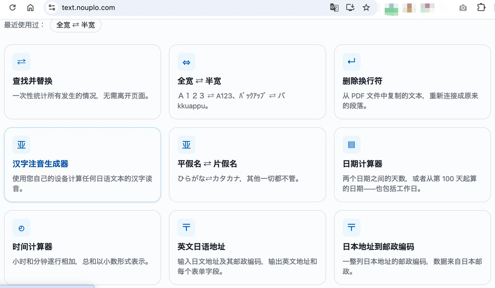

# Wyong：新工具站 Nouplo——靠小语种 61 天拿 13 个谷歌第一

> 每日起量新站案例（11-10）：Nouplo 靠法/德/西/意/韩小语种小需求起量——按当地规矩做工具（德国 1-6 分制/法国 20 分制/韩国 4.5/意大利 30）、低竞争小语种、600+ 工具 × 9 语言、Pro €4.5/月 或年付 €36、€2.79 24 小时通行证、无正经外链纯页面排名；前 20 名关键词每月约两千次点击。

<!-- more -->

每日起量新站榜单 · 11 月 10 日案例

一个新工具站靠小语种 61 天拿到 13 个谷歌第一

Nouplo .com 它的流量不靠英语，靠的是法语、德语、西班牙语、意大利语、韩语这些市场里没人好好做的小需求。比如这些排第一的词：

notendurchschnitt：德国学生算成绩平均分

jahresplaner 2027 zum ausdrucken：可打印的 2027 年年历（德语）

convertir une note sur 20：把分数换算成 20 分制（法国的打分方式）

taille publication instagram：Instagram 帖子图片尺寸（法语）

probar camara web：在线测试摄像头（西班牙语）

실제 크기 자：实际尺寸的在线尺子（韩语）

我想复刻它，有五个原因：

每个工具都按当地规矩做，不是简单翻译。它的算平均分工具里，德国 1 到 6 分、法国 20 分制、韩国 4.5 分制、意大利大学 30 分制都有，所以当地人一搜就是它。

小语种竞争小。同样一个“在线尺子”，英语里要和一堆老站抢，换成韩语、意大利语，新站几十天就能排到前面。

一个站铺开六百多个工具、9 种语言，每个工具在每种语言里都是一个能被搜到的页面。

它收费清楚。免费版直接用；Pro 每月 4.5 欧元，或每年 36 欧元，去掉文件数量和大小限制、能批量处理；还有 2.79 欧元的 24 小时通行证，临时用一次的人也能付费。

它几乎没有正经外链，17 个链接网站大多是垃圾链接站，排名靠的是页面本身。

光是排进前 20 名的词，每月估计就能带来两千多次点击。算成绩、测摄像头、打印年历这些事每年都有人要做，流量不会过几周就没了。

它排上的关键词、带流量的页面和外链，在 Risetive 上都能看到，一键复制给 AI agent 就能开工。

