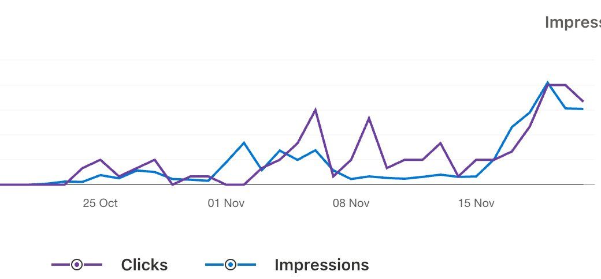

# Intentplex：把网页游戏做成常青树养老站——搜索排名、首局完局率与社区壁垒

> 做了两个月的网页游戏排进 Bing 大词第一页（无痕搜索第二）。要把游戏站做成常青树，核心是同时守住三件事：搜索排名不掉、新来的人留得住、留下的人有理由一直回来。**排名侧**：能排上去的着陆页别乱动，每次只改一处并观察 1–2 周；把「技术上不出错」做成每日自动巡检（状态码、核心词、noindex、Canonical、Sitemap、TTFB）；矩阵分散风险别只押一个词。**留存侧**：搜索进来 33% 会完整打完一局，首局路径不能有登录门槛；结算页埋「明天有全新关卡」+ 实时排名，注册利益点具体化（战绩/排行榜/每日宝石）+ Google 一键登录；用邮件订阅（Double Opt-in）与 PWA 主屏幕建立主动召回。**壁垒侧**：规则百科/攻略等不过时的常青内容、抄不走的社区氛围（每日挑战/段位联赛/论坛）、品牌词直接搜索量、极低且可预测的服务器成本。每周只复盘 5 个指标：核心词排名与 CTR、首局完局率、新客 7 日留存、老客周活跃、品牌词搜索量。

<!-- more -->

我做了两个月的网页游戏，排进了 Bing 的大词第一页，我自己无痕浏览器搜，已经是第二名了。如何能保持优势，把这个游戏做成常青树养老站？以下是一些实战方法：

想把一个游戏站做成常青树，核心是同时守住三件事：搜索排名不掉、新来的人留得住、留下的人有理由一直回来。

一、 守住搜索引擎排名（不犯低级错误）

1. 能排上去的东西别乱动

- 现在拿到排名的核心着陆页（标题、H1、网址和主要正文）千万保持稳定。
- 每次优化只改一处，改完观察 1–2 周再动下一处。
- 切忌一天之内频繁调整首页板块顺序，这不仅让搜索引擎重新评估页面权重，也会破坏老玩家的使用习惯。结构性调整每月最多一次。

2. 把“技术上不出错”做成自动化巡检

- 排名暴跌最常见的原因往往不是算法变了，而是哪次上线把东西弄坏了：误加 noindex、标题被覆盖、SSR 挂了、服务器响应变慢或宕机。
- 写个每日自动巡检脚本监控生产环境：状态码 200、核心关键词完整、无屏蔽标签、Canonical 正确、Sitemap 可访问、TTFB 响应正常。哪项出问题，立刻报警修复。

3. 拼完局率，让搜索引擎看到用户满意

- 搜索引擎会盯着点击率后的行为：用户是秒退，还是留下来玩了？
- 目前从搜索进来的新访客，有 33% 会完整打完一局。这个比例越高，排名越稳。因此从搜索落地到开始第一局，路径必须极致丝滑，绝对不能有登录门槛。

4. 矩阵分散风险，别只押注一个词

- 把所有流量押在首页几个大词上，一次算法波动就可能腰斩。
- 用长尾页面搭建护城河：好友联机页、竞品对比页、新手规则指南、进阶技巧库、实用工具表。让每个页面去抢占对应的精准长尾词。

5. 积累高质量外链与每日新鲜度

- 持续做垂直社区的优质外链建设。
- 同时给搜索引擎提供“每天都在更新”的信号——比如每日挑战赛页面，每天自动展示前一天的战况与榜单，让爬虫保持高频抓取。

二、 留住新访客（把过客变成玩家）

后台数据很说明问题：第一天体验过新手教学的人，次日回访率高达 40%–57%；打过排行榜的回访率 22%–29%；只随便玩一局的只有 6%–15%；而一旦完成注册并进入排行榜的老玩家，5 天内平均活跃 4.6 天。

1. 首要目标：让新人打完第一局

- 这是留存一切的前提。每周只盯紧一个核心转化率：搜索进来的新用户，到底有多少比例完整打完了第一局？

2. 离开前，埋下明天再来的钩子

- 第一局结算页就是黄金转化位：直接告诉他“明天有全新关卡”，并展示他今天的实时排名。
- 引导注册时别讲空话，利益点要具体：“永久保存战绩、冲击全服排行榜、每日领宝石”。接入 Google 一键登录，把注册摩擦降到零。

3. 建立主动召回通道

- 人走了，靠他自己想起来太难，必须拿到触达渠道：
   · 邮件订阅：注册时勾选“每日挑战提醒”（注意合规的 Double Opt-in 机制）。
   · 桌面驻留：做好 PWA 支持或封装轻量 App，引导用户添加到手机主屏幕。

三、 沉淀“常青树”壁垒

1. 沉淀常青内容资产

- 规则百科、进阶攻略、可打印的辅助工具，这些内容不过时。持续打磨、不轻易推倒重来，时间越久，自然积累的权重和被动外链就越深。

2. 打造抄不走的社区氛围

- 每日挑战、段位联赛、排行榜、玩家论坛。竞品可以花几天抄走你的游戏界面和玩法，但抄不走“每天都有一群活人在这儿竞技”的社区生态。

3. 培养品牌词直接搜索

- 真正抗周期的流量，是用户直接在搜索框里敲你的品牌名。目前品牌词每周的展示和点击都在稳步爬升，只要这条曲线一直向上，这个站就真正活成了养老资产。

4. 极致的低成本与高可用

- 常青树的前提是“一直活着”。架构要轻量化，服务器成本必须控制在极低且可预测的范围内，杜绝冷启动延迟和长时间宕机。

每周复盘只盯这 5 个核心指标：

1. 核心大词群：平均排名与点击率（目前第 6–8 名，CTR 约 1%）。
2. 首局完局率：搜索来源新用户的首局完成比例（目前 33%）。
3. 新客 7 日留存：单独追踪搜索渠道进来的新访客 7 天内回访率。
4. 老客周活跃度：进入联赛体系的注册玩家每周活跃天数（目前 5 天内活跃 4.6 天）。
5. 品牌词搜索量：品牌名在搜索引擎的每周展示量与点击量。

独立开发做流量站，拼的不是一时的爆发，而是把每一个细节做成自动化飞轮，然后交给时间。

## 相关页面

- [[patterns/overseas-website-conversion-loop]]
- [[concepts/open-source-seo-tooling]]
