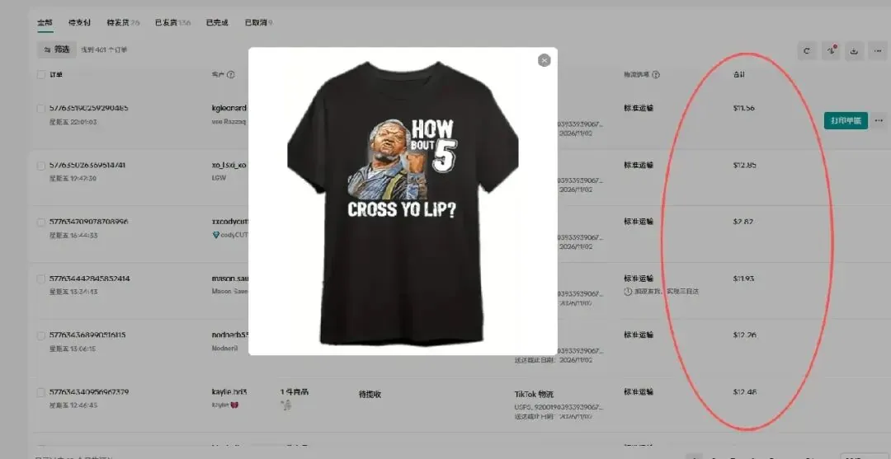
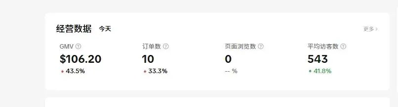
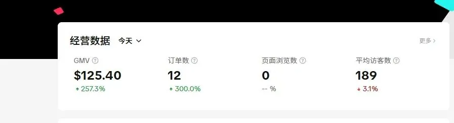
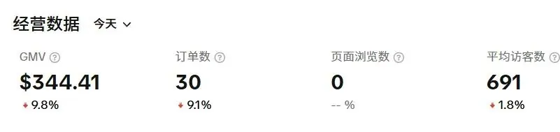
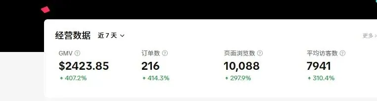
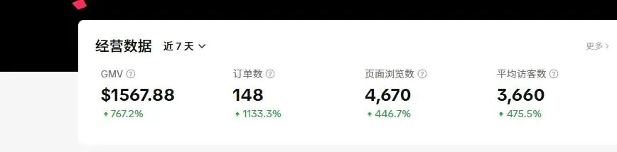

# 澎湃王侯：【TK-POD】副业项目逻辑概述——信息差 × POD 按需生产 × 跨境的三层组合

> **一句话概括**：这个副业项目不是靠单一技巧取胜，而是把**信息差**、**POD 按需生产模式**、**跨境市场**三层 buff 叠加起来形成的组合拳。任何一层单独拿出来都不稀奇，三者叠满才是全貌。

---

## 前言：为什么用视频口播稿讲商业逻辑

这个主题不讲大道理，直接拆一种简单粗暴的灵活就业路径——具体的副业或自由职业项目。它的特点是**稳定长久、效益较好，且不需要全职经营**，大致相当于二线甚至一线城市全职白领的收入水平，且时间精力投入较少。

需要特别说明的是：这里**只科普原理、把逻辑讲清楚**，因此收益规模、投入成本等具体参数一概略过。原因有二——一是部分参数本身存在上下浮动的可能，二是视频内容不像图文那样可以直接修改，为避免数据谬误，只能一带而过。

---

## 元素 1：信息差

第一个元素是**信息差**。

这是一种大多数人够得着的生意：能以很低的成本运营，在资金和个人能力上几乎没什么门槛。

> **边界**：这里讲的是那种**合法合规、也符合道德**的信息差生意。灰色地带不在讨论范围内。

---

## 元素 2：POD 模式（Print on Demand）

POD 是「**按需打印 / 按需生产**」（英文全称 Print on Demand）的缩写。

**运作方式**：先有订单，再生产，不提前囤货。上传自备的或顾客指定的图案与文字，店主在后台把图案印到 T 恤、杯子、手机壳等空白产品上——说白了就是电子 P 图，"pia" 上去就行，然后直接发货。整个过程就是「**来图定制 + 一件代发**」，卖一件做一件。

### POD 模式的三重优势

| 优势 | 说明 |
|:---|:---|
| **不用提前压货** | 没有资金压力。传统电商最怕把钱变成一堆卖不出去的货砸在手里 |
| **满足个性化需求** | 顾客能拿到独一无二的定制商品，满足差异化需求——这种需求在国外非常吃香 |
| **特别适合测款和蹭热点** | 遇到重要节日或重大时间节点（热门人物/事件等），可以快速上传大量设计链接，哪个火了就重点推哪个 |

关于第三点值得展开：这类文化契机在国外**相当丰富**——不光是大的节日节点，就连平时看个球赛、开个 party、过个生日、搞个游行，都是一连串的应接不暇。

POD 定制在跨境电商领域特别火，像比较知名的 **SHEIN** 这种品牌，早期就是靠这种模式起家的——大量来图定制，快速响应海外市场需求。

另外一个容易忽略的细节：在美国，**T恤、卫衣这类东西不分季节**，属于四季畅销品类，大冬天照样卖；他们没有秋衣秋裤、保暖内衣这类的概念。

---

## 元素 3：跨境

第三个元素是**跨境**，这一点有两层要讲。

### 第一层：为什么要出海

国内是工业国，而且是全产业链，能把任何东西的成本打成白菜价，这造成了极其严重的内卷——做什么、倒腾什么都很难有利润，别说利润，赔钱卖都不一定卖得动。

**既然国内内卷，那我不在国内卷了，我出去，去不那么卷的地方卷别人。**

### 第二层：为什么「赚美元、花人民币」是关键

这一层很多人想不到，但一说就懂。

先看一个常见疑问：那些「润人」到底图什么？在国内找个活儿干，赚个三五千并不难，但非得千辛万苦跑到太平洋对岸去，那不还是赚个三五千？如果那边能赚更多，为什么在国内不行？

他们的答案通常是「美元更值钱，汇率是咱们的好几倍，我赚 1 美元相当于赚 7 块钱人民币」。但问题是：**你人都过去了，虽说你挣的是美元，但你花的也是美元**，甚至会花得更多——各种公共设施没有国内这么便利，物价也高。

所以对一个「润人」来说，最好的状态是：**赚了美元，拿回国内来花**，这样汇率才有意义。他可能会说等干上几年攒够钱就回来，但这种理想状态根本实现不了——事实上当地底层大众只打一份工都养活不了自己，中产还有斩杀线，过去以后别说攒钱，能站住脚就谢天谢地了。

### 回到跨境项目：汇率就是一个放大器

而本文这类跨境项目恰恰能够实现「**赚美元、花人民币**」的效果——**虽然收的款是美元，但你的肉身地理位置、你的生活环境并没有变**。

打个比方：你销售一件东西，赚了几美元的差价。这几块钱对海外消费者来说在体感上几乎可以忽略不计，但对我们来说，因为汇率的存在，**相当于一个放大器，把这几块钱变成了几十块**——所以客单利润相当高，这在传统电商里是很难达成的。

---

## 三层叠加：项目逻辑全貌

> **信息差 + POD 模式 + 跨境平台**，三者合在一块就是这个项目的逻辑原理。

---

## 商业模式推演：为什么这类项目天然适合「陪跑」而非规模化

理解原理之后，必须回答一个绕不开的商业问题：**既然对方会赚钱，为什么不自己干，反而要找人合作？**

### 灵魂一问的正面回答

「凡是教你赚钱的人，都是想赚你的钱」——这句话**无法反驳，因为它是对的**。现代商业社会里，除了你圈子内的社交对象（父母、亲友等），其他人无时无刻不在想着赚你的钱：卖菜的想赚你的钱，送外卖的想赚你的钱，通马桶的想赚你的钱，你手机上所有 APP 都想赚你的钱。

但**想赚你的钱这件事本身并没有错，只要产品或服务保质保量，就没毛病。错的不是赚，而是骗**。

这句话的问题不在于对错，而在于它背后的**潜台词**：在它的语境中，会让你下意识地把「赚」理解成「骗」，默认了一种「**零和博弈**」的买卖关系——只要你赚了，我必然就亏了；你亏了，我势必就会赚。这完全把**双赢**的状态排除在外，而双赢是存在且大量存在的：你花钱买馒头填饱肚子，商家赚到了钱，这就是双赢。

### 复制 vs 放大：两条路都走不通

但凡一个人掌握了一种赚钱的方法，必然会想办法通过这种方式赚更多的钱。无非两条途径：**复制**，或者**放大**——到底选哪个要具体情况具体分析。

- **适合复制、不适合放大**：比如你在小区开了个水果店，挺赚钱，但你基本不可能把这家店无限放大——这个小区客流量只有这么多，是有上限的，只能去其他小区开分店，多点开花。
- **适合放大、不适合复制**：比如做自媒体，你做上十个八个账号每一个都做不好，还不如集中火力把一个账号做好——不管你有 1 个粉丝还是 1 亿粉丝，需要制作的内容数量是一定的。

**具体到这个项目**：

1. **不适合放大**——每个人的时间精力是有限的，每个店铺的盈利规模也是有限的，收益有上限；
2. **复制同样很鸡肋**——复制就需要雇人，但招人有成本：除了工资，还要准备场地、设备、水电物业费宽带费，算下来每家店铺的收益还能剩多少？摊子铺得很大、兴师动众心力交瘁，到头来一看没剩个仨瓜俩枣，全都养人玩了。更何况这还需要一定的流动资金，复制越多需要的数额越大，不可能无限复制。

**综上所述**：这种项目的特性决定了它复制不行、放大也不行，所以用它来做「**培训 + 持续陪跑 + 利润分润**」的模式最合适，才能实现利益最大化。这非常符合逻辑，**没必要用阴谋论来看待**。

### 陪跑模式的经济学：牧羊人与羊

有个不太恰当但很贴切的比方——**放羊**。

你把羊领到草地上是不够的，想让羊长得壮，还需要解决一系列问题：羊生病了你给治疗，狼来了你给保护；这块草地吃得差不多了，你得负责领着羊群到另一块水草丰茂的牧场继续生活。只有这样才能长久。牧羊人也会定期薅点羊毛作为他做这件事的回报，他才能有动机、有动力持续做下去——**双方是一种互惠互利的合作关系**。

反过来讲，如果我是一只羊，**损失一点羊毛对我来说反倒是好事**：因为利益绑定，就有人为我服务、为我托底，我知道我和牧羊人之间一荣俱荣一损俱损，我就能安安心心地吃草，不用操心别的。还是那句话，这样才能长久，谁也不用担心谁舍弃谁、背叛谁。

---

## 真实风险与项目缺点

没有十全十美的项目。这一类跨境 POD 项目实打实踩过的坑与缺点如下：

### 1. 封店问题（已解决）

前一段时间做过一次跨境项目，但没做多长时间，当时碰到两个问题。

**第一个是封店问题**：因为当时对接的是国内货源，不符合平台规则，所以总被平台风控限制。**目前这个问题不存在了**——因为对接的货源都是目标市场的本土工厂发货，完全符合平台所鼓励的规则。

### 2. 数据泄露问题（已解决）

**第二个是数据泄露问题**：当时大概有 100 个左右的伙伴一起做，都是正常盈利的。但突然有一天，共享的商品数据每次下载量达到将近 2K——肯定是有人把数据二次转卖了，但查不出到底是谁。

> **数据这东西就是：100 个人用，100 个人都能盈利；1000 个人用的话，就没有任何一个人能盈利了。**

吃一堑长一智，这个问题现在也不再是问题，会采取适当措施。

### 3. 盈利周期长（固有缺点）

这是平台规则决定的——设置了一种类似于**考察期**的机制，对所有人一视同仁。

- **前两个月左右看不着回头钱**；
- 这个过程中**你甚至还得亏点钱**（虽然亏得不多）；
- 熬过「养店」阶段就一切都好了。

---

## 写在最后

这个项目的逻辑并不复杂：**信息差**提供低门槛的利润来源，**POD 按需生产**实现零囤货与个性化溢价，**跨境**把国内内卷的价格战转成汇率放大器。

真正决定成败的往往不是某个单点技巧，而是**能不能把这三层 buff 叠满**。
