# Jacky 无限生长（@Jackywxsz）：全流程｜如何用 Grok Bot 做自媒体？

> 端到端拆解使用 Grok Bot 开展自媒体运营的完整流水线：从选题与热点抓取、竞品与爆款拆解、内容生成与多平台改写，到配图制作、定时发布与数据复盘的每个环节，逐一说明 Bot 在哪一步接管、哪一步必须人工把关，并给出可复用的 Skill 化配置方法。

<!-- more -->

很多人做自媒体，最后都死在「精力耗尽」上。

早上醒来刷手机找选题，通勤路上焦虑今天发什么，晚上对着空白光标敲两段删两段，最后好不容易凑齐 1500 字，还得排版、找图、改开头，再挨个平台复制粘贴。折腾两个月，人肉干成了打卡机器，内容越来越像应付差事。

我白天负责企业营销的 AI 落地，晚上自己写自媒体。如果每个环节都要我肉身在场，我一周都撑不下去。

跑通半年后，我现在的状态是：我基本只负责出创意和最后点头，中间所有恶心人的体力活，全被我塞给了一台云电脑。

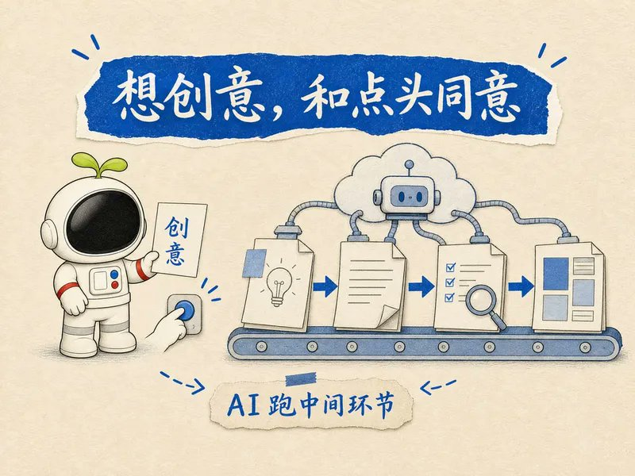

不用随身背电脑，也不用在手机对话框里跟 AI 来回拉扯。Grok Bot 用一台 24 小时挂在云端的虚拟机，自己爬选题、把我的语音口喷观点润色成文章、接下来成文、去 AI 味、质检诊断、配图排版，它顺着流水线自己往下走。

这套系统能成立，核心就一句话：机器跑工序，人定标准。

市面上多数人玩 AI 自媒体，最大误区就是想「全自动生成、全自动发布」。

那种垃圾水文除了毁账号没有任何意义。你真正该丢给 AI 的是重复搬砖，而不是思考。终检是我，调性是我，按下发布键的那根手指，必须是我。

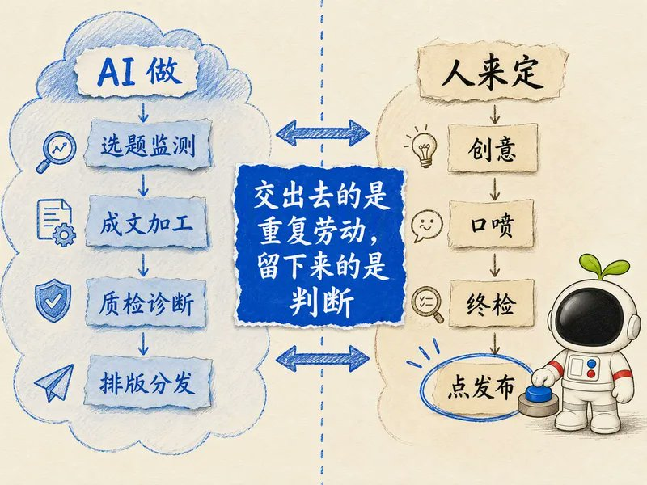

下面把我目前常驻云电脑的八道工序拆开，讲讲里面的坑和真正起效的细节。

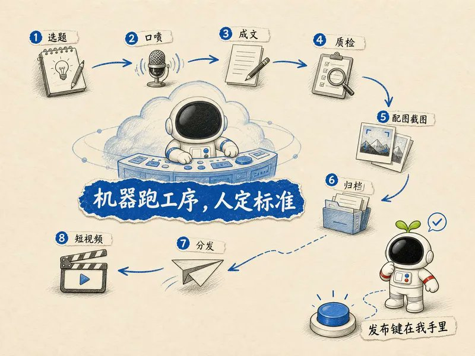

## 选题别硬想：让素材自动上门

做内容最耗神的一步其实是「找选题」。一旦你坐在桌前想「今天写点啥」，你就已经输了。灵感这东西极其不稳定，靠灵感日更无异于自杀。

我的做法是彻底把「创造」变成「筛选」：

早上 8 点，云电脑里的 get 笔记 CLI 自动跑一圈，把我盯的 5 到 10 个头部对标博主的新内容整理到飞书多维表格；同时 AIhot 扫一眼公开热点流，抓时效窗口。博主给认知深度，热点给传播杠杆。

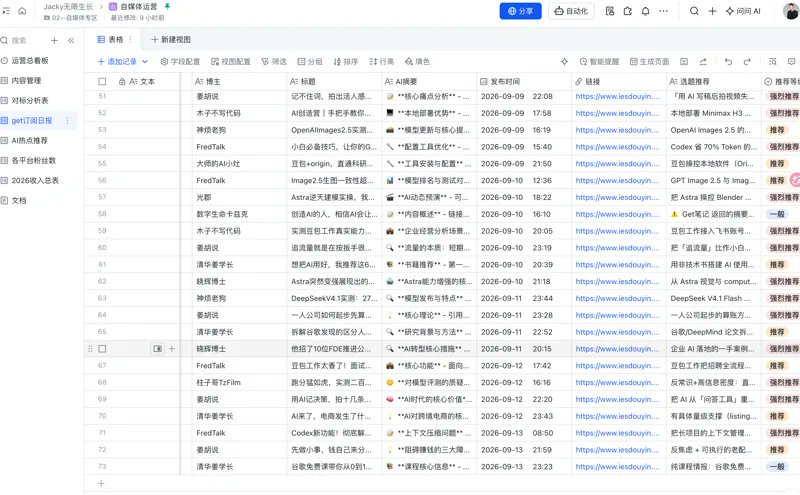

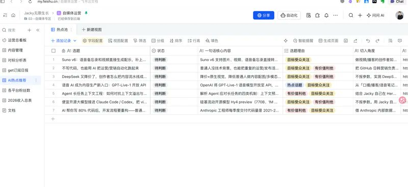

注意，对标账号千万别搞几十个，囤几百条不叫素材库，叫精神内耗。

早上 9 点半，Grok Bot 将我前一天 get 笔记记录的内容进行观点提炼、生成结构化卡片，直接推到我的 Obsidian 文件夹，并进行主题归类和双链。

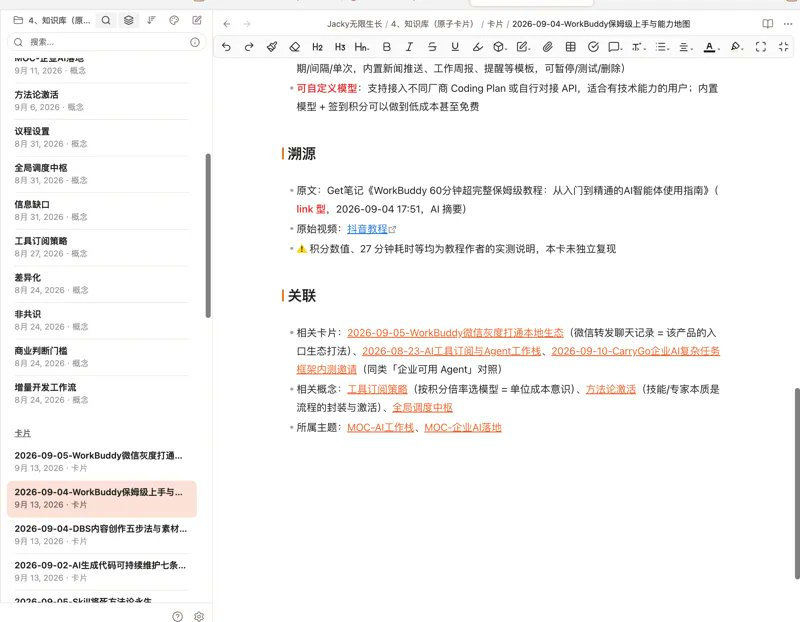

等我端着咖啡翻手机时，面前不是空白屏幕，而是几张理好的卡片

挑中的卡片，我随手补两三行「我的切入角」，绝不多写。多写就把精力和表达欲提前透支了，真写时反而索然无味。

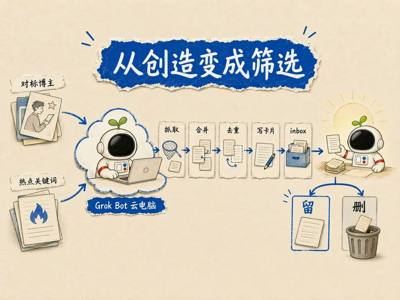

## 口喷的真谛：倒出偏见与锋芒，别边说边改

有了切入角，千万别坐下来码字。一码字，人脑的防御机制就会启动，下意识想写得全面、严谨、客观，最后写成一篇谁看都挑不出错、但也谁都不会记下的温吞水。

我通常是散步或站着，掏出手机直接语音口喷。随性、杂乱、跑题都没关系，唯一的死规则是：别边想边改。

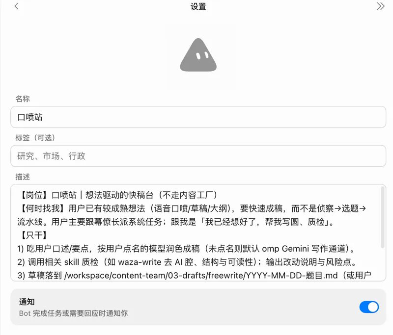

想到什么极端判断就直接说出来。比如你说「大部分人写 Prompt 都是在浪费时间」，别半路改口成「其实部分场景下 Prompt 还是有价值的」。那种磕磕绊绊、带着情绪和火气的原始表达，才是整篇稿子最值钱的灵魂。

口喷完我只看三点：

1. 有没有明确的个人立场？（是不是在说车轱辘话）
2. 有没有踩过坑的具体场景？（是不是在悬空讲大道理）
3. 给出的判断能不能被反驳？（无法反驳的观点等于废话）

这三点立住了，口喷稿就是最好的高纯度矿石；立不住，后面用再高级的 AI 润色，也只是一坨光滑的废话。

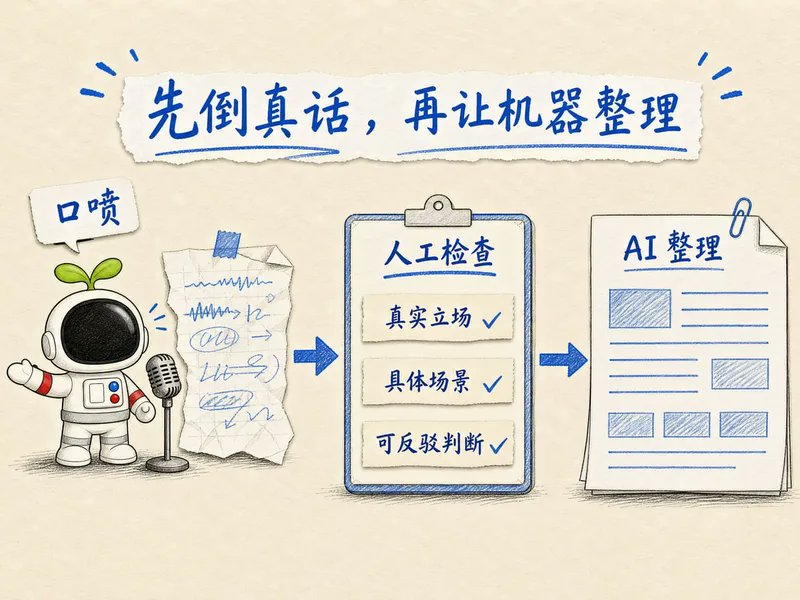

## 加工链写死：严防模型「自我感动式的发挥」

口喷完，我在手机端给 Grok Bot 发一句指令，它就在云电脑里把加工链开起来。

这一步最忌讳在对话框里一句一句跟模型聊。聊多了它不仅开始说胡话，还会悄悄磨平你的棱角。我的调度策略非常死板：固定工序、固定读写路径，模型只有执行权，没有自由发挥权。

首先，Gemini3.8Flash 接口喷原稿，我给的约束就四条铁律：整理成有骨架的文案；完全保留我的语气和第一人称；不许凭空加数据；不许替我下伟光正的结论。

初稿出来，立刻推给 waza-write 去 AI 味。这一步至关重要，它专门剔除那些经典的 AI 恶习——比如开头动不动「在如今快节奏的数字时代」，每段末尾非要来一句「总而言之这值得我们深思」。把这些说教腔和假大空剥掉，稿子才像真人在说话。

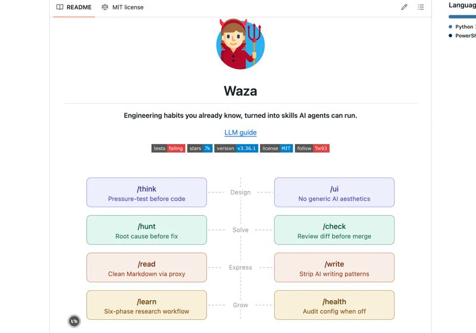

接着进 dbs-content 做五维诊断，查文字洁癖、表达效率和认知落差，标记出哪段塌了；最后才让 dbs-hook 出几个开篇候选。为什么开头放最后？因为正文没定型前，打磨开头纯粹是浪费时间。

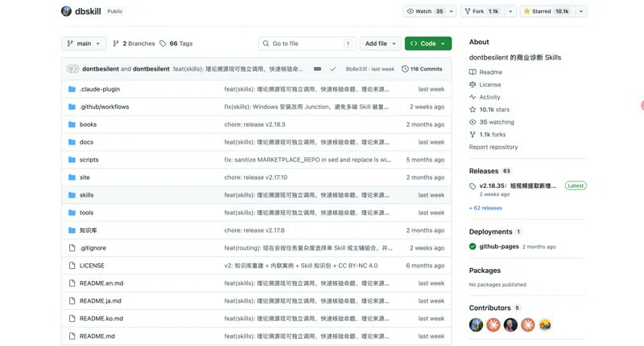

验收时我只抽检三处：有没有替我加戏？有没有把我的极端判断磨平？有没有把「我」偷换成没有性格的公关腔？ 只要出现这三种毛病，打回重来。

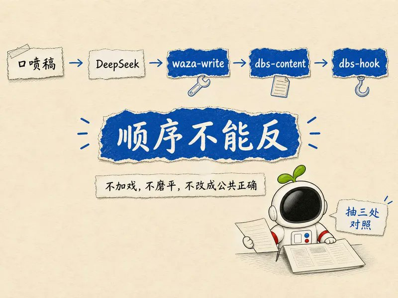

## 配图与归档：一眼讲清结构，当天闭环

稿子成形后，配图不要去图库找那种毫无意义的办公白领握手图。

我用 jacky-illustration 跑结构图解。原则就一条：如果读者看完图能省下看两百字正文的时间，这图才算合格。 遇到技术页面或工具后台，直接调 ego lite 无头浏览器截真图存档，不搞虚假渲染。

归档上，我把协作和沉淀严格切开：需要团队看或对外同步的，自动推飞书云文档；我个人的私库、半成品与口喷音频，雷打不动留存 Obsidian。当天的文件夹必须包含口喷、成稿、诊断、配图和截图，整整齐齐。

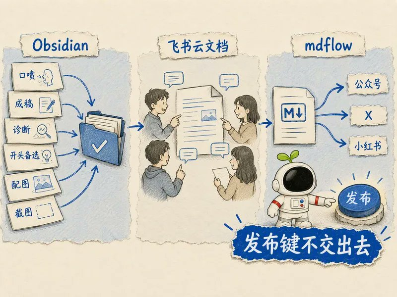

## 发布键是我最后的尊严

分发工具我用 mdflow，Obsidian 写完一键渲染排版，直接映射到微信公众号、X 和小红书。格式、代码块、引用样式全部自动化，省去了每次在各个后台反复调字号缩进的折磨。

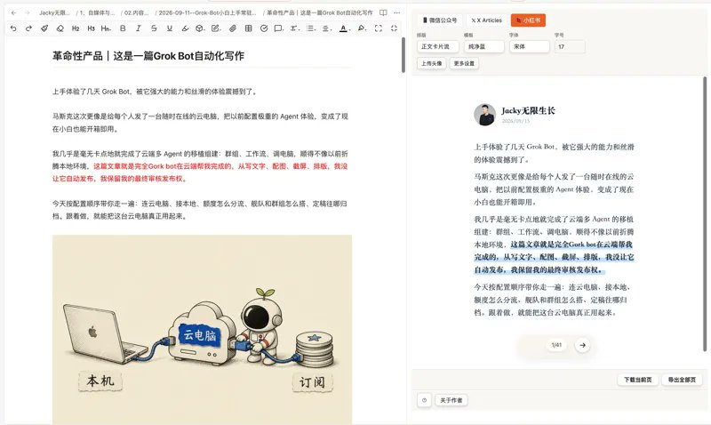

但哪怕流程自动化率达到 95%，最后那个「发送」按钮，我也永远自己点。

各平台的敏感词每天在变，社区的暗坑每周不同，机器根本不知道这周哪个词容易被限流。更重要的是，这是你在互联网上的个人资产，你的信用背书经不起机器的一次低级失误。

复制粘贴和搬运格式可以自动化，对读者的负责不可以。

## 先盖好房间，再开门迎客

长文在各平台落地后，整条线其实还没完。

我会把长文里的核心对立、金句和刚才画好的结构图，丢给 Jacky-motion 切成短视频。出镜或者录屏口播都行，但素材必须 100% 来源于已经成立的长文。

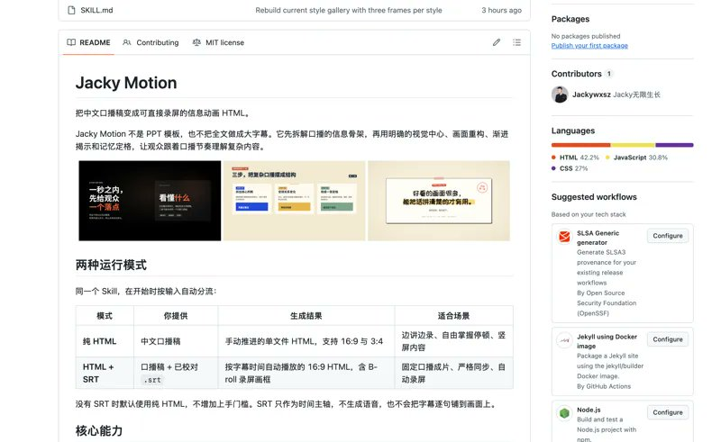

很多人问我：现在短视频流量大，为什么不先拍短视频、火了再写长文？

因为顺序反了，内容就虚了。 先拍短视频爆了再硬凑长文，往往写出一篇水分十足的注水肉，读者点进你的主页一眼就能看穿。

真实的内容消费逻辑是：大家在公域被一条犀利的短视频吸引，顺藤摸瓜点进主页，翻开你写的一篇深度长文，读完觉得「这个人肚子里真有货」，才会按下关注键。

短视频是那扇招揽路人的大门，长文才是你让人愿意留下来深聊的房间。 房间没盖好，光把门造得花里胡哨，把人迎进来大家也只能尴尬地站着。

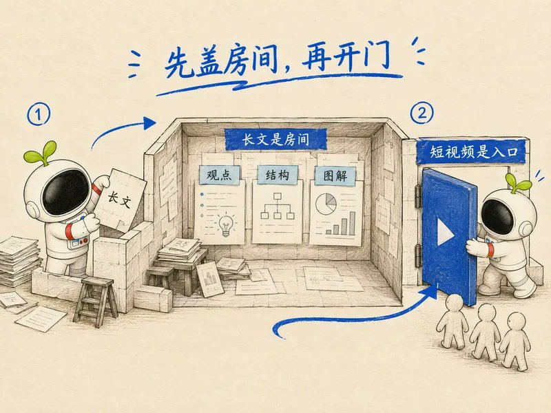

## 怎么从今天开始搭？

别被这套系统吓到，我最开始也是从最笨的手工活一点点迭代出来的。你想摆脱内容焦虑，今天就可以照着这个节奏迈出第一步：

1. 盯住 3 个真正有水平的对标博主，用 AIhot 设几个关键词，不再无脑刷信息流。
2. 在笔记软件里建个 Inbox，每天早上扫一眼，只保留让你产生反驳欲的话题。
3. 打开语音备忘录口喷一段真实看法，别管语病，把情绪和偏见倒出来。
4. 把口喷稿扔给 DeepSeek 梳理骨架，加一条死命令「不要说教、保留原意」。
5. 自己动手做一次去 AI 味删减，删掉所有「总而言之」「显而易见」的套话。
6. 图解只讲结构与逻辑，不放无意义的装饰插图。
7. 用本地 Markdown 沉淀资产，各平台分发前人肉扫一眼敏感词，亲手点发布。
8. 长文立住之后，挑最锋利的观点切一条短视频。

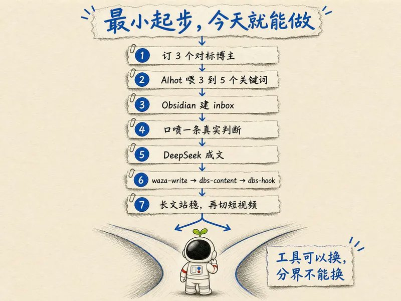

做自媒体不是为了把自己变成人肉打卡机。工具、模型、代码、提示词随时都会过时，但你在真实业务里踩过的坑、你看待行业的独特切口，以及你对读者负责的标准，永远过时不了。

把重复的苦活甩给云端，把精力留给真正的表达。

我是 Jacky，专注于企业营销 AI 落地与自媒体创作

陪你在 AI 时代，无限生长。

更多分享与互动，主页简介有我的频道官网

## 相关页面

- [[sources/ryan-muse-ai-image-post-daily-15-skills-rotation]]
- [[sources/fanshifu-grok-bot-800-new-sites-monitoring-workflow]]
- [[concepts/ai-content-pipeline]]
- [[concepts/agent-skill]]
