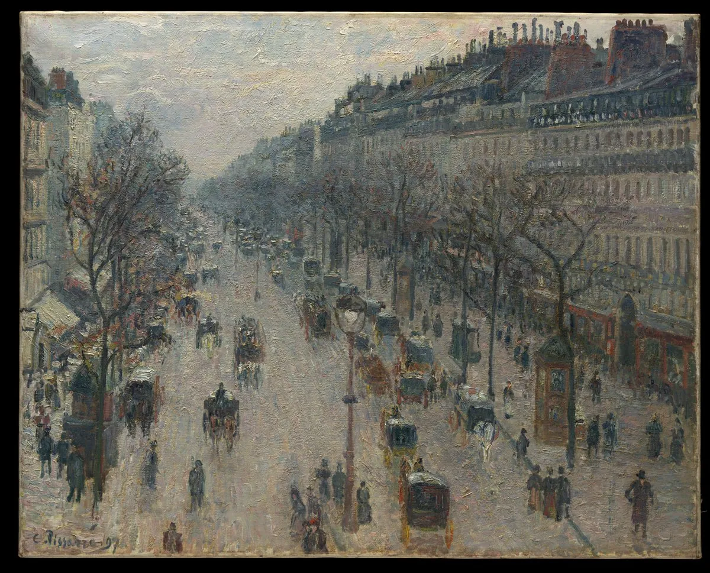
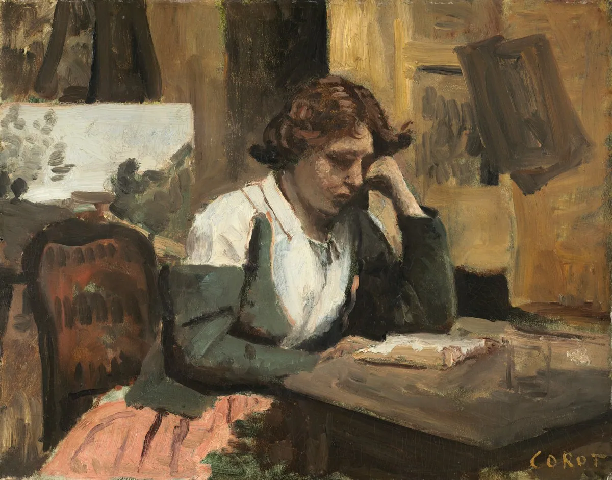
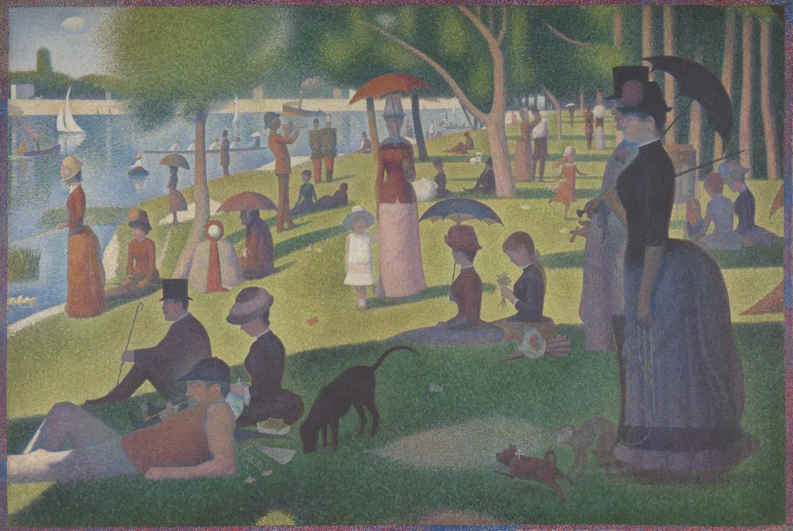

# Jaden 抽象日志（@Jaden_riku）：Paul Graham——时间和金钱，是怎样失去的

> 硅谷教父 Paul Graham 经典认知精髓导读与反思：深度辨析人类流失时间和金钱的隐蔽机制——不是一次性的大败局，而是被无意识的微小习惯、缺乏边界的琐事干扰与伪工作状态蚕食殆尽；指导创业者重新找回专注力的高价值锚点。

<!-- more -->

Paul Graham｜原作 How to Lose Time and Money，2010 年 7 月

1998 年我们卖掉创业公司时，我突然有了很多钱。我开始不得不考虑一个以前从未考虑过的问题：怎样才能不把它们弄丢。

我知道，人可以从富有变得贫穷，就像可以从贫穷变得富有一样。此前几年，我花了很多时间研究从穷到富的路，却几乎不知道从富到穷有哪些路。为了避开它们，我现在得先弄清楚，它们在哪里。

于是，我开始留意人们是怎样失去财富的。小时候，如果有人问我富人为什么会变穷，我会说，因为他们把钱花光了。书和电影里总是这么演，毕竟这种方式最有戏剧性。但实际上，多数财富的损失来自糟糕的投资，而不是过度消费。

要在毫无察觉的情况下花掉一大笔钱，其实很难。如果一个人的消费习惯平常，花掉几万美元以后，多半就会意识到：天哪，我花了好多钱。可一旦开始交易衍生品，你可能转眼就损失一百万美元——其实，你想赔多少都行。

在大多数人的脑子里，花钱买奢侈品会触发警报，投资却不会。奢侈品让人觉得是在放纵自己。除非你的钱来自继承或中彩票，否则，你多半早就学会了：自我放纵会带来麻烦。

投资却能绕过这些警报。你不是在花钱，只是在把钱从一种资产挪到另一种资产里。这也正是为什么，想向你推销昂贵东西的人会说：“这是一项投资。”

解决办法是学会建立新的警报。这并不容易。阻止我们过度消费的警觉非常基础，甚至可能写在我们的 DNA 里；但防范糟糕投资的警觉，却需要学习，有时还很违反直觉。

毕沙罗《冬晨蒙马特大道》，1897。纽约大都会艺术博物馆藏。 [图像来源](https://www.metmuseum.org/art/collection/search/437310)

几天前，我突然意识到一件事：时间的情况，和金钱很像。最危险的时间损失，来自那些看起来像工作、实际上却没有成效的忙碌。你花时间找乐子时，知道自己正在放纵，心里的警报很快就会响起来。

如果有一天早上醒来，我坐到沙发上看了一整天电视，我会觉得自己出了大问题。光是想想，我就难受。别说一整天，坐着看两个小时，我就已经开始不自在了。

但有些日子，我就算整天坐在电视机前，结果也差不多。一天结束后，如果问自己究竟完成了什么，答案是：基本上，什么也没做。这种日子结束时，我也会难受，却远没有整天窝在沙发上看电视那么难受。真要看一整天电视，我会觉得自己简直在往深渊里滑。

可那些毫无进展的日子，并不会触发同样的警报。因为我做的事情，表面上很像真正的工作。比如处理电子邮件。你坐在办公桌前做这些事，又不觉得有趣，那它当然就算工作了。

柯罗《画室中阅读的女人》，约 1868。美国国家美术馆藏。 [图像来源](https://www.nga.gov/artworks/66407-woman-reading-studio)

对待时间和金钱一样，单靠远离享乐，已经不足以保护自己了。这一招对狩猎采集时代的人类可能足够，对工业化以前的社会也许都有效。因此，天性与后天的教养一起，让我们学会避免自我放纵。

但世界已经变得更复杂了。如今最危险的陷阱，是一些模仿更高尚行为的新做法，它们绕过了我们对自我放纵的警觉。更糟的是，这些事甚至一点也不好玩。

修拉《大碗岛的星期日下午》，1884–1886。芝加哥艺术博物馆藏。 [图像来源](https://www.artic.edu/artworks/27992/a-sunday-on-la-grande-jatte-1884)

感谢 Sam Altman、Trevor Blackwell、Patrick Collison、Jessica Livingston 和 Robert Morris 阅读本文草稿。

原作：[How to Lose Time and Money](https://paulgraham.com/selfindulgence.html)

## 相关页面

- [[sources/thomas-zhou-flow-is-dead]]
- [[sources/tw93-leading-vs-being-pushed-forward]]
- [[concepts/cognitive-load-three-element-model]]
- [[concepts/loop-engineering-thoughts]]
