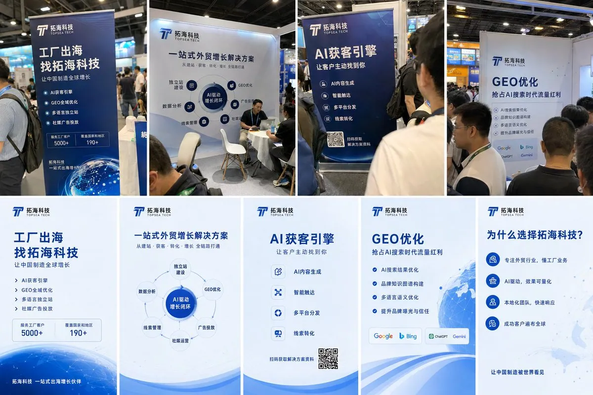

# 在悉尼和稀泥（@JamesAI）：普通人如何在 24 小时内 0 成本拿到 B 端客资

> 24 小时 0 成本获取 B 端企业精准客户线索的 15 步操作法：选取焦虑型需求（出海/获客/GEO/FDE 改造）、用 AI 整理行业诊断书与痛点清单、在公开平台定向检索目标企业、以提供免费诊断为抓手触达决策人，把认知差迅速包装为轻咨询服务样品。

<!-- more -->

普通人如何在 24 小时内，0 成本拿到你的 B 端客资

1. 选取一个 B 端的焦虑型需求，比如出海、获客、GEO、FDE 改造。（1 小时）

2. 去闲鱼购买上述关键词的 9.9 引流课、行业报告、销售资料。不用看，挑字数多的下单。（1 小时）

3. 想一个商务又土鳖的公司名，注册微信公众号、抖音号，把自己的微信昵称加上这个名字后缀。（1 小时 30 分钟）

4. 把刚才买来的资料全部丢给豆包，提取高频关键词、概念词、客户痛点，再生成一套宣传海报、传单、易拉宝，右下角统一放微信二维码。（20 分钟）

5. 再用 AI 做一份公司介绍《白皮书》、解决方案《红皮书》、行业案例《绿皮书》、报价表和客户诊断报告模板《黄皮书》。到这里，你已经从一个人变成了一家数字化出海服务商。（1 小时 30 分钟）

6. 把第 5 步生成的彩虹书挂回闲鱼，回本。（30 分钟）

7. 报名一个本地或者周边传统行业线下展会。工业设备、跨境电商、建材、汽配、医疗器械之类都可以。（1 小时）

8. 找同城打印店把易拉宝、传单做出来，带着东西赶到展馆，完成签到、布展。（1 小时 30 分钟）

9. 在现场发传单，加微信，跟老板聊出海、获客、GEO、AI。不用试图解决任何问题，搜集问题。老板问能不能做，一律能做。

顺便用 iPhone 随机拍一些展位、人流、客户交流、电脑屏幕和易拉宝的现场照片。（4 小时）

9a. 如果今天没有展会，或者你根本没报名上，把第 4 到第 5 步的素材丢给 AI，让它生成几张展会现场 iPhone 抓拍图。一定要有人流、遮挡、歪构图、过曝、路人后脑勺。

（10 分钟）

10. 公众号、抖音、朋友圈同时发 plog。标题参考《今天在 XX 展聊了几十家制造业老板，我发现 2026 年企业出海最大的坑不是流量》，随机配一个土鳖的 BGM。（20 分钟）

11. 睡觉。（8 小时）

12. 起床，回私信，通过好友请求。（1 小时）

13. 把老板的公司介绍逐个丢进 AI，根据他的公司和行业生成一份 3 页的行业免费诊断：
   第一页告诉他问题。
   第二页告诉他机会。
   第三页告诉他可以找你。
   不用管内容，他大概率不会看，会直接和你聊。（1 小时 20 分钟）

14. 把第 13 步的报告挂回闲鱼。另外开始拉收费群，入群即送这些报告。回本第 8 步的开销。（50 分钟）

恭喜你。

24 小时前，你也许还不知道 FDE 是什么意思。

24 小时后，你已经是一家给做了 20 年外贸的工厂老板诊断数字化出海的服务商了。

如有雷同，纯属巧合。

## 相关页面

- [[sources/victor-chen-ai-workbench-six-figure-profit]]
- [[sources/wadezone-2026-ordinary-person-1m-guide]]
- [[patterns/cross-platform-information-arbitrage]]
