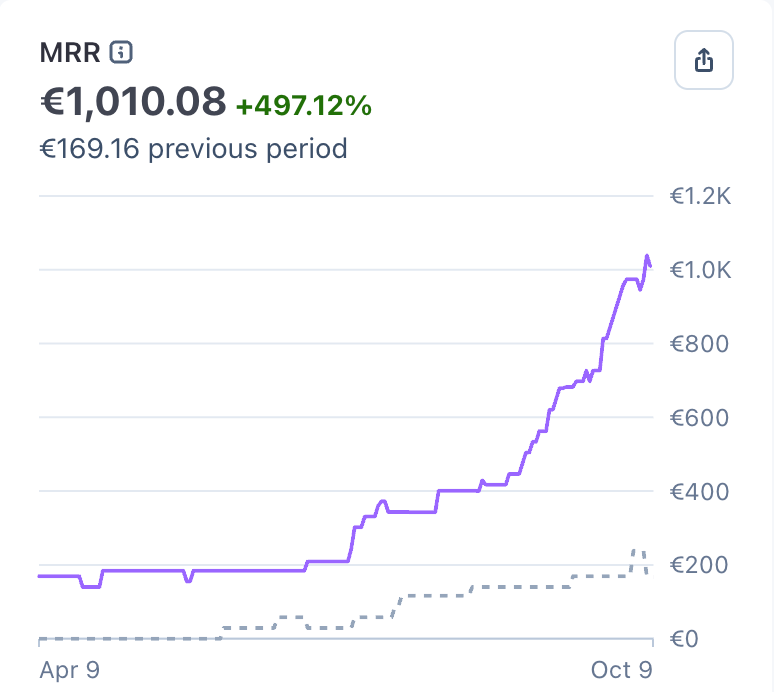

# Term（@JaniBangiev）：我们花 7 个月才做到 €1,000 MRR——AI 社媒工具 Picmim 的真实过程与 €3,000 只买来 1 个客户

> 作者 Term 说他们刚在 Stripe 上跨过 €1,000 月度循环收入，用了七个月、一次重大 pivot、大量毫无结果的营销实验。第一章原本要做「Buffer 加强版」，目标客户是社媒经理和营销代理商；第二章他们在 Google 和 Meta 花掉将近 €1,000、拿到约 500,000 次曝光却几乎没转化，复盘出三个原因：对专业人士来说 AI 未必是卖点甚至是减分项、代理商已有成熟工作流难以迁移、一部分人把 AI 自动化当作竞争者。第三章在导师建议下改打代理商服务不起的客户（本地面包店、小网店、个人创业者，因为营销代理一个月可能几千欧元），又花两个月把平台重做成 AI-first 的「口袋里的社媒代理商」，当时 MRR 只有约 €200–300。第四章标题就是「如何花 €3,000 只获取一个客户」：与约 20 位不同国家的 UGC 创作者合作、投入近 €3,000、内容拿到约 500,000 自然播放，付费客户只有 1 个，他由此总结播放量不是客户、注册也不是客户。第五章的转机是 Picmim 拿到一个区域创新比赛第三名，同期 MRR 翻倍，而早期 traction 很大一部分仍来自本国 Slovenia，于是把分销重心加回本地。第六章他们停止营销技术、改营销结果，取消传统免费试用、上线更聚焦的 Meta Ads，新活动首月 MRR 又翻一倍。第七章坦白仍有 bug、UX 问题和必须降低的 churn，下一个里程碑是 $5K MRR，并直言每一家看似一夜做到 $10K MRR 的公司背后，都有无数创始人花好几个月找第一批付费客户。

<!-- more -->

One pivot, multiple redesigns, over a million impressions, thousands spent on failed marketing experiments, and a lot of lessons learned.

Every time I open X, I see another founder sharing how their AI startup went from $0 to $10K MRR in 30 days.

And don’t get me wrong, that’s genuinely impressive.

But I sometimes wonder how representative those stories really are.

Because our experience building [Picmim](https://picmim.com/) has been quite different.

We just crossed €1,000 in monthly recurring revenue on Stripe. It took us seven months, a significant pivot, several marketing experiments that went absolutely nowhere, and more product changes than I’d like to admit.

Technically, we’d already passed €1K MRR earlier through customers paying outside Stripe. But there’s something satisfying about finally seeing that number on the dashboard.

And I figured this was a good opportunity to share what those seven months actually looked like.

Not because we’ve made it. We definitely haven’t.

But because I think stories like ours are probably a lot more common than the overnight successes filling our feeds.

## Chapter 1: Building the wrong product for the right people. Or so we thought.

When we started Picmim, our vision was to build a smarter social media management platform.

Think Buffer, but on steroids.

The idea was that AI would act as a social media consultant working alongside you.

It would analyze your social media performance, recommend optimal posting times, generate captions with strategic hashtags, suggest content ideas, and generally help you make better decisions.

But the human was still at the center of everything.

You created the content. You made the decisions. AI simply helped you do everything more efficiently.

As developers, we loved the concept.

And our initial target audience seemed obvious: social media managers and marketing agencies.

These were the people spending hours every day managing multiple social media accounts. Surely they’d appreciate a tool that could make their lives easier?

Well...

## Chapter 2: Half a million impressions and a reality check.

We launched our first marketing campaigns on Google and Meta.

Over the following months, we spent almost €1,000 and generated roughly 500,000 impressions.

Sounds pretty good, right?

Except impressions don’t pay the bills.

We were getting attention, but hardly anyone was converting into a paying customer.

After talking to potential users and analyzing what was happening, we started noticing a few things.

First, the AI aspect wasn’t necessarily a selling point for professionals. For some, it was actually a turnoff.

Second, most agencies and experienced social media managers already had established workflows and tools they were comfortable with. Getting them to switch to an unknown platform was much harder than we anticipated.

And third, some viewed increasing AI automation as competition rather than something that would help them.

The problem wasn’t necessarily our technology.

We were trying to sell a solution to people who either didn’t want it or didn’t need it badly enough to switch.

That was a difficult realization after spending months building the product.

## Chapter 3: What if we targeted the people agencies don’t serve?

After discussing our situation with a mentor, we started looking at the problem from a completely different angle.

Instead of building AI to help social media professionals manage social media...

What if we built AI to manage social media for people who couldn’t afford those professionals?

Think about the economics.

A marketing agency can cost thousands per month.

Hiring a dedicated social media manager can cost hundreds or thousands.

But what about a local bakery? A small online store? A solo entrepreneur trying to grow their business?

They still need an online presence.

They just don’t have the budget to hire someone or the time and expertise to manage everything themselves.

That was the opportunity we decided to pursue.

We weren’t going to compete for agencies’ existing customers.

We wanted to serve businesses that traditional agencies couldn’t economically reach.

So we pivoted.

We spent another two months building automation features and completely redesigning the platform around an AI-first experience.

Instead of a tool that helps you create and schedule content, we started building something closer to a social media agency in your pocket.

You tell the AI about your business, and it handles the content creation, planning, and scheduling. You remain in control, but no longer need to do most of the work yourself.

At this point, we had around €200–300 MRR from a handful of local businesses testing Picmim.

Not exactly an overnight success.

But at least we had actual paying customers.

## Chapter 4: How to spend €3,000 and acquire one customer.

With our redesigned product and new target audience, we needed to figure out how to reach people.

One idea seemed especially promising: user-generated content.

Our product is visual. Seeing an AI generate social media content for your business should be much more convincing than reading about it on a landing page.

So we partnered with around 20 UGC creators from different countries.

We invested almost €3,000 into the campaign.

And the content generated approximately 500,000 organic views.

We were pretty excited about those numbers initially.

Then we looked at the sales.

One.

One paying customer.

€3,000 spent. Half a million views. One sale.

Hahahaha.

To be fair, that customer is still subscribed, so I suppose we’re playing the long game.

But seriously, that campaign taught us a lesson we probably should have learned much earlier.

Views aren’t customers. Signups aren’t customers. And getting attention from people who have no intention of paying for your product is a very expensive way to feel successful.

The campaign wasn’t completely worthless. We learned a lot about messaging, audience quality, and what doesn’t convert.

But financially?

It was a disaster.

If you want to read more about that I wrote another article about it: https://x.com/JaniBangiev/status/2095419794568736955

## Chapter 5: Sometimes the opportunity is closer to home.

Something interesting happened while our UGC campaign was running.

Picmim won third place in a regional innovation competition.

Around the same time, our MRR doubled.

And a significant part of our early traction was still coming from businesses in Slovenia, our home market.

This got us thinking.

We’d spent so much time trying to reach customers internationally that maybe we’d overlooked an opportunity right in front of us.

Locally, we could actually talk to businesses, understand their problems, build trust, and get direct feedback.

We also had growing credibility thanks to the innovation award and our existing customers.

So we decided to give our local market another serious shot, while continuing to pursue international growth.

It wasn’t another product pivot.

It was a change in how we approached distribution.

## Chapter 6: Back to the drawing board. Again.

By this point, we’d learned quite a bit about what wasn’t working.

We had changed our target audience, rebuilt major parts of the product, and spent thousands trying to acquire customers.

But one thing was becoming increasingly clear.

We needed to stop marketing the technology and start marketing the outcome.

Small business owners weren’t looking for AI-powered hashtag optimization.

They didn’t particularly care about sophisticated analytics or which AI models we used.

They wanted to stop worrying about what to post on social media every day.

So we made another round of changes.

We redesigned our marketing pages around the actual problems our customers faced.

We overhauled onboarding to demonstrate the product’s value earlier.

We removed the traditional free trial and adjusted how people experienced the product before paying.

And we launched a new Meta Ads campaign with more focused messaging and targeting.

This time, we weren’t selling another social media management tool.

We were selling the possibility of having your social media handled without hiring an agency or spending hours doing it yourself.

And finally...

Things started clicking.

In the first month after launching the new campaign, we doubled our MRR again.

We started acquiring paying customers more consistently.

Our growth accelerated.

And now we’ve officially crossed $1K MRR on Stripe.

Seven months after starting this particular journey.

## Chapter 7: We still have a lot to figure out.

I’d love to end this article by saying we’ve cracked the code and everything is smooth sailing from here.

But that would be a lie.

We’re growing faster than before, and that’s exciting, but growth has also exposed some problems.

For months, we were so focused on finding the right audience, improving our marketing, and optimizing onboarding that we didn’t give enough attention to certain issues inside the application.

There are bugs to fix.

There are UX problems to solve.

And perhaps most importantly, we need to reduce churn.

Acquiring customers is only half the battle. If customers aren’t consistently getting value from the product, eventually they’ll leave.

We’re also competing in an industry that’s evolving at an absurd pace.

New AI capabilities appear almost every week. Existing social media platforms are adding AI features. New startups are emerging constantly.

The product that makes sense today might need to look completely different in six months.

That’s exciting, but also a little terrifying when you’re the one building it.

Our next milestone is $5K MRR.

And getting there won’t just be about increasing our advertising budget.

It will mean making the product more reliable, improving the experience for existing customers, and ensuring the people we acquire actually want to stick around.

## What these seven months taught me

I’m a software developer by background.

I’ve been programming for nearly a decade, and building software is the part of running a startup that comes most naturally to me.

If something doesn’t work technically, I can usually figure out how to fix it.

But building a business is a completely different challenge.

You can build something technically impressive that nobody wants to buy.

You can generate hundreds of thousands of impressions without making a single meaningful sale.

You can have what seems like a perfectly logical target audience, only to discover that they’re the wrong people to sell to.

And sometimes, the thing that finally starts working isn’t some revolutionary feature.

It’s understanding who your customer actually is, what problem they’re trying to solve, and how to communicate that clearly.

Looking back, I don’t think our original product was necessarily bad.

We were just trying to solve the wrong problem for the wrong audience.

The technology we’d built became the foundation for something very different.

And we’re still learning how to turn that into a sustainable business.

## The reality behind the MRR screenshots

I have nothing against founders sharing their success stories.

In fact, I find many of them inspiring.

But I think the AI startup community could use a little more transparency about the journeys that don’t fit into a 30-day success story.

Because for every company that seemingly reaches $10K MRR overnight, there are countless founders spending months trying to find their first paying customers.

Rebuilding features nobody uses.

Running campaigns that lose money.

Changing their minds about who the product is even for.

And constantly wondering whether they’re one experiment away from finding something that works, or simply wasting their time.

We haven’t built some massive company.

We’re not profitable enough to stop worrying about growth.

And we certainly haven’t figured everything out.

But we’ve gone from an idea to a product that real businesses are willing to pay for.

And after everything we’ve tried, seeing that $1K on Stripe feels pretty damn good.

If you’re building something and your growth doesn’t look like the screenshots you see on X every day, you’re definitely not alone.

Some of us are just figuring things out as we go.

On to $5K MRR.

## 相关页面

- [[concepts/app-idea-validation]]
- [[patterns/ai-business-seven-layers]]
- [[concepts/b2c-conversion]]
