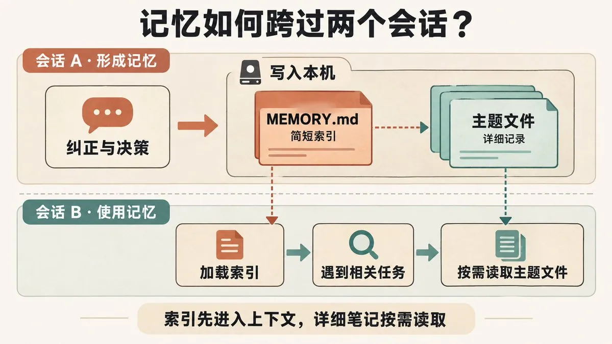
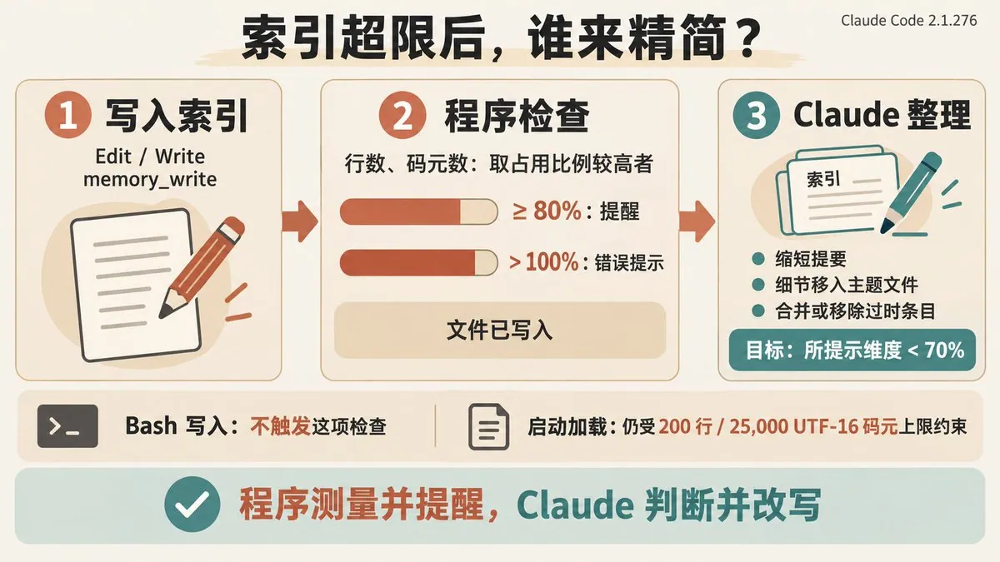

# Jason Young（@Jason_Young1231）：Claude 是如何记住你的项目的？——浅析 Claude Code 项目级记忆功能

> 系统解析 Claude Code 的项目级记忆机制：CLAUDE.md 等项目上下文文件的加载优先级与作用域、记忆文件如何在不同会话间持久化项目约定与偏好、记忆条目对 Token 预算的占用影响，以及与 Agent Skill、Harness 记忆层（Memory Provider / 事件溯源）的分工边界对比。

<!-- more -->

从 CC Switch 的日常开发维护，看自动记忆的机制、价值与使用方法。

长期使用 AI 开发和维护一个项目，有一个经常遇到的痛点：一些决策在再次遇到类似情况的时候，需要重新向 AI 解释说明，如果没有说明的话，AI 会在同一个地方跌倒两次。

这个方案之前为什么被否掉了？那段看起来多余的兼容逻辑为什么必须保留？上次审这个 PR 时发现了什么，哪些问题还没有解决？代码只能回答其中一部分，另一部分留在过去的讨论里。

我在维护 CC Switch 的过程中，发现 Claude Code 的项目级记忆起到了越来越多的帮助：记录纠正、保留决策背景、接续 issue 和 PR 的审查工作。截止此文写作时，记忆目录里已经有 358 个文件。

这些记录大部分时候可以让新会话很快接上之前的工作，大幅提升工作效率，也出现过正文已经更新、索引还保留旧结论的情况。本文尝试分析自动记忆的价值和缺陷，以及使用它的一些经验。

## 一、为什么有了 CLAUDE.md，还需要自动记忆？

Claude Code 的自动记忆叫 auto memory，也就是标题中的项目级记忆，它会在协作过程中，把认为对未来有用的信息写成笔记，供后续会话使用。

而 CLAUDE.md 是我们主动维护的指令文件。构建命令、编码规范、项目布局、团队工作流程，都可以放在里面。这两套机制的分工，可以参照[官方记忆文档](https://code.claude.com/docs/en/memory#claudemd-vs-auto-memory)。

但开发过程中还有很多更具体的背景：我为什么否定某种改法，一个方案暂缓的原因是什么，某次讨论中的判断后来被什么证据推翻了。这些信息通常无法直接从当前代码中读出来，也未必值得逐条写进项目规范（海量的记忆也决定了这些内容无法直接写入 CLAUDE.md）。自动记忆可以把这部分协作经验保存下来。

- CLAUDE.md：主要解决什么问题：希望 Claude 持续遵循什么；典型内容：项目规范、构建方式、协作约定
- Auto memory：主要解决什么问题：有哪些经验值得带到以后的会话；典型内容：用户纠正、决策背景、外部资料入口
- 会话历史与压缩摘要：主要解决什么问题：这次工作进行到了哪里；典型内容：当前任务、工具结果、尚未完成的步骤

三者会有内容交集，主要区别在：这条信息由谁维护、给谁使用、能有效多久。

例如，一条已经确定、需要团队共同遵循的规则，适合整理进项目指令。一次暂缓实施的方案，可以先在记忆里保留原因和重新讨论的条件。当前测试跑到哪一步，则通常留在会话或任务记录中就够了。

另外，CLAUDE.md 也可以用于个人配置，不能简单地把两者理解为“公开文件”和“私有文件”。在我的项目里，提交到仓库的指令承担团队规范，本机记忆则更多承担个人协作笔记。

## 二、它是怎么记住的？

### 一份索引，加上一组主题文件

默认情况下，记忆保存在本机的 `~/.claude/projects/<project>/memory/`。其中 `<project>` 由仓库路径生成，并不一定等于仓库名称。

目录结构很简单：

memory/

├── MEMORY.md # 索引：有哪些记忆，去哪里找

├── feedback_ledger_write.md # 一条工作方式纠正

├── project_provider_plan.md # 一项决策的背景

└── reference_review_log.md # 外部审查记录的入口

为了避免不断增长的记忆撑爆上下文，设计的关键是：启动时加载索引，详细笔记按需读取。

MEMORY.md 的内容会在上限范围内进入新会话的上下文，告诉 Claude 有哪些值得注意的记录。其他主题文件留在磁盘上，Claude 根据当前任务，决定要不要用文件工具打开。

所以，保存一份很长的笔记，并不意味着每次会话都要把它全部读进去。反过来，如果索引没有说明这份笔记能解决什么问题，Claude 也未必会想到去找它。

觉得眼熟？自动记忆与 Agent Skills 的按需加载思路很相似：先提供简短的入口信息，需要时再加载详细内容。[Skills 加载机制](https://code.claude.com/docs/en/skills#control-who-invokes-a-skill)

同一仓库的 worktree 默认共享这份本机记忆；换机器或进入云端环境，不会自动带过去。长会话发生上下文压缩后，自动记忆会从磁盘重新注入，索引可以继续提供查阅入口。[上下文压缩后的加载行为](https://code.claude.com/docs/en/context-window)

### 一次记忆怎样跨过两个会话

典型过程是这样的：

1. 我纠正某种做法，或者确认一项值得保留的判断。
2. Claude 在工作过程中创建或修改主题文件，并更新索引。
3. 下一次会话开始时，Claude Code 加载索引。
4. 遇到相关任务，Claude 再打开对应文件，结合当前情况继续工作。

整个过程不需要用户说“记住”（当然也可以说）。在我的使用过程中，很多记忆写入发生在纠偏或工作确认之后，Claude 自己判断这些内容值得留下，也不会每次会话都写记忆。

按内容看，记忆有四类：

- user：用户的角色、专长和工作偏好
- feedback：用户给出的纠正、确认过的做法
- project：无法从代码和 Git 历史还原的项目背景与决策
- reference：去哪里查找项目之外的信息（比如参考的官方文档）

这些分类有助于理解笔记的用途，但不必为了凑齐四类而额外创建文件。

### 索引会不会无限增长？

Claude Code 对索引设置了启动加载上限：前 200 行或文档所称的前 25KB，先到哪个算哪个。文件仍可能继续增长，但超出部分不会在启动时加载。这里按位置保留前面的内容，不会判断哪条记忆更重要，也不会删除磁盘上的内容。[加载与告警规则](https://code.claude.com/docs/en/memory#how-it-works)

有一个实现细节：在 Claude Code 2.1.276 中，这个“25KB”实际按 25,000 个 UTF-16 码元计算。实现使用 JavaScript 字符串的 .length，并非文件的 UTF-8 字节数。常见汉字和英文字母通常各占一个码元，许多 emoji 则占两个。

这解释了为什么直接用文件字节数去对照界面上的 KB，可能会发现数字对不上。它也不能直接换算成固定的 token 预算。

### 索引满了，谁来精简？

为了尽量避免加载时截断，Claude Code 会在索引写入后检查容量。在当前，Claude 每次修改索引后，会比较行数和码元数各自占上限的比例：达到 80% 就提醒精简，超过 100% 则返回更明确的错误提示。不过，后者也表示文件已经写入成功，需要处理的是超限内容无法完整加载的问题。

提醒会按占用比例更高的那个维度，要求把索引缩到上限的 70% 以下。例如，行数达到 172 行时，目标是压到 140 行以下，给之后的记录留出空间。附带的整理指引很简短：每条索引尽量只占一行，把细节移进主题文件，合并或移除过时条目。

接下来，收到提醒的 Claude 会读取索引、判断怎么整理，再调用文件工具修改。容量检查负责量大小和发提醒，具体取舍由当前会话里的 Claude 完成。 这条路径没有固定的淘汰算法，也不需要另起一个专门的精简子 Agent。

### Claude 怎么决定哪些记忆可以舍弃？

这里的“舍弃”需要分清层次：从索引移走一行，会让它失去启动时直接可见的入口；删除主题文件，才会移除磁盘上的那份记录。在这次能追踪完整过程的 7 次精简中，主题文件删除数为 0。常见的操作是缩短提要、合并条目，或者把索引行移进归档。

Claude 收到的常驻记忆指引包括：避免重复，更新或移除错误、过时的记录，遇到冲突时以当前观察到的信息为准。但这些要求没有定义“多久算过时”，也没有给每条记忆计算保留分数。结合工具调用和精简前后的文件变化，我观察到的取舍主要围绕四个问题：

1. 后面还有没有事情要做？ 等作者修改、等用户拍板、等待发布的条目，更容易保留在索引里；已经处理完的事项，更容易被折叠成汇总行。不过，“PR 已合并”不一定代表维护工作结束，后面可能还要补发感谢、整理发版说明。只看状态词，就可能过早移走入口。
2. 这是长期经验，还是某次任务的进展？ 用户偏好、工作方式纠正、长期有效的约束，通常比单个 PR 的状态保留得更久。在我的样本里，反馈分区的入口保留得很稳定。不过，这是一种观察到的倾向，并没有程序替这些条目提供永久保留的保证。
3. 能不能只删掉索引里的重复细节？ 索引行太长时，往往可以保留链接和一句提要，把空间省在详细过程上。8 月 29 日的一次整理中，Claude 先检查细节是否已写进主题文件，发现有遗漏后先补写，再缩短索引。9 月 11 日的另一次整理则保留了全部已有文件链接，主要靠缩短内容解决超限。
4. “过时”有没有得到核实？ 这一步并不总做得一样好。9 月 1 日的一次整理依据索引中“已合并”“已关闭”等字样筛选待归档条目；9 月 7 日的另一次整理，则先用 Git 和 GitHub 核实事项状态，再决定折叠哪些记录。后者能减少把旧状态误当成当前事实的错误。

这些判断来自可见的操作记录，不能当作 Claude 每次都会执行的固定流程。决定一条记忆是否继续占据索引空间，关键在于它对后续工作的作用、内容是否仍然成立，以及有没有更简短的保留方式。

被移出索引的主题文件仍可能通过目录搜索、其他文件或工作台账找回来。我的项目里，不少回查就是靠事项编号和台账中的文件名完成的。因此，移出索引并不等于彻底遗忘，但它确实减少了一次被主动注意到的机会；只有归档，没有可用的查找线索，仍然容易漏掉。

## 三、在我的日常工作中，它主要帮上了什么忙？

下面三个场景，是我最愿意保留这项功能的原因。示例根据实际记忆整理，项目标识和具体细节做了脱敏、精简。

### 让一次纠正成为后续工作的参考

在我的开源维护工作流（这部分之后会分享）里有一些 JSONL 格式台账，每行存一条记录。一次回写时，Claude 用 echo 追加包含转义字符的 JSON；在当时的 shell 环境下，里面的 \n 被展开成了真实换行，破坏了一行一条记录的格式。

这次纠正后来被整理成一条 feedback，核心内容大致如下：

写入 JSONL 台账时，使用 printf ’%s\n’ 输出完整的单行 JSON。

**Why:** 曾经使用 echo 追加记录，其中的转义字符被 shell 展开，

导致一条记录变成多行，整份台账无法正常解析。

**How to apply:** 修改后校验整个文件，核对预期的记录数量；

解析失败时，不要用错误结果覆盖原文件。

这里保存的不只是一个命令，还包括出错原因和完成后的检查方法。下一次修改同类台账，Claude 就有机会把这个经验用起来。如果只有一句“不要用某种方法”，容易被理解成随意的个人偏好；写清楚它曾经造成什么问题，适用范围也更容易判断。

### 保留方案背后的决定

维护一个项目，经常会同时讨论几条实现路线。最后代码里通常只留下采用的方案，但其余方案为什么没有采用，同样值得保存。

我的一些项目记忆会按这样的结构整理：

## 当前决定

先采用方案 A，保留现有兼容行为。

## 暂缓的方案

方案 B 改动较小，但会增加用户需要理解的配置项。

方案 C 覆盖范围更广，仍需验证对现有客户端的影响。

## 已被推翻的判断

原先认为某条兼容路径可以删除。

后续复现发现仍有客户端依赖它，应保留相关测试和验证记录。

下一次讨论相邻功能时，这些记录能帮助 Claude 理解之前的取舍，避免把已经验证过的路线重新当成全新的建议。而且，记忆也应该允许决定被重新讨论。暂缓的方案需要写清楚缺什么条件；被推翻的判断需要标出新证据。这样，后续会话既能理解历史，也能判断当前是否有理由改变做法。

比如，CC Switch 在切换 Claude Code 供应商时，为什么采用完整配置写入，而不只是替换几个关键字段？这个问题要经常在 Issue 和 PR 里解释，有了自动记忆之后可以节约很多时间。

### 接续 issue 和 PR 的审查工作

PR 审查是我现在开源维护的主要工作内容，也是记忆文件最多的一类用途。一次审查可能要确认调用链、复现边界情况、检查兼容行为，这些过程往往比最终那句“可以合并”更费时间。

如果作者几天后更新了代码，再次审查时，我希望 Claude 能找到上一次的证据，知道哪些问题需要重新核验，而不是从头开始审查整个 PR。

为此，我的审查记录会保存：当时的提交标识、问题清单、复现步骤、验证结果，以及仍未解决的疑问。索引只保留简短入口，详细过程放在主题文件中。

配套工作流先获取 PR 的当前状态，再比对记录对应的代码版本。代码发生变化时，旧问题清单成为本轮的核对项；旧复现步骤则可以作为重新验证的起点。即使 PR 的提交没有变化，目标分支或其他判断条件变了，也需要重新检查相关结论。

这里发挥作用的是几部分配合：

- 记忆主题文件：保存之前的发现、证据和决策背景
- Review Skill：规定如何审查、核验和更新记录
- PR 台账：组织审查记录，帮助生成工作清单
- GitHub 当前状态：确认 PR 是否仍开放、代码是否已更新

这样做省下的是重复调查的成本。继续审一个 PR 时，Claude 可以从上次查明的地方开始，同时对变化的部分重新验证。

## 四、为什么记下来了，下一次还是可能出错？

### 文件还在，但没有读到

自动记忆至少要经过两个步骤才能影响后续工作：先保存下来，再进入当前会话可使用的上下文。

我的索引至少出现过两次超限。9 月 7 日精简前，索引已经达到码元上限的 120.2%；这次缺少当时的启动注入记录，超限持续时长只能根据间接记录估计。9 月 10 日到 11 日的另一次超限持续了约 16 小时，会话记录直接显示，新会话加载到的索引不完整，一条测试前需要遵循的本机隔离规则也被截掉了。

这说明，记忆保存下来之后，还要确认它能否进入当前会话的上下文。索引超限时，即使文件里保留着规则，新会话也可能看不到。

为什么容量检查没能及时提醒？在 Claude Code 2.1.276 中，通过 Bash 运行脚本或 shell 命令修改索引，不会触发上述写入后检查。我的记录里确实有连续通过 Bash 更新索引、跨过提醒阈值的情况。但加载时的截断照常生效，所以没有写入告警，并不能说明索引仍在上限之内。

我还发现，历史归档中出现过、当前索引已不再链接的 219 个文件，全部仍在磁盘上。它们有些可以通过归档、其他文件的链接或目录搜索找到，但查找路径更长，也更容易漏掉。

### 当时正确，现在已经变化

用户偏好可能几个月都不变，PR 的代码却可能在几分钟后就更新。

在 2026 年 9 月 16 日核验的 26 条仍开放、带有提交锚点的 PR 审查记录中，有 18 条对应的 PR 已经出现新提交。这说明旧结论需要重新核验，并不意味着原审查没有价值。

已经合并或关闭的 PR 记录，也可以继续提供历史背景和回归检查线索。使用时要区分“当前可以执行的结论”和“过去积累的证据”。

更直接的例子是，索引里还写着“等作者修改”，作者其实早已提交了更新。此时记忆中的状态已经落后于实际工作，继续按它安排任务就会漏掉待审事项。

所以，涉及外部进展时，需要回到对应系统核验。写入日期只能说明这条记录有多旧，无法证明它今天是否仍然成立。

### 正文改对了，索引还在说旧话

随着内容增加，索引需要不断精简。我的项目在 67 天里留下了 16 份索引归档，其中也出现过整理后的信息不一致。

一次整理把多条已处理事项折叠成汇总行。三天后，其中一个结论被新证据推翻，主题文件已经更新；索引里的汇总行却仍保留旧说法，而且已经不再直接链接那个主题文件。

新会话先看到旧结论，又不容易找到更正后的正文，错误就有机会延续下去。

精简还可能改变一句话的适用范围。主题文件里原本保留了前提和例外，汇总行却只剩下结论，读起来就比原来的判断更绝对。因此，检查精简结果时，不能只确认字数变少、文件还在，也要看条件有没有被一起删掉。

这让我开始把索引也当成需要维护的内容。更正一条判断时，主题文件、索引摘要以及其他引用处，都应该一起检查。归档可以保留历史原貌，但需要让读者知道去哪里找当前结论。

## 五、实际使用时，我建议怎么做？

### 先找到自己的记忆

在 Claude Code 会话里输入 /memory，可以查看相关文件位置、管理自动记忆开关，并打开记忆目录。自动记忆默认开启，通常不需要先手工搭建整套文件结构。[管理入口](https://code.claude.com/docs/en/memory#view-and-edit-with-memory)

打开后，先看 MEMORY.md，再选几份主题文件读一遍：它记住的是你认可的经验，还是一次临时判断？描述是否准确？现在还适用吗？

- /context 可以辅助检查当前上下文和加载的指令文件，但主题文件的细节有没有被读取，还需要结合工具调用记录判断。

### 表达纠正时，说清楚原因

如果希望某个经验延续到以后，可以明确提出，例如：

记住这次确认的协作偏好：讨论改动时，先说明对现有用户的影响，再展开实现方案。请记录原因和适用范围，之后讨论同类改动时参考。

这样的表达比一句“以后别这样了”更容易形成有用的笔记。保存后也可以让 Claude 展示写入的位置和内容，确认它理解得对不对。

已经确定的团队规则，则可以直接要求整理进项目 CLAUDE.md 或 rules。个人长期指令也有对应的配置位置，不必把所有内容都交给自动记忆维护。

### 更新结论时，一并处理旧说法

涉及代码或外部状态的判断，尽量写明依据的提交、版本和绝对日期。发生变化后，明确记录哪条判断被推翻，以及新的依据。

同时检查主题文件、索引摘要和其他引用处，让后续会话能够找到更正后的结论。旧归档可以作为历史记录保留，但不应继续充当当前状态的唯一依据。

### 整理索引时，检查留下了什么

在上述版本中，可以明确要求 Claude 用 Edit 或 Write 完成索引写入，让容量检查有机会运行。整理前，先确认事项的当前状态和未完成的后续动作；长期反馈尽量单独组织，避免随着某个已结束的任务一起被折叠。

整理后，我会重点检查三件事：

- 从索引删去的细节，是否已经保存在主题文件中，前提和例外是否完整。
- 活跃事项和长期反馈是否仍有清晰入口；移出索引的文件，能否通过事项编号、目录搜索或台账找到。
- 缩短后的提要是否还表达原意，有没有把“满足条件时可以”变成无条件的结论。

索引回到上限以内，解决的是启动时的加载问题。留下的入口是否有用、指向的判断是否准确，还需要另外核对。

对长期维护的项目而言，自动记忆能让过去的沟通和判断继续发挥作用，大幅提高工作效率。

本文基于 CC Switch 本机记忆目录与会话记录，调研截至 2026 年 9 月 19 日。机制核验针对 Claude Code 2.1.276，基本使用方式已对照官方文档复核。样本覆盖单个长期维护的项目，文中的数量、维护频率与取舍倾向不代表所有用户。未公开或需要特殊开关的记忆子系统不在本文讨论范围内。

## 相关页面

- [[sources/zeroagent-12-longterm-memory-management]]
- [[sources/khazix-agent-autoloop-open-source-architecture]]
- [[concepts/claude-skills]]
- [[concepts/agent-autonomous-pipeline]]
