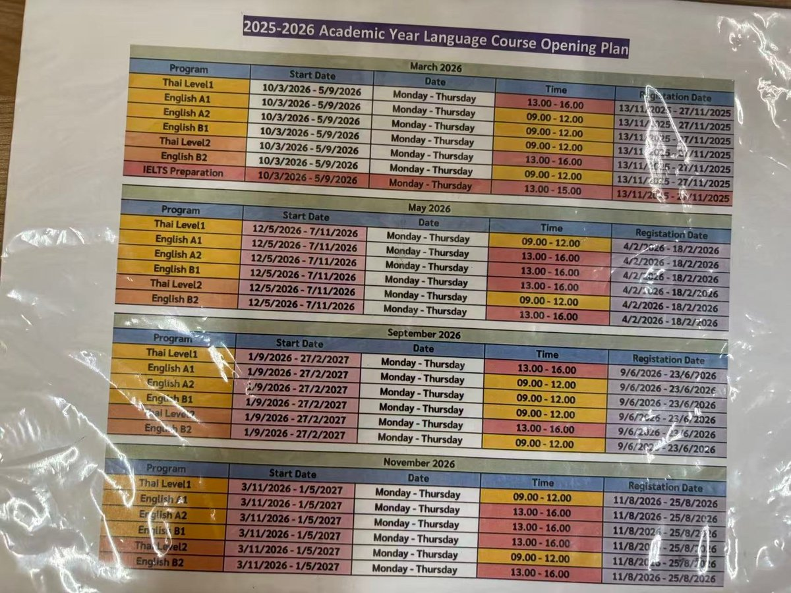
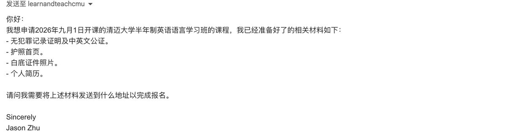
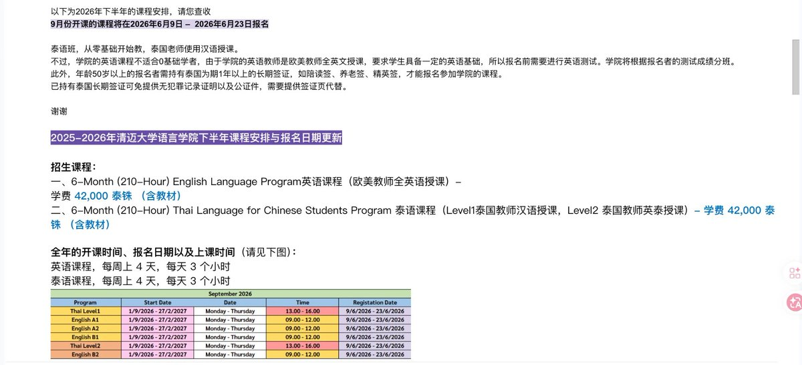
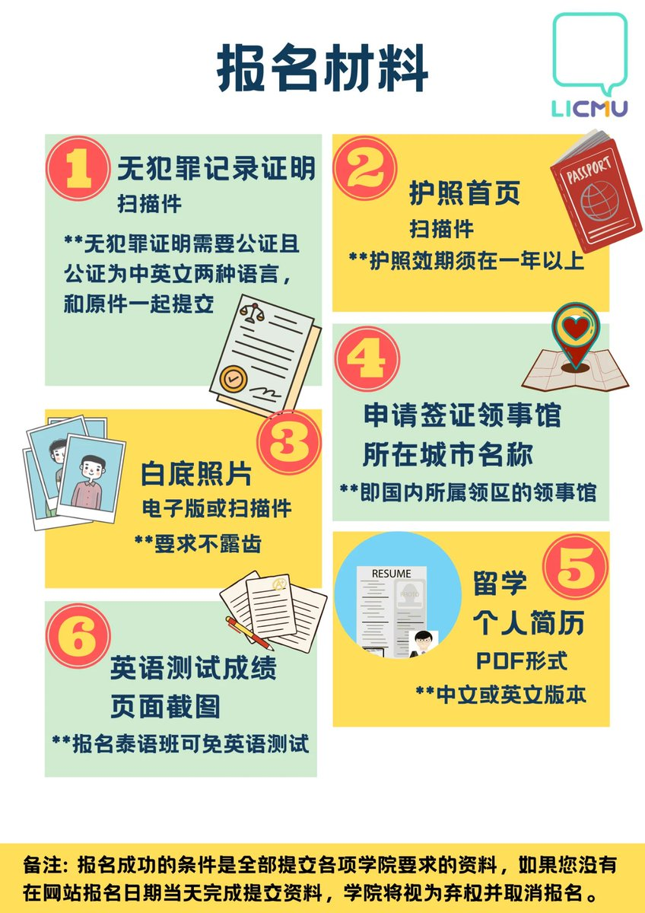
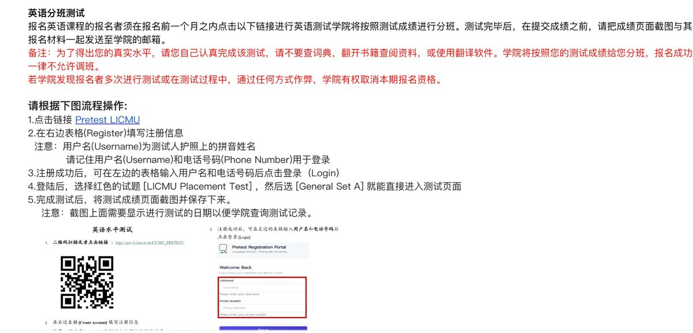
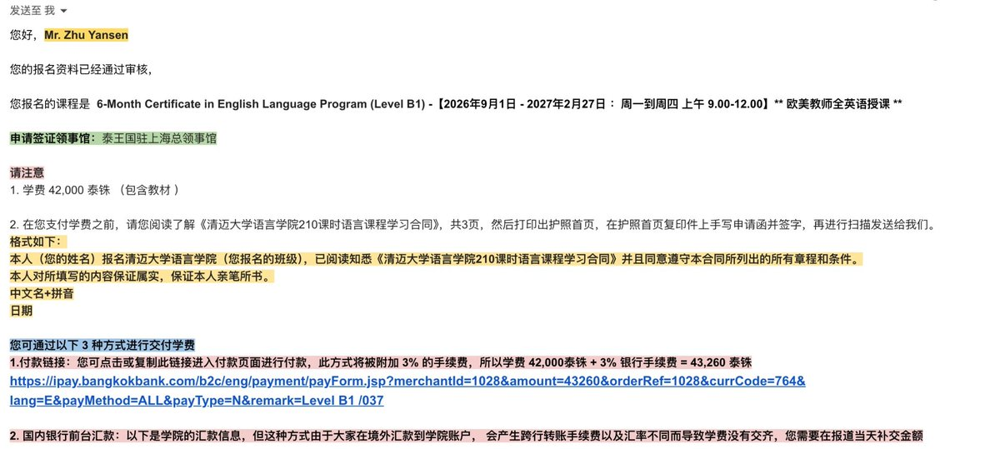
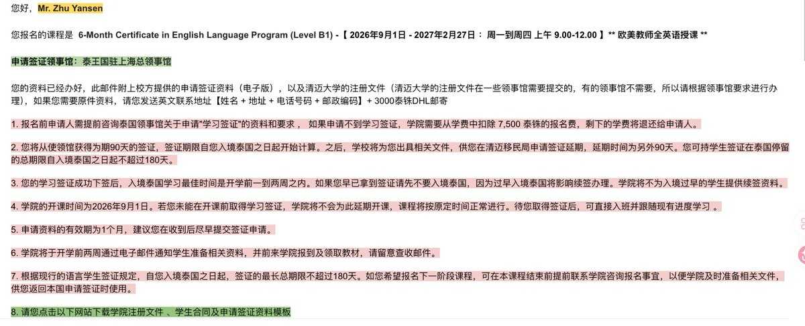
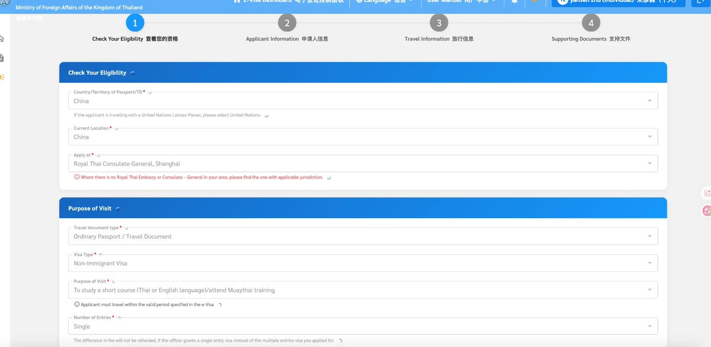

# Jason Zhu（@GoSailGlobal）：手把手教你申请清迈大学语言班——42000 泰铢，半年泡在清迈学英语

> 数字游民长居海外的实操路线分享：清迈大学语言学院（LICMU）半年制英语班全流程拆解——欧美教师全英文授课、210 课时、学费 42,000 泰铢（约 8,500 人民币含教材），可凭学生签证在泰国合法居留 180 天；对比国内动辄数万的成人英语班与尼泊尔学英语三百多块的成本，详解开课时间倒推报名节点、材料准备、申请与落地生活成本等完整跑通步骤。

<!-- more -->

去年在尼泊尔学英语花了三百多块，这次我把坐标换到了清迈。

很多朋友问我：想去泰国长待几个月，又不想纯玩虚度，有没有什么正经的路径？清迈大学语言学院（LICMU）的半年制英语班就是我找到的答案，欧美教师全英文授课，210 课时，学费 42,000 泰铢（约 8500 人民币，含教材），还能拿学生签证在泰国合法待满 180 天。

比起国内动辄几万的成人英语班，这个价格加上清迈的生活成本，性价比直接拉满。数字游民、Gap 期、想换个环境沉浸式学英语的，都可以看看。

下面是我跑通的完整申请流程，照着做就行。

## 一、先看开课时间，倒推报名节点

清迈大学语言学院一年开 4 期：3 月、5 月、9 月、11 月，每期都是 6 个月（210 课时），周一到周四上课，每天 3 小时。

重点看报名窗口，错过只能等下一期（以 2026 年为例）：

开课时间报名窗口 3 月班前一年 11 月中下旬 5 月班 2 月上中旬 9 月班 6 月 9 日到 6 月 23 日 11 月班 8 月中下旬我的建议是提前 3 个月给官方发邮件确认最新安排，邮箱：

learnandteachcmu@gmail.com

邮件不用花哨，直接说明想报哪一期、已准备什么材料、问清楚发送地址，参考我的写法：

## 二、准备报名材料

官方回信会附上当期课程安排和报名材料清单：

逐项过一遍：

- 无犯罪记录证明，需要公证，且是中英文双语公证。可以在各地公证处的线上小程序申请，懒得跑腿也可以淘宝代办，一两百块搞定
- 护照首页扫描件，注意护照有效期须在一年以上，不够的先换护照
- 白底证件照，电子版即可，要求不露齿
- 申请签证领事馆所在城市，即你户籍/居住地所属领区的泰国领事馆（比如江浙沪就是泰王国驻上海总领事馆）
- 个人简历 PDF，中文或英文都行，不用太卷
- 英语分班测试成绩截图，见下一步（报泰语班可免）

几个特殊情况：

- 泰语班从零基础教起，泰国老师汉语授课；英语班不适合零基础，欧美老师全英文授课
- 50 岁以上的报名者需持有泰国 1 年以上长期签证（陪读签、养老签、精英签）才能报名
- 已持泰国长期签证的，可以免掉无犯罪证明和公证件，提供签证页代替

## 三、英语分班测试

报英语班必须在报名前一个月内完成官方线上测试，学院按成绩分班，报名成功后不允许调班。

流程很简单：

- 打开测试链接（官方邮件里有，Pretest LICMU）
- 右侧表格注册：用户名填护照上的拼音姓名，记住用户名和手机号（登录要用）
- 登录后选红色的 LICMU Placement Test，然后选 General Set A 进入答题
- 做完把成绩页面截图保存，截图上要能看到测试日期

官方红字警告：不要查词典、不要翻书、不要用翻译软件。如果被发现多次测试或作弊，直接取消本期报名资格。反正是分班用的，考出真实水平对自己最有利，分太高的班反而跟不上。

材料齐了之后，在报名窗口期内全部发到官方邮箱。注意：必须在报名截止日当天前提交完所有资料，否则视为弃权。

## 四、审核通过，交学费

材料通过审核后会收到确认邮件，里面有你的班级、上课时间和领区领事馆信

这一步要做两件事：

1. 签学习合同：阅读《清迈大学语言学院 210 课时语言课程学习合同》，打印护照首页复印件，在上面手写申请函并签字（格式官方邮件里有模板），扫描后发回。

2. 交学费，三种方式：

- 付款链接（曼谷银行）：最省事，但加收 3% 手续费，42,000 + 3% = 43,260 泰铢
- 国内银行柜台汇款：无手续费加成，但跨行转账手续费和汇率差可能导致到账金额不足，需要报到当天补齐
- 第三种方式官方邮件里有说明，按需选择

付完把支付回执发邮箱，按要求补齐剩余资料。

## 五、拿签证材料，申请学生签

报名成功后，学院会把申请签证所需的全套文件（电子版）发给你，包括校方申请签证资料和清迈大学注册文件：

几个关键点划重点：

- 如果申请不到学习签证，学院从学费里扣 7,500 泰铢报名费，其余退还，所以材料一定按领事馆要求备齐
- 签证下来后先拿到 90 天，入境后学校会出具文件，去清迈移民局再延 90 天，总共最长 180 天
- 最佳入境时间是开学前 1 到 2 周。拿到签证也别提前太久入境，会影响续签，学院不为过早入境的学生提供续签资料
- 签证资料有效期只有 1 个月，收到后尽快提交申请
- 开学前两周留意邮件，按通知去学院报到领教材

网申 e-Visa

中国申请人统一走泰国电子签系统：https://www.thaievisa.go.th/（上海领事馆）

按你的领区选领事馆（比如上海领区选 Royal Thai Consulate-General, Shanghai），几个易错项

- Visa Type：Non-Immigrant Visa
- Purpose of Visit：To study a short course (Thai or English language)/attend Muaythai training
- Number of Entries：Single

另外记得提前买好入境机票 + 预订几天住宿（不用订满半年，头几天的就行），签证申请要用。

## 总结时间线

以 9 月班为例：

- 6 月初：发邮件咨询 + 做无犯罪公证 + 分班测试
- 6 月 9 到 23 日：报名窗口，提交全部材料
- 7 月：审核通过，签合同，交学费，拿签证材料
- 7 到 8 月：网申 e-Visa
- 8 月下旬：入境泰国（开学前 1 到 2 周）
- 9 月 1 日：开学，正式开始清迈的半年

算一笔账：学费 43,260 泰铢（约 8800 元）+ 公证几百块 + 签证费 + 机票，一万出头就能换来半年沉浸式英语环境和清迈的慢生活。对比一下国内的语言培训价格，再加上清迈一个月两三千的房租，这可能是性价比最高的“留学”方案之一了。

有问题欢迎留言交流，我在清迈等你。

创作不易，如果你也对出海感兴趣，想一起出海学习交流，请关注微信公众号「杰森 AI 出海」。另外可加入 GoSail 出海交流群，一起交流数字游民、出海和 AI。

原文链接：https://x.com/jasonzhu_ai

## 相关页面

- [[sources/nini-global-freelancer-skills-stack]]
- [[sources/xaiwind-telegram-from-beginner-to-master-developer-guide]]
- [[concepts/overseas-tool-stack]]
- [[concepts/digital-products-side-income]]
