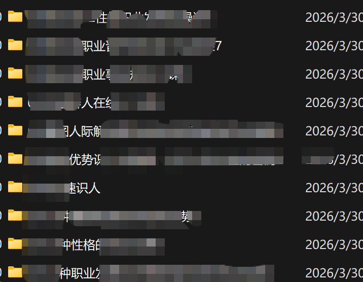

# 大熊 Jason：普通人自媒体获客方法论——线索型内容五步模板与单号闭环

> 核心公式：获客素材 × 内容分发 = 客户线索。账号是获客工具不是涨粉工具，区分播放型内容与线索型内容。一句话定位公式（人群+问题+证据），五步线索模板（锁定人群→指出问题→提供方案→说明差异→行动钩子），别赌爆款把有效素材反复用，闭环最易断在「承接」。

<!-- more -->

## 这套方法整理自我们内部跑通的「流量获客系统」，就讲一件事：普通人怎么靠自媒体账号持续找到客户。

如果你希望通过自媒体进行获客，请一定要好好看完这篇内容，这个内容价值百万，但是一定要记住，获客前提是你有一个能交付的东西（服务、产品、课程、资料）

核心公式：获客素材 × 内容分发 = 客户线索

## 先想明白：账号是获客工具，不是涨粉工具

很多人做账号，把播放量、点赞、粉丝当目标。

这些数字好看，但不等于业务。

但你要盯的是另外三个数：多少目标客户来问了、多少人留了联系方式、最后多少单成交了。

所以内容要分清两类：

- 播放型内容：追求观看、点赞、转发，适合涨粉，但不是获客的主力。
- 线索型内容：让有明确需求的客户采取行动——私信咨询、留联系方式、领资料、约服务、问报价。获客主要靠的就是这类内容。

## 定位：一个账号只服务一类人，只解决一个问题

普通人最常犯的错：内容什么都发，什么人都想服务，结果目标客户刷到也不觉得「这说的是我」。

定位越窄，来的人越准。

这里多讲一句：IP 也是一样逻辑，不要因为一些 IP 的打法而混淆(IP 细分打法后续会分享)

一句话定位公式：我为【某类人】解决【某个具体问题】，我的证据是【具体经验或交付】。

可选方向示例：正在找婚礼摄影的新人、想低成本获客的个体店主、正在备考雅思的学生、想省税的小企业老板、正在挑装修公司的业主。

怎么选：从你的技能和经验里挑一个最能交付的方向，再从中挑客户最痛、最愿意付钱的问题。

> 你能不能一句话说清「我帮谁解决什么问题」？说不清，这个视频就大概率很难获客。

## 内容：一套五步模板，写出「让人想找你的内容」

线索型内容不只讲知识，还要明确告诉客户下一步做什么。每次创作按五步走：

1. 锁定目标客户：开篇点名面向谁，让目标客户一眼认出「这是在说我」。
2. 指出客户问题：说出他正在遇到的具体问题、成本或风险，越具体越疼。
3. 提供解决方案：说明你的服务能解决什么，表达具体，不用「专业、优质」这类空词。
4. 说明差异化：成本、效率、结果、经验、交付速度，挑一两个最硬的讲。
5. 设置行动钩子：告诉客户下一步怎么找你，比如评论扣关键词、私信领资料。

完整示例（会计代账）：

1. 对象：刚开公司、还没请会计的小老板；
2. 问题：记账报税没人管，错过申报期被罚款，专职会计一年好几万；
3. 方案：按月代账加申报，费用固定，随时能看账；
4. 差异：十年财税经验、申报期从不漏、带风险提醒；
5. 钩子：评论区扣「报价」，领一份《小公司报税避坑清单》。

## 钩子：给客户一个主动联系你的理由

光写「欢迎咨询」不算钩子。

钩子得让客户有个理由主动来找你。好的钩子一般长这样：跟客户的痛点直接相关、拿过去就能用、能看出你是干嘛的、顺便还能筛掉一批随便问问的人。

常见钩子物料：行业检查清单、产品选型表、操作流程图、成本核算模板、资料包、风险排查表、案例合集。

> 钩子不用做得多大，一张清单、一份表、一个 PDF 都行，关键是跟前面戳的痛点对得上。越具体，越有人愿意动手。

## 测试与复用：别赌爆款，把有效内容反复用

别假设一条内容发出去就有用，得拿数据验。具体做法：

1. 围绕同一个客户问题，写出多条内容；
2. 换标题、换开头、换案例、换表达；
3. 观察每条内容带来的有效咨询数，而不是播放量；
4. 把带来咨询最多的素材存下来，进入你的素材库；
5. 对有效素材持续改写复用：换开头、换标题、换钩子、拆成短内容、合并成完整方案、改成图文或口播稿。

别迷信爆款。播放量最高的那条，不一定是给你带来客户最多的那条。

每条内容都得带个能追踪的动作——评论扣字、私信领资料都行——不然你根本不知道这条到底带来了几个咨询。

## 发布与承接：一个账号怎么坚持下来

单账号不需要矩阵，做好三件事：

1. 发布节奏：每周稳定发 3—5 条，坚持比爆发重要。选一个你客户所在的平台，一直发。
2. 数据记录：每发一条，记下日期、标题、播放、咨询数。每周看一次：哪类内容在带来咨询。
3. 线索承接：私信和评论当天回复，咨询统一登记，主动跟进。

> 最容易断的环节是「承接」：内容有人问，但回复慢、没登记、不跟进，前面全白做了。

## 做获客一定要避开这 4 个坑

- 只追粉丝：粉丝增长不等于客户增长。
- 只做泛干货：没有明确的客户对象和钩子，内容再好也不来业务。
- 只看播放量：播放高但没咨询、没成交，不算有效获客。
- 有线索不接：不及时回复、不登记、不跟进，流量就白费。

## 具体使用方法

1. 选定一个目标客户和一个具体问题，写下一句话定位，准备 2 个钩子物料。
2. 按五步模板，围绕同一个问题写出 10 条内容（换标题、换开头、换案例）。
3. 选一个主平台，每周发 3—5 条，内容统一带钩子；私信评论当天回复。
4. 找出带来咨询最多的 2—3 条素材，改写复用，进入素材库循环。

## 一个案例让你理解

我们团队前期在孵化一个星座客户。

第一次做这个赛道，流量本身不难拿，单号每月稳定 300 万播放（拍摄半天），但获客是另一回事——每个行业的客户需求不一样，早期我们摸不准，连客户自己也说不清楚什么内容能获客、用户会为什么买单。

所以我们完整跑了一遍新赛道从 0 到 1 的获客内容测试。

真正的难题在产品端：IP 名下有十几门课，职场、情感、人际都有，但不清楚哪门好卖、用什么话术卖。

那时候完全没头绪，最后是怎么做到一条视频卖十几单课的？就是把五步模板拆开：

## 用户人群

星座赛道最省事：12 个星座分开讲，人群立刻就清晰了。比如天蝎座。

## 客户问题

问题一定要搭场景。比如个人成长向的：你习惯把情绪压在心里，不信任任何靠近你的人，那你很可能错过真正的贵人和亲密关系。

## 解决方案

在我的 XX 课程里，我专门为天蝎座拆解你亲密关系……

## 差异化（放大欲望）

「帮助你……」

## 行动指引

「点击左下角课程，……」

拼起来就是一条完整脚本框架：

> 天蝎座，你的问题就是习惯把情绪压在心里，习惯不信任任何靠近你的人，那你很可能会错过真正的贵人和亲密关系。在我的 XX 课程里，我专门为天蝎座拆解……帮助你……，点击左下角课程，……！

其他星座、其他场景、对应产品，照这个框架批量换着测。

最后就是一轮轮跑：职场、情感、个人事业，至少测 3 轮，统计曝光、点击和转化。

跑着跑着就会发现，有一类内容转化率特别高。

这套方法我们在好几个赛道、好几种产品上都跑过，具体用的时候按行业微调就行。

最后总结：获客就是一个账号、对准一类人、戳一个痛点、给一个钩子，哪条能带咨询就反复用，剩下的事就是接住线索、做好成交。

方法框架整理自内部社群资料《流量获客系统》。

如果你有获客问题可以找我咨询⬇️

## 相关页面

- [[concepts/selfmedia-compound-model]]
- [[patterns/wechat-video-silver-economy-monetization]]
- [[sources/ai-xiaomu-50k-followers-monetization]]
