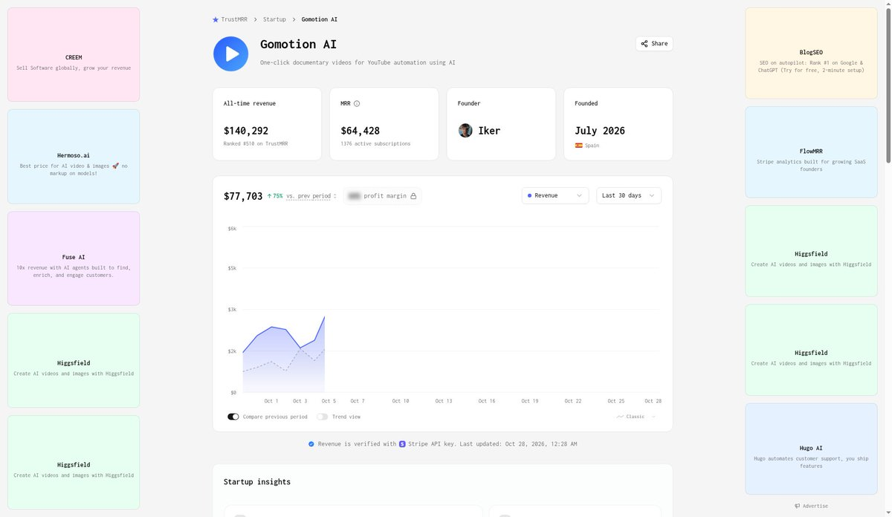
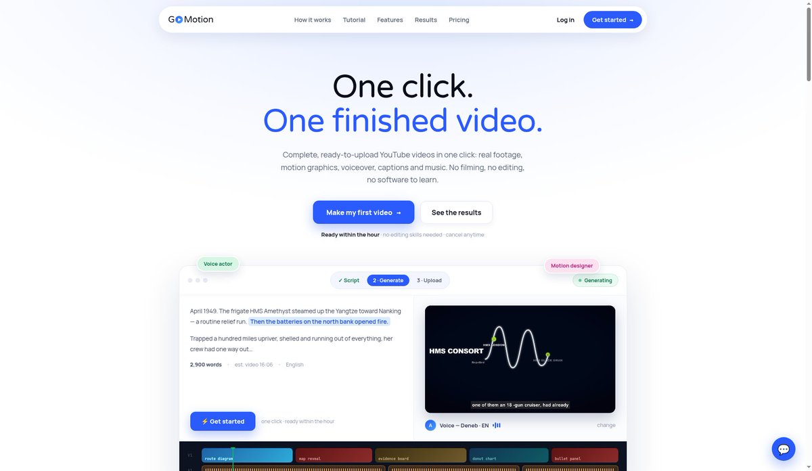

# Jason 泽源：GoMotion 上线不到 3 个月 MRR 6.4 万美元——贴脚本自动出 15 分钟纪录片

> 7 月成立的产品 GoMotion，只做一件事：贴一份视频脚本，一小时后拿到 15 分钟以上的 YouTube 纪录片，旁白、素材、字幕、动效、配乐全自动。TrustMRR（Stripe 第三方核验）数据：MRR 64,428 美元、1,376 个活跃订阅、近 30 天收入 77,703 美元、累计 140,292 美元、5,500 多个用户、未融资。定价 27/59/107 美元三档对应每月约 12/30/60 条，Creator 档一条成片约 2.25 美元。买的是时间：无脸频道靠广告分成，更新越勤赚得越多。MVP 一周能跑通，真正的坑是每句话配到版权可用的真实素材，以及长视频渲染排队的服务器成本。

<!-- more -->

一个 7 月才成立的产品，现在月收入 6.4 万美元。

它只干一件事：你贴一份视频脚本，点一下，一小时后拿到一条 15 分钟以上的 YouTube 纪录片。

旁白、每句话对应的素材、逐字字幕、地图展开这类动效、配乐，全是自动出的。

产品叫 GoMotion，用的人是做历史、真实罪案、财经、太空、助眠故事这类无脸频道的。

我去 TrustMRR 看了数据（Stripe 第三方核验，10 月 28 日更新）：

- MRR 64,428 美元
- 1,376 个活跃订阅
- 近 30 天收入 77,703 美元
- 累计 140,292 美元

不到 3 个月，5,500 多个用户，没融资。

定价 27、59、107 美元三档，每月大概 12、30、60 条视频。官网说 Creator 档一条成片约 2.25 美元。

为什么有人买，我觉得不难理解。做这类频道靠广告分成，更新越勤赚得越多。以前一条纪录片写稿、配音、找素材、剪辑要好几天，现在一个小时。他们买的是时间。

复制难度我判断中到高，脚本、配音、字幕、拼接，一周左右能跑通 MVP。

真正的坑有两个：每句话都配上版权可用的真实素材，还有长视频渲染排队的服务器成本。

## 相关页面

- [[patterns/story-studio-video-pipeline]]
- [[patterns/code-video-rendering-method-matrix]]
- [[patterns/ai-wealth-creation]]
