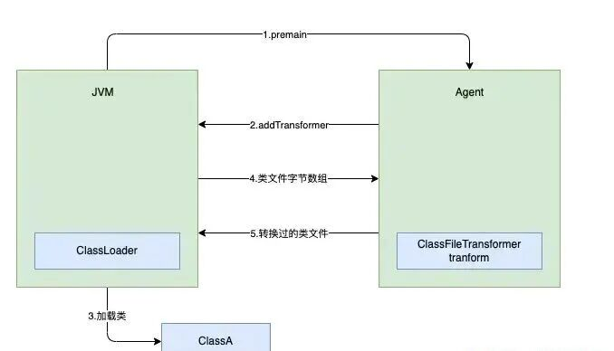
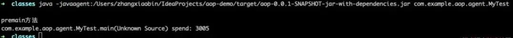
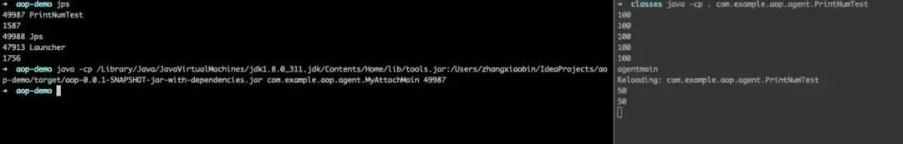
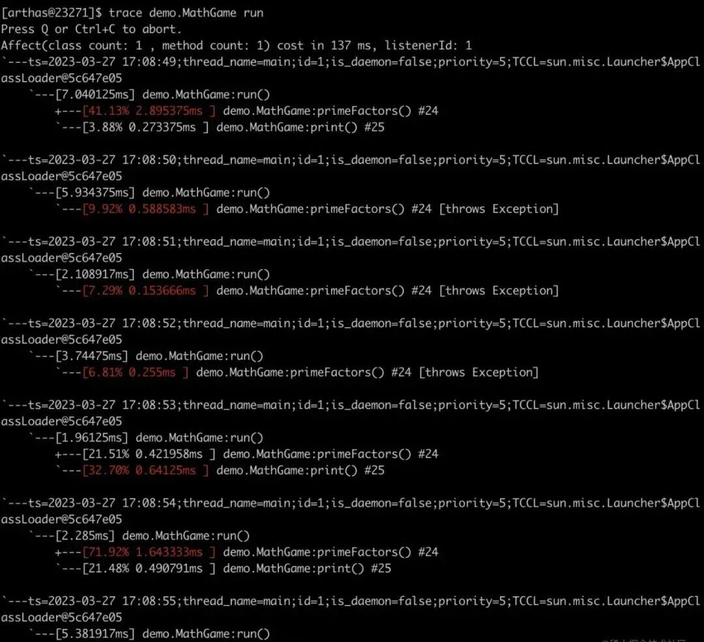
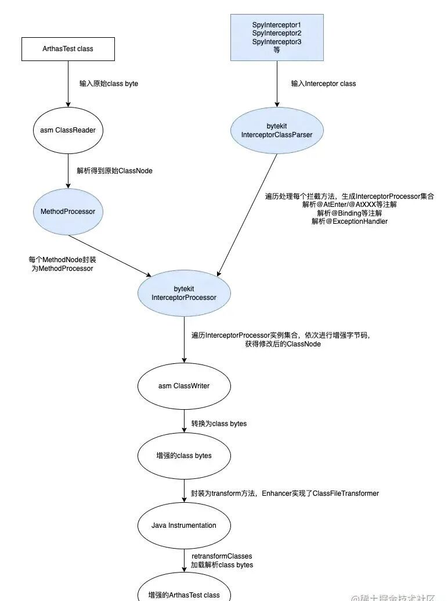

# 手把手教你实现一个 Java Agent：从 Instrumentation、Attach 到 Arthas Trace 底层原理

> 在微服务性能调优和排障中，如果直接在业务代码中写死大量 `StopWatch` 统计耗时，会带来极大的代码侵入与维护负担。基于 JVM 提供的 Java Agent 机制，开发人员可以在不修改任何业务代码的前提下，实现零侵入的方法耗时统计与动态诊断。本文系统讲解 Java Agent 的底层核心接口 `Instrumentation`、类加载器转换机制、JVM 启动前 `premain` 与运行时动态 `attach`（VirtualMachine）的区别与实战，并深入阿里开源诊断神器 Arthas，拆解其 `trace` 命令如何基于 ByteKit 与 ASM 框架完成优雅的无侵入字节码增强。

<!-- more -->

## 01. 业务痛点：侵入式耗时统计的弊端

日常开发中做性能优化时，许多团队由于缺乏基础监控设施，往往在业务代码中嵌入大量统计逻辑：

```java
@Override
public void method(Req req) {
    StopWatch stopWatch = new StopWatch();
    stopWatch.start("某某方法-耗时统计");
    doBusiness();
    stopWatch.stop();
    log.info("查询耗时分布：{}", stopWatch.prettyPrint());
}
```

这类代码不仅严重污染核心业务逻辑、侵入性极大，而且排查完毕后往往遗留在代码库中形成坏味道。Java Agent 技术正是为了以**无侵入**方式解决此类横切关注点而生。

---

## 02. Instrumentation 机制

JDK 从 1.5 版本开始引入了 `java.lang.instrument` 包，该包提供了一系列工具帮助开发人员实现字节码增强。核心接口为 `Instrumentation`：

```java
public interface Instrumentation {
    // 注册 Class 文件转换器，用于改变 Class 字节流
    void addTransformer(ClassFileTransformer transformer, boolean canRetransform);
    
    // 移除指定的转换器
    boolean removeTransformer(ClassFileTransformer transformer);
    
    // 重新转换已加载的类
    void retransformClasses(Class<?>... classes) throws UnmodifiableClassException;
    
    // 当前 JVM 配置是否支持重转换
    boolean isRetransformClassesSupported();
    
    // 获取所有已加载的类
    Class[] getAllLoadedClasses();
}
```

`ClassFileTransformer` 的 `transform` 方法负责拦截 JVM 的类加载过程。当方法返回修改后的字节数组时，JVM 将直接加载并运行转换后的字节码。

Instrumentation 有两种经典使用方式：
1. **JVM 启动时挂载（静态加载）**：通过 `-javaagent:xxx.jar` 参数挂载；
2. **JVM 运行时挂载（动态加载）**：在任意时刻通过 Attach API 远程连接目标进程并加载 Agent Jar。

---

## 03. 启动前加载：Premain 机制

使用静态 Java Agent 时，核心类必须声明一个规范方法：

```java
public static void premain(String agentArgs, Instrumentation inst);
```

顾名思义，它在 Java 虚拟机的 `main()` 函数执行之前运行。JVM 启动时的处理流程如下：


*图 1：JVM 执行 premain 注册 ClassFileTransformer，在类加载时动态改写字节码*

### 实战示例：统计方法执行耗时

1. 实现 `ClassFileTransformer`，利用 ASM 或 Javassist 在目标方法的前后插入耗时打点；
2. 在 `premain` 中调用 `inst.addTransformer(new TimeCostTransformer())`；
3. 打包时在 `MANIFEST.MF` 中声明 `Premain-Class: com.example.MyAgent`；
4. 启动目标程序时增加启动参数：`java -javaagent:myagent.jar -jar app.jar`。

控制台将输出被拦截方法的毫秒级执行耗时：


*图 2：无侵入实现的方法耗时统计运行结果*

---

## 04. 运行时动态附加：Agentmain 与 Attach API

`premain` 局限于在应用启动前配置。如果线上系统早已处于运行状态，想在不重启 JVM 的前提下临时排查问题，就需要使用 Attach API。

其核心方法签名如下：

```java
public static void agentmain(String agentArgs, Instrumentation inst);
```

`agentmain` 是在 Agent 被附加到目标 JVM 时触发的。通过跨进程通信，Attach 发起端（一个独立的 Java 进程）通过 `com.sun.tools.attach.VirtualMachine` 建立连接：

```java
// 1. 获取目标进程 PID
VirtualMachine vm = VirtualMachine.attach("12345");

// 2. 注入 Agent Jar
vm.loadAgent("/path/to/attach-agent.jar", "param");

// 3. 断开连接
vm.detach();
```

结合 `Instrumentation.retransformClasses()` 方法，可以热重载并动态替换目标类的字节码实现，实现真正的热拔插在线排错。


*图 3：运行时动态 Attach 并修改目标类返回结果*

---

## 05. 进阶探秘：Arthas Trace 命令背后的实现原理

阿里巴巴开源的 Java 诊断利器 **Arthas**，其强大的 `trace` 命令正是上述技术的集大成者。


*图 4：Arthas trace 输出多层级调用树与精确耗时*

### 5.1 ByteKit 增强封装
直接手写 ASM 字节码操作极易出错且难以维护。Arthas 基于 ASM 封装了开源字节码工具库 **ByteKit**，提供了高层语义注解：
- `@AtEnter`：方法进入时织入；
- `@AtExit`：方法正常退出时织入；
- `@AtExceptionExit`：发生异常时在特定 `try-catch` 块中捕获处理；
- `inline = true`：代码直接内联嵌入原方法体中。

### 5.2 Arthas Trace 内部流程
Arthas 的各种命令采用了模版方法模式。入口为 `AnnotatedCommand`，复杂的动态追踪逻辑封装在 `EnhancerCommand` 与 `TraceCommand` 中：


*图 5：Arthas Trace 命令解析拦截器注解并重写方法字节码的整体流程*

1. 解析各类拦截器（Interceptor Class）上的 `@AtEnter`、`@Binding` 等注解，构建 `InterceptorProcessor` 集合；
2. 递归遍历目标方法，在每一个子方法调用的入口与出口插入时间戳采样与调用树构建代码；
3. 通过 Attach 机制下发至目标 JVM，最终在终端渲染出清晰的树状耗时分布。

---

## 相关页面

- [[sources/dma-engine-from-descriptor-to-completion]]
- [[columns/agentic-engineer/zero-agent/agent-from-zero-longterm-memory-management]]
- [[concepts/engineering-skills]]
- [[concepts/ai-friendly-backend]]
