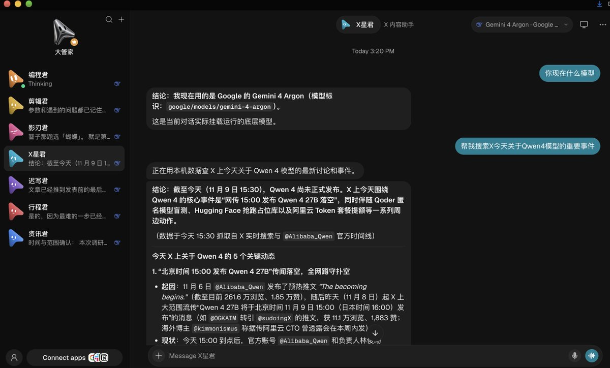
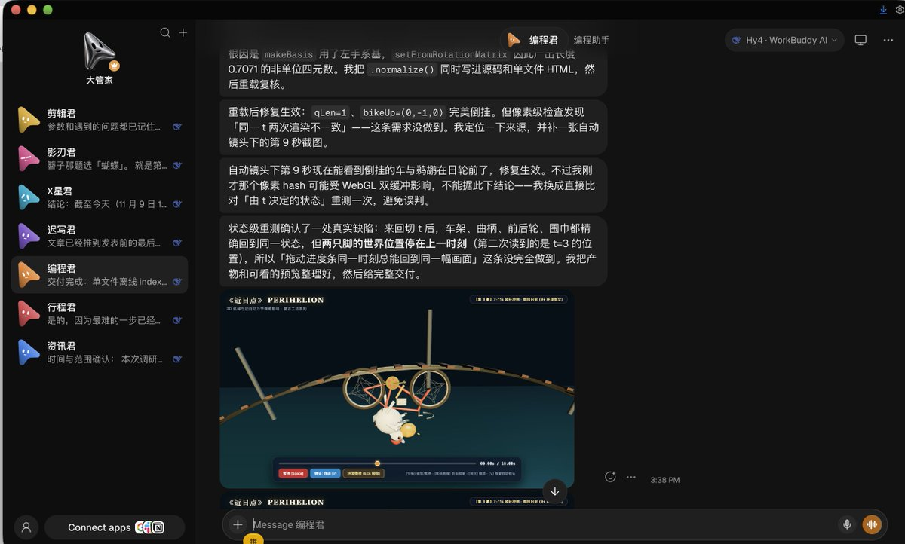

# Jerry Xiong（@Jerry_Galaxy）：OpenMausBot + Magpie 实现无限 Token 与多 Bot 并行且不被封号

> 实战配置路径：以 Magpie 作为模型路由层——① 在 Magpie 登录 WorkBuddy 后选择免费或积分模型；② 把 Google AI Studio 的 API Key 配进 Magpie（建议充值 1 美元开启付费层级，可用 Google 每月赠送金，Pro 每月 10 美元、Ultra 更多，GCP 新用户可直接 300 美元）；③ 本机登录 agy CLI，让 OpenMausBot 通过 agy CLI 完成任务，从而完全规避账号被 Google 锁定——切勿在第三方工具用 OAuth 登录 Google 模型，这是雷区极易封号；④ 已有 opencode、ollama、cursor、openAI 订阅甚至本地模型都可配进 Magpie，模型池越丰富越能做到每个任务用不同模型完成。

<!-- more -->

我的私藏分享，OpenMausBot 如何做到：无限 Token+多 Bot 并行任务+不被 Google 封号的情况将 Gemini Argon 接入 OpenMausBot。

核心是依靠 magpie 来路由模型：

1. 在 magpie 里登陆 WorkBuddy 后选择使用免费模型或需要积分的模型，这样你可以使用 WorkBuddy 里各种模型。

2. 将 google ai studio 里的 API Key（建议充值 1 刀开启付费层级）配置到 magpie 里，这样你就可以使用 google 每月赠送金，Pro 用户每月 10 刀，Ultra 更多，然后在 OpenMausBot 直接使用 Gemini Argon 模型。如果你是 GCP 全新用户那直接 300 刀更爽了。

3. 你机器登陆 agy cli，然后让 OpenMausBot 通过 agy cli 来完成各种任务，这样能完全避免账号被 google 锁定问题。千万不要通过 oauth 在第三方工具使用 google 模型，这是雷区，非常容易封号。

4. 如果你还有 opencode、ollama、cursor、openAI 等订阅，甚至本地模型，都可以配置到 magpie，这样你能有更多模型池，可以做到每个任务使用完全不同模型完成。
   大家快去试试吧。

## 相关页面

- [[sources/zujingpgg-openmausbot-grok-bot-alternative]]
- [[sources/diygod-pinky-open-source-phone-remote-control-for-ai-agents]]
- [[concepts/agentic-architectures]]
- [[concepts/agent-skill]]
