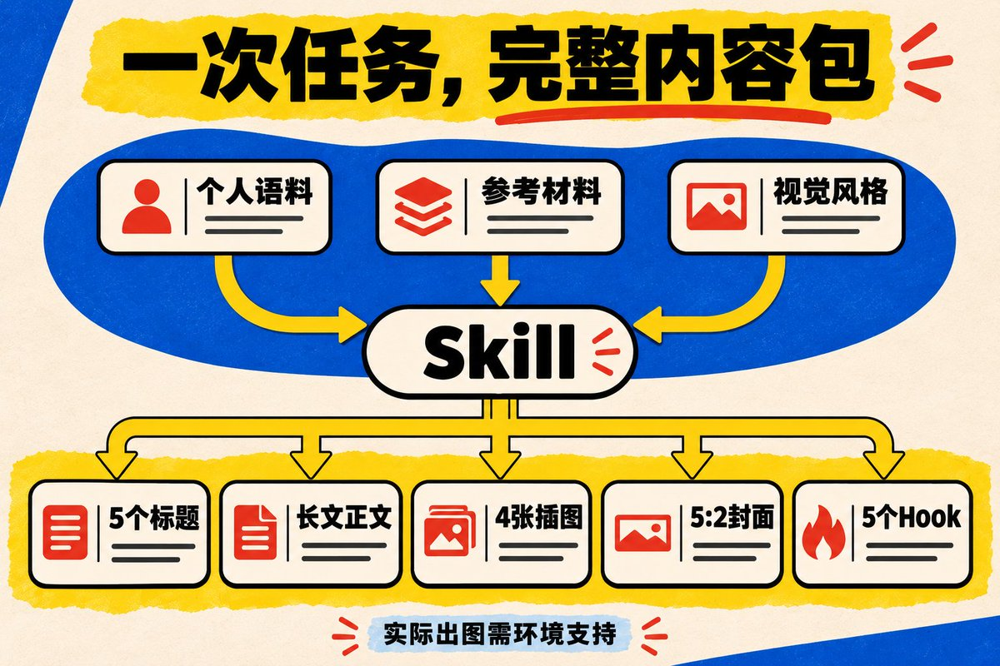

# Jessi Cao（@JessiCao_JC）：我把写 X 长文的流程做成了 Skill——语料、配图、封面，整套开源

> 自建 X 长文生产 Skill 的开源与复盘：把选题、写作、配图、封面与发布 Hook 固化成一条可复用流水线，默认产出 5 个标题备选、2000 字以上实操教程长文、4 张正文插图、1 张 5:2 横幅封面与 5 个 250 字符以内的导流 Hook；作者同时坦诚指出一份规则无法复制个人效果的原因在于语料与人设沉淀，并给出语料准备、图片风格配置与人工复核清单。

<!-- more -->

我现在做内容，AI 用得已经很多了

从选题、文字到配图，基本上都在用自己搭好的 Skill。它会结合我之前积累的语料和人设风格，把文章、插图、封面、发布时用的 Hook 一起做出来。生成之后，我通常整体 review 一遍，有些细节需要改，就改一下，不用每次从头重写

但这个使用感受有一个前提：里面有我自己的语料，也有之前反复调整过的要求。换一个人，只拿到一份规则，不一定就能得到同样的结果。

所以这次我把通用流程单独整理出来 skill，放到了 GitHub。大家可以填自己的语料、自己的配图风格，生成自己的 X 长文

我也是用这个长文 skill 生产出自己的爆款长文，24h 涨粉 3k+


先给地址：[X-Article-skill 开源仓库](https://github.com/JessiJCJingyi/X-Article-skill)

目前我把它当成一个 60 分的初版。能跑完整流程，也有没做好的地方。下面把怎么用、要准备什么，以及哪些地方还需要自己看一遍，讲清楚。

## 01. 先看它能替你完成哪些工作

写 X 长文，正文完成之后，往往还有不少事：标题要选，重点要配图，封面要做，发文章时还需要一段让人愿意点进来的文字。

我把这些交付写进了同一个流程。默认会得到：

- 5 个标题备选，从中选定一条主标题。
- 一篇不少于 2000 字的中文长文，默认按实操教程组织。
- 4 张正文插图，解释文章里的步骤、关系或判断。
- 1 张 5:2 横幅封面，与正文插图统一风格。
- 5 个导流 Hook，每个控制在 250 字符以内。

你不需要每次把这张清单再说一遍。只想改某一项时，直接说“只改封面”或者“给这篇文章重写 5 个 Hook”也可以。

这里的 Skill，可以理解为交给 AI 的一份工作说明：收到资料先做什么，什么时候应该问你，最后交哪些文件。它本身不附带一个模型，也不附带出图额度。实际图片能否生成，要看你使用的助手有没有图像工具；没有的话，它应该明确告诉你只完成了提示词和图位。

文章主题可以是小红书运营、办公方法、产品经验，也可以是你的专业领域。这个公开版最终生成的是 X Article


## 02. 想让它写得像你，先给它一点真的东西

我选择小红书运营作为自己的内容方向，是因为做过大概两年，有个人号、产品号从零起号的经验，也积累过运营 SOP。写作时，这些东西可以拿出来拆步骤、讲判断。

对我来说，语料不只是已经发表的文章。你向朋友解释一件事的方式、一次真实的复盘、为什么不建议某种做法，都可以成为材料。

第一次试用，不必先整理一个庞大的知识库。可以先准备：

1. 一两段你自己写过的内容，或者一段口述整理。
2. 一个愿意公开的具体过程：遇到什么问题，怎么做，结果怎样。
3. 这篇文章要参考的资料，以及你对它的看法。

比如，你准备写“新手第一篇小红书笔记怎么做”，可以这样口述：

以下为输入示例，不是我的真实案例：

我想写给已经确定方向、但一直没发出第一篇笔记的人。

这篇先教他把一个用户问题变成标题和内容提纲。

我希望读者最后能列出每张图放什么，而不只是学到一堆术语。

没有可以公开的成绩，不要写涨粉或变现数据。

这样的材料已经能帮助 AI 确定文章范围。相比“写一篇专业、有深度的爆款文章”，它更容易知道哪里应该展开，哪里应该收住。

语料还需要分清用途。自己的公开文章，可以允许改写；涉及客户或私聊的材料，如果只想让它学习你的表达，就标注“仅学习表达，不使用其中的事实”。不方便提供的内容直接不放。

你的个人语料放在自己的目录里，不用提交到这个 GitHub 仓库。 公开的是通用规则和空白模板，填完的模板属于你自己的创作材料。

## 03. 第一次用，它会先问你 8 个问题

之前我不太满意的一点，是 AI 拿到一个标题，就开始往下写。写得很完整，但里面未必有我真正想讲的东西。

所以公开版刚补了一步：首次完整创作，先采访，再生成。

这 8 个问题大致是：

1. 这篇具体想讲什么，最想解决哪个问题？
2. 写给谁，对方现在卡在哪一步？
3. 读完后，希望他能完成什么？
4. 关于这个主题，你最想表达的判断是什么？
5. 有哪些真实经历、步骤、数据或参考材料可以支持？
6. 你平时怎么表达，喜欢什么语气，不喜欢哪些词？
7. 配图希望什么风格，有没有参考图？
8. 有什么必须讲清楚、必须保留，或者不能出现的内容？

它会根据已有材料分轮问，通常一轮 3—4 个。你已经说过的，就不应该再问一遍。

这里也借用了 grilling 的追问方式：先把前提问清楚，再往后推进。比如连读者是谁都没确定，就没必要急着替你设计文章的收尾话术。这套方法已经写进公开版，不需要再安装一个 grilling 才能用。

回答不需要写得像文案。你可以直接口述：“我就是觉得大家在这一步容易想太多，我想让他们先做出来。”助手再追问具体是哪一步、你为什么这样判断。

没有案例就说没有，没有配图想法就让它给建议。它需要把缺口说出来，让你决定怎么补，不能悄悄替你加一段成功经历。

回答整理清楚之后，它会形成一份简短的创作简报，再进入制作。同一会话里已经有了这些回答，后续文章只补新的主题和变化。跨会话的长期档案复用，我还没有在这个版本里做完，不会说它已经永久记住了你。


## 04. 下载之后，怎么开始用

第一版优先写了 Codex 的使用方式

打开 [GitHub 仓库](https://github.com/JessiJCJingyi/X-Article-skill)，下载 ZIP 并解压。打开终端，进入解压后的仓库文件夹；电脑已经安装 Python 3 的情况下，运行：

```bash
python3 scripts/install.py
```

这个命令只安装公开 Skill。遇到已经存在的同名目录，会停止，不直接覆盖你自己的修改。具体安装位置和自定义目录的方法，README 里都有。

安装完成后，在 Codex 后续消息里调用：

```text
$x-article-skill

主题：如何制作第一篇小红书图文笔记。
读者：已经确定账号方向，但还没有开始发布的新手。
最终形式：X 长文操作手册。

结合我提供的个人语料和视觉风格，生成完整内容包。
先问清楚缺失的信息，再写文章。
没有真实案例的部分，用明确标注的演示。
生成后给我审阅，不自动发布。
```

这个例子的主题是小红书，产出形式依然是 X 长文。你可以把主题和读者换成自己的，其他要求先保留。

仓库里有两份模板：一份填创作资料，一份填视觉风格。复制到自己的工作目录，填写后作为附件提供给助手，或者明确告诉它可以读取哪些文件。

如果暂时不会安装，也可以把 Skill 文件和它引用的采访说明、输入模板提供给能读取文件的助手，请它照着执行。这是手动提供工作说明，不等于完成了客户端安装；实际出图和保存文件的能力，仍然取决于那个助手。

第一次出现“不知道怎么开始”的情况，可以先用仓库里的演示输入试一遍。演示不包含你的经历，适合熟悉流程；准备正式写自己的文章时，再换成自己的材料。

## 05. 配图风格，要说到能判断对不对

我自己提过很多次类似的修改：字太多，标题太窄，重点不突出。

这些意见其实比“做得高级一点”更有用。它们能变成下一次生成时的明确要求，你也能看着成品检查有没有做到。

如果还没有自己的配图风格，可以先这样描述：

视觉要求示例：

背景用浅色，标题用宽体字，手机上能直接读清楚。

封面只保留短主标题和一行副标题。

正文图每张解释一个问题，不把整段文章塞进去。

使用同一套配色，不要每张图换一种画风。

不要生成看起来像真实数据后台的截图。

有参考图会更直观，但要补一句具体参考什么：是配色、字体、留白，还是图中信息的排列方式。别让 AI 连原图的文案和内容也一起搬过来。

插图应该承担实际任务。讲先后顺序就画流程，讲区别就做对照，讲怎么检查就做检查图。文字已经讲清楚的地方，不必再塞一张只有几个装饰图标的图片。

封面则把范围收小。长标题可以放在 Article 标题栏里，图上提炼为短标题。你希望读者第一眼记住什么，就把那句话留在最大的位置。



## 06. 我通常怎么 review，你第一次该检查什么

我现在使用自己的版本，通常是生成后整体看一遍，有细节再调整。这个结果来自之前已经积累的语料和规则，所以不代表第一次拿到公开版，也一定不需要改。

第一次用，我建议先看这几处：

- 文章里的“我做过”“我发现”，是不是确实来自你的材料？
- 标题承诺的步骤、模板或结果，正文有没有交付？
- 哪几段读起来像在重复同一个意思？
- 图中文字有没有错，重点是不是一眼能找到？
- 封面和 Hook 有没有把普通建议夸成确定的效果？

修改时尽量说具体。比如“第二节删掉重复解释，保留操作步骤和例子”，就比“整体再去一下 AI 味”更容易执行。

你也可以把自己反复改的地方逐渐整理成规则：不喜欢哪些开头、封面允许多少信息、哪些经历不能公开。一次只改某篇文章的问题，不必都变成永久规则。否则越积越多，最后每篇都被同一套写法卡住。

公开版不会替你点击发布。正文和图片生成后，仍需要你放进 X 的编辑器，检查实际排版、图片顺序和封面裁切。

## 07. 这个版本实际测到了哪一步

公开之后，我让助手按新用户的路径做了一轮测试：从 GitHub 下载，在隔离目录安装，再让不继承我这段聊天和私人语料的独立助手，使用仓库里的演示材料生成内容。

那轮产出了一篇正文 2551 字的教程、4 张插图、1 张约 5:2 的封面，以及 5 个符合长度要求的 Hook。

但我不想把“文件都出来了”写成“质量已经很好”。

测试稿有重复解释的问题，Hook 的点击理由还不够强，图片也没有严格遵守某一条配色要求。首次采访的八问，是这轮测试之后补进来的；新流程还没有重新完整跑一遍。新电脑上的原生 Skill 发现、各个客户端的兼容情况，也没有全部验证。

所以我觉得，现阶段先把它当成一个可以试用、可以继续改的 60 分版本，没有什么问题。它已经把需要交付的东西和基本流程整理出来，接下来还要继续优化采访、文字精炼和视觉验收。

这也是我愿意公开的原因：先让大家拿自己的材料使用，再看真正卡住的是哪一步。你的问题可能是“它一直追问，没开始写”，也可能是“文案可以，但配图不像我的风格”。这些具体反馈，才知道下一版应该改哪里。

## 08. 从你最熟的一件事开始试

第一次不用挑一个很大的题目，也不用为了配合 Skill，临时去写自己不熟悉的领域。

找一个你确实做过、别人也会问的问题。把过程讲出来，说明读者是谁，附上你喜欢的视觉参考，让它先采访你，再整理成文章。

你会更容易判断：哪些话确实是我会说的，哪些地方它理解错了，哪张图把意思讲清楚了。这些判断，也会成为你下一次使用的输入。

仓库在这里：[X-Article-skill｜下载与使用说明](https://github.com/JessiJCJingyi/X-Article-skill)。

可以先跑一篇。遇到问题，在仓库里留下经过匿名处理的输入、你期待的结果和实际结果；自己的私人语料就不用一起发出来了。

## 往期文章

引用推文：Jessi Cao (@JessiCao_JC)

很多人做小红书，第一步就开始日更 发了几篇没数据，又去研究养号、设备和发布时间 真正的问题可能更早：陌生人看完主页，还是不知道你是谁、能帮他解决什么。 我把小红书冷启动这 7 天 SOP，开始发内容之前，先把这一步做完👇 https://t.co/Bh7CbKwME5

https://x.com/JessiCao_JC/status/2107674848457843182

引用推文：Jessi Cao (@JessiCao_JC)

很多人都不知道做小红书最重要的就是找对标 找对标，最容易错在用粉丝量判断一切 这篇把阶段、内容成本、评论需求和数据观察拆开讲，附一份可以直接填的对标表。找账号之前先看一下 ↓

https://x.com/JessiCao_JC/status/2108861809952465002

引用推文：Jessi Cao (@JessiCao_JC)

小红书主页简介这样改，涨粉率提高 80% https://t.co/WmZDHrYE3s

https://x.com/JessiCao_JC/status/2110238620359778473

## 相关页面

- [[sources/kaitox-markdown-to-x-article]]
- [[sources/yuntianming-md2draft-markdown-to-x-draft-extension]]
- [[concepts/agent-skill]]
- [[concepts/selfmedia-compound-model]]
