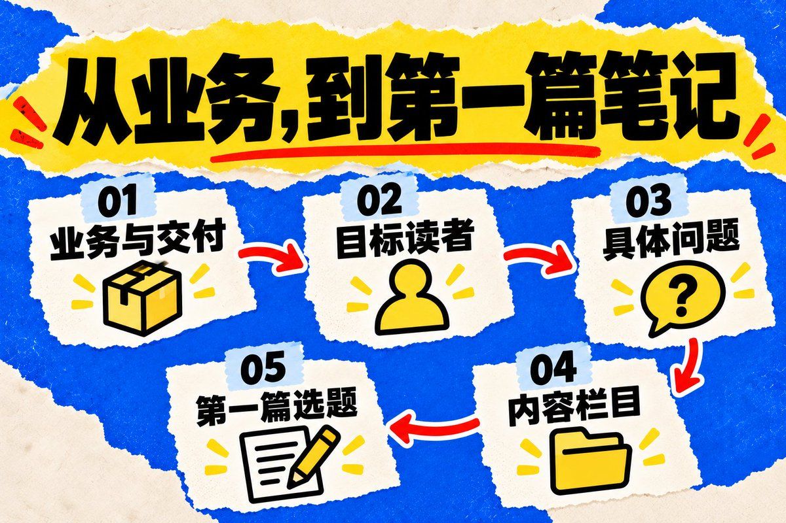
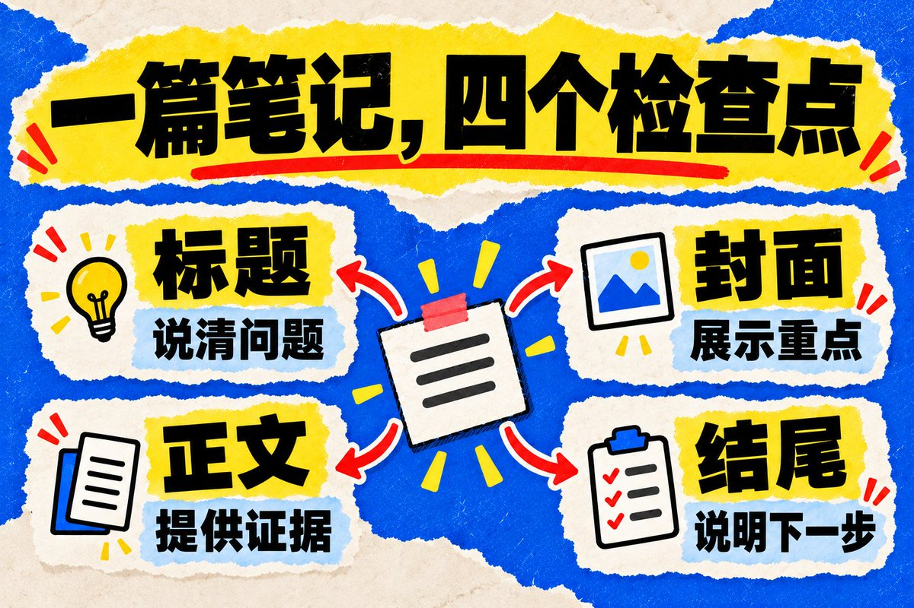
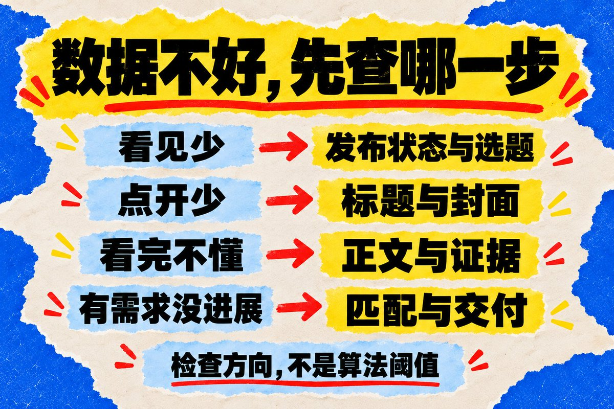
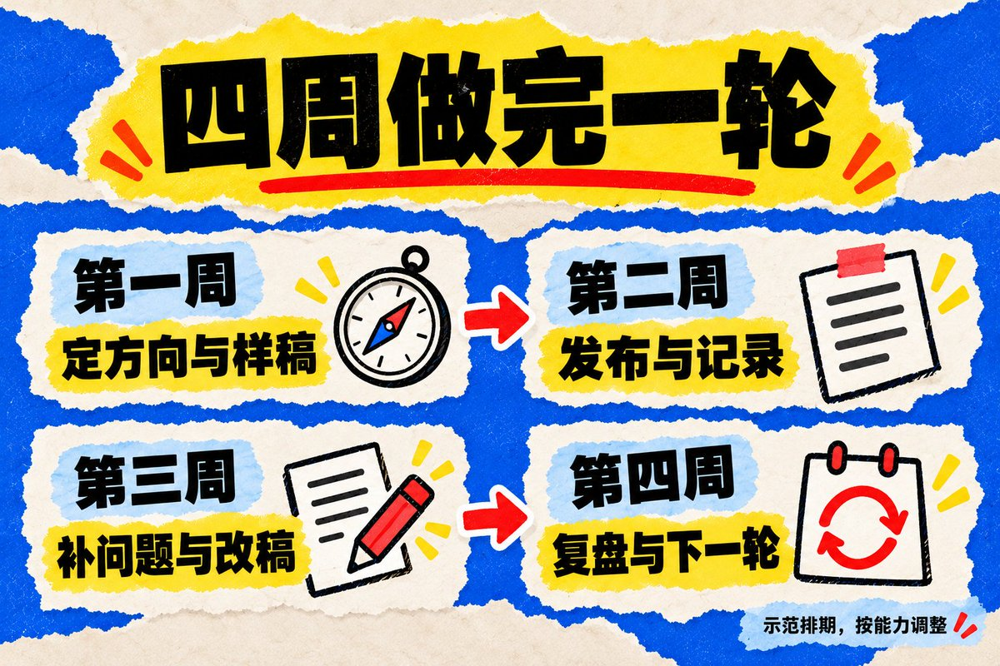

# Jessi Cao（@JessiCao_JC）：万字教程｜小红书从 0 到 1 入门运营详细指南——业务定位、对标拆解与变现闭环

> 服务型与虚拟资产创作者必读的小红书全流程实战手册：从买前疑虑反推业务定位、垂直人群定义与三栏目设计、真诚人设打造；到对标账号深度拆解、高点击封面与标题公式、数据漏斗多维排查，以及私域转化接单与履约交付流程。

<!-- more -->

准备做小红书的时候，手上往往已经存了很多教程。有人说先养号，有人说先找对标，有人让你每天发，还有人说不做个人 IP 就没机会。

每条建议单独看都像有道理，放在一起，第一步反而更难下手。尤其是你已经有产品、有服务的时候：账号到底发什么，什么样的人会来看，看完又为什么愿意找你？这些问题没想明白，忙一周也可能只是多了几篇笔记。

我更熟悉的是卖虚拟产品、提供个人服务的老板。我觉得，不管最后选什么平台，先说清楚你能帮谁解决什么问题，后面的动作才接得上。小红书运营也可以按这个顺序做：确认业务和人群，找到具体问题，把解决过程写出来，再看吸引来的人是不是你想服务的人。

这篇把从零开始需要处理的事情排了一遍。已有产品的人，可以跟着做一轮；暂时没有产品、想先做内容的人，也会看到适合自己的起点。文中会用一个“为小团队提供内容策划服务”的演示账号贯穿操作，它不是我的实测账号。涉及商品的地方，再补一个实体产品例子。

不用一次把全文背下来。每走完一节，留下一份东西：定位卡、对标表、选题单、样稿，最后是一份能看出问题的复盘记录。你下一次打开文档，就知道接着做哪一步。

## 先看你现在卡在哪里

- 还没确定做什么：先读第一、二节，把业务和读者说清楚。
- 知道方向，但不知道发什么：读第三到第五节，完成调研和第一批选题。
- 有选题，做出来总觉得不像样：读第六、七节，拆开标题、封面、图文和视频。
- 已经在发，数据不好也不知道怎么改：读第八、九节，按环节查问题。
- 有人来问，没形成业务：读第十节，检查咨询和交付。
- 准备投放、招人或者做矩阵：先读第十一节，再决定现在是否值得扩大。
- 想照着排一个月：最后一节有行动安排和可复制的工作底稿。

## 一、先决定这个账号要帮你做哪门生意

### 已有产品的人，从客户买之前的问题开始

拿张纸，写下你现在能卖的具体东西。不要只写“咨询”“课程”“设计服务”，写到别人可以判断买了之后会得到什么。

比如“内容策划服务”还太宽，可以继续补成：为一到三个人的小团队整理用户问题，制定一轮内容选题，并完成其中几篇样稿。交付物是什么、需要客户提供什么、你暂时不做什么，都说得出来，才方便往下选题。

接着想，客户买之前会犹豫什么。他可能担心你不了解行业，担心拿到的只是模板，也可能还没弄清自己到底需要策划还是代运营。这些问题，比“我们服务很专业”更适合做内容。

卖产品也是一样。卖收纳盒的人，除了展示产品外观，还可以回答抽屉尺寸怎么量、东西太碎怎么分区、拿取是否方便。产品当然重要，但用户的生活里不会只有你的产品，他先遇到的是一个具体麻烦。

把这两层写在一起：

我提供：__。

客户通常在__的时候需要它。

买之前最担心：__。

我能展示的证据：__。

我暂时不能解决：__。

如果这些都写不出来，先补业务本身。一个讲不清的服务，很难靠换标题变得好卖。你可能需要先完成一次小规模试交付，知道自己做得完什么，再把过程整理成内容。

### 还没有产品的人，先找自己能持续提供的材料

没有产品不等于不能开始。你可以从长期使用经验、工作技能、真实学习过程里选一个方向。关键是你愿不愿意持续接触这个问题，手里有没有自己的材料。

比如你经常给租房空间做整理，可以记录测量、挑选和调整的过程。以后有可能发展出品牌合作、产品推荐或者服务，但开始时不用假装已经有完整商业模式。

先问自己两个问题：接下来的几周，我还能做出哪些不同的内容？如果没有广告费，我能不能承受这段时间的投入？答案会影响你做图文还是视频，买不买拍摄设备，是否接需要大量前期投入的合作。

不要因为别人说某个赛道“离钱近”，就直接跳进去。同一个品类，有人有供应链，有人有专业经验，有人靠长期积累的受众。你能看到他们卖什么，却未必看得到成本和投入。

### 把变现方式拆开看，别把收入都算成粉丝的功劳

常见的几条路径，可以用不同的问题判断。

做品牌合作，客户看的是你的内容、受众是否匹配、制作能力和履约情况。粉丝数是一个参考，不能直接乘一个比例就得出你的报价。具体合作类型和准入条件，应从[小红书蒲公英官方帮助中心](https://pgy.xiaohongshu.com/faq)查看，别把旧教程里的门槛当成固定规则。

做商品销售，除了内容，还要处理商品信息、库存、发货和售后。先在[小红书招商官网](https://ark.xiaohongshu.com/merchant/login?from=xhsweb)核对店铺类型、类目和资质要求。能不能开店、需要什么资料，是你必须先确认的事情，不适合靠同行一句“我当时很简单”来判断。

做分佣推荐，要先理解样品、合作权限、结算和退货会怎样影响收益。做个人服务，则要考虑每个客户需要你投入多少时间，怎么判断服务完成。收了钱之后的工作，比账号上看到的复杂得多。

先选一个主要目标。 这一阶段到底是验证服务需求、做出第一批商品内容，还是积累一个方向的读者？目标可以以后调整，但不能今天用涨粉判断成功，明天又因为没订单认定失败。

## 二、定位先写成一句能执行的话

### 别把“所有想变好的人”当成用户

写定位时，很容易列年龄、性别、城市、收入。这些信息可能有用，但对第一批选题来说，知道一个人当前在做什么，往往更容易落笔。

“二十五到三十五岁的创业者”很宽。“已经有产品、只有两个人负责推广、不知道第一批内容发什么的小团队”，就具体多了。这个人可能不急着学复杂的品牌战略，他眼前是周五要交选题，素材又只有几张产品照片。

把定位写成：

我帮助【处在什么阶段的人】，在【具体场景】里解决【什么问题】，主要用【什么材料或能力】来讲清楚。

演示账号可以这样填：帮助已经有产品的小团队，把零散的业务信息整理成能发布的内容；主要展示选题拆解、样稿修改和制作过程。

这句话先能用就行，不用为了找到最独特的形容词卡三天。发了一轮之后，你可能发现最关心你的人是独立咨询师，而不是实体产品团队。到时再调整，调整依据是实际反馈。

### 内容垂直，先看是不是同一批人会需要

同一个人可能既想找选题，也想改标题，还想知道没人咨询时该查什么。这些内容可以出现在同一账号里，因为它们服务同一段工作过程。

反过来，今天讲小团队运营，明天发宠物搞笑合集，后天转一篇投资观点，哪怕每篇都有道理，关注你的人也未必期待下一篇。这首先是读者体验的问题，不必每次都解释成神秘的账号标签被打乱。

给演示账号定三个栏目就够：选题怎么来，笔记怎么做，发完怎么改。遇到一个新想法，先试着放进这三个栏目。放不进去，暂时存到别处，等账号方向更清楚再考虑。

栏目不是要永远锁死你。以后有证据说明同一批读者还关心别的问题，可以逐渐拓展。一次只加一点，更容易知道新内容有没有被接住。

### 人设从你的选择里出现，不靠简介堆身份

“真诚、专业、有温度”谁都能写。真正让人看见你的，是你为什么这样选，遇到什么限制，做过哪次修改，哪些事你不愿意答应。

比如同样讲选题，有人给十个现成标题，你则展示为什么删掉其中三个：一个没有材料，一个离业务太远，一个只是换词重复。这种判断就有个人色彩，也更容易让读者理解你怎么做事。

我之前口述文章时提到过，咨询来了，我会看对方是否先说自己的情况，以及为什么联系我。这是一个具体的沟通习惯。写进文章，比给自己贴“擅长精准获客”的标签更容易让人理解。

没有很多经验也可以讲真实的过程。你刚试完一个方法，发现什么地方不适合自己，就说清楚条件。不要为了做人设，把还在学习的事情写成已经替几十个客户验证过。

## 三、找对标，是为了看懂别人怎么做

### 先找同类问题，再看是谁在持续回答

打开小红书，用你的业务词和用户问题去找内容。不要只搜“运营”，可以试“产品没有素材怎么发”“小团队内容选题”这类更接近实际工作的话。

遇到一篇有参考价值的笔记，先看它解决什么问题，再进作者主页。只收藏一篇爆款，很容易把偶然受欢迎的一个题目误认为这个账号全部的打法。

看它最近一段时间发了什么，哪些主题反复出现，内容形式是否稳定，评论里主要是谁在问问题。能连续看几篇之后，才决定要不要放进对标库。

搜索建议、相关话题和推荐内容都可以帮助发现账号，但它们只是线索。浏览习惯改变后，你看到的推荐也可能越来越相近，所以偶尔换一组问题主动搜索，避免只在同一个小圈子里打转。

### 粉丝数量接近，不等于条件接近

一个粉丝不多的账号，也可能有成熟团队、站外客户、投放预算或品牌积累。反过来，一个大账号里某篇制作简单的内容，也可能很适合你学习。

更值得比的是：面对的读者是否相似，卖的东西是否相似，内容材料你拿不拿得到，制作成本能不能承担。如果对方每周有客户现场、拍摄团队和大量真实案例，你一个人刚起步，照着它的更新节奏做，可能很快就耗尽精力。

先收五到十个账号作为工作样本。这是方便比较的数量，不是规定。可以有几个阶段接近的账号，也留一两个内容质量更高的账号，分别学习执行方式和表达上限。

对标库不要只有链接。每个账号补三句话：它帮谁，最有辨识度的内容是什么，我具体想学哪一点。写不出第三句的，暂时不用继续收藏。

### 看多篇表现，不用一条高赞证明商业成功

假设一个账号有十篇近期笔记，其中一篇互动特别高，先把这篇单独标记，再看其他九篇。高的是同一类问题，还是某次热点、抽奖或特殊事件？评论是在问业务，还是单纯表达情绪？

你能看到的公开数据，只能支持有限的判断。互动多不代表利润高，主页写着“已服务很多客户”也不是你已经核验的经营结果。对自己没有证据的部分，留空比猜一个数字更有用。

拆一篇笔记时，可以按这五个问题记：

谁会点进来？

标题和封面让他期待什么？

正文拿什么材料兑现？

评论还留下哪些没解决的问题？

如果由我来写，能补什么新的条件或证据？

最后一问决定你是不是只在换词。学结构、信息顺序和选题角度，不搬对方的照片、文案、经历。能用自己的材料做出一篇，才算这次拆解有了结果。

## 四、把用户问题变成可以写的选题

### 选题库先记问题，不急着写爆款标题

“分享我的运营经验”是一个写作方向，还不是一篇笔记。“只有产品图，怎么做出第一篇内容”就更容易准备材料。一个题目最好能让你立刻想到需要展示什么。

问题可以从四个地方来：搜索中实际出现的表达、同类内容的评论、你服务过的人问过的事、自己的工作记录。聊天里的原句尤其值得留，因为它能告诉你读者怎样描述困难。

假设有人说：“我知道要做内容，但团队没有人出镜。”这时候不要立刻归纳成“内容营销效率提升”。先保留这句话，再往下问：产品需要演示吗，现有照片能不能用，有没有必须讲清楚的步骤？最后选题可能变成“不出镜，产品教程怎么拍”。

同一个问题，还能按场景拆开。没有素材的独立设计师、卖模板的人和实体店老板，手里可用的东西不一样。你把场景写清楚，解决方法自然会更具体。

### 给每个题补上材料和用途

建表时，先留这几列就够：问题原话、目标读者、准备怎么回答、现有材料、还缺什么、这篇主要想让读者做什么。

最后一列不要每次都填“成交”。有些笔记是让别人第一次知道你，有些是解释服务，有些是解决购买顾虑。只要和当前业务有关，它们都可能有用。

比如同样做内容策划，三篇笔记可以分别是：

- “只有产品照片怎么发”：展示整理材料的方法。
- “选题策划和代运营有什么区别”：帮潜在客户判断需要哪种服务。
- “一份选题表交付后怎么用”：说明交付物如何进入实际工作。

这三篇回答不同问题，不必长得一样。第一篇适合过程演示，第二篇适合比较，第三篇适合拿一份匿名样表逐格讲解。

选题准备发布前，再问一次：如果读者照着做，能完成哪件小事？答案只有“提升认知”的，往往还需要补一个动作或例子。

### 选题排优先级，用你手里的条件判断

不用给每个题做复杂的打分系统。先挑同时满足三件事的：问题具体，手里有材料，和你想服务的人有关。缺材料但确实值得写的，安排一次拍摄、演示或采访；只有热度、和你没什么关系的，先放着。

例如“某个热点里的营销启示”可能很容易写长，但读者看完未必知道你能做什么。相比之下，把一份混乱的产品介绍改成清楚的笔记，虽然话题更小，却能直接展示能力。

也不要把同行没写过当成唯一优势。一个常见问题，如果你能给出适用条件、真实过程和明确限制，仍然有新的内容。原创不要求所有问题都由你第一次发现。

当选题库里有十几个具体问题，就可以进入制作。继续无限收藏，很容易让调研变成拖延。接下来做一篇样稿，会暴露更多真实困难。

## 五、主页和第一批内容，一起准备

### 主页先让陌生人看懂你

昵称不需要塞进所有关键词。选一个好记的名字，再带上有助理解业务的词就够了。演示账号可以叫“小林做内容”，比一串身份和符号更容易记住。这里是示例，不意味着这个名字可用，也不用照着改成一模一样。

头像清楚、辨识度稳定，比追求复杂设计重要。个人账号可以用自己的清晰照片，品牌账号可以用有权使用的标识。背景图用来补充工作场景、作品或者一句服务说明，不必再塞一份完整简历。

简介回答三个问题：你是谁，内容帮谁，为什么值得继续看。没有可公开验证的成绩，就写清楚工作范围，不用编一段履历来撑场面。

演示简介：

帮小团队把业务信息写成内容

分享选题拆解、样稿修改和制作过程

从一份能用的选题表开始

写完把昵称、简介、最近几篇笔记放在一起看。如果简介说服务创业团队，主页全是泛娱乐内容，读者还是会疑惑。主页装修只是说明，内容才是他用来核对的材料。

### 置顶内容分别解决不同疑问

如果账号当前支持置顶，可以挑几篇承担不同任务的内容：一篇说明你做什么，一篇展示你的具体做法，再有一篇回答服务或产品常见问题。实际数量与功能以账号界面为准，不用为了凑固定数量先写几篇空稿。

不要只按点赞从高到低选。有一篇热点内容互动很高，却和业务关系不大，放在最显眼的位置未必有帮助。另一篇数据普通的完整案例，可能更方便新读者理解你。

演示账号可以把“一份内容策划包含什么”作为介绍，把“一段产品描述怎么改成笔记”作为能力展示，把“什么情况暂时不需要找人代运营”作为选择参考。三篇连起来，读者能更快判断是否适合自己。

资料过时了也要更新。服务范围、交付方式或产品状态变了，就检查置顶是否仍然准确。不要让读者按照几个月前的说明来咨询，再在聊天里一项项纠正。

### 第一批不用全是干货，也不用全是广告

你可以先安排三组内容，每组都围绕同一类读者：回答一个问题，展示一个过程，交代一个选择条件。这样既能让人看到能力，也能看懂你服务的范围。

下面给演示账号排六篇，作为第一轮工作量：

1. 只有产品照片，第一篇笔记可以怎么做？
2. 把一段产品介绍拆成三个选题，过程放出来。
3. 内容策划、代写和代运营，分别解决什么问题？
4. 两个人做内容，哪些步骤可以先固定下来？
5. 展示一份选题表，从问题到材料逐格填写。
6. 没有案例、没有专人拍摄，现在适合找外包吗？

六篇是示范数量，不是账号起号的标准。你做得慢，可以拉长周期；材料已经齐全，也可以先完成一组。关键是每篇都留得下可以观察的结果，而不是为了凑篇数重复相同的话。

你也可以加一篇真实的工作记录：一次选题为什么被自己推翻，一次交付哪里改了很久。只有实际做过才写成经历。个人色彩不要求每篇都讲故事，但需要让人知道这些判断从哪里来。

## 六、把一篇笔记做出来：标题、封面、正文怎么接

### 先写正文骨架，再挑一个点击理由

拿“只有产品照片怎么做第一篇”举例，先列出三个动作：选一个使用场景，把照片按问题排序，补上照片看不出的信息。再找一组自己有权使用的图片，实际做一遍。

做完之后你才知道，这篇最值得看的是什么。如果最有价值的是一步步过程，标题可以突出操作；如果前后差别特别清楚，就突出改前改后。不要还没做内容，先定一个“七天起号”的大承诺，再回头找东西填。

同一个主题可以写几个候选：

只有产品图，第一篇小红书怎么发？

产品图别只拼一起：这 3 处信息补齐

同一组照片，改成一篇能看懂的笔记

三条都要回正文核对。“三处”是不是真的有三处，“改成”有没有展示过程。最后挑一条最贴合材料的，剩下的不是让你全部发一遍，而是帮你看清不同表达的侧重点。

标题中的关键词，也应该来自用户实际会使用的表达。卖内容策划服务的人可能熟悉很多专业词，但新手找的可能只是“没有素材怎么发”。自然说清楚任务，比把同义词塞满标题更重要。

### 封面只承担一个主要任务

封面要让读者快速认出这篇在讲什么。截图、照片、对比、简洁文字都可以，形式跟材料走。没有必要给每篇都套上复杂边框和一排小标签。

如果标题已经说“只有产品图怎么发”，封面可以展示原本零散的照片和整理后的结构。读者先看见变化，再点进去看过程。标题与封面相互补充，比把同一句话写两遍更节省空间。

做完以后缩到手机列表里接近真实的大小看。最关键的字是否清楚，主体有没有被裁掉，背景是否抢走注意力，信息是不是多到需要停下来找？这些比在电脑上放大欣赏细节更接近实际使用。

竖版图文可以把三比四当成一种常用工作画布，但不是所有内容都必须用它。横向对比或者步骤截图可能需要别的安排。最终以发布预览为准，确保关键内容没有被遮挡。

一套账号可以固定两三种版式：过程演示、对比、清单各一种。固定的是字号层级、配色和间距，不是每篇连信息位置都不能变。模板应该减少重复劳动，不该让内容为了迁就框架变得难读。

### 图文里的每一页都要有事做

把正文先当成一次解释。第一部分交代问题和适用人群，中间放操作与证据，最后交代结果和需要自己判断的条件。

例如演示笔记可以这样排：首图展示问题；第二页说明原始材料有什么；接下来展示怎样分组和补信息；最后给读者一张检查卡。页数由信息决定，三页能说明白就不用硬凑九页。

同一张图上，不要同时放完整背景、三条步骤和长段解释。先选一个主要意思，解释太长就挪到下一页或正文。图里已经完整出现的信息，配文可以补充条件、材料来源和遗漏的细节，不必逐字再抄一遍。

如果是实体商品，照片要能支撑你在说的特点。讲容量，展示实际装入什么；讲尺寸，提供清楚的参照；讲使用限制，也让读者看见。不能只靠一组好看的远景图，就要求别人相信所有卖点。

拍摄先处理最基础的条件：镜头干净，光线足够，主体明确，颜色和实际产品尽量一致。修图不要把真实缺点消掉，示意图和实拍也要区分。读者以为看到的是实物证据，收到东西却不一样，前面的内容做得再漂亮也没用。

### 结尾给读者一个自然的下一步

教程结束后，可以让读者照着做一次，或请他描述还卡在哪个环节。产品内容可以把适用条件、商品信息和当前可用的购买方式讲清楚。服务内容则说明咨询前最好准备什么。

不需要每篇都要求点赞、收藏、关注、评论、私信全部完成。动作太多，连你自己都难判断这篇主要想做什么。更不要为了引发争论故意说半句、编一个对立面，让评论数量盖过问题本身。

如果你确实有一张模板，就完整说明里面是什么、适合谁使用。没有准备好就别写“评论发你全套”。一次兑现不了的承诺，会让后续沟通变得更难。

## 七、图文还是视频，按你要展示的东西选

图文适合让人停下来比较、逐项填写、反复查阅。视频适合动作、过程、语气和空间关系。不要因为有人说视频流量更大，就把一张本来很好读的表录成缓慢滑动的屏幕。

演示账号如果要讲“如何整理一份选题表”，图文能直接给出字段和例子。如果要讲“客户抛出一个大问题时怎么追问”，口述或对话演示更容易表现沟通节奏。

先做自己能稳定完成的形式。一个人每次拍视频都要搭景、补光、录三遍、剪半天，可能需要先把内容范围收小。更简单的录屏加讲解，有时已经能把过程交代清楚。

### 口播别从一张写满术语的稿纸开始

先找一个具体问题，像回答朋友那样讲一遍。录完以后保留实际说出的判断，再删重复和停顿。这样整理出来的稿子，通常比先写一篇书面文章再强行读出来更接近你的表达。

我这套内容创作里，也会先保留口述，再区分原话、整理后的判断和编辑补充的例子。比如我讲过一次 X 推广合作，哪些细节是我说过的，就保留；没有说过的成交金额和时间，不会为了故事好看补进去。

你自己录的时候也可以这样问：发生了什么，我当时为什么这么判断，后来发现哪里需要改？一次只讲一个问题，讲完再补需要的画面。别一上来就要求自己五分钟讲完全部运营方法。

视频剪辑优先保证听得清、顺序明白、画面与说法对应。字幕检查人名、数字和业务词，重要步骤留够阅读时间。背景音乐、转场和装饰放在后面，它们救不了一个还没说清楚的问题。

### AI 可以整理材料，但证据需要你提供

可以让 AI 帮你归类评论问题、整理口述、提出标题候选、检查一份笔记有没有前后矛盾。把用户信息去标识后再处理，别为了方便一次上传整套客户资料。

比较好用的要求是：只基于已有材料整理，缺少的地方列成问题，不补写结果。你再去补一张图、一段操作记录或一次回答。这样 AI 帮你减少整理工作，文章仍然有自己的内容。

最后一定读一遍。把你平时不会说的话删掉，把“赋能”“闭环”“全方位提升”换成具体动作。文章里每个“我”，都要知道是谁真的做过；每个结果，都要知道能从哪里核对。

## 八、发布之前检查一次，发完先留下记录

### 不要把准备工作无限延长

新手容易在发布前做很多仪式：刷固定时长，等某个整点，反复改简介，买一堆工具。学习同行和熟悉平台当然有用，但它们不能替代自己的第一篇作品，也不能保证给你带来某个曝光数量。

先完成基础检查：标题与内容是否一致，图片是否可读，使用材料是否有权限，事实和数字是否能解释，产品或服务描述是否准确。需要资质的内容和经营活动，按对应要求准备。

小红书官方社区公约强调真诚分享，产品功效和服务效果的描述需要真实体验或依据支撑。这个原则也适合用来检查自己的稿子：说了什么，就拿得出什么，不为了引人点击加一个没验证的结果。[官方社区公约](https://pgy.xiaohongshu.com/help/detail?id=1eda0a065dd894063c2e029a49e8f6a1&userType=4)

发布时，地点、话题和其他信息按实际内容填写。无关热门词即使能让文字看起来热闹，也不会让笔记更好懂。不要把“关键词布局”做成在每一页机械重复业务名。

### 给自己选一个能持续的发布节奏

先看一周能做出几份有材料的内容。如果只能认真完成两篇，就先排两篇。每次都熬夜赶一篇，后续很容易只剩空话或者转述别人的内容。

制作和发布可以分开安排。一次集中拍几组素材，另一个时间写稿，再留时间复查。这样更容易估算成本，也方便观察哪个步骤经常拖延。

发布时间可以记录，但不要把每次数据差都归咎于错过了某个整点。不同受众使用习惯可能不同，你可以在自己的可持续时段里积累观察。刚起步样本很少时，不需要用两篇笔记总结出一个全平台规律。

发出之后留一份版本：标题、封面、主要内容、时间、目标读者、这篇的用途。有修改就补一条记录，说明改了什么、为什么改。以后回头看，才知道数据变化前发生过哪些动作。

### 评论区也是内容的一部分

优先回答真正有信息的问题。对方问材料怎么准备，就补充材料；指出了错误，就核实并更正；问的是另一个适合展开的主题，就记进选题库。

不必找人装成客户来制造热闹。表面多几条互动，却不能帮你了解真实读者。也别把每个评论都变成推销入口，先处理他当前的问题，具体业务沟通再选择适用的方式。

如果一篇内容开始被更多人看到，先检查是否有重复的误解。是不是某个适用条件没说清，或者读者把演示当成了你的真实成绩？及时补充，比顺着误解继续放大更稳妥。

## 九、数据不好，按环节查，不先给账号判死刑

### 把“流量”拆成你实际能看到的事情

曝光、阅读、互动、主页访问、关注、咨询和订单，不是同一个指标。用哪个数字，先看后台怎么定义，记录时也保留原有名称。没有某项数据就留空，不用另一个指标冒充。

读者可能从推荐看到你，也可能主动搜索后点进来，还可能经由主页或分享访问。你可以用后台实际提供的来源数据观察自己的账号，不需要预设搜索一定占多少、推荐一定更重要。

搜索内容通常可以围绕一个明确问题准备。推荐内容则需要在读者还没主动提问时，让他看懂这件事为什么和自己有关。两者可以出现在同一篇笔记里，不必为了区分流量来源把文章写得僵硬。

日常运营先记住：题目是否被看见、标题封面是否让人理解、正文是否解决问题、看完是否愿意继续了解。你不用知道平台每个算法环节的权重，才能检查这些具体事情。

### 阅读少和咨询少，要查的东西不一样

如果曝光和阅读都很少，先看内容是否已正常发布，有没有明确的审核或违规通知，再检查选题是否具体、材料是否完整。没有通知时，不能仅凭几十或几百阅读就断定限流。

如果曝光有一些，阅读明显接不住，检查标题和封面。是不是话太宽、字太小，或者看不出这篇能提供什么？有点击但留不住读者，再回正文看开头是否兑现标题、信息顺序是否清楚。

收藏多却没有业务咨询，不一定说明内容失败。它可能适合查资料，但距离你的产品决策比较远。可以补一篇讲适用条件或者服务范围的内容，不必把原来那篇改成硬广告。

有咨询没有成交，要继续拆：需求是否匹配，价格是否超出对方预算，交付是否说清楚，时机是否合适。内容运营解决不了所有销售问题，更不能用一句“话术不行”解释每次中断。

### 比较时保留口径，少做过早归因

假设有两篇演示数据：甲有一千次阅读、二十次收藏；乙有两百次阅读、八次收藏。甲的收藏总数更多，乙按这个口径算出的收藏比例更高。它们回答的是不同问题，不能只挑一个数字宣布谁更好。

还要看是不是相同的观察时长、内容用途和流量条件。发了一周和发了两小时的笔记放在一起，看总量很容易误判。付费流量和自然流量混在一起，也要先标记出来。

这些小样本比例容易波动。可以把它们当作下一次尝试的线索，不当作统计上已经确定的结论。关注一个方向能否在多次内容中反复出现，比追着每一条的涨跌改定位更有用。

每次复盘留下一个明确的下一步。 例如下次封面减少一层信息，或者把同一问题补成过程演示。不要写完“继续优化内容质量”就结束，因为这句话明天还不知道怎么执行。

## 十、咨询来了，要能说明自己帮到哪一步

### 先补背景，再谈方案

之前我写过一篇介绍怎么做 X 平台的内容，收到过不同的私信。有人问注册，有人已经有产品，想了解怎么推广。后面这类需求更具体，聊起来就容易围绕业务展开。

我们加了微信之后，我介绍了 X 的平台属性、运营基本逻辑和产品推广做法，随后达成了推广合作。这是我自己的 X 推广经历，不能当作已经验证的小红书获客成绩，也不能把沟通渠道直接照搬到小红书。

我从这里想保留的判断是：对方有没有讲清楚自己目前的情况，为什么找你，想做成什么。不是问的问题越少越好，也不是语气客气就一定会付费。你补问之后能不能得到具体信息，才方便决定是否继续投入时间。

假设有人看到演示账号，问“想找你做运营，多少钱”。这时可以先回复：

“你现在主要想解决选题和内容制作，还是账号日常运营？产品是什么，目前做到哪一步了？”

这是沟通示例，不是我的客户原话。它先确认范围，避免你把全套服务介绍发出去，对方却只需要修改三篇笔记。

如果对方已经介绍了背景，就接着往下聊，不必照着固定问卷再问一遍。每次只补当前判断缺的信息，沟通会自然很多。

### 把“有效咨询”定义清楚

可以先把有效咨询记为：对方有具体需求，需求与你能提供的东西有关，双方愿意确认下一步。这个定义是自己的工作口径，不是平台指标，也不等于订单。

一个人来回发十条消息，仍然是一个咨询对象。有人只领取资料，没有表达业务需求，就不要自动算成潜在客户。来源不清楚的就写未知，不把每次成交都归给最近发的那篇笔记。

简化记录可以是：

来源笔记｜当前情况｜需要解决的问题｜是否匹配｜约定的下一步｜结果

这样你过一段时间再看，能发现具体问题：可能是某类笔记只吸引同行，也可能服务介绍太宽，很多人误以为你提供另一种业务。下一篇写什么，就不再完全凭感觉。

对暂时不匹配的需求，明确说出范围。对方还在了解阶段，可以给已有的公开内容；需要后续联系，先取得同意。不要为了“提高转化”把一次普通询问变成持续催促。

### 交付说明要比宣传语具体

个人服务尤其容易出现误解。你说提供内容策划，对方可能以为包括拍摄、发布、评论回复，甚至保证成交。真正开始前，把交付物、修改范围、配合事项和时间安排讲清楚。

演示服务可以这样描述：提供一份针对指定读者的选题清单，完成约定数量的样稿，包含几轮修改。没有包含的拍摄、账号值班和投放，要单独说明。不要用“全程陪跑”代替这些细节。

价格也不能只看同行。先估计一次交付要花多少时间，需要哪些直接成本，你能同时接多少客户。报价太低而交付时间很长，就算账号每天都有人咨询，也可能让业务更忙、更难持续。

卖虚拟产品的人，要提前说明文件格式、使用条件、更新范围和支持方式。卖实体商品则要确认库存、发货、退换和客服能否跟上。笔记突然有更多人看时，先核对这些准备，而不是只想着再把曝光放大。

### 沟通入口按当前账号和业务选择

优先使用适用于自己行业、账号当前可用的站内商品、咨询或交易能力。功能名称、准入要求和限制可能变化，实际操作前看官方说明和账号界面。

别把“图片拆联系方式”“换谐音”“借助小号转一圈”当成稳定、安全的流程。本指南不承诺任何站外导流方式完全合规，也不把加到微信作为每种业务的必经终点。读者能在适当渠道了解产品、确认需求和完成后续事项，才是你要检查的过程。

如果收到明确的规则提示，先读原因、按要求处理，保留相关记录；需要申诉时使用对应渠道。换设备或反复重发，不是你已经解决问题的证据。

## 十一、什么时候考虑投放、工具和矩阵

### 先算清楚你想买到什么

付费推广之前，写下这次要验证的问题。想让更多合适的人看到作品，和想拿到可继续沟通的需求，目标不同，观察指标也不同。不要只设一个预算，然后看花完以后有没有“感觉变好”。

还要知道自己能承受多少测试成本，谁来回复咨询，产品和服务能接住多少需求。如果站内入口没准备好、服务范围说不清，花钱让更多人来，也只是把问题放大。

能看到经营数据以后，再算账。例如假设一轮推广花了三百元，得到六次按你自己口径判断的有效咨询，那么这轮每次有效咨询的推广成本是五十元。这只是示例计算，不是行业价格，更不代表六个人会成交。

如果最后只有一人购买，还要把制作、沟通、交付、退款等成本考虑进去。订单金额不能直接当成利润。能否继续投入，要看你的实际收入和成本，而不是别人截图里某一个好看的比例。

### 自然数据和付费数据分开记

同一篇笔记有付费推广时，记录开始和结束时间、花费、目标以及平台实际提供的结果。后台不能区分的部分，就注明无法分开，不假装自己知道全部归因。

不要为了让一篇内容看起来漂亮而追投。先问：这篇是否已经把问题讲清楚，吸引的人是否相关，后续沟通是否可用？如果这些都不确定，可以先改内容或服务说明，再考虑下一轮。

也不要把投放当成验证违规与否的测试工具。审核反馈有具体要求，就按要求处理内容和业务，不研究怎样改几个字躲过判断。

### 先把一个账号的工作流程做顺，再谈多个账号

矩阵能增加工作面，也会增加内容、权限、回复和复盘的成本。一个人连一个账号的素材都供不上，开五个账号通常只会让每个账号更薄。

真的需要多个账号时，先说清楚它们分别服务什么人。比如品牌官方账号讲产品和售后，创始人账号讲真实的产品选择，门店账号讲当地服务。每个账号都需要独立的内容理由，而不是把同一篇复制几遍。

管理上先列账号归属、授权方式、负责人、审核和交接记录。团队成员离开时，账号、素材和客户沟通记录怎样移交，也应该提前想。不要把密码散落在聊天里，或者所有人都用一个没有记录的登录方式。

关于手机、网络和账号关联，不要相信一个简单配置就能保证安全。遵循平台支持的账号管理方式，先解决内容和经营本身的问题。设备不是业务规则的替代品，也不用为了照搬旧教程先买一堆机器。

### 工具按卡点添加

刚起步，一份选题表、一个素材文件夹、一套制作工具和一份复盘记录，已经能开始。素材目录里保留来源、授权和原始版本，能帮你少很多返工。

如果每次都卡在排版，就固定字号和版式；如果找不到素材，就先整理命名和分类；如果不知道写什么，就回到用户问题。不是每个卡点都需要订一个新工具。

考虑付费工具时，先拿自己的真实任务试一次：能省哪一步，输出是否可靠，导出的数据能不能理解，是否仍然需要人工核对。省下的时间如果只转移成更多校对工作，就不一定值得。

## 十二、给自己一个月，完整做一轮

下面的一个月安排，是便于执行的示例，不是四周起号或变现承诺。你有其他工作，可以拉长；有团队，也可以分工。每周看交付物有没有做出来，不用只盯着发了几篇。

### 第一周：把方向和材料备齐

先写一张业务卡，确定你这一轮到底要验证什么。再写一句定位，列三个内容栏目，用真实问题去找一小组对标。每个对标只记你具体想学的地方，不做一份看起来很厚、以后不会打开的报告。

然后从问题库里选出几条有材料的题目，做一篇完整样稿。样稿会告诉你，之前估计的制作时间是否合理，自己是否真的能把这个问题解释清楚。

这周结束应该有：一张业务卡、一句定位、一组对标记录、一份初始选题单和一篇样稿。主页可以先搭到信息准确、读得懂，不需要等所有视觉细节都完美才进入下一步。

如果样稿迟迟做不出来，回去看缺的是哪种材料。缺实际操作，就做一次；缺用户问题，就找适合的人了解情况。不要把每种缺口都交给 AI 用一段顺滑文字填上。

### 第二周：发布一组有区别的内容

从样稿开始，再做相邻问题。可以先发布问题解答、处理示范、适用范围各一篇，数量按制作能力调整。

每篇发布前写一句观察目标：是看这个问题有没有人继续问，还是看大家能否理解某种服务区别？这样你读评论和复盘数据时，会更有方向。

同时记录制作时间。哪一步花了很久，哪些地方可以下次复用，哪些细节做得很累但读者根本看不见？这些也是运营数据，能帮助你决定下一周怎么安排工作。

这一周不要因为一篇表现差，就把人群、风格和业务全换掉。先积累可比较的材料，有具体错误当然马上纠正，但普通波动不需要引发整套重做。

### 第三周：挑一个问题改深一点

把前面出现的反馈列出来，选一个最值得处理的。例如很多人都在问“没有真实案例怎么办”，就做一篇明确区分演示与实绩的内容，展示你会怎样准备材料。

也可以把原来讲得太快的一步单独展开。如果教程看起来完整，读者却总卡在同一个地方，这就是下一篇最直接的题目。

改内容时留一份前后版本。尽量保留其他重要条件，观察主要改动之后发生什么；但不要把日常运营当成严格实验，分发和时机变化仍然会影响结果。

这周的产物是一个被讲得更清楚的问题，以及你为什么决定这样改的记录。以后需要讲自己的方法时，这些才是真实的材料。

### 第四周：决定继续什么，暂时停什么

把一个月的内容和咨询记录放在一起看。哪些问题和目标读者最相关，哪些内容你做得出来，哪些笔记只是好看却很难继续？写成具体判断，而不是一句“还需要坚持”。

接着决定下一轮保留什么。可以继续一个得到有效追问的栏目，也可以减少一种成本太高、信息收益很低的形式。没有足够证据的地方，写成待验证，不强迫自己每个月都总结出一套成功方法。

如果还没有成交，看看是否已经出现了有背景的咨询、愿意补充信息的人、能说清的业务问题。这些和收入不是一回事，但能帮助你知道下一轮该验证什么。

如果已经有订单，就把交付和售后也纳入复盘。一个账号的从零到一，最好包括你有能力接住需求，而不只是第一次有人愿意付钱。

## 十三、把这几份底稿留在手边

不必建很复杂的系统。下面的字段可以放进同一个文档，每次新增一条记录。先用起来，等真正感到哪里不方便，再调整工具。

### 业务与定位卡

我目前提供的产品或服务：__

这一轮最想验证的事情：__

目标读者现在处在什么阶段：__

他最常遇到的具体问题：__

我能拿出的材料或经验：__

交付包括什么，不包括什么：__

三个内容栏目： / / __

填的时候不要写“所有人”“提供价值”这类无法帮助选择的答案。把目标读者想成一个具体的人，他今天为什么会需要这篇内容，写出来之后，选题才容易。

### 对标拆解卡

账号或笔记链接：__

观察日期：__

服务谁，解决什么：__

采用什么材料和形式：__

公开可见的数据：__

不能确认的信息：__

我准备学习哪一点：__

我自己的材料是什么：__

“不能确认的信息”这一栏值得保留。它会提醒你：别人没有公开成交数据，你就没有资格替他推算利润；看不到团队和成本，也不要把更新频率当成自己一定能做到的标准。

### 单篇制作卡

这篇给谁看：__

只回答哪一个主要问题：__

准备用什么证据：__

标题候选：__

封面让人先看到什么：__

正文的操作顺序：__

看完可以做什么：__

发布前还要核实什么：__

先填材料，再写标题。遇到一个特别吸引人的标题，但内容卡怎么都填不满，先放弃那个标题。这样做看起来慢一点，却能减少发布后不断解释“我其实不是这个意思”的麻烦。

### 复盘与咨询卡

笔记与版本：__

发布和观察时间：__

内容目标：__

后台可见指标及口径：__

是否有付费推广：__

读者具体问了什么：__

有效咨询及后续结果：__

下次只准备改哪一点：__

不用每次把所有字段都填满。没有咨询就空着，不知道来源就写未知。记录是帮你保留事实，不是为了让表格看起来像已经运营得很成熟。

## 十四、几个最容易让新手绕远的问题

### 我是不是应该先养号，再开始发？

先完成账号正常使用需要的设置，熟悉内容和规则，然后做自己的作品。浏览同行有助于理解表达和用户问题，但不要把浏览时长当成发布效果的保证。你最终需要验证的是自己的内容是否能被读懂，服务是否有人需要。

如果还没准备好材料，就把时间花在收集问题、做一次演示、写一篇样稿上。固定刷多少分钟、连续等几天，不会自动替你回答这些问题。

### 要不要每天发，才能证明自己认真？

认真可以体现在材料扎实、解释清楚、按时回复和持续复盘，不只体现在频率。选一个能执行的节奏，连续做一轮，再看制作成本和反馈。

如果频率降低后每篇都能拿出更完整的证据，这可能是适合你的安排。如果制作已经很顺、素材充足，也可以提高频率。两种情况都需要自己的记录，不用用同一条口号决定。

### 爆过的内容，是不是换个标题再发就行？

先看受欢迎的是哪个问题，再补一个新场景、新材料或未回答的细节。把同一篇换词重发，不能自动带来相同结果，也不能让读者得到更多东西。

例如一篇“选题怎么找”受到关注，下一篇可以具体演示怎么从评论里识别需求，而不是把同样五条建议重新排版。系列内容需要继续解决问题，不能只是在封面上加一个序号。

### 做个人 IP，是不是必须讲很多私生活？

不必。你的工作判断、用词、取舍和处理问题的方式，都能让人逐渐认识你。愿意公开的生活可以分享，不愿意公开的部分没有义务为了运营拿出来。

真实也不等于毫无边界。客户和团队的私人信息，不应该因为故事好看就公开。可以匿名概述过程，保留有用的判断，删掉能识别他人的细节。

### 有了粉丝，再想怎么赚钱来得及吗？

如果目标本来是兴趣记录，可以边做边探索。如果你当前有明确业务，就尽早让内容与业务问题关联，不必等某个粉丝数才说明自己能提供什么。

但“可以开始介绍服务”和“已经有人愿意购买”之间仍然有距离。用真实咨询和小规模交付去了解需求，再调整服务，不要为了变现临时卖一个自己都没有验证过的承诺。

### 一直没效果，什么时候换方向？

先确认你到底试过什么。只发了几篇互不相关的内容，和围绕同一类人、同一组问题持续做了一轮，是不同的情况。把材料、成本、阅读反馈和业务匹配放在一起看。

如果你始终拿不出这个方向需要的材料，或者做起来明显超过能承受的成本，可以缩小范围。如果来的读者与你的业务持续不匹配，重新检查定位。调整可以具体到一个栏目、一种服务，不一定要把整个账号推倒。

换方向前写下原判断和改变理由。以后再遇到类似问题，你能看见自己当时缺什么，而不是只记得“那个赛道不行”。

现在先做最前面的那张卡：你提供什么，想帮谁，他现在卡在哪里，你拿什么说明自己能帮。填完之后，选一个有材料的问题，做出第一篇完整笔记。

等这篇真的发出去，再带着读者的反馈回来看后面的章节。那些反馈，会比再收藏十篇教程更具体。

## 继续阅读

引用推文：Jessi Cao (@JessiCao_JC)

很多人做小红书，第一步就开始日更 发了几篇没数据，又去研究养号、设备和发布时间 真正的问题可能更早：陌生人看完主页，还是不知道你是谁、能帮他解决什么。 我把小红书冷启动这 7 天 SOP，开始发内容之前，先把这一步做完👇 https://t.co/Bh7CbKwME5

https://x.com/JessiCao_JC/status/2107674848457843182

引用推文：Jessi Cao (@JessiCao_JC)

很多人都不知道做小红书最重要的就是找对标 找对标，最容易错在用粉丝量判断一切 这篇把阶段、内容成本、评论需求和数据观察拆开讲，附一份可以直接填的对标表。找账号之前先看一下 ↓

https://x.com/JessiCao_JC/status/2108861809952465002

引用推文：Jessi Cao (@JessiCao_JC)

小红书主页简介这样改，涨粉率提高 80% https://t.co/WmZDHrYE3s

https://x.com/JessiCao_JC/status/2110238620359778473

#

## 相关页面

- [[sources/hytidel-xiaohongshu-ecommerce-operations-and-10x-scaling]]
- [[sources/missle8z-ai-life-advice-image-card-monetization]]
- [[concepts/selfmedia-compound-model]]
- [[concepts/b2c-conversion]]
