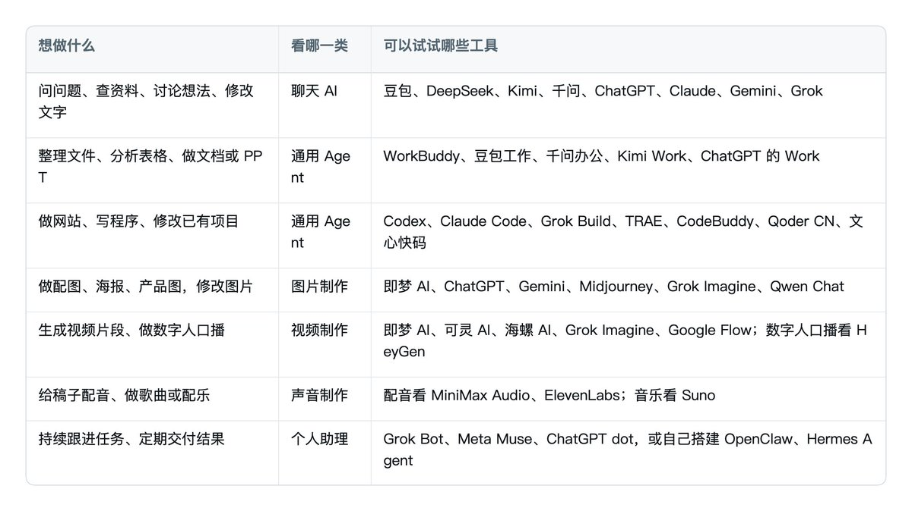
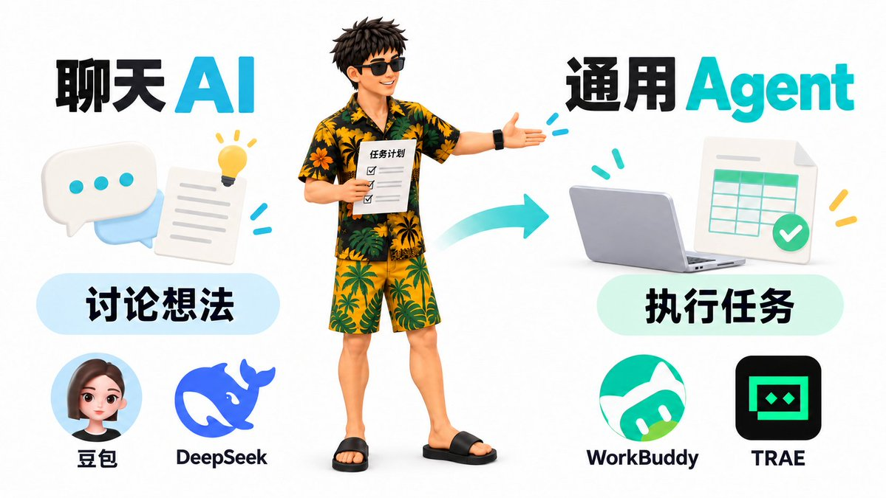
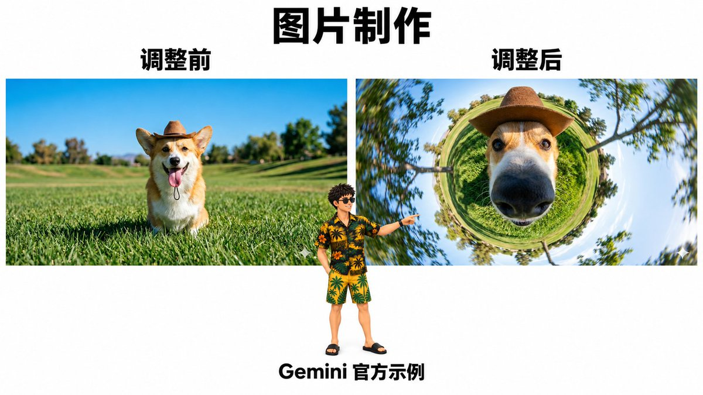
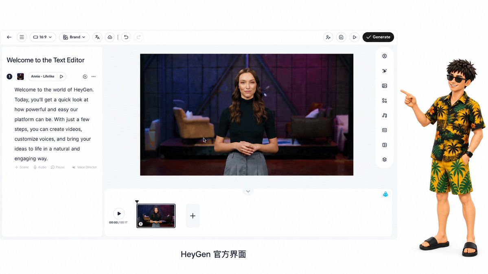
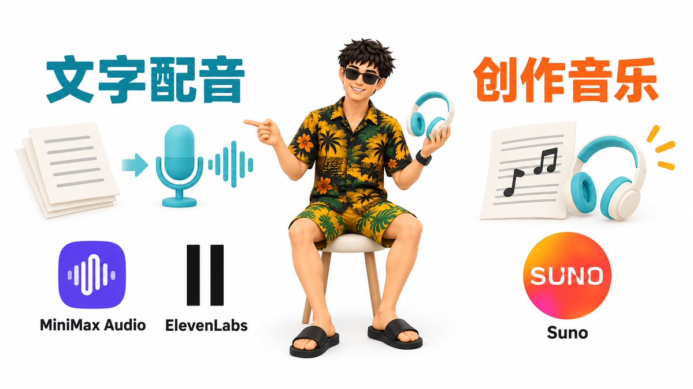
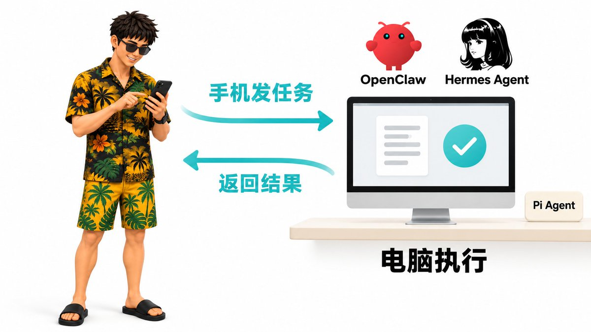

# 金尘马（@jinchenma_ai）：AI 工具太多了不知道怎么选？一文讲清楚常用 AI 工具与选择逻辑（2026 年 10 月版）

> 2026 年最新全景 AI 工具选型指南：按工作场景分类（通用对话、代码编程、内容创作、图片生成、音视频制作、信息检索），梳理国内外代表性工具的功能边界、性价比梯队与最佳适用人群，提供清晰决策树帮助小白与专业开发者按需选型，拒绝工具焦虑。

<!-- more -->

朋友们大家好啊，我是金尘马。

好多朋友现在都想学 AI，也开始试着用一些 AI 工具了。

但 AI 发展太快了，市面上的工具各式各样，几乎每周都能听见一些新产品、新热点。一个还没弄明白，下一个又火了，追起来也挺累的。

这么多 AI 工具，到底都是干嘛的？有什么区别？

其实回到日常使用，常见的场景就这么几类。先放一张速查表，大家可以对照自己要做的事看。

这里按用途来分，同一个产品可能出现在好几个地方。比如 ChatGPT 能聊天，也能做图，还能通过不同功能执行任务。

同一类里，有些产品用起来确实差不多。大家可以拿自己的实际问题试一试，最后选一个用着顺手、价格也合适的，不用每个都学。

那接下来呢，就按这几类场景，给大家展开聊聊。看看你遇到的问题可以找哪些工具来帮忙，大概怎么用，最后能做出什么。

## 聊天 AI

聊天类 AI，应该是很多朋友最早接触的 AI 工具了。像国内的豆包、DeepSeek，大家已经挺熟悉了。

最开始，大家主要拿它们来聊天、问问题，让它写一段文字。后来慢慢能联网查资料，现在功能又丰富了不少，有些还带上了 Agent 功能，可以做 PPT、生成文档，或者分析你上传的表格。

那这一类产品呢，国内常见的有豆包、DeepSeek、Kimi、千问。

海外的话，常见的有 ChatGPT、Claude、Gemini 和 Grok。

比如想写一篇文章，就把选题、写给谁、手头有什么材料告诉它。觉得哪儿不对，就接着聊、接着改。

用普通聊天功能时，交互主要还是在 App 或网页里。你把内容发过去，它给你回答；支持生成文件的，也可以把文件下载下来。

想让它直接整理电脑里的文件，再保存到指定位置，就需要让它连接电脑上的工具，并授权访问文件。

像豆包工作、千问办公、WorkBuddy，就是接下来要讲的通用 Agent。它们和同品牌的聊天 App，在能接触到的资料、能操作的工具上会有区别。

## 通用 Agent

前面讲聊天 AI，我们已经习惯了把问题发过去，让它给个回答、帮忙想想办法。

Agent 又往前走了一步。相当于给 AI 装上了手和脚，让它能使用电脑里的工具，真正上手干活。 比如打开一个文件夹，读取里面的表格，统计好数据，再把结果保存成一份文件。

你告诉它想做什么，它就可以调用工具，一步一步完成。这些工作可以在你的电脑上做，也可以在云端或飞书、钉钉这样的办公软件里完成。

那为什么叫「通用 Agent」呢？因为它能处理多种任务，整理材料、分析数据、做网站、写程序，都可以做。当然，各家也有侧重，有些更擅长编程，有些主要面向办公。

国内常见的有：

- WorkBuddy：读写本地文件、整理资料、分析数据，生成文档和表格。
- 豆包工作：接入飞书，查找团队资料、制作文档和分析表格。
- 千问办公：连接钉钉，做信息检索、文档制作和数据分析。
- Kimi 的 Agent 功能与 Kimi Work：前者可以制作文档、表格、PPT 和网站；Kimi Work 在桌面运行，可连接本地文件和浏览器完成工作。
- DeepSeek Harness（DSH）：整理文件、分析数据、写文档和执行代码任务，目前仍在预览阶段。
- AutoGLM：搜索和整理资料，生成研究报告、PPT 或网页。

海外有：

- ChatGPT：桌面客户端授权后能直接调用电脑里的工具、读取文件和操作浏览器。它提供 Work 和 Codex 两种任务执行方式，Work 面向日常工作，Codex 更侧重编程。
- Claude Code：能读取和修改电脑里的文件、调用工具，既能写程序，也能处理材料和数据。
- Grok Build：偏向程序开发，可以阅读和修改项目文件，并运行程序检查结果。

如果你想做个网站、写个程序，或者开发一个小工具，国内还有这些更偏编程的产品：

TRAE、CodeBuddy、Qoder CN（原通义灵码）和文心快码。你可以用自然语言讲需求，让它们帮你写代码、改功能、找问题，再运行看看效果。

Pi Agent、Hermes Agent 和 OpenClaw 也能处理多种任务。这几款需要自己做些配置，可以按自己的需要连接模型和工具。出门在外，想用手机继续安排家里的 Agent 干活，也可以考虑这种用法，后面个人助理部分会讲。

比如想把几份销售表格合并统计，就告诉它文件在哪、按什么统计、结果存到哪里，并授权它访问。事情复杂的话，先看看它的计划，做完再检查生成的表格。

## 图片制作

用一段文字描述你想要的画面，让 AI 生成一张图；拿一张已有的图片，让它换背景、改局部；或者把几张图里的人物、产品、场景融合到一张新图里，这些都属于图片制作。

给文章配图、做海报、制作产品图，都能用上。完成这些生成和修改工作的，就是图像模型。

那支持图片创作的工具有哪些呢？

- 即梦 AI：用 Seedream 系列做图，比如 Seedream 5.0 Pro，在即梦里叫「图片 5.0 Pro」。可以生成、修改图片，也能融合多张参考图。
- ChatGPT：图片功能使用 ChatGPT Images 2.5，可以直接描述画面，也可以上传图片，边聊边改。
- Gemini：使用 Nano Banana 系列，包括 Nano Banana 2 和 Nano Banana Pro，可以生成图片、修改照片、融合参考图。
- Midjourney：使用自家的图像模型，目前默认是 V8.2，可以按描述生成图片，也能参考已有图片的风格。
- Grok Imagine：图像模型是 Imagine Image 2.0，可以生成图片、修改局部、组合参考图。
- Qwen Chat：可以使用 Qwen-Image 2.0 生成和编辑图片，也能制作带文字的海报。

做图的时候，先告诉它这张图用在哪儿，画面里要有什么，想要什么风格、多大比例。 改图或融合图片，就把素材一起发过去，说清楚要保留什么、修改什么。

生成后看看画面是否合适，海报上的字有没有错，需要改的地方直接告诉它，最后下载图片。

## 视频制作

视频也类似。你可以用文字描述一个场景，让 AI 生成一段动态画面；也可以给它一张图片，让画面里的人物动起来。还可以提供人物、场景或动作参考，让它照着这些素材生成镜头，或者修改已有视频。

这些生成和修改画面的工作，可以交给视频模型。做数字人口播，或者把现成的图片、字幕和配音编排成视频，也有对应的工具，下面分别说。

### 生成视频片段

常见的工具和模型有：

- 即梦 AI：使用 Seedance 系列，比如 Seedance 2.5，可以结合文字、图片、视频和声音参考来生成或修改片段。
- 可灵 AI：有可灵视频 3.0、3.0 Omni 等模型，可以用文字、图片或参考素材生成视频，也能安排多个镜头。
- 海螺 AI：可以使用 MiniMax H3，结合文字、图片等素材生成带声音的视频。
- Grok Imagine：视频模型是 Imagine Video 1.5，可以让图片动起来，同时生成环境音、音效或对话。
- Google Flow：可以使用 Veo 3.1、Gemini Omni Flash 1.1 等模型，按文字、参考素材或指定的起止画面生成视频，也能用 Gemini Omni 修改已有视频。

先想一想这条视频要讲什么，需要哪些镜头，再描述人物、场景、动作和镜头怎么变化。有参考图片或视频，也可以一起提供。

生成后拿到的是视频片段，要看看人物、动作是否符合要求。想做成一条完整视频，通常还要剪辑、加字幕和声音，再导出。

### 数字人口播

还有一种，你希望画面里有个人对着镜头讲解，就可以用 HeyGen 做数字人口播。它也能翻译已有视频、同步口型，配上相应语言的声音和字幕。

准备好讲解稿，选人物形象，或者用照片、短视频创建数字人，再设置声音和语言。生成后检查发音、停顿和口型，调整好再导出。

### 用 Remotion 做视频

如果手里已经有图片、图表、字幕和配音，想安排它们什么时候出现、怎么动，可以用 Remotion。它用代码编排这些内容，再输出视频。

你可以把脚本和素材交给 Codex、Claude Code 等 Agent，讲清楚画面顺序、动画和字幕要求，让它帮忙写代码，预览调整后输出视频。刚开始只想生成几个视频片段的话，先用前面那些工具就够了。

## 声音制作

稿子已经写好了，想配个音，做成旁白或有声内容，可以看看这两款：

- MiniMax Audio：文字配音、声音克隆和多语言语音生成，可以调整情绪和表达方式。
- ElevenLabs：文字配音、声音克隆、按描述设计声音，以及音视频配音翻译。

把文字准备好，选声音、语言和表达方式，生成后听听读音、停顿和语速，调整好再下载音频。如果是给视频配音，再放进剪辑工具里配合画面。

如果想做歌曲或配乐，还有：

- Suno：根据风格、情绪或歌词生成带演唱和编曲的歌曲，也能制作纯音乐。
- MiniMax Music：这是音乐模型系列，可以根据创作构想和歌词生成歌曲。

以 Suno 为例，告诉它歌曲的主题、风格和情绪，也可以提供歌词。试听调整后，下载歌曲或配乐音频。

## 个人助理

前面讲的很多任务，做完一次就结束了。个人助理还可以持续跟进一件事，比如定期整理简报、跟进活动安排，或者记住你的偏好。 遇到需要你决定的事情，再来问你。

厂商提供的云端助理有：

- Grok Bot：使用独立云端电脑，跨应用处理任务，并保留工作偏好。
- Meta Muse：在云端电脑和浏览器里推进长期任务，记住偏好，并在需要你决定时询问。
- ChatGPT dot：在对话之间继续跟进任务，使用云端电脑，也可以把工作交给 Work 或 Codex。

比如想每周一收到一份行业简报，就把关注什么、参考哪些资料、发到哪里讲清楚，连接好相关应用，设置定时任务。哪些事得先问你，也可以提前约定。

还有一种需求，我自己就是这么用的：出门在外，用手机连到家里的电脑，继续安排 Agent 干活。这样手边没有电脑，也能交代任务、看进度。

如果想这样用，可以了解 OpenClaw（小龙虾）、Hermes Agent。先让它们在电脑或服务器上运行，配置好模型和工具，再连接它们支持的聊天 App，就能通过手机发任务、收结果。

Pi Agent 也可以搭配远程连接工具来用。运行 Agent 的电脑或服务器要保持在线。

## 写在最后

好，上面说了一大堆，大家对现在市面上这些 AI 产品，是不是有了一个更清晰的认识？

简单来说，问问题、聊想法，可以找聊天 AI；想让它动手处理任务，可以找通用 Agent。做图片、视频、声音，就找对应的创作工具；想让它持续跟进工作，就看看个人助理。遇到什么需求，去找对应的工具就行。

学工具这件事，还是回到自己要解决的问题上。现在用的工具已经能把问题解决好了，那就足够了，没必要每出一款新产品都跟着学。

AI 圈有句调侃：「有些东西不用着急学，拖着拖着就不用学了。」有些新产品，可能没几个月就消失了。

所以，挑有代表性、能解决自己问题的工具，先把它用好。以后真遇到解决不了的需求，再去找新的，也来得及。

金尘马｜前大厂程序员，OPC 实践中｜持续分享普通人也能看懂、用得上的 AI 实用教程｜目前在做 AI 培训与企业 AI 落地｜合作咨询，联系方式见主页：[https://x.com/jinchenma_ai](https://x.com/jinchenma_ai)。本文由我口述，ChatGPT 协助整理，经我审稿定稿。

## 相关页面

- [[sources/miles-ma-ai-beginner-guide-no-courses]]
- [[sources/leoshen-ai-agent-quickstart-rethinking]]
- [[concepts/ai-era-learning-paradigm]]
- [[concepts/overseas-tool-stack]]
