# Joker（SEOActionBlog 演讲嘉宾）：SEOer 容易陷入的「数据指标」困惑

> **采集说明**：本文由 [@JokerMayCry_Jun](https://x.com/JokerMayCry_Jun) 在 X 上分享（`https://x.com/JokerMayCry_Jun/status/2118536879968763948`），原文是其 2020 年在 John SEOActionBlog 成都线下分享会的演讲整理稿，原文标题《SEOer 容易陷入的"数据指标"困惑》。本归档已合并 X 分享帖与公众号全文内容。

> **核心命题**：DR 值、DA 值、外链数量、文章字数、跳出率……这些被 SEOer 奉为圭臬的「数据指标」，绝大多数都**不是** Google 算法的评判标准，而只是行业自造的、容易被数据站操纵的替代品。


---

## 演讲全文的四条主线

本次分享分为四个部分，内容主要来自群友们经常提出的问题：

1. **外链篇**：DR 值（Ahrefs）、DA 值（Moz Toolbar）、Authority Score（SEMrush）等指标越高，是否代表网站权重越高、质量越好？外链数量越多越好吗？能否有相对准确的量化标准？
2. **内容创作篇**：文章字数越多越好？2000 字是标准吗？文章需要保持更新吗？
3. **网站体验篇**：停留时间越低是否表示页面体验越差？跳出率越高是否表示页面质量越差？
4. **结语**：作为 SEOer，「数据指标」是衡量 SEO 效果的标准吗？应该从哪些方面做网站 SEO 自审？

---

## 一、外链篇：第三方权重指标为什么靠不住

### 1.1 PR 时代结束，第三方指标补位

2016 年以前，判断网站权重与价值大多以 Google 官方的 Page Rank（PR）为参考指标。**但 2016 年 4 月 Google Toolbar PageRank 停止更新。**

> **注意区分**：Google 只是停止了 Toolbar 的 PR 值更新，**并非取消了 PR**——Google 背后依然有一套自己的计算方式，只是不再以具体指标形式对外展示。

> **DYK = Do You Know**：Google 搜索部门发言人之一 Gary Illyes 也曾公开承认 Google 至今仍在使用 PR 作为排序算法。

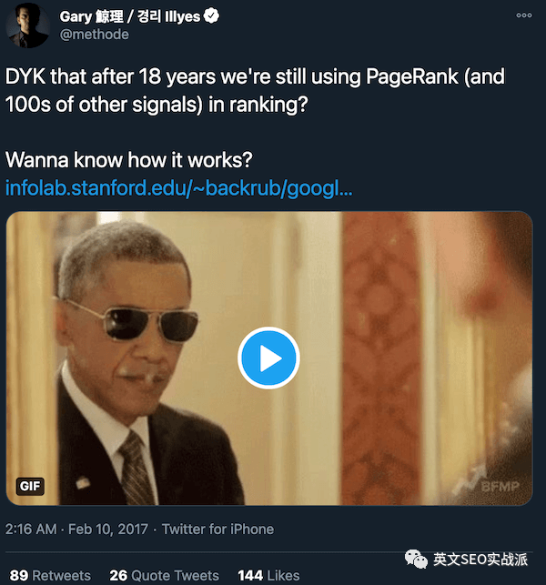

随着 PR 工具条停更，市场涌现出一大批第三方工具来帮助站长分析网站，其中最知名的是 **Moz、Ahrefs 和 SEMrush**，分别给出 **DA 值（Moz）、DR 值（Ahrefs）、AS 值（SEMrush）**。一时间大家仿佛找到了新方向，从追求 PR 值转向追求 DA、DR。

### 1.2 三家指标的官方定义说明了什么

**DA 值（Moz）**

> Domain Authority (DA) is a search engine ranking score developed by Moz that predicts how likely a website is to rank on search engine result pages (SERPs).

官方对「什么才算好 DA」的说明：拥有大量高质量外链的网站位于 DA 刻度的高端，而外链较少的小企业网站 DA 分值会低得多；**全新网站的 DA 永远从 1 开始**。

**DR 值（Ahrefs）**

> Domain Rating (DR) shows the strength of a website's backlink profile compared to the others in our database on a 100-point scale. It's essentially a less granular version of Ahrefs Rank (AR).

Ahrefs 官方进一步解释权重传递机制：

> When a domain's DR is higher, more "link juice" is transferred to linked domains. The source domain splits its rating equally amongst the domains it links to. So: **a DR-10 domain which links to three other domains can influence your DR more than a DR-80 domain which links to a million other domains.**

**从这两家的描述可以直接看出**：无论 DR 还是 DA，它们的计算方式基本都基于「**Link 数量**」和「**Link 质量**（工具自家算法）」，**只是第三方工具自家的估算，并不代表 Google 背后的 PR 值**。

更关键的是：**这个判断标准跟网站自身的内容相关性、专业度、权威度没有任何关系**。自然也就留下了巨大的「人为」可控操作空间，催生了大量专门「做数据」的网站。

### 1.3 数据站陷阱：三个 DR 60+ 的例子

演讲中以三个 tech 站为例（演讲者自称在做资源扩展时由同事发现的）：

- 单纯看 DR 值，三个站都是 **DR 60 以上**的站点（在多数 SEO 人观念里，DR 60 以上就算「优秀」）；
- 但这三个站的「数据指标」**大概率是人为做出来的**；
- 如果花 80–120 美元，或提供一篇优质 Guest Post 换取一条反链，**其实并没有那么高的价值**（你可能还以为自己赚了）。

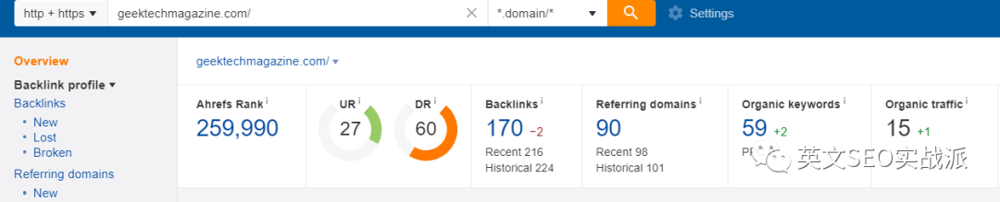

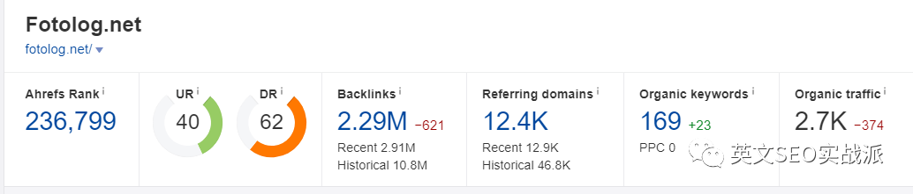

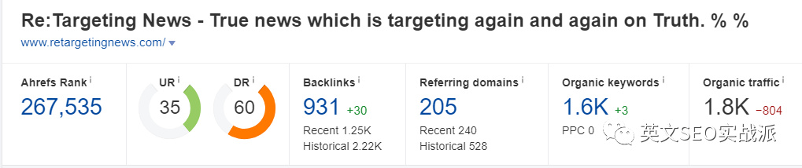

### 1.4 如何识别数据站：五个必须交叉验证的信号

以 Ahrefs 工具为例，判断一个站的数据指标是否人为所做，要看：

| 信号 | 说明 |
|:---|:---|
| **Organic Keywords（关键词覆盖量）** | 核心信号 |
| **Organic traffic（预估关键词流量）** | 核心信号 |
| **网站内容收录量** | 与实际产出能力是否匹配 |
| **流量趋势** | 是否符合真实业务的增长曲线 |
| **建站时间** | 通常有价值的站点不会建站 2 年内（部分更换域名做过 301 的除外） |
| **Top Page 内容** | 判断是否与你的行业内容相匹配 |

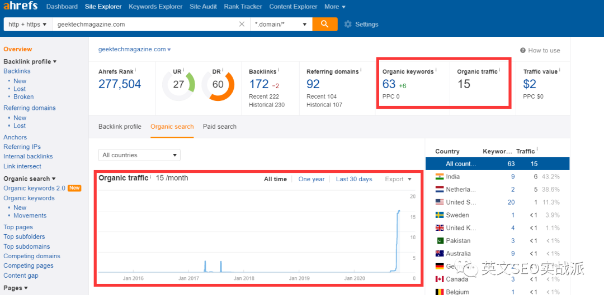

**关键推论**：一个 DR 60 的站点，关键词覆盖量却只有几十、预估流量也只有几十，说明这个站点本身的关键词覆盖量与排名能力**基本为 0**。

而「权重」这个概念本身是通过 Link 传递的，「权重」的体现可以理解为**在某些关键词的覆盖量和排名上有优势**。像上述这样的站点，其本身并没有这种优势体现，自然也就没有「有价值的权重」可传递——**从这样的网站获取的反链也就失去了其本身的价值**。

### 1.5 结论：DR/DA 不能作为直接判断标准

> **Joker 观点**：DR 值、DA 值这类「指标」本身**并不能**作为网站权重高低的直接判断标准，需要结合其他多项指标综合判断，避免陷入「数据站」的陷阱。

需要综合判断的四项：

1. **建站时间**；
2. **关键词覆盖量、预估关键词流量**（这两点其实要刷也可以刷，不过手法就高明多了）；
3. **Top Page 数据量，以及其内容相关性**——**这点非常重要，不是想刷就能刷得了**。

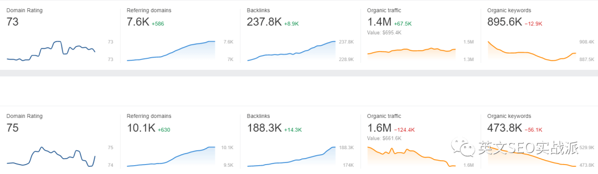

### 1.6 外链数量：Google 新 PageRank 专利给出的答案

「外链数量越多越好？」——这个问题放在 2016 年以前，答案肯定是 YES。但演讲者认为现在可以说 NO，理由来自 Google 的官方专利：

**Producing a ranking for pages using distances in a web-link graph**
（专利号 US9165040B1，2006 年就存在，但演讲者判断 Google 真正开始利用是在 2015 年以后，可结合 2016 年的「企鹅更新 4.0」来理解）

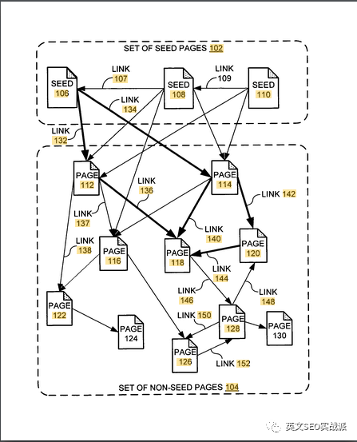

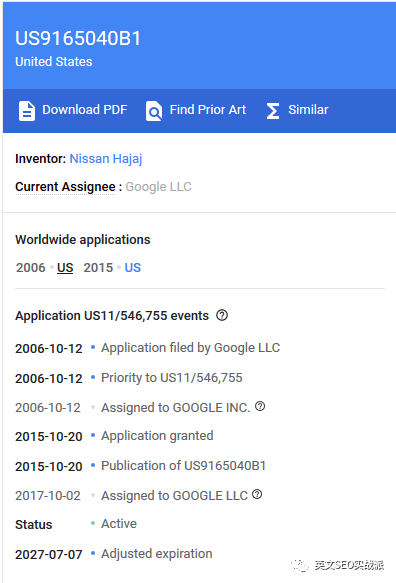

根据 Zac 老师对该专利的解读，核心要点有四条：

**① 概要**：新 PageRank **不再计算导入链接的总数**，而是计算页面与「种子页面」之间的距离——距离越近，页面质量越高，页面级别的新 PR 越高。

**② 种子页面的特征**：种子页面显然是高质量页面，专利举例是 Google 目录（如 DMOZ，该目录已死）和纽约时报。种子页面需要与其他非种子页面有很好的连通性，有比较多的导出链接指向其它高质量页面；需要稳定可靠、有多样性、大范围覆盖各类主题。

**③ 链接的长度**：页面导出链接越多，链接长度越长——这和原始 PageRank 思路一样，导出链接越多每个链接分到的权重越少。链接所在位置越重要（比如正文中、正文靠前部分），链接长度越短；链接锚文字字号越大，或者在 H1 中，可能链接长度越短。

> **实操提醒**：那些还在做 Footer 或侧边栏全站链接的，停停吧，风险很大。
> （关于「锚文字字号越大链接长度越短」这一观点，专利原文只提到字体、未提及其他，演讲者同样存疑。）

**④ 链接距离**：链接距离就是页面与种子页面集合之间的**最短链接长度之和**。如果一个页面无法从任何种子页面出发访问到（种子集合到它完全没有链接通路），那么链接距离是**无限大**。Google 根据链接距离算出页面的排名能力分数（新 PR 值），作为最终排名算法中的排名因素之一。

**如果一个页面从种子集合完全没有链接通路可以到达，将被排除在简化链接网络图之外。如果一个页面得到的链接都来自简化链接网络之外，虽然链接总数可能很大，但其链接距离依然是无限大。**

> **核心推论**：在这套算法下，外链的「总量」不再是计算价值的标准了，取而代之的是**与「种子页面」的通路**——也可以理解为**相关站点或权威站点的反链量**。

### 1.7 关于发外链的清醒判断

> **Joker 观点**：
> - 「外链数量」并没有一个明确的指标来衡量想要获得 XX 排名、需要多少数量的外链；
> - **「发外链」是无法获取高质量、高相关度的反链**；
> - **Outreach 的核心目的不是外链，而是这个资源，这个人**；
> - **最优质的外链来源方式是被动获取**。

关于「发外链」：主要指常规 WEB 2.0 链接、博客评论链接、profile、垃圾 guest post 之类——**想想看，这些你能人工发的内容，都可以通过机器实现，你认为你能发得过机器吗？**

不过这仍取决于行业竞争度。演讲者提到正在研究一些 B2B 领域，发现他们并不需要什么优质反链，做好网站自身架构和内容就行了，因为整个行业的竞争度还没有达到需要靠优质反链竞争的地步。

**被动获取**指的是：通过创作优质内容（形式不限——文字、图片、视频、数据、工具），让别人主动把你的信息作为引荐来源，自然就能获取到高相关度的反链——**这本来就是外链最初的作用**。

做软件的朋友其实在内容提供上比其他领域多一个优势：**可以通过提供实用的小工具供第三方平台使用，从而获取更多流量来源与自然链接**（想想 YouTube 的嵌入式代码、各种工具的插件）。

---

## 二、内容创作篇：字数崇拜的破除

### 2.1 现象：对「2000 字」的迷信

自从内容创作流行起来，**「文章字数」似乎成了判断文章质量好坏的标准之一**。各类分析报告显示长文（Long Content）策略有种种好处：文章字数与能获取的反链数、社交分享数、排名都正相关。

于是越来越多 SEOer 开始迷惑：**对手写了篇 1500 字的文章，我想超越他，就得写 3000 甚至 4000 字？真的要创作超过 2000 词的文章吗？**

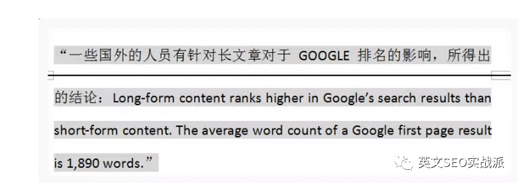

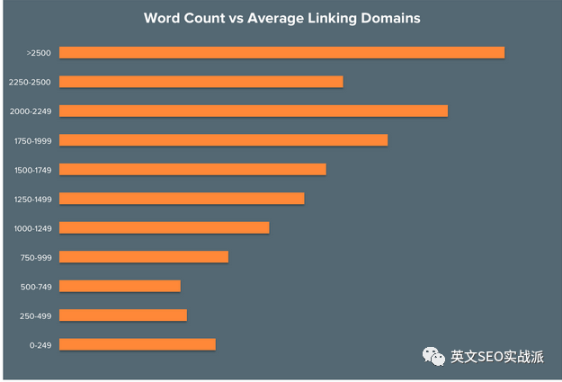

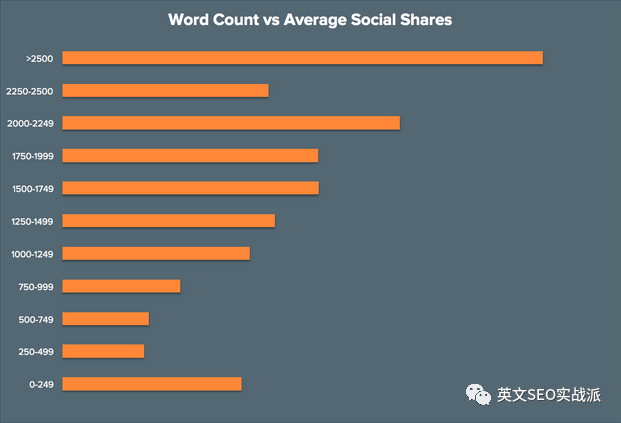

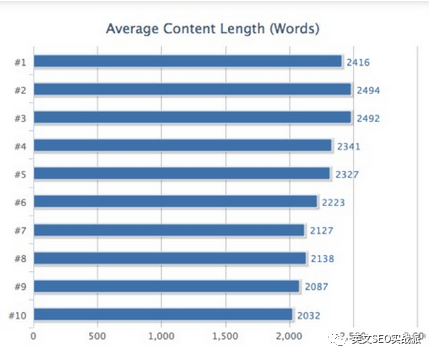

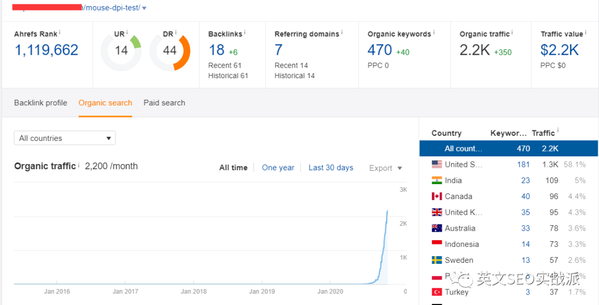

### 2.2 核心结论：Long Content ≠ Deep Content

> **Joker 观点**：**文章字数从来不会成为 Google 算法评判的一个标准。** 不论对于用户还是 Google，真正需要的是 **Deep Content**。

**Long Content 不等于 Deep Content。** Deep Content 的内容长短取决于你选择的话题，这本身并没有明确的字数指标。

**什么是 Deep Content？** 我的理解是：**尽可能多地去覆盖与用户搜索核心话题相关联的内容**，从而达到让用户了解更多相关知识信息的目的。

### 2.3 Deep Content 实例拆解

以话题 `mouse dpi` 为例：多数 SEO 人会直接开始介绍「mouse dpi 的内容」，但通过 Deep Content 分析，结论是需要覆盖以下关联意图：

```text
what is mouse dpi
how to check mouse dpi (mouse dpi changer)
how to change mouse dpi (mouse dpi checker)
mouse dpi test
mouse dpi for gaming
mouse dpi setting
```

演讲者展示了这篇基于 Deep Content 的成文效果——**文章 7 月上线，且上在一个当年 6 月才上线的新站**（全新站点、域名、服务器都是全新的，主要用于做测试）。首页上与它竞争的站点，要么是自身 DR 碾压它，要么是外链碾压它；但它可以通过**内容架构**搬回一点劣势，从而挤进首页。

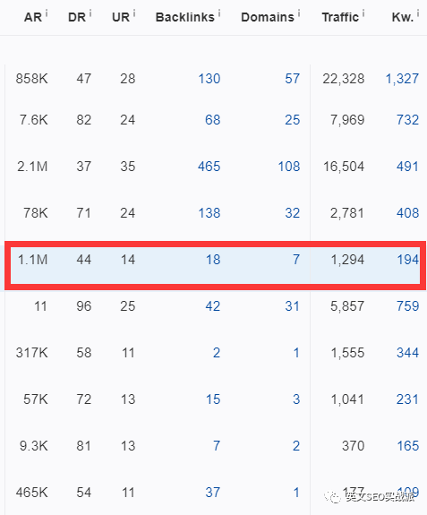

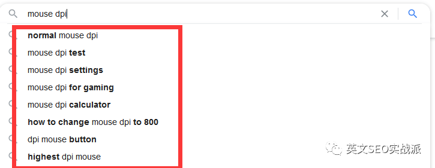

### 2.4 Deep Content 分析的四步操作法

**第一步：分析排名前 20 的页面内容**
了解各个网站对这个话题的关注点有哪些。**特别需要注意出现在 0 排位的页面内容**——另外，其实很多在第二页的内容非常有价值，它可能本身站点 SEO 做得较差所以无法挤进前 10，但我们可以好好利用。

**第二步：利用「提示性关键词」**
了解用户在搜索这个话题时容易触发哪些相关词。

**第三步：利用「People also ask」栏目**
了解话题相关信息。

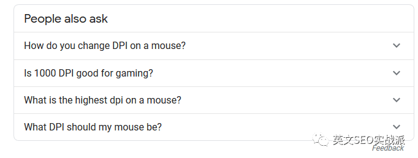

**第四步：利用「Related Search」**
了解用户相关搜索。

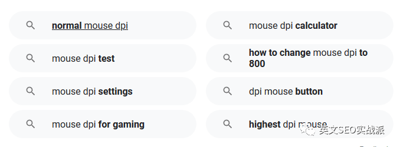

> **工具备选**：Ahrefs Keywords Explorer、Ubersuggest 等关键词工具（收费）；备选还有 MarketMuse（价格偏贵且功能较为单一）。

通过上述分析思路，就能得到一份不错的数据报告，让你**从架构上思考如何把内容做到「Deep」**。

---

## 三、网站体验篇：跳出率与停留时间的正确解读

### 3.1 先看 Google 官方对「跳出」的定义

> A bounce is a single-page session on your site. In Analytics, a bounce is calculated specifically as a session that triggers only a single request to the Analytics server, such as when a user opens a single page on your site and then exits without triggering any other requests to the Analytics server during that session.

在 Google Analytics 中，「跳出」**特指仅触发了一次对 GA 服务器请求的会话**——用户打开一个页面后退出，且该会话未触发对 GA 服务器的任何其他请求。

**所以单看「跳出」这个行为，本身并没有体现用户对当前页面是否满意**，它仅仅表示用户通过当前页面退出，并没有和其他页面再次互动。

### 3.2 高跳出率是不是坏事？官方回答是「It depends」

> If the success of your site depends on users viewing more than one page, then, yes, a high bounce rate is bad. For example, if your home page is the gateway to the rest of your site... then you don't want a high bounce rate. On the other hand, if you have a single-page site like a blog..., then a high bounce rate is perfectly normal.

据此可以把页面分为两类情况：

| 情况 | 页面类型 | 跳出率判断 |
|:---|:---|:---|
| **情况 1** | 首页、目录页等**具有导航性质**的页面 | 主要目的是让用户浏览更多内页 → **高跳出率肯定不是好事** |
| **情况 2** | 文章页、特定的专栏页 | 页面本身提供的信息已满足用户基本需求 → **跳出率高可以被接受** |

但还需借助另一个指标「停留时间」综合判断：

> **对内容页，高停留时间 + 高跳出率是可以被接受的，但低停留时间 + 高跳出率就不行了。**

### 3.3 演讲者自己网站的对照样本

**首页**（主要目的是「引导用户访问更多内页」）：虽然平均停留时间只有 **45 秒**，但跳出率只有 **17.17%**。

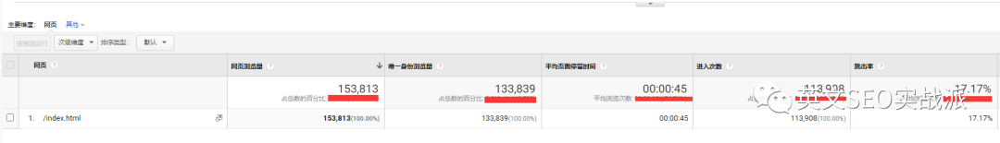

**文章页**：虽然跳出率高达 **85%**，甚至部分页面达到 **90%**，但停留时间能达到 **6–7 分钟以上**，TOP 1 流量的文章可达 **8 分 52 秒**。

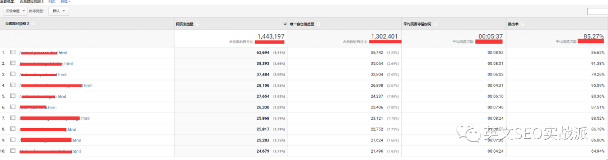

此外还可通过 **Crazy Egg** 等热力图与屏幕录像工具，观察用户访问文章页的真实浏览动态。

### 3.4 降低跳出率的五个着手点

> **Joker 观点**：**跳出率和停留时间这两项指标，单独来看，其本身并不能反映页面质量是否满足用户需求。是否需要降低跳出率，取决于页面本身的目的。**

1. **按流量来源渠道，分析着陆页是否满足该渠道来源的用户需求**；
2. **页面内容的可视性是否友好**（如针对移动端用户的优化体验）；
3. **增加页面内链建设**，推荐引导用户阅读更多相关内容。**注意：对 Deep Content 页面，通过内链增加的方式引导收效甚微**——因为页面内容本身已满足用户基本需求，很难引导其访问更多内容；
4. **检查所有页面的跟踪代码是否添加正确**（演讲者曾帮朋友分析网站，最后发现是其新增页面没正确添加跟踪代码，导致从 Landing Page 访问了更多内页却没有被统计到）；
5. 配合 GTM（Google Tag Manager）设置事件，如浏览深度、行为按钮点击等，综合判断页面是否满足了用户需求。

> 演讲者补充：GA4.0 最大的提升就在用户交互数据方面做得更好，比如直接把 `scrolling` 数据体现出来了。

### 3.5 决定停留时间的四个因子

| 因子 | 说明 |
|:---|:---|
| **#1 内容相关度** | 与用户搜索意图的匹配程度 |
| **#2 内容深度** | 即前文的 Deep Content |
| **#3 排版与阅读逻辑引导** | 字体大小、颜色等。**注意 Google 目前对内容的 content readability 与 content accessibility 已开始有一定判断**，Lighthouse 中已出现根据对比度来判断的指标 |
| **#4 内容多样性** | 尤其强调**视频**：文案中嵌入 YouTube 视频能大幅提升单页停留时间；嵌入视频的另一个好处是增加 YouTube 上的视频观看量与相关用户数据，提高该视频在 YouTube 站内搜索的排名，进而收割 YouTube 本身的流量 |

---

## 四、结语：真正该盯的指标与自审框架

### 4.1 指标不是目的

> **Joker 观点**：SEOer 的核心目的是**从搜索引擎获取「有效」的流量，达成相应的转化**。所谓的「数据指标」，不论是 DR 值、DA 值、外链数量、文章数量、Lighthouse 得分，**其本身并不是我们的目的**。

真正需要关注的三项指标：

**第一，网页加载速度**

越快越好，但**没有实际标准**——比如加载 10 秒就不好、9 秒就好；这还有一个前提：**所提供的内容本身是符合用户需求的**，而不是「只要快就行」。

加载速度应分两端看：

| 维度 | 因素 |
|:---|:---|
| **A. 技术端** | 网站自身大小、服务器稳定性、JS/CSS 文件大小、请求数量、图片信息大小。**特别注意 TTFB（Time to First Byte，推荐工具 webpagetest.org）** |
| **B. 用户端** | 用户网络情况、设备情况（GA 中可查详细报告）、服务器与用户的位置关系（**使用 CDN 可有效解决**） |

> **不要只盯着 GA 报告里「XX 页面加载时间 5 秒、6 秒」**。如果某页面加载速度真的远低于平均水平，需要做**细分报告**——比如在 GA 中查看该页面的具体用户设备、地理位置等。
>
> 实例：某页面加载速度达到 8.49 秒，远高于平均水平；经细分发现是「Android」用户的问题，而安卓平台并非主要优化方向（需根据业务、资源、人力、技术权衡是否投入）。

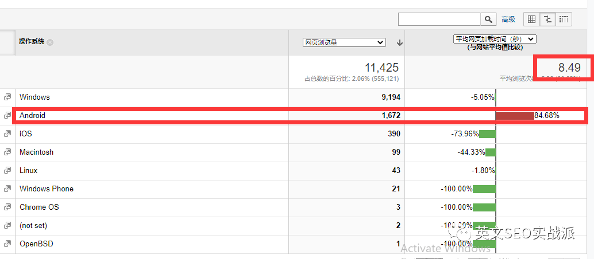

**第二，SERP 中的点击率（CTR）**

这是已经明确的一个影响算法的大因素。

**第三，收录率**

随着 Google 不断变化，特别是近两年，「人为可控」的地方越来越少，取而代之的是更多较模糊的概念——比如前面提到的 **seed page**，比如 **EAT（Expertise-Authoritativeness-Trustworthiness）** 的评判。

> **所以希望大家把更多的精力花在自己的网站、产品、内容上，服务好自己的用户，才是最根本的目的。**

### 4.2 SEO 自审要加上「技术端」这一维度

大多数人评判 SEO 仅停留在「内容」和「外链」两部分，但演讲者认为**还应该加入 Tech 端**。近几年分析了很多网站——不论竞争激烈的行业还是传统 B2B 行业，**其实大部分最核心的问题并不在内容和外链上，而在网站的基本技术上**。

搜索引擎蜘蛛的简单流程是：

```text
爬行 → 抓取 → 索引 → 渲染 → 排名
```

**首要解决的是 BOT 的「Crawl accessibility」**——Google bot 本身也是一个程序，是程序就得消耗资源，存在消耗就有 **Crawl Budget**。我们需要做的是通过技术让 bot 在有限的预算内抓取到我们希望的内容，并指导它理解内容。

演讲者展示了自研的 SEO Audit（SEO 自审）流程清单：

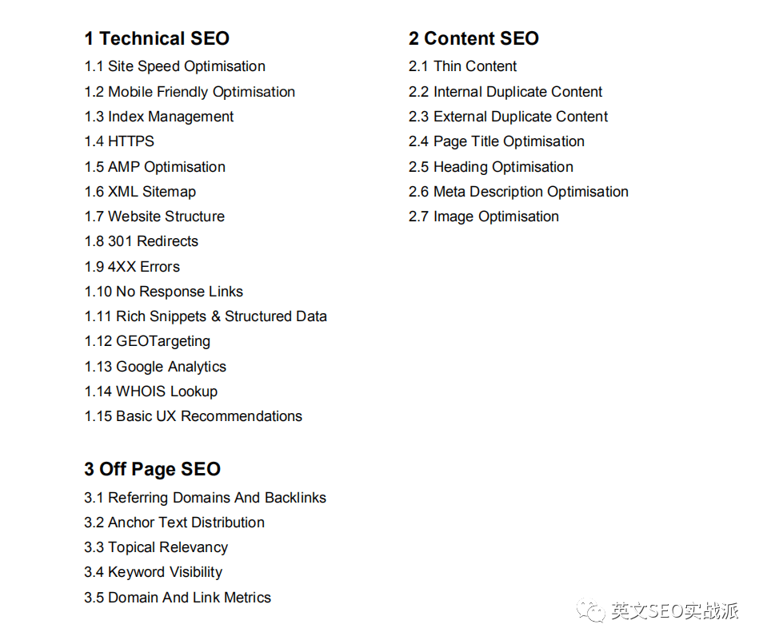

其中 **Technical SEO** 一块就包含：Site Speed Optimisation、Mobile Friendly Optimisation、Index Management、HTTPS、AMP Optimisation、XML Sitemap、Website Structure、301 Redirects、4XX Errors、No Response Links、Rich Snippets & Structured Data、GEOTargeting、Google Analytics、WHOIS Lookup、Basic UX Recommendations——**这正是多数 SEOer 自审时完全忽略的部分**。

---

## 相关参考（原文引用的技术资料）

| 资料 | 用途 |
|:---|:---|
| [Google 专利 US9165040B1](https://patents.google.com/patent/US9165040B1/en) | Producing a ranking for pages using distances in a web-link graph，新 PageRank 原始文档 |
| [Zac 老师解读](https://www.seozac.com/google/google-new-pr/) | 对上述专利的中文要点总结（链接距离、种子页面、链接长度） |
| [Bill Slawski 解读](https://www.seobythesea.com/2018/04/pagerank-updated/) | SEO by the Sea 的英文解读 |
| [Moz — What is a "good" Domain Authority](https://moz.com/learn/seo/domain-authority) | DA 官方定义 |
| [Ahrefs — What is Ahrefs Domain Rating](https://help.ahrefs.com/en/articles/1409408-what-is-ahrefs-domain-rating) | DR 官方定义与权重传递机制 |
| [Google Analytics — 跳出率定义](https://support.google.com/analytics/answer/1009409) | Bounce 的官方口径与「It depends」解释 |
