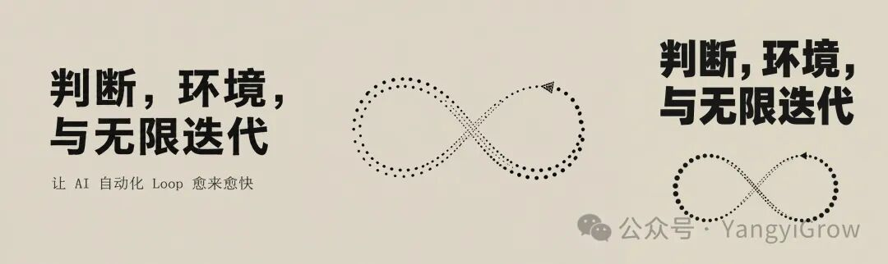
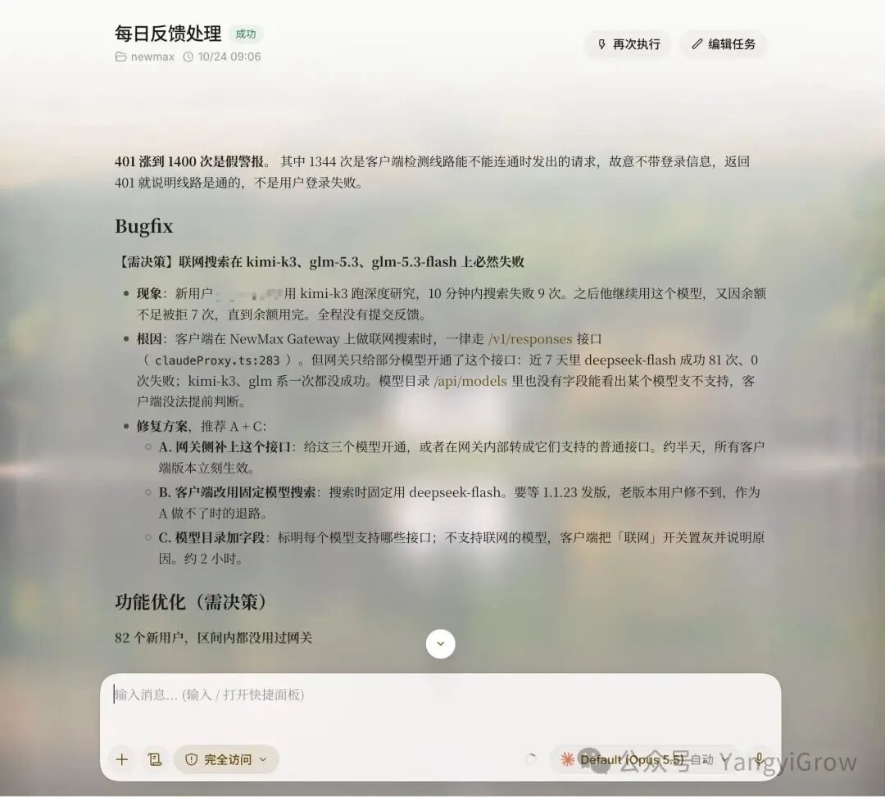
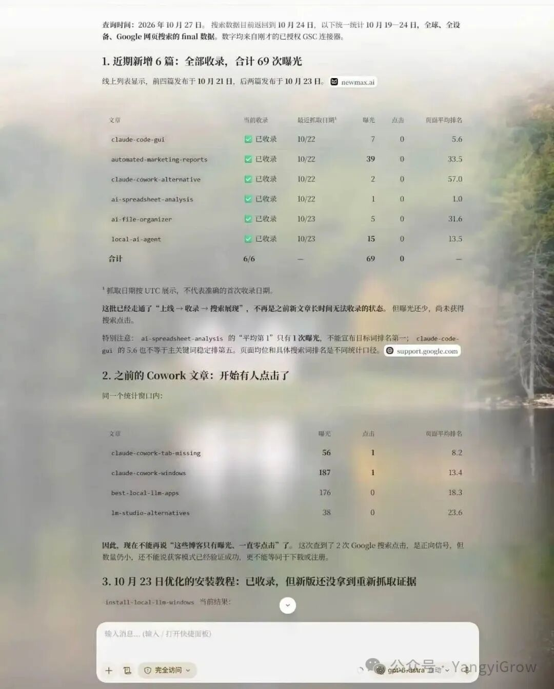

# 判断，环境，与无限迭代

> AI 创业的「逃逸速度」：在下一代模型到来之前做更多次有效迭代。本文给出方向判断与迭代判断两类决策，以及把迭代成本压下来的环境基建方法。

让 AI 自动化 Loop 的愈来愈快

## 逃逸

自 25 年 Manus 爆火之后，掀起了一轮 Agent 软件创业浪潮，时至今日，有许多的 startup 都已经进行了方向转型，甚至大部分公司都进行了多次 pivot，很多产品从想通用做，到不得不垂直做，历经了大部分无法熬出规模商业化的时光后，好像慢慢接受了要定向解决某部分人群的特定需求场景，而不是高举高打做通用智能的逻辑。

自 23 年初 GPT 爆火，那时候大家就在关注套壳。从最早那波小狐狸 GPT 站的套壳生态，到后来套 Midjourney 的生图站，以及后面各种各样的 AI 漫剧生产，GPTs 虚拟员工……人们一直在谈论套壳的意义，帮助普通人降低门槛这件事，究竟在大模型叙事面前成立不成立？

时至今日，我仍然觉得，套壳是有许多价值的。优秀的套壳产品，就会像 Manus 一样，持续扩展模型的边界。

> 很多人说，大模型时代创业很容易死。其实这也分怎么做，非要去跟 openAI 卷，那确实是容易死。AI 时代你只要搞明白，输入端和输出端，至于里面的黑盒技术怎么变化，无关紧要。这就意味着，如果你是从底层往上做，盒子随便换，表现层也可以随便换，但本质从没发生过改变 我举个例子，比如 invideo…—— @yangyi，2024 年 2 月

很多人说，大模型时代创业很容易死。其实这也分怎么做，非要去跟 openAI 卷，那确实是容易死。AI 时代你只要搞明白，输入端和输出端，至于里面的黑盒技术怎么变化，无关紧要。这就意味着，如果你是从底层往上做，盒子随便换，表现层也可以随便换，但本质从没发生过改变 我举个例子，比如 invideo…

—— @yangyi，2024 年 2 月

原帖：x.com/yangyi/status/1760626600901849522

我是这样看待这个问题的：

当 Agent 能力提升后，配合高水平人类进行人机协同，就会得到更优质解决方案。

于是，套壳的问题就转化成了，如何在有限的时间内，通过优化后三者，在下一代模型到来之前，提供出优质的服务来获得客户，并在这个时间内构建出一种「逃逸速度」，通过数据的积累+基建建设，让套壳始终有一种超越模型能力的速度，这样就能持续保持套壳领先。

这是 AI Startup 的产品力生死线，在此之上，领先模型，就存在套壳的意义，在此之下，落后模型，产品力不足，那么就只剩下心智与营销的调度空间。

那逃逸问题，最终就变成了，如何让 Agent 在有限的时间内，进行更多次的有效迭代。

## 判断

### 方向判断

谈及 AI 创业，往往都喜欢聊到第一性原理。

第一性原理，就夹杂着人们对未来方向的判断。

这种判断有时候异常简单，比如 25 年大家都在卷桌面智能体的时候，其实所有人都会有一个基础判断，人们不愿意坐在电脑前面。

人是希望自由的，能不能面向美景办公？移动，就是第一性。

很多创业之所以会死，是因为 Pivot 不够，Claude Code 在席卷桌面端，如果你做套壳的时候，一上来就是移动端 Claude Code，那么自然就会产生这种优势心智。但你复刻一个 Claude Code，那么就要说出比 Claude Code 优秀的方面，这个课题本身就难，因为它并不顺从人类的第一意识。你是后来者，你还比前人厉害，这个信任基点难以构建。

有许多的方向判断，都和这类例子息息相关。

当 Day1 的方向就错了，那么就只能依靠不断地 Pivot 找到答案。

方向存在时空性，比如有些产品它知道它的未来就是移动的，但它选择优先做桌面，因为桌面能让移动更快，更稳，这是战术，但战略的远方从来都是移动。

初心不一样，虽然都做同样的事（做桌面优先），但侧重点就完全不同，这就导致后面的逃逸速度是截然不同的。

这就是第一类判断。

### 迭代判断

如果你希望 Agent 获得有效结果，那么当模型做的无效时，就需要输入人的智能，以辅助修正 Agent 的行为。

这就是通过外部人类输入给 Agent 的专家知识，Agent 获得的专家知识越多，它就越发能变得智能。

Agent 在早期实践中，往往缺少许多常识，比如 25 年的时候，你让模型去帮你做 SEO，但模型压根不会使用 SEMrush 或者 Ahrefs 去调用工具获得关键词 KD 与搜索量，它缺少有效的上下文信息，就难以做出高质量的决策建议。

这是依赖专家知识的第一个层面，让外部提供 Agent 工具，或者提供 Agent 自我构建工具的方向。

第二个层面是，Agent 本身可能已经获取了一部分公开在互联网上的专家知识并被训练进入了基础模型内部，但它缺少「上下文」来触发它的注意力机制，让生成概率偏向「专业」的部分。通过优化「指令」与「记忆」，来构建上下文工程，以优化 Agent，这是专家知识的第二个作用。

这是在初始化 Agent 的阶段，我们要做的事情。当 Agent 从 0 到 1 开始执行之后，Agent 就需要从实践过程中自我获得反馈。通过反馈去优化模型层，这是大部分模型厂商在做的事情，也叫 RSI。那么通过反馈优化套壳层（指令+记忆+工具），就是应用侧可以优化的东西。

于是，我们发现了一个问题，如何让 Agent 沉淀经验，更新上下文与工具，这是决定 Agent 迭代质量的关键环节。

然而这里，不仅需要后验的评估测量框架（迭代到底变差了，还是变好了？），更需要先验的部分：人的判断是什么，该沉淀什么，该丢弃什么？

这是从 Agent 获得智能的角度上，人类要做的第二类判断。

当有了这两类判断，叫做我们在正确的做正确的事了。

这是道的层面，接下来就是术了。

## 环境

如果你每天刷抖音，都是那些毫无营养的奶头乐，那投入时间获得的上下文就是这样，所以这个人大概率也很难成长。

人是环境的产物，Agent 也是如此。

我们该如何为 Agent 构建一个良性循环的环境，让它获得更好的上下文，也让人类获得更好的上下文，这就至关重要。

这里我们提到的一个概念，就是 Dogfood，狗食自己的产品。

你做一个产品，你要每天都用它，你自己要用，你要观察用户用。

比如我在做 NewMax 的时候，我每天都在用它，我不断用它，我觉得哪里卡住了，我就立马用 AI 优化，直到我觉得它还不错，它还可以，它能帮我解决一些问题，我再给到用户。

后来我发现，当群体逐渐下沉时，产品会在某个用户群体出现断层，很多人用不明白了，我就知道了这个产品的边界，或者说，需要更多其他的策略去拓展人群（比如依靠教学，依靠达人这类传播节点）

我每天想一切办法使用它，我用它构建应用，我用它搭建自己的 Agent，自己的定时任务。

比如我让它构建一个 Loop 每天自己挖掘问题日志，和用户反馈，进行修复。

我让它自己提交外链，找达人，写 SEO：

我几乎是在我有限的能力范围之内，全方位使用它，扩展它的边界。

当客户端 Ready 之后，我开始进入手机端的周期，现在我的目标，就是强迫自己每天移动办公。

不呆在电脑面前，但使用 NewMax 解决我的日常工作。

我出门，我就必须要用 NewMax Mobile，我就会发现有各种各样的不适。

于是你发现，进入无限迭代之前，每个产品都会经历一个痛苦期。

## 无限迭代

在优化 NewMax 的时候，有一个阶段是很难熬的。

就是你想让它变好，它却有百般的问题，导致你让它完成一次有效迭代的成本极高，这时候人就很痛苦，因为你可能花上 1-2 天，它才好了那么 1%，成本高，好的有限，就会导致投产比很低，人就逐渐地不愿意再次投入。

比如，我优化移动端，我发现移动端发版热更新就存在问题，导致我在外面用着用着，卡壳儿了，我就没办法修复了，就得等我回家用电脑先更新好 NewMax 桌面端，才能再同步更新移动端。

那这种就属于基建问题，属于重大的瓶颈。我就把目标改变，我的首要任务就是先打通这些环境和依赖，让它的迭代能更顺畅。

比如它依赖 NewMax 的开发环境更新，我就先做工具让它能自动更新。它依赖 Testflight 更新新包，我就让它自己去发新包。

当你把这个问题解决好，你就有了优化的环境。

这时候你再遇到问题，你只需要跟他说一句话，他自己就自行修复了。

这个验收过程就会变的非常迅速。

每个产品，只要你在自己使用，你都会主动优化它。

因为你创造了使用环境，你就会发现许许多多细节的场景，产品的细节都是在这些场景里不断探究优化出来的。

但你想优化它，还需要一个迭代环境，如果你每次的迭代成本极高，你就懒得处理。

为了让自己更松弛，就去解决这些基建卡点。

先把他们优化好，AI 产品自然就会进入一种口喷无限迭代的正向循环里。

## 延展

做产品是这样，GTM 也是这样。

如果你希望他快速提外链，你甚至可以使用 NewMax 的自动化浏览器脚本功能，让它不断提，不断沉淀脚本，沉淀多了，提的自然就快了。

还有写宣传材料。

我现在让它自己录屏，自己写公众号，同步发推特，然后自己转化个视频发布出去。目前已经在跑这个流程了。

痛苦，是改变的重要原动力。

你越不想自己做的事情，就越该想办法自动化它。

