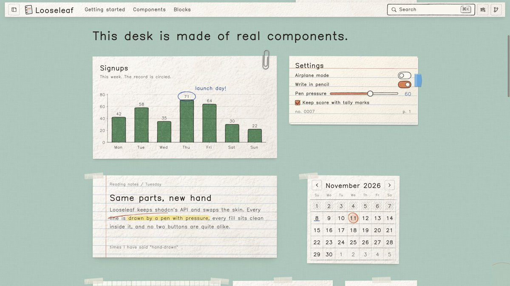
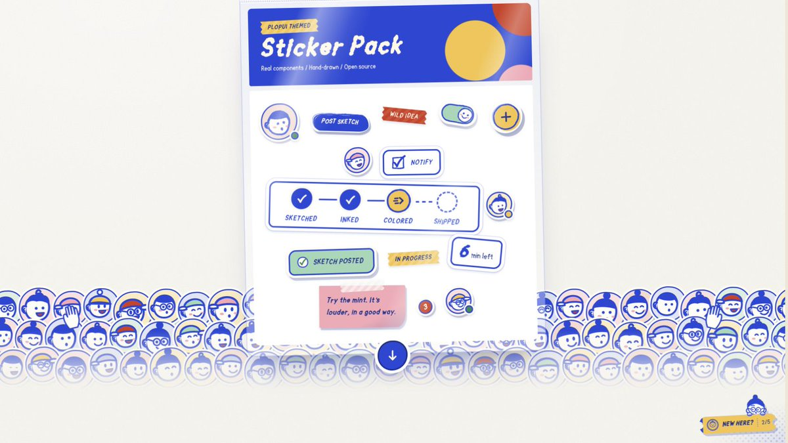
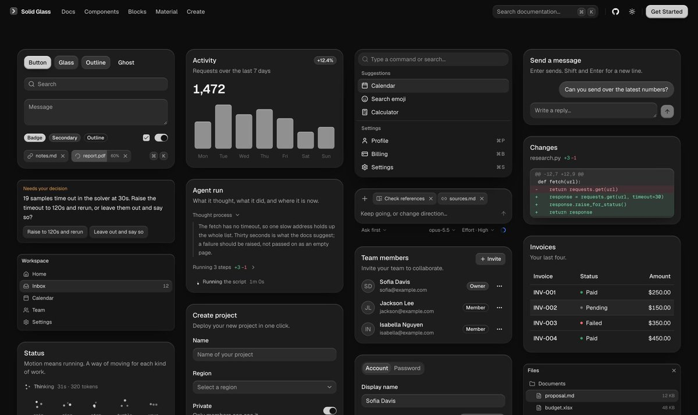
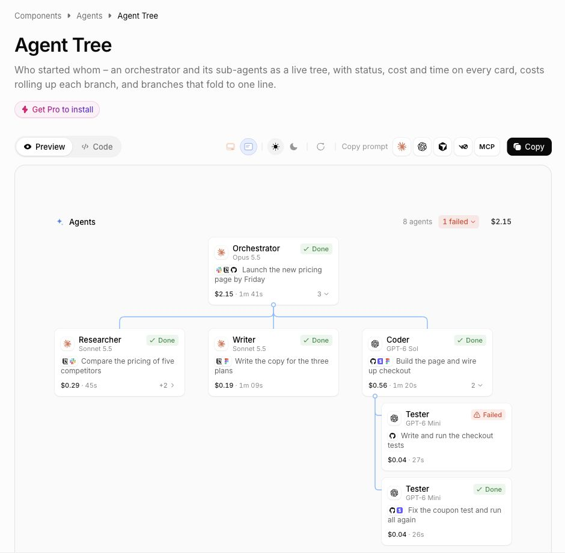

# Justin3go（@Justin1024go）：设计 Skill 根本没用，用好组件库就够了——8 个小众但有特色的 UI 组件库

> 反主流观点「设计 SKILL 根本没用，用好组件库就够了」，并推荐 8 个小众但极具特色的组件库用于 Vibe Coding 做出差异化：Looseleaf（纸张纹理、胶带、手绘图表）、PlopUI（蓝色马克笔与贴纸头像、按钮按压回弹）、Inkra（铅笔笔触与淡彩，连日历地图都带手绘感）、goopUI（会滴落拉伸的黏液组件，Vue/Nuxt 优先）、Solid Glass（克制的玻璃材质，含 Agent 状态/工具步骤/diff 展示）、AffectUI（Agent 树、工具调用、审批与 trace）、Prestige UI（React/Tailwind/Motion 组件与落地页区块）、BoardUI（仪表盘与 AI 工作台，含表格图表日历与 Agent 聊天）。

<!-- more -->

暴论：设计 SKILL 根本没用，用好组件库就够了

一些知名组件库就不推荐了，最近看到的一些小众但很有特色的组件库，手绘纸张、贴纸、黏液、Agent 工作台等等，vibecoding 想要做出特色就用这些：

1. Looseleaf：纸张纹理、胶带、手绘图表，还有完整页面区块 https://t.co/TFX9Yq8pYn
2. PlopUI：蓝色马克笔、贴纸头像，按钮按下去还会挤一下 https://t.co/ni7zDJtY6o
3. Inkra：铅笔笔触和淡彩，连日历、地图都带着手绘感 https://t.co/bPZNvgclji
4. goopUI：会滴落、拉伸的黏液组件，Vue / Nuxt 优先，目前是 https://t.co/4kEaP1lTjJ
5. Solid Glass：克制的玻璃材质，带 Agent 状态、工具步骤和 diff 展示 https://t.co/5WMvd5JY20
6. AffectUI：Agent 树、工具调用、审批和 trace；部分付费，图中的 Agent Tree 是 Pro https://t.co/faiQek3Njx
7. Prestige UI：React / Tailwind / Motion 动画组件，落地页区块也很丰富，含付费内容 https://t.co/laUvadXONX
8. BoardUI：主打仪表盘和 AI 工作台，表格、图表、日历到 Agent 聊天都有，整体风格干净克制（含付费组件）https://t.co/I79uB6HWvx

## 相关页面

- [[sources/pamela-build-personal-website-from-scratch-60-ui-checklist]]
- [[sources/adrian-mckinsey-style-consulting-visual-prompts]]
- [[concepts/agent-skill]]
- [[concepts/indie-site-builder-skill-stack]]
