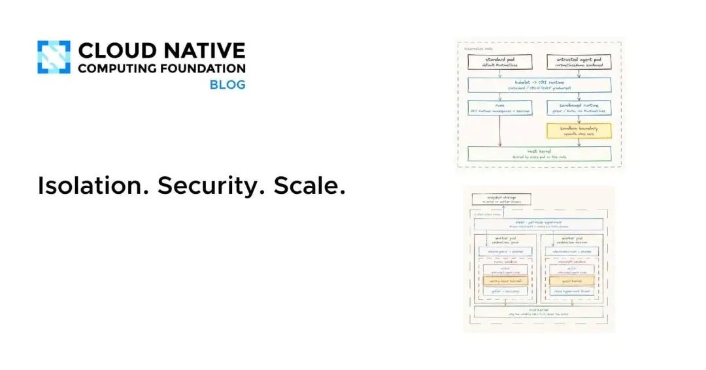
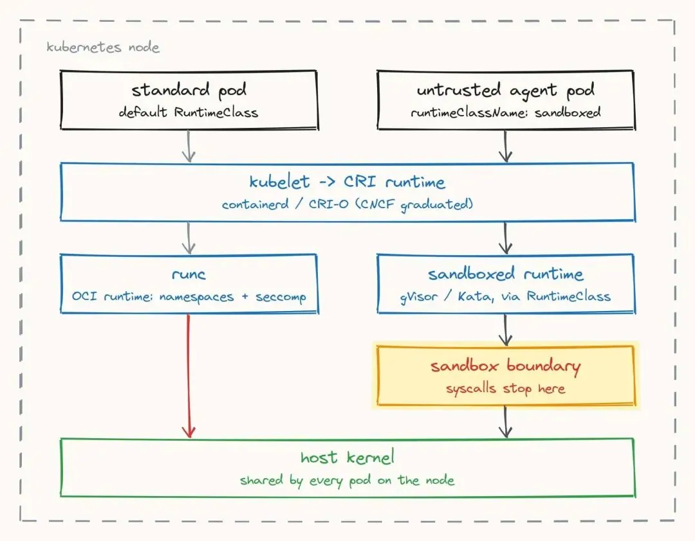
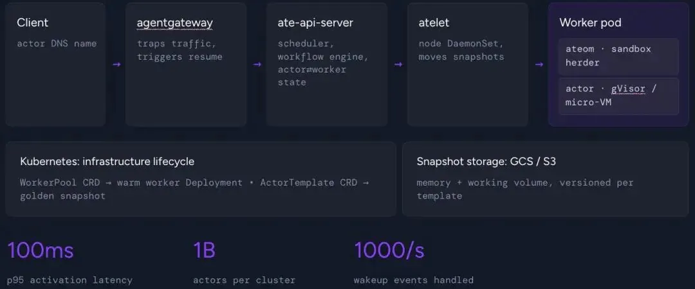
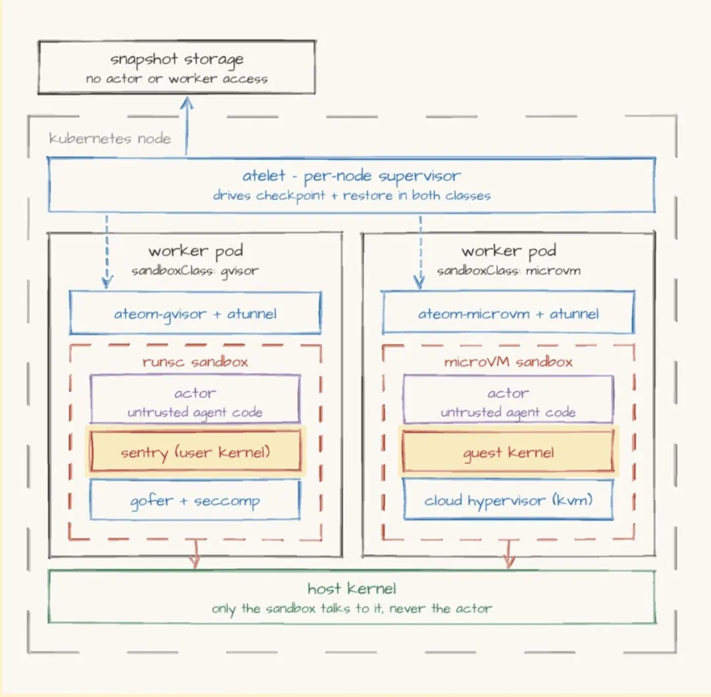
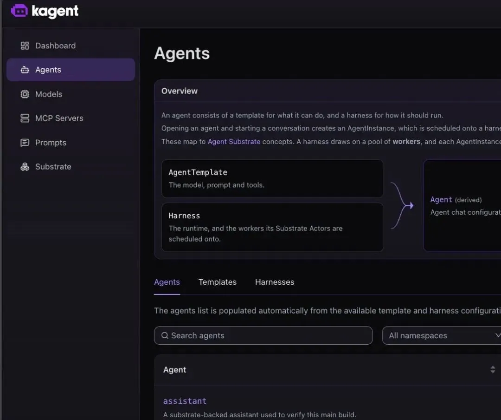
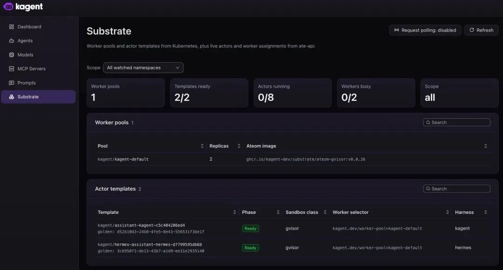
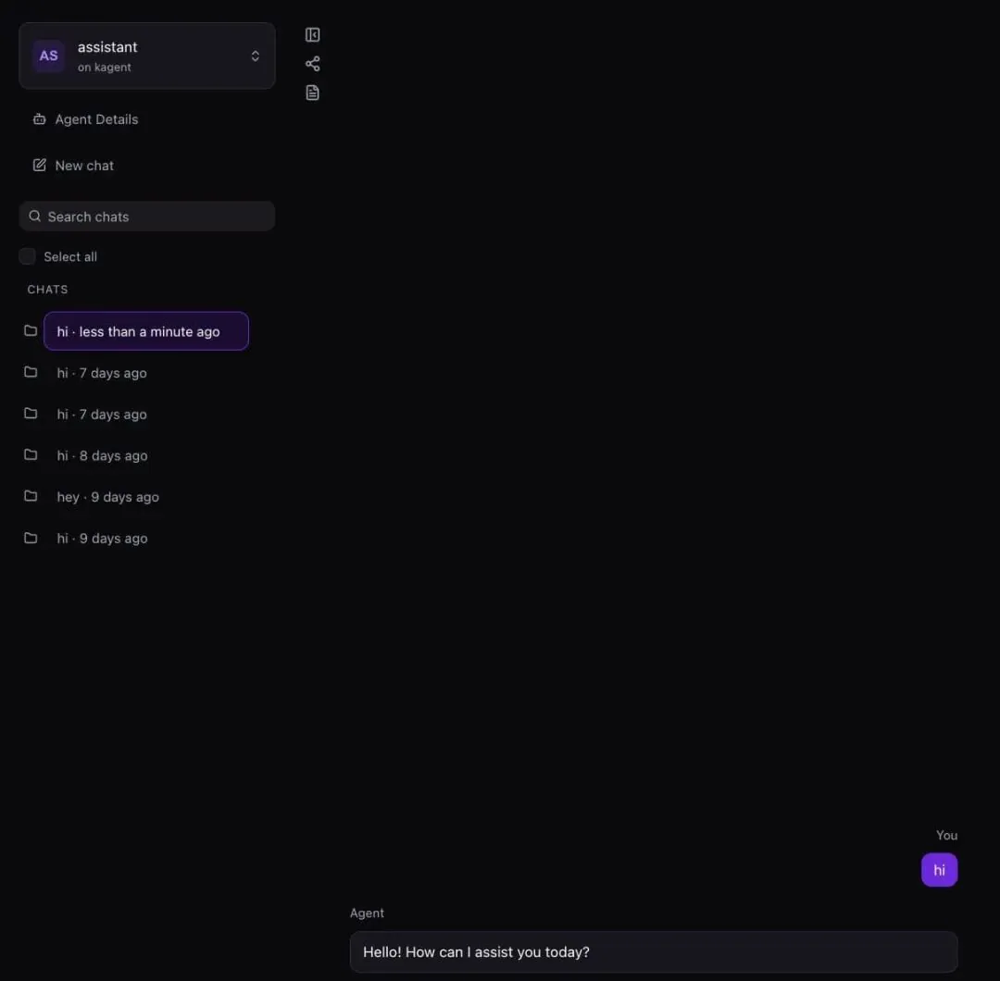

# Michael Levan：AI Agent 如何安全运行在 Kubernetes 上？——从沙箱隔离到 kagent 实战

> **核心命题**：随着 AI Agent 从实验环境进入生产系统，企业面对的已不是「如何构建 Agent」，而是「如何让它在 Kubernetes 中安全、稳定、高效地运行」。答案是把 **kagent 作为 Agent 运行时** + **Agent Substrate 作为底层沙箱平台**。



---

## 一、前言：Agent 生产化的三根支柱

要实现这一目标，三个关键能力不可或缺：

| 支柱 | 含义 |
|:---|:---|
| **隔离（Isolation）** | 防止 Agent 的执行行为影响宿主机或其他工作负载 |
| **安全（Security）** | 通过策略执行与权限控制，确保 Agent 只能在授权范围内运行 |
| **扩展（Scale）** | 确保 Agent 在需要时能够及时启动并提供服务，同时有效利用基础设施资源 |

如果缺少这些能力，就难以在受控环境中可靠部署 Agent，也无法充分保证策略执行和运行可用性。

**前置条件**：一个 Kubernetes 集群（本地的 kind 或 Minikube 集群也可以）。如果没有集群，也可以先从原理层面理解本文，等集群就绪后再实践。

---

## 二、从整体上理解智能体沙箱

### 2.1 容器沙箱「形同虚设」

如果启动 Docker 或其他容器引擎、创建一个容器并在其中运行工作负载，从技术上说这个工作负载已经处于「沙箱」中。

**然而这一层级的沙箱隔离几乎形同虚设**：

- 入站和出站流量完全开放；
- 工作负载可以向任意目标发送数据包；
- 没有任何强制执行的策略。

当然，可以通过网络策略、网络分段、路由规则等方式收紧这些边界，但这并不能改变**沙箱机制整体上天然具有「扁平化」特征**这一事实。

### 2.2 安全沙箱的五条硬性要求

安全、有效地为智能体建立沙箱，意味着：

1. **不可信的智能体代码不能逃逸到宿主机环境**，也不能危及底层基础设施；
2. **尽量缩小 Harness（智能体执行框架）的潜在影响范围**；
3. **持有模型输出、可能的凭据以及工具调用的智能体**，始终处于隔离边界之内；
4. **为智能体创建快照**，使其能够知道从哪里继续执行——也就是保留状态所在的位置；
5. **多租户环境中的智能体多路复用**（将流量路由到多个智能体），必须具备隔离和明确的边界。

要妥善实现上述要求，就需要能在**硬件和软件两个层面**隔离智能体，并在智能体流量到达目标时，通过 **AI 网关强制执行策略**。



---

## 三、Agent Substrate 在其中发挥什么作用

**容器隔离，以及这一层面上的软件隔离，其边界止于内核。** 所有工作负载都在该内核所提供的用户空间中运行。这对某些场景可能已经足够，但**隔离是如何实现的仍然很重要**。

> **客户端如何将请求路由到智能体，以及由哪些中间组件来完成路由，才是决定隔离效果的关键。**

这正是 Agent Substrate 发挥作用的地方。



### 3.1 双层隔离模型

在 Agent Substrate 中，**所有智能体都运行在 Worker 中，而 Worker 本质上是 Pod**。智能体通过 **Actor** 承载，Actor 则由 **ateapi**（Agent Substrate 的控制平面）管理。

其隔离能力来自软件和硬件两个层面：

| 层级 | 技术 | 机制 |
|:---|:---|:---|
| **软件级隔离** | **gVisor** | 隔离后的工作负载运行在用户空间内，使用一个名为 **Sentry** 的专用用户态应用内核来拦截和处理系统调用 |
| **硬件级隔离** | **microVM** | 客户机操作系统或虚拟机借助**硬件虚拟化扩展**，直接运行在物理 CPU 核心上 |

是否采用用户空间或命名空间中的运行方式（即软件级隔离），是由 gVisor 这类系统作出的**设计选择**。



---

## 四、在 kagent 中使用 Substrate

### 4.1 二者的交互关系

- **kagent 充当运行时**，Agent Substrate 则作为**底层平台**，帮助实现并提供沙箱能力；
- 如果不使用 kagent，与 Agent Substrate 交互的实际入口基本只有**编程调用**（例如用 `curl` 与 Actor 交互）；
- **kagent 则让你能够通过行业熟悉的方式——图形界面和声明式配置——与运行在 Substrate Actor 中的智能体交互。**

### 4.2 安装与配置

安装 kagent v1.0 和 Agent Substrate 需要几个步骤：

1. 配置 `kubectl-ate`，以便通过命令行与 Agent Substrate 交互；
2. 安装 Agent Substrate；
3. 安装 kagent。

> 逐步操作说明可参阅官方安装指南。

安装并运行后，默认通过 Helm 安装 kagent 时会创建一个 **WorkerPool**，其中包含**两个 Worker（Pod）**。这个 WorkerPool 由 Helm Chart 中的 `substrateWorkerPool.create=true` 配置创建。

### 4.3 通过编程方式创建智能体

安装完成后就可以创建**智能体（Actor）**和**智能体模板**。两个核心 CRD 的职责划分：

| CRD | 作用 | 类比 |
|:---|:---|:---|
| **AgentTemplate** | 包含智能体的配置，可在部署多个智能体时复用 | 类似一份「**黄金镜像**」（尽管「镜像」这个说法可能有些重） |
| **Harness** | 对应 Actor（智能体）本身 | 可以是 Codex、Claude Code 等执行框架，也可以是使用 LangGraph 等框架构建的自带 Agent（BYO Agent） |

运行以下命令，通过 kagent CRD 以声明式方式创建 Harness 和 AgentTemplate：

```yaml
apiVersion: kagent.dev/v1alpha3
kind: Harness
metadata:
  name: kagent
  namespace: kagent
spec:
  kagent: {}
  workload:
    image: PATH_TO_YOUR_AGENT_IMAGE
    substrate:
      workerPoolRef:
        name: kagent-default
    snapshotPolicy:
      location: gs://ate-snapshots-PATH_TO_YOUR_SNAPSHOTS
  allowedAgentTemplates:
    selector:
      matchLabels:
        kagent.dev/harness: kagent
---
apiVersion: kagent.dev/v1alpha3
kind: AgentTemplate
metadata:
  name: assistant
  namespace: kagent
  labels:
    kagent.dev/harness: kagent
spec:
  modelConfig:
    name: default-model-config
    description: A substrate-backed assistant used to verify this main build.
  systemPrompt: You are a helpful assistant running on kagent.
```

部署后，你会在 kagent 中看到运行中的智能体及其模板。



### 4.4 通过界面创建智能体

除了声明式配置，也可以通过界面创建：

1. 打开 **Agents** 面板；
2. 点击紫色的 **+ New template** 按钮，随后即可像上一节的 YAML 配置一样定义模板；
3. 通过紫色的 **+ New Harness** 入口进入 Harness 配置——在这里可以像使用声明式配置时一样，指定 **Actor／智能体部署到哪个命名空间、名称、运行时适配器，以及镜像所在位置**。


---

## 五、弹性伸缩的关键机制：Actor 按需拉起

使用沙箱化智能体后，打开 **Agents** 标签页可以看到 `assistant` 智能体。接着切换到 **Substrate** 标签页。

> **注意界面显示正在运行的 Actor 数为 0/8**——这是因为 **Actor 只会在存在活跃会话时运行**，这也体现了 Agent Substrate 对硬件资源的高效使用。



打开智能体并输入任意提示词，此时会看到 Actor 数变为 **0/9**：

- **新建会话会启动一个新的 Actor**；
- **会话完成后，这个 Actor 就会停止运行**；
- 这里的「会话」，指你向智能体提出请求并由它作出响应的这一过程；
- 如果再打开一个新会话并输入提示词，界面会显示 **0/10**；
- 如果**继续使用已有会话**，Actor 数量则**不会变化**，因为仍然是同一个会话。

> **这一点很重要**：表面上可能看起来「每次使用智能体都会启动一个新 Actor，这会带来大量资源管理工作」，但实际上**只有新建会话时才会出现这种情况**。



---

## 六、总结

本文介绍了沙箱为何重要、推动相关技术发展的关键项目，以及如何以 Agent Substrate 作为沙箱平台与架构，在 kagent 中部署 Actor。

对于工程团队和企业而言，**具备隔离、保护、治理和控制智能体的能力，是明确智能体能做什么、不能做什么的关键**；而这也正是当下许多组织部署智能体时面临的重要障碍。

---

## 重要链接

| 资源 | 地址 |
|:---|:---|
| CNCF 官方原文：Isolation. Security. Scale. | https://www.cncf.io/blog/2026/10/26/isolation-security-scale/ |
| kagent v1.x 官方安装指南 | https://kagent.dev/docs/kagent/1.x/setup/installation/ |
| Agent Substrate 架构文档 | https://kagent.dev/docs/kagent/1.x/about/architecture/agent-substrate/ |
| Agent Substrate 沙箱隔离文档 | https://kagent.dev/docs/kagent/1.x/about/substrate-runtime/sandboxing/ |
| kagent GitHub 仓库 | https://github.com/kagent-dev/kagent |
