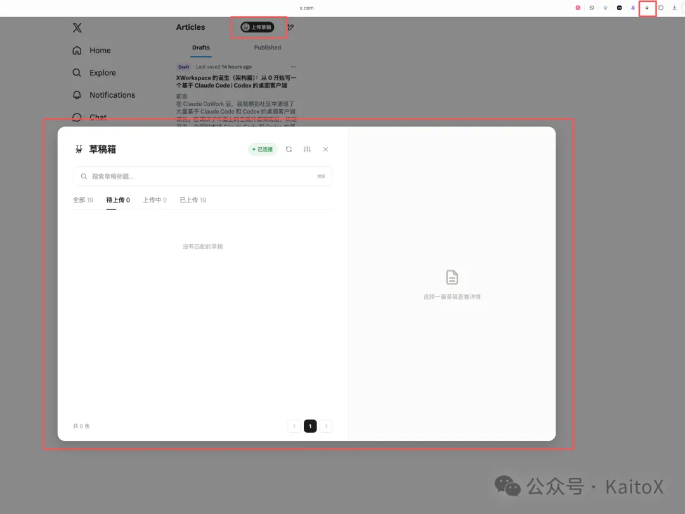
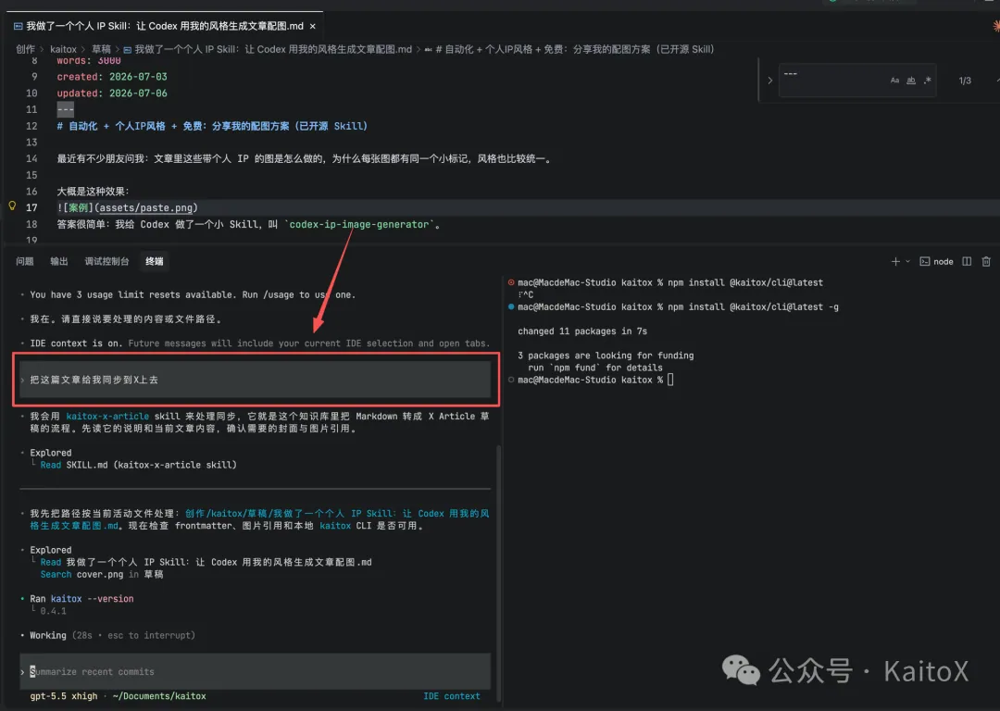
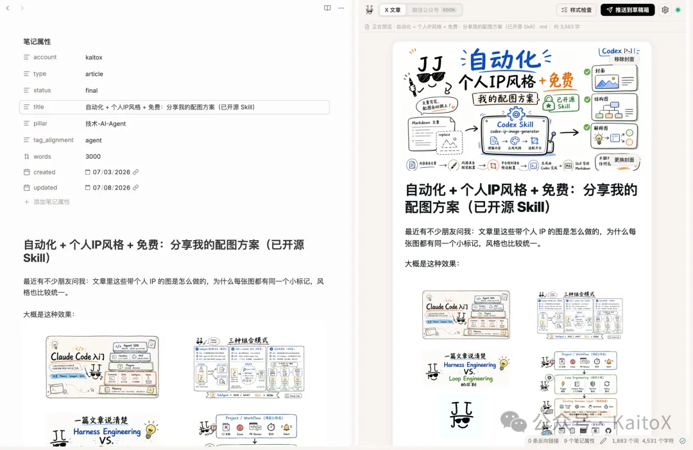

# kaitox：本地 Markdown 转 X 长文——我开源了目前最顺手的方案（Kaitox 工具链）

> 在 X 上写长文（Article），最恶心的不是写，是搬。本地写好的 Markdown——图片、标题、加粗、分割线都齐了——一到发布就得打开 x.com 编辑器从头来一遍：贴正文、一张张重传图片、调格式、单独设封面。写一小时，搬半小时。作者把这个搬运环节做成了开源工具 **Kaitox**：把本地 Markdown 一键发成 X 的 Article 草稿，图片、排版、封面一次到位。MIT 协议，免费。

<!-- more -->

## 一、为什么现有方案都不够用

作者在动手前完整调研了四条既有路线：

| 方案 | 痛点 |
|------|------|
| X 官方 API | 需付费（约 1 元/次），格式容易丢失 |
| 宝玉的 `baoyu-post-to-x` | AI 遥控浏览器（CDP 自动化），依赖复杂 |
| 王树义的 `x-article-publisher` | Playwright + 剪贴板逐段复制，容易卡 |
| XPoster（浏览器插件） | 图片内容仍需手动上传 |

看完这一圈没有一个能完全满意，于是 Kaitox 走了另一条路——**本地 relay + Chrome 插件**，绕过浏览器的逐步操作，直接推送。

### 核心优势

- **原生排版**：标题、加粗、列表、分割线等原生落地，本地什么样、发出去就什么样。
- **零成本、完全本地**：无 API 付费、无云端中转，relay 只监听 `127.0.0.1`。
- **三个入口**：Skill / CLI / Obsidian 插件，任选其一。
- **稳定且快速**：代码驱动转换，毫秒级生成，不依赖 AI 推理，零转换失败。
- **开源 MIT**：可直接使用或改造，甚至接入其他平台。


*图 1：Kaitox 的技术路线选择——本地 relay + Chrome 插件直推*

---

## 二、三步工作流：本地推、浏览器发


*图 2：推送 → 中转 → 上传的三段式架构*

1. **推送**：Agent / Obsidian / CLI 对 Markdown 做风格检查，连图片打包投给本地 relay。
2. **中转**：relay 只监听 `127.0.0.1`，把草稿存在本地磁盘，数据不出机器。
3. **上传**：Chrome 插件取走草稿，用你已登录的会话在 X 编辑页把它建成 Article 草稿，图片、封面一起传好。

---

## 三、安装配置

需要装两样：一个推送端（Skill / CLI / Obsidian 三选一）+ Chrome 插件（必装，负责写进 X）。

**环境要求**：Node.js ≥ 18、一个保持登录的 X 账号、Chrome / Edge / Brave 浏览器。

### 推送端 A：Skill（推荐）

```bash
git clone https://github.com/kuangjiajia/kaitox-toolkit
cd kaitox-toolkit

# Claude Code
cp -r skills/kaitox-x-article ~/.claude/skills/

# Codex
cp skills/kaitox-x-article/SKILL.md ~/.codex/prompts/kaitox-x-article.md
```

也可以直接把这句话丢给 Agent：

> 参考 https://github.com/kuangjiajia/kaitox-toolkit/blob/main/docs/Features/x-article.zh-CN.md，给我安装一下这个 skill

CLI 缺失时 skill 会自动装 `@kaitox/cli` 并拉起 relay。

### 推送端 B：Obsidian 插件

已上架 Obsidian 社区插件商店，打开 Obsidian「设置 → 第三方插件 → 浏览」，搜 `Kaitox` 安装启用即可（仅桌面端）。

> 注意：Obsidian 插件不像 Skill 会自动拉起 relay，需要先自行装好 CLI 并把 relay 跑起来。

```bash
npm i -g @kaitox/cli
kaitox relay --daemon
```

### 推送端 C：CLI

```bash
npm i -g @kaitox/cli
kaitox relay --daemon
```

### Chrome 插件（必装）

从 Chrome 应用商店一键安装。装好后打开 `https://x.com/compose/articles`，relay 在跑时页面角落出现 Kaitox 面板即安装成功。


*图 3：X 文章编辑器右下角的 Kaitox 面板*

---

## 四、日常使用：同步 → 上传两步

### 第一步：同步（把 Markdown 推成草稿）

**Claude Code / Codex（推荐）—— 直接说人话：**

> 把 ./post.md 同步成 X Article 草稿。

它会做风格检查、告诉你哪里在 X 上显示不好、让你选（改 / 降级纯文本 / 原样发），再投进 relay；CLI 没装、relay 没起都会自己搞定。也能顺带指定封面、改标题。


*图 4：Agent 自动完成风格检查与草稿投递*

**Obsidian**：笔记旁开面板，实时预览、一键推送，不用离开写作界面就能看到 X 上的样子。


*图 5：Obsidian 端实时预览与一键推送*

**CLI：**

```bash
kaitox x push ./post.md --title "标题" --cover "封面图地址"
kaitox x list   # 查看草稿
kaitox x status # 查看状态
```

### 第二步：上传（浏览器里点一下）

打开 `https://x.com/compose/articles`，在 Kaitox 面板找到草稿，点「上传草稿」。插件用你的登录态传图片、建 Article 草稿、跳进编辑器，图片排版一次到位。

**确认没问题后自己点发布**——发不发、什么时候发，永远握在你手里。


*图 6：浏览器端一键上传，排版与图片一次到位*

还支持浏览器内直接预览文章效果：


*图 7：上传前在浏览器中预览完整文章*

---

## 五、把这套流程接进你自己的工具

核心能力都拆成了独立的 npm 包，可直接复用：

- **`@kaitox/x-article`**：X 引擎。把 Markdown 转成 X 文章的那套逻辑——图片枚举、标题推导、风格检查、预览渲染。
- **`@kaitox/relay-protocol`**：线上契约 + `HttpRelayClient`，一行 `postDraft` 把草稿投给本地 relay。
- **`@kaitox/relay`**：本地 relay 服务本身。

你的脚本、博客流水线、笔记应用，只要调这几个包，就能复用这套「转换 + 投递」能力，最后同样由 Chrome 插件在 x.com 建成草稿。

### 边界声明

发布走的是 X 私有网页接口 + 你自己的登录态，属非官方用法，X 改内部实现时可能要跟着更新；**只用于以人类节奏发自己的内容，别拿去批量自动化**。

---

## 相关页面

- [[sources/yuntianming-md2draft-markdown-to-x-draft-extension]]
- [[sources/ryan-muse-auto-sync-x-posts-to-wechat-guide]]
- [[sources/ryan-muse-x-account-dedicated-proxy-ip-guide]]
- [[concepts/claude-skills]]
- [[concepts/agent-skill]]
