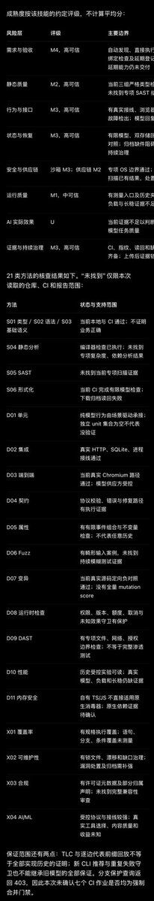

# kejun：skills 审计的代码验证成熟度——8 个风险维度 + 21 类验证方法

> 作者给 skills 审计加了代码验证层的成熟度模型：8 个风险维度 + 21 类验证方法（skill 见 github.com/kejun/squad 的 audit-verification-maturity 目录）。引用其上一条：重新认识「代码验证」，配套 kejun.github.io/code-verification-atlas。

<!-- more -->

加了一个 skills 审计代码验证层的成熟度，8 个风险维度 + 21 类验证方法：https://github.com/kejun/squad/tree/main/.agents/skills/audit-verification-maturity

> 引用推文：
>
> 需要重新认识一下「代码验证」了 https://kejun.github.io/code-verification-atlas/

