# 蛋挞：第二届 GEO 大会 Day 1 全嘉宾实战精华（附 15 位讲者避坑与实操清单）

> 基于 GEO 大会视频号直播整理：上午场 6 位主讲、下午场 7 位主讲 + 1 场 4 人圆桌 + 11 位一线会员快分享，带时间码可跳转回放。上午场由姚金刚与乔向阳开场定调（首届约 200 人，这届扩到五六百人；会前收集了 107 个参会者最关心的问题），内容覆盖官媒定调、数据闭环、AI 原生与出海快打等方向。

<!-- more -->

基于 GEO 大会视频号直播，我和 Agent 整理了上午场 6 位主讲、下午场 7 位主讲 + 1 场 4 人圆桌 + 11 位一线会员快分享的精华干货。可以快速过一下，对感兴趣的找对应的回放看（文章里面带了时间码）。

## Part 1：上午场——官媒定调、数据闭环、AI 原生与出海快打

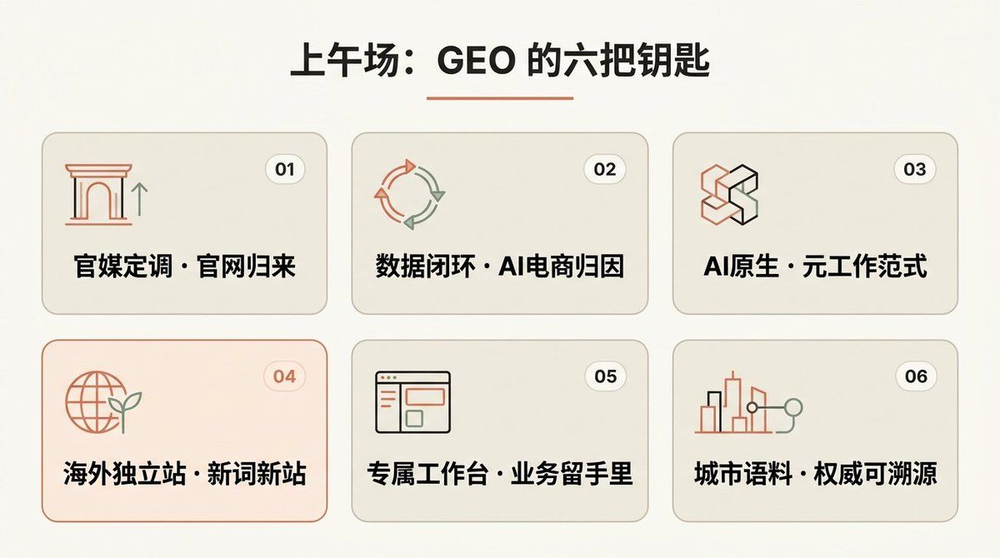

上午场由发起人姚金刚与乔向阳开场定调（上午场 00:02:04–00:12:41）：4 月首届北京场约 200 人，这届直接扩到五六百人；会前收集了 107 个参会者最关心的问题，核心全集中在 AI 搜索机制、国内 GEO 分发、数据监测与如何赚钱。

紧接着，6 位嘉宾从 6 个完全不同的切口，给出了上半场的六把钥匙。

## 1. 任强（北京日报社）：官媒大面积入局，“官网归来”是块大蛋糕

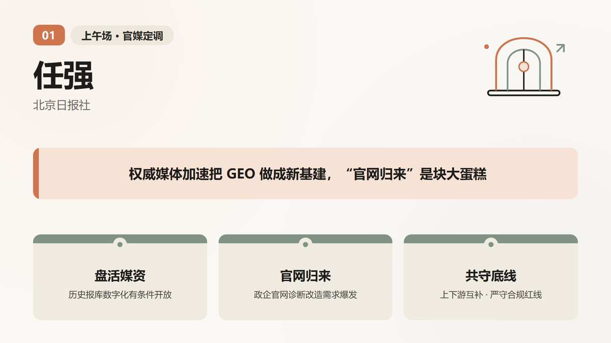

（时间码：上午场 00:12:42–00:34:48，其中 00:15:36–00:28:25 现场录像存在音频空窗）

作为开场定调的官媒代表，任强只讲了三件最实在的事：

- 盘活独家媒资：北京日报把除敏感年份外的历史报库（比如朝鲜停战谈判当天的竖版报纸）全部数字化解析，有条件地向大模型和行业开放，这是大模型厂商眼里的稀缺高质量语料。
- “官网归来”是真机会：不管是政府部门、大企业还是个体户，现在都必须重新重视官网。据其分享，北京及周边多地（含河北、乌兰察布、承德等）已主动联系报社做官网诊断与改造，多数老官网在技术与内容指标上都很欠缺，官网改造是一块非常大的市场蛋糕。
- 媒体与服务商不是零和博弈：据其透露，在中国传媒年会和中国晚报年会分享后，全国有近百家媒体来联系探讨复制北京日报的 GEO 路径。他强调媒体下场是赛道细分、上下游互补，但全行业必须共同守护合规与信源可靠的底线——一旦爆出突破底线的违规事件，招致政策管制，伤害的是整个行业。

## 2. 拔刀刘（爱搜 AI / AIDSO 合伙人）：GEO 终局是数据运营，当下是电商最佳窗口

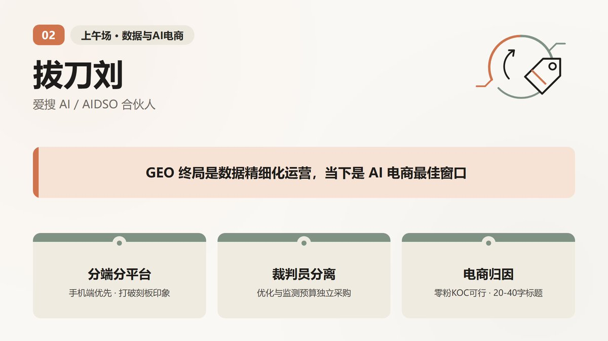

（时间码：上午场 00:36:43–01:06:36）

拔刀刘经历过 ASO、DSO 到 GEO 四代搜索周期，整场分享数据密度极高，核心就三个硬核判断：

- 第一，GEO 终局一定是基于数据的精细化运营。

AI 平台不公布官方搜索量怎么办？爱搜把过去 3 年积累的社媒搜索数据映射为 AI“热度值”，跑通了五步闭环：选真问题 → 筛高价值信源 → 抽高引用文章模板 → 创作发布 → 持续监控迭代。

他用实测数据打破了一个常见误区——千万别信“做豆包就猛发抖音头条”。不同行业、不同 AI 平台、甚至豆包手机端与网页端的引用源都完全不同（比如某口腔医院在豆包手机版里压根不引用抖音）。预算有限时，优先打手机端。

- 第二，监测是标配，洞察才是壁垒，“裁判员”与“运动员”正在分离。

据其分享，顶级甲方现在把 GEO 预算拆成独立的两笔：一笔找优化服务商（运动员），一笔找独立监测（裁判员），绝不由同一家兼任；部分大客日均监测达 1 万次（峰值近 3 万次），靠单题一天连续问 10–30 次来消除 AI 随机性。他预测，监测预算占整体 GEO 预算 25%–30% 以上的品牌，才是行业领导者。

- 第三，7 月之后，国内 AI 电商已经跑通归因。

豆包 3 月上线电商卡，7 月抖店后台上线「豆包运营专区」后，老板能直接算清 ROI 了。据其现场分享的学员与后台案例：某教辅书学员豆包 GMV 占比从 2% 一路涨到双十一超 10%；另一份抖店后台截图单周成交 70 多万、1 万多单，点击率 6.45%，点击到购买转化率高达 37%。

他还甩出两组能直接抄的电商干货：

- 抖音视频信源：账号粉丝数与 AI 引用次数的相关系数只有 0.06–0.09——零粉号、低粉 KOC 也能做 GEO；多品牌客观盘点比自夸更易被引用；40% 被引用的视频是 1 年前发的老视频，说明这是长期内容资产。
- 商品链接标题：统计显示，20–40 字、同时包含“品牌词 + 功效词 + 明确容量 + 品类 + 赠礼场景”的商品标题，最容易被 AI 弹出商品卡。

## 3. 张栖铭（奥罗卡创始人）：旧流程叠加 AI 只会更慢，人要转向“元工作”

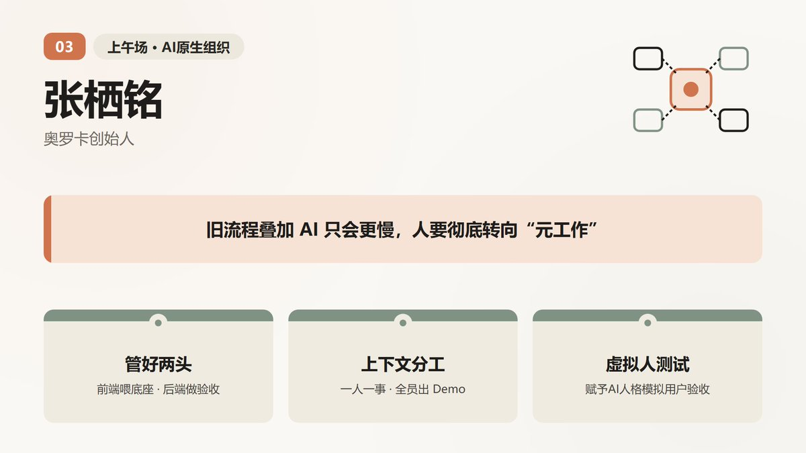

（时间码：上午场 01:06:41–01:41:21）

张栖铭（自述曾参与有道词典、扫描全能王）讲的不是 GEO 技巧，而是 AI 时代的团队怎么干活。

他晒了自己的日常：两三台电脑开几十个叠起来的窗口，“不是给我看的，是给模型看的”。睡前把任务布置好，设备 24 小时跑，早上起来验收代码、文章和视频，自称个人产出比两三年前涨了 10 倍以上。

但他踩过一个全行业都在踩的坑：传统流程叠加 AI，反而变慢了。

产品用 AI 写 PRD、设计用 AI 出图、开发用 AI 写代码，每个人都觉得快了，但一算发版时间反而更长，还冒出“播客播放键点一下先变小、点第二下才播放”这种人类写不出的诡异 Bug。

原因很简单：过去所有流程都建立在“写代码很贵”上，现在人脑和阅读交接成了最大瓶颈。（就像传统油车在车里塞部手机，而不是围绕智能造电车。）

他的 AI 原生工作法，做 GEO 团队也能直接套用：

- 人只管两头，做好“元工作”（安排工作的工作）：前端喂底座、做规划（先让模型去全网找全球最佳实践，或者喂公司历史最好案例，再加上你的业务上下文）；后端做验证、定取舍（赋予 AI 不同用户人格，用 Computer Use 模拟小白或目标客户去评测网站与 GEO 输出结果）。中间过程放手让模型跑，千万别逐字去读 AI 的输出。
- 按“上下文”分工，全员出原型：不再分产品/设计/开发，而是“一人一事、完整上下文先上”，聊方案直接拿 Demo 对着聊，全程录音喂给模型迭代。

## 4. 哥飞（出海独立站实战派）：别抢老词擂台！“新词新站”首日拿 GPT 订单

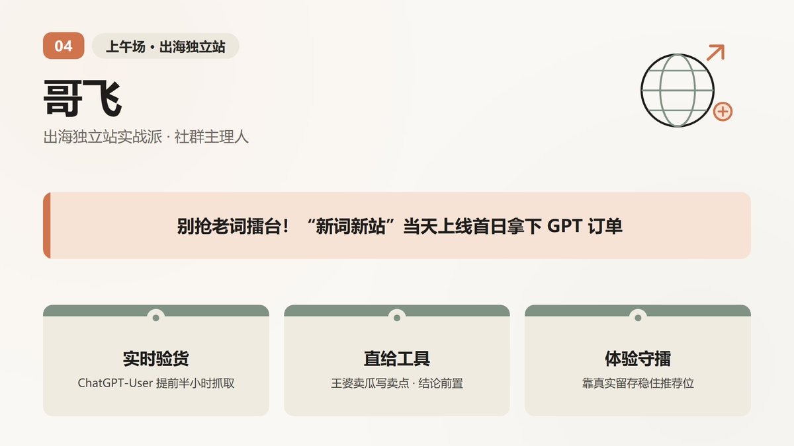

（时间码：上午场 01:54:55–02:33:13）

上午场实操颗粒度最细、赚钱路径最直接的，是哥飞（自述付费社群超 7000 人）。

传统 SEO 要熬三六个月，老板根本等不了。哥飞的反杀打法叫“新词新站”：不去老词擂台跟大站死磕，而是借谷歌趋势和 SimilarWeb 找刚冒头的新词（比如 TikTok 新爆火的特效玩法），当天注册域名、当天建站上线，一周内就能给老板拿出正反馈。

他晒了自己的实测数据（均为现场自述）：

- 9 月 28 日上线一个零外链、零广告的 TikTok 特效工具站，第一天就拿了 600 UV、17 单、221 美元收入，全来自 ChatGPT；第二天收入直接破千美元；累计 1.7 万访客、收入超 6000 美元。ChatGPT 流量付费率高达 3.4%（高于谷歌的 2%）。
- 国庆期间拉群友复现，49 位出单群友中，41 位拿到 ChatGPT 流量，20 位首单或首流量直接来自 ChatGPT。

为什么零权重的新站第一天就能拿到 GPT 流量？

哥飞拆解了 ChatGPT 的三类爬虫：GPTBot（训练）、OAI-SearchBot（建索引）、ChatGPT-User（实时二次验证）。他抓日志发现，每次真实用户来前半小时，ChatGPT-User 都会先来验货。AI 推荐你不是因为“记住了你”，而是为了抢谷歌“什么都能搜到”的用户心智，当场检索、当场验货！

抄作业必看的 4 条铁律：

1. 给对形态：10 月 19 日他做一个多热点合集站却零出单，因为只写了“这个梗是什么”，而没像 9 月 28 日那样直接给“特效生成工具”。用户要工具给工具，要对比给对比。
2. 王婆卖瓜、结论前置：别只放一个光秃秃的工具框，必须把卖点、场景写清楚让爬虫读懂，且把结论写在最前面（太长 GPT 不看）。
3. 把网址发给 GPT：在国内天天跟豆包夸自己品牌是笑话，但在海外把新站 URL 发给 ChatGPT，真能触发爬虫抓取入库。
4. 用体验守住擂台：用户点进去不满意，退回去点第二名（last click 失败）或者直接骂一句“刚才那个网站不行”，推荐位很快就会掉。

## 5. 谭少卿（Floatboat 创始人）：别把业务全交给大厂，沉淀自己的专属工作台

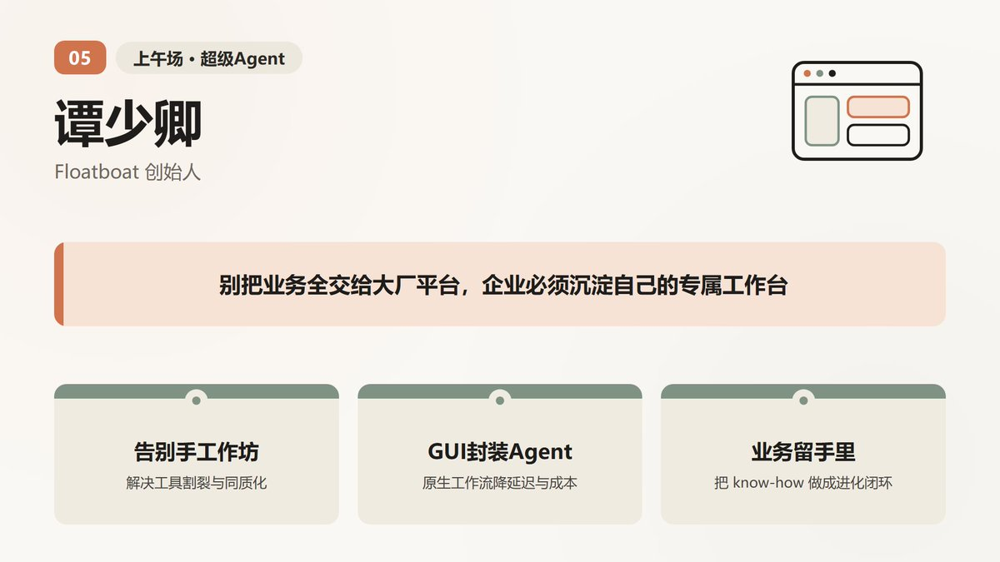

（时间码：上午场 02:34:11–02:47:36）

谭少卿（三次创业老兵）一针见血地指出 Agent 时代的残酷真相：SaaS 时代大厂取代不了你的业务；但 Agent 时代，如果你的业务全跑在大厂的 Agent 上，是可以直接被平台取代掉的。

他总结了企业落地 AI 的三大痛点：散装手工作坊（工具割裂无沉淀）、流程千篇一律（买同套 SaaS 和公开 Prompt 抹平壁垒），以及六到八成用户根本用不明白 Skill 和 Prompt（自述观察）。

他的解法是做 All-in-One 专属工作台：外层是传统软件般好上手的 GUI 界面，底层封装好 Agent + 原生 Workflow（解决推理慢和贵的问题）+ 自带 AI 浏览器 + 3000 多个海外 SaaS 连接器，把企业自己的 know-how 封装成可持续进化的业务闭环——并且自己公司仅用约 10 名全职员工，把所有业务都先跑在了自家产品上。

## 6. 张伟方（城市语料与标准启动）：用“城市语料”沉淀资产，算清获客成本

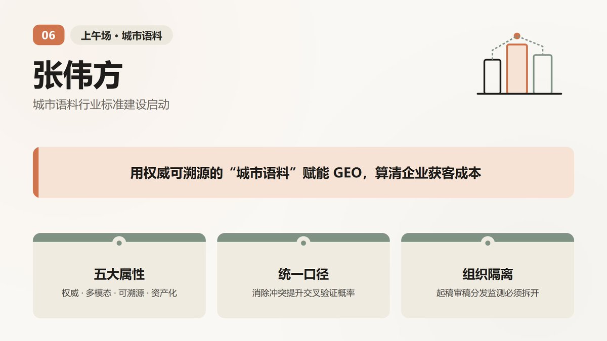

（时间码：上午场 02:47:53–02:58:04；注：现场未清晰自报全名，与官网 11:34 场张伟方对应，现场携北京日报任强、宁波日报于总等启动标准建设，并预告第三届 GEO 大会落户宁波）

上午场压轴聚焦在城市语料（以宁波「天一语料」为例）：

- 城市语料具备五大属性：权威主流媒体与政府数据、多模态、知识加工与城市图谱、可溯源、帮企业沉淀可交易的数据资产。
- 提醒企业一个最容易踩的低级错误：很多公司在不同地方写的公司名、产品名、报价、案例完全不一致，导致 AI 交叉验证时被取到的概率大打折扣。
- 落地必须守住四条前提：合规安全、权威背书、标准对齐、组织隔离（起稿、审稿、分发、监测必须拆开）。最后一句大实话：提及率、首条率都不如获客成本重要——投 1 万能不能换回 1.5 万订单，才是老板续费的唯一理由。

## Part 2：下午场前半——高维场景、反排毒机制与行业大去魅

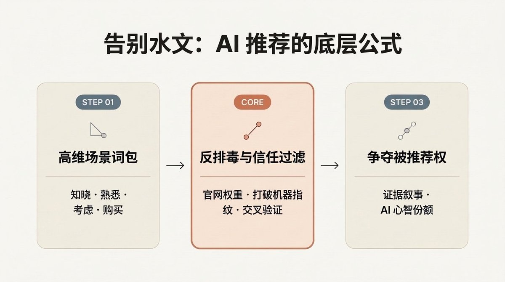

如果说上午场偏重“新机会与新工具”，那下午场前半段则是把 GEO 代运营和内容打法掰开揉碎，连“亏钱的底裤”都掀开给你看。

## 7. 刘树勋（智推时代联合创始人）：3+1 攻防词包 + 预测媒介清单

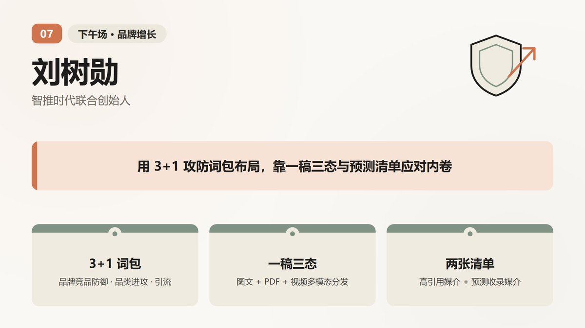

（时间码：下午场 00:00:00–00:25:21；注：录像从演讲中途切入）

刘树勋先把企业做 GEO 的真实需求拆成 6 类：信任感展示、排名占位、竞品对比、场景化营销（如春节送礼白酒、运动装备）、投融资信息披露（让投资人搜赛道时能搜到最新融资与规模）以及流量增长（自述服务的某渔具品牌豆包订单 10 个月内从几百单破万，翻了 30 倍以上）。连高校教授都在做 GEO 个人 IP，好让考研学生搜学院导师时优先看到自己。

实操上最值得抄的三招：

- “3+1”攻防词包：品牌词（某某好不好，做防御）+ 竞品对比词（A 和 B 谁更好，提前做防御）+ 品类词（推荐什么牌子，做进攻）+ 引流词（怎么联系/怎么买，做转化）。
- 一稿三态分发：同一份结构化内容，同时做成图文稿 + PDF 文档 + 视频多模态分发（AI 会抓视频标题/标签和 PDF 标题）。
- 两张媒介清单：今年竞争已从去年的单篇见效变成十倍百倍，省钱的办法是拉一张当前高引用媒介清单，再结合趋势拉一张下一批可能被收录的预测清单（自述知乎在 DeepSeek 权重 9 月后大涨，抖音在豆包美妆/科技引用占 40%–90%）。另外，出海玩家要提前关注 GEO + GEM（ChatGPT 后台广告投放）。

## 8. 艾奇先生（艾奇在线创始人）：场景相关性是入场券，用高维场景词包取代拼词

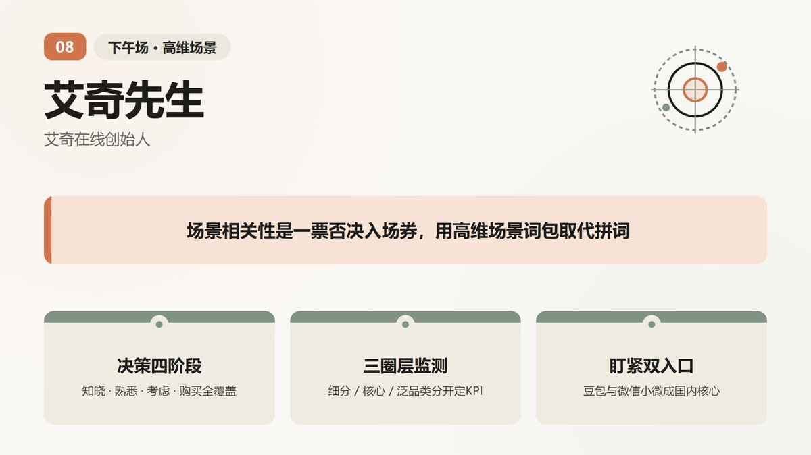

（时间码：下午场 00:25:22–00:55:19）

拥有十几年 SEO/SEM 经验的艾奇先生，把 AI 推荐总结成一条清晰公式：场景相关性（一票否决入场券）× 内容质量 × 信源可信度。你在深圳做装修，哪怕上了央媒，人家搜“武汉装修公司”AI 也不会推你。

他用“买二手房的年轻夫妻纠结软装翻新”和“3 岁儿童助听器选型”两个案例，拆穿了传统拼词的局限：

- 覆盖完整决策四阶段：问题知晓（要不要装修/听力下降怎么办）→ 业务熟悉（怎么避坑/助听器能解决什么）→ 合作考虑（武汉装修公司推荐/品牌对比）→ 品牌购买（有没有纠纷投诉/电话门店）。
- AI 会自动补全场景：即便用户没打“武汉”，豆包也会靠历史记忆自动补全地域、年龄与消费力。
- 三圈层分开监测：把细分赛道（如硬派越野 SUV / 德国进口有机奶粉）、核心品类、泛品类拆开定 KPI、拆开监测，混在一起数据一定会失真。
- 重点盯紧双入口：据其现场引用数据，豆包月活超 4 亿，而腾讯 Q3 财报披露微信小微内测日活已达 3000 万，未来国内 GEO 的两大王者入口就是豆包和微信。

## 9. 苍何（前台科技 CPO · 微软 MVP · AI KOL）：亏钱复盘！拆解模型四大排毒机制

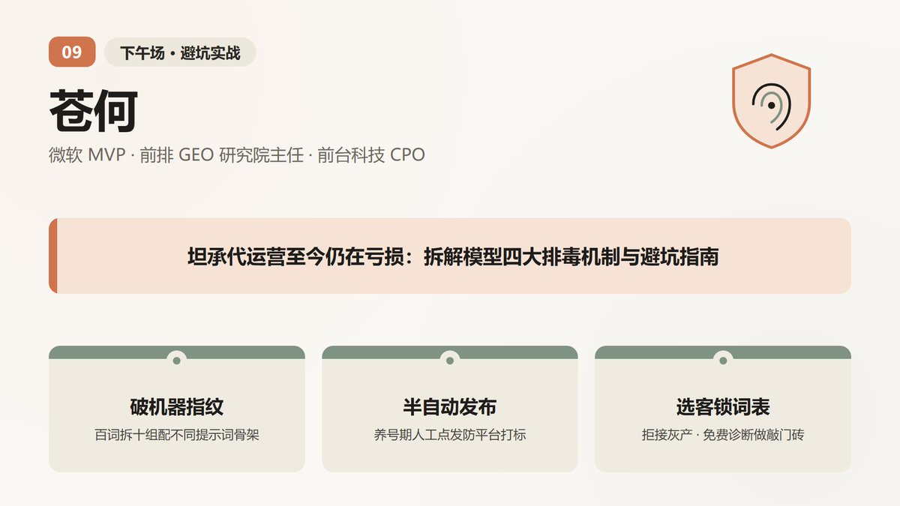

（时间码：下午场 00:55:30–01:33:17）

全场最真诚的“泼冷水”来自苍何。他一上台就自曝：“把自媒体赚的钱投入 GEO 代运营，到现在还是亏的。”

为什么亏？早期为了签单把价格定太低，却想做精细化交付；加上老客户每月不停换新词、还要维护旧词、双十一前临时加急，交付成本直接炸掉，运营甚至被客户骂哭离职。

也正因为真金白银交过学费，他的实战避坑极其硬核：

- 大模型四大“排毒机制”：
1. 来源分级：政府官网/权威媒体/学术期刊 > 企业官网 > 自媒体矩阵；
2. 机器指纹：同一套提示词、同一套“一二三”文章骨架发多了，直接被打标拒采，发一万篇都没用；
3. 交叉验证：多平台口径必须一致，靠知识库和知识图谱支撑，绝不做虚假投毒；
4. 反垃圾升级：豆包已有专门大团队反攻黑帽 GEO。
   - 两招破局：把 100 个目标词拆成 10 组，每组（品牌/行业/竞品/场景）配完全不同的提示词和文章骨架，打破机器指纹；放弃纯全自动群发，尤其小红书、抖音养号期一定要改半自动、人工点发布，防止被平台打自动化标签下架。
   - 服务商四大保命法则：① 处方药、夸大医美、灰产坚决不接，贷款金融慎接；② 签约前锁死词表管住预期，小品牌先打本地（如先打湖北再打全国）；③ 见效后绝不能停更，必须建日监测预警，停了再拉极难；④ 用免费诊断报告做销售敲门砖（自述自家免费诊断工具使用量超 20 万）。

## 10. 岳琦（每经科技首席产品官）：行业尚处“五代十国”，从流量叙事转向证据叙事

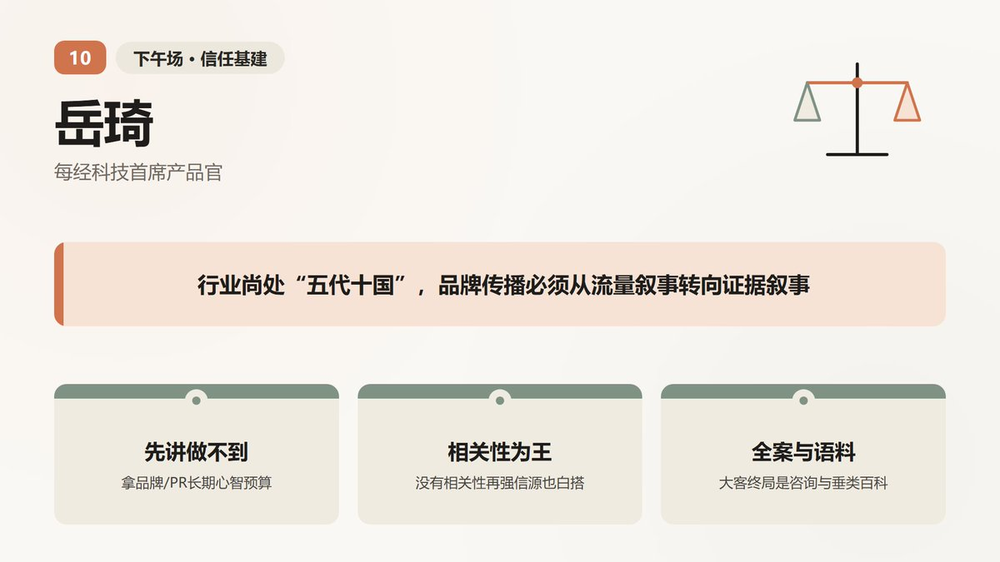

（时间码：下午场 01:33:18–01:49:43）

作为财经媒体孵化的科技公司负责人，岳琦给出了全场最清醒的大客户视角：

- 别被风口冲昏头：目前 GEO 处于“五代十国”的混乱期，需求真实性没官方数据、监测靠轮询统计有误差、定价毫无标准。据其估算，全国两三千家服务商中，真正能完整交付的可能不超过 50 家；央企竞标四五家上市公司一起压价，大客户交付往往至少三个人服务一个客户，“不管是大客户还是中小客户，要赚到钱真的非常难”。
- 先跟客户讲清楚 GEO 做不到什么：归因难、指标有波动、必须追着模型跑。所以做大客户要拿品牌部、PR 部的长期心智预算，拿市场部短期效果预算极易翻车。
- 信源不是万能的：即便手握每日经济新闻 20 多年的高权重信源，没有相关性，央媒发了也白搭。品牌传播必须从追求情绪和点击的“流量叙事”，彻底转向有逻辑、有数据、有真体验的“证据叙事”。未来大客服务终局是全案咨询 + 垂类百科语料共建。

## 11. 圆桌对话：岳琦 × 吕推 × 张莹莹 × 安美奇——回归产品与“被推荐权”

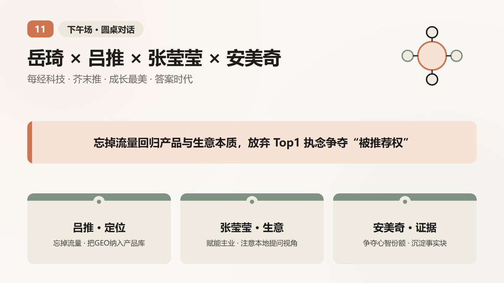

（时间码：下午场 01:49:46–02:13:08）

三位一线操盘手把行业最大痛点摊开聊透：大模型问答是封闭私域，用户旅程追不到，导致归因和 ROI 核算极难；且国内还没有一家像海外估值约 18 亿美元标杆（现场音译“播放的/profunt”）那样公认的监测标准。

每人最后留给品牌方一句压箱底的建议：

- 吕推（芥末推创始人）：忘掉流量，回归产品，把 GEO 纳入产品库。 先做好品牌定位（别一个品牌想切所有人群），传统企业出海做 GEO 前，一定要先复盘清理以前发过的旧信息，别让历史内容拖后腿。
- 张莹莹（成长最美 / HOCOMO LIMITED 创始人）：把生意作为主体，别把 GEO 作为主体。 别丢掉原有主业，用 GEO 赋能主业；提问视角极关键——用全国口吻问和用当地人口吻问，AI 给的结果天差地别；同时要提前思考，未来大厂自建闭环生态后（如腾讯 AnswerBase 等），第三方服务商的核心壁垒是什么。
- 安美奇（答案时代创始人）：放弃 Top1/Top3 排名执念，争夺 AI 心智份额（Share of Voice / 被推荐权）！ 重点看 AI 是否提到你、给了多少字篇幅、在什么场景提、是不是正向推荐。形容词对大模型只是噪音，唯有不可编造的事实块（具体数字、可查资质、真实好评）才是品牌护城河。

## Part 3：下午场后半——软件终局 80/20、官网承接力与时间护城河

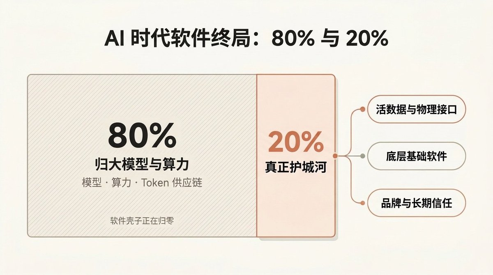

下午后半场的 3 位压轴嘉宾，把视角一口气拉高到了产业终局、企业全域治理和跨周期战略。

## 12. 杨攀（Bilink 创始人、前硅基流动联创）：软件壳子归零！看清 80% 与 20%

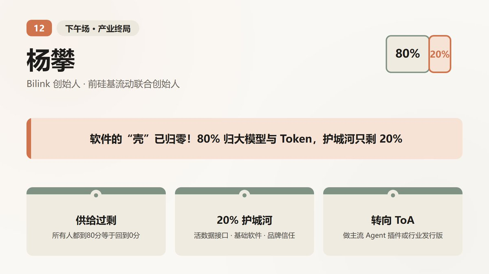

全场最具颠覆性的宏观判断，来自技术老兵杨攀。他先甩出一组震撼对比（现场引用）：2026 年九十月以来 Steam 每 6 分钟上线一款新游戏，新 App 上架数翻番，但全平台下载量只涨了 2%。

AI 让做软件变得像写网文一样简单，很多人搓出来的产品只是满足自己愉悦的“自我代偿（To Me）”。当 AI 让所有人都到了 80 分，所有人其实又回到了 0 分起跑线——软件的“壳”不再值钱。 用户看到好软件不再付费下载，而是让自己的 Agent 分分钟复刻一个。

在被称为“AI 历史垃圾时间”的 2026 年，杨攀给出两条极其清醒的生存法则：

- 看清 80% 与 20% 的终局切分：未来全球软件市场 80% 的收入归大模型、算力与 Token 供应链（哪怕你卖的是 Agent，本质也是借壳卖 Token，企业必须专人管 Token 供应链）；剩下的 20% 护城河，只属于模型训练不进去的三样东西：
1. 活的数据与物理/数字世界接口（如每天变动的企查查工商数据，或滴滴、美团的线下履约接口，模型花 1 块钱调接口比自己搜 1000 次划算得多）；
2. 云计算、存储、数据库等底层基础软件；
3. 品牌与长期信任（面对几千个同质化 PPT Skill，大家只会无脑选归藏这样听过的名字）。
   - 全面转向 ToA（面向 Agent）：移动互联网吃的是网民从千万到十亿的增量，Agent 时代一个人可以并行跑成百上千个分身，红利是百倍千倍级的。软硬件别再执着于做独立 App，而是去做主流 Agent 的插件（Harness），或者基于开源生态封装自己的行业发行版，靠持续服务变现。

## 13. 高军（媒介匣创始人 & CEO）：碳硅共存要左右逢源，没有承接力做什么 GEO

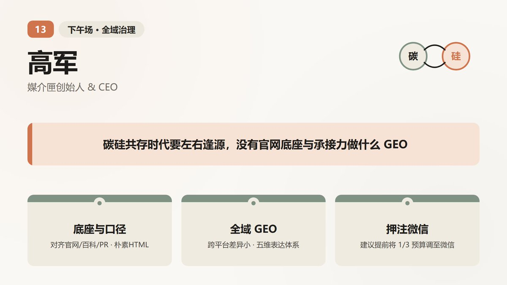

（时间码：下午场 03:17:40–03:42:06，接在 8 分钟录音空窗之后）

高军把当下定义为“碳基生物（人）与硅基生物（AI）共存的时代”，品牌必须学会左右逢源——既要懂新华社（新闻批发商，给硅基和理性看），也要懂央视（内容放大器，影响人类）。

他直指企业最致命的三大盲区：

- 80% 客户忽略底座建设，60% 客户 PR 口径自相矛盾：成立 15 年还是 16 年、年产 30 万吨还是 80 万吨，以前没人细查，现在全被 AI 理性抓包并降权。甚至有超级上市公司在百度百科和招聘网站里，压根没写自己的第二增长曲线业务。
- 流量承接力普遍不合格：官网一味追求视觉酷炫、400 电话藏得极深，AI 根本抓不到。反倒是大众网、邢台网、咸宁网这类“十年没改版、只用最朴素标准 HTML”的地方小站，成了 AI 最爱的信源。“机器推荐、人类决策，没有承接力，提及率再高客户也不续费！”
- 提出“全域 GEO”与押注微信：与分平台精耕派不同，高军监测 16 个行业 80 余家企业发现，跨十余个平台的复现率差异不足 20%，核心不是逐个抠平台规则，而是搭建品牌表达、行业表达、用户表达、媒体表达及其他证据五位一体的系统工程。同时他预判微信小微大概率春节前后全量开放，已鼓励所有客户把 1/3 预算立刻调到微信。

## 14. 陈峥（欧博东方 CEO）：SEO 终局是排名，GEO 开局是采信

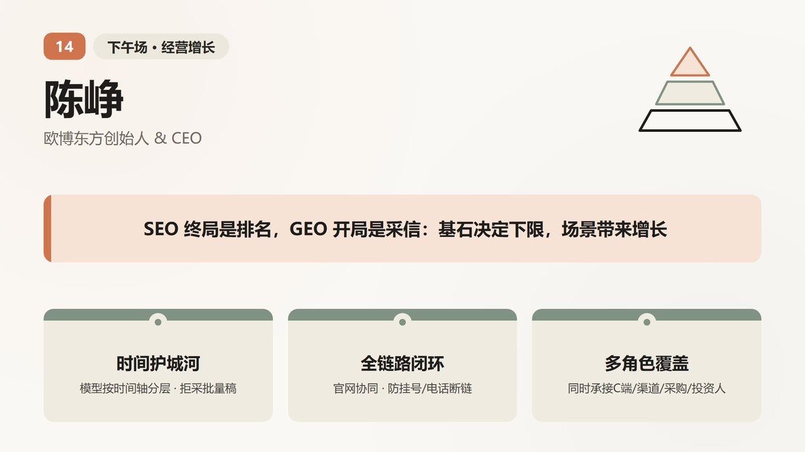

（时间码：下午场 03:42:18–04:10:50）

作为压轴嘉宾，陈峥（自述服务近 2000 家客户含 80 家上市公司/五百强、跨境电商累计销额约 50 亿）临场换了 PPT，掏出几项极具含金量的内部监测发现：

- 大模型正在建“时间护城河”：去年模型有“趋新性”，谁后发稿谁占优；但据其 9 月 14–21 日从医疗、法律等严肃赛道抓取的内测数据，模型已经开始按时间轴分层沉淀资产（1 年 / 半年 / 3 个月 / 30 天）。先手布局者筑起护城河，后来者光靠狂发相似通稿根本追不上——模型甚至会在思考链里直接判定“多个相似信源为商业化信源，不予采信”。
- 春节后官网权重暴涨：去年客户问要不要建官网他还会说“暂不用”，但今年春节后法律、医疗、装修、家居、教育等赛道大幅拉高官网权重——因为有官网的企业受国家监管不敢轻易造假，没官网协同，光发央媒都可能不被采信。
- 别让转化链路在最后一公里断掉：他举了一个扎心的民营医院案例——消费者搜完专家后，会继续追问“在哪出诊”“挂号电话多少”“外地医保能不能用”。医院改版官网却把挂号电话搞错了，前期抖音小红书花大钱引来的流量瞬间流失给竞品甚至号贩子。
- GEO 不只面向 C 端消费者：以人工晶体上市公司为例，同一套信息基建要同时承接患者家长、潜在加盟代理商、三甲医院采购主任、二级市场投资者四类人的深度追问。
- 三层落地结构：底层搭品牌基石（决定下限，其自述几十万上百万的季度大单里甚至没有一个排名词，全在建基石），中层做多元场景（带来增长），顶层才是竞争延伸。同时通过全国拟人化 IP、输入法脱敏词和线下销冠录音卡，反推黑箱里的真实提问。

## Part 4：11 位一线会员快分享精选（最接地气的草根样本）

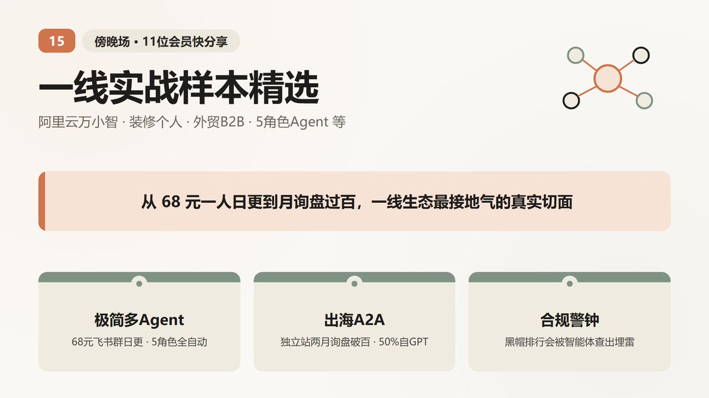

（时间码：下午场 04:10:51–04:56:23）

傍晚的 5 分钟快分享，反倒冒出好几个让人拍案叫绝的一线真实样本：

- 68 元一人日更全链路 GEO（土木转行装修的年轻人）：家做装修、自己跑工地拍视频录音频，只花 68 元开豆包会员，在飞书群里建起几个协作机器人，在工地随手把素材扔进群，Agent 自动完成写稿、剪视频与发布准备，回家点一下就行。他的忠告很实在：一定要留存所有真实案例证据链，别像他爸那样随手把去年案例全删了。
- 两月做到月询盘过百，A2A 已在真实运转（16 年传统 B2B 建材外贸人）：7 月中旬用 GEO 思维做领英当天见效，一周建好独立站、第二周来 ChatGPT 询盘，两个月月询盘破百。约 50% 询盘来自 ChatGPT，更有 20%–30% 是海外客户用 AI 发过来的，己方再用 Agent 回复——Agent 对 Agent 的外贸闭环已经跑起来了。
- 5 角色全自动 GEO 优化部（浙江台州曹伟）：搭了 5 个 Agent 角色（部长决策审批、品牌事实专员提炼原子事实、数据专员抓全网下拉词与监测、分发专员、内容主编），人工只负责审核知识库和终稿，极大压缩人力。
- 阿里云万小智（刘天勇 / 花名福波）：押注“官网归来”，从去年 9 月全面转型 AI 原生建站，自述已上线超 2 万个企业官网，提供域名+备案+CDN+托管一站式底座，现场招募 GEO 数据采集合作方。
- 一条保命警告（杭州张叔，自述接过数百万汽车大标）：千万别给客户发黑帽排行榜！ 普通对话 AI 未必查出来，但用智能体一查必露馅，“那是给客户埋一辈子的雷”。
- 销售怎么赚到钱（深圳迅宁祝海燕）：先用苍何的免费诊断报告敲门，再把麦肯锡行业分析框架写成 Skill 筛选上升期行业，“先把简单好签的钱赚了”。
- 生态共建呼声：朱小乔（云栖，自述依托新疆算力中心免费开放系统与静态住宅 IP）、周小鸟开窍（痛点—困境—产品三步给用户写攻略）、益海创腾联创（400 人老牌跨境 SEO 代运营求 AI 建站与 GEO 合作）、华谊数科沈卓义（高铁媒体求实力交付伙伴）、艾奇在线联创陈振强（呼吁转向全域全案交付）。

## Part 5：一图收尾——2026 做 GEO 的三避坑与三必做

【👇 在此处粘贴图 19：2026 做 GEO：三避坑 & 三必做】

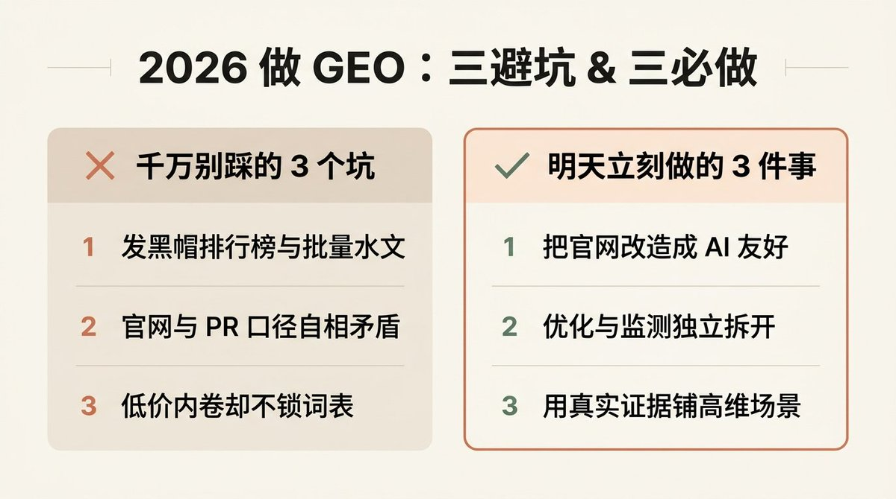

听完这 8 个多小时，如果只带走最核心的行动指南，看这张清单就够了：

千万别踩的 3 个坑：

1. 发黑帽排行榜与批量水文：3·15 之后不仅极易触发“机器指纹”和商业信源拒采，还会在智能体检索下给品牌埋下长期负面雷。
2. 官网与 PR 口径自相矛盾：成立年限、专利数、核心业务、挂号/客服电话各说各话，AI 交叉验证直接降权，流量来了也接不住。
3. 低价内卷却不锁词表：代运营最容易亏死在“卖白菜价却包无限加新词”，签约前必须锁死词表、管住预期、远离处方药与灰产。

明天就能立刻做的 3 件事：

1. 把官网改造成 AI 友好：别迷信酷炫动画，老老实实用标准 HTML 把核心业务、资质参数、案例证据和清晰联系方式铺平，顺手把百度百科与企业征信口径对齐。
2. 优化与监测独立拆开：甲方把“运动员”和“裁判员”分开采购；国内电商立刻去抖店后台看「豆包运营专区」，同时提前留出预算盯紧「微信小微」。
3. 用真实证据铺高维场景：忘掉堆砌行业大词，围绕消费四阶段与多角色追问（C 端/渠道/采购/投资人），把不可编造的事实块沉淀成长期资产；做海外的，马上用“新词新站 + 直给工具”去测 ChatGPT 实时流量红利。

GEO 的终点，从来不是糊弄算法，而是用 AI 读得懂、人类信得过的方式，把你真正过硬的产品与专业价值，稳稳递到正在做决策的人面前。

## 相关页面

- [[concepts/open-source-seo-tooling]]
- [[sources/yaohongan-geo-five-actions-guide]]
