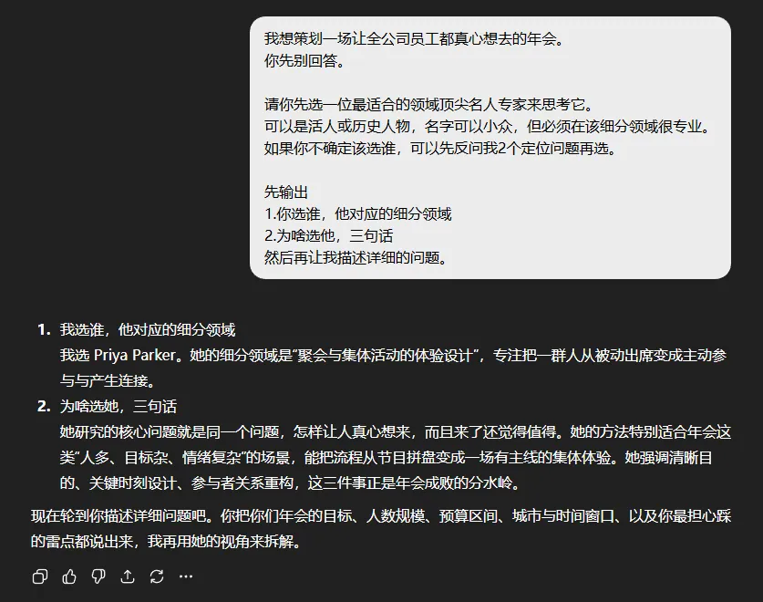
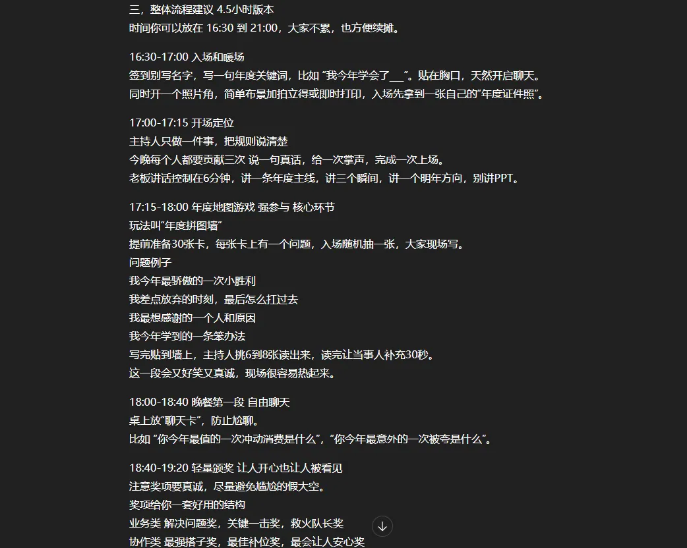
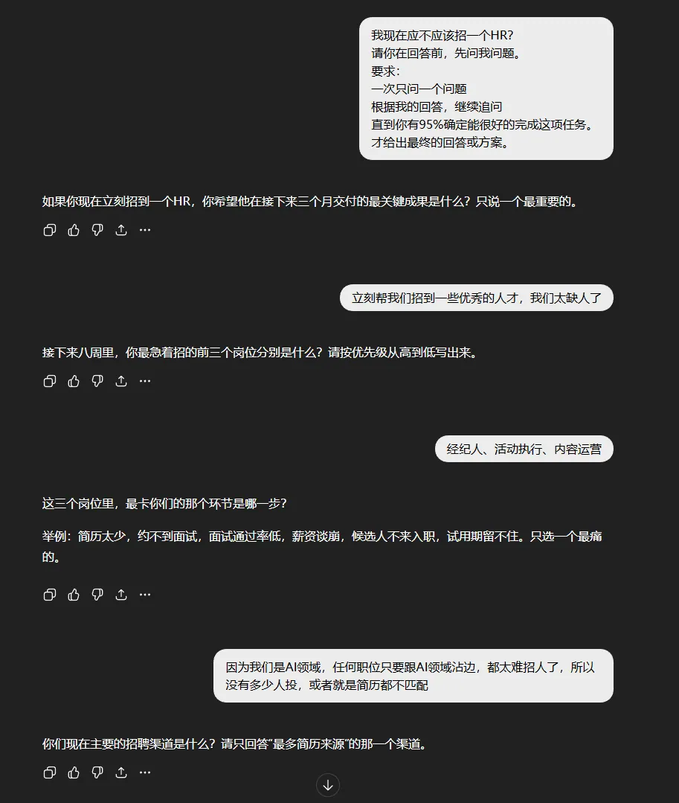
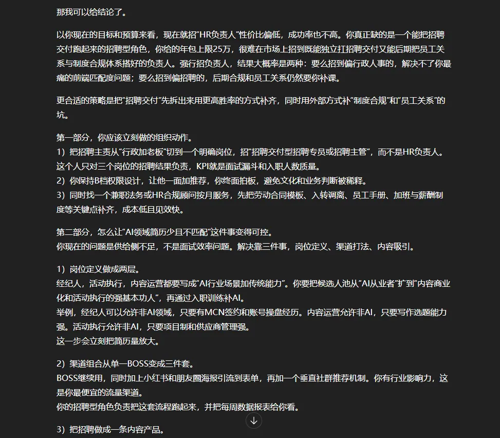
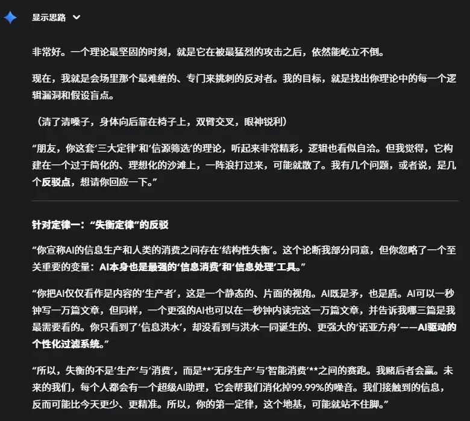

# 数字生命卡兹克：分享 6 个平时我最常用的 Prompt 心法

> 已经 2026 年了，还是看到很多朋友说不知道怎么跟 AI 更好地对话——问点日常问题效果尚可，一旦稍微专业一点、需要维度多一点，回答效果一下子就崩了。作者玩了两三年 AI，日常生活与工作中大量依赖，已到「每天没了 AI 就废人一个」的状态。本文分享 6 个高频使用的 Prompt 心法，每一条都附可直接抄用的模板与真实使用场景。

<!-- more -->

作者自己很少用特定格式的 Prompt，他常讲的一句话是：**你能把问题表达清楚、把上下文和背景信息表达清楚，Prompt 就成功了一大半。**

但真做起来没那么简单——很多时候脑子里就是一瞬间空空如也。所以他更喜欢用「心法」，即一种跟 AI 的对话技巧，尽可能激发 AI 的能力。

---

## 一、让 AI 选定角色后再回答

设定具体角色是有用的。在你清楚要问什么时直接设角色，越具体越真实效果越好——设定「乔布斯」常常比设定「10 年产品经理」更有效。

但很多时候你根本不知道该设什么角色。这时**没必要自己憋，直接让 AI 给你选**。

模板：

> 我想探讨【领域】里的【问题类型/场景】。先别回答。请你先选一位最适合的领域顶尖名人专家来思考它。可以是活人或历史人物，名字可以小众，但必须在该细分领域很专业。如果你不确定该选谁，可以先反问我 2 个定位问题再选。先输出：1. 你选谁，他对应的细分领域；2. 为啥选他，三句话。然后再让我描述详细的问题。

**真实案例**：要办年会时用这个模板问，AI 选了一位活动策划专家（Priya Parker），确实在该细分领域非常专业。给出更多信息后，年会策划答案立刻变得丰满。

善用各种各样的专家做参考，你会得到一些非常棒的回答。

*图 1：让 AI 自主选择领域顶尖专家作为思考视角*

---

## 二、给答案前先让 AI 追问（苏格拉底式追问）

日常决策中，别人听完你第一轮信息一定会再追问细节。而 AI 不会——**你给什么信息，它就产出什么回答**，根因还是上下文与背景给得不够。

所以完全可以让 AI 帮你补齐。这个心法源自 Reddit 大佬 @imthemissy，作者优化后的模板：

> 【你的问题/需求】请你在回答前，先问我问题。要求：一次只问一个问题。根据我的回答，继续追问。直到你有 95% 的信心理解我的真实需求和目标。然后才给出方案。

**「95% 置信门槛」是神来之笔**：既足够高以确保质量，又足够真实，避免 AI 陷入无尽追问循环。

**真实案例**：业务盘子变大卡在招聘时，用这个心法问「我现在应不应该先招一个 HR」，AI 连续问了十几个非常详细的问题，最终给出的回答远胜于干巴巴没有营养的输出。

*图 2：AI 连续追问十余轮后给出的高质量决策建议*

这是作者日常与 AI 对话中使用频率最高的心法，没有之一。

---

## 三、与 AI 辩论

核心是**让 AI 不要那么「舔狗」**。

AI 的谄媚效应太强，在没有刻意引导时会经常顺着你说，导致你无法对自己做客观判断。

模板（强攻击性版）：

> 我马上要参加一场辩论赛，会有很多人来挑战我的观点。我的观点是【观点】。我希望这个理论必须变得无懈可击。如果你是一个学者，你需要用尽一切论据、细节和逻辑，来挑战我、反驳我。你的唯一目标，就是证明我是错的。你会怎么反驳呢？

简化版：

> 【我的想法/观点】请你现在扮演一个"反对者角色"，从不同角度攻击我的想法，帮我完善我的观点。要求：不用客气，直接指出漏洞。

**真实案例**：国庆假期准备一场分享，担心自己思考不完善会闹笑话，于是把攻击性 Prompt 扔给 Gemini 聊了将近 3 小时。坦率讲那一次作者被 AI 折服，确实学到了很多。

*图 3：让 AI 担任"反对者角色"挑战你的观点*

---

## 四、让 AI 提前预演失败

人做计划容易热血，AI 做计划也容易乐观。两者凑一块，很容易搞出「听起来很燃但落地全靠命」的方案。

因此作者喜欢在方案开始前先做一次「**预演失败**」——类似影视行业的 Previz，正式开拍前先踩坑。

模板：

> 【我的项目/想法】请假设这个项目到时候失败了拉了大垮。然后回答：什么时间点开始出现衰退信号？最致命的决策错误是什么？你忽视的核心风险是什么？如果能重来，第一个应该改的是什么？要求：写一篇"失败复盘文章"，要基于真实的类似项目失败案例。

**真实案例**：为一场规模可能达万人的 AI 大会，把 PDF 方案扔给 AI 用这套心法预判风险，拿到洋洋洒洒几千字的复盘文章，甚至列出了签到区的排队、盒饭、厕所、安检、动线等风险——**这之前完全是我的认知盲区**。

推荐大家经常给方案做预演失败，能补充很多珍贵角度。

*图 4：预演失败产出基于真实案例的复盘文章*

---

## 五、反向提示（倒推提示词）

有时你根本不知道怎么问，只知道想要什么样的结果。比如看到一篇很牛的文案或一张很棒的图，你想要同样的结构和节奏，却说不出来。

那就**把成品给它，让它倒推提示词**。

作者最常用的一句话：

> 这是我想要的成品范例。请你倒推一个提示词，让我用它能稳定生成同风格的内容。并说明这个提示词里每一句的作用。

**真实用法**：把自己的文章扔给 AI，让它倒推出非常详细的 Prompt。但作者也坦承不是让大家去复刻——「能复刻个形，但复刻不出来魂」，这个做法本质上**是帮我们去学习用的**：拆解优秀作品的结构与节奏规律，把它们融入自己未来的内容创作。

图片同理。可惜音乐还不太好推，作者想去反推很多歌的 Prompt 来学习。

*图 5：让 AI 从成品倒推出可复用的提示词并解释每句作用*

---

## 六、双层解释法

平时用 AI 了解陌生领域或不懂的名词，很多人会用「我是一个六年级小学生，请用我听得懂的方式解释」。这个方法当然有用，能让你最快了解个大概，但**并不特别利于后续学习**。

所以作者让它直接出两个版本：

> 请帮我解释一下【你的问题】。请用两种方式进行回答：1. 初学者版本：面向对象是洗脚城的大爷，用大爷也能听得懂的话语为他进行详细解释。2. 深度专业版本：面向对象是专业人群，一定不能出现事实错误。

**「洗脚城的大爷」**是作者特别偏爱的画像——出来的例子非常生活化通俗化，主要不幼稚；以前用「六年级小学生」，出来的解释实在太像哄小孩。

两个版本对照学习，中间有不懂的地方继续用双层解释法向下挖掘。

**真实案例**：DeepSeek 新论文中的「残差连接」概念，用这套 Prompt 解释，作者认为解释得相当到位。

*图 6：同一概念的双版本对照式解释*

---

## 写在最后

> Prompt 这玩意，说实话，有些时候也没有那么高深，更多就是一种沟通的方式。
> AI 也从来不怕你笨，怕的是那种说不清道不明的模糊。

这六个心法，本质只有一句话：**让对话变成你跟 AI 的协作，让提问变成你对 AI 的设计。**

你不需要做 Prompt 大佬，你只需要做自己问题的导演。

---

## 相关页面

- [[sources/aiwarts-awesome-seedance-463-ai-video-skills]]
- [[sources/khazix-agent-autoloop-open-source-architecture]]
- [[concepts/prompt-engineering]]
- [[concepts/prompt-as-code]]
