# 数字生命卡兹克：折腾了一年，分享我的 Agent 自动化系统

> 从不懂代码的设计师到自建 Agent 自动化系统：事件触发→自动化中台（rules.json 统一格式）→本地 Mac 接单程序→CI 中台（审查/检查/合并/发布/核实五步）。9000 star 开源公益产品，百万月活。核心判断：人的注意力是最大瓶颈。

<!-- more -->

上周六的时候，DeepSeek 发了他们一篇很长的技术文章，叫《Super-agent 设计探索：迈向更自主的 Agent 系统》，细细读完了，非常棒的架构，对很多开发者来说，都非常非常值得学习。

其中里面最重要的一句话，我觉得就开篇的那句：

“一个人通常只能同时跟进 3 到 5 个活跃的会话，在这种设计下，单任务的上限取决于模型能力，多任务的上限取决于人的注意力。”

在整个 Agent 系统里，人的注意力是最宝贵的资产，同时也是最大的瓶颈。

其实历史上出现过无数次这种情形。

1380 年，朱元璋借着胡惟庸案，把中书省和丞相一起废了，从此六部直接对皇帝负责，天下大事，全部直通他本人。

然后报应很快就来了，洪武十七年九月，给事中张文辅给朱元璋报了一笔账，从十四号到二十一号，八天时间，内外各衙门送上来的奏札一共 1660 件，里面要处理的事，三千多件。

平均下来，一天两百多份奏札，朱元璋要一个人处理 400 多件事。

朱元璋是出了名的勤快，但这个强度，他自己也绷不住了，当场跟大臣们说了一句话，“朕一人处此多务，岂能一一周遍”。

翻译过来就是：

我一个人，管这么多事，怎么可能每一件都照顾得过来啊。

你看，皇帝的注意力，跟我们普通人的，其实也差不了多少。

六百多年过去了，我们人类也步入了 AI 社会，每个人也都开始成为了自己的皇帝，只不过这一次，递奏折的不是六部九卿，是一个个 Agent。

如何设计 Agent 的调度系统，解放自己的注意力同时，大幅提高生产力效率，尽可能让自己抽身出来，只做最关键的决策，就是未来我们每个人都要学习和思考的命题。

这个特质，其实也叫：

领导力。

所以，我也想用这篇文章，来斗胆给大家分享一下我自己这将近 1 年的 Agent 系统的成果和经验，以及我是如何让 Agent 自动化的去处理各种事务的，架构是什么样的，我又是如何尽可能的抽身出来跟 Agent 协同，只做最关键的判断的。

整体确实是我这种非专业用户自己这么长时间的探索和使用，以及我觉得可能也更加适合普通用户一些的流程，希望能对大家有用～

## 1. Agent 自动化系统

首先还是分享一下我对 Agent 自动化的理解。

现在大部分人用 Agent 的方式，其实都还是偏聊天的方式。

打开 Claude Code 或者 Codex，给它一个任务，看着它干，干完了你检查一下，再给它下一个任务。

这个过程里有一个弊端，你会发现，所有事情的起点都是你，你只要不打开那个窗口，什么都不会发生，所以不管模型有多强，你能同时推进的事，永远就是你盯得过来的那几个窗口，DeepSeek 说的 3 到 5 个会话，就是这个意思。

所以我们在用 Agent 的时候，一定要尽可能的是领导力思维，把这个任务发生的起点，从人的身上拿掉，用各种信号来去触发 Agent 进行工作，而不是必须等待你下命令。

你可以想象你现在就像朱元璋一样，一定不是所有的任务都需要推到你的面前，且也绝对不是你不说话，底下的大臣们就不干活了，一定是大臣们遇见事情，能自己处理的就处理掉了，只有他们拿不准的，必须需要上升到你这进行决策的，才会推到你的面前。

这个就是我自己理解的 Agent 自动化系统最终极的意义。

这就跟带团队一样，一个好的团队，从来不会什么事都跟你汇报，它会自行推进，只把需要你拍板的事拿给你，剩下的，自己去干掉就 OK 了，你需要给与的，就是充分的信任。

所以在这套理解下，我整个的系统架构和流程，是这样子的。

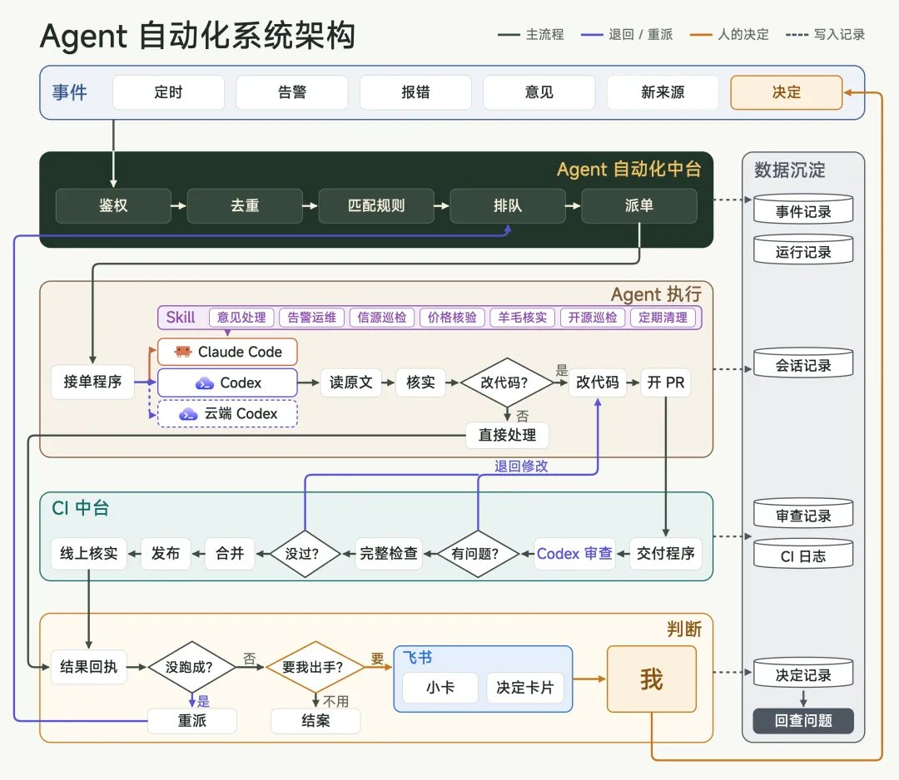

我唯一要做的事，就是最后一步，我称为批奏折。

在飞书里面，我的 AI 助理小卡会给我弹一张卡片，让我确认，我只要点击就可以了。

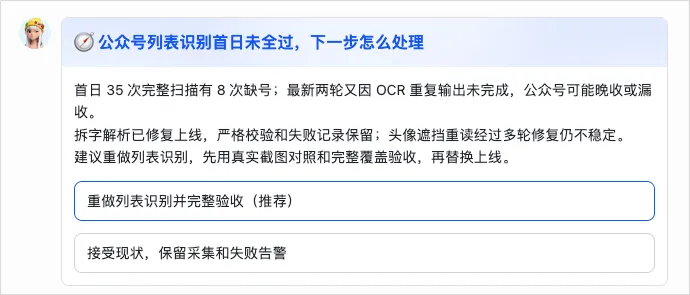

点完以后，Agent 就收到我的决策了，继续自己干活了。

基本能最大化释放我的人力。

顺着流程，我们一个一个模块说。

## 2. 自动化中台

先说最核心的这个，Agent 自动化中台。

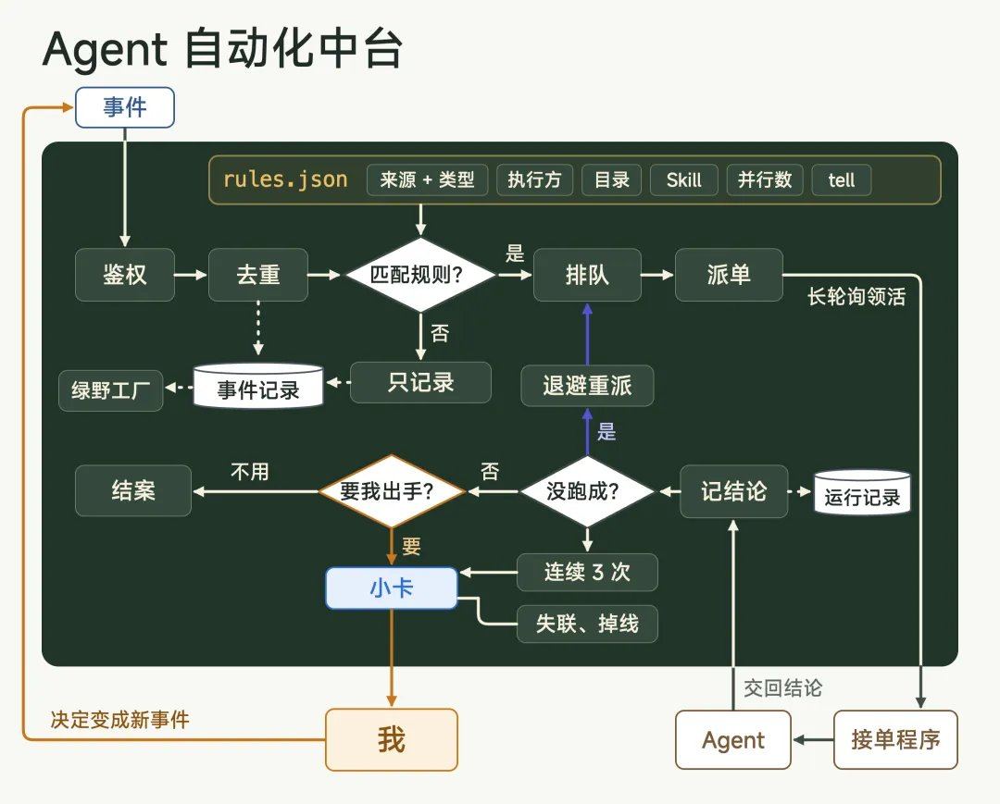

在 Agent 的体系里面，既然我们要把人给拿出去，那在何时、在何种信号下触发 Agent，让它进行工作，就变成了一个需要设计的命题。

这也就是：事件。

世间万物，任何的信号触发，我们都可以归纳为一个事件。

比如定时任务就是一个事件的搜寻行为，固定每分钟或者每小时去轮询请求，来发现事件，比如 Webhook 触发也是一种事件，比如我们收到一条消息、收到一份邮件、某个系统突然触发了告警等等。

定时去找的那种，Claude 和 Codex 自己的应用里已经做得很好了，每天几点跑一次什么，设一下就行，我自己也有一大批定时任务，就放在它们的应用里跑。

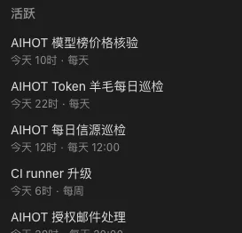

甚至还有个很好玩的东西，是每一天下午，Codex 都会从微信群的聊天记录、X、小红书、抖音等平台搜索大家对于 AIHOT 的最新讨论和反馈，然后汇总成一份报告给我，给我可行的评估建议，是否要去优化。

还有每周操控我的浏览器，去豆包、DeepSeek、千问、元宝、ChatGPT、Gemini 等等平台，去问一遍我们的一些 GEO 问题，来判断 AIHOT 的 GEO 情况，等等等等。

然后 AIHOT 也开源了，每一天都有朋友在 Github 上提建议、提 PR 等等，Claude 就会每天晚上 6 点扫一遍，然后处理问题还有 PR。

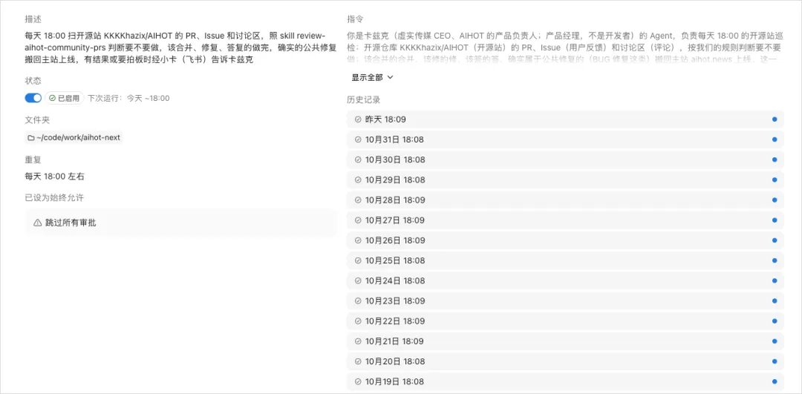

但定时任务轮询有个天生的问题，就是不及时，同事提了一条意见，线上突然报了一个错，你总不能等到第二天早上的定时任务再去看对吧。

这种事件，必须一发生，Agent 马上就被叫醒，这就得靠 Webhook，有事的时候，那边的系统主动推一条消息过来。

而找上门来的事件，来源五花八门，飞书消息、飞书机器人、邮件、各种系统的告警，每一种长得都不一样。

并且因为模型的能力不同，擅长的任务也不同，为了最大化性价比和省 Token，所以事件触发以后，要叫醒的 Agent、模型、推理深度也都不一样。

比如有的事件要叫醒 Claude Code 用 Claude Opus 5.5 high 推理去处理，有的要叫醒 Codex 用 GPT-6.1 Terra xhigh 去浏览器搜索一些正常拿不到的数据，有的又是要推给 GPT-6.1 Sol xhigh 去修复 BUG 等等等等。

如果每接一种事件，都单独写一套脚本，去接这个来源，去叫醒那个 Agent，做三五个还行，做到十几个、几十个，一定会乱成一锅粥的，你再也无法管理了。

所以，为了以后不乱，我就自建了这个中台，专门用来管所有的事件触发，后来把定时任务也纳入进去了，全部打通。

它本身是一个很小的独立服务，部在线上一台轻量服务器上，有自己的网址和数据库。

它干的事也很简单，所有的事件，都先发到这里，由它统一决定交给哪个 Agent，统一去叫醒，统一把结果收回来，真需要我来决策的时候，再通过飞书告诉我给我弹一张卡片，我来决策。

它的第一件事，就是给所有事件定一个统一的格式。不管从哪来，发到中台的都是一条很短的消息，里面只有几样东西，从哪来、什么类型、对象是谁、一句话摘要，再加一个回到原处的链接。比如虚实中台发来一条 feedback.new #12，就是同事给虚实中台又提了一条新意见，编号是#12。

格式统一了，后面就好办了，中台收到事件以后，去查规则。所有规则都写在一个叫 rules.json 的文件里，比如同事意见这一条，是这么写的。

```
{
  "name": "中台意见",
  "when": {
    "source": "virxact-hub",
    "types": ["feedback.new", "feedback.followup", "feedback.decided"]
  },
  "to": "m5-claude",
  "cwd": "~/code/work/virxact-hub",
  "skill": "hub-feedback",
  "ask": "按其中“被 Agent 自动化中台叫起来的”一节处理。",
  "group": "hub-feedback",
  "parallel": 3,
  "tell": "needed"
}

```

翻译成人话就是，对产品新意见、同事的补充、还有我拍过板的决定，都交给 M5 上的 Claude Code，在虚实中台的代码目录里，用 hub-feedback 这个 skill 去处理，给 Agent 的指令就一句，按 skill 里对应的那一节办，每条意见单独开一轮，同一条意见同时只跑一轮，最多三条一起跑，做完了，只在需要我决策的时候才告诉我，否则就不需要推到我这边。

然后是叫醒 Agent，这里有个技术上的小问题，Webhook 能把消息推到中台，但中台推不到我的 Mac 上，我的 Claude 和 Codex 都是部在本地的，因为我的两台 Mac 都在家里和办公室的内网里，外面根本连不进来。

所以我们反过来做，每台 Mac 上都跑着一个接单程序，一直挂在中台上等活，一次最长等 50 秒，有活立刻接走，没活就再挂上去接着等，这样 Mac 不用暴露到公网上，速度也跟实时推送也差不多。

它的好处，我觉得有这么几个。

第一，接一种新的事件，变得特别简单。不用再写一套新脚本，在 rules.json 里加一条规则就行。我跟 Agent 说一句，它改完文件、过了检查，几分钟就生效。

第二，换 Agent 也特别简单。哪类事交给谁，就是规则里的一行字。今天交给 Claude Opus 5.5，明天想换成 GPT-6.2 Astra，改一行就行，以后出了更好用的模型，可以随意替换。

第三，去重。自动化跑起来以后，同一件事被发好几遍，是常态，比如网络抖一下，来源那边以为没发出去，就会再发一遍。同事提完意见，又补了一句话，又贴了一张图，这又是好几条事件。如果每来一条就叫醒一次 Agent，同一件事就会有好几个 Agent 同时在干，这个 Agent 改一遍，那个 Agent 又改一遍，最后绝对是乱的要死的，所以就让自动化中台做统一去重，非常省心。

第四，所有消息，只有一个出口。不管哪个 Agent、哪个任务要找我，都只走一条路，就是小卡，我在飞书里的 AI 助理。而且每条规则都写清楚了，只在必须需要我判断和决策的时候才说，不会这个脚本发一条，那个机器人发一条，把我的飞书刷屏，尽最大可能保护我的精力。

第五，数据沉淀。因为所有的事件都从中台过，所以每一件事都留了底，什么时候来的、从哪来的、交给了哪个 Agent、它最后的结论是什么、有没有需要我留意的、后来又是怎么解决的，全都记在中台的数据库里，点开任何一件任务，还能直接跳到当时 Agent 干活的那个会话，看它到底干了什么。这些东西攒久了，就是非常完整的数据沉淀了，哪条流水线最忙，哪个 Agent 干得最多，哪类事老出问题，一眼就能看出来，以后要换模型、改规则，也有数据依据。

并且还有一个符合我自己爽感的东西，就是所有的自动化任务，我一眼就能看清，可能我确实受种田游戏影响颇多，所以对这种自动化的可视化有深深的迷恋，玩《戴森球计划》的时候，最喜欢看的就是那种密密麻麻的自动化流水线。

所以，我甚至还做了一个有趣的网页，来把我们的流水线像游戏一样展示出来，并且跟现实世界时间和天气完全打通，现实下雪，那这个自动化小镇里也会下雪。

之前渲染了一个视频，给大家看看～

引用推文：数字生命卡兹克 (@Khazix0918)

花了 5 天的时间，终于把我的 Agent 自动化流水线做完啦哈哈。 起因是因为我的 Agent 自动化任务实在太多了，有直接在桌面端里定时触发的的，有 Webhook 然后用后台 CLI 触发的，还有在 Dots 里面设的等等等等，所以我想给自己做一个可视化的 Agent 自动化管理界面。 第一版先做成了普通网页列表，但是感觉太没意思了，于是灵感大爆炸...想到了戴森球计划，于是，那不如做成一个可视化的流水线吧，平时还能加个小屏幕，当个桌搭用。 说干就干，在调个 N 版美术风格之后，还是选定用这种微缩景观风格了，我觉得更有趣一点。 整体来说，流水线就是预设的自动化，有包裹发出去...

https://x.com/Khazix0918/status/2114343004471460341

这个中台就是让每个事件一发生，就能自己找到该干活的 Agent，只把真正需要我的那一小部分，递到我面前。

## 3. Agent 执行

在触发了事件之后，接下来就是 Agent 领任务和执行了。

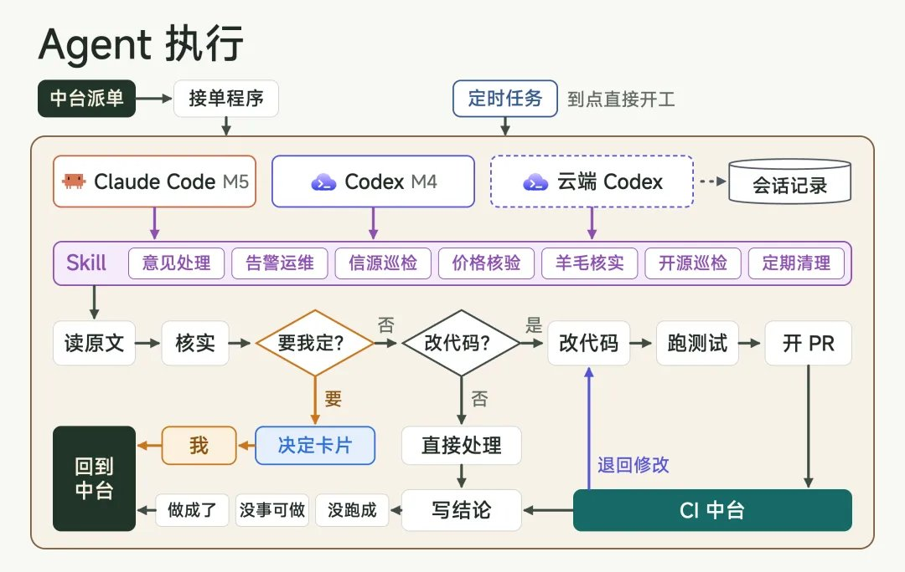

首先我想说一个巨大的前提，就是我们并不是无限 Token，即使我开了 200 刀的 Claude 会员，猛用下来 3 天就能用完近 90%。

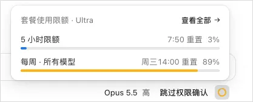

且几个主流模型所擅长的能力点，确实不太一样，各有优劣，所以才会涉及到调度，就是为了整体性价比最优。

目前我是 200 刀 Claude 会员+100 刀的 GPT 会员，基本够用。

目前主要是几个模型：

Claude Opus 5.5，它是我们的主力开发，AIHOT 的自动化开发、同事对公司中台提的意见这类比较复杂、需要一定主观能动性且能做决策的活，基本都是它在干，我现在几个核心项目的代码，大部分也都是它写的。

GPT-6.1 Sol，它主要管我们所有项目的运维，告警、每天早上的系统日报、各种到期的复查等等，出了问题它就去查，查到 BUG 或者问题就直接修了，在做这种活上效果非常好，性价比也极高。

GPT-6.1 Terra，专门干浏览器&电脑操控的活。它能直接操控我 MacMini 上那个登录好各种账号的 Chrome，前面说的每天去各个平台搜大家对 AIHOT 的讨论，每周去各家 AI 问一遍 GEO 问题，这些没有接口、正常拿不到的数据，全靠它去处理的。

我自己如果日常主动触发的任务，用的也都是 Claude 来进行任务的处理，其实我也经常能看到很多人用 Grok 或者是一些其他的弱一点的模型来指挥 Claude，我觉得还是有点不太对，因为做决策和做管理的模型，它一定得是智力和主动性最强的，你不能用笨逼来指挥聪明的，这样会乱套的。

同时，我自己是有两台 MacMini 的，一台新买的 M5 Pro，一台是去年买的 M4 的 Mac Mini。

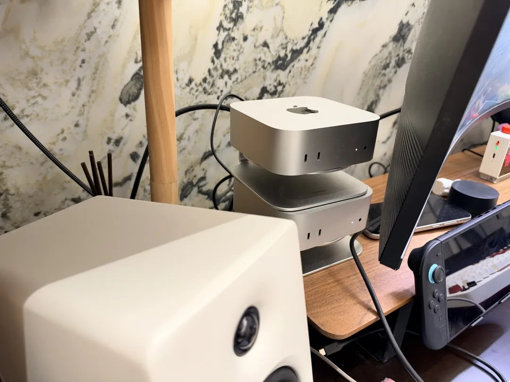

M5 Pro 是我的主力日常用机，而我的 Agent 自动化任务基本都是运行在 M4 那台机器上的，两端通过局域网互通，基本都在本地，没有上云。

主要是我基本是独立开发，我的代码仓库、发布权限、飞书身份，还有那个登录好各种账号的 Chrome，全都在这两台 Mac 上。

要是把 Agent 放到云上，就得把这些登录和权限，在每一家云上都复制一份，既麻烦，又不安全。

而且很多国内的东西，海外的云端 Agent 根本就没法用，他们大多跑在海外，跨境访问我们在北京的服务器，动不动就慢就超时。浏览器类的任务更别说了，像微信这种，换成云上虚拟机里的浏览器去打开，直接就给你崩了。

再加上两台 Mac 本来就是现成的，一直开着也无所谓，功耗也极低。

日常需要用 M5 Pro 电脑操控 M4，直接 Agent 操控或者 UU 远程就行了，方便快捷。

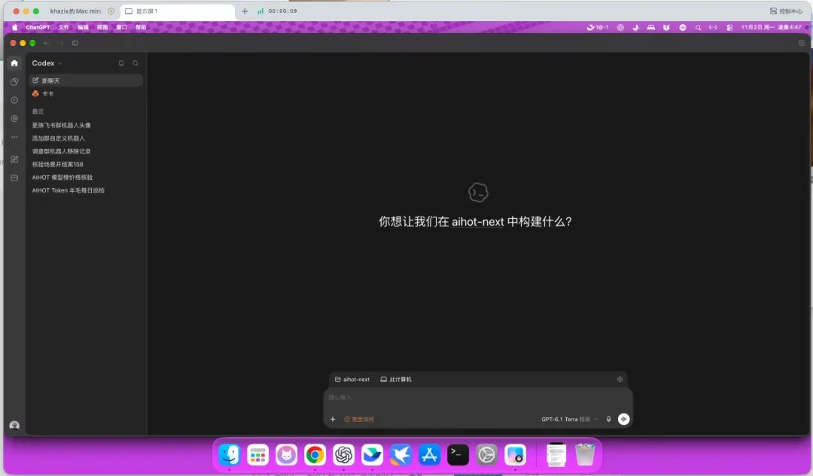

然后我觉得在 Agent 自动化执行里面，还有一个蛮重要的东西，是 skill。

我们每个自动化任务，基本上都配着一个专属的 Skill，Skill 其实过了这么久了，大家也都知道本质上它就是一个沉淀下来给 Agents 用的 SOP，里面附带着一些规则、参考还有脚本之类的。

比如每周日早上我有个大扫除的定时任务，就搭配了一个专门的 Skill，写的就是把这一周合进来的屎山找出来删掉，同一件事写了两遍的、为个案打的补丁、停用了却没拆干净的、变成流水账的文档，能删的直接删掉，再上线。

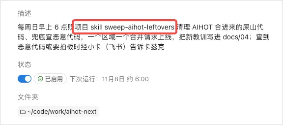

这样的好处就是清晰、可控、可管理，你想对这个任务的详情进行修改，直接去改 Skill 就可以了，不用去改这个 Agent 执行本身的逻辑，尽可能解耦，可管理。

## 4. CI 中台

Agent 把代码写完、提交上来以后，就到了第三块，CI 中台。

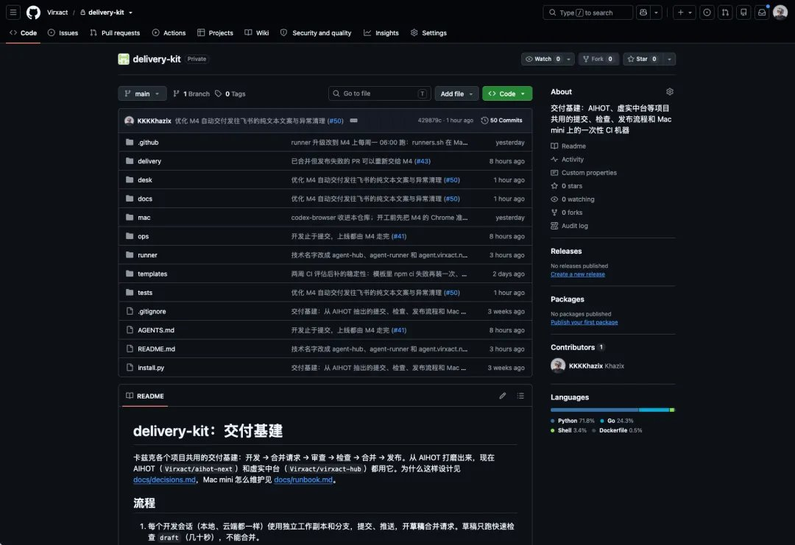

CI 这个词，可能很多不写代码的朋友没怎么听过，大概意思就是，代码写完以后，自动帮你审查、测试、上线的那一整套流水线。

这块之所以要单独拎出来做一个中台，原因很简单，量太大了。

GitHub 自带的 CI，用的是它自己的机器，每个月我开了会员也才 3000 分钟的免费额度，超了就得另外交钱，而我们的量实在太大了，光 AIHOT 一个项目，整个 10 月已经合进去了将近一千个合并请求，平均一天二三十个，每一个还要来回跑好几遍检查，那点额度根本扛不住。

我之前算过，按照我们提交 PR 的数量，如果还是用 Github 的 CI 体系的话，每个月光超额费用就得交 50 美金以上。

所以干脆在家里的那台老的 M4 的 MacMini 上自己自建了一台 CI 中台，机器是现成的，不用另外花钱，而且性能强多了，还在北京，跑得比 GitHub 自己的 CI 快多了。

这一块，如果你有 Linux 的机器来做 CI 其实会更好，我的 Mac 是 ARM 的，所以其实是模拟的环境，但是我觉得也够用了。

然后因为项目多，Agent 多，所以这个本地 CI 我就升级了一下，也变成了中台，供我所有的项目使用。

流程大概是这样的。

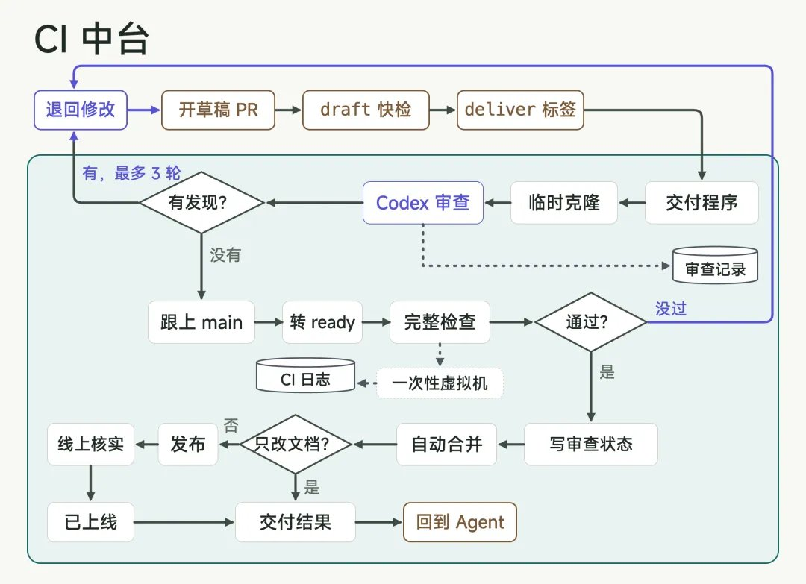

不管是 Claude 还是 Codex，Agent 的活，干到提交代码、开一个合并请求，就结束了，它自己不能上线。后面所有的事，全部交给 CI 中台，一共五步，审查、检查、合并、发布、核实。

第一步，Agent 审查，这个我觉得是整套系统里最值得说的一块。

我们几个项目的代码，现在基本都是 Claude 在写，但每一个合并请求在合进去之前，都要先过一遍 Codex 的审查，用的就是前面说的 GPT-6.1 Sol，GPT 模型在审查这块还是牛逼的。

之前也遇到过无限审查和挑错的情况，Codex 能审个 10 轮磨磨唧唧，所以学习了 Anthropic 自己那篇《How the Claude Code team does code review》，他们 Claude Code 团队就是每个改动合并前都审一遍，但是最多审 3 次。

最近两周，四个项目，一共审了 298 个合并请求，Codex 报了 333 条问题，306 条在合并前被修掉了，其中最严重的那一档有 51 条。

并且审查也有几条规矩，比如 Codex 是只读的，只能看不能改，连不了网，也读不到任何钥匙。只报真会出错的问题，不报代码风格，不然它能给你挑几十条「可以写得更好」，能给你打回去能改到天荒地老。

成本也不高，一次审查中位数两分多钟，大概占那次任务 5%到 15%的 Token。

第二步，检查。审查过了，就开始跑完整的检查，类型检查、全部测试、构建，还有数据库只能加不能改这类硬规矩，有一条不过，就不能合。

这些检查，就跑在前面说的那台 M4 的 MacMini 上。每个任务都开一台全新的虚拟机，跑完连机器带身份一起删掉，Agent 写的代码，从来不会直接在我的 Mac 本机上跑。

第三步，合并。审查和检查都过了，GitHub 自动合并，而且这两项是写死在 GitHub 上的规则，没审过、没检查过的代码，不管是哪个 Agent、哪个工具，都合不进主干。

第四步，发布。合进主干以后，GitHub 会自动启动发布流程，活照样派给那台 M4 单独开一台专门发布的虚拟机来跑。

第五步，核实。合并进去、发出去，依然没有结束。M4 上的交付程序会等 GitHub 上的发布流程全部跑完，再去线上问一遍，现在跑着的版本是不是已经包含了这次的改动，确认真的上线了，再把结果写回 GitHub，这一轮才算结束。

最后执行开发任务的本地 Agent，看一眼 GitHub 就知道最终状态是什么样了。

五步走下来，从 Agent 把代码交过来，到真正上线，中位数两三分钟，速度极快，体验极佳，全程不需要我管，并且上线的质量大大提高，几乎很难会有 BUG 或者返工的情况。

并且因为有了 CI 中台，所以未来我们做任何项目，都是完全可以复用这一整套流程的，非常的省心加愉快。

## 5. 在飞书上批奏折

能自动解决的，Agent 都自动解决了。

那最后能推到我这边的，一定是需要我做的决策或者是大事。

我也不喜欢 Agent 通过什么 DOT、Grok Bot 之类的所谓 Personal Agent 来去找我，我觉得会有点麻烦，于是就直接跟飞书打通了，我的 AI 助理直接给我推一个卡片，我就能第一时间看到。

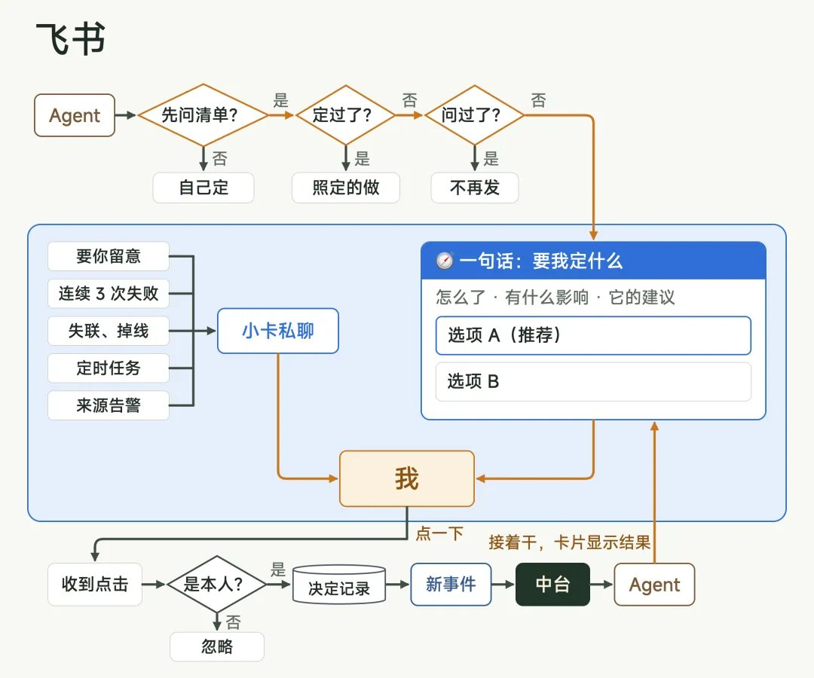

并且还可以直接做选择。


这个感觉，其实讲道理，跟皇帝批奏折真的没有什么区别。

朱元璋那会儿自己是一个人硬扛，到了他的子孙，慢慢摸索出了一套办法，叫票拟和批红。

奏章送上来，先交给内阁，大学士把建议的处理意见写在一张小票上，贴在奏章上面，这叫票拟，皇帝看一眼，同意就用红笔批下去，这叫批红。

这样确实是最省心的方式。

所以我的决定卡片，就是 Agent 给我写的票拟。

我只做判断，只要点击就行，然后在之前等着我审批的 Agent 就会接着往下干，卡片也会自己改成结论，比如今晚临时发生的，有个龟儿子进了 AIHOT 的飞书群，把推送机器人也移除了，然后自己退群了，我都不知道还有这个漏洞，然后因为报错，就触发了整个自动化工作流，给我推了一条卡片。。。

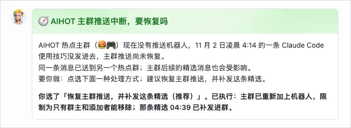

但卡片做的这个交互方式即使有用，但是最重要的就是到底什么事情应该推到我的面前。

之前其实踩过很多坑，甚至有的时候一天给我推几十条，严重影响我的注意力。

所以现在必须先问我的就那么几类了，比如删数据、停服、花钱、对外发消息、改产品方向、新建或轮换密钥、修改权限等等，剩下的，Agent 就自己全权做完上线。

而且我定过的事，Agent 不会问第二遍。

我们的仓库里，有一份文件就叫「卡兹克定的事」，只记我亲口做的决定，带着原话和日期。

然后还有一份「定了不做的事」，我拒绝过的，Agent 以后再碰到，直接照着回答，不会再拿来烦我。

最后还有一个小东西，是我完全没有交给 Agent 的，每一个，我一定都亲自看，然后把有价值的，亲自发给 Agent，让它去做后续的执行。

这就是用户反馈。

我每天都会收到一些用户直接的反馈内容，我特别感谢他们。

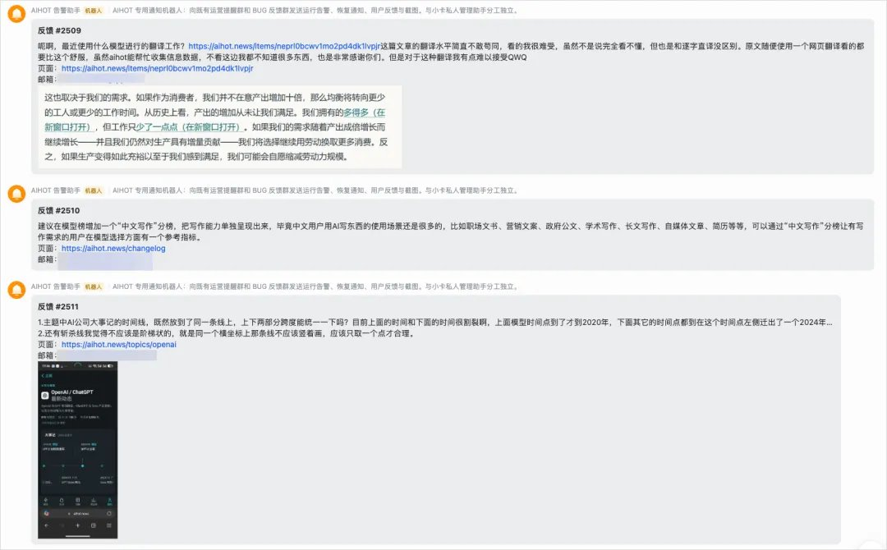

只要是我觉得能做的，每一个我都会复制粘贴，让 Agent 来去解决。然后解决完以后，给对方的邮箱发一封真诚的回信反馈。

可能这也是最后的一种仪式感吧。

## 写在最后

上面就是我整个走 Agent 自动化的一些探索和技巧啦。

我肯定没有那么专业，只是想跟大家分享一下，我自己的一些经验和玩法，因为这确实是我最近用的非常爽的方式。

万一呢，万一真的对一些人有用，真的能帮助到大家呢，那也真的是一件非常开心的事了。

想一想这一年，还真的有一些魔幻。

一年前，我是一个完全不懂开发的设计师。

一年后的今天，我搭了我自己的 Agent 自动化系统，做出了百万月活的公益产品，还开源了，拿到了 9000 star 的好成绩，也看到无数的反馈，说帮到了他们。

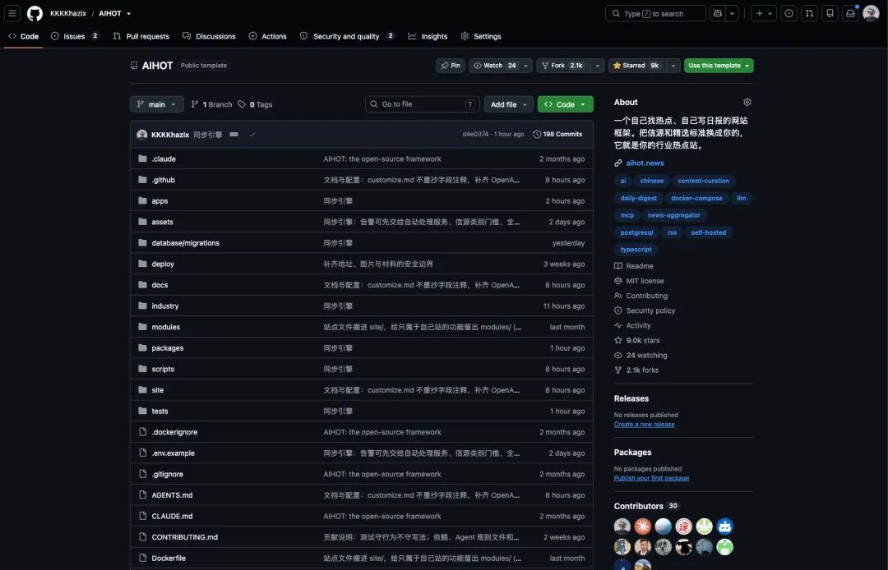

每一天，我都在开发中、在创作中学习，一年前，我连 CI 是什么都不知道，半年前，我甚至连 CDN 是什么都不知道，但是不妨碍我，现在都知道了。

这可能，就是学习的快乐吧。

希望今天这篇内容，能对大家有用。

也愿我们，永远对世界，保持好奇。

## 相关页面

- [[sources/sujingshen-deepseek-harness-super-agent-reading]]
- [[concepts/deepseek-harness-agent-formula]]
- [[concepts/durable-execution]]
- [[concepts/dsh-browser-first-configurable-harness]]
