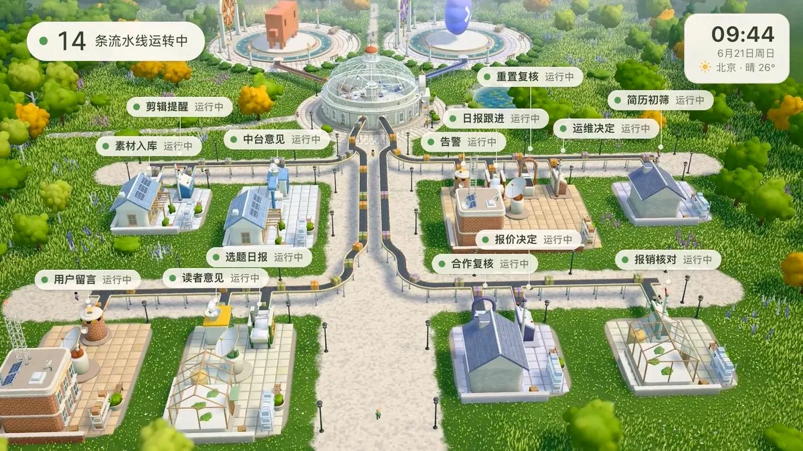

# 数字生命卡兹克（@Khazix0918）：5 天打造微缩景观 Agent 自动化流水线——戴森球计划灵感与多模型工程协同

> 面对日益庞杂的定时触发与 Webhook 任务，卡兹克借鉴《戴森球计划》将抽象的 Agent 任务调度可视化为微缩景观流水线：单次任务以包裹投递形式路由执行，打通现实时间与天气联动；工程上由 Claude Opus 5.5 构建架构视觉、GPT-6 Astra 建模渲染、Codex 负责海量端到端测试，探索「把一切能自动化的都自动化」的极客美学。

<!-- more -->

花了 5 天的时间，终于把我的 Agent 自动化流水线做完啦哈哈。

起因是因为我的 Agent 自动化任务实在太多了，有直接在桌面端里定时触发的的，有 Webhook 然后用后台 CLI 触发的，还有在 Dots 里面设的等等等等，所以我想给自己做一个可视化的 Agent 自动化管理界面。

第一版先做成了普通网页列表，但是感觉太没意思了，于是灵感大爆炸...想到了戴森球计划，于是，那不如做成一个可视化的流水线吧，平时还能加个小屏幕，当个桌搭用。

说干就干，在调个 N 版美术风格之后，还是选定用这种微缩景观风格了，我觉得更有趣一点。

整体来说，流水线就是预设的自动化，有包裹发出去就是具体的对应单次任务，会路由到两个 Agent 上做执行，并且跟现实世界时间和天气完全打通，现实下雪❄️，那这个自动化小镇里也会下雪。

工作上主要是 Claude Opus 5.5 搭整体的视觉和框架，然后 Opus 5.5 指挥 GPT-6 Astra 建模+渲染，Codex 在我自己的 CI 机上做海量的端到端测试，整体应该是用了 30%的 Claude 周额度，和两管 Codex 额度。

最后，终于做完啦，顺道还渲染了一个小小的演示视频～

喜欢。

对于所有想玩转 Agent 的朋友，相信我，把一切能自动化的都自动化，一定是你能感受到的最棒的事。

[video](https://video.twimg.com/amplify_video/2114342866453741568/vid/avc1/1920x1080/XljOCAK_7wz2qujY.mp4?tag=29)

## 相关页面

- [[sources/fanbing-dsh-superagent-engineering-common-sense]]
- [[sources/criscxuan-deepseek-super-agent-architecture-teardown]]
- [[concepts/agent-autonomous-pipeline]]
- [[concepts/vibe-coding]]
