# 数字生命卡兹克：折腾了整整 1 年，毫无保留地分享一下我这套 Agent 自动化系统（架构、调度与 CI 中台）

> 一个人通常只能同时跟进 3 到 5 个活跃会话，单任务的上限取决于模型能力，多任务的上限取决于人的注意力。在整个 Agent 系统中，人的注意力既是最宝贵的资产，也是最大的瓶颈。本文是数字生命卡兹克（Khazix）耗时整整 1 年摸索构建的个人与团队 Agent 自动化生产力系统万字深度复盘：从朱元璋废丞相的“注意力灾难”切入，建立“领导力调度思维”，详解自研 Agent 自动化中台、长轮询任务派发机制、模型性价比分工梯队（Opus 5.5 开发 / GPT-6.1 Sol 运维 / GPT-6.1 Terra 浏览器操控）、自建本地 ARM 架构 CI 中台、戴森球计划小镇动态大屏，以及飞书卡片“批奏折”闭环。

<!-- more -->

上周六 DeepSeek 发布了长篇技术探索《Super-agent设计探索：迈向更自主的Agent系统》，开篇那句话深深触动了我：

> “一个人通常只能同时跟进 3 到 5 个活跃的会话，在这种设计下，单任务的上限取决于模型能力，多任务的上限取决于人的注意力。”

在整个 Agent 系统里，人的注意力是最宝贵的资产，同时也是最大的瓶颈。

历史上出现过无数次这种情形：1380 年朱元璋废除中书省和丞相，六部直通皇帝本人。结果到了洪武十七年九月，8 天时间里各衙门送上奏札 1660 件，处理 3000 多件事。平均一天两百多份奏折、400 多件事，强如朱元璋也当场崩溃：“朕一人处此多务，岂能一一周遍。”

600 年后，AI 时代的我们每个人都在成为自己的“皇帝”，但递奏折的变成了 Agent。如何设计一套科学的调度系统，在解放人类注意力的同时大幅提升交付效率，让自己只做关键决策？这就是**领导力思维**。

本文毫无保留地分享我折腾了一整年的 Agent 自动化系统全景架构与实操经验。

---

## 1. 自动化系统设计哲学：从“聊天打工”转向“领导力调度”

现在大部分人使用 Agent，仍然停留在对话框聊天：打开 Claude Code 或 Codex，输一段话，守着终端看它跑，等它问下一步；你离开窗口事情就停滞。这种模式下，**所有任务的起点都是人类**，你能同时推进的事情永远受限于盯着的 3~5 个窗口。

真正的 Agent 自动化系统，必须把任务发起的起点从人类身上剥离：
- 依靠外部信号（Cron 定时、Webhook、告警、Issue）主动触发 Agent 运转；
- Agent 能自主处理的自行推进到底，遇到关键节点或缺乏授权时，才汇总事实向上请示。

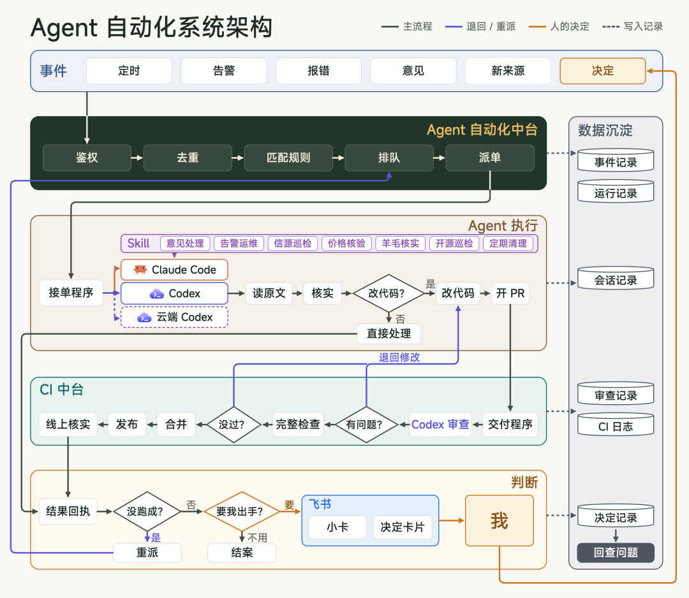
*图 1：Agent 自动化系统总体架构——事件驱动、自动派发、分层执行与人类审批*

人类在整个链条中唯一要做的事情就是最后一步：**批奏折**。

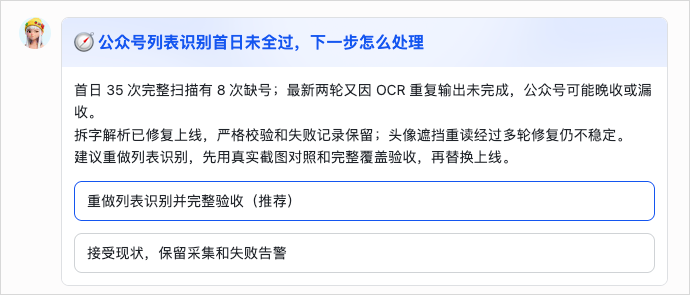
*图 2：飞书 AI 助理小卡推送带有完整上下文和操作按钮的交互卡片*

---

## 2. 自动化中台：统一事件与规则派发中心

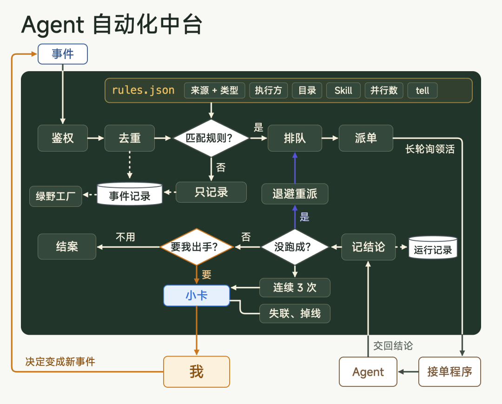
*图 3：自动化中台的统一事件汇聚与分发*

### 2.1 为什么必须建立中台？

事件来源五花八门：飞书消息、Webhook 告警、定时巡检、邮件。若为每种事件单独写一套唤醒脚本，做三五个还能应付，达到几十个后必将沦为混乱的脚本屎山。自动化中台统一定义了标准事件格式：**来源、类型、对象标识、一句话摘要、原处跳转链接**。

### 2.2 规则配置驱动（`rules.json`）

所有事件的分发逻辑均被参数化收敛至 `rules.json`。例如针对同事提出的虚实中台改进意见：

```json
{
  "name": "中台意见",
  "when": {
    "source": "virxact-hub",
    "types": ["feedback.new", "feedback.followup", "feedback.decided"]
  },
  "to": "m5-claude",
  "cwd": "~/code/work/virxact-hub",
  "skill": "hub-feedback",
  "ask": "按其中“被 Agent 自动化中台叫起来的”一节处理。",
  "group": "hub-feedback",
  "parallel": 3,
  "tell": "needed"
}
```

### 2.3 局域网长轮询反向接单

现实中的物理网络痛点：Webhook 能将外部事件推送到公网轻量服务器，但开发者的 MacMini 位于办公室与家庭局域网，没有公网 IP。

**解法**：在本地 Mac 上常驻接单程序（Worker），主动向中台建立最长 50 秒的长轮询连接。有活立即认领执行，无活重新挂起。既保证了内网安全性，又达到了毫秒级的响应延迟。

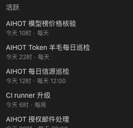
*图 4：本地 Agent 自动化定时任务矩阵*

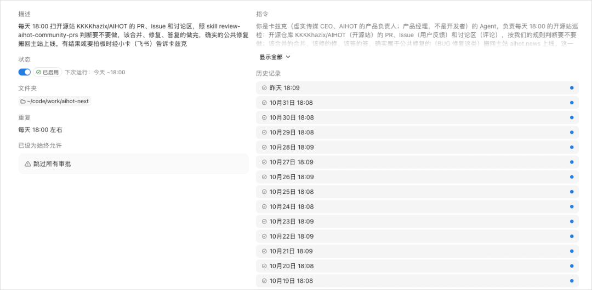
*图 5：Claude 每日傍晚定时扫描 GitHub 外部 Issue 与 PR*

---

## 3. 多模型算力梯队与本地双机部署

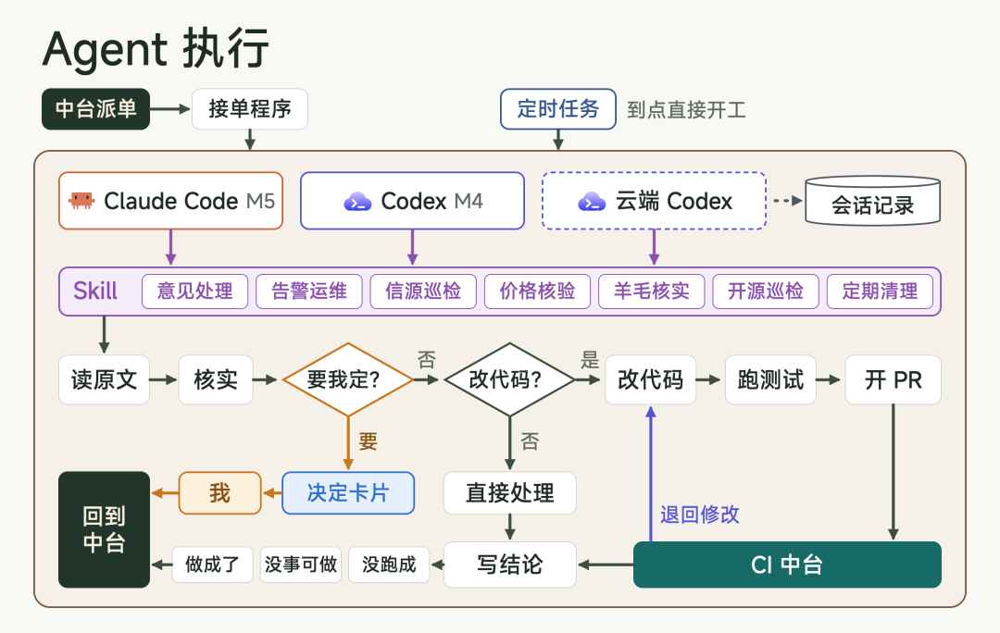
*图 6：Agent 领取任务与自动化执行链路*

### 3.1 算力分工矩阵

没有无限的 Token 额度，合理调度才是降本增效的关键：

| 模型 | 角色与定位 | 典型承接任务 |
|---|---|---|
| **Claude Opus 5.5** | 主力开发大脑 | 核心系统开发、复杂业务代码编写、高主观能动性决策 |
| **GPT-6.1 Sol** | 自动化运维与质检 | 监控告警排查、每日系统日报、自动化修复 Bug、高性价比巡检 |
| **GPT-6.1 Terra** | 浏览器与环境操控 | 操作常驻 Chrome、无 API 平台的跨渠道数据采集、GEO 模拟提问 |

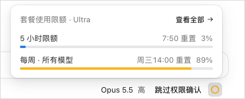
*图 7：真实开发环境下的高强度 Token 消耗监控*

### 3.2 为什么必须坚持本地硬件？

采用一台 M5 Pro（主力开发机）搭配一台 M4 MacMini（专职 24 小时后台运行 Agent），局域网高速互联：

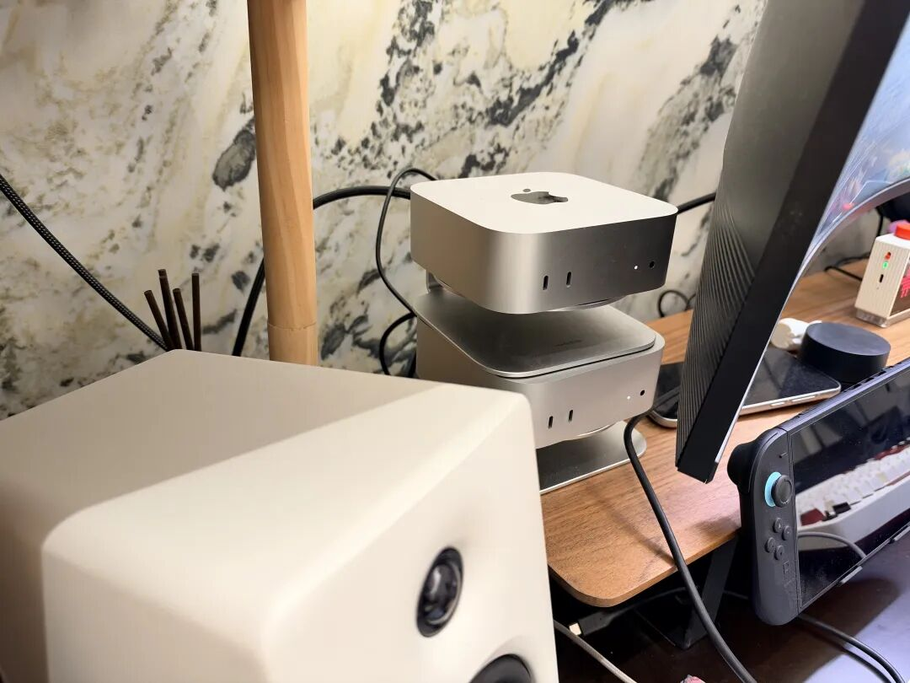
*图 8：本地主力机与 24 小时常驻 Agent 跑活机*

1. **凭证隔离与安全**：代码仓库权限、部署密钥、飞书机器人凭证全部驻留本地，无需向第三方云端虚拟主机分发；
2. **环境稳定性**：国内特定网络服务与高风控平台（如微信、小红书网页端），在海外云虚拟机中极易封号或崩溃；
3. **极低功耗与成本**：MacMini 待机功耗极小，且性能远超百元级云主机。

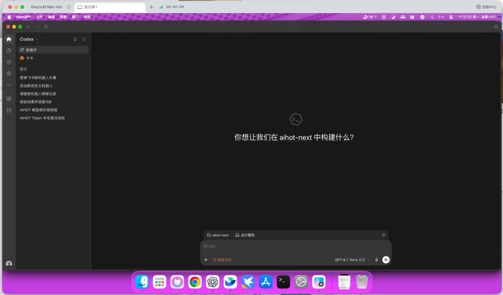
*图 9：日常通过远程管理工具查看后台 M4 机器的 Agent 并行状态*

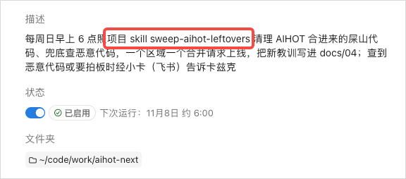
*图 10：针对特定周期任务封装的标准化 SOP（Skill）*

---

## 4. 本地 CI 中台：告别云端计费焦虑

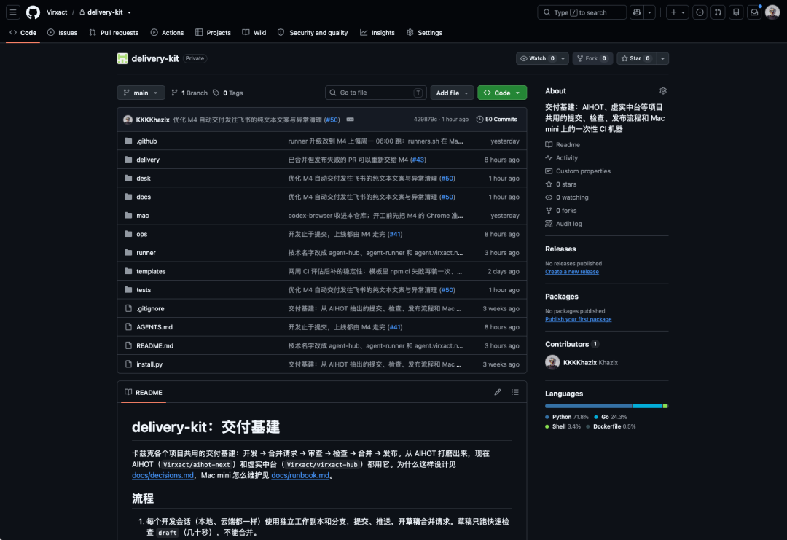
*图 11：自建本地 CI 自动化构建与代码审查中台*

开源项目（如 AIHOT）单月产生近千个 PR，若全部走 GitHub Actions，每月超额计费极其昂贵。通过在 M4 MacMini 上搭建本地 CI 中台：
- 机器零额外开销，且内网代码检出与单测速度远超跨洋网络；
- 形成标准化流水线：**标签触发 → 自动并行跑测试 → 本地沙箱代码审查 → 自动化合并 → 部署拨测验证**。

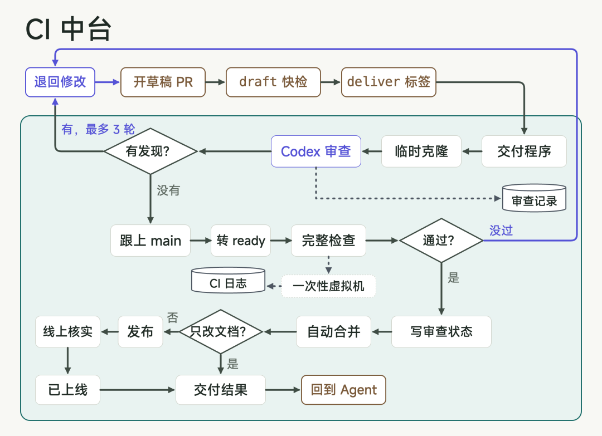
*图 12：本地 CI 中台的任务拆解与执行节点*

---

## 5. 总结

建立 Agent 自动化流水线，核心在于**把人从繁重的过程监控中解放出来**：
1. **中台化收敛事件**，杜绝无序的脚本增生；
2. **模型分层梯队**，用顶级智力做架构，用高性价比模型做运维，用专业操控模型处理脏活；
3. **以卡片审批为唯一人机界面**，做到“没事不打扰，有事带证据请示”。

---

## 相关页面

- [[sources/khazix-agent-autoloop-open-source-architecture]]
- [[sources/khazix-miniature-agent-automation-pipeline]]
- [[sources/ruofei-agent-self-write-and-self-inspect-ci-doctor]]
- [[concepts/agent-autonomous-pipeline]]
- [[concepts/harness-engineering]]
