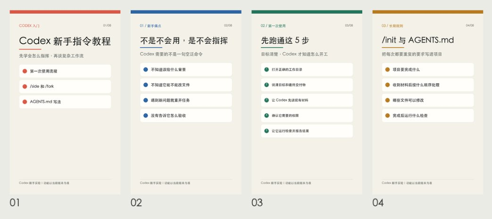
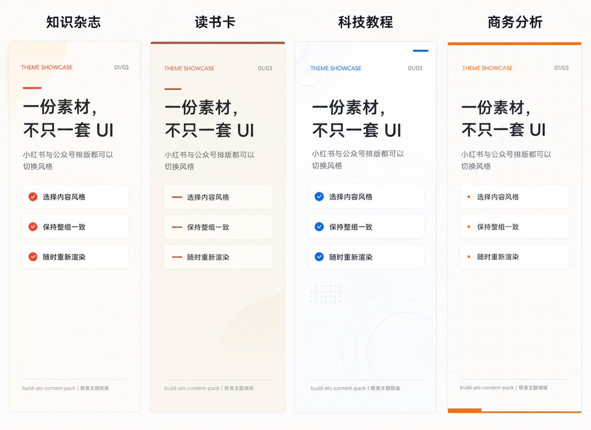

# Kimberly（@king1818888）：有嘴就行！小白零门槛，AI 一键生成小红书和公众号内容

> 面向自媒体新手的零门槛多平台内容生成实战技巧：通过语音输入原声素材，结合定制化结构提示词，自动清洗口语冗余并转化为符合小红书爆款图文（标题钩子/分段 emoji/标签）与微信公众号（深度叙事/知识点提炼）双平台原生规范的内容草稿，解决普通人提起笔不知道写什么的卡点。

<!-- more -->

现在很多人都在同时做 X、小红书和公众号。

问题是，同一份内容，到了不同平台，就要重新拆、重新写、重新做图。

X 上是一篇长文。

小红书要变成封面、知识卡片、正文、标签。

公众号又要变成文章、头图、流程图、对比图、总结贴图。

如果每次都手动来一遍，真的很耗时间。

所以我最近把这个流程跑通了：

给 AI 一句话，或者丢给它一篇文章，它就可以帮你生成小红书内容和公众号内容。

小红书有标题、正文、标签、知识卡片。

公众号有文章结构和配套贴图。



我还把这套流程封装成了一个 Skill，已经开源到 GitHub。

Skill 地址：

https://github.com/Kimberlying/build-xhs-content-pack

具体怎么用，看正文。

## 这套东西解决什么问题？

以前我做内容，经常是这样：

先在 X 上写一篇长文。

然后想发小红书，就要重新想封面标题、拆图文卡、写正文、配标签。

再想发公众号，又要重新整理成文章，还要想哪些地方适合做贴图。

同一份内容，来回改好几次。

真正累的地方，是每个平台都要一套不同的表达方式。

小红书要快，要有封面，要能收藏。

公众号要完整，要有上下文，要适合慢慢读。

如果只让 AI 写一段正文，后面的拆卡、出图、顺序、检查、复盘还是要自己做。

所以我想做的是让 AI 直接生成一套内容发布包。

## 什么是内容发布包？

大白话说，就是一篇内容从准备到发布要用到的所有材料，统一放在一个结构里。

比如小红书要用的图文卡、正文、标签。

公众号要用的文章、贴图、结构图。

还有发前检查、发后复盘。

我一般会让 AI 生成这样的结构：

```text
案例/<主题>_<日期>/
  source/
    brief.md
    platform_rules.md
    banned_words.md
    reference/

  cards/
    cards.json
    preview.html

  images/
    01_cover.png
    02_problem.png
    03_definition.png
    04_value.png

  wechat/
    article.md
    cards.json
    preview.html
    images/

  publish.md
  checks.md
  review.md
```

这个结构看起来有点多，但其实很好理解。

source/ 是原材料。

cards/ 是小红书每一张图文卡的内容结构。

images/ 是最后要上传的小红书图片。

wechat/ 是公众号文章和公众号贴图。

publish.md 是发布时要复制的标题、正文、标签和图片顺序。

checks.md 是发布前检查。

review.md 是发布后的复盘记录。

你可以把它理解成：每一篇内容都有自己的小型工作仓库。

以后要修改、复用、复盘，不用再翻聊天记录。

## 第一步：先写 brief，不要直接写正文

很多人用 AI 做内容，第一句话就是：

帮我写一篇小红书。

这样当然能写出来，但很容易泛。

因为 AI 不知道你的判断是什么，也不知道你到底想让读者记住什么。

我现在会先让 AI 写 brief。

brief 就是这篇内容的方向盘。

最少要讲清楚这些东西：

```text
选题：

目标读者：

搜索问题：

核心观点：

个人判断 / 素材：

希望读者看完做什么：

不能写什么：

参考资料：
```

这里最重要的是“个人判断”。

你不给判断，AI 就只能给套路。

你告诉它这篇内容想强调什么，后面的小红书拆卡、公众号改写、贴图结构才会更像你自己的表达。

比如这篇内容，我给 AI 的判断就是：

不要只把 AI 当文案工具。

真正有用的是让它参与整个内容生产流程：选题、拆卡、出图、发布正文、检查和复盘。

这样它生成的东西就不会只是一段普通文案，而是一套可以发布的材料。

## 第二步：把内容拆成小红书图文卡

小红书图文不是把一篇长文切成 10 段。

卡片应该是一条解释链。

每一页只解决一个问题。

比如这篇内容，可以拆成：

```text
01 封面：用 AI 一键生成小红书和公众号内容
02 痛点：一个内容发多个平台，为什么这么麻烦
03 定义：什么是内容发布包
04 结构：发布包里应该有什么
05 brief：为什么不能一上来写正文
06 拆卡：小红书图文怎么拆
07 出图：图片尺寸、命名和顺序
08 公众号：为什么不能直接复制小红书
09 贴图：公众号适合做哪些图
10 检查：发布前要检查什么
11 Skill：我把它封装成了开源 Skill
12 Prompt：直接复制使用
```

你看，这不是把文章硬切开。

它是一页一页带读者往下走。

封面负责让人点进来。

第二页负责让读者觉得“我也遇到过”。

中间讲方法。

最后给工具、Prompt 或行动步骤。

如果你想让 AI 自动拆卡，可以这样说：

```text
请把这个选题拆成 8-13 张小红书图文卡。

要求：
每张卡只讲一个问题。
第一张是封面。
第二张先讲读者痛点或常见误区。
中间按照解释链展开。
最后一张给出可复制 Prompt、行动清单或风险提醒。
不要把原文机械切成若干段。
请同时说明每张卡和上一张卡之间的关系。
```

这一步做好，后面的图片和正文都会顺很多。

## 第三步：生成小红书图片，顺序要固定

小红书图片我一般固定成：

```text
尺寸：1080 × 1800
格式：PNG
命名：数字编号 + 内容用途
```

比如：

```text
01_cover.png
02_problem.png
03_definition.png
04_value.png
05_workflow.png
06_publish.png
07_checklist.png
08_prompt.png
```

前面加数字，是为了避免上传的时候顺序乱掉。

第一张必须是封面。

中间每一张都只讲一个重点。

图片生成以后，不要马上发。

先看预览，再看单张图。

重点检查：

```text
字有没有太挤
标题是不是太虚
每页是不是只讲一个问题
封面是不是第一张
图片顺序有没有错
有没有编造案例、数据或实测
```

这一步很像做一个小产品的质检。

内容能不能发，很多时候就差在最后这一轮检查。

## 第四步：公众号不要直接复制小红书

同一份素材，可以同时做小红书和公众号。

但不能直接复制。

小红书是快节奏图文。

公众号是完整文章。

小红书要让读者快速抓住重点、愿意收藏。

公众号要补背景、过渡、案例和判断。

所以我会让 AI 重新生成公众号文章，而不是把小红书卡片拼起来。

公众号更适合补这些内容：

```text
为什么这个问题值得讲
读者在什么场景下会遇到
不同做法差在哪里
这套方法适合谁
不适合谁
哪里必须人工确认
哪里不能让 AI 编
```

这样公众号读起来才像一篇文章，而不是一组卡片说明书。

## 第五步：公众号贴图一起生成

公众号文章里，经常需要一些辅助图。

比如头图、流程图、对比图、结构图、步骤清单、总结图。

这些图如果一张张自己做，也很耗时间。

所以这套 Skill 也支持公众号贴图。

默认可以生成横版图：

```text
尺寸：1200 × 675
方向：横版
用途：头图、流程图、对比图、总结图
原则：少字、清晰、服务文章
```

这里有个原则：

一张图只完成一个视觉任务。

不要把整篇文章都塞进一张图。

比如这篇文章，公众号贴图可以做成：

```text
图 1：一个内容如何变成小红书和公众号
图 2：小红书和公众号的表达差异
图 3：从 brief 到出图的流程
图 4：发布前检查清单
```

这样文章更好读，也更适合转发和收藏。

## 我自己跑通的一个案例

我最近就用这套流程做了一篇 Codex 教程。

原始选题是：

```text
Codex 新手指令教程
```

目标读者是：

```text
想学 Codex，但是还不会指令操作的小白
```

我的判断是：

```text
不要一上来讲复杂概念。
先告诉读者什么是 Codex 指令。
新手最该掌握哪些指令。
哪些指令最容易混。
第一次使用应该怎么走流程。
最后再讲如何写好 Agent。
```

然后 AI 会先生成 brief，再拆成小红书图文卡。

比如：

```text
01 封面：Codex 新手指令教程
02 痛点：新手不是不会用，而是不知道怎么指挥
03 定义：什么是 Codex 指令
04 高频指令：新手先掌握哪些
05 易混指令：/side 和 /fork 怎么区分
06 流程：第一次使用怎么做
07 Agent：如何写好一个 Agent
08 检查：发布前怎么确认
09 Prompt：直接复制使用
```

同一份内容，还可以继续改写成公众号文章，再配几张横版贴图。

这样一个选题，不只是出一段文案，而是同时变成小红书和公众号都能用的内容资产。

## Skill 现在能做什么？

我把这套流程封装成了一个 Skill。

现在可以做这些事：

```text
把 X 长文变成小红书图文
把文章变成知识卡片
把书籍资料变成读书卡
生成小红书标题、正文、标签
生成公众号文章
生成公众号贴图
生成发布前检查清单
生成发布后复盘模板
```

视觉风格目前有四套：

```text
知识杂志：适合观点、长文总结、知识整理
读书卡：适合书单、读书笔记、金句总结
科技教程：适合 AI 工具、Codex 教程、操作指南
商务分析：适合投资、商业框架、行业分析
```

整体风格还是统一的，不会每套看起来都完全不一样。

只是给大家多几个选择，避免所有内容都长一个样。



## 直接复制的 Prompt

你可以把下面这段直接丢给 Codex：

```text
使用 build-xhs-content-pack。

根据下面的素材，为我生成一套小红书和公众号内容发布包。

要求：

先整理 source/brief.md，明确目标读者、搜索问题、核心观点、收藏理由、平台边界和不能写的内容。

再把内容拆成 8-13 张小红书图文卡。
每张卡只讲一个问题。
第一张是封面。
第二张先讲痛点、误区或读者 tension。
中间按照解释链展开。
最后一张给出 Prompt、行动清单或风险提醒。
不要把正文机械切成图文卡。

生成小红书图片，默认尺寸为 1080 × 1800 PNG。
封面必须是第一张。
文件名使用数字编号，保证上传顺序。

同时重新改写一篇完整的公众号文章。
不要直接复制小红书正文。
根据公众号文章生成 1200 × 675 的横版贴图。

生成发布正文、标题备选、标签、图片上传顺序和发布注意事项。
生成 checks.md，完成发布前验收。
生成 review.md，保留发布后的复盘字段。

不要编造实测、数据、案例、用户评价或来源。
不要写夸张承诺。
如果涉及投资、健康、法律或其他高风险内容，标记需要人工确认的地方。

视觉主题可以使用：
知识杂志
读书卡
科技教程
商务分析

我的输入：

选题：

目标读者：

个人判断 / 素材：

参考资料：

希望读者看完做什么：
```

如果你想先看文字，再决定要不要出图，可以加一句：

```text
请先只输出 brief 和全部卡片文字，等我确认以后再生成图片。
```

如果你想一次性做完，可以加一句：

```text
请直接完成文字、图片、公众号文章、公众号贴图和发布前检查。
```

## 写在最后

用 AI 做内容，我现在越来越不喜欢只问一句“帮我写一篇文案”。

因为那样得到的通常只是一段正文。

真正费时间的，是怎么把一份内容变成不同平台都能用的发布材料。

这也是我做这个 Skill 的原因。

以后你可以给 AI 一个选题、一篇 X 长文、一篇文章、一份读书笔记，甚至一堆零散素材。

它帮你整理、拆解、改写、出图。

你负责判断、核对和决定是否发布。

这样一份内容就不只是发一次，而是可以变成一套能复用、能检查、能迭代的内容工作流。

Skill 地址：

https://github.com/Kimberlying/build-xhs-content-pack

关于作者

Kimberly｜[@king1818888](https://x.com/@king1818888)

Australia AI Engineer，每天用 AI 建系统、做内容，也是 X 创作者。

关注普通人如何在 30 岁前，用 AI + 数据驱动财富增长。

## 相关页面

- [[sources/yooee-xiaohongshu-zero-followers-monetization-blueprint]]
- [[sources/wadezone-hollywood-three-act-storytelling-copywriting]]
- [[concepts/selfmedia-compound-model]]
- [[concepts/ai-content-pipeline]]
