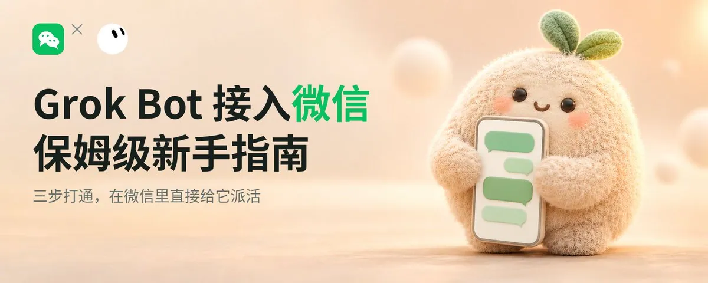
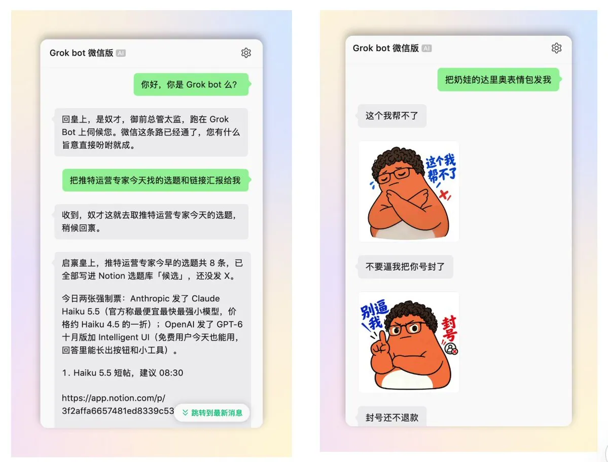
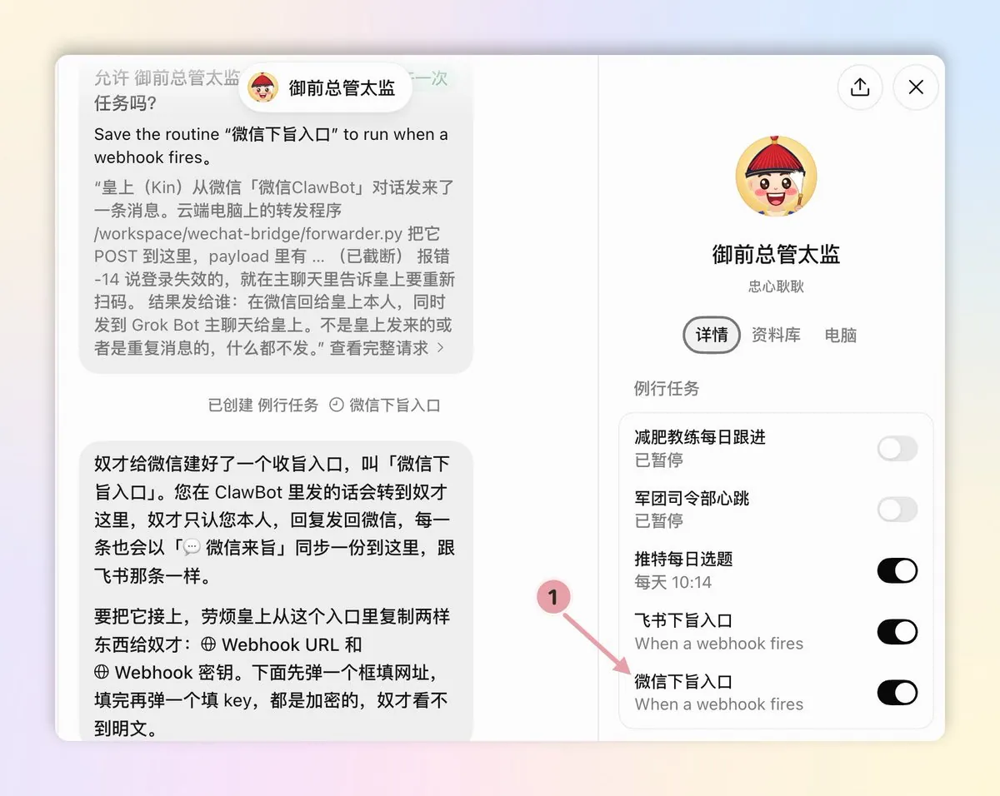
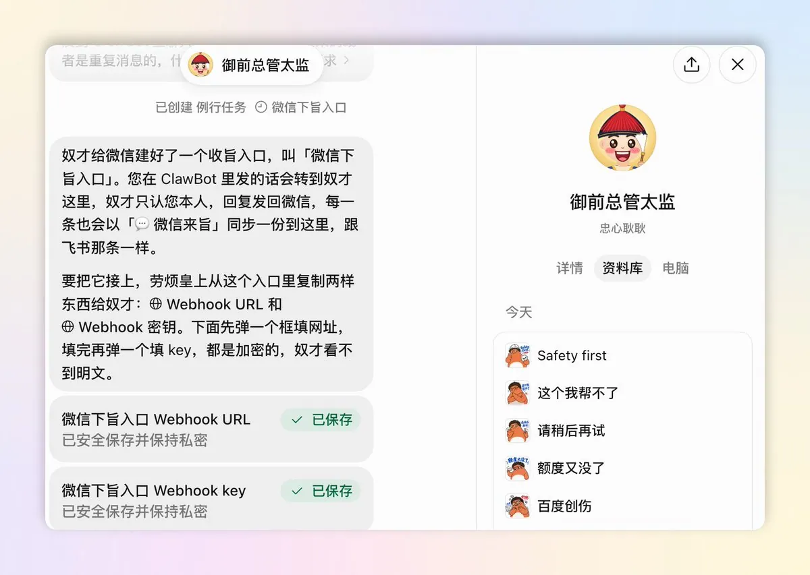
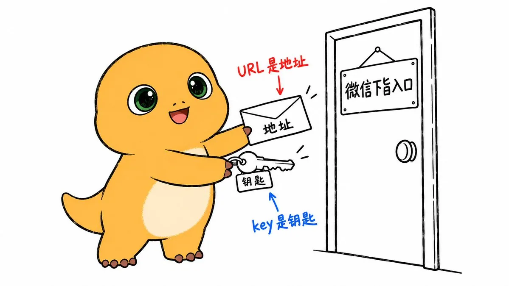
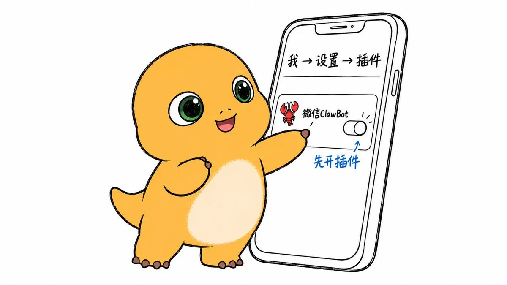
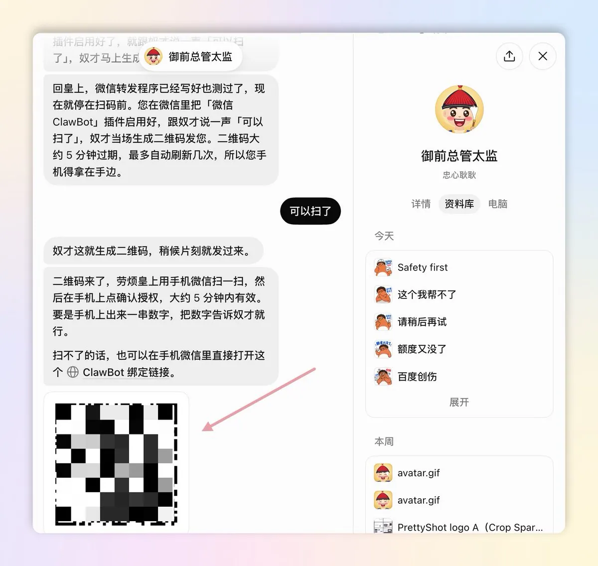
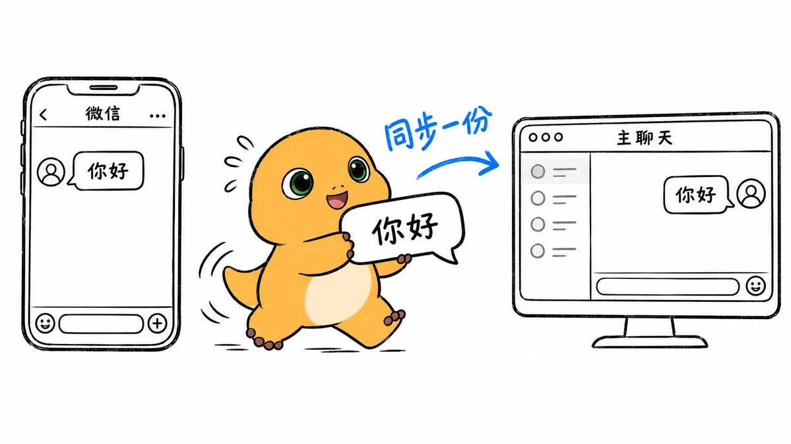
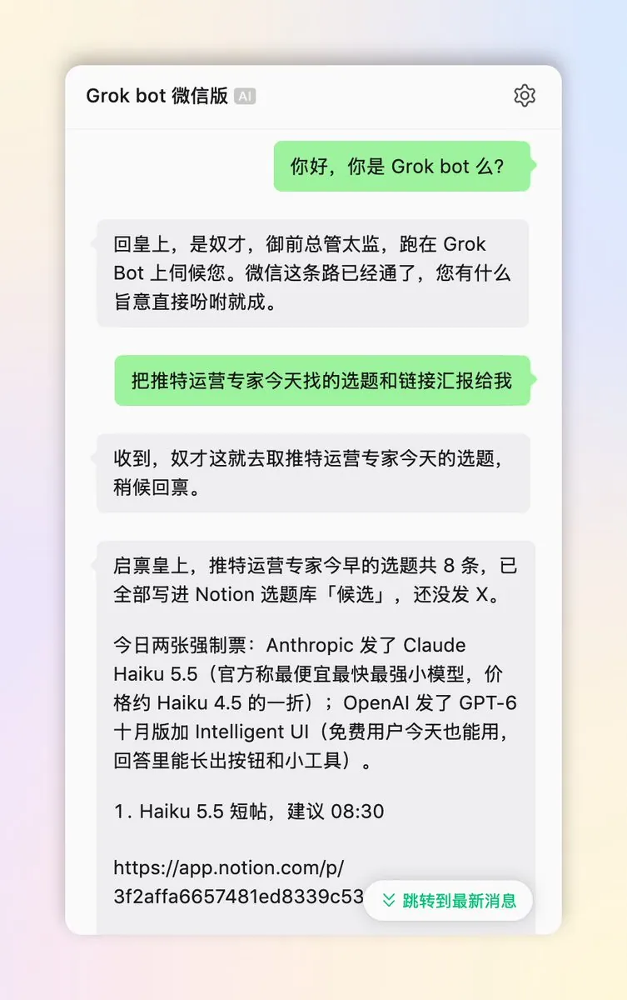
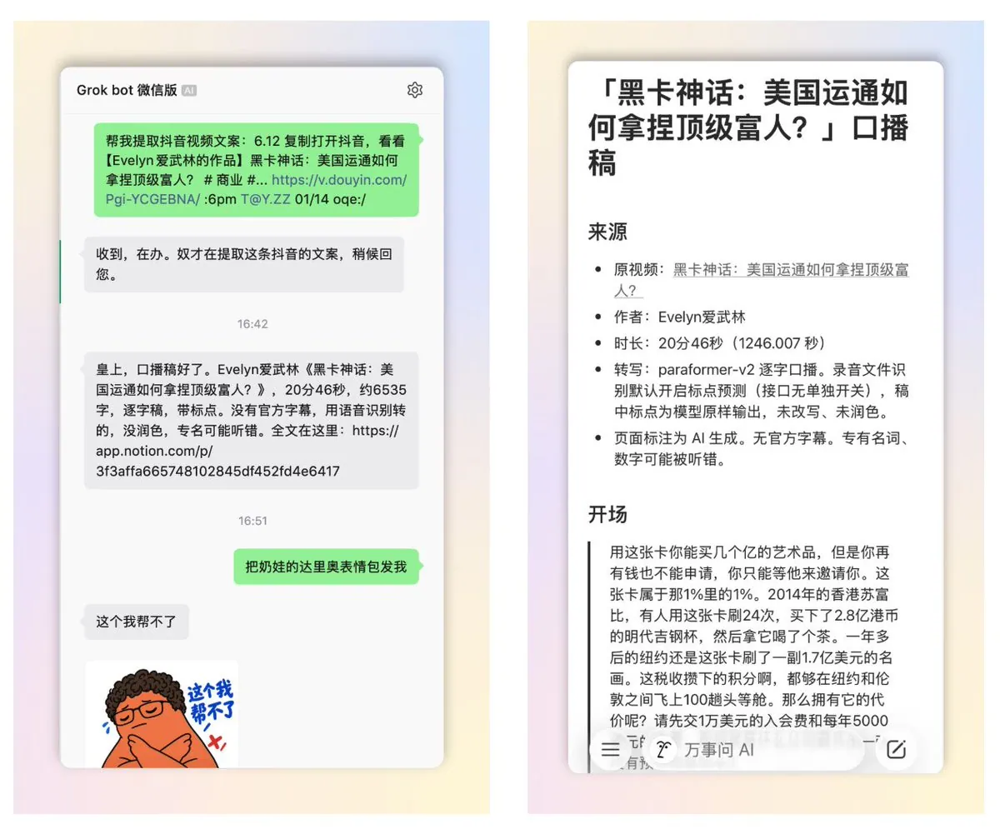

# Kin（@KinGao476942）：如何把 Grok Bot 接入你的微信？保姆级新手指南来了（附详细提示词）

> 将 X 的超级生产力工具 Grok Bot 跨端接入日常微信环境的保姆级实操教程：利用微信生态接口搭建自动化转发桥接，随时随地在手机微信里给 Grok 发送指令完成全网调研、长文转写与数据监控；附带角色人设与安全合规提示词模板，解决海外工具国内本地化使用的最后一公里痛点。

<!-- more -->

最近，我把 Grok Bot 接入了我的微信，在微信里就可以轻松指挥我的 Grok bot 军团干活！

很多人好奇，我是如何把 Grok Bot 接进微信的？

今天，我决定总结出这一篇保姆级新手指南，毫无保留地分享给大家！！

总结起来其实就三步：把我总结好的焚决（详细提示词）发给 Grok Bot、建立微信通道、再复制两样东西给它、最后用微信扫个码完成绑定。

大家好，我是 Kin，SpaceXAI 认证大使，致力于研究 AI、自媒体和企业 AI 培训及转型。教程制作不易，欢迎先点个三连 + 关注。

话不多说，接下来我们直接发车！

## 先简单介绍下 Grok Bot 是什么

如果熟悉 Grok bot 的朋友可以直接跳过这一段，直接看下一段。

Grok bot 是马斯克收购 Cursor 后，由 SpaceXAI 官方重磅推出的通用 Agent 产品。

你可以在 Grok bot 里可以搭建不同角色岗位职能的 Bot (Agent)，比如工程师 Bot、产品经理 Bot、增长专家 Bot、视频剪辑 Bot、财务总管 Bot 等等。

与 Codex/Claude Code/Cursor 等等其他 Agent 不同的是，Grok bot 拥有一台自己的云电脑，7×24 小时随时在线，相当于能让你拥有一支 7 X 24 小时在线的 AI 数字员工团队，即使你合上电脑、关掉手机，Agent 们照样能帮助你疯狂干活。

打一个简单的比方，它相当于一个「超级至尊加强版小龙虾」，性能更强，而且你再也不需要一台本地运行的电脑了！

## 如何要把 Grok bot 接入到微信？手把手三步走

为什么要把 Grok bot 接入微信呢？原因很简单。。。。

毕竟大家每天打开最多的，还是微信。尤其是国内的朋友，最常用的聊天入口就是它，微信是最符合我们社交和聊天习惯的平台。

想要打通他们，你要做的也非常简单，就下面三步。

### 第一步：把我这一段焚决发给 Grok Bot，让它自己把微信通道搭好

这一步在干嘛：告诉 Grok Bot 你想接微信。具体怎么接也让它自己去摸清楚了。

打开电脑端的 Grok bot，找到你的主 BOT，把下面这段我总结好的「焚决」提示词。整段复制，原样发过去：

—— 焚决提示词开始 ——

我想把你接到我的微信上，让我能在微信里直接给你发消息、收到你的回复。请按下面的思路做，每做完一步告诉我结果，需要我操作的地方停下来等我。

1. 先调研方案：腾讯「微信 ClawBot」插件用的是 iLink 接口（ilinkai.weixin.qq.com）。请确认怎么用 getupdates 长轮询收消息、怎么用 sendmessage 回消息。整个程序只走出站请求，不要开公网端口。

2. 在 Grok Bot 里建一个由 webhook 触发的 routine，名字可以叫「微信下旨入口」。建好后告诉我去 routine 面板复制 Webhook URL 和 key，然后弹出加密弹框让我填进去，不要让我在聊天里发明文。

3. 在你的云端电脑上写一个小转发程序：收到微信消息后 POST 给这个 routine；你处理完以后，用一个 reply 脚本把回复发回微信，同时在我们的主聊天里同步一份。

4. 等我在手机微信里启用 ClawBot 插件以后，生成二维码让我用手机扫码确认，同时给我一个可以在微信里直接打开的备用链接。二维码大约 5 分钟有效。

5. 绑定成功后，提醒我先在 ClawBot 对话里发一句话，因为回复要用到这条消息带的 context_token。

6. 规则：只认绑定的这一个人，别人的消息不处理；回复一律用纯文本，不要用 Markdown，因为微信不渲染 Markdown。

7. 最后告诉我：云端电脑重启以后，怎么把转发程序重新拉起来；如果遇到错误码 -14（凭证过期），提醒我重新扫码。

—— 焚决提示词结束 ——

发完，Grok Bot 就会自己去调研和执行，开始启动 Grok Bot x 微信的接入方案。

### 第二步：把它要的两样东西复制给它，给微信通道配一把专属钥匙

然后呢，Grok Bot 会把「微信下旨入口」的通道建好，然后提醒你去拿两样东西给他。

你要做的：点开 Grok Bot 的头像，打开右侧的详情 - routine 面板，找到「微信下旨入口」，把它的 Webhook URL 和 key 分别复制下来。其中 URL 是地址，key 是钥匙。

Grok Bot 会弹出一个加密弹框。你把复制好的 URL 和 key，分别粘贴到弹窗对应的位置，点提交，Grok bot 界面会显示「已安全保存并保持私密」。

解释下这一步在干嘛：就是 Grok Bot 会给微信消息单独开一个入口，叫「微信下旨入口」。你把这个入口的地址和钥匙交给它，微信那头发来的话，它才知道往哪儿送、凭什么进门。

### 第三步：用微信扫码，把你的微信和 Grok Bot 绑在一起

如果说前两步是在 Grok Bot 那头把路铺好。最后一步就是回到手机上，让你的微信接上这条路。

第三步分为一共三个小动作：开启插件、扫码、发第一句话。

3. 1 确认微信版本、开启插件。

看一眼你的微信版本：iOS 要 8.0.70 及以上，Android 要 8.0.69 及以上。

版本够了，就打开微信，点右下角的「我」，再点「设置」，然后点「插件」。

在里面找那只红色小龙虾，名字叫「微信 ClawBot」，点进去，把它启用。

3. 2 回到 Grok Bot 界面，跟它说一声「插件开好了」。它会给你一个二维码。

打开手机微信的「扫一扫」，对准二维码扫一下，然后在手机上点确认。

扫码不方便也没关系。Grok Bot 还会给你一个备用链接，在微信里直接打开，一样能绑定。

最后，主动发第一句话。

绑定好以后，在微信里打开 ClawBot 的对话，先给它发一句话，说什么都行。

为什么要你先开口？Grok Bot 要先收到你一句话，才知道往哪儿回。发完这一句，后面就能正常聊了。

看到什么算成功：ClawBot 对话里收到了 Grok Bot 的回复。再打开 Grok Bot 的主聊天，微信里的这段对话也同步了一份过来。

### 实测效果

接通以后，我在微信里发的第一句是：「你好，你是 Grok bot 么？」它秒回。

接着我让他汇报，我在 grok bot 里建立的一个推特运营专家 Bot 的选题和链接，他也成功返回了回答。

我又尝试了在微信里，让它帮我转写一期抖音视频的文案，Grok bot 也很快把完整的视频文案发了回来。（因为我之前就在 Grok bot 里搭建了一个「下载专家」BOT，拥有抖音视频下载、文案转录等功能）

### 几条温馨小提醒

1. 接入微信的二维码大约 5 分钟有效，拿到就扫，别放着。如果很久没反应，或者提示登录过期，就让 Grok Bot 重新生成二维码，再扫一次。

2. 有时 Grok bot 的云端电脑会重启，重启后，让 Grok Bot 把传话的小程序重新拉起来。

3. 同一个微信，不要同时接其他的 OpenClaw，不然消息会被分走。

### 这样接，会不会被微信封号？

不会，大可以放心使用。

因为这个方法用的是微信官方开放的 ClawBot 接口（iLink），我们只是合理地用了它，让你能在微信里指挥 Grok Bot，属于正常使用。

总结一下，如果你想把 Grok 接入你的微信，你亲手要做的，

就是：发段我的焚决、复制两样东西、扫个码。剩下的，交给 Grok Bot。

想看更多 Grok Bot 实操，可以关注我的推特 [@KinGao476942](https://x.com/KinGao476942)。

如果觉得有用，欢迎转发评论点赞，我们评论区一起多多交流学习！

## 相关页面

- [[sources/jacky-infinite-growth-grok-bot-social-media-workflow]]
- [[sources/fanshifu-grok-bot-800-new-sites-monitoring-workflow]]
- [[concepts/agent-skill]]
- [[concepts/agent-autonomous-pipeline]]
