# KKKK：AI 产品 2 个月 10 万访问量｜只靠 SEO 和社媒的出海增长指南

> BeatAPI 运营第 2 个月访问量 10 万+：SEO & GEO 上千个页面、5 种语言 20 多个社媒渠道一周约 200 条、10+ 开源项目，附 SEO 体检提示词与社媒 Bot 团队开工包思路。

<!-- more -->

BeatAPI 8 月 30 日开始运营，第 2 个月访问量做到 10 万+

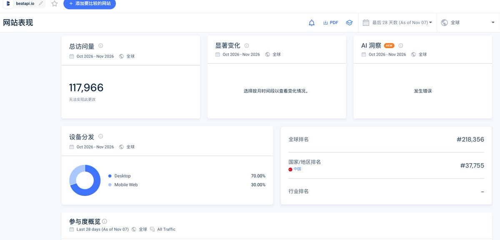

这 2 个月，流量主要靠两条线：SEO / GEO 和社媒

1. SEO & GEO：上千个页面，每个页面对应一个用户真实在搜的需求，同时让 ChatGPT、Perplexity 回答问题时能提到我们

2. 社媒：5 种语言、20 多个渠道，一周发约 200 条内容

3. 开源项目：一般我也把它算在社媒里，10+ 开源项目，GitHub 累计近 800 star

做 AI 出海，被问最多的问题就是：产品做出来了，流量到底从哪来？

这篇我把我们自己这一路的打法，加上研究过的几十个海外案例，整理成一份适合小白 0 到 1 的出海增长指南

先说结论：对大多数 AI 小白来说，出海增长最好的渠道就是 SEO 加社媒，是低成本和高可用性结合比较好的起点，红人和广告可以晚一点再碰。

这篇分成 5 个部分：

1. 增长不是流量：动手之前，先回答 5 个问题

2. 出海增长的 4 条路，各适合什么产品

3. AI 小白怎么选第一条路：SEO 和社媒的 4 个海外案例

4. 我们自己怎么做到 10 万+ 访问量：SEO & GEO 上千个页面怎么来的，5 种语言、20 多个社媒渠道怎么跑，10 多个开源项目怎么反哺产品

5. 增长的脏活累活如何交给 Agent

文末附两份可以直接丢给 Agent 一键复用的材料：一份是 SEO 体检提示词，一份是搭社媒 Bot 团队的开工包

## 一、增长不是流量，是一整套流程

很多人一说增长，想的就是流量，但流量只是第一步

一个很常见的场景：产品冲上 Product Hunt 日榜第一，注册涨了几千，团队很兴奋

一个月后再看，真正用起来的人很少，付费的更少

真正的增长至少要走完四步：曝光、注册、激活、付费

做任何增长动作之前，我都会先问自己 5 个问题：

1. 用户具体是谁

2. 他要解决什么具体问题

3. 他为什么现在就要用

4. 我的官网和产品接得住吗

5. 这个动作能不能重复做

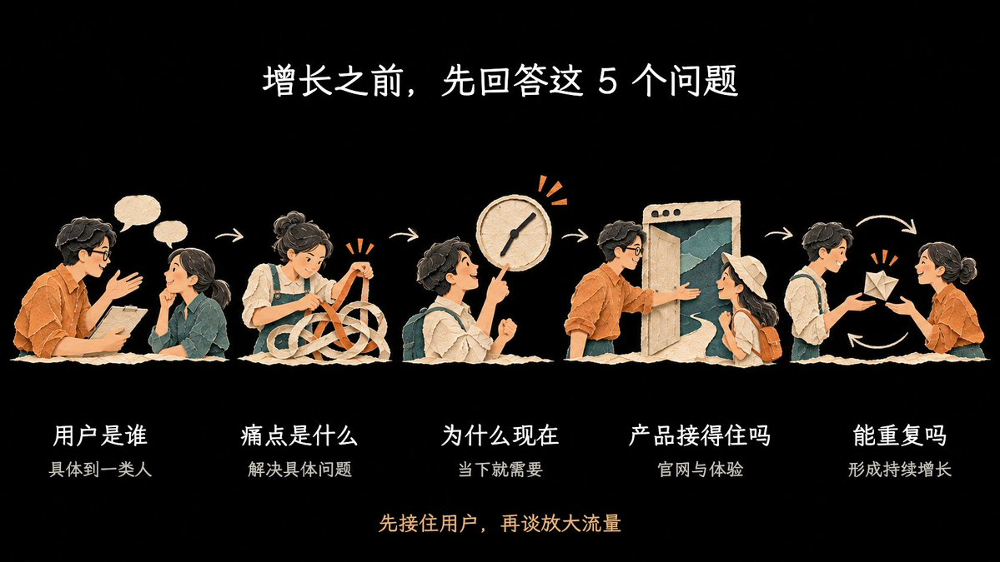

前四个答不上来，流量来了也接不住

第五个答不上来，火了一次也只是一次，没有持续和复购，你的产品获客的边际成本永远居高不下

拿两个做起来的产品，回答一下这 5 个问题

Higgsfield：AI 视频工具，不到一年做到月访问 2000 万以上

1. 用户：做 AI 视频的创作者和短视频博主

2. 问题：AI 视频的镜头乱飘，做不出电影感的运镜

3. 为什么是现在：社媒上运镜炫酷的 AI 视频正火，人人都想做同款

4. 接得住吗：把爆款镜头直接做成模板，上传一张照片就能出同款

5. 能重复吗：每出一个新爆款，就多一个新模板；用户发作品还能按播放拿奖金，作品本身又带来下一批用户


Postiz：开源的社媒发布工具，做到约 200 万美元 ARR

1. 用户：要在几十个社媒平台上发内容的创始人和运营

2. 问题：表面上是排程发帖，真正想要的是靠社媒拿到客户和收入

3. 为什么是现在：AI 让做软件变容易了，大家拼的不再是功能，是分发

4. 接得住吗：开源，可以自己部署，也有托管版，一个地方发 30 多个平台

5. 能重复吗：创始人持续公开收入，当作信任证明；把表现最好的短推扩成 X 长文，再用短视频引用文章反复分发，每一轮都在复用已经验证过的内容


两个产品都能把这 5 个问题答清楚，所以流量来了接得住，火过一次还能接着火

## 二、出海增长的 4 条路

海外常见的获客方式，基本可以归成 4 类：

1. SEO（包括 GEO）：让用户在 Google 和 AI 搜索里找到你

2. 社媒（包括开源项目）：X、LinkedIn、Reddit、YouTube、TikTok 和各种开发者社群等等，用内容吸引用户

3. 红人：借别人的影响力，把你介绍给他的受众

4. 广告：花钱买曝光，最快，也最容易亏

其中有几个我觉得也都可以归类在 SEO 和社媒里面：开源、免费工具和集中发布

GitHub 开源、上 Product Hunt，本质也是社媒内容营销，只是营销的人群和场景比较特殊

做一个免费小工具，一般可以归类到 SEO 的 free tool 方法中

### 选渠道之前，先做用户分析：你的用户会怎么找到你

4 条路摆在面前，先别急着选。先想清楚一件事：你的用户平时是怎么发现你这类产品的？

一般就两种情况：

- 用户主动搜：他知道自己要什么，会去 Google、亚马逊、AI 搜索里找。比如搜「AI 生成产品图」「Claude Code 怎么接视频模型」。这类流量精准，转化往往更高，但量相对难起
- 用户刷到你：他本来没在找，在 TikTok、X、Instagram 上刷到一条惊艳的 AI 视频，当场点进去。复刻爆款可以短期起量，但流量偏泛、不精准，想做大一般需要做矩阵，或者对内容做精细化研究

用户主动搜得多，优先做 SEO / GEO；用户更多是刷到你，优先做社媒，红人也是同一个逻辑；

广告两种都能做，搜索广告接住主动搜的人，信息流广告让更多人刷到你


想清楚这一点，再看 4 条路放在一起的对比：

### 4 条路放在一起比

- SEO / GEO：适合用户会主动搜、关键词多的产品。
- 起量较慢，按月算，但会一直累积。
- 小白优先级：高
- 社媒：适合效果一眼能看懂、有讨论点的产品。
- 起量快，一条内容可能当天起量。
- 小白优先级：高
- 红人：适合需要演示、需要信任背书的产品。
- 需要对红人营销有足够预算和专人负责，一般为有资金实力的大公司。
- 小白优先级：中，先验证再放大
- 广告：适合客单高、能算清回本的产品。
- 初期可以测试一下验证需求，中后期放量需要较强的资金预算。
- 小白优先级：中，转化没跑通前别碰

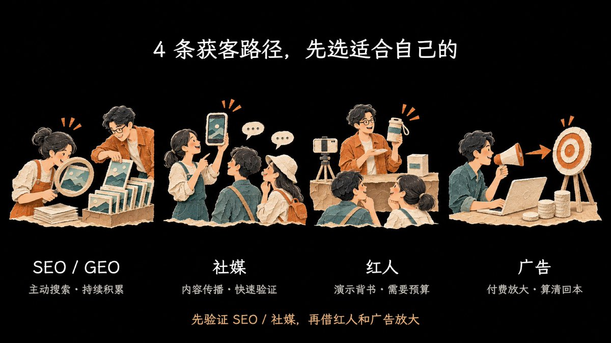

为什么小白先别碰红人和广告？

不是它们不好，而是因为它们本质是放大器，放大的前提是你已经有东西可以放大

官网讲不清就去找红人，流量进来看不懂就走了

转化没跑通就投广告，除了烧钱一无是处

SEO 和社媒在前期成本更低，也能用进来的流量帮助你不断校正自己的产品细节，比如说 onboarding 流程、付费转化的引导、产品功能实现细节等等

当你的产品已经打磨得比较成熟了，就可以考虑上红人和广告的杠杆

## 三、AI 小白怎么选第一条路

同样是 AI 产品，走的路可以完全不同，列举 4 个比较经典的 SEO 和社媒增长案例：

1. VisualGPT，靠 SEO：每个细分需求都是一个长尾关键词，一个需求一个词做一个页面，非常典型的 SEO 驱动增长，做到月访问约 851K

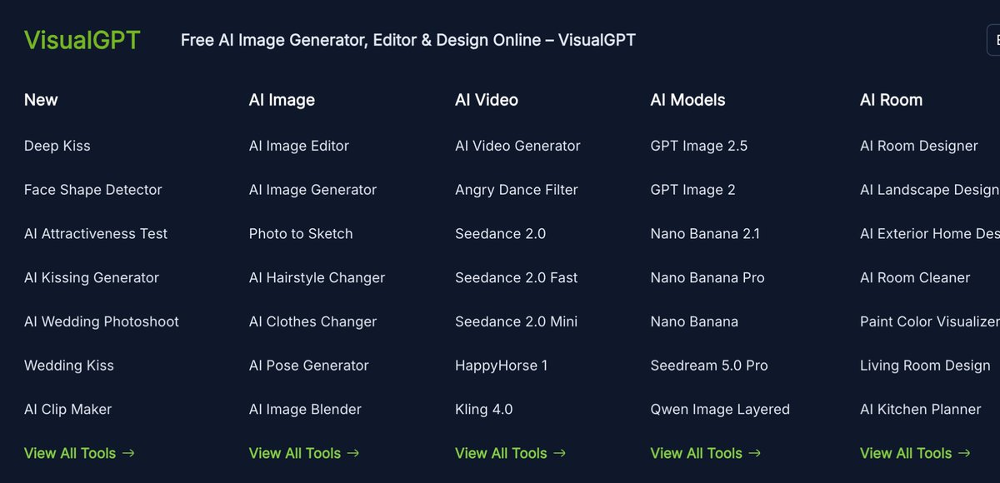

2. MuAPI，靠 SEO + GitHub：用户是开发者，做了近 2000 个模型试用页和对比页，同时做了较多的开源项目，来吸引对应的开发者用户

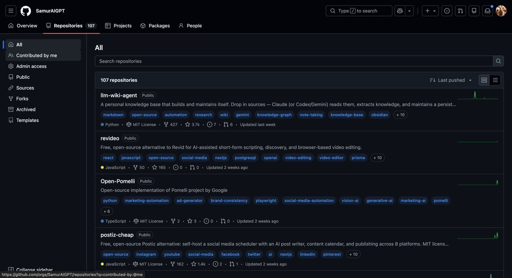

3. Halo AI，靠 TikTok UGC：一套视频格式反复拍，85 个创作者每天发约 300 条，做到约 30 万美元月收入

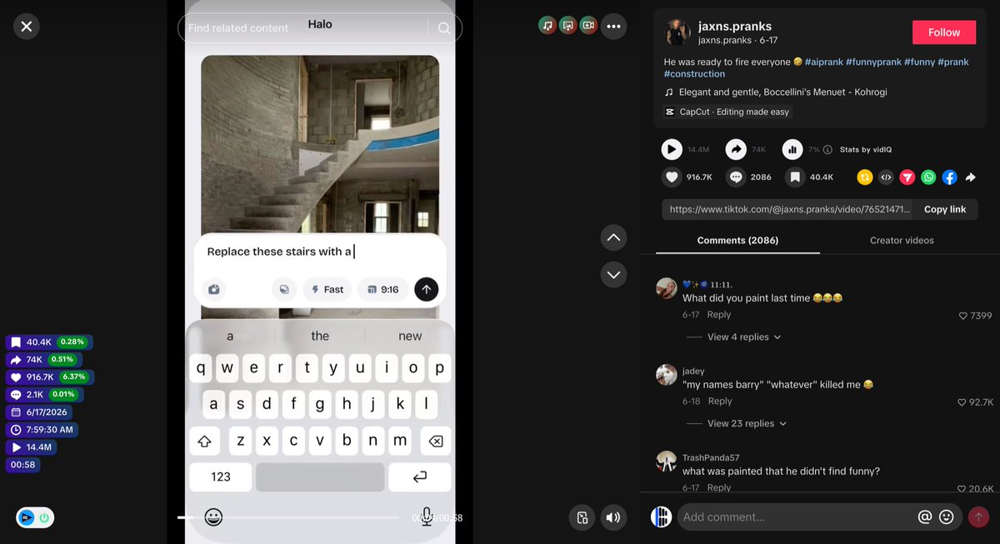

4. Wireflow，靠 LinkedIn：客户是有预算的品牌和 agency，他们本身也是偏 B 端的产品，所以在对应的用户渠道里面反复营销和触达

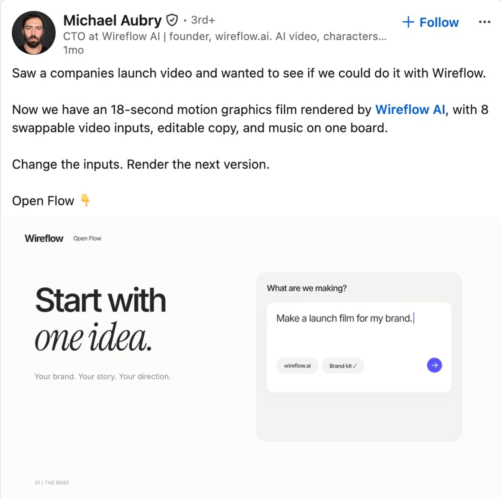

它们都做起来了，但路完全不一样，无论做任何渠道，在做之前都要先问自己 3 个问题：

1. 你的用户现在在哪里找答案？

搜索、YouTube、某个社区，还是同行推荐

2. 你能持续产出什么？

会做 SEO 的搞博客外链和内页，愿意出镜或者会做 AI 视频的可以去尝试做 UGC 视频，懂投放的再考虑广告

3. 这个渠道的账算得过来吗？

你需要投入哪些成本去运营这个渠道，广告费、IP 费用、自己每天写精细内容的时间、搭建 AI 自动化社媒系统的成本？


选定一条之后，先写清楚三件事：投入多少时间、看哪个结果、到什么时候判断

然后找到你最直接的 3 个竞对，看看他们都在做什么渠道，交叉分析一下上述的三点和竞对的优势

看的指标要尽量靠近付费，比如注册、询盘、订单等等，曝光可以是早期指标，但是我们最终的目的还是要盈利，一定要围绕付费相关的指标去展开。

到时间就按结果决定继续还是换，不要边做边换

还有一点：早期选一条主线做透，再加配合。

一个人不可能同时是 SEO、广告和红人专家，一定是渐进成长并且慢慢组成团队来补足各方面能力的。

## 四、我们自己怎么做到 10 万+ 访问量

讲完框架，说说我们自己

我们的打法就是三块：SEO & GEO、社媒、开源，下面一块一块拆开讲

### 1. 先想清楚用户是谁，再想明白用户场景

我们一开始就把用户锁定在一群人身上：Agent 的开发者和使用者

- 每天在用 Claude Code、Codex、Grok Bot 的人，想让自己的 Agent 能出图、做视频、拉数据、做 SEO 等等
- 在 AI 刚刚兴起的时代，大家需要 OpenRouter
- Agent 时代，也需要有对应的 OpenRouter，只不过 Agent 时代的需求更加多元，仅仅是模型已经不够了，还需要更多的数据、更多的能力插件、更多的 MCP 和 CLI

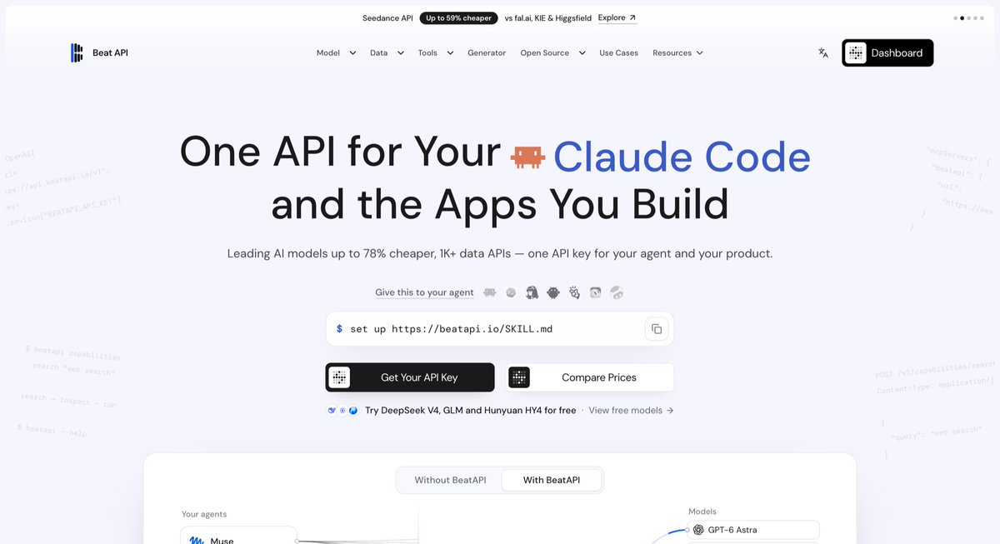

BeatAPI 官网：一个 Key，给你的 Agent 和你做的 APP / Web 用

不同的用户，要的东西不一样，场景也不一样：

1. 编程爱好者和 Agent / App / Web 开发者：要用高质量模型，同时把 Token 成本压下来

我们给的：用更低的价格调高质量模型。我们也在研发智能路由：基于不同任务自动调用最合适的模型，简单的活交给更便宜的模型，复杂的任务交给相对昂贵和高质量的模型，降低整体的 Token 消耗

2. 用 Agent 做 AIGC 的创作者：模型贵、反复抽卡、素材散在好几个软件里

我们给的：图片、视频模型比 fal.ai、KIE、Higgsfield 等平台平均便宜 30% 以上；配合开源的 BeatDesign，生图、剪辑、素材管理都在本地一个软件里，Agent 也能直接操作

3. 想做出海增长 GTM 的人：要查关键词、盯排名、看竞品，还要盯社媒上的热点和痛点

我们给的：SEO 数据接口查关键词的搜索量和难度、看自己和竞品的排名、分析外链、估算网站流量；社媒数据接口扒热点和用户痛点；再加上网页搜索、网页读取、站点地图，让你的 Agent 直接监控你和竞品的网站

用户不同，使用场景就不同。这一步定下来，后面做什么页面、发什么内容、在哪发，就都有了答案：围绕每一类用户的具体需求做内容。

### 2. SEO & GEO：把每一个有搜索量的需求都做成一个页面

SEO 不等于写博客，而是把用户的每一个任务拆成一个页面。我们的网站有上千个页面，都是围绕上面三类用户和场景，找到对应的关键词再做出来的

只说自己好的页面，用户不信，AI 搜索也不爱引用。把竞对比较和真实用户场景写出来，价格优势反而更可信

效果最好的是 Competitor comparison 页面，用户搜 XX alternative 的时候，已经默认有比较强的付费意愿了

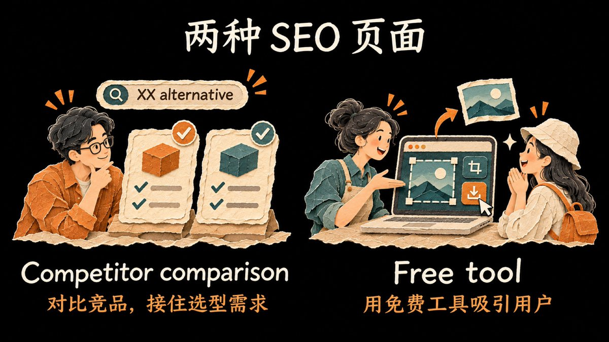

GEO 我们是和 SEO 放在一起做的：让 ChatGPT、Perplexity 在回答问题时，能读懂我们、提到我们

- 这件事对我们特别重要，因为我们的用户本身就是重度 AI 用户
- 越来越多人直接问 AI「哪个平台能一个 Key 调所有模型」「哪家的视频 API 最便宜」，而不是去 Google 搜
- GEO 在实操里和 SEO 非常像，核心都是站内内容，比如 llms.txt、对比页和博客。站外的内容虽然有权重，但相对没那么大
- 上面那些对比页，正好是 AI 回答这类问题时最需要的材料

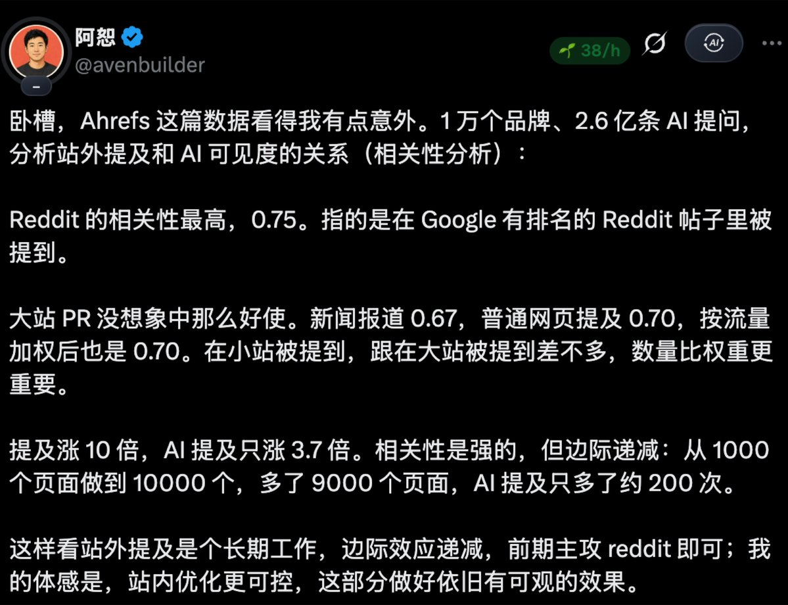

页面做出来只是第一步，还要天天体检

上千个页面，哪些被收录了、哪些排名在掉、哪些在 AI 的回答里被提到，靠人每天打开 GA、GSC 去看，太吃精力了，很多问题都是事后才发现

现在我们有一个专门做 SEO & GEO 的 Bot，每个工作日巡检一遍收录和可见度：

1. GA 和 GSC 开只读权限，数据直接交给 Bot

2. 规矩是没变化就不吵我：只有降幅过大、关键页报错或者被设成 noindex，它才来报，而且会把修复写成一条具体任务

3. 每周一份周报，每月一次复盘：全站重爬一遍，再对比和竞对在关键词上的差距，关键词、排名和外链数据直接用我们自己的 SEO 数据接口拉

4. AI 回答里有没有提到我们、引用了谁，用我们开源的 BeatGEO 追踪

接下来要做哪些新页面，就是从这份体检里列出来的

以前做 SEO，比的是谁外链买得多。现在做 GEO，比的是谁先把用户的问题回答清楚

这套体检的核心步骤，我写成了一段提示词放在文末附一，你可以直接丢给自己的 Agent 跑一遍

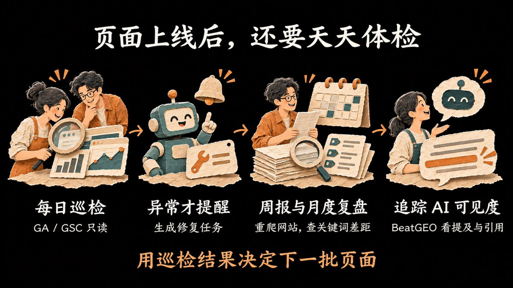

### 3. 社媒：5 种语言、20 多个渠道，一个渠道一个 Bot

海外社媒这一块，我一个人运营着 5 种语言、20 多个渠道，一周发约 200 条内容

光 X 就有中文、英文、日文三个号，每个号的受众和内容都不一样

最好用的分工是：一个渠道、一种语言，对应一个 Bot

每个 Bot 就是长期管这一个渠道的员工，有固定的风格，有一个明确的对标

写内容的逻辑，拆开就是四步：

1. 找对标

在每个渠道里，找已经起量的同类账号，挑一个最适合我们学的

2. 拆对标

把它过去的帖子全部拉下来，看起量的那些是什么结构：开头怎么写，正文分几段，配什么图，结尾怎么收

X 上用 Grok 自带的连接器拉，X 以外的平台用我们自己的社媒数据 API 拉

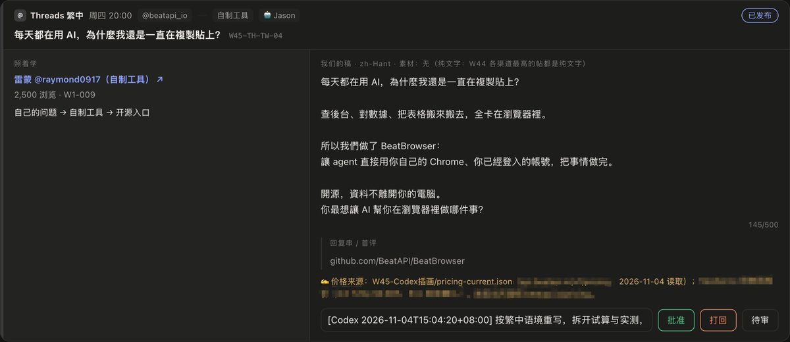

(每条帖子都要有竞对的内容作为结构参考)

3. 找真实痛点

用我们自己的社媒数据 API，去扒 X、Threads、LinkedIn、Reddit 上用户在抱怨什么：哪家又涨价了，哪个模型排队排了半小时，哪个接口文档看不懂。

每一条痛点都有原帖，截图就是证据。用户真实痛点对应的解决方案就是我们产品社媒宣传的核心文案。

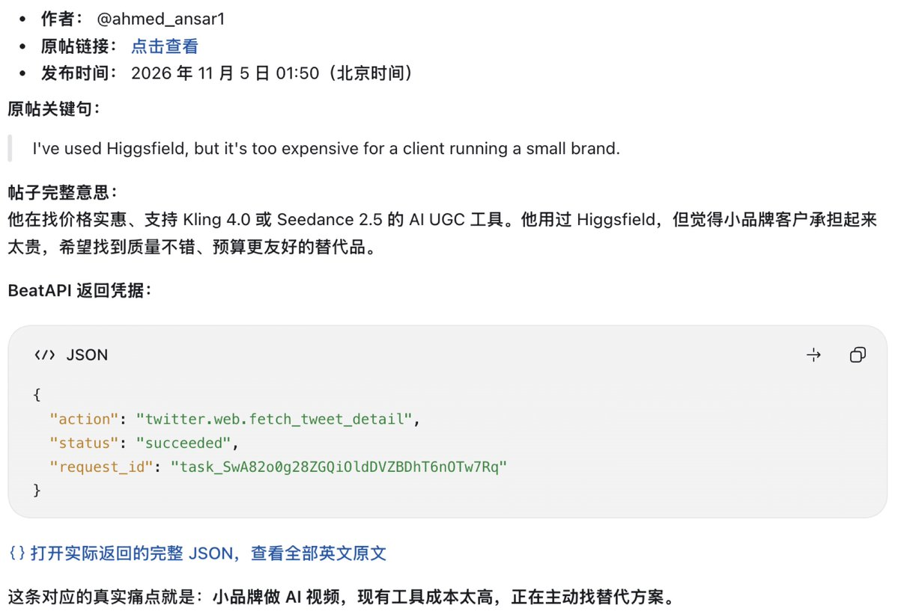

用我们的社媒数据接口扒到的真实痛点：小品牌嫌 Higgsfield 太贵

4. 换成自己的产品重写

竞对拆解过的爆款结构留下，把具体内容换成我们的产品、我们的场景和这些真实痛点，再分发出去

这样写出来的每一条，都有一个对标，背后也有一个真实的用户问题。数据不好的时候，也知道回去查什么：是对标选错了，还是痛点找偏了

所有稿子汇到一个审核台，按这个顺序往下走：待审 → 批准 → 发布 → 回填链接 → 回收数据

哪条卡在哪一步，一眼就能看到。竞对参考和发布数据都存在一起，下一轮怎么优化也一目了然

发布这一步：

- 有 API 的平台直接发，比如 Threads
- 没有 API 的，放在云电脑上发也不行，机房 IP 不够干净，一发就容易被限
- 所以我们自己做了一个开源浏览器插件 BeatBrowser：在我日常用的 Chrome 里单独开一个任务窗口，用我已经登录的账号和本机网络去发，人和 Agent 各用各的浏览器，复用同一个登录态，但互不干扰
- 这一整套具体怎么搭，见文末附二

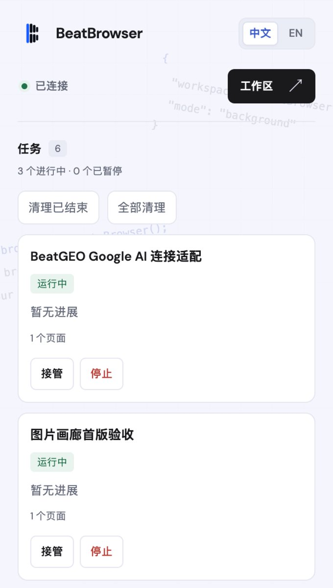

我们产品社媒发的东西很少是硬广，大部分是：

- 一个具体任务，Agent 是怎么完成的
- 一个真实痛点问题，我们的产品怎么比竞对提供更好的解决方案
- 我们自己做产品、做增长的真实过程

涨粉和获客是两件事。 一条内容发完，我们除了看曝光和粉丝，更关注产品的访问、注册、点击和进一步的付费使用

### 4. 开源：先解决自己的问题，再反哺产品

到现在，我们在 GitHub 上开源了 10 多个项目，累计近 800 star，大概分三类：

1. 工具：BeatBrowser、BeatGEO、BeatDesign，还有社媒抓取、README 优化、独立产品收款这些小工具

2. 技能包：比如 Grok Bot 出海增长开工包、选题地图，丢给 Agent 就能用

3. 提示词库：MiniMax H3 等热门模型的精选提示词和效果案例，MiniMax H3 那个库有 200 多 star

它们都不是为了开源而开源，每一个都是先在我们自己的增长里卡住了，做顺手了，才放出来

挑三个讲：

1. BeatBrowser

做社媒发布时，Agent 要用我的登录态和本机网络，云端的机房网络一发就容易被限；可这台电脑我自己也还在用。所以做了它，人和 Agent 在同一个 Chrome 里各用各的

（开源项目：BeatBrowser）

2. BeatGEO

我们要知道 ChatGPT 们回答问题时有没有提到 BeatAPI、引用了谁，市面上的工具大多是按月订阅的商业服务。所以做了一个开源替代：追踪品牌提及和引用来源，改完页面再用同一组问题复测

（开源项目：BeatGEO）

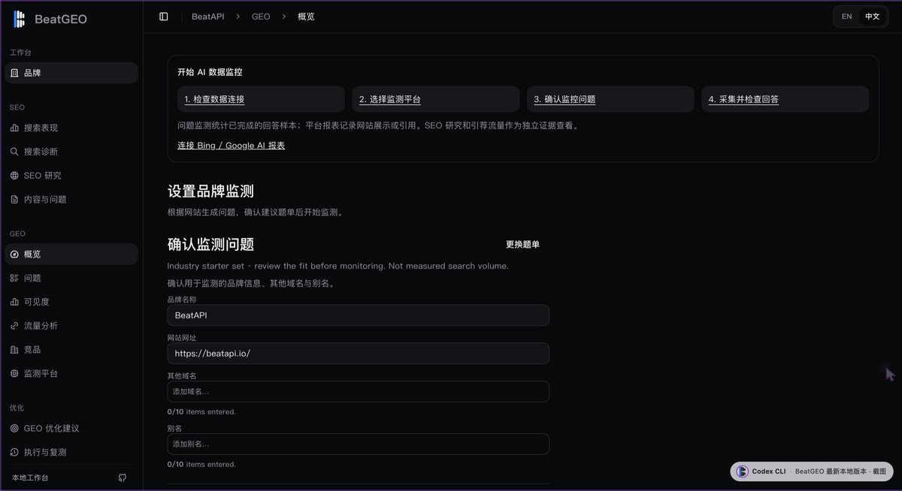

3. BeatDesign

我们自己平常要做社媒和视频素材的时候，也需要一个本地工作台，把画布、素材库和时间线剪辑放进一个本地项目，Agent 也能直接操作，提高自身的效率

（开源项目：BeatDesign）

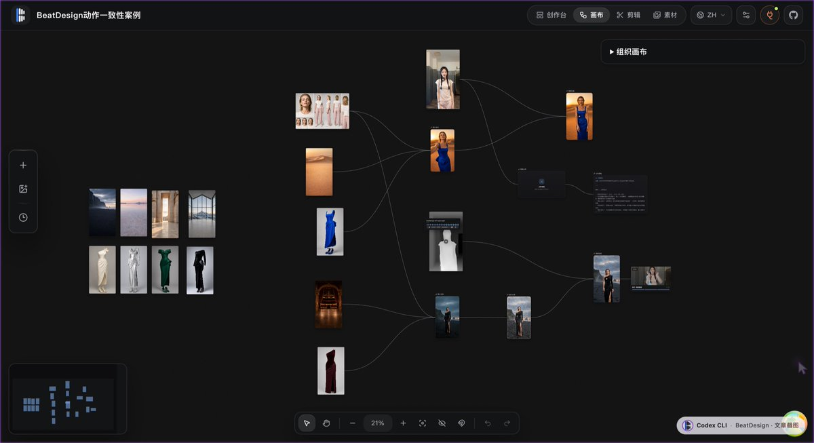

开源项目反哺产品主要通过如下几种方式：

- 直接带来开发者：开发者在 GitHub 上用到它、Star 它，顺着就会了解到我们在做什么。对开发者产品来说，这比任何一条广告都可信
- 高 DR 的 dofollow 外链：300+ star 的开源项目可以带来 GitHub 的 dofollow 外链
- BeatAPI 的真实使用场景和案例：BeatDesign 生图、生视频，BeatGEO 的 SEO 数据接口，都是我们自己产品的真实用例和场景。我们自己每天在用，也可以持续依据反馈对产品进行迭代

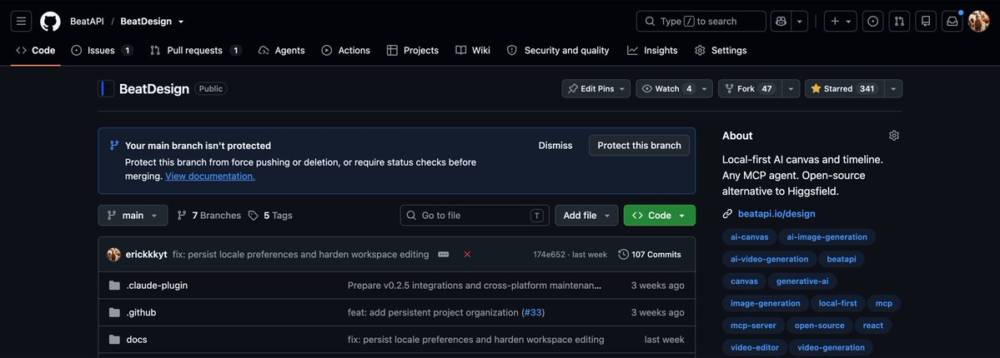

## 五、增长的脏活累活，交给 Agent

做到这里，我越来越强烈地感觉到一件事：出海增长的很多脏活累活，现在可以交给 Agent 了。

过去做增长，要一个人盯关键词、一个人刷社媒找热点、一个人找红人、一个人做素材

现在给 Agent 发一句话就行：

- 「找出这个细分领域本周 TikTok 上最热的视频，按播放排序」
- 「给我找 20 个和这个达人相似的 Instagram 博主，对比粉丝和互动」
- 「拉一下我们重点页面的关键词排名，看哪个页面在掉」
- 「按这份产品简介，生成一组竖版短视频素材」

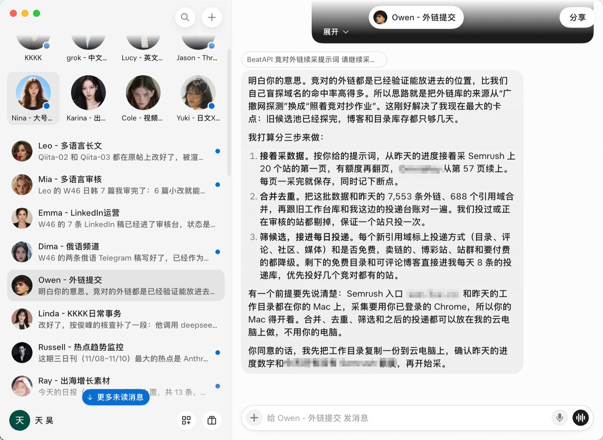

前提是，Agent 得拿得到这些能力：模型、数据和工具

这类能力可以概括为 Agent 的通用能力层：一个接入点，让 Claude Code、Codex 这类 Agent 直接用上文本/图片/视频模型、各社媒平台的数据接口、SEO 数据接口（关键词排名、搜索量、外链分析）、网页搜索与读取等。

对应到出海增长的 4 条路：

1. SEO：让 Agent 搜网页、读竞品页面、拉关键词和排名

2. 社媒：让 Agent 拉各平台的热门内容和评论，找选题、找用户

3. 红人：让 Agent 按数据找相似达人、对比真实互动

4. 广告和素材：让 Agent 调用图片和视频模型，批量出素材


## 附一：SEO 体检，把这段丢给你的 Agent

前面讲的 SEO 体检，我把核心步骤写成了一段提示词

复制下面这段，把域名换成你自己的，发给 Claude Code、Codex 这类 Agent。它会用你接入的 SEO 数据接口，拉你和竞品的数据，告诉你现在卡在哪、接下来该做哪些页面

```
你是我的 SEO 体检顾问。先确认你可以访问一个 SEO 数据接口（能查关键词搜索量/难度/意图、SERP 排名、外链、域名权重、流量估算的那种，例如各种关键词/SEO API 服务），按该接口的文档接入后，给我的网站做一次 SEO 体检。接口的用法以你所用数据源的官方说明为准，拉数据时把返回条数调大，不要只看第一页。

我的网站：[你的域名]
目标市场：[比如 us]
我的产品一句话介绍：[比如：给小品牌做 AI 视频广告的工具]

【先分清三个口径】
- Domain Rating：域名权重，0 到 100 分，越高越强
- 搜索流量估算：从搜索引擎自然搜索带来的流量
- 全站访问估算：最近一个月整个网站的访问量，包含直接访问、社媒、引荐等
后两项不是一个口径，不能相加，也不要互相比较

【请按顺序做】
1. 体量：我的网站的搜索流量估算、Domain Rating、全站访问估算
2. 流量从哪来：给我带来流量最多的 50 个关键词和 20 个页面。ranked_keywords 返回的数据里已经带了搜索量、难度和搜索意图，不用再单独查
3. 竞品：按关键词重合数找竞品。先去掉 GitHub、YouTube、Wikipedia、文档站、课程站这类泛站，以及和我不是同一个品类的大站，再取重合最多的 3 家，拉它们的关键词，列出它们有排名、我还没有的词
4. 外链：我的外链概况，以及最强的 20 条外链
5. 筛词：缺口词先按我的产品线筛一遍，再按搜索量、难度和搜索意图挑出最值得做的 10 个，每个写一个建议的页面类型：对比页、教程页、工具页还是博客。这 10 个词用 keyword_overview 看分月搜索量，头条月搜明显虚高的要注明
6. 排计划：围绕这 10 个词，排出接下来 30 天的页面计划，按周写

【请输出】
1. 最重要的 3 个发现，每个一句话
2. 一张表：我和 3 个竞品的搜索流量估算、Domain Rating、关键词数、外链概况
3. 10 个最值得做的关键词，每个配建议的页面类型
4. 接下来 30 天，按周排好的页面计划
5. 这次的实际花费，以每次响应里的价格/计费字段相加为准

【要求】
- 流量都是估算值，在报告里写明
- 返回不足要求条数的，按实际条数写
- 查不到的数据直接写「查不到」，不要写成 0，也不要估
- 排名数据可能是一两个月前的，注明数据时间
- 说人话，每部分几行就够
```

跑完以后，你就知道自己的网站现在卡在哪、下一个页面该做什么

## 附二：社媒，搭一支自己的社媒 Bot 团队

前面讲的社媒打法，怎么交给 Bot 去跑，我在之前那篇 Grok Bot 长文里拆过：

引用推文：KKKK (@kkkeric_ai)

grok bot 真的是出海增长神器 这篇文章希望对于在做 AI 产品和出海增长的朋友都有所帮助 文末附了可以一键复用的 skill 

https://x.com/kkkeric_ai/status/2116726197111648426

文末有开工包，丢给 Grok Bot 就能搭自己的社媒 Bot 团队。开工包也开源在 GitHub：

（开源项目：grokbot-growth）

## 写在最后

做出海增长，最怕的不是方法不够多，而是一开始就同时做所有事

先判断用户画像和产品定位，围绕一条主线做透，等转化跑通了，再逐步放大

我们这 2 个月靠的也是开头说的两条线：SEO 和社媒

脏活累活交给 Agent 之后，人的价值在哪？

我的判断是，AI 时代的未来属于两类人：

1. 精耕细作的产品型人才：AI 一键直出越来越多，但能耐心抠用户需求和产品细节的人越来越少，这样的人会越来越值钱

2. 全栈营销人才：懂营销的人，现在需求远大于供给。vibe coding 的时代过去了，即将迎来全新的 vibe marketing 时代

一类把产品做深，一类把产品卖出去


这篇中涉及 SEO & GEO、社媒和开源项目的增长框架，希望对大家有所帮助


我是 KKKK，前私募投资，纯文科转型 AI

现在和团队一起做出海 AI 产品

