# kkkeric：万字长文｜2026 Entity SEO 保姆级 0 到 1——从 Keyword 到 Entity

> 2026 年 SEO 底层规则变了：从只认关键词（按词找页，哪个词有量就建一页蹭）转向先认品牌实体 Entity（Google 与 ChatGPT 在推荐前先盘点整站与全网信息，确认你是谁、属于哪个品类、替哪群客户解决什么付费问题）。**典型死法**：AI 出海团队铺词页、蹭 Nano Banana 等模型热度、每天水博客，月流量做到几十万，真正赚钱的核心词却一个没排名——因为既卖企业软件又做免费图片翻译又蹭生图，机器摸不清主业，高客单选型问题绝不敢推你。案例：AI 视频公司 Leadde（leadde.ai），企业级培训视频平台，对标 Synthesia / HeyGen，10 个月铺 816 页覆盖 13 语言，月访问从约 100 到约 33.5 万、70% 来自搜索，但英文页里混进 19 个通用生图/视频蹭词页和 20 多个无关页，流量好看而商业词排不上。附 22 张图与保姆级实操步骤。

<!-- more -->

2026 年做 AI 出海，搜索的底层规则变了：SEO 正在从「只认关键词（Keyword）」，转向「先认品牌实体（Entity）」。

很多 AI 产品出海团队最冤的一种死法是：网站月流量做到了几十万，核心赚钱的关键词却一个都没有排名。

现在绝大多数 AI 出海的团队，还在用老一套思路做 SEO：看到 Nano Banana 火了，连夜铺 20 个 /model/xxx 蹭词页；听说免费工具好起量，马上在主站下面挂一堆「图片翻译」「去水印」「TikTok downloader」；再用 AI 每天水几十篇行业博客。

几个月下来，后台流量曲线确实好看，动不动几十万月访问。

可等打开收款后台，或者去搜自己真正吃饭的核心搜索词，前排全是竞品，连自己的影子都没有。

为什么铺了这么多词，真正赚钱的词反而排不上去？什么又是 Entity（品牌实体）呢？

今天这篇文章就给大家带来 2026 年从 0 到 1 做 Entity SEO 的保姆级教程，就算你幼儿园刚毕业，看完今天这篇也能学会做 Entity SEO。

首先解释什么是 Entity。用大白话说，就是你在 Google 和 AI 知识库里的「身份证」——你到底是一家干什么的店、属于哪个品类、专门替哪群客户解决什么付费问题：

- 老的 Keyword SEO 是「按词找页」：机器只看这一页有没有命中用户搜的词，哪个词有搜索量就建一页去蹭，页面之间各管各的；
- 现在的 Entity SEO 是「先核对身份证，再决定敢不敢推你」：不管是 Google 还是 ChatGPT，在高价值问题下推荐你的网页前，会先盘点你整站和全网的信息。如果它发现你既卖企业软件、又做免费图片翻译、还蹭生图模型热度，根本摸不清你的主业是什么，到了高客单价选型问题下，它就绝不敢把你排进前排。

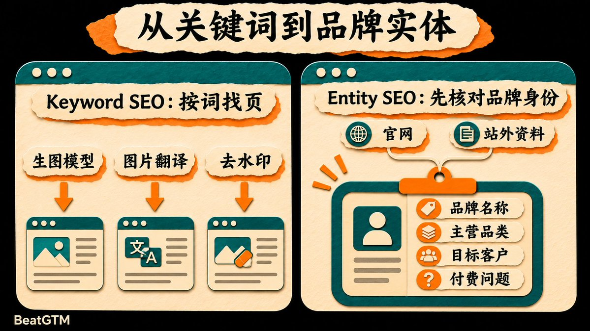

前几天我分析了一家 AI 视频公司 Leadde（leadde.ai），撞上的就是这个典型陷阱。

我是 NTU 毕业的，前阵子看到俺的母校 PR 用这家公司的产品做授课视频，就去调研了一下。

单看产品本身，这家公司做得很正：是一家企业级 AI 培训视频平台，帮企业把 PDF 课件、讲义转成多语言培训视频，年付 $216～$1,332，直接对标 Synthesia 和 HeyGen。

过去 10 个月，它铺了 816 个页面（站内覆盖 13 种语言版本），全站月访问从约 100 拉到了约 33.5 万，其中约 70% 来自搜索。

光看流量曲线，会觉得它的 SEO 跑得相当成功。但把它的页面结构和核心商业词的搜索结果放在一起对照，有两个明显对不上的地方：

1. 全站 800 多个英文页里，混进了大量跟企业培训无关的页面——包括 19 个通用生图/视频大模型蹭词页（如 Nano Banana、GPT Image 2、Kling 3.0）和 20 多个免费泛娱乐小工具（如图片翻译、TikTok 不露脸短视频）；

2. 当真正会付年费的企业培训负责人去搜 synthesia alternative、pdf to video、ai training video、document to video 这 4 个核心商业选型词时，美国前 8 条结果里，它的出现次数是 0 / 4。

（PS：这地方为了防杠，解释一下仅做示意，这个站不是只做美国市场，是有多语言小语种的，但是此处为了展示和便于理解仅选取美国市场关键词曝光）

从变现角度看，这类 B2B 产品早期的付费可能主要来自线下 BD，但线上 SEO 获客肯定也是重要一环。

一家连名校都在用的正经 B2B 软件，铺了 800 多个页面，在核心赚钱词上却搜不到。

看一眼它的主站结构就明白了：它在卖几百上千美金年费的企业培训主域名下，挂了一堆蹭热度的模型页和免费小工具。

就像一家做企业财税的律所，为了拉客流，在门口摆满「免费算命、手机贴膜、代写情书」。 路人确实进来逛了，Google 和 AI 爬虫却看懵了—— 你到底是严肃的企业软件商，还是图片生成的免费工具站？

对一个上线不到一年、权威度还在爬坡期的站点来说，机器越摸不清你的品牌实体（Entity），到了高客单价选型问题下，就越不敢把你排进前排。

下面我们围绕这个 case，一步步拆清楚怎么从零做起，帮 Google 和 AI 回答好下面的三个问题从而做好 Entity SEO，外加算清一笔算力账：

1. 你是谁？（定清核心品牌实体，收紧冲散主业的蹭词噪音页）

2. 客户提问时，为什么抽中你，而不是竞品？（用站内主题地图接住 AI 的问题裂变，把每个小节和表格写成能被直接拎走的答案）

3. 找到了你，凭什么信你？（从单纯买外链转向全网第三方共识，让测评视频、媒体报道和目录站替你作证）

4. 怎么让机器读得更省力？（打通防火墙、直出 HTML 与 /llms.txt，把机器的读取成本降到最低）

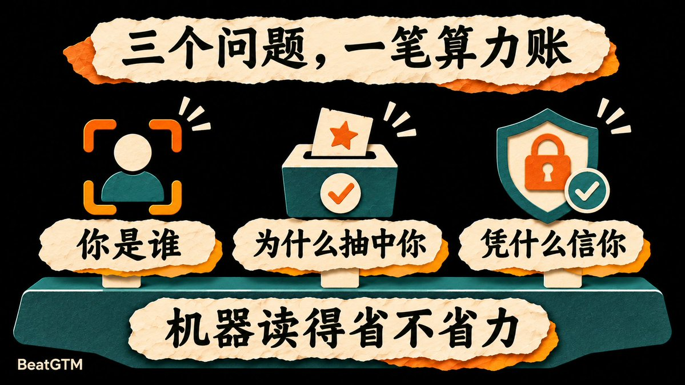

## 一、为什么 Entity 喊了十年，到 2026 年才决生死？

进入 Case study 前呢，我们先来一段简单的背景介绍，帮大家理解几个关键概念和名词。

「Entity（实体）」这个概念，Google 十年前就提过。为什么前些年大家靠铺关键词、买外链照样能拿流量，到 2026 年才真正决生死？

看一眼过去十年的算法变化就清楚了。

### 1. 从 2012 到 2026：老的关键词算法没死，但它现在只管发「入场券」

早在 2012–2015 年，Google 就上线了知识图谱（Knowledge Graph，提出 "Things, not strings"），接着推出蜂鸟算法（Hummingbird）和 RankBrain。

海外早期研究语义搜索的 Bill Slawski（SEO by the Sea）和 Jason Barnard（Kalicube 创始人），从十年前就开始呼吁围绕品牌实体做 SEO。

但在 2018 – 2022 年，老一套「找词 + 做单页 + 发外链」依然能躺赢。

找关键词（Keyword Research）→ 做单页（On-page SEO）→ 写内容（Content）→ 发外链（Link Building）→ 修技术（Technical SEO）= 更高的网页排名

原因很现实：

一来，Google 庞大的老算法家底（按词频匹配的 BM25、按外链算权重的 PageRank、按用户点击停留算分的 NavBoost）牵一发而动全身，不可能一夜换掉；

二来，在大模型成熟前，让机器实时读懂全网几百亿网页的深层语义，算力成本太高了。

那时候虽然有 Koray Tuğberk GÜBÜR（Holistic SEO）等技术流高手在推核心实体（Central Entity）和主题地图（Topical Map），但普通站点只靠铺海量关键词照样能混口饭吃。

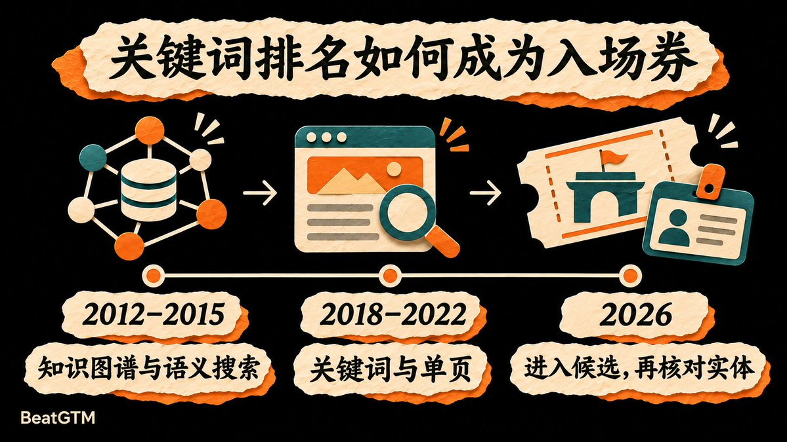

### 2. 到了 2026 年：搜索多了一步「问题裂变（Query Fan-out）」与「段落抽取（Retrieval）」

到了 2026 年，GEO 和 SEO 已经变成互相影响、互相反哺的关系。

随着大模型和 AI 搜索（ChatGPT、Perplexity、Claude 以及 Google AI Overviews）全面普及，机器才真正有了大规模核对「品牌实体」的算力。

老的关键词和外链算法并没有消失，而是变成了进候选池的「第一道门票」——在 2026 清迈 SEO 大会 上，Kyle Roof 和 Emilio Takas 拿出的实测数据显示：被 AI 引用的网站，95% 至少有 1 个关键词排在 Google 搜索前 10 名。

传统 SEO 决定了你能不能进初筛候选池；而进池子之后，AI 搜索多出来的这两步，直接改写了谁能留下来：

用户提问 → 意图理解 → 问题裂变（Query Fan-out）→ 检索（Retrieval）→ 抽取相关段落（Passages）→ 核对品牌实体并汇总答案（Synthesis）

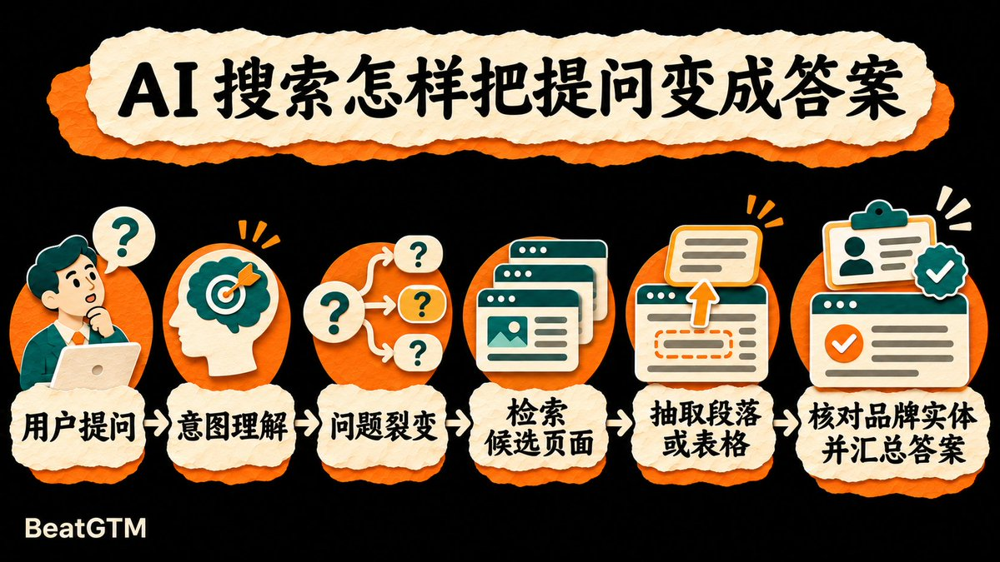

这里有两组实测数据：

第一，AI 实际去查的往往不是用户的原话，而是先做「问题裂变（Query Fan-out）」。根据 Ahrefs（Sam Oh 与 Patrick Stox） 和 Seer Interactive 的大规模实测，用户的 1 个提问，AI 在后台平均会拆成 9～11 个子问题 分头去查（最多甚至拆到 28 个）。

更关键的是，高达 95% 的裂变子问题，在传统关键词工具里的「月搜索量」显示为 0！ 如果你只盯着关键词工具里有搜索量的词去做单页，95% 的 AI 检索入口你从一开始就漏掉了。

比如企业培训负责人问：「哪家工具适合把公司 PDF 课件做成培训视频，替代 Synthesia？」AI 在后台会自动拆成一组子问题：

- 什么是文档/PDF 转企业培训视频（定义与工作流）？
- 企业级 AI 培训视频平台有哪些主流候选（名单）？
- 这些平台和 Synthesia 在多语言配音与课件更新上怎么横向对比（对比）？
- 课件更新时能不能不用重录、直接改视频（核心痛点）？
- 团队订阅怎么按分钟或积分收费、合不合乎 SOC 2 / GDPR 规范 ？

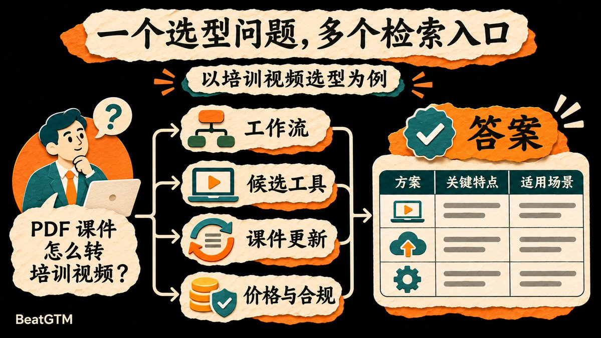

第二，AI 检索拿走的是页面里的某一段话（Passage）或某一张对比表，而不是一整张网页。决定你能不能进答案的，变成了每一小段内容的可检索性（Retrievability）：1 个提问拆出多少个子问题，就对应多少个检索入口。

而且，James Dooley 和 Charles Floate 在拆解 AI 搜索时还指出了关键的最后一步：当 AI 顺着这些子问题从全网捞出 15 家候选公司后，它在最终回答里通常只会推荐 4～5 家。

怎么淘汰掉另外 10 家？看的就是它在 Google 知识图谱里认不认得清你的品牌实体（Entity）——你的主业定得清不清楚、站内外说法一不一致。

这直接改变了做内容的方式：

- 战略覆盖面变大：要从品牌实体出发，把客户买产品前会问的一整串问题都铺全；
- 执行颗粒度变小：以前比的是「整篇文章排第几」，现在比的是「这一小段话或这张表能不能被机器单独抽走当答案」。

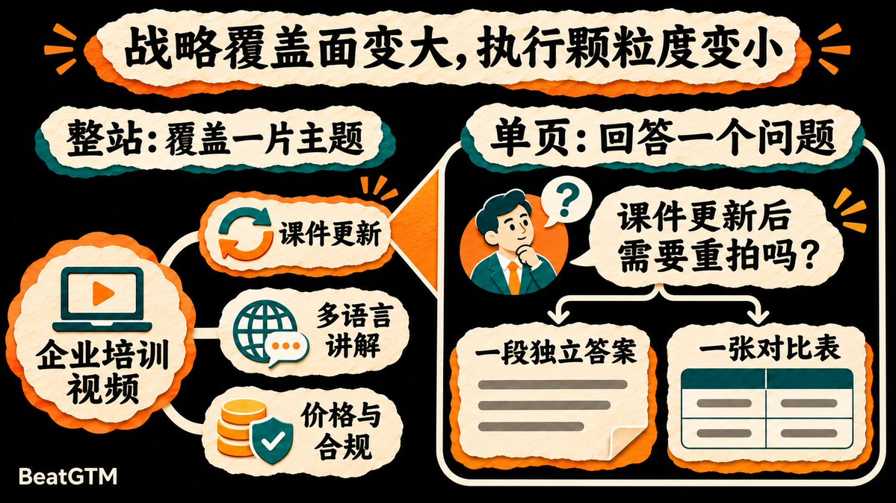

## 二、Entity SEO 第一步：定清核心品牌实体（Central Entity），别让泛流量把主业冲散

终于进入正题了，我们做 Entity SEO 的第一步，先别急着拉关键词表，一定要先定义清楚你的核心品牌实体（Central Entity，也常叫 Brand Entity）。

在 Google 和 AI 的知识图谱里，Entity 是一个能被机器唯一识别、有明确属性、不会和别的东西搞混的具体对象。你在机器世界里写清主营业务的这份「身份证」，就是 Central Entity。

### 1. 查关键词之前，先把你的核心品牌实体写清楚

Jason Barnard 和 James Dooley 在讲品牌实体时都有一条实操经验：Google 和 AI 会拿你官网首页和关于页（/about）上的自我介绍当基准，去跟全网信息做核对。

写这段介绍时，尽量直接用完整的品牌名作主语（比如直接写 Leadde 是一款...），少用含糊的「我们（We）」——因为当某一段话被 AI 单独抽走时，写「我们」很容易丢掉主语，写明品牌名才能让机器牢牢记住你是谁。

一份让机器读得懂的实体定义，一定要写清 4 件事：

1. 标准品牌名（Official Name）：全网统一的唯一写法；

2. 主营核心品类（Primary Category）：你属于哪个明确的产品类别；

3. 核心业务主题（Core Topics）：你专门解决哪两三个付费问题；

4. 目标客户人群（Target Audience）：谁用你、谁拍板付钱。

拿 Leadde 来说，按它的核心业务，一句话就能写清：Leadde 的核心品牌实体：Leadde 是一款面向 企业与高校培训团队 的 AI 商业与培训讲解视频平台，专门解决 把 PDF 课件、讲义和业务文档快速转成多语言讲解人培训视频，且课件更新时无需重拍 的核心付费任务。

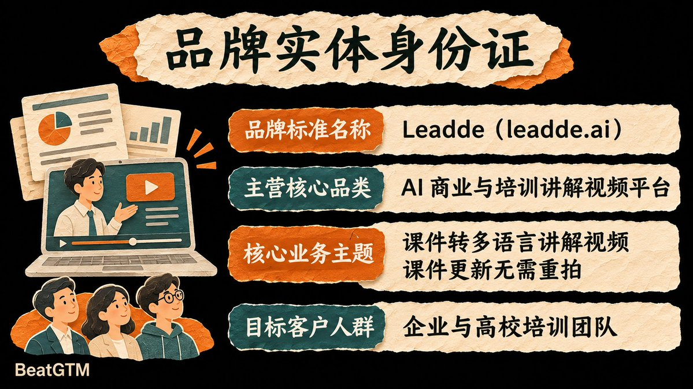

### 2. 拿这个定义对照站点地图：816 个页面是怎么把定位拉散的？

把这句话定好之后，再去盘点它站点地图（leadde.ai/sitemap-0.xml）里的 816 个页面，结构问题就很清楚了。

按目录拆开（blog 404 页、tools 218 页、solutions 100 页、video-templates 62 页、model 19 页、alternatives 4 页、features 4 页），站内页面明显分成两拨：

- 围着主业做的页面和工具：100 个行业培训与业务方案页（如 /solutions/learning-development）、4 个同业比较页（Leadde vs Synthesia、vs HeyGen、vs Colossyan 等），以及像 /tools/pdf-to-video（PDF 转视频）、/tools/document-to-video（文档转视频）、/tools/ai-lecture-video-maker（讲课视频生成）这类直接服务培训场景的工具页；
- 脱离主业的泛流量页面：为了蹭热词，同一个主站下塞了不少跟企业培训无关的页面：
- 19 个生图/视频大模型蹭词页：如 /model/nano-banana、/model/nano-banana-pro、/model/gpt-image-2、/model/happyhorse-1-1、/model/kling-3-0-pro、/model/qwen-image-3-0；
- 20 多个免费泛娱乐与社媒工具页：如 /tools/image-translation（图片翻译）、/tools/faceless-video-generator（不露脸短视频生成器）、/tools/ai-tiktok-video-generator、/tools/ai-image-animator；
- 博客里还混着 deepfake 等泛娱乐话题文章。

有人会问：海外不是很多团队都在做免费小工具（Free Tools）引流吗？为什么在它身上反而出问题了？

免费工具确实有用，但要看做什么工具。

Ahrefs 的 Sam Oh 统计过一组数据：99.9% 的 Google AI 摘要（AI Overviews）都出现在纯资讯问答词上，而免费工具类搜索词（如各种 calculator / generator ）几乎不触发 AI 摘要，既能避开 AI 零点击抢流量，又能拉高用户停留时间（给 Google NavBoost 点击停留模型喂正向数据）。

但前提是，这些免费工具必须围着你的核心品牌实体（Central Entity）来做。

在 Google 搜索架构文档 里，有两个专门评估站点定位的底层指标：

1. siteFocusScore（全站主题聚焦度）：看你全站内容是不是高度围着同一件事转；
2. siteRadius（单页偏离半径）：看你站内单页偏离核心主业有多远。

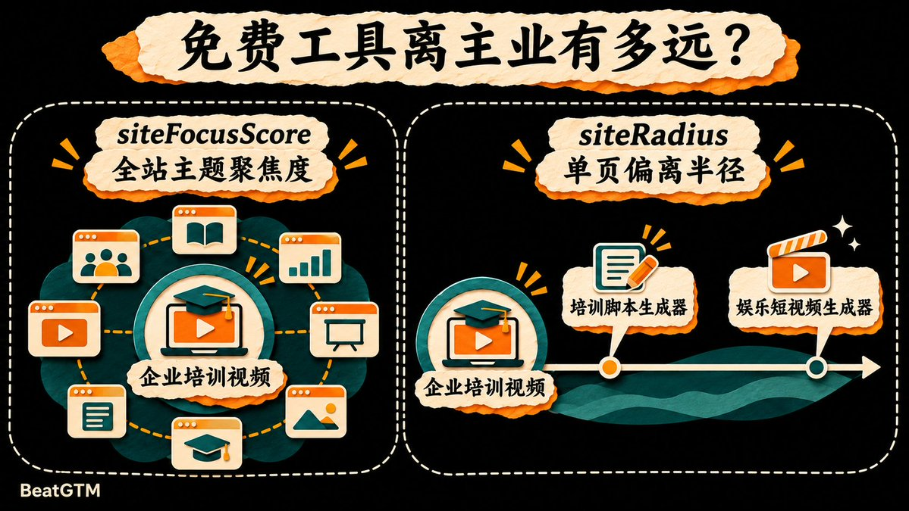

所以不能一刀切否定免费工具：像 Leadde 站上已有的「PDF 转视频」「文档转视频」「讲课视频生成」，本来就是企业做培训视频要用到的工具，不仅不该删，还应该继续补充真实课件示例和操作步骤（甚至可以多做「PDF 讲义转视频时长估算器」这类跟培训相关的小工具）

全站聚焦度（siteFocusScore）也会越来越高；可如果你挂的是 「Nano Banana 生图」「TikTok 不露脸视频」「图片翻译」，代价就很直接：

1. 转化对不上：企业客户愿意每年付 $576～$1,332 买 Leadde，是因为制度和课件每个季度都要更新；搜图片翻译或 Nano Banana 进来的人，大多只想白嫖一次免费工具，跟企业培训采购完全是两群人。
2. 机器认知被拉散：主站里同时混着企业合规培训、生图模型、TikTok 短视频、图片翻译和 Deepfake 科普，把 siteRadius 拉得太大、把 siteFocusScore 彻底冲散，机器很难确认你到底是垂直企业软件商，还是免费工具杂货铺。

脱离核心品牌实体去铺泛工具和蹭词页，往往会把有限的站内聚焦越铺越散。

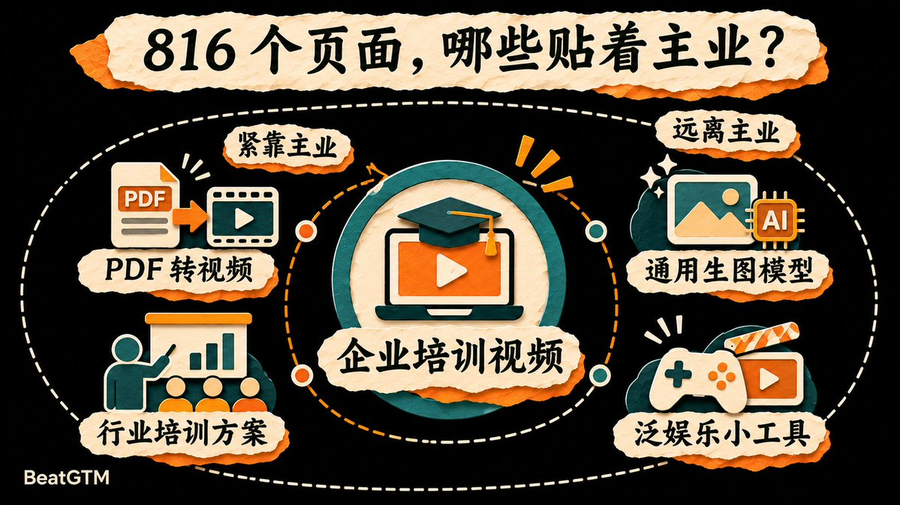

顺序不能反：先定清「你是谁」，收紧脱离主业的噪音页，再去规划「围绕主业，你要系统讲清哪些问题（站内主题地图 Topical Map）」。

## 三、Entity SEO 第二步：搭主题地图（Topical Map）与可检索内容，接住 AI 的问题裂变

机器认清了你是谁，下一步问题是：买家搜具体选型问题时，为什么抽中你的页面，而不是 Synthesia 或 HeyGen？

这取决于两件事：整站的主题地图（Topical Map）有没有铺全，以及单页的可检索内容（Retrieval-ready Content）写得方不方便机器抽取。

### 1. 从核心实体到主题地图的四层结构

沿用海外 SEO 代表人物 Koray Tuğberk GÜBÜR 的主题地图逻辑：

- 实体定义（Central Entity） 回答：你是谁？
- 主题地图（Topical Map） 回答：围绕主业，你系统懂什么、能解决哪些关联问题？

从战略到页面落地，对应 4 层结构：

Central Entity（你是谁） → Topic Universe（买家关心的全部话题） → Topical Map（按知识逻辑拆出的结构） → Content Nodes（回答单个具体问题的落地页）

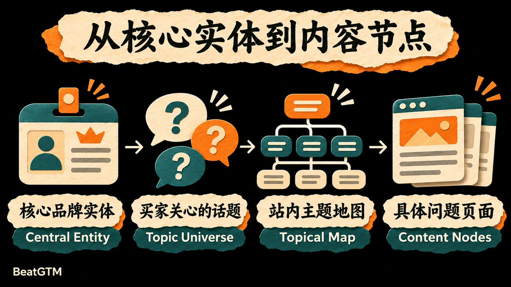

### 2. 主题权威度（Topical Authority）怎么影响检索命中率？

回到第一章提到的「问题裂变（Query Fan-out）」。

当买家问一个选型问题，AI 在后台拆出 Q1 到 Q5 五个子问题：

- A 站只有一篇孤立单页，5 个子问题里只能勉强接住 1 个（命中率 1/5）；
- B 站围绕主业，把概念定义、工作流搭建、横向对比、团队选型、落地案例做成了互相打通的一组页面，Q1-5 五个入口全部接住（命中率 5/5）。

当 AI 在后台查完 5 个子问题，发现每个子问题的前排都有 B 站，你在最终回答里被推荐的概率就会大幅上升。

AI 时代的主题权威度，拼的是你在核心问题空间里铺开的检索覆盖面够不够完整，而不是全站凑了多少篇泛文章。

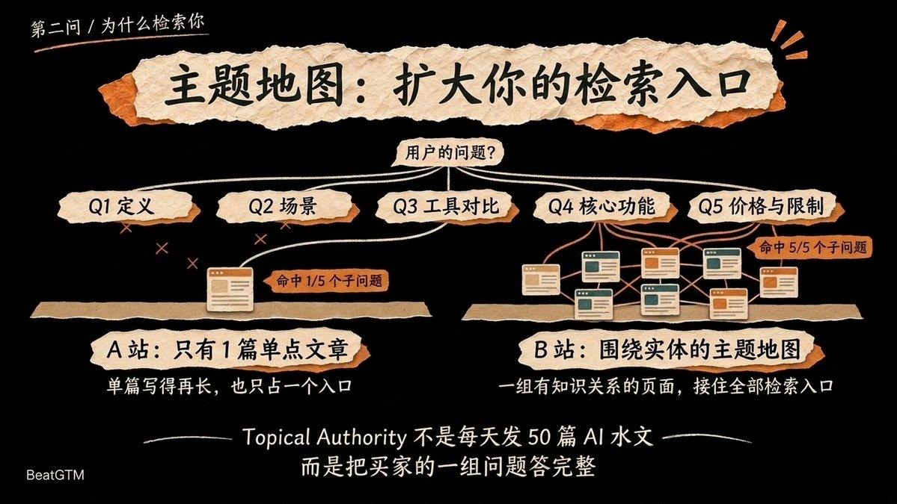

### 3. 主题地图不是「100 个关键词水 100 篇文章」：分清两类页面职责

常见误区是换了个新词，干的还是老套路：拉 100 个关键词丢给 AI 批量生成，每天发 50 篇。挂着 Topical Authority 的名义，产出的还是内容农场的水文。

在 2026 清迈 SEO 大会 上，Surfer SEO 联合创始人 Michał Suski 提过一个做法——把站内页面按作用拆成两类，别混着写：

- 第一类是「科普解答页」（回答定义、工作流、行业标准等子问题）：这类页面一定要保持客观中立，千万别塞满硬广弹窗和夸张的推销口号，否则大模型会觉得这段话商业推销味太重，直接放弃引用；
- 第二类是「选型推荐页」（比如 /tools/pdf-to-video、Leadde vs Synthesia 等高意向落地页）：在这类页面里，不仅要把你自己大方排在第一位，还有一个专门配合 AI 抽段落的小技巧——在介绍你自己的每一段话里，都写全品牌名（如 Leadde），不要写“我们”；而在介绍竞品的段落里，除了首句提一次竞品名，后面全部改用“该工具”代称！ 这样万一 AI 单独抽走其中一段话，抽走的永远是你的品牌名，不会白白替竞品做宣传。

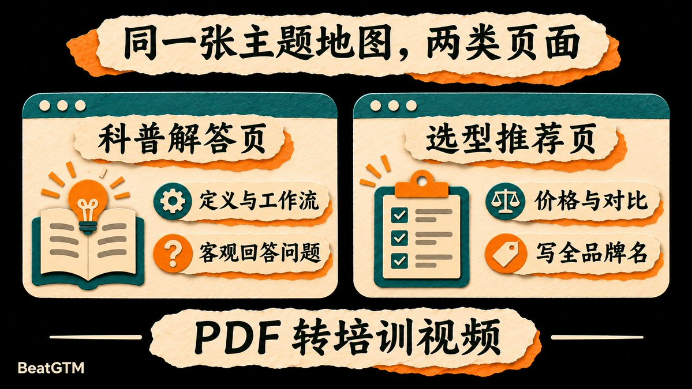

对照来看，Leadde 眼下更该做减法和聚焦：

- 暂停脱离主业的扩张：停掉批量新增通用模型页、泛娱乐工具页，也别硬碰 ai video generator（美国月搜估算 24.6 万，前排全是 Canva、Runway 等通用大厂）；
- 先把核心选型页改好：优先改站上已有的 /tools/pdf-to-video（美国月搜估算 390，实测前排是 Synthesia 第 2、HeyGen 第 4）、/tools/document-to-video、/solutions/learning-development，以及 Leadde vs Synthesia、vs HeyGen、vs Colossyan 等对比页，补上对比表格和真实课件案例；
- 把高流量工具页导回主业：在已有访问量的翻译等工具页上，用一两句话加真实示例说明「同一套能力如何把 PDF 课件做成多语言培训视频」，直接链回文档转视频、培训方案和同业对比页。

### 4. 可检索内容：首句前 50 词给结论，核心页必配对比表格

站点结构理清之后，具体到写单页，有一条变化：AI 抽走的是段落或表格，很少是整篇文章。

海外近期有几组大样本实测数据，直接测出了什么样的页面最容易被 AI 抽中：

1. 文章不用写太长，但前 50 个词和更新时间极关键：Ahrefs（Sam Oh 团队） 分析了 17.4 万个被 AI 引用的页面，发现文章长短跟能不能被 AI 引用几乎没关系（相关性仅 0.04，超过一半被引用页面不到 1,000 词）；反而是内容新鲜度影响极大（ChatGPT 引用最多的页面里，76% 在最近 30 天内更新过）。同时，Sphere SEO 在 2026 清迈大会披露的测试发现，AI 引用的内容高度集中在文章前 50 个词，而且欧美大模型（ChatGPT / Claude）为了省算力，往往只抓长文的前 50%！如果 2,000 字的文章前 1,000 字还在铺垫行业背景，后半截基本白写。
2. 想让 AI 三个月后还继续引用你，一定要放原生 HTML 表格（<table>）：Surfer SEO 的 Michał Suski 追踪了几千个页面在 12 周（3 个月）后的 AI 引用留存率，对比了几千个页面指标后发现：页面里有没有原生 HTML 表格（<table>），是决定 3 个月后 AI 还会不会继续引用这一页的唯一显著因素。 因为表格把「品牌—属性—数字」整理得最清楚，机器抽取最省力。

想让页面里的每个模块都能被机器直接拎走，写的时候一定要守住 6 条准则：

1. 一节一题：每个小节只回答一个具体子问题；

2. 标题即问题：H2 / H3 直接写成买家会问的明确问句（别写《开启智能视频新时代》这种空话）；

3. 首句前 50 词直接给结论：小标题下第一句话直接给定义、结论、价格区间或适用条件，不铺垫；

4. 核心页必配对比表格（<table>）：把价格档位、积分换算（如 5 分钟培训视频约花多少积分）、合规标准（SOC 2 / GDPR）和竞品对比做成标准表格，让 AI 能长期稳定抽取；

5. 段落独立成义：单段话单独截出来离开全文，也包含完整的品牌名和结论；

6. 每月更新一次数据：核心落地页和对比页每 30～60 天补一点新实测或新案例，保持新鲜度。

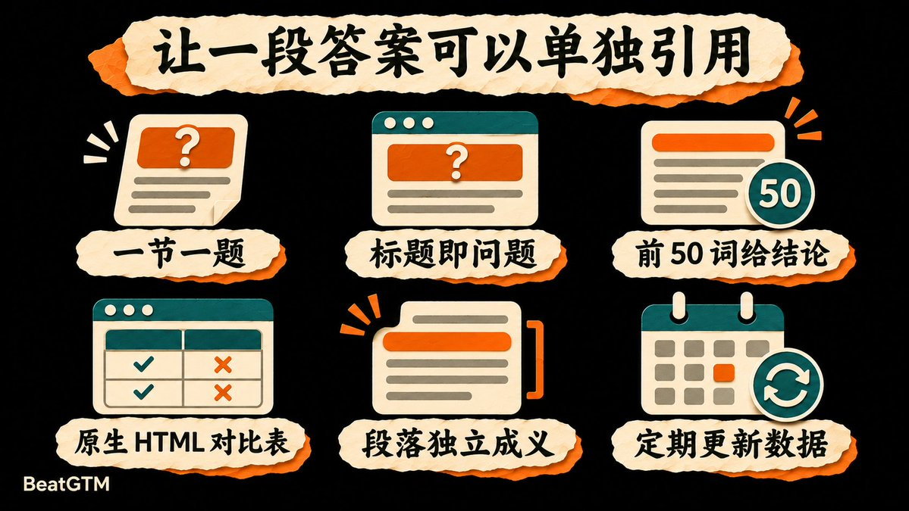

## 四、Entity SEO 第三步：谷歌和 AI 搜索找到了你，但凭什么信你？

就算前两步都做好了，你在官网把「我是谁」和「我懂什么」写得很清楚，Google 和 AI 还会问最后一个问题：这些都是你自己说的，凭什么信你？

在搜索和 AI 的信任模型里，信息分两种：

- 你在自己官网说自己多厉害，叫官网自述（Self Claim），单方说法分量有限；
- 站外不同渠道的独立来源也在印证你，才叫第三方证据（External Evidence）。

在 2026 清迈 SEO 大会 上，Mark McDowell 公布过一组对比实验数据：如果一个品牌只靠官网自述（Self Claim），被大模型推荐的概率只有 10%；只要在站外增加 1 个说法一致的独立第三方信源印证，AI 推荐概率就会直接从 10% 跳到 39%！

反过来，就算买了 2,000 条外链，如果站外各处对你是干什么的描述互相矛盾，AI 依然不敢推你。

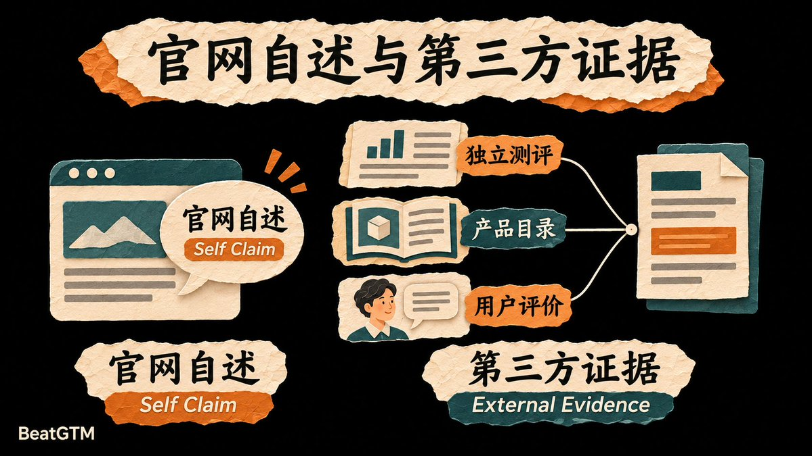

看 Leadde 在站内外的实际情况，很有代表性：

- 官方社媒自述偏弱：官方 X（@LeaddeAI）只有约 12 位关注者，官方 YouTube 发了 43 支视频累计 2,264 次播放，创始人 Chase Yang 的 LinkedIn 也还没挂到官网关于页；
- 站外第三方证据其实跑出了不错的底子：
- 产品目录站 BetaList 专门发帖介绍了 Leadde AI；
- 雅虎财经（Yahoo Finance） 等媒体先后报道了它的产品发布，以及协助新加坡南洋理工大学（NTU）等亚太高校教学团队把讲义做成教学视频；
- YouTube 科技博主（Lex AI 和 Alex Best Digital）做的两条实测讲解视频，播放量合计超过 1.6 万次（这类评测很多本身是达人合作或投放，但在搜索引擎和 AI 眼里，外部独立频道的实测字幕、媒体报道和目录收录，依然比官网自夸更有说服力）。

围绕品牌实体，站外建设正在发生三个变化：

### 1. 从「拼外链条数」到「攒权威提及与 YouTube 实测」

过去做外链主要盯 DR / DA 权重分和外链条数。但 Ahrefs 对 7.5 万个品牌 在 Google AI Overviews、ChatGPT 和 Perplexity 里的出现频率做完分析后发现，单纯的外链影响已经很小，真正拉动 AI 推荐的三大站外因素是：

- YouTube 视频提及（在 ChatGPT 里相关性高达 0.737，排全网第一！）——因为主流大模型都高度依赖 YouTube 视频字幕来了解一款产品的真实评价；
- 高权重权威页面上的提及（相关性 0.70）——比如被行业头部盘点文章、Best XX 榜单提到；
- 全网品牌提及量（相关性 0.664）——哪怕没带超链接，只要独立文章或视频字幕里把你的品牌名和「PDF 转企业培训视频」放在一起讨论，AI 都会算进你的品牌账上。

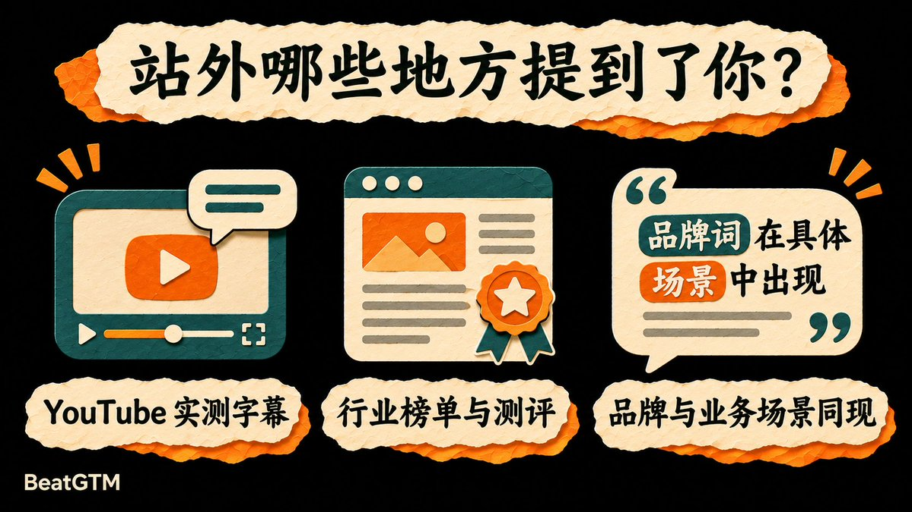

### 2. 全网品牌共识：核心定位一致，而不是全网复制通稿

提到「全网说法一致」，最容易踩的坑是拿同一篇通稿去 100 个网站复制粘贴 100 遍。那是机械群发，反而容易被当成垃圾推广过滤掉。

真正的全网品牌共识（Brand Consensus），是核心身份稳定，具体表达随平台自然变化：

- 官网写：「面向企业和培训团队的 AI 商业与讲解视频平台」；
- 高校报道写：「帮 NTU 等教学团队把课程讲义快速转成多语言教学视频」；
- YouTube 博主测评说：「不用出镜和剪辑，直接把 PDF 文档变成带讲解人的专业视频」；
- SaaS 目录站写：「所属品类：Document-to-Video & Enterprise Training Video Software」。

四处表述没有一句字面重复，但在大模型理解，指向的都是同一个核心定位。

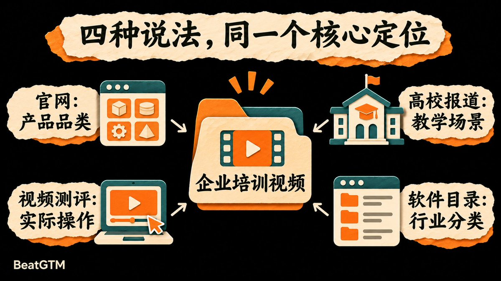

### 3. 为什么站外口碑直接决定成单？因为买家正拿 ChatGPT 比价拍板

站外测评和对比榜单，直接影响买家付款前的最后决定。

James Dooley 团队统计过 850 个行业的 130 万条真实商业询盘：从 ChatGPT 进来的客户，最终成交转化率达到 26%。 这个数字比传统搜索高出一大截，甚至略高于线下熟人转介绍（转化率约 24%）。原因也不复杂，现在越来越多的企业买家在签单前，会直接把几家候选产品丢给 ChatGPT 做比价和拍板。

想在买家的临门一脚里胜出，除了铺好 YouTube 测评和第三方对比榜，外链的锚文本（超链接上可点击的文字）也要带上「品牌 + 具体场景 + 业务关系」：

- 用 Leadde 把企业 PDF 课件转成多语言培训视频
- Leadde 与 Synthesia 在企业培训场景下的实测对比

一条站外提及有没有价值，关键看链接前后那句话和视频字幕，有没有帮机器认清「你是谁、比竞品强在哪」。

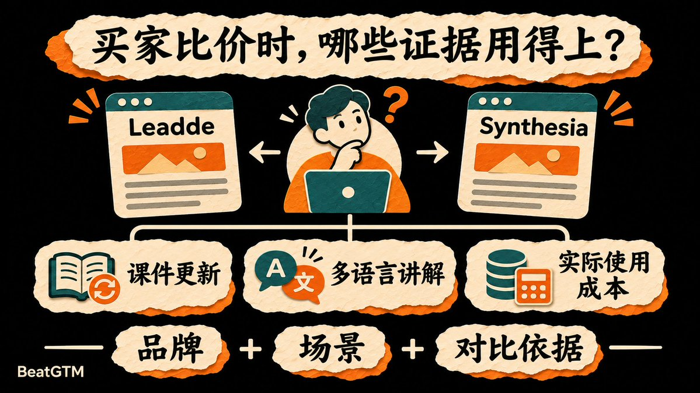

## 五、从 Google 和 AI 的算力账看，为什么这套方法管用

把上面三个核心问题讲完，再换到搜索系统的视角算一笔算力账，就能明白为什么前面这三步这么关键。

搜索引擎和 AI 每天面对几百亿个 URL 和海量 AI 水文。把一个页面变成答案，每一步都在消耗服务器、CPU 和带宽：

发现 URL → 爬虫抓取（Crawling）→ 页面渲染（Rendering）→ 结构解析（Parsing）→ 建立索引（Indexing）→ 语义理解（Semantic Understanding）→ 检索抽取（Retrieval）→ 可信度评估（Trust）

Koray Tuğberk GÜBÜR 和 James Dooley 都提过同一个算力原则：如果两个网站的内容质量差不多，谁让机器抓取、解析和核对身份的算力成本更低，系统就优先抓取谁、推荐谁。

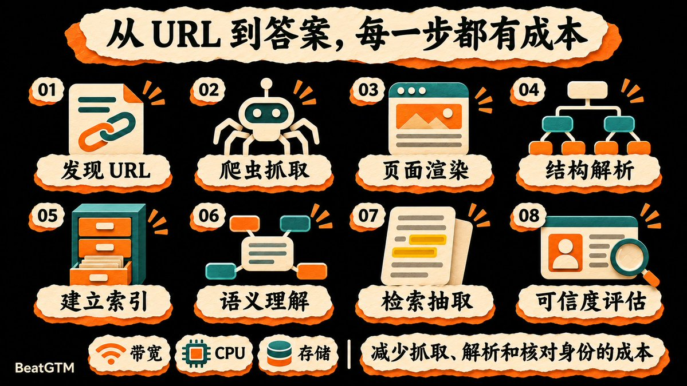

结合 Stephen Burns 在 2026 清迈 SEO 大会 的技术实测、Ahrefs 对 1.4 亿个网站的扫描报告，以及我们自己的诊断经验，很多出海站点排不上去、也不被 AI 引用，往往是卡在了这「三道技术门槛」上：

1. 第一道门：别让防火墙默认设置把 AI 爬虫拦在门外

Stephen Burns 实测发现，目前全网有 35% 的优质网站在站长毫不知情的情况下屏蔽了 AI 爬虫！头号原因就是 Cloudflare 默认开启的防爬拦截设置（Ahrefs 扫描 1.4 亿个网站也发现，有 5.9% 的网站拦截了 GPTBot）。

一定要检查防火墙和 robots.txt，确保放行 OAI-SearchBot、ChatGPT-User、PerplexityBot 和 ClaudeBot。

2. 第二道门：核心正文直出 HTML，别交「纯前端 JS 渲染」和「假 /llms.txt」的白卷

绝大多数 AI 搜索爬虫（包括 ChatGPT 的搜索爬虫）并不会像浏览器那样替你跑复杂的前端 JavaScript。

如果正文和价格表全靠客户端 JS 加载，爬虫抓回去就是白卷。同时还要检查 /llms.txt（专门放给大模型看的纯文本站点说明书）：比如我们实测案例库里另一家 AI 视频公司 Anijam（anijam.ai/llms.txt）时，服务器直接返回了前端 SPA 默认的 HTML 外壳代码，里面连一句产品介绍都没有；

而 Leadde（leadde.ai/llms.txt）虽然返回了 39.7 万字节的纯文本说明，却把 GPT Image 2、GPT Image 2.5 等生图页排在了工具列表最前面，连写给大模型看的站点说明书都在把定位往生图工具上带。

3. 第三道门：省着用 Common Crawl 的 2,500 页抓取预算，清掉重复 URL 和蹭词水文

各大模型训练依赖的 Common Crawl（CCBot），对普通网站的默认抓取预算通常只有约 2,500 页。

如果站内有大量带参数的重复 URL、canonical（规范网址标签）没指对，或者塞了几百篇跟主业无关的蹭词水文，爬虫还没抓到你真正赚钱的核心页，配额就已经耗光了。

所以技术地基（Technical SEO）在 AI 时代照样是底线：机器抓不到、读不懂，前面写得再好也没用。

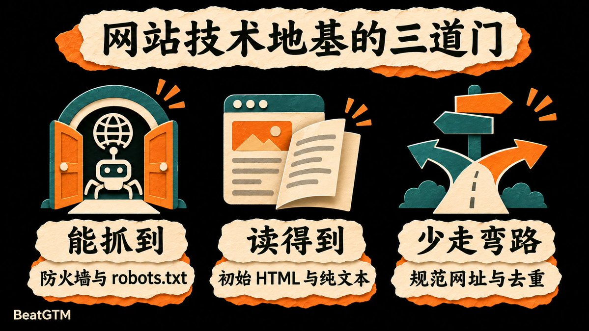

## 六、收束总表：一张图看懂新旧 SEO，附 Entity 网站 6 维自查表

整篇文章说的其实就一条公式：

更低的机器理解成本 + 更高的信息确定性 = 更好的搜索排名与 AI 推荐可见度

现在市面上的新词很多——Entity SEO、Topical SEO、AEO / GEO、Technical SEO、Link Building。

它们看着各自独立，实际上都在替 Google 和 AI 爬虫消除 6 个层面的「不确定性」。

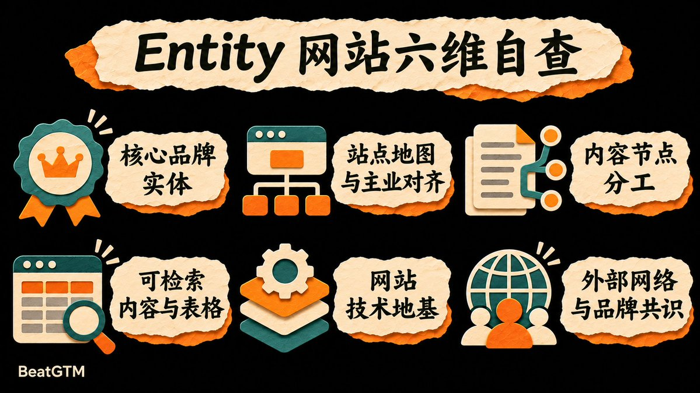

你可以直接拿着自己的网站，按下面这份《Entity 网站 6 维自查表》从头到尾过一遍，哪条答不上来，就先补哪条：

1. 核心品牌实体 → 消除「你到底是谁」的不确定性

自查：官网首页和关于页有没有用一句话（尽量直接写品牌名，少用含糊的“我们”）写清标准品牌名、主营品类、核心付费任务和目标客户？首页、定价页、关于页和外部简介的说法有没有前后打架？

2. 站点地图与主业对齐 → 消除「你到底懂什么」的不确定性

自查：拆开 /sitemap.xml，站内页面和免费工具是围绕核心主业搭出来的主题地图，还是塞了一堆蹭流量的模型页和泛娱乐小工具，把全站主题聚焦度（siteFocusScore）冲散了？

3. 内容节点分工 → 消除「哪一页接哪个问题」的不确定性

自查：围绕主业的高意向选型词裂变出的子问题，是不是都有对应的科普解答页（客观不塞硬广）和选型推荐页（把自己排第一、每段写全品牌名）来回答？已有流量的边缘工具页有没有把访客导回核心付费场景？

4. 可检索内容与表格 → 消除「答案藏在哪里」的不确定性

自查：核心页面的 H2 / H3 是不是直接对应买家问题？首句前 50 词有没有直接给结论、价格量级和适用边界？核心页有没有配齐原生 HTML 对比表格（<table>），让 AI 在 3 个月后还能继续引用？

5. 网站技术地基 → 消除「能不能抓到读懂」的不确定性

自查：Cloudflare 防火墙和 robots.txt 有没有误拦 AI 爬虫？关掉浏览器 JS 后，核心正文、价格和对比表格还在不在？如果有 /llms.txt，返回的是纯文本说明书，还是前端默认 HTML 外壳？

6. 外部网络与品牌共识 → 消除「凭什么信你」的不确定性

自查：除了官网自述（仅 10% 推荐率），站外有没有独立测评（尤其是 YouTube 实测视频）、SaaS 目录站、客户报道和对比榜单替你背书，且描述指向同一个定位？当买家把你和竞品丢给 ChatGPT 比价时，全网有没有足够的对比证据支撑 AI 替你拍板？

### 附一：把这段提示词丢给 Agent，给你的网站做一次 6 维体检

对应上面这 6 条自查表，我整理了一段诊断提示词。复制下面这段话，把网址换成你自己的域名，直接发给能联网读网页的 Claude Code 或 Codex：

```plaintext
你是我的 Entity SEO 与 GEO 诊断顾问。请先读取我的网站首页、定价页、关于页、/sitemap.xml、/robots.txt 和 /llms.txt（如有），对照以下 6 个维度帮我做一次完整的「品牌实体（Entity）」结构体检：

待体检网站域名：
我的核心付费产品与目标客户（一句话）：
我最想拿下的 3-5 个核心商业选型词：
主要竞品（2-3 家）：

请依次输出：
1. 【核心品牌实体（我是谁）】
   - 对比首页、定价页、关于页的 Title/H1/首段，写出机器目前最可能给我贴的「品牌实体身份证（标准品牌名 / 主营品类 / 核心付费任务 / 目标客户）」。
   - 指出站内各页面对「我是谁、卖什么、给谁用」的表述是否存在前后打架、过度使用代词“我们”或空洞口号。

2. 【站点地图与主业对齐（我懂什么）】
   - 拆解 /sitemap.xml 的 URL 目录结构，统计各目录页面数量。
   - 标出哪些页面紧扣主业，哪些属于脱离核心付费业务的「泛流量噪音页」（如无关免费小工具、蹭热点模型页、泛科普水文），评估它们是否在拉低全站主题聚焦度（siteFocusScore）。

3. 【内容节点分工与主题地图缺口（哪一页代表哪个问题）】
   - 围绕我最想拿下的核心商业选型词，模拟 AI 搜索的「问题裂变（Query Fan-out）」，列出买家做决定前必问的 5 个子问题（定义与工作流/候选名单/横向对比/核心场景痛点/价格与合规）。
   - 检查站内是否有对应的科普解答页和选型推荐页承接这 5 个子问题，标出当前命中率（X/5）和缺失页面，并给出存量高流量工具页导回主业的内链建议。

4. 【核心落地页可检索性（答案藏在哪里）】
   - 抽查最重要的 2 个核心功能页或对比页：H2/H3 是否直接对应买家问题？首句前 50 词是否直接给出结论、价格量级和适用边界？
   - 页面是否包含能被机器单独抽走的原生 HTML 对比表格（`<table>`），以及推荐页段落中是否每段都写全了品牌名。

5. 【网站技术地基（能不能抓到读懂）】
   - 检查防火墙与 robots.txt 是否放行 OAI-SearchBot、ChatGPT-User、PerplexityBot、ClaudeBot。
   - 检查不执行复杂前端 JS 时，核心正文、价格和对比表格是否在初始 HTML 中直接可读，以及 /llms.txt 返回的是真纯文本说明书还是前端默认 HTML 外壳。

6. 【最该先改的 3 件事（按优先级排序）】
   - 只挑眼下最值得先动手的 3 个动作：改哪一页（或收紧哪类噪音页、补哪张对比表格/第三方测评）、具体怎么改、改完怎么验收。
   - 只输出诊断报告与改稿建议，不要直接修改线上代码或发布。

```

### 附二：我们也把这套方法做成了一键可用的「出海增长诊断 Skill」

如果你还想把搜索词数据、外链、社媒讨论（YouTube / X / Reddit）和竞品落地页放在一起做更深入的交叉核验，我们也把整套拆解流程做成了一个公开的「出海增长诊断 Skill」，底层调用 BeatAPI 的网页读取、SEO 数据和社媒数据能力，跑完会自动生成一份逐条带原始出处链接的独立 HTML 诊断报告。

可以按这两步直接上手：

1. 先看 GTM 案例库上的真实公司完整报告（ [https://gtm.beatapi.io](https://gtm.beatapi.io/) ）里面整理了几家不同类型 AI 出海公司的增长诊断样本，可以直接点进去对照看。

2. 在工作台一键生成指令，丢给你的 Agent 跑自己的网站或产品（ [https://beatapi.io/zh/case/growth-diagnosis](https://beatapi.io/zh/case/growth-diagnosis) ）已经配好了完整的出海增长诊断 Skill，丢给你的 Agent 就能做一次全面的增长诊断。

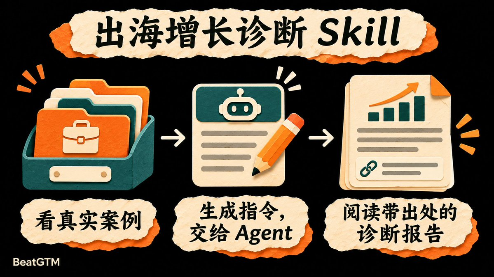

## 写在最后

对绝大多数垂直 AI 产品来说，1,000 个搜核心选型词或让 ChatGPT 比完价进来的精准买家，比 30 万个只来用一次免费工具的路人值钱得多。

关键词、页面、外链和技术地基都还在，只是不再各管各的，现在都要围着品牌实体（Entity）来做。做好一件事就够了：让 Google 和 AI 爬虫用最低的读取成本，一眼认清你是谁，以及你比竞品强在哪。

更完整的出海增长实战手册（6 册 BeatGTM 资料包 + 百问百答），我们都整理在 [BeatGTM 出海增长社群](https://my.feishu.cn/docx/RYjxdhaPtooCxrxOITjcUlalnFe) 里，欢迎带着你自己的网站和问题来交流。

如果这篇对你有帮助，欢迎收藏，或者转给身边正在做 AI 产品、做出海增长的朋友，感谢支持 🙏🏻🙏🏻🙏🏻

我是 KKKK，前私募投资，纯文科转型 AI

现在和团队一起做出海 AI 产品：BeatAPI、BeatDesign、BeatGEO，还有开源的 BeatBrowser

后续会持续更新 AI 产品和出海增长的实战内容，欢迎关注

## 参考资料

1. Koray Tuğberk GÜBÜR (Holistic SEO) — Topical Authority & Semantic SEO（Central Entity 与 Topical Map 核心框架） [https://www.holisticseo.digital/theoretical-seo/topical-authority/](https://www.holisticseo.digital/theoretical-seo/topical-authority/)
2. Jason Barnard (Kalicube) — Entity Home & Brand SERP（品牌实体身份证与三层信任机制） [https://kalicube.com/learning-spaces/faq/entity-seo/what-is-an-entity-home-](https://kalicube.com/learning-spaces/faq/entity-seo/what-is-an-entity-home-) in-seo/
3. Google Content Warehouse API Leak (2024) — Google 搜索内部泄露文档（siteFocusScore、siteRadius 与 NavBoost 机制拆解） [https://ipullrank.com/google-algo-leak](https://ipullrank.com/google-algo-leak)
4. Ahrefs (Sam Oh) — Complete AEO Course: How to Rank in AI Search & LLMs [https://www.youtube.com/watch?v=uza9GX0E2mw](https://www.youtube.com/watch?v=uza9GX0E2mw)
5. Ahrefs (Sam Oh & Patrick Stox) — The New SEO Playbook for AI Search & GEO Ranking Factors（7.5 万品牌相关性与 1.4 亿网站 AI 爬虫拦截实测） [https://www.youtube.com/watch?v=gReszNnykpg](https://www.youtube.com/watch?v=gReszNnykpg)
6. Charles Floate × James Dooley — Entity SEO & Decision Engine Optimization (DEO) in the Age of AI Search（850 个行业 130 万条询盘转化率实测） [https://www.youtube.com/watch?v=2tp9I4wgu5k](https://www.youtube.com/watch?v=2tp9I4wgu5k)
7. 2026 清迈 SEO 大会（Chiang Mai SEO & LLM Mastery）实测复盘（上/下） — 涵盖 Kyle Roof、Michał Suski (Surfer SEO)、Mark McDowell、Stephen Burns 核心实验（英文 SEO 实战派 John & Span 梳理） [https://www.youtube.com/watch?v=tpQV5D3p9ZU](https://www.youtube.com/watch?v=tpQV5D3p9ZU) [https://www.youtube.com/watch?v=WjfGMnJA97g](https://www.youtube.com/watch?v=WjfGMnJA97g)
8. Lenny’s Podcast × Ethan Smith (Graphite) — The Ultimate Guide to Answer Engine Optimization (AEO) [https://www.youtube.com/watch?v=iT7kq-R3Gjc](https://www.youtube.com/watch?v=iT7kq-R3Gjc)
9. JOKER（JOKER 摆运营笼门阵） — 《SEO 的下一次进化：内容，外链，品牌，到底需要进化成什么》 [https://mp.weixin.qq.com/s/ESPeoAGt5TToZrXqVItDyw](https://mp.weixin.qq.com/s/ESPeoAGt5TToZrXqVItDyw)

## 相关页面

- [[sources/google-seo-ranking-factors-2026]]
- [[sources/geektao-krillion-nofollow-comment-links]]
