# 空格.space（@kongge_space）：10 个 Skill 搭建日更爆文的公众号写作系统

> 3 年 400 篇原创创作者系统公开其微信公众号日常高产的 10 个专属 Skill 矩阵：涵盖定位收敛、爆款选题雷达、长文架构路由、去 AI 腔短文、爆款标题安全区评分、2.35:1 封面规范、逻辑图表生成、排版组件以及草稿箱一键入库，实现高频日更与深度质量并存的工业化内容体系。

<!-- more -->

继续聊聊公众号商单和创作。

我做公众号三年，三万粉，最近半年每个月稳定赚一两万。

不多，但胜在稳定。同样的粉丝量，公众号报价一般高于小红书和抖音。

## 公众号为什么更值钱

报价逻辑很简单：平均阅读量乘以二，一万阅读可以报价两万，但要平均一万阅读，至少做到十万粉以上。

商单贵是因为读者值钱，创业者、老板多，决策力消费力强；加上微信的触达和原创保护，文章是在持续积累信用。

小红书抖音像广场，公众号像自己的房间，读者会坐下来认真读，更容易建立长期关系。

## 现在起号更友好

现在推荐机制对新人更友好，选题准、爆一两篇就能起量，但很难靠一篇爆款涨粉过万，得稳扎稳打。

公众号要按年做，我做了三年，停更过三个月，也经历过半年只涨一千粉，攒下的文章和读者信任是做其他平台的基础。擅长文字的话，其他平台可以先不做，把公众号做扎实。

## 我把创作流程做成了 10 个 Skill

做公众号最耗心力的是围绕写作的碎事：选题找方向、标题反复改、配图一张张做、排版调来调去。

我把这些动作做成了 Skill，结合三年四百多篇原创的经验，整理开源，一共 10 个。

1 定位和选题

gzh-positioning｜账号定位：一句话收敛定位，制作吸引读者的简介、关注回复和菜单。

baokuan-article-analysis｜爆款分析：按赛道抓公众号爆款，用真实数据找选题方向。

gzh-explosive-content-detector｜每日爆款：持续收录低粉高阅读文章，看最真实的数据参考。

2 写作

gzh-longform-writer｜长文写作：先问你手上有什么素材，按素材形态路由六种写法。

gzh-short-post｜短文写作：一千字以内纯文字推送，带去 AI 腔风格规则和输出自检。

baokuan-title-generator｜爆款标题：批量生成候选，逐个评分标风险，按场景推荐。

3 配图和封面

space-gzh-cover｜头图封面：2.35:1 封面，带分享安全区校验，防止标题被裁切。

space-chart-image｜图表配图：十类图表，流程图、架构图、思维导图、SWOT 都能出。

space-text-logic-diagram｜逻辑配图：把段落拆成逻辑关系图，六种关系类型。

4 排版

space-wechat-layout｜整篇排版：文章转公众号 HTML，一键复制贴进编辑器。

## 怎么用：我的创作全流程

这些 Skill 不是孤立的工具，它们嵌在我每天的创作流程里。

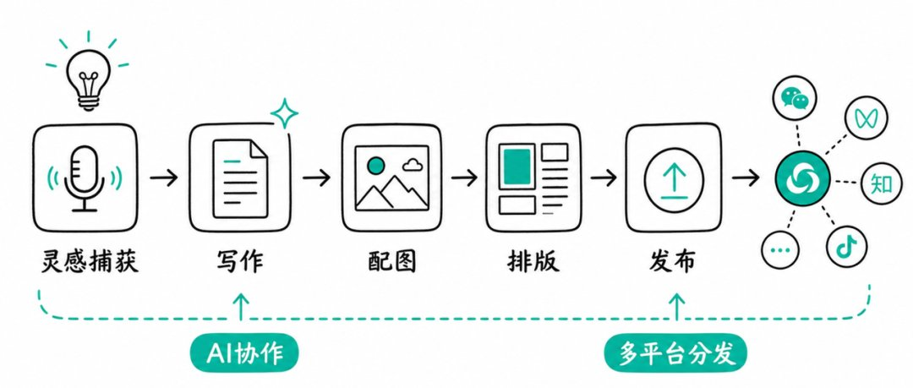

1. 灵感记录

灵感来了用语音输入法说一遍，发给微信文件传输助手，不用管语句通不通顺，记关键词就行。

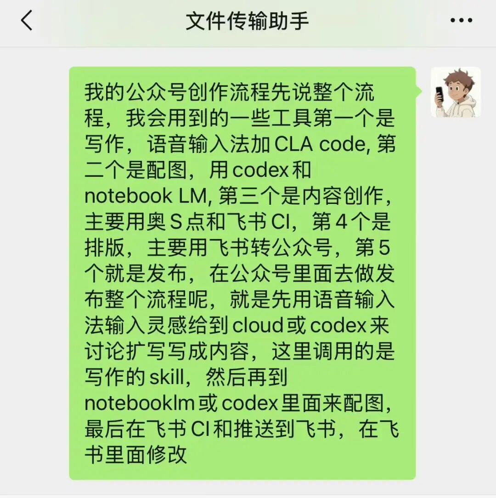

还有一种记录，是把当下感受快速写下来，不懂的概念、词语、案例，全部用 xxx 来代替，下面的写作我会提到怎么来根据这些灵感扩写。

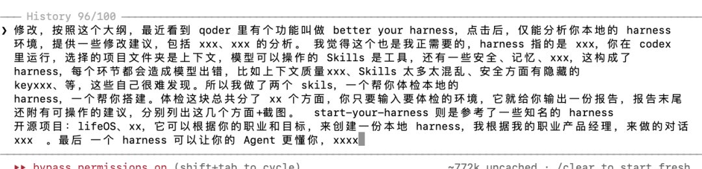

关键是把“想”和“写”分开

灵感捕获和内容生产是两个独立动作，不要放在一起做。好灵感往往来源于情绪波动，愤怒、兴奋、紧张的时候，赶紧记下来。

2. 选题验证

有了方向，用 baokuan-article-analysis 跑一遍赛道关键词，看最近什么选题在涨、哪类标题反复出现。

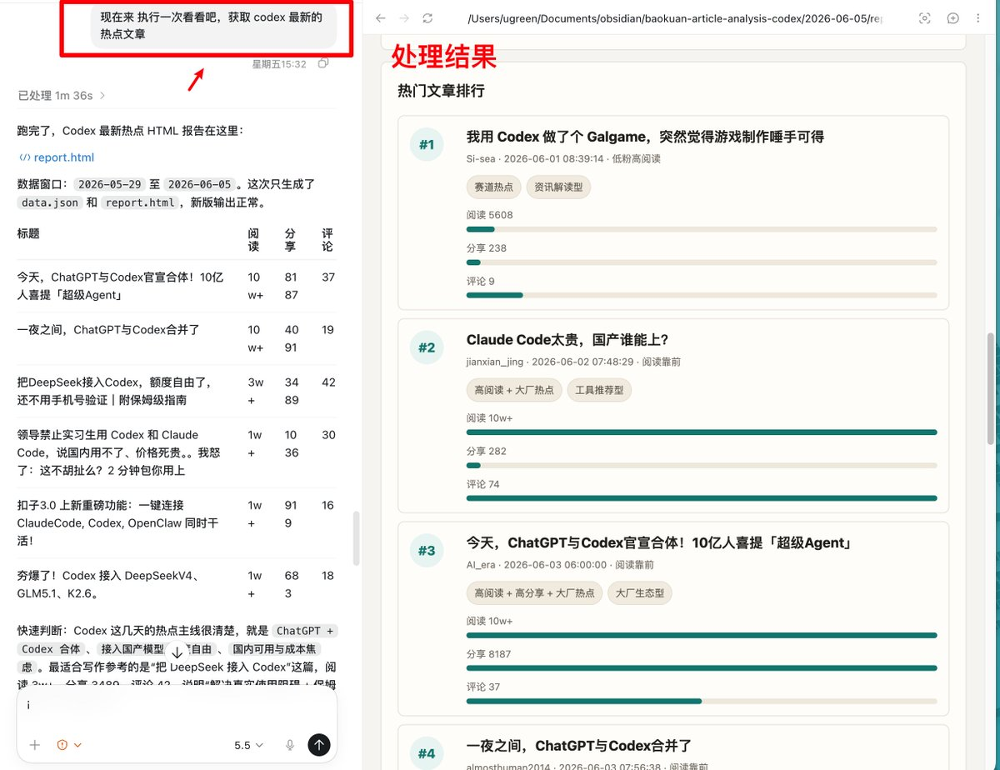

再用 gzh-explosive-content-detector 高阅读的文章，阅读很高，说明选题踩中了真实需求，顺便也能学学别人的写作风格

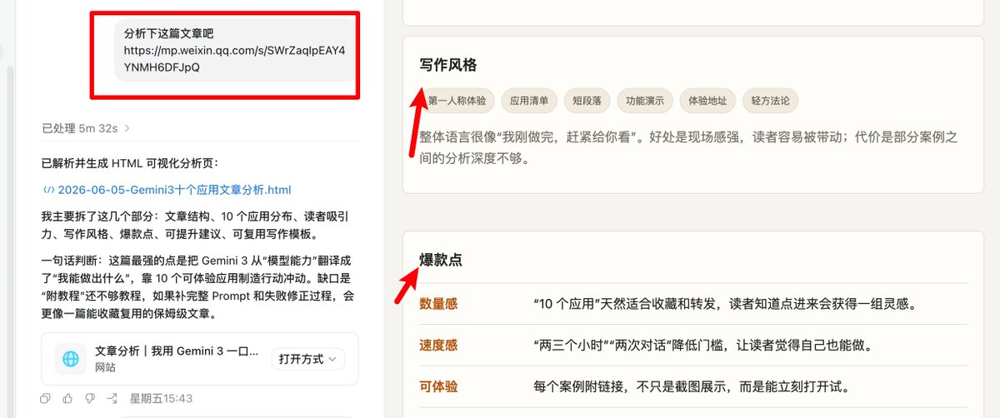

选题是数据和灵感碰撞出来的。

3. 写作

我最常用的是“完形填空式”写法：一口气把文章结构写出来或者语音念出来，遇到想不起的例子、卡壳的解释，直接打 xxx 往下走，保持思路惯性，一停就断。

写完让 gzh-longform-writer 填充 xxx 部分，再自己改。

核心原则：人定骨架，AI 填肉。

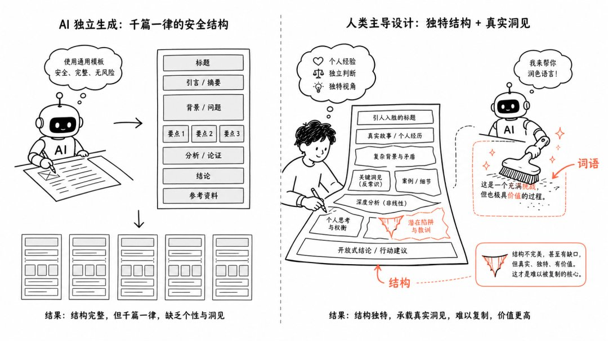

文章的观点、结构、起承转合必须是你的，AI 只负责把你没说完的话说完。

还有一种方法是直接和 Agent 对话来展开写作。

长文用 gzh-longform-writer，它先问你手上有什么，一段口述、几篇笔记还是一堆资料，再按素材形态选写法。

短文用 gzh-short-post，自带去 AI 腔自检。

初稿写完，我会让 AI 来审核挑毛病：有没有活人的思考、节奏有没有起伏、读者有没有信息增益、语气像不像在跟人对话。然后自己改。

4. 标题

定稿后用 baokuan-title-generator 批量出十几个候选，它逐个评分、标注风险，按用途推荐。我挑两三个再自己改一版。

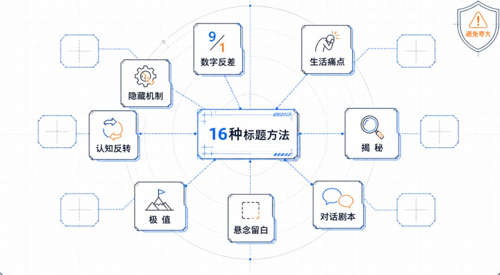

50%靠选题，30%拼标题和封面，剩下 20%才是把话捋顺。别把时间花错地方。

5. 配图和封面

配图用有支持生图的 Agent，比如 codex。

让 space-chart-image 和 space-text-logic-diagram 根据内容出。

讲步骤的出流程图，讲差异的出对比图，讲抽象概念的出逻辑图。

我最常用的就是把整篇文章发给 Agent，让它调用上面的 Skill，根据每段的中心意思出配图，就像这篇文章的配图风格。

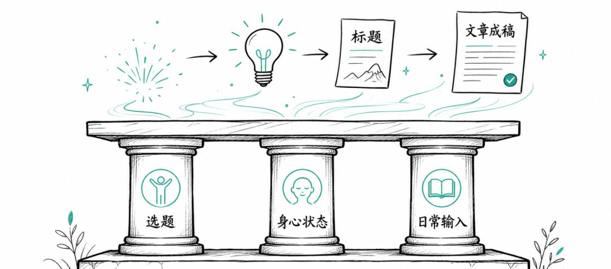

封面用 space-gzh-cover，它会检查分享安全区，避免标题在聊天里被切掉一半。

6. 排版发布

最后用 space-wechat-layout 转成公众号 HTML，预览满意直接复制粘贴到后台。

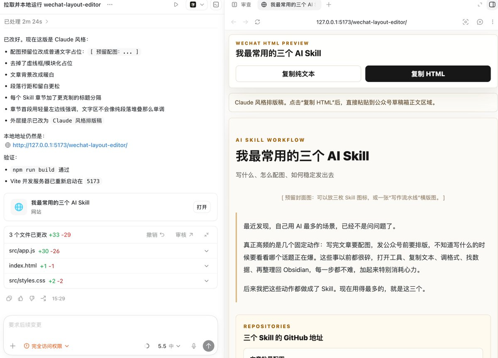

我还做了一个飞书排版的插件，把我推送到飞书里的文章自动转成小红书图文和公众号排版，复制就能用，这个我用的最多。

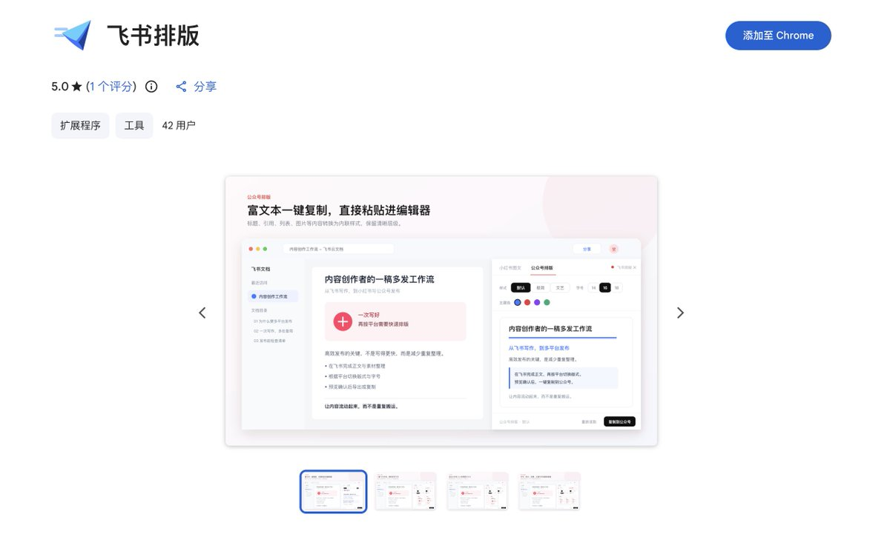

我的习惯是让文章在草稿箱多躺两天。走路、排队时打开手机读一读，刚写完看不出问题，隔一天再读，别扭的地方全出来了。

发布后还会把文章录成视频发 B 站和小红书，一套内容多次使用。

要让这篇文章持续发光发热，我还要做两件事。

第一个是把文章录成视频，我非常建议每个写文章的都可以试试把文章做成视频。

因为是自己写的文章，思绪和表达会非常清晰：

使用 screen studio 录屏，把自己人脸和自己对文章理解都读出来。

视频就投自己的文章页面。

最后用剪映配个字幕，发到 B 站、小红书、抖音。我在 B 站发了不少，浏览量还不错，感兴趣可以关注下❤️

另一个是分发到不同平台。

我主要发的是知乎，有精力的也可以发 CSDN、掘金这些技术社区。

这里用到的工具如下，一键发布所有平台。

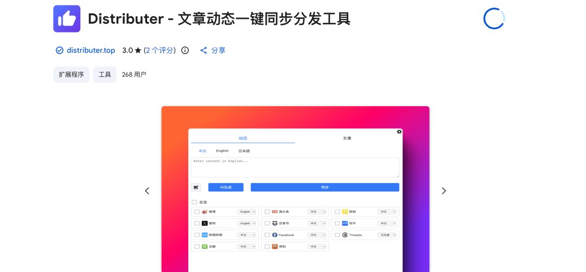

## 最后

在自媒体这行，如果单以“高阅读量”来定义好文章，根据我上面的分析，爆款秘诀很清晰：

50% 靠选题，30% 拼封面和标题，剩下的 20% 才是把话捋顺的基本功。

但很多人把 50% 用在了把话捋顺上面。

最占权重的“选题”不是硬憋出来的，

它源于灵感，而灵感，本质上是“身心状态”与“日常信息输入”的综合反应。

只有当身体是舒服的、情绪是顺畅的，那些你日捕获的信息，才会真正击中你，激发出表达欲。

好的身体、清醒的头脑、以及对热爱领域的信息追踪，才是创作最坚实的底座，创作的第一步是睡好觉。

总结下这篇文章提到的工具：

- 语音输入法：微信、豆包输入法
- AI 写作：Claude 、codex、豆包
- 配图：Codex、Notebook LLM、豆包
- 内容管理：Obsidian、飞书
- 编辑发布：飞书排版插件、一键发布插件
- 录屏和剪辑：screenstudio+剪映

Skill 开源地址：github.com/SpaceZephyr/creator-buddy/tree/main/gzh-Skills

## 相关页面

- [[sources/kongge-creator-buddy-10-wechat-skills]]
- [[sources/xaiwind-codex-20-social-media-skills-one-man-team]]
- [[concepts/agent-skill]]
- [[concepts/selfmedia-compound-model]]
