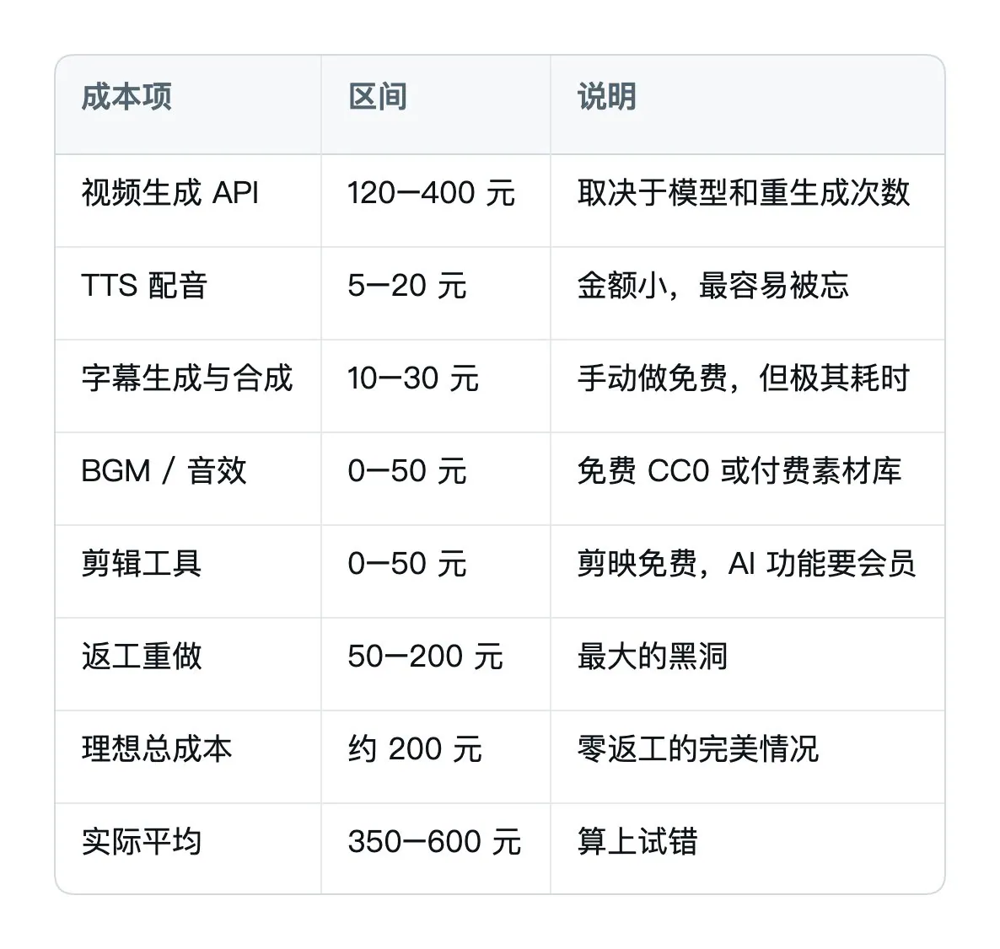
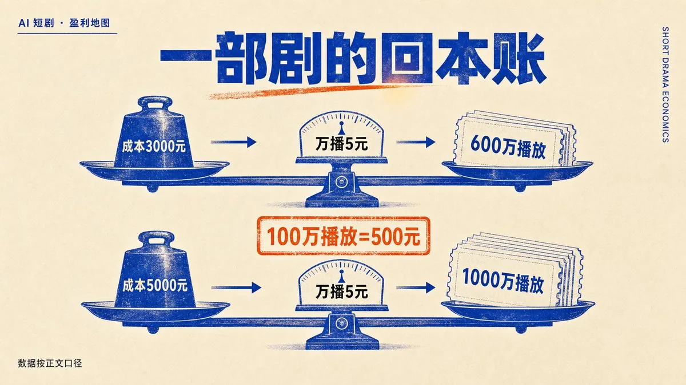
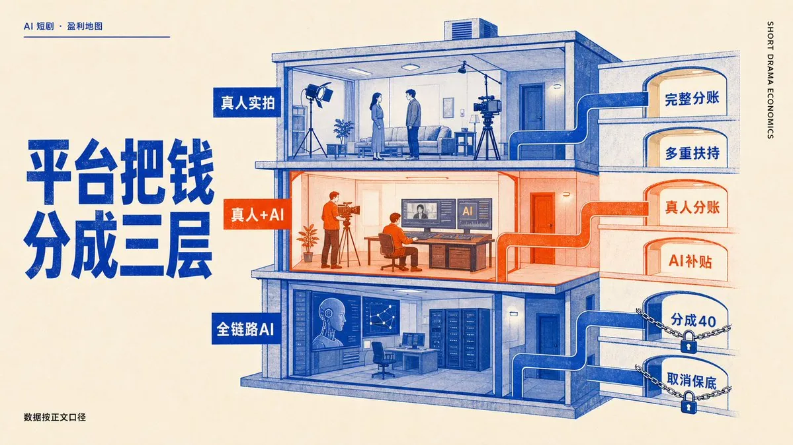
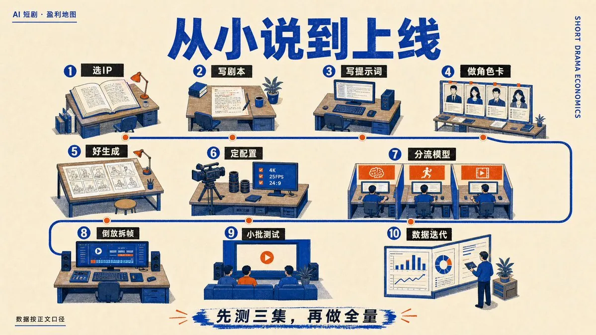
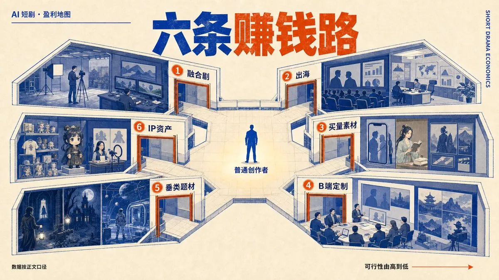

# Kyrie（@KyrieCheungYep）：百万播放只能赚 500 块？AI 短剧真正赚钱的 6 条路与成本账本

> 万字拆解 2026 年 AI 短剧赛道残酷真相与商业破局：揭开万次播放收益从 100 元暴跌至 5 元背后的补贴到期逻辑，巨量引擎与大盘投流日耗 2 亿的平台税本质；用真实账本证明绝大多数纯分账项目注定亏损，指出创作者应该把平台分账当作获客成本，转向商单植入、本地生活定制、品牌代运营、出海译制、高客单 IP 变现与技术服务 6 条真正赚钱的闭环通路。

<!-- more -->

我最近非常认真在研究 AI 短剧这门生意。

动手之前的想法很简单：制作成本砍掉九成，一个人一天能出一部，这么大的效率差摆在那儿，总该有肉吃，这个风口必须跟上。

看到第一周，我把翻到的十几张后台结算截图拼在一起，盯了很久。

一张是 1.8 亿播放，结算 18 万。另一张 2500 万播放，到手 3.3 万。最狠的一张来自一个手搓了 11 部剧的人，累计收益 9 块 6。

你没看错，11 部剧，就 9.6 元。

按理到这儿就该收手了。但同一批材料里还有另一组数字：一个 1982 年出生的前半导体工程师，没有影视背景，没有团队，一个人日更三个半月做完 93 集，播放量 7 亿，收益超过 170 万，纯算力成本不到两万。

同一个赛道，同一个平台，同一年。

这个落差让我眩晕瘫坐在原子弹上，仿佛看到了椅子爆炸。

钱到底流去了哪里？一部剧的账该怎么算？现在哪几个位置还空着？如果你真决定进场，第一个月又该做什么？这篇文章把我扒到的东西一次摊开。

风口叙事我一句都不打算写。我想尽量写好能落地的部分。

##

## 万播从一百块跌到五块，中间隔着一整个招商周期

先把行业的实际温度贴出来。

2026 年一季度，全行业上线短剧约 12.8 万部，其中 AI 占比超过 95%。平均每天有一千三百多部新剧涌进市场，抖音端光是三月一个月就新增了近五万部，一个月的产量追平了 2025 年全年。

产量翻着跟头往上走，流量池没跟着变大。

2025 年 12 月，在播 AI 漫剧超过 5 万部，破亿的 96 部，爆款率 0.18%。到 2026 年 2 月，在播涨到 12 万部，破亿不足 150 部，爆款率跌到 0.117%。DataEye 后来给出的口径更直接：每 1000 部新上线的 AI 漫剧里，只有 1 部能真正跑出来。

收益端的曲线更陡。红果的万次播放收益，去年这个时候还在 100 块上下晃，之后一路滑到 50、30、20，现在大部分项目只剩 5 到 10 块。千次播放收益从 2025 年下半年的 60 元左右，掉到今年的 15 到 30 元。

DataEye 剧查查那边给过三个数字，我觉得是理解整件事最省力的入口：制作端成本下降约 90%，流量成本同比上涨超过 100%，收益端下滑 50% 以上。

三个数字叠在一起，也就解释了为什么很多人效率提高了十倍，钱包却越来越薄。

那钱去哪儿了？

顺着投流这条线往上看就很清楚。巨量引擎一家吃掉约 73% 的短剧投流份额，腾讯广告约 17%，快手约 8%。Seedance 2.0 单月收入已经到 10 亿元，还在爬坡。国内 AI 短剧行业的投流大盘，日消耗超过 2 亿元。

再往下看做剧的人。分销商的毛利率通常只有 1% 到 2%，策略稍微失误就转负。点众科技 2025 年营收 145 亿，公司整体毛利率约 10%，短剧业务净利率不到 1%。近半年投流消耗超过 20 亿的公司只有花笙一家，按最高 5% 的分销利润倒推，半年利润约 1 亿。

投流占了 AI 短剧总流水的七成左右。这是最大的一笔成本，也是最稳定流向平台的一笔。

有句话说得特别准：你花 1000 块做了一部 AI 短剧，想让目标用户看到它，可能得再给平台交 5000 块过路费。

到这儿其实该问一个更根本的问题：红果为什么敢把万播砍到 5 块？

有人算过一笔账，我核了一遍，逻辑成立。红果月活 2.45 亿，人均日使用时长 120.5 分钟，按短视频广告 eCPM 15 到 25 元估算，月广告收入在 50 到 100 亿量级。平台每月新上线约 1000 部短剧，假设每部平均播放 100 万次，合计 10 亿次播放。

万播 100 元，分成总额 100 亿，跟广告收入基本持平，平台一分毛利没有。万播 5 元，分成总额 5 亿，正好对上红果此前披露的单月分账 5 亿元。

这么一算就明白了：万播 100 是扩张期的招商价，万播 5 元才是盈利期的市场价。中间那 95% 的跌幅，由做剧的人买单。

我的判断很明确：这轮下跌更像补贴到期，不能简单算成行业衰退。把补贴当成商业模式的人，被清算得最狠。

而且这一轮里，钱其实没有变少，只是换了流向。同一时期，抖音把原生真人短剧的付费分成从 70% 提到 80%，快手拿出 8 亿探索多元分账、2 亿现金孵化精品、10 亿级专属流量池，腾讯视频全年超 3000 万厂牌激励，优酷单合作方最高 10 万，淘宝推了 AI 剧百万激励计划。

平台在收紧的只是纯 AI 流水线那一条口子，整个赛道并没有被关掉。看懂这个区别，比追热点重要得多。

## 一部剧的账，要算到分钟

聊完大盘，把镜头拉到单部。

我发现一个挺普遍的现象：很多人对 AI 短剧成本的认知，停留在“生成视频花了多少钱”。实际的账要复杂得多，而且有一项支出几乎所有新人都会漏掉。

先看个人手搓一条 3 分钟、50 个镜头的完整成本：

返工那一项才是真正吃钱的地方。经验不足的创作者返工率超过 50%，一个镜头平均要跑两三版才能用，这部分 API 费用全是纯损耗。

往上一档，小工作室做一部漫剧。剧本费加上 AI 工具订阅、渲染和后期人力，压到最低也要三五千。有小团队用自动化把成本卡在两三千一部。再往上，精品 AI 仿真人短剧可以控制在 20 万以内，《斩仙台真人 AI 版》是 12 人团队做 30 天，算力成本 10 万。

现在把成本和万播 5 元这个价格放到一起，算一次回本线。

万播 5 元，意思是每 1 万次播放收 5 块钱。100 万播放等于 500 块。

我特意提一下这个，是因为行业里流传的一个说法在我这儿没通过：不少文章写“按万播 5 元算，需要 100 万播放才能收回成本”。可 100 万播放只有 500 块，连一部三五千成本的剧的零头都不到。

自己按乘法算一遍：成本 3000 元的剧，需要 600 万播放才回本；成本 5000 元的剧，需要 1000 万播放。

而 AI 漫剧目前的平均播放量，大多在几十万到两三百万之间。2025 年的一份统计里，三万多部样本中，全年累计播放不足百万的有 30042 部，占比约 80%。

答案已经写在算式里了：绝大多数纯 AI 项目从上线那一刻起就注定亏损。内容好坏当然重要，但这首先是个数学问题。

再看两笔真实的账。

有位创作者做了三个月、发了 20 条短剧，总播放约 180 万，各平台分成合计不到 900 元，20 条的 API 成本约 2400 元，每条净亏 75 元。他的完播率在 AI 短剧圈算中上。

另一笔更完整：一条悬疑类 3 分钟 48 镜头，单人做 5 天。API 320 元，TTS 12 元，字幕 8 元，剪映会员折算 15 元，总成本约 355 元。第一周分成约 180 元，第二周长尾 60 元，第三周 20 元，收入合计 260 元，净亏 95 元。

但故事没完。这条片子后来被一个本地生活品牌看中，接了三条定制，每条 1500，进账 4500。

这两笔账合起来，就是我对新手最重要的一条判断：纯靠平台分账做通用题材，现在是负期望值的生意，别做。

分账在今天真正的用途，是给你一份能拿出手的作品集，用它去撬后面的商单、定制和 B 端订单。把它当收入来源，会亏得很难看；把它当获客成本，逻辑就通了。

还有个细节值得单拎出来说。AI 短剧的完播率普遍比真人短剧低 30% 到 40%，所有 AI 内容都在同一个降权池里。但有人做过一组对照：同批发布两条 AI 短剧，一条花大量精力调提示词保证角色的脸不变，完播率 42%；另一条完全不纠结画面细节，只死磕剧情节奏，完播率 51%。

观众对 AI 画面的容忍度，比创作者自己想象的高得多。

钱该花在哪儿，这个实验已经给了答案。别把预算全砸在画质上，先救节奏。

##

## 平台把钱分在四个口袋里

搞清楚成本之后，接着要搞清楚钱能从哪儿进来。AI 短剧的收入有四个口径完全不同的来源，很多人只盯着其中一个，然后得出这行不赚钱的结论。

第一个口袋是免费流量分账。你把剧发到红果、抖音这类平台，平台按用户新增有效观看时长乘以一个动态单价跟你结算。单价由平台按免费净收益（广告加免广会员）自己算，非独家合作单价更低。这就是万播五块钱的那个口袋。

第二个口袋是付费充值分账。走抖音原生、抖音和微信小程序，用户充值扣掉渠道成本后按比例分。这里有个数字值得记住：投流回收里 92% 会回给投流方，红果拿 8%，能给到创作者的是付费小程序充值金额的 6%。而漫剧的投流有八成以上是在抖音买流量。这笔账算到底，最赚的还是抖音。

第三个口袋是保底和专项激励，这是目前最容易被低估、金额也最大的一块。

抖音短剧版权中心给 S+ 漫剧 75 万保底分成，保底价 5000 元／分钟，超头部作品最高 3 万／分钟。针对番茄原创 IP 改编的漫剧，版权中心补贴 100% 的改编费用。条件够的创作者有机会零成本做漫剧，还拿 75 万保底。AI 仿真人剧的单部保底最高给到过 360 万。腾讯火龙漫剧的独家内容分账系数 200%，是目前行业最高。爱奇艺把独家漫剧分账比例提到 100%，还开了独立入口。番茄对爆款原著奖励 50 万。

第四个口袋是 B 端和后链路，包括品牌定制、平台定向采买、把短剧当买量素材的后链路转化。稍后单独讲。

四个口袋讲完，还得讲今年最关键的一次规则变化，它直接决定了你现在该往哪个方向做。

2026 年 4 月起，抖音把 AI 仿真人剧的分成系数从 60 砍到 40，动画漫剧从 50 降到 40；5 月全面取消 AI 短剧专项保底；7 月完整的分层分账规则公示。平台给出的“全链路纯 AI”判定标准很明确：无真人演员出镜、无实景实拍，剧本、人物画面、配音全部依靠 AI 生成。

腾讯视频在 1 月就发过类似方案：以真人实拍为核心、AI 只承担剪辑特效辅助的剧集，享受 100% 独家分账加阶梯超额收益补贴；全程无真人的流水线 AI 短剧，削减流量推荐、取消厂牌专项扶持。

爱奇艺是唯一没有下调纯 AI 基础分账的，它设立了独立的 AIGC 内容补贴，但审核端统一收紧，要额外提交 AI 工具溯源材料，AI 剧的审核周期明显变长。

把三家的规则摊在一起，收益明显分成三层：

纯真人实拍，保留完整基础分账，加独家、系列、题材创新的多重扶持；真人实拍加 AI 辅助，不扣任何分成，还能同时申领真人精品激励和 AI 工具补贴；全链路纯 AI，抖音腾讯砍保底降分成，爱奇艺不给真人专项流量。

中间那一层，是我认为 2026 年下半年最被低估的位置。

只要片子里有真人出镜、有实景，剪辑、场景渲染、特效、字幕照样可以交给 AI。这样既能拿真人的分账系数，又能拿 AI 工具补贴。一条走廊，两头都发钱。

这条路的门槛也不高。找一个演员、一个场地，拍够能过判定标准的实拍素材，剩下九成的工作量交给 AI。它比纯 AI 贵，但贵出来的部分平台替你补回来了，而且过审率高得多。

另外还有个小口子，很多人没注意。5 月系数调整后，AI 仿真人剧和 2D、3D 动态漫的分账系数拉平，都是 40。可动态漫不需要用最贵的视频模型就能做，成本更低，审核更松，短剧 Agent 上还有成熟工作流可以直接跑。同样是 40 系数，选难的那条没有道理。

至于该去哪个平台，按身份对号入座就行：

个人新手先上快手加视频号，门槛低、有流量扶持，快手还有算力补贴能把单集成本压到 15 到 30 元；月产 10 到 30 集的中小团队主攻抖音和红果，同时用快手拿中腰部的稳定收益；有量产和质量保证的工作室去谈抖音红果的 S+ 级合作和腾讯火龙的独家；做二次元和原创 IP 的去 B 站加腾讯火龙。

## 从一本小说到一部能上线的剧

这一节可以直接照着做。我按实际制作顺序往下拆。

第一步，选 IP，不用自己硬想

三个免费库：抖音系的番茄小说开放了超过 6 万部 IP，免费改编还有补贴；腾讯系的阅文适合 3D 和古风；百度系的七猫适合男频爽文。

筛选标准就四条：付费榜 TOP50（市场已经验证过付费意愿）、完读率大于 70%（剧情有吸引力）、章节数大于 100（内容够长期连载）、角色鲜明。

那位做出 7 亿播放的创作者，选题方法简单到有点粗暴：只从番茄开放库里挑阅读量极高的头部作品，别的一概不看。他的原话大意是，题材是读者选出来的，读者多，作品肯定就好。做《风水之王》的时候，他连小说第一章都没看完就开工了。

这个偷懒法我认为是对的。你的判断力大概率赢不过几十万读者的投票。

第二步，按短剧的结构写剧本

短剧剧本有几条铁律，不符合的话，画面做得再好，完播率也会垮：

前三秒必须是最狠的冲突。“美丽的早晨，女主角起床了”这种开头直接判死刑，要的是“女主被当众扇了一巴掌，但她没有哭”。

每 60 到 90 秒一个情绪峰值。注意力有衰减曲线，爽点密度决定完播率，完播率决定平台推不推流，推流决定你能不能赚到钱。

前三集结构固定：身份确立、危机爆发、第一个小高潮。观众要在第一集就知道主角是谁、被谁欺负、有没有翻身的可能。

第十集必须大反转，得是真正颠覆预期的那种，小惊喜不算。

每集控制在 1200 到 1500 字，至少两个情绪高点。对白以短句为主，单句不超过 20 个字。

第三步，写提示词时记住三件事

先给 AI 明确的结构锚点，写清楚每一集在哪个位置做什么。

对白风格也要说清楚，而且要动作，不要空形容词。“台词冷静克制、不哭诉只行动”有用，“人物很有魅力”没用。

最后，补一份专门供模型解析的分镜描述。这一条漏得最多，也是角色一致性差的常见原因。每场戏标注场景、情绪基调和镜头建议；角色首次出场时，把服装、发型、面部特征、年龄感一起写进去。

第四步，角色一致性靠角色卡

提前做好角色卡：正面、侧面、表情特写各一张，固定发型、五官、穿搭、配饰。所有分镜都以角色卡为参考，提示词里加上“参考上一张图的角色造型”。同一部剧全程用同一个模型，中途换工具画风必乱。

第五步，让剧本更“好生成”

用同样的工具，有些剧本就是更容易出片，问题往往出在剧本本身：

一场戏控制在 1 到 2 个主要场景，五六个地点 AI 会理解偏。

角色描述放在首次出场，用括号附上，比如（林峰，25 岁，短发，黑色卫衣，面容普通但眼神锐利）。

对白比内心戏好处理，内心独白尽量转成旁白或者外显动作。

动作描写要具体。别写“他很生气”，写“他把杯子摔在桌上，走向门口，停下，没有回头”。越具体，分镜越准。

第六步，定好四项基础配置

画风：都市剧用真人写实，末世爽文用 3D 视觉冲击更强，热血题材真人或写实 3D 都行。画幅：抖音、快手、红果一律竖屏 9:16，B 站和 PC 端才用横屏。旁白：内心戏多的时候开。时长：每集 2 到 3 分钟，太短撑不起情节，太长流量成本高。

第七步，按镜头类型分流模型

这是压返工最有效的一招。

特写和近景，用面部保持最好的模型，保证角色不出戏；全景和场景，用场景还原度高的，保证氛围；运动镜头，用动态流畅的，保证过渡自然。

每个模型只干自己最擅长的活，整体返工率能从 50% 压到 20% 以下。还有个技巧：每个镜头用两个不同的 seed 各发一次请求，选效果好的那版。多花一点点 API 钱，省下的返工时间远不止那点成本。

第八步，学两个野路子

打斗镜头不流畅，就把动作完全拆解，生成一秒一个视频再拼起来，笨，但连贯。

需要有首帧没尾帧的微表情镜头，调转思维用倒放。想要“闸门升起、主角探身微笑”，就让 AI 生成“主角起身、收起笑容、闸门落下”，再在剪辑软件里倒放。

第九步，冷启动不全量

新账号先投 3 到 5 集做测试，看完播率和互动数据，再决定要不要全量投放。抖音和快手流量最大也最卷，红果的漫剧分区竞争强度反而低一些。

第十步，按数据迭代

看完播率、留存率、弹幕热词。同一个剧情做两个不同开场做 A/B，留下完播率高的那版。第一部先别惦记爆款。把流程跑通，看看哪个题材、哪种节奏在这个平台的完播率更高，再顺着数据迭代。

最后说一句产能的现实。个人手搓、还要自己设计各类资产的话，日均产能大概只有 2 分钟内容。一条 3 分钟的短剧，从剧本到提示词到合成，至少要投入 8 到 15 个小时。

算上时间成本，第一个月的时薪可能还不如跑外卖。这话不好听，可你提前知道，总好过做完第一部才发现。

## 真正跑出来的人，差别都在工具之外

我把能找到的成功案例挨个拆了一遍，想看看他们到底强在哪儿。结果有点出乎意料：没有一个人靠选对工具吃饭。

那位前半导体工程师，三个半月日更 93 集，播放 7 亿，收益 170 万。他的流程简单到不像话：看小说、定人物、定场景、生图生视频、后期剪辑，全部当天闭环，几乎不画分镜。他明确反对过度依赖一站式智能体，哪个模型能解决问题就用哪个。要人物一致性，那部剧 80% 的内容用 Vidu；要生活质感，就深用即梦 2.0；新一季则全面接入 Seedance 2.0。

他自己总结的能力模型有三条，其中第二条我觉得最要命：脑内成片。海量阅片量积累下来，读小说文字的时候，运镜方式、景别切换、光影氛围会自动在脑子里完成初剪。

第三条是死磕。《风水之王》纯算力成本不到两万，真正的成本是每天十小时起步的人力。有个只出场一集的老道配角，为了抓到那股既仙气又古怪的神韵，他磕了整整一天，生了几百张图。他说过一句话我记到现在：一旦用了那种高度同质化的脸，整个剧的质感就烂掉了。

再看一对 95 后夫妻。两个人产出六百多集，累计播放 41 亿，作品更新到第九季，全系列有 6 部进了上半年百强榜 TOP15。他们做对的事情是把一个模板做成了世界观工厂。同一个开荒逆袭内核，换个设定就是星际版、兽世版、废土版。

还有一位女性创作者，一个人两天上线一部海外短剧，热度破千万。问她壁垒是什么，她给的答案跟技术和数据都没关系，是情感。她的原话大意是，我宁可让你感到被冒犯、愤怒或者悲伤，只要你能记住我的剧。她最怕的是观众刷完就忘。

还有个反面参照更有意思。一位广告行业出身的创始人，团队几十人，在腾讯视频上线的剧只跑了 100 多万播放，他自己在公开场合承认了。但他为伊利做的商业植入定制剧是最成功的业务。他的结论是团队基因决定路径：如果你是工业化的命，别碰大 IP，成本太高；如果你是小团队又有广告人对出品的执念，工业化本来就不适合你。

最后是那位纯外行。二十年创业试错之后，2025 年 11 月一头扎进 AIGC，两个月做到全网播放破千万。他用的工具原始得可爱：生图 Nano Banana Pro，视频海螺，剪辑剪映，音乐用剪映自带的可商用音频，不会的就去问豆包。专业朋友劝他，专业软件学习成本太高，现在的凑合能用就行。

他的成本账特别有参考价值：第二集一个人埋头三天肝了 55 小时，出了 120 个有效镜头，消耗积分换算成本 2500 元。而且用的还是便宜的 2K 出图、720P 生视频，上 4K 和 1080P 成本不止翻倍。抽卡比例是每个镜头最少 5 张图挑 1 张底图，视频平均抽 3 条选 1 条。

到现在他 0 变现，把送上门的短平快商单都推了，理由是太分心。

这五个人的路径差得很远，手里却都有旧账可吃：阅片量、广告审美、短视频节奏感、对网文的理解。这些东西 AI 一点忙都帮不上。

而且他们不信黑箱。没人把小说丢进一站式工具，然后坐等成片。每个人都在某个细节上磕到不划算，还都做系列，不做单部。

工具变了，手艺没法变。这句话我原本觉得是句正确的废话，扒完这些案例，我改主意了。

## 六个还没被占满的位置

账算完了，再看机会。我按可行性从高到低排，也把成本量级和启动路径写清楚。

第一个，真人实拍加 AI 辅助的融合剧

前面讲过的政策套利。真人出镜加实景，AI 负责剪辑、场景渲染、特效、字幕，分账系数按真人算，还能叠加 AI 工具补贴，过审率也高一大截。

现在市场上大部分人还在纯 AI 那条被砍的路上死磕，做融合的反而人少。启动成本大概是找一个演员加一个场地，比纯 AI 贵几千块，但贵出来的钱平台在替你补。

我把这个排第一，是因为它是唯一一个规则明确写着“我给你更多钱”的方向。

第二个，出海，而且有三条腿可以走

最稳的一条是给 TikTok 做承制方。很多真人实拍公司转型时第一个接到的就是出海订单，除去抽成能拿到 100 到 150 元的利润空间，纯保底、无分账，但胜在稳定，不用赌。

第二条是拿 TikTok 的分成。它 2026 年一季度总分成突破 2400 万美元，其中本土剧 1200 万、翻译剧 1000 万，AI 短剧赛道 200 万美元，首次进入公开战报，季度增幅超过 6 倍。这个基数还小，但增速摆在那里。

第三条是自己发行或者合作平台。海外微短剧 2025 年综合产业规模约 40 亿美元，2026 年预计超 50 亿。

出海有几个数字必须先记住，不然会亏得莫名其妙：

收入和下载完全是两张地图。内购收入里美国占 60.1%、日本 7.3%、英国 2.6%；下载量里印度占 31.5%、巴西 13.2%、印尼 12.6%。想赚钱看欧美日，想要量看新兴市场，两套打法不能混。

业内通常这么算回本：一部投资 15 万美元的剧，大约要投到 150 万美元才能回本。结果就是，80% 到 90% 的出海剧收不回成本。海外投放不看单日消耗，看买进来的用户能贡献多少长期价值。平台先定一个 60 天或 90 天的回本周期，再按周期倒推 ROI，很多平台把线画在 0.3、0.4。

AI 译制把本土化成本从 5 万人民币压到了 3000 以内，这是目前最实在的一个红利。

要清醒的是，出海也在给 Google 和 Meta 交租，投流依然占 70% 到 80%。换个地图并不能躺赚，它只是把绞肉机换了个型号。但相比国内，它的竞争密度确实还低。

同时也可以看看我之前对东南亚市场 AI 短剧的赚钱机会解析。

引用推文：Kyrie (@KyrieCheungYep)

https://t.co/6id6bUdNWC

https://x.com/KyrieCheungYep/status/2080133281832677506

第三个，把短剧当买量素材，赚后链路的钱

这条路藏得最深，也最稳。有 IP 储备的公司把小说或者游戏的高能片段用 AI 快速做成短剧，投到抖音快手，用户点进来直接跳转 APP。利润不在短剧本身，在后链路的付费阅读和游戏充值。

所以有些 AI 短剧你看完也想不通它靠什么赚钱。答案很简单：人家压根没打算靠短剧本身赚钱。

如果你手上有任何一个需要买量的产品，或者能接到网文和游戏公司的单子，这条路的确定性比赌爆款高一个量级。

第四个，B 端定制和文旅

这是目前 AI 短剧真正能收到现金的地方。品牌剧情类短剧，新人一条报价 500 到 2000 元，有粉丝基础的能报 3000 到 8000，成熟工作室的单集商单在 5000 到 5 万之间。平台的定向采买，反诈、文旅这类题材，单集 500 到 5000 元，是稳定的订单源。私域定制更碎但也更好起步，情侣纪念、个人故事这种，单条 500 到 2000。

文旅是被严重低估的一块。已经有导演在专攻历史名人 IP，接到了地方文旅的“项羽传”和商业定制的“刘邦传”。全国各地的古代名人做一遍，这活儿能干很久，而且甲方付钱、不用你赌流量。

品牌方不会因为你用了 AI 就买单，他们买的是有流量的内容。前面那句“分账当获客成本”，到这里才真正闭环：先用几百块一条的自制剧攒作品集，再拿作品集去接几千块一条的定制。

第五个，垂类的容忍度套利

悬疑、恐怖、科幻这三个类型，观众对画面真实感的要求本来就不高，对创意和氛围的要求高，恰好是 AI 现在的强项。有做悬疑的账号，平均播放量比同粉丝量的都市情感号高出将近一倍。

他的做法很直白：每集控制在 90 秒以内，用快节奏盖住画面瑕疵，前 5 秒必须抛出悬念钩子，完播率稳定在 45% 以上。

反过来说，都市情感和甜宠这类高度依赖微表情的题材，现在做 AI 版是自找麻烦。AI 在眼神游移和情绪传递上的短板，在这类题材里会被放到最大。

第六个，系列化和 IP 资产

高频季播在漫剧里已经是常态。有部改编自起点的作品，2026 年 2 月 2 日上线首季，十几天后第二季接档，现在更新到第 24 季。有新剧第二季的预约量做到 250 万，超过绝大多数真人短剧。

真人短剧的爆款生命周期以天计算，漫剧以季计算。这个差别的商业含义是：真人剧在做流水，漫剧在做资产。

而且 AI 生成的 IP 形象是永恒的、独属于版权方的。真人演员会疲劳、有档期、会涨价，AI 角色不会。往下延伸就是 IP 授权（手办、联名，毛利率 50% 到 80%，头部 IP 年均授权收入超 200 万）、剧本杀、主题展、直播带货。

已经有 AI 短剧里孵化出的虚拟角色长出了独立的商业生命：有自己的粉丝群，开始直播带货，产生剧外收入。

还有一种活法没排进这六个位置：卖课。行业里有个公开的秘密，转型做 AI 短剧培训，半年利润能做到亲自做剧的八倍。我知道它赚钱，但我不推荐。市面上大部分课程教的东西，网上就能直接搜到，用的也是那几个常见应用。有人花 7800 元买课，又花近一万做出一部剧，结果每集播放连一千都难。

赚这种钱，你的复购在第一天就没了。

## 备案、拒收、涨价、尾款：四道最容易翻车的关口

机会讲完，坑也得讲透。下面每一条，都有人真金白银栽过。

备案这关，先算时间再排期。

广电总局 2026 年 6 月 25 日发布了 AI 微短剧分类分层标准，7 月 1 日施行。“先备案后上线”落地后，投资额超过 100 万元的微短剧必须报省级广电备案，审核周期 7 到 15 个工作日。存量作品没在期限内完成备案补审的，全网强制下线。AI 生成内容还要设醒目标识。

个人创作者的备案门槛不低。排期的时候把这半个月算进去，别等成片了才想起来。

过审这关，是现在最要命的一关。

红果的剧本过稿率从此前的约 30% 一路跌到 7.5%。拿保底的 AI 剧审核严到逐帧的程度，机位、光影、镜头语言全要过。有团队一部剧改了三次直接被判全面不通过，再也上不了线，人力算力全打水漂。

甚至有工作室主动要求取消保底，只求审核松一点。一线从业者说得很直白：现在大家先操心能不能上线，赚钱都排到后面去了。

拒收这关，能把你一次打回原点。

有个真实的例子我印象很深。一位创业者接了两部“跑量”的言情剧，把真人剧转成 AI 剧，一部 150 分钟一部 109 分钟，团队干了半个月。第 1 集样片、前 3 集、前 10 集都顺利通过，等 259 分钟全部做完，才被告知平台拒收。

光算力成本就花掉 24000 元，加上半个月人力，这两部剧亏了 11 万多，团队从 12 人缩回 4 人。

这件事只留下一条硬规则：分段验收，每一段都拿到书面确认。宁可慢一点，也别一口气做完再送审。

算力涨价这关，会悄悄吃掉你的毛利。

即梦 Seedance 2.0 的会员从“299 元 15000 积分”变成“499 元 5870 积分”。原来 15000 积分能生成约 30 分钟视频，现在 5870 积分只够 7 分钟左右。同一个人做一集漫剧的成本，从三月的 17 到 19 元涨到了 80 到 100 元。

有位从业者总结出一个悖论：AI 越普及、技术越先进，创作成本反而越高，赚的钱越少。2025 年充一百来块的会员能生成成千上万张图；到 2026 年涉及视频和高质量图，每月花几千元很正常。

报价的时候把算力涨价的风险写进合同，或者干脆按积分消耗结算。

承制这条路，我建议直接绕开。

AI 精品漫的承制单价从 2024 年的每分钟 3000 到 5000 元，一路跳水到 500 到 1000，有人卷到 200，甚至更低还有人抢单。层层分包之后，真正干活的承制方可能只拿到每分钟 50 到 100 元。

承制就是平台给剧本、你负责制作。你看不到后台数据，也绑不了自家厂牌，本质上还是外包。有位工作室创始人跟团队说得很直接：做承制没有出路。

自制是自立厂牌、自负盈亏，搏的是后期分账，收益没有上限，风险当然也更高。但以小博大一直是这个行业的核心游戏规则，不接受这条，就很难拿到大结果。

尾款和骗稿，签合同前把条款读三遍。

同行之间流传的警告是：千万别信“上线后结尾款”这套。也有甲方以不可抗力、验收不过关为由拒付。抄袭纠纷更是连环罗生门，某家的爆款上线不久被指抄袭，指控方随后又被第三家点名 1:1 复制。

最后一个坑是投流，新手请直接跳过。

漫剧用户 65% 是男性、85% 是年轻人，和短剧受众的重合度只有 38%。这意味着你没法沿着短剧或者二次元的路径去找用户。有制作公司前期投流 6 万元，只换回 1000 元的付费转化，难点就在找不准用户池。

成熟投流团队的常规 ROI 稳定在 1.03 到 1.07 的微利区间，大量普通项目的 ROI 已经低于 0.8。没有 IP、没有投流经验的普通人，ROI 普遍低于 0.5。

这是一个需要资金量、数据积累和试错预算的专业活。新手把钱投进去，基本等同于捐款。

## 如果只给你三十天

写到这儿，我把这两个月的判断压成一条最小路径。它不保证赚钱，但至少能把试错成本关在笼子里。三十天后，你手里也能留下点东西。

第 1 到 3 天，定方向。

选平台：个人从快手加视频号起步，或者直奔红果的漫剧分区。选形态：优先考虑真人加 AI 辅助，如果实在没有实拍条件，退而求其次做 2D／3D 动态漫，别一上来就啃最卷的仿真人。选题材：从悬疑、恐怖、科幻里挑一个，避开都市情感。

第 4 到 7 天，写剧本，只写一部 30 集的大纲加前 3 集完整剧本。

去番茄付费榜 TOP50 里挑一本完读率高于 70%、章节数过百的书，申请改编。按前面那套结构锚点写：前 3 秒最狠冲突，每 60 到 90 秒一个情绪峰值，第 10 集大反转。角色卡在这一步一起做完。

第 8 到 15 天，只做前 3 集。

按镜头类型分流模型，每个镜头两个 seed 选优。目标是把单集成本压在 300 元以内，返工率压到 20% 以下。做完发出去，测完播率。

第 16 到 25 天，看数据改。

完播率低于 40% 就回去改节奏，别改画质。改完补到 10 集，看留存和弹幕热词，确定这个题材在这个平台走不走得通。

第 26 到 30 天，拿着这 10 集去接第一单。

去找本地生活商家、中小品牌、文旅项目，报价从 1500 一条开始。这一步才是真正的收入起点。

整个三十天的现金投入，大概在三千到五千之间。我认为这笔学费还算合理。花到一万还没跑通，就该停下来看看哪一步出了问题。

最后说点判断。

行业里对下一波窗口有个说法我比较认同：从现在到 Seedance 2.0 出现大版本更新、或者出现超越它的新工具落地之前，这段时间属于超级个体的窗口期。工具更新一次，所有人的经验值就要重新洗一遍，而现在这套工作流已经稳定了小半年，正是把它跑熟的时候。

至于赚钱这件事，我最后只想留下一个判断：AI 把生产成本打到了地板，却把“被看见”的成本抬得更高。

技术平权的另一面是技术贬值。当所有人都能用同一套模型、跑同一个工作流、喂同一批提示词，会用工具这件事就不再是壁垒。

真正的壁垒在哪儿，我在那五个跑出来的人身上看到了同一个答案：在你对故事的理解深度，在你愿意为一个只出场一集的配角磕上一整天的那股劲儿，在你敢不敢做出让观众生气、但记得住的东西。

AI 能帮你画图、配音、剪辑。它没法替你决定这个故事值不值得讲。

万播五块钱的时代，最会用 AI 的人未必能留在牌桌上。

最懂人性的那批人，机会更大。

关于作者

Kyrie — 前国内大厂 R&D 工程师，现居曼谷，做中国科技企业出海 BD。持续分享出海一线真实记录、AI 在业务里的实战用法，偶尔也聊聊美股投资和国外生活。

- X：.[@KyrieCheungYep](https://x.com/@KyrieCheungYep)

## 相关页面

- [[sources/luffy-19yo-ai-tiktok-dance-girl-7-prompts]]
- [[sources/xilo-codex-knowledge-video-editing-ab-roll-method]]
- [[concepts/selfmedia-compound-model]]
- [[concepts/b2c-conversion]]
