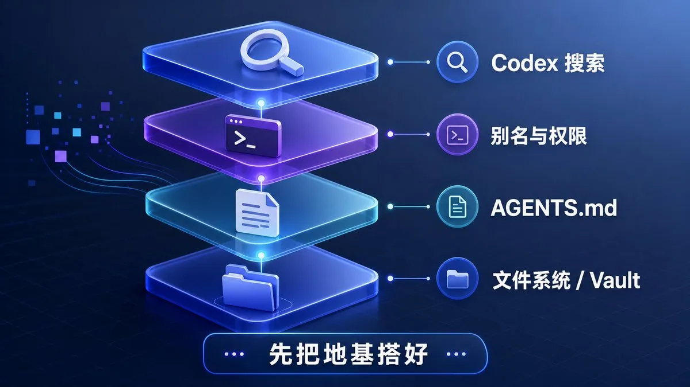
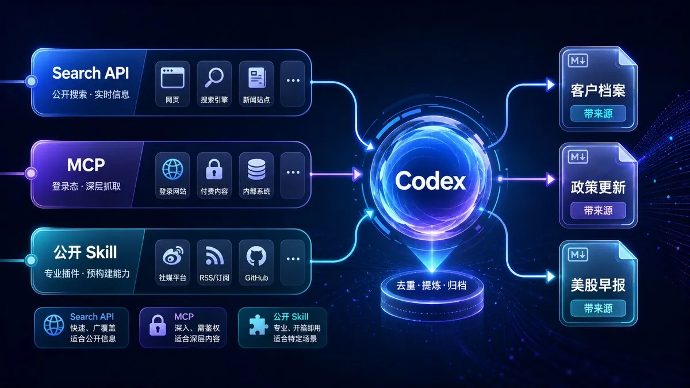
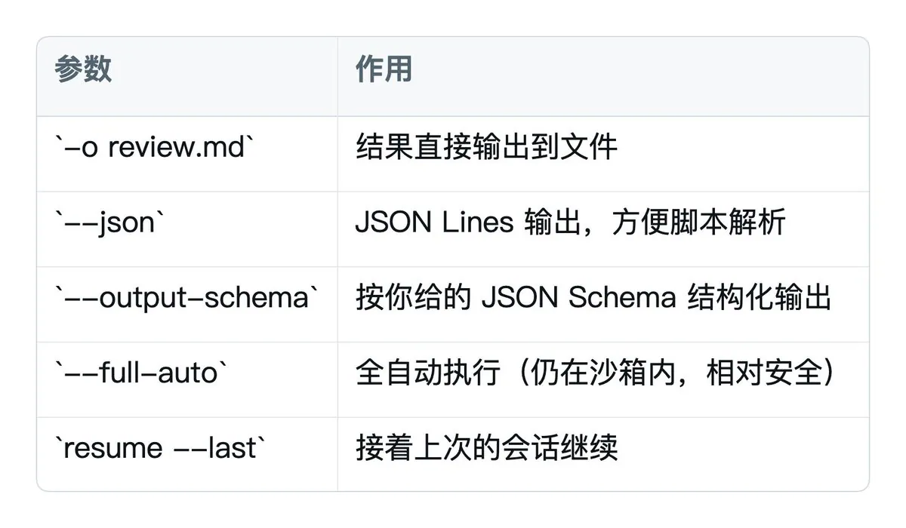

# Kyrie（@KyrieCheungYep）：每天省下 3 小时——用 Codex 搭建客户背调、政策追踪与美学盯盘自动化信息流水线

> 前大厂研发转型曼谷出海 BD 的实战沉淀：利用 Codex CLI 终结手动复制粘贴信息检索。制定 AGENTS.md 强制溯源规约与三档别名，接通 Playwright 与 Bright Data MCP 复用登录态，运行客户多角度背调、政策定点 Schema 抽取与美股简报，并沉淀为自动触发的 Skill 与定时 Automations 机制。

<!-- more -->

我每天早上打开电脑，做的第一件事：

查客户：这家公司最近有什么动作、融资、招聘、负面； 看政策：跟我业务相关的监管、补贴、行业文件有没有更新； 扫美股：我关注的领域，昨晚发生了什么，有没有要紧的新闻和数据。

这三个事情有个共同点：重复、零碎、每天都要做。单独看每一条，又都不值得你花半小时。我一开始是开十几个标签页，搜一圈，复制粘贴到 Obsidian，再手动整理。一套下来一两个小时就没了，第二天还得再来。


我把这套活交给了 Codex。早上喝咖啡的时候，它已经把昨晚的客户动态、政策更新、美股要闻整理成 Markdown，放进我的 vault，每条都带原文链接。

我会把我用的这套方法完整拆解给大家。少讲概念，多给流程，看完就能自己搭一版。

###

### 一、为什么用 Codex？

很多人觉得：信息收集，我直接问 ChatGPT 不就行了？

差别挺大。聊天框里的 AI 是你问一句、它答一句，结果留在对话里，你还得手动搬运。Codex 多了一层关键能力：它能在你电脑上干活。它能读文件、改文件、跑命令、联网搜、通过 MCP 协议连外部工具，最后把结果直接写进你指定的目录。

这里有个经常被低估的事实：你的终端本来就能看到你电脑上的一切。Obsidian 笔记就是一堆 Markdown 文件，你 cd 进 vault，Codex 就能直接读写它们。没有插件，没有 API key，也不用复制粘贴。一个长期住在 Cursor 里的开发者就是因为这一点转向了 Codex CLI：每次想让 AI 帮他理笔记，要么把整个 vault 拖进编辑器，要么来回复制上下文，烦得要死。后来他发现，那些摩擦其实是自己加出来的。

在找信息这件事上，Codex 强到什么程度？一位 OpenAI 内部研究员，一个月能烧掉一万美金 API 费用的重度用户，这么形容它：

“Codex 就是一个极其出色的搜索引擎。”

他让 Codex 做调研时，它会自己翻相关 Slack 频道、读讨论、拉出别人提到的实验分支、看截图、翻文档和表格，最后汇总成一份带链接的笔记。每条信息都会标注来源。他用这套方法在几个小时内生成了 700 多条可验证的假设。他大致的判断是：在容易犯错、代价又高的场景里，你需要一个很勤快、召回率很高的搜索代理。

这正好对应信息收集最麻烦的三件事：尽量搜全、能追到来源、最后能变成可用文件。Codex 在这三件事上都好用。

###

### 二、五句心法：把 Codex 从工具变成队友

动手前，先把 OpenAI 官方最佳实践里最有用的部分记住。核心很简单：不要把 Codex 当一次性助手，要把它配置成一个长期跟着你工作的队友。

具体有五点：

1. 先给足上下文，别让 Codex 猜你的意思；
2. 用 AGENTS.md 做长期指导，把它调成贴合你工作流的样子；
3. 用 MCP 连接外部系统，少做复制粘贴；
4. 把重复工作抽成 Skill，别反复输入同一段提示词；
5. 把稳定流程做成自动化，把固定动作交出去。

还有一个区分要记住：

Skill 定义怎么做，Automation 定义什么时候做。

对应到信息收集，就是一条升级路径：先教会它怎么搜，给它联网的眼睛，再把搜法固化成 Skill，最后让它定时自己跑。下面一段段来。

###

### 三、搭地基：把 Codex 调成你的信息收集助手

3. 1 给它写一份岗位说明书：AGENTS.md

AGENTS.md 是 Codex 的入职手册，每次启动会自动加载。它会影响 Codex 怎么理解你的需求。做信息收集时，我在 vault 根目录放了这么一份：

```markdown
# 信息收集助手指南

## 我是谁、我要什么
- 我做销售，长期关注：客户公司动态、行业政策、美股。
- 所有产出用中文，存成 Markdown，放到对应目录。

## 收集铁律
- 每一条信息必须附原文链接，无法溯源的不要写。
- 区分“事实”和“推测”，推测要单独标出来。
- 优先最近 7 天的信息，旧信息要标注日期。
- 输出统一用表格 + 简短要点，方便我一眼扫完。

## 目录约定
- 客户调研：`02_客户/<公司名>.md`
- 政策更新：`03_政策/<日期>.md`
- 美股盯盘：`04_美股/<日期>.md`

## 禁止
- 不要编造数据和引用。
- 不要把推测当事实写。
```

注意这几条：每一条必须附链接，区分事实与推测，无法溯源就不写。它们能把 Codex 从会认真胡说的助手，拉回到相对可靠的调研员位置。

小技巧：直接在 Codex 里敲 /init，它会帮你生成一份基础版 AGENTS.md，你再改。

3. 2 配几个顺手的别名

不同场景需要不同配置，用别名会省很多事。可以加到 ~/.zshrc：

```bash
# 日常调研：高推理 + 实时联网搜索
alias cx='codex -c model_reasoning_effort="high" --search'

# 只读分析：纯收集、不改任何文件，最安全
alias cxr='codex --sandbox read-only --ask-for-approval never --search'

# 脚本/自动化：非交互模式
alias cxx='codex exec'
```

这里要分清楚权限。--search 只让 Codex 通过官方搜索 API 联网，不能直接访问任意 URL。完全网络访问，也就是 Full Access，才会允许它执行 curl 访问任意资源。日常信息收集一般用 --search 就够了，能查最新内容，也不会把网络权限放得太开。



###

### 四、用 MCP 把实时网络接进来

--search 解决的是查得到。很多场景还需要更具体的能力：抓某个网页的结构化数据，用你已登录的浏览器读取页面，或者调用专业行情和新闻数据源。这时就要用 MCP，Model Context Protocol。

MCP 是 Codex 连接外部工具的标准协议。接上之后，Codex 不只是文件编辑器，也能操作你的信息工具链。

4. 1 两种配置方式

Codex 的 MCP 配置在 ~/.codex/config.toml。常见有两种加法：

```bash
# 方式一：命令行（适合新手）
codex mcp add context7 -- npx -y @upstash/context7-mcp
codex mcp list      # 查看已配置的

# 方式二：直接编辑 ~/.codex/config.toml（适合老手）
```

```toml
# STDIO 类型（本地工具，如抓取/浏览器）
[mcp_servers.brightData]
command = "npx"
args = ["-y", "@brightdata/mcp"]
env = { "API_TOKEN" = "你的token", "PRO_MODE" = "true" }
```

4. 2 用你已登录的浏览器去抓

很多有价值的信息藏在登录墙后面。这里有个门槛很低的方案：Playwright MCP 加你现有的浏览器会话，不需要额外 API key。

```toml
[mcp_servers.playwright]
command = "npx"
args = ["@playwright/mcp@latest", "--extension"]
```

配好之后，Codex 就能复用你 Chrome 里已经登录的身份，打开页面、读取内容、把结果存进 Markdown。有人就用这招把自己 Linear 里的待办任务自动同步进 Obsidian：让 Codex 打开页面，等加载，读取任务标题和编号，再带链接存成 Tasks.md。最后文件里看到的内容，和网页里看到的基本一致。

把 Linear 任务换成你常看的客户情报站、需要登录的政策数据库、券商持仓页，逻辑是一样的。

4. 3 抓网页结构化数据

如果你要的是把某个页面抓成干净的结构化数据，可以接 Web 类 MCP，比如 Bright Data 这种带 search_engine、scrape_as_markdown 工具的。一个真实例子：让 Codex 抓某商品页，存成 product.json，再写个脚本读出来处理。整个过程里，Codex 自己选工具、自己抓、自己存、自己验证格式，拿到的是网页里的真实数据。

简单说，--search 让它知道哪里有信息，MCP 让它把信息拿回来。

4. 4 别自己造轮子：先看看有没有公开 Skill

MCP 是底层管道，但你不用每个数据源都自己接。社区里已经有不少打包好的公开 Skill，装上就能用。对信息收集来说，我会优先找那种能覆盖多个平台的工具，比如 Agent Reach。

Agent Reach 把十几个平台封装成 Codex 能直接调用的命令：搜索引擎、小红书、微博、抖音、B 站、推特、Reddit、V2EX、LinkedIn、GitHub、公众号文章、网页、RSS、YouTube、播客。装好之后，你不用关心每个平台怎么抓、怎么处理登录，直接跟 Codex 说人话就行：

```
去小红书和微博搜“XX科技”最近一个月的讨论，挑出有信息量的，带链接列给我
把这个公众号最新 3 篇文章读出来，各总结 5 个要点
看看 Reddit 和推特上关于 NVDA 的讨论，情绪偏多还是偏空
```

它会自动调 Agent Reach 去对应平台抓，再按你 AGENTS.md 里的规矩写入文件。这对我那三个场景挺合适：

- 客户：去小红书、微博、脉脉、LinkedIn 看公司口碑、员工吐槽、招聘信号。这些软信息在工商数据里一般看不到；
- 政策：盯相关公众号和 RSS，自动拉最新发文；
- 美股：扫推特和 Reddit 的讨论热度，补上新闻之外的情绪面。

怎么找这类公开 Skill：

- 上 mcpmarket.com、ComposioHQ/awesome-codex-skills 这类聚合站，先搜一圈。信息收集相关的 Skill 已经不少，比如 research-collector、lead-research-assistant、content-research-writer；
- 找到后丢进 ~/.codex/skills/<技能名>/，重启 Codex 就会自动识别；
- 嫌麻烦的话，把仓库链接发给 Codex，让它帮你装。

我的习惯是先搜有没有现成的，再考虑自己接 MCP。别人已经趟过的坑，没必要再踩一遍。



###

### 五、三个日常真实场景

地基搭好了，直接看实战。下面三个就是我每天真在跑的，prompt 可以直接抄改。

场景一：客户信息：多角度背调，每条带来源

我接触一个新客户，最想要的是一份多角度、可溯源的背景档案。自动网络调研很适合干这个：多角度搜索，抽取内容，核验来源可靠性，再整理成报告。

我的 prompt 大概长这样。用 cxr 只读模式跑，纯收集：

```
帮我调研“XX科技有限公司”，从这几个角度收集最近 6 个月的信息：
1. 工商与融资：注册信息、最新融资、股东变化
2. 业务动态：新产品、新合作、招聘扩张信号
3. 风险信号：诉讼、负面新闻、监管处罚
4. 关键人物：创始人/高管的公开表态

要求：
- 每条信息后面附原文链接
- 区分“确认的事实”和“推测”
- 按上面四个角度做成表格
- 最后给我一段 200 字的“销售切入建议”
存到 02_客户/XX科技.md
```

它会自己去搜、去读、去交叉验证，最后给我一份带链接的档案。我只需要审一遍，判断哪些推测靠谱。决策权还在我手上，但 90% 的体力活省下来了。

进阶一点，别让 Codex 只靠搜索引擎硬搜。配合前面说的 Agent Reach 去扫小红书、微博、脉脉、LinkedIn，常能挖到工商信息里没有的口碑和内部信号。再叠一个现成的 research-collector 调研 Skill，多角度搜索和来源核验可以一起做。

场景二：政策信息：定点抓取，结构化输出

政策这块有两个特点：来源固定，格式要求固定。你关心的通常就那几个官网和栏目，最后也无非是标题、发文日期、要点、影响。它特别适合用 exec 非交互模式加 JSON Schema 输出，因为格式稳定，后面归档和再处理都方便。

```bash
codex exec --json --output-schema policy.schema.json \
  "检查 [政策来源URL] 最近一周的更新，提取与“数据安全/跨境”相关的文件，
   每条给出：标题、发文单位、日期、3条核心要点、对我业务的潜在影响、原文链接"
```

codex exec 是非交互模式，专门给脚本和自动化用。常用参数就这几个，信息收集会反复碰到：



默认情况下，exec 跑在只读沙箱里，不会乱改你的文件。做信息收集刚好。

场景三：美股盯盘：实时新闻 + 行情

美股最讲时效，你关心的是昨晚到今天发生了什么。这块我一般接两类 MCP：一类抓实时新闻，有些还带偏见评分和实时行情，比如 helium-mcp；另一类抓指定数据源。

```
我盯这几只票：SPCX、NVDA、TSLA、AAPL。
帮我整理过去 24 小时：
1. 每只票的关键新闻（财报/产品/监管/大行评级），带链接
2. 昨夜收盘表现和盘前异动
3. 有没有影响我持仓逻辑的重大变化，单独标红
按票分组做成表格，存到 04_美股/今天日期.md
```

跑完，一份带链接的盯盘简报就进 vault 了。我从自己搜和整理一小时，变成花三分钟审一份。

###

### 六、如何让 Agent 自动值守


[video](https://video.twimg.com/tweet_video/HKybkEJaQAAJr4t.mp4)

上面三个场景，如果每天都手敲 prompt，还是累。真正省事的是下面两步。

6. 1 第一步：把搜法固化成 Skill

一个 prompt 反复用，就该做成 Skill。Skill 本质上是一个 SKILL.md 文件，里面写清某个任务的操作规范。放进 ~/.codex/skills/ 目录后，Codex 遇到相关任务会自动读取并遵守。

Skill 有一个挺聪明的设计，叫渐进式披露。它分三层加载，不浪费上下文：

- 第一层，元数据：name + description，约 100 字，常驻上下文，Codex 靠它判断要不要触发这个技能；
- 第二层，SKILL.md 正文：触发后才加载，通常控制在 5000 字内；
- 第三层，附带脚本和资源：按需加载，脚本能直接执行，也不会长期占上下文。

比如把场景一的客户背调做成 customer-recon 技能，以后我只要说“调研 XX 公司”，它就自动按那套规范跑。Skill 的设计原则也别想复杂：一个技能只干一件事，包含 2 到 3 个用例，输入输出和触发短语写清楚。

最省事的办法，是让 Codex 自己帮你写 SKILL.md。别从零手写。

6. 2 让 Codex 记录并改进自己的工作流

前面那个烧一万美金的 OpenAI 研究员，他真正用得狠的地方，不在某个单点技巧上，而在一套习惯上：让 Codex 持续记录并改进它自己的工作流。他会让 Codex 边干边记笔记，把可复用的方法沉淀到一个专属文件夹。跑几次之后，这些笔记会稳定下来，Codex 对常做任务会越来越快、越来越准。他说自己从没读过那些笔记，价值主要在于让 Codex 表现更好。

国内也有人验证过同一招。与其每次从头教，不如在全局告诉 Codex：

“在这个项目目录里，你要建立一个可复用的沉淀系统。以后类似的任务，自己抽象成流程，不用每次从头推理。”

然后 Codex 会自己判断哪些沉淀成 Skill，哪些写成说明文档，自己设计、自己实现。一次跑通，后面就少很多重复劳动。同一个目录下的多个会话上下文还能互通，越积累越懂你的工作方式。

6. 3 第二步：让它定时自己跑

流程稳定了，就可以上自动化。2026 年 4 月，OpenAI 给 Codex 上了 Automations 功能。你设个时间表，它到点执行，把结果推给你。

三个核心概念：

- 时间表 Schedule：每天、每周或 Cron 表达式，比如 30 8 * * *，每天 8:30；
- 触发器 Trigger：文件变更、Webhook 等事件触发；
- 上下文保持 Context Persistence：回到同一对话线程，记得上次报告过什么，只报新增变化。盯盘和追踪政策更新时，这点很有用。

我的每日早报就是这么配的：每天早上 8:30，Codex 自动把客户动态、政策更新、美股要闻三件事跑一遍，输出一份表格简报。官方有条建议很实在：先对话，再自动化。先在普通对话里把任务调到满意，再保存成 Automation。

如果你不想依赖官方 Automation，比如要跑在自己服务器上，用 codex exec 加系统 cron 也能做：

```bash
# crontab：每天 8:30 跑信息收集脚本
30 8 * * * cd ~/vault && codex exec --full-auto -o "04_美股/$(date +\%F).md" "执行美股盯盘技能"
```

注意：本地版 Codex 跑自动化时，你的电脑得保持唤醒。关键任务建议放云端实例。

###

### 七、进阶玩法：一个指挥官带一队子代理

当你的收集需求变复杂，比如同时要客户、政策、美股，每块还要深挖，单线程就慢了。

那位 OpenAI 研究员后来的工作流是：只跟一个 Agent 对话，让它去指挥一队子代理。有人负责搜资料，有人负责读代码，有人负责写东西，有人负责做数据分析。这样他不用在多个任务间反复切换，也能靠并行把效率拉起来。新一代 codex 模型尤其擅长同时管理多个并发子代理。

官方 Cookbook 里也给了范式：用 Agents SDK 把 codex mcp-server 当工具，让一个项目经理 Agent 做总控，按顺序把任务分派给各个专职 Agent。每一步都要确认上一步的产物文件存在，再继续下一步。放到信息收集里，就是主代理拆任务，子代理分别搜客户、政策、美股，最后由主代理汇总成日报。

另一个常被提到的高效模式叫 4x Codex：先花时间把需求写清楚，也就是 specs，然后一次起 4 个并发任务跑不同版本。你同时看到几个结果，补齐遗漏的细节，最后人来验收。

这些不用一上来就搞。先知道上限在哪，心里有数就行。

###

### 八、避坑清单

我把官方和实战里反复踩到的坑集中列出来，可以进行参考：

- prompt 太模糊。“帮我看看有什么新闻”每次结果都不一样。要写清目标、上下文、约束、完成条件，这是官方提示词里最关键的四件事；
- 持久规则塞进 prompt。长期偏好该写进 AGENTS.md 或 Skill，别每次重复敲；
- 流程还没稳定就做自动化。频繁出错更耗时。先做成 Skill，跑稳定再自动化；
- 权限给太松。没理解流程就开全部权限，有风险。信息收集优先用 --sandbox read-only，纯收集不需要改文件权限；
- 不要求溯源。一定在 AGENTS.md 里强制每条带链接、区分事实与推测，否则你拿到的可能是幻觉；
- 上下文撑爆。一个会话别塞太多事，及时 /compact 压缩或 /new 开新会话；
- API key 硬编码。跑自动化时 key 用环境变量或 Secrets，别写进脚本。

###

这套方法的核心很简单：别把信息收集当成每天必须亲自刷一遍的体力活，把它改造成一条 Codex 替你值守的流程。

从手动搜，到教 Codex 搜，到让它沉淀搜法，再到定时自动跑，你会发现每天省下的一两个小时，可以拿去做更需要人判断的事：跟客户聊、做决策、想策略。

工具会继续变，模型版本号也会继续涨。但这套从上下文到 MCP，再到 Skill 和 Automation 的骨架，短期内不会过时。

今天先花十分钟，配一个最简单的每日早报跑起来。先动起来，再慢慢调。

关于作者

Kyrie — 前国内大厂 R&D 工程师，现居曼谷，做中国科技企业出海 BD。持续分享出海一线真实记录、AI 在业务里的实战用法，偶尔也聊聊美股投资和国外生活。

- X：.[@KyrieCheungYep](https://x.com/@KyrieCheungYep)

## 相关页面

- [[sources/govin-codex-12-productivity-workflows-and-ecosystem]]
- [[sources/aliez-ren-claude-code-fable-opus-coding-playbook]]
- [[concepts/codex]]
- [[concepts/agent-skill]]
