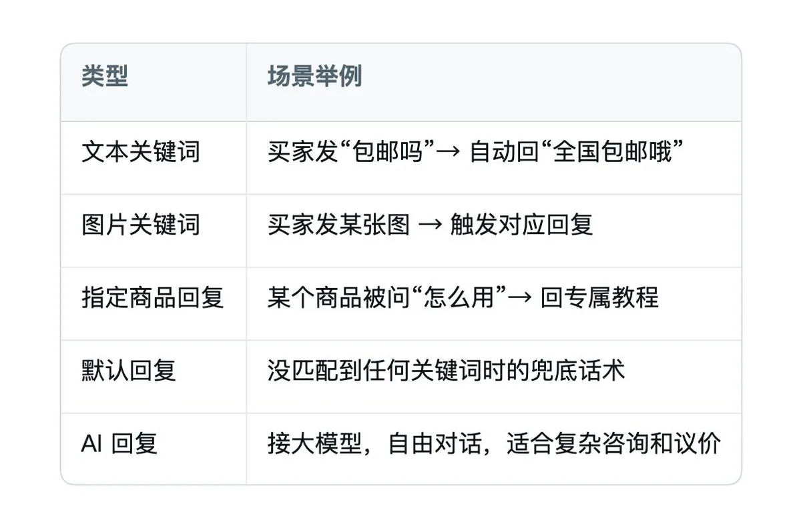
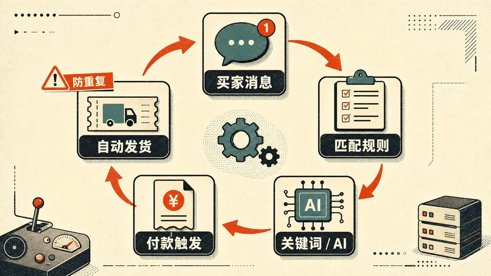
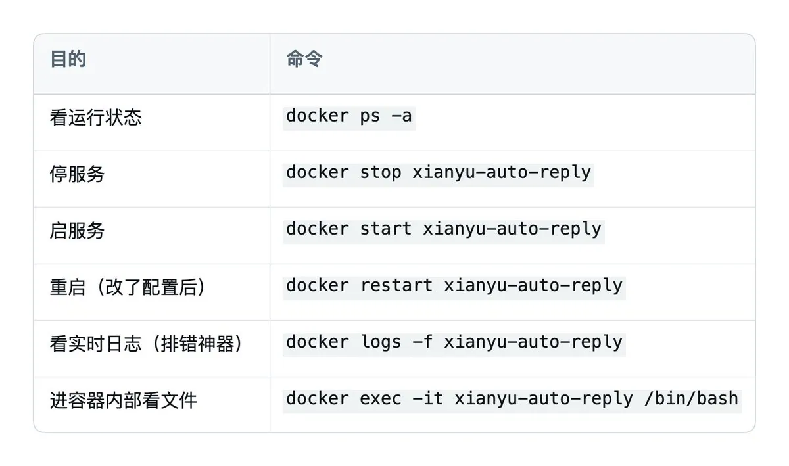
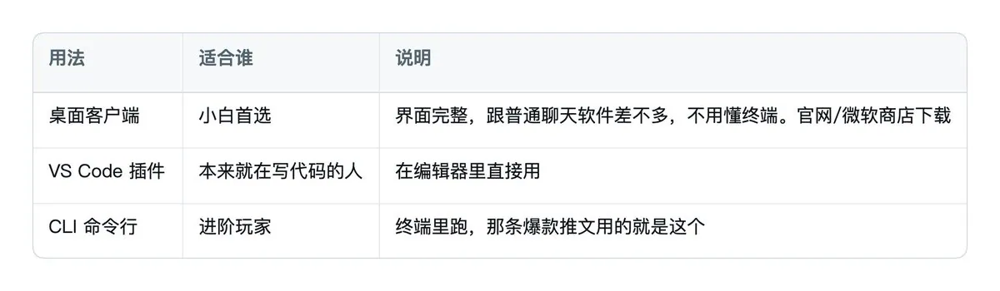

# Kyrie（@KyrieCheungYep）：7 分钟搭好闲鱼自动化客服——让付费的 Codex 自己赚回来

> 7 分钟利用 Codex 搭建闲鱼自动回复与成交客服工作流：基于真实业务场景设定多轮对话决策树，拦截无效咨询，促成虚拟资料与服务即时交付，让 AI 订阅费用通过轻资产业务反哺覆盖。

<!-- more -->

上次写了一篇 Hermes 自动赚钱的文章，是我跑去泰国春武里，在朋友家看他的演示和操作，还有分享一些经验教训，记录下来的。

引用推文：Kyrie (@KyrieCheungYep)

https://t.co/5mFUDHHbmS

https://x.com/KyrieCheungYep/status/2065300718811328987

这几天又去了一趟，看见他还在做国内的一些东西倒卖，还卖一些修图剪辑软件的短期卡。搭了一套闲鱼自动化流程，而且这套东西他早就不管了，挂在服务器上七天没碰，该出的单也一个没漏。

我一看就知道，逻辑跟之前都大差不差，只是场景换成了闲鱼客服。他说他没写一行代码，也没配 Docker，从头到尾只跟 Codex 说了一句话：“帮我把这个项目跑起来”。我算了一下，七分钟后，系统就开始自己回消息。

我又把他的思路和整个流程记了下来，回来自己也操作了一遍，能踩的坑都替大家踩过。这篇就把“用 Codex 自动回复闲鱼”这件事，从零到能跑，一步一步讲清楚，看完你自己也能很快搭一套起来。

##

## 一、先把逻辑讲明白

很多人一听“用 Codex 自动回复闲鱼”，会以为 Codex 就是那个替你聊天的机器人。这里容易搞混。真正跑起来以后，你会发现它其实分成两层。

- 第一层：真正干活的是一套开源的“闲鱼自动回复系统”。它挂在你的电脑或服务器上，通过 WebSocket 连着闲鱼服务器。买家一发消息，它就实时收到，然后按你设的规则，关键词、AI、指定商品这些，自动回、自动发货、自动确认收货。这套东西 GitHub 上有好几个开源项目，免费。
- 第二层：Codex 负责“把这套系统跑起来”。换作手动部署，你得自己研究 Docker、配 Python 环境、读 README、Google 报错。我朋友原话是：“三小时没跑起来，气到摔键盘。”把 GitHub 链接丢给 Codex 后，它会自己读文档、装依赖、起服务，遇到报错也会先自己修。

也就是说，开源项目负责自动回复，Codex 负责把它装到你能用。先分清这个，后面的步骤就没那么绕。

##

## 二、以防有人不认识“ Codex”

如果你完全没用过 Codex，先补这一段；用过的可以直接跳到第三节。

Codex 是 OpenAI 出的 AI 编程智能体。你可以把它理解成一个会自己动手的编程伙伴：写代码、跑测试、看报错、改配置，它都能接着做。你跟它说“帮我把这个项目跑起来”，它会自己往下推进，不用你一步步喂。别把它当成 ChatGPT 的桌面版，它能做的事要更靠近真实开发环境。

它有三种用法，按上手难度排：

装好之后打开，会跳到浏览器登录。用 ChatGPT 账号登即可；没有账号也能填 API Key，但新手用账号登录更省事，功能也完整。

几个搭闲鱼要用到的关键概念：

- Chat vs Project：零碎问答用 Chat；只要涉及生成文件、跑项目、装东西，就用 Project 模式。它会在你电脑上建一个文件夹，文件都放在里面，不容易丢。
- 权限三档：默认权限（最保守）→ 自动审查（沙盒里跑，隔离，不碰你真实电脑）→ 完全访问（放开所有限制，风险高）。装项目、跑命令时，要给到能执行命令的权限，但不用一上来就开“完全访问”。
- 计划模式：开启后，它会先拆任务、列步骤、问你几个选择题再动手，适合容易做错的活。搭项目建议开着。

##

## 三、核心流程

这是全文最关键的部分。我把整个流程拆成了可复制的步骤，可以直接照着参考。

第 0 步：先想清楚跑在哪台机器上

这一步不写代码，但很关键。这套系统要一直开着才有意义。买家半夜发“在吗”，它得在线才能替你回。

- 只是想先跑通、体验一下：用你自己的电脑（本机）就行，最快。
- 想真正 7×24 挂机、人走了它还在工作：得放在一台常开的机器上，比如一台便宜的云服务器（2 核 4G 就够），或者家里一台不关机的旧电脑、NAS。别指望用自己的笔记本长期挂着，你合盖睡觉、断网、关机，它也会停。

新手建议：先在本机跑通整个流程、确认能自动回能发货，再把同样一套搬到服务器上长期挂。

第 1 步：选一个开源项目（先用最主流的）

闲鱼自动回复的开源项目有好几个，新手别纠结，先用最主流的 zhinianboke/xianyu-auto-reply（GitHub 5.4k star，功能最全，带 Web 后台）。它支持：

- 多账号管理（多个闲鱼号一起挂）
- 自动回复（文本关键词 / 图片关键词 / 默认回复 / 商品专属回复 / AI 大模型回复）
- 自动发货（卡券、虚拟商品、自动补发、防重复发货）
- 商品管理、订单管理、自动评价、多渠道通知

复制好它的 GitHub 地址：https://github.com/zhinianboke/xianyu-auto-reply

其他几个项目的对比放在第六节，跑通这个之后你再按需要换。

第 2 步：把链接丢给 Codex，说一句话

在 Codex 里新建一个 Project，然后把下面这段话发给它（这就是那句“魔法咒语”，我帮你写得更具体一点，成功率更高）：

```
帮我把这个开源项目在本机跑起来：
https://github.com/zhinianboke/xianyu-auto-reply

要求：
1. 优先用 Docker 部署，我电脑上如果没装 Docker 就先帮我装
2. 跑起来之后，告诉我浏览器访问地址、默认账号和密码
3. 中途遇到报错你自己排查修复，修不了再来问我
```

然后你就看着它干活。它会自己读 README、判断部署方式、拉镜像、起容器、检查健康状态。顺利的话，几分钟后它会给你一个访问地址。

如果你是用 CLI 版 Codex，准备工作就是先装好 Codex，本机或服务器都行，然后同样把这段话发给它。


[video](https://video.twimg.com/tweet_video/HMJvfLRaIAA4Bk5.mp4)

第 3 步（可选）：不放心的话，知道它在背后干什么

Codex 帮你跑的，本质上就是下面这几行命令之一。你不用自己敲，但知道它在干嘛，心里有底，出问题也好跟它对话。

最简单的老版单容器镜像（很多教程用的就是这个，一个容器搞定，端口 8080）：

```bash
mkdir -p xianyu-auto-reply
docker run -d \
  --restart always \
  -p 8080:8080 \
  -v $PWD/xianyu-auto-reply/:/app/data/ \
  --name xianyu-auto-reply \
  registry.cn-shanghai.aliyuncs.com/zhinian-software/xianyu-auto-reply:1.0
```

跑完访问 http://localhost:8080（服务器就是 IP:8080），默认账号 admin、密码 admin。

官方新版一键脚本（多服务架构，前端在 9000 端口，功能更新更全）：

```bash
curl -fsSL https://xy-update.zhinianboke.com/deploy.sh | sed 's/\r$//' | bash
```

跑完访问 http://服务器IP:9000，默认账号 admin、密码 admin123。以后更新就把 deploy.sh 换成 update.sh 再跑一遍。

两种方式选一种就行，别同时开。新手想省事就让 Codex 用第一种单容器的。

第 4 步：进后台，第一件事改密码

打开访问地址，进登录页，用默认账号密码登进去。

进去先改默认密码。路径是：系统设置 → 密码设置。只要你的端口暴露在公网，admin/admin123 这种默认密码就等于把后台大门敞开给所有人，这是最容易被人钻空子的地方。

第 5 步：绑定你的闲鱼账号

进“账号管理”，添加闲鱼账号，有两种方式：

- 扫码登录（推荐）：点扫码，用手机闲鱼 App 扫一下就行，最省事。
- 手动填 Cookie：打开闲鱼网页版，按 F12 进开发者工具 → 选“网络 / Network”→ 筛选类型选“Fetch/XHR”→ 随便点一个请求 → 找到 cookie2=xxx; ... 那一整串，复制粘进去。

这里有个坑单独拎出来说：扫码登录如果一直失败或异常，先把你电脑的代理（梯子）关掉再扫。IP 跟账号归属地对不上，闲鱼风控会拦。很多人就栽在这里。

登录成功后，账号列表里会显示这个号的状态，确认链路是“在线”。

第 6 步：同步商品 + 配自动回复

先在“商品管理”里同步/拉取你在卖的商品，让系统认识你的货。

然后进“自动回复”，选账号、选商品，开始配规则。这里有个回复优先级要搞清楚，不然会出现“我明明设了 A 它却回了 B”。

指定商品回复 > 商品专用关键词 > 通用关键词 > 默认回复 > AI 回复

意思是：越具体的规则优先级越高。给某个爆款单独写的话术，永远盖过通用关键词；所有规则都没匹配上时，才轮到默认回复兜底，或者交给 AI 自由发挥。

几种回复类型怎么用：



想用 AI 回复，得先给它接一个大模型。在后台的 AI 配置里填三样东西：模型接口地址（Base URL）、模型名称、以及一个 API Key。国内直接用通义千问、DeepSeek、豆包这类都行，去对应平台开通、复制一个 API Key 填进去即可。这些模型很便宜，回几千条消息也就几毛几块。填完记得开一句测试，确认能通再正式挂。纯关键词回复的话，这一步可以先跳过。



第 7 步：配卡券和自动发货（虚拟商品必做）

如果你卖的是卡密、账号、教程这类虚拟商品，这一步是核心。

1. 先在“卡券管理”里创建卡券/卡密数据（把你要发的内容录进去）。
2. 再进“自动发货”，配置发货规则，把商品和发货内容匹配起来（按商品标题、商品详情里的关键字匹配）。
3. 发货方式支持文本、批量数据、API、图片等。
4. 触发逻辑：系统检测到买家“付款消息”或者“小刀卡片（改价成交）”后，自动发货，把卡密秒发过去。内置防重复发货，不会一单发两次。

配完，启动账号监听。到这里，一套“买家咨询自动回、付款自动发货”的无人客服就能跑了。你可以在日志和账号状态里看它有没有正常工作。

##

## 四、日常怎么维护

如果是 Docker 跑的，日常就这几条命令：



其实这些不记下也行。真出问题了，直接截图或者把报错贴给 Codex，让它帮你看日志、判断哪出了问题，通常比自己到处搜快。

##

## 五、避坑清单

把系统跑起来只是第一步，真正决定你能不能长期用下去的，是下面这些。

- 默认密码必须立刻改。前面说过，这里再重复一遍，因为这是最高频的翻车点。
- 登录一直失败？关掉代理再扫码。IP 归属地和账号对不上会被风控拦。
- 别在生产服务器上盲跑远程脚本。那种 curl ... | bash 的一键脚本权限不小，会创建配置、拉镜像、清容器。至少先在测试机跑一遍，或者把脚本下下来，让 Codex 帮你看一眼再执行。
- 公网使用一定加 HTTPS + 反向代理，并限制后台访问范围。别把后台、API 文档（/docs）、数据库端口裸奔在公网。CORS_ORIGINS 生产环境别用 *。
- 备份。自动发货记录、商品、订单、账号状态全在 MySQL 数据卷和静态资源目录里，定期备份，别哪天容器一崩全没了。
- 浏览器环境。登录、Cookie 刷新、发布这些功能依赖 Playwright，报“浏览器缺失”就执行 python -m playwright install chromium（Docker 版一般已内置）。
- 脚本报 /bin/bash^M: 坏的解释器？这是 Windows 换行符（CRLF）的问题，前面命令里那个 sed ’s/\r$//’ 就是干这个的。
- 风控和账号安全要单独放在心上。自动回复、自动发货本身就贴着平台规则边界走，有账号异常甚至封号的风险。别一上来就把最重要的号和真实交易全接进去。先拿一个低风险的小号跑通整个流程，确认稳定了再慢慢扩大。
- 合规红线也别忽略。这些开源项目基本都是 AGPL/GPL 协议，README 白纸黑字写着“仅供学习研究、禁止商业用途”。自己学习可以，别拿去二次转售或做成 SaaS 卖给别人。

##

## 六、四个项目怎么选（跑通主流的再看这段）

第一个跑通了、想进阶的，看这张对比表按需换：



两个项目可以单独说一下：

① XianyuAutoAgent：想要“会砍价的 AI”可以看它。它是代码型项目，配置走 .env 文件：填 API_KEY（模型密钥）、COOKIES_STR（闲鱼 cookie）、MODEL_BASE_URL、MODEL_NAME，默认用通义千问。它最有意思的是把客服拆成了“意图分类 → 议价专家 / 技术专家 / 默认客服”几个角色，能做阶梯式降价，一刀一刀慢慢让价；也能用一个“句号”在人工接管和 AI 接管之间切换。装好后跑 python main.py。话术全在 prompts/ 目录里，可以自己调。

② goofish-cli：这个更像是把 Codex 直接变成闲鱼工具。前面几个项目是“Codex 帮你部署一套系统”，goofish-cli 则把闲鱼的能力，发布、查询、收发消息、议价这些，直接封装成了 MCP 工具。你在 Codex / Claude Code 的配置里加上这么一段：

```json
{
  "mcpServers": {
    "goofish": {
      "command": "uvx",
      "args": ["goofish-cli"]
    }
  }
}
```

之后你在对话框里直接说“帮我看下这个买家发了什么，回复他一句‘在的，可以小刀’”，Codex 就会自己调用闲鱼接口。它内置了令牌桶限流（1 写/分钟）和风控熔断，能降低因为动作太快被平台盯上的概率。这条路更灵活，但也更吃你对 AI Agent 的理解，建议前面那套玩明白了再来碰。

我的这个朋友一直贯彻一个理念：重复活必须交给 AI 。然后他就把链接丢给 Codex，说了一句“帮我把这个项目跑起来”。

过去这套东西最麻烦的地方是部署。很多人不缺自动化的想法，缺的是配环境、读报错、改配置那几个小时的耐心。Codex 把这段脏活接过去了，你不用先变成程序员，也能把程序员写好的东西用起来。

别想太复杂。今天能做的第一步，就是把 Codex 装上，找个小号，把那个 GitHub 链接丢给它，看它七分钟能不能给你跑起来。

先跑起来，再谈优化，很多事真要动手以后才会明白。

关于作者

Kyrie — 前国内大厂 R&D 工程师，现居曼谷，做中国科技企业出海 BD。持续分享出海一线真实记录、AI 在业务里的实战用法，偶尔也聊聊美股投资和国外生活。

- X：.[@KyrieCheungYep](https://x.com/@KyrieCheungYep)

## 相关页面

- [[sources/weiyux2021-claude-xianyu-ecommerce-workflow]]
- [[patterns/cross-platform-information-arbitrage]]
