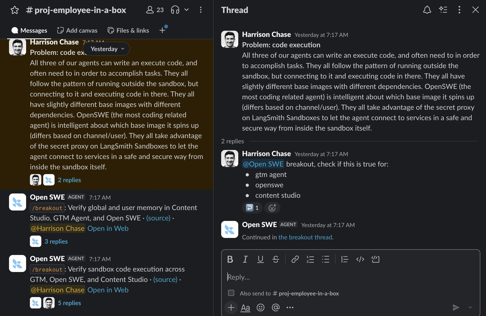
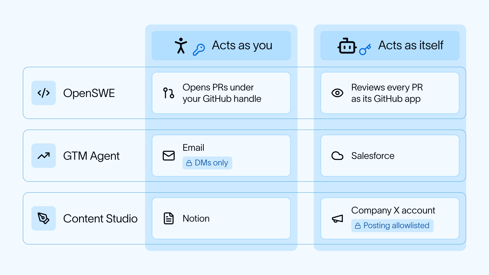
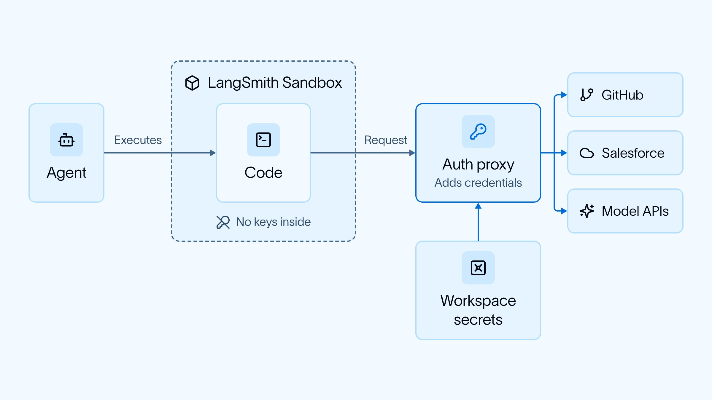
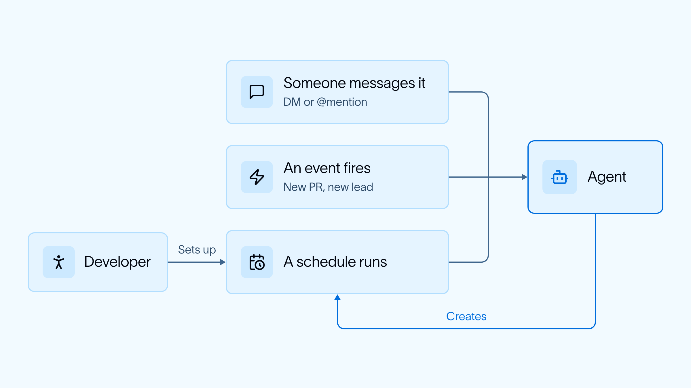

# LangChain：构建「公司级 Harness」的五个组件

> LangChain 内部在营销、销售、工程三个团队都建了 Agent，真正难的不是让 Agent 能干活，而是让它在企业里**以谁的身份干活**。这篇官方博客给出他们踩坑后收敛出的五个通用原语：住在人已经工作的地方、身份、记忆、沙箱执行、后台调度。

<!-- more -->

*图 1：LangChain 三大内部 Agent 遵循同一套构建配方。*

## 一、核心命题：怎么建「公司级 Harness」

LangChain 在营销、销售、工程团队内部都建了 Agent，团队工作方式被彻底改变。这些 Agent 并不容易做对——他们在「多人协作型 Harness」上花了大量时间解决问题，最终每个团队都收敛到同一组核心原语：

1. **它住在人们已经在工作的地方**（对 LangChain 来说是 Slack）
2. **它知道是谁在问，并且对某些服务「代表那个人（OBO）」行事、对另一些服务「以自己的身份」行事**
3. **它有记忆，可以是全局的，也可以是用户级的**
4. **代码在沙箱里执行，并且可以对需要鉴权的服务发起请求**
5. **它的大部分运行是定时触发的，而不是由人显式发起（ambient agents!!）**

> 原文致谢：@caspar_br 对本文的贡献。

---

## 二、LangChain 的三个内部 Agent

| Agent | 定位 | 能力 |
|---|---|---|
| **GTM Agent** | 主动常驻的 GTM 助手 | 监控并回复邮件、响应新的合格线索、发送每日简报、回答账户相关问题、发起 outbound 动作 |
| **OpenSWE** | 工程 Agent | 编写并起草 PR，同时对所有 PR 运行代码审查 |
| **Content Studio** | 营销 Agent | 按公司风格与产品定位知识起草素材（博客、图片、PPT、视频） |

三者构建方式完全一致，作者认为这是一套通用的「公司级 Harness」配方。

---

## 三、问题一：用户体验——住在人已经工作的地方

所有 Agent 都住在人们已经在工作的地方，对 LangChain 而言就是 Slack。每个 Agent 有自己的 Slack App，可以被私聊（DM），也可以在频道里被 @。

在频道里工作有一个好处：**别人能看到大家是怎么用它的**。

### 「Breakout」——把 Agent 拆出独立线程

很多情况下，一段很好的对话正在进行，你想把 Agent 拉进来听听意见或让它做点事。但如果它直接跑在那个线程里，会污染人之间的对话、造成分心。所以他们加了一个机制：Agent 可以「break out」到频道里的独立线程。

*图 2：Agent 在频道内 breakout 到独立线程的用户体验。*

### 哪些体验不适合放在 Slack

有些体验**最好不要**在 Slack 里做。例如 GTM Agent 在审阅它想让你发送的邮件时，零散地在 Slack 里点「发」没问题；但如果积压了一大堆，从一堆 Slack 消息里追踪进度就完全不享受。对于这类体验，他们最终自建了定制 UI。

*图 3：积压场景下 GTM Agent 改用自建 UI 承载。*

---

## 四、问题二：身份——Agent 到底以谁的身份干活

这是他们啃下的**最棘手、最难**的问题：当这些 Agent 采取行动时，它们**代表谁**行动？

行业里主要有两种处理方式：

- **On-behalf-of（OBO）**：Agent 代表发起调用的用户行事
- **Fixed credentials（固定凭据）**：Agent 无论被谁调用，都使用同一套固定凭据（例如 service account）

LangChain 每个 Agent 的具体做法：

### OpenSWE

- **你给它发消息时**：它代表你行事（例如用**你的** GitHub handle 开 PR）
- **它在后台运行时**（例如作为 code review agent）：它用**自己的身份**行事（GitHub App）

### GTM Agent

- **部分工具**（例如 Salesforce 访问）用**固定身份**，这样不是每个人都要单独登录
- **部分工具**（例如发邮件）**代表调用它的用户行事**，且这些工具**只在私聊（DM）中可用**，在共享频道里不可用

### Content Studio

- **部分工具**（例如 Notion）代表调用它的用户行事
- **部分工具**（例如 Twitter）使用**固定凭据**，即公司 Twitter 账号；但**只有白名单用户**才能调用特定操作——例如并非人人都能发帖，有些人只能读和起草

*图 4：Content Studio 的身份模型——固定凭据 + 白名单调用的组合。*

> **关键洞察**：身份不是全局开关，而是**按工具逐个授权**的。同一台 Agent 在不同工具上可能呈现完全不同的身份语义；再加上「工具的可用范围」与「调用的授权范围」两层约束，形成完整的企业权限模型。

---

## 五、问题三：记忆——全局与用户两层

所有 Agent 都有**两层记忆**：

- **Global memory**：对所有用户生效的记忆
- **User memory**：仅对特定用户生效的记忆

**Agent 自己决定**它想把哪些事实记到哪一层记忆里。

原文坦承这可能是目前**探索最少**的领域，他们在这块还有大量工作要做。

---

## 六、问题四：代码执行——沙箱与密钥代理

三个 Agent 都能编写并执行代码，且很多时候必须执行才能完成任务。它们遵循同一个模式：**在沙箱外运行，但连接到沙箱并在沙箱内执行代码**。

- 三者都有略有不同的基础镜像与依赖；
- OpenSWE（与编码关系最密切的 Agent）会**智能地选择该起哪个基础镜像**（依据频道/用户不同而不同）；
- 它们都利用 LangSmith Sandboxes 上的 **secret proxy**，让 Agent 能从沙箱内部以安全的方式连接外部服务。

*图 5：沙箱执行 + secret proxy 让 Agent 能在沙箱内安全访问需要鉴权的服务。*

---

## 七、问题五：调度运行——大部分运行是后台发起的

很大比例的运行是**由事件在后台触发或定时执行**，而不是用户直接发起。

触发来源有两类：

- **Agent 开发者设定**：例如 OpenSWE 监听 PR，一旦新 PR 被创建就自动审查；
- **用户口头要求**：例如「我跟 GTM Agent 说一声，让它每天给我发销售简报」，它就自己建了一个 cron 来执行。

*图 6：Agent 运行既可由开发者预置，也可由用户一句话自行挂上 cron。*

---

## 八、统一底座：Managed Deep Agents

以上所有 Agent 都构建在 **Managed Deep Agents** 之上，而它又架在开源的 **Deep Agents** harness 之上。Managed Deep Agents 提供解决上述所有问题的基础设施（channels、crons、sandboxes、memory、identity），同时保留足够的灵活性来定制 Agent 行为。

---

## 九、五个原语速查表

| 原语 | 关键决策点 | LangChain 的落地方式 |
|---|---|---|
| **住在人已工作的地方** | 什么体验适合 Slack、什么必须自建 UI | Slack App + DM/频道 @ + breakout 独立线程 + 积压场景自建 UI |
| **身份** | Agent 代表谁行事 | 按工具粒度选择 OBO 或固定凭据；工具可用范围（DM vs 频道）与调用授权（白名单）双重约束 |
| **记忆** | 事实记到哪一层 | Global + User 双层，由 Agent 自行判断归属 |
| **代码执行** | 代码在哪跑、如何安全调外部服务 | 沙箱外运行 + 沙箱内执行 + secret proxy + 按场景选基础镜像 |
| **调度运行** | 谁来触发 | 开发者预置事件监听（PR 自动审查）+ 用户一句话自建 cron |

---

## 相关页面

- [[concepts/harness-engineering]] — Harness 工程：为 Agent 打造安全与自适应工作台
- [[patterns/agent-iteration-environment]] — Agent 迭代环境闭环模式
- [[sources/yihui-loop-engineering-explained]] — yihui：Loop Engineering 到底是什么
- [[sources/xudong-langchain-company-harness-insight]] — Xudong Han：LangChain 公司级 Harness 的中文解读
- [[sources/shao-meng-google-5day-ai-agents-course]] — Google 官方 5 天 AI Agents 课程解读
- [[concepts/agent-token-architecture]] — Agent 的本质：用 Token 换架构
- [[patterns/agent-skill-design-patterns]] — Agent Skill 设计模式与实践
- [[concepts/ai-friendly-backend]] — 后端架构 AI Friendly 标准与路径
