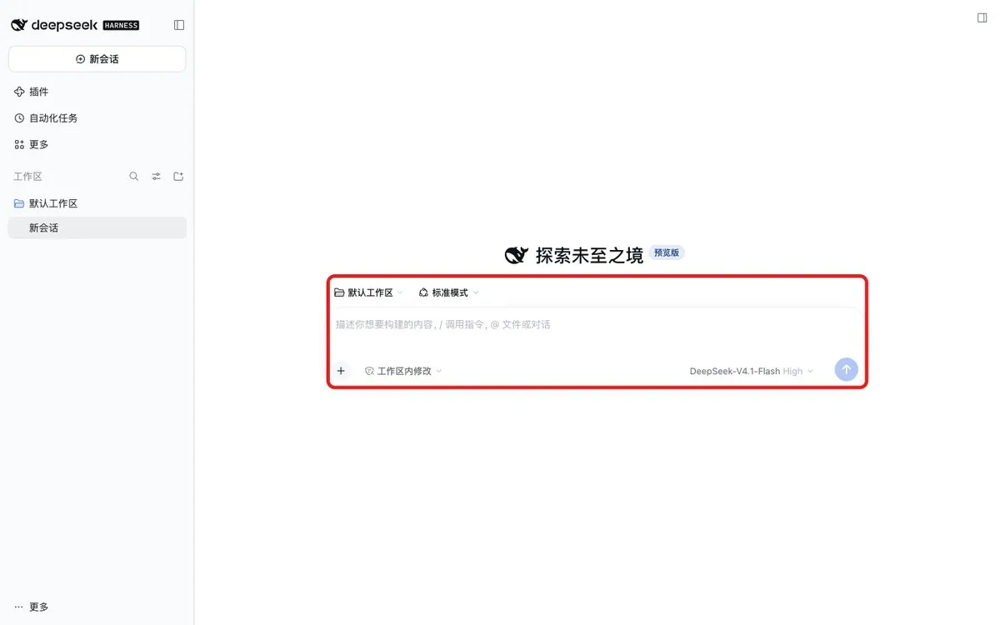
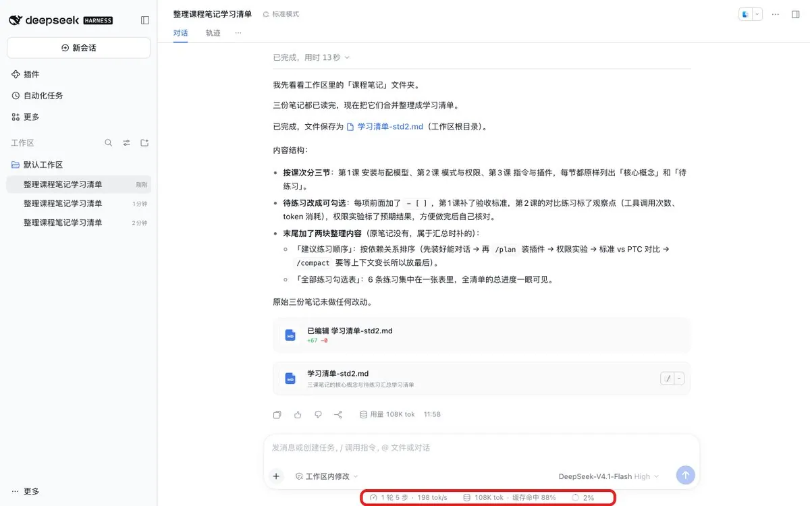
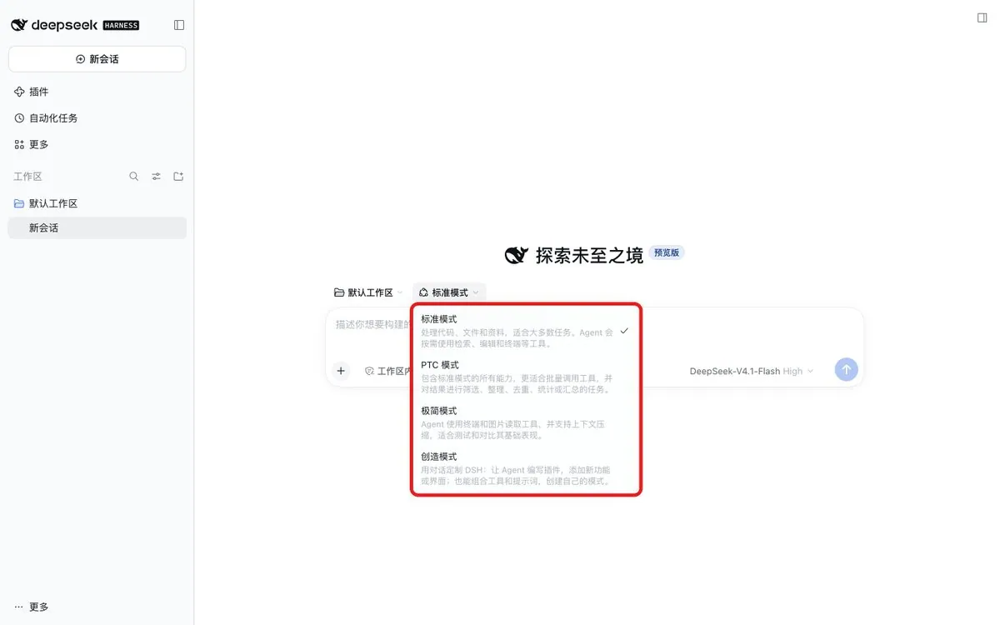
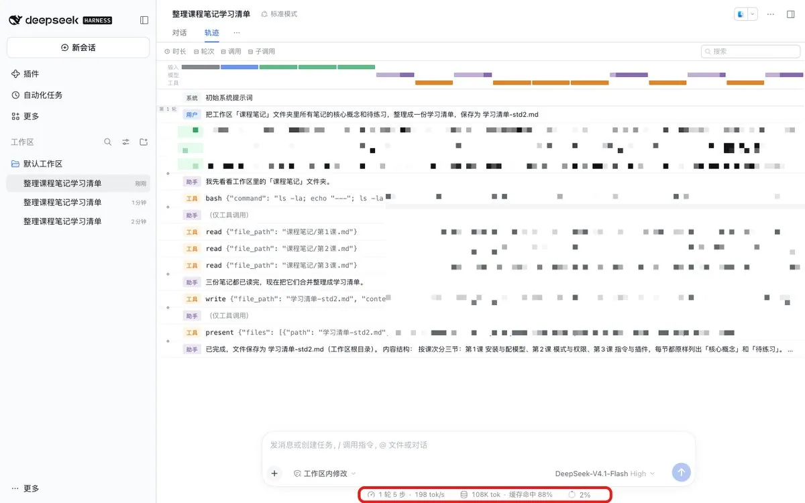
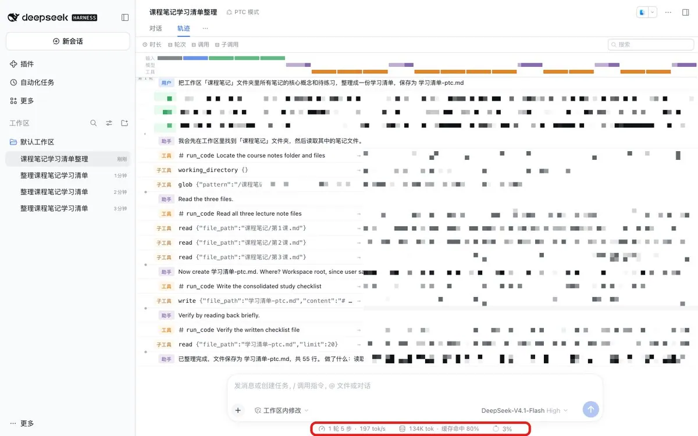
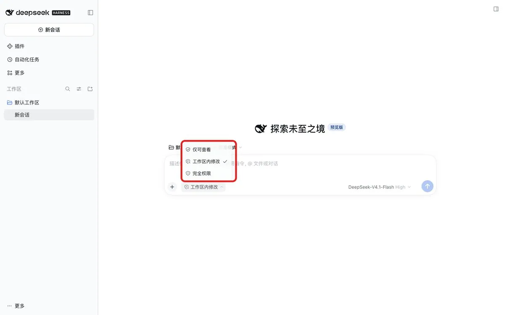
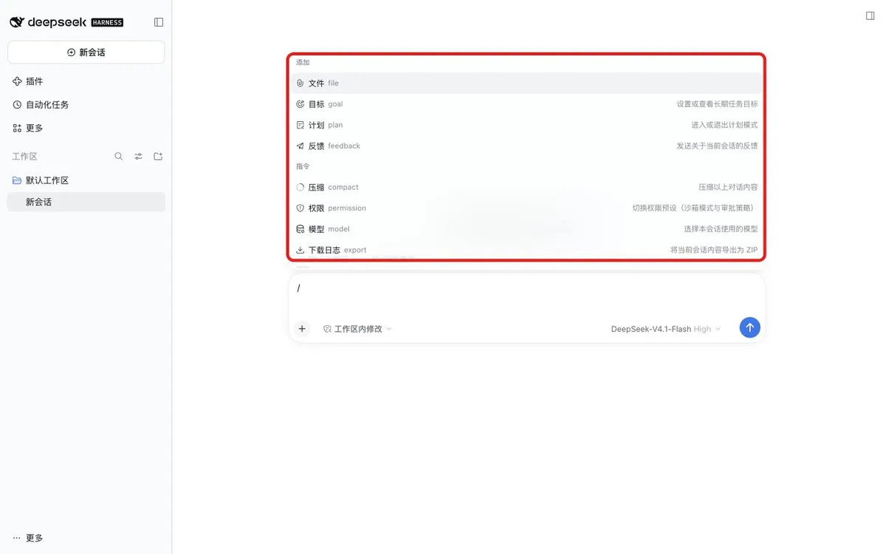
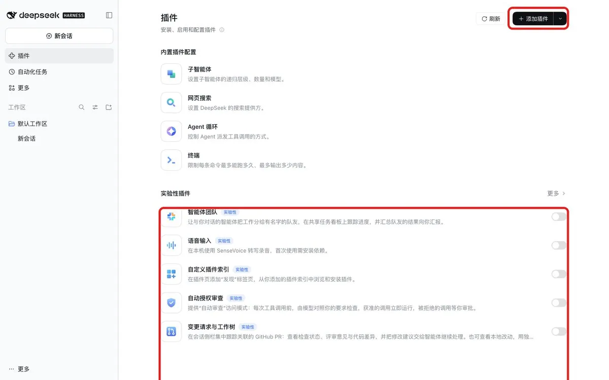

# Leaf Yeah!（@leaf_sanren）：万字长文｜DeepSeek Harness 从入门到精通——4 种模式、8 条指令、15 个必装插件

> DeepSeek Harness 的完整上手长文：系统讲解 4 种运行模式、8 条常用指令与 15 个必装插件的组合用法，涵盖插件安装与配置、模型接入、会话与上下文管理、子 Agent 与 Skills 协作、插件生态的实际取舍，是从「能跑」到「用顺」的完整路径参考。

<!-- more -->

各位，今天来看 DeepSeek Harness（下面简称 DSH）。

一句话：网页版 DeepSeek 是聊天窗口，DSH 是干活现场。 它能直接读写你电脑上的文件、跑命令、做 Word/PPT/Excel，还能装插件给自己加功能。

上线三个月，日活 154 万。这篇从安装讲到插件，新手照着走一遍就能用起来。

目录

1. 这是什么：和 Claude Code、Codex 有什么不一样
2. 能干什么，不能干什么
3. 下载安装：10 分钟装好，和装微信一样
4. 第一次跑通：配模型、认界面、打招呼
5. 怎么指挥它：4 种模式、4 档权限、8 条指令
6. 插件大全：15 个必装插件，附仓库地址
7. 实战：不写一行代码，做一个自动记笔记的小应用
8. 大肥鱼：B 站为什么都在“养”DeepSeek
9. 坑集锦：8 个新手最容易踩的坑
10. 速查表

───

## 一、这是什么：和 Claude Code、Codex 有什么不一样

Harness 直译是“马具”：缰绳、鞍子、套包这些。

它不是马，也不是车，是把马和车连起来、让马听你指挥的那套装置。

- 马 = 模型（DeepSeek、Kimi、GLM……负责理解和思考）
- 马具 = DSH（负责让模型能读文件、用工具、按步骤干活）

所以同一匹马，配不同的马具，干活效果能差很多。B 站有人用同一个 DeepSeek 模型、同一道题接了 7 个工具测过，下面第九节细说。

和网页版比，最直观的三个区别：

- 改文件：网页版要你上传文件、复制修改、再贴回去；DSH 直接打开那个文件改。
- 查资料：网页版要你一段段贴资料；DSH 自己翻你本地的文件夹，自己上网搜。
- 批量活：100 个文件改同一个地方，网页版只能一个个贴；DSH 自己写个小脚本，一次改完。

和 Claude Code、Codex 比，三个不一样：

- 一切皆插件：模型、工具、会话、沙箱、文件系统、Agent 循环、界面，全是插件，都能换。
- 不绑模型：DeepSeek、Kimi、GLM、本地模型、任何 OpenAI 兼容接口都能接。
- 能把别人装进来：可以在里面拉起 Claude Code、Codex 当子 Agent。

你所不知道的冷知识：DSH 仓库的第一笔提交，是写给 AI 看的说明书 AGENTS.md。从第一行到开源只用了 64 天，提交了 1.2 万多次。

───

## 二、能干什么，不能干什么

能干：

- 办公三件套：桌面版输入 / 能看到 Word、PPT、Excel 三个内置技能。PPT 里的图表是能编辑的原生图表，不是贴一张截图；生成后它会先检查文件有没有坏、页数对不对，再渲染成图片给你预览。
- 写代码、改项目：读懂项目、修 bug、写功能、跑测试。
- 查资料：搜索、交叉核对、给出带来源的结论。
- 后台和定时任务：跑脚本、批量处理文件；装 Automation Task 插件可以设定期执行的活。
- 做小应用：第七节有个完整例子，一句话做出一个自动记笔记的“课程助手”。

暂时别指望：

- 当生产工具。官方安全说明原话：“尚未接受安全审计，不得视为安全或可用于生产环境的软件。”
- 接口稳定。现在是开发者预览版，官方写明“未来将出现破坏兼容性的变更”。第三方插件市场 8700 多个插件里，1000 多个已经不适配最新稳定版。
- 免费。软件免费开源，但用 DeepSeek 官方模型要去开放平台充值，按 token 计费。
- 直接看图。主力模型是纯文本的，丢一张图进去它看不见。官方 8 月出过实验性的视觉模型，社区更常用 ModLens 插件补（见第六节）。

───

## 三、下载安装：10 分钟装好，和装微信一样

路线 A：桌面版（推荐新手）

1. 去官网 [https://www.deepseek.com/harness/](https://www.deepseek.com/harness/) 下载，macOS 和 Windows 都有。只认官网，有名字很像的山寨站。
2. Windows：双击安装包，一路“下一步”。安装路径建议改到 D 盘，别装 C 盘；弹出“是否允许此应用更改你的设备”点“是”。
3. Mac：双击安装包，把图标拖进 Applications；提示“从互联网下载的 App”点“打开”。
4. 整个过程没有命令行、不用配环境变量，和装微信一样。

路线 B：命令行（Linux 或想折腾的人）

装好 Node.js（v22.19.0 或 v24 以上），一行命令：

```
npx @deepseek-ai/dsh web
```

终端会打印一个带令牌的本地地址，用浏览器打开就行。网页版第一次进来会让你选：登录 DeepSeek 账号，或者填 API Key，二选一。

登录这一步别跳过。 第一次打开要用手机号和验证码登录。你的配置、会话和装过的插件都跟着账号走，换台电脑登录还在；跳过就找不回来。

───

## 四、第一次跑通：配模型、认界面、打招呼

1. 充值或接自己的 API

第一次进来会有欢迎页，提示你充值。

- 这里充的是 API 余额，充完可以在账单里开发票。
- 如果你已经买过 DeepSeek 官方 API，或者有别家模型的 API，直接点“继续”跳过。

2. 配模型

点左下角头像 → 设置 → 模型：

- DeepSeek 账号：用的就是刚充的余额。
- 自己的 DeepSeek API Key：点编辑，把密钥粘进去，旁边出现绿点就是配好了。
- 别家模型：点“添加模型提供商”，选第三方提供商，下拉选对应模型，粘密钥保存。阿里云百炼、OpenRouter 都有现成教程。

3. 选工作区

点输入框旁边的工作区按钮，添加一个本地文件夹。不选工作区，输入框是灰的。 这次对话生成的文件都会放进这个文件夹。

一个坑（我自己踩的）：网页版自带的“默认工作区”在 文稿/deepseek-harness/default-workspace，不是你启动命令所在的文件夹。我把笔记放在别处，它找不到，就开始满电脑搜。先确认工作区选对了，再派活。

4. 认一下界面



整个界面分三块：

- 左边导航栏：新建对话；插件按钮（能看到官方自带的插件）；按工作区分好组的历史会话；最底下是账号和设置。
- 中间对话区：上面有“对话”和“轨迹”两个视图（要先在设置 → 通用里打开“显示代码工作轨迹”）。对话看结论；轨迹把过程排成一张时间表，点任意一步能看到用了多少 token、花了多久，想复盘它是怎么做出来的就看这里。
- 右边侧栏：默认隐藏，有文件、终端、浏览器三个标签，还能左右分栏。模型在中间干活，你在右边同时看文件和网页。

5. 打个招呼

发一句测试：

用机灵的语气做个自我介绍，说说你和网页版 DeepSeek 有什么区别

能正常回复，就说明模型配通了。

我给它的第一个活是：把工作区里 3 份课程笔记的核心概念和待练习，整理成一份学习清单。13 秒做完，还顺手把待练习改成了可勾选的格式。



───

## 五、怎么指挥它：4 种模式、4 档权限、8 条指令

这一节是全篇最干的部分。模式决定它怎么干活，权限决定它能干多大的事，指令是你给它的口令。

### 1. 四种模式

- 标准：模型一步一步直接调工具，读文件、搜索、计划、目标、子 Agent 都有；拿不准就选它
- PTC 代码编排：先写一段 TypeScript 程序，让程序一口气把工具调完；重复动作多、要批量处理
- 极简：只留命令行和文件编辑器；跑模型基准测试
- 创造：在标准的基础上，多了运行时检查、插件管理和开发指引；想写插件、改界面、改造 DSH 本身



标准和 PTC 到底差在哪？ 打开“轨迹”视图就看得出来：

- 标准模式：模型自己一个一个调工具，读一个文件、再读一个、再写
- PTC 模式：模型先写一段程序（run_code），程序里再去调读文件、写文件这些“子工具”

Git 源宝在 B 站用一堆课程笔记测过，标准模式几十次工具调用，PTC 只留几条程序记录，token 省了一大截。

但我自己测出来不一样。 同一个小任务（3 份笔记整理成学习清单），两种模式各跑一遍：

- 标准模式：5 步，10.8 万 token
- PTC 模式：5 步，13.4 万 token，反而多花了 24%





结论：PTC 省的是“几十次重复工具调用”的批量活。 文件就几个的小任务，写程序本身的开销反而更大，用标准模式就行。

选模式记四句话：

- 拿不准，先用标准
- 重复动作多、要批量，用 PTC
- 想把它改造成自己的工作台，用创造
- 跑测试，用极简

一个坑：模式在对话开始时就定了，中途不能换；模型可以中途换。 新建对话前先想好。

### 2. 四档权限

- 仅可查看：能读，不能改文件
- 工作区内修改：工作区里随便改；想碰工作区外的文件会被沙箱拦下，再来问你
- 完全权限：开启时先弹一次风险确认；越界操作仍会弹审批卡片，不是从此不问
- 自动授权审查（实验）：要先在插件里开启。每次工具调用前先让模型审一遍，低风险的直接执行，高风险的转给你；每次审查要额外花 token，也可能误放或误拦



新手日常用“工作区内修改”就够了。 能干活，有边界，不会把电脑弄乱。别一上来就开完全权限。

### 3. 八条斜杠指令

在输入框敲 / 就能看到：

- /plan：先出计划，你同意了再动手
- /permission：切换权限，不用鼠标点
- /compact：压缩上下文，把前面聊的整理成摘要
- /file：上传本地文件
- /model：切换当前对话的模型
- /goal：设一个长期目标，它会一轮接一轮地做，直到完成、被挡住或轮次到上限
- /feedback：给官方提反馈
- /export：把整段对话日志打包成 ZIP 带走



Git 源宝编了个口诀：先计划、给权限、选模型、传文件、清桌面、管目标、提意见、存档案。

几个你可能不知道的细节：

- 光敲指令不花 token，指令后面跟了话才花。
- 桌面版菜单里和指令挨着的 Word、PPT、Excel 不是指令，是技能，一用就花 token。（我跑的网页版菜单里没有这三个，以桌面版为准。）
- /plan 强烈建议养成习惯。 动手前就能看出它有没有理解偏，少踩一大半坑。
- 什么时候用 /compact？ 三个信号：它开始忘记前面的要求；它开始重复你说过的话；界面提示上下文快满了。

───

## 六、插件大全：15 个必装插件，附仓库地址

### 先说怎么装（三种方式）

1. 插件页：左侧“插件” → “添加插件”，粘包名、GitHub 地址或本地路径。
2. 让它自己装：新建对话，/plan 后面贴上插件链接，再说一句“先读说明、检查和当前版本兼不兼容，再告诉我它的作用和用法”。它会先交一份安装计划，你看过再放行。三颗门牙 X 实测这样装，一个插件大概花一块钱。
3. 插件市场：先装 dsh-market，之后在设置最下面进市场，搜索、一键安装，像逛手机应用商店。

官方自带的插件分两组：

- 内置：子智能体、网页搜索、Agent 循环、终端，默认就在
- 实验性：智能体团队、语音输入、自定义插件索引、自动授权审查、变更请求与工作树，要手动打开



智能体团队怎么用？ 它没有专门的指令，要在提示词里点名让它用 Agent Teams，并说清楚要哪些角色。三颗门牙 X 让它做一份 AI 自媒体选题，主 Agent 派出一个干活的、一个负责审查的，审完再改。

### 按需求挑（星数为 11-09 GitHub 数据）

先装这三个（防翻车）

- dsh-cost-meter（652★）：看每个会话花了多少钱、还剩多少余额。还会提醒你现在是不是闲时：DeepSeek 官方 API 分时计价，不着急的活放闲时跑能省一半。[https://github.com/Han-1413141/dsh-cost-meter](https://github.com/Han-1413141/dsh-cost-meter)
- dsh-context（4675★）：把上下文“从黑箱变成玻璃箱”，人设占多少、记忆占多少、工具结果占多少、什么时候被压缩过、压掉了什么，都能看见。官方也点名推荐过。[https://github.com/bowenliang123/dsh-context](https://github.com/bowenliang123/dsh-context)
- dsh-market（196★）：插件市场，号称收录 6000+ 插件，中文搜索、一键安装。[https://github.com/2BingLing/dsh-market](https://github.com/2BingLing/dsh-market)

补能力

- ModLens（4862★）：主力模型看不了图，它在中间搭桥，把图片转成结构化描述再交给模型。[https://github.com/liustack/modlens](https://github.com/liustack/modlens)
- dsh-image-gen（1185★）：在对话里生图、改图，内置 500+ 提示词。[https://github.com/shanliuling/dsh-image-gen](https://github.com/shanliuling/dsh-image-gen)
- dsh-agent-teams（2789★）：多个 Agent 组队分工。[https://github.com/NanmiCoder/dsh-agent-teams](https://github.com/NanmiCoder/dsh-agent-teams)
- dsh-memory-evolve（726★）：跨会话长期记忆，换个窗口不用从头交代背景。[https://github.com/csyangwen/dsh-memory-evolve](https://github.com/csyangwen/dsh-memory-evolve)
- dsh-rewind（246★）：越改越偏时，把对话退回到前面某一轮，还能一并还原文件，类似 Claude Code 的 /rewind。[https://github.com/SiriLee/dsh-rewind](https://github.com/SiriLee/dsh-rewind)
- dsh-chat-import（294★）：把 25 种以上 AI 编程工具的历史对话导进 DSH。从 Claude Code、Codex 换过来的人，聊天记录不用丢。 [https://github.com/Nwflower/dsh-chat-import](https://github.com/Nwflower/dsh-chat-import)

手机远程

- dsh-pocket（2851★）：电脑上跑着，手机扫码就能访问，局域网和公网都行，不用买服务器。[https://github.com/shaobeichen/dsh-pocket](https://github.com/shaobeichen/dsh-pocket)
- dsh-im（3375★）：把微信、飞书、钉钉、企业微信、QQ、Slack 等接进来，在手机聊天软件里派活、收结果；电脑上的 DSH 要一直开着。[https://github.com/xmanrui/dsh-im](https://github.com/xmanrui/dsh-im)

改界面

- dsh-web（10247★）：一套 Web 插件合集。三颗门牙 X 重点推荐两个：会话归档（按关键词、日期、项目搜旧对话）和任务看板（像拖卡片一样管任务，还能设定时执行）。[https://github.com/zhu1090093659/dsh-web](https://github.com/zhu1090093659/dsh-web)

插件都是第三方代码。会操作浏览器、命令行、文件和远程访问的，装前先看仓库来源和它要的权限。

───

## 七、实战：不写一行代码，做一个自动记笔记的小应用

Git 源宝用三个插件 + 两条指令，做了一个“看 B 站课程自动记笔记”的小应用。 流程很适合照抄：

1. 装三个插件：一个跨对话记忆、一个插件市场、一个把视频内容整理成知识图的插件。

2. 新建工作区“课程助手”，选 PTC 模式。 因为这是典型的“反复判断、批量处理”的活。

3. 用 /plan 发需求，大意是：

定时看浏览器当前窗口。如果是新的课程视频，就读取内容生成一份知识笔记；看过的跳过。按关键词判断学科，已有的学科更新到对应笔记里，新学科就新建一份。

4. 看它交的计划，没问题就点“确认执行”。 中途弹权限申请，点“允许一次”。

5. 再用 /plan 加一句：做一个简单的前端页面，能调轮询间隔、有启动开关、能看实时总结，并在桌面生成快捷方式，不打开 DSH 也能用。

6. 打开 B 站随便点一个视频，页面就开始同步记笔记；换一个其他学科的视频，它会自动归到新学科下。

7. 最后 /export 把整段对话打包存档。

全程没写一行代码。Git 源宝的原话：“从我会不会写代码，变成了我能不能把需求说清楚。”

───

## 八、大肥鱼：B 站为什么都在“养”DeepSeek

在 B 站搜 DSH，一半视频在讲“养鱼”。近一个月 50 万播放以上的 17 条里，11 条是养鱼、接 QQ、鱼灾和大肥鱼梗。

大肥鱼是网友给 DeepSeek 画的二次元形象：蓝发鲸鱼娘，爱吃白饭（token）、爱摸鱼。起因是有人把 DeepSeek 的蓝鲸 logo 发给它认，它说这是一条“蓝色大肥鱼”。

所谓养鱼，就是给 DSH 装上人设、记忆、桌宠、聊天插件，让它像个活人一样陪你。

### 常见玩法

- 桌宠：最火的是 dsh-pet（5912★），一行命令装好的透明动画小桌宠，能多开，还能用 AI 视频自己做专属宠物。[https://github.com/PC2005-cloud/dsh-pet](https://github.com/PC2005-cloud/dsh-pet) GenJi 演示的桌宠更有戏：点多了会朝你发脾气，不理它会自己吃饭、吃完睡觉，还能查余额、主动找你聊天。
- 接 QQ：主流方案是 AstrBot + NapCat。准备一台 Windows 电脑、一个 QQ 小号、DeepSeek 开放平台账号。用小号不用官方机器人，是因为官方机器人发不了 QQ 空间、改不了签名。 泽轩 604 的教程近百万播放，专门解决“只会干巴巴回话、不会发语音、聊着聊着不认识你了”。
- 刷 B 站：源头插件是 dsh-bili-scroll（1332★），每天替你刷一轮 B 站，读字幕挑出值得看的，写一份日报。[https://github.com/c1overzz/dsh-bili-scroll](https://github.com/c1overzz/dsh-bili-scroll) 这类插件一般能设：想看的视频类型、排除词、人设、日报详细程度，以及看完是给你发私信还是公开评论。
- 一份记忆，三处生活：玛露 Marrow 的 SurfCore 插件，让同一个角色（一张人设卡 + 一张记忆卡）同时活在 QQ、B 站和你的桌面上，三处读写同一份记忆，而且记忆会随时间慢慢淡忘。
- 抖音和直播：GenJi 演示过让大肥鱼在抖音刷视频、发评论、发自我介绍视频，最后用直播伴侣开直播。

### 安全养鱼四条

10 月中旬 B 站闹过一次“鱼灾”：大量用户的鱼在评论区公开留言、互相盖楼，抽查的热门视频里一度有 4.61% 的评论是鱼发的。 教训是：

1. 只让它给你自己发私信，别公开发评论。 想更稳，用把评论接口直接关掉的版本 dsh-bili-humanism（257★）。
2. 用小号，别用大号。 教程里专门提醒有风控风险。
3. 别交出账号最高权限和整台电脑。 有 UP 主这么干，结果大部分资料被泄露在了评论区。
4. 装 dsh-cost-meter 看账单。 两条鱼在评论区互聊，能盖一百层楼，把主人的 token 吃光。

有人晒过养鱼账单：近 30 天 36.91 元、3883 次请求，“养我一年，比养一只猫便宜”。

───

## 九、坑集锦：8 个新手最容易踩的坑

- 聊着聊着变笨了：用 /compact；长期用可以装 dsh-context 看看上下文被什么占满了。
- 模式选错了：中途换不了，只能新开对话。
- 开了完全权限还是弹窗：正常，越界操作每次都要你单独放行。想少点弹窗，开自动授权审查，但它每次多花 token。
- 升级后插件崩了：版本迭代快，升级前看插件仓库最近有没有更新。
- 账单比预期高：平均每个活跃用户每天约 600 万 token（官方日活和日耗推算）；搜索和网页抓取 10 月 31 日起也开始收费，每千次 0.75 美元。不急的活放闲时跑。
- DSH 不是最省钱的壳：三颗门牙 X 用同一个 DeepSeek 模型、同一道“3D 清明上河图”题接了 7 个工具，Claude Code 花 1.62 元最便宜，DSH 和 Pi 各 2.33 元并列最贵。但 DSH 主要功能都做出来了，接 Codex 的版本方向键是反的，接 WorkBuddy 的人物是倒着走的。
- 群聊里谁都能派活：用 dsh-im 接进群聊前想清楚，群里谁发话它都可能执行。官方建议“只授予所需的最小权限”。
- 跳过登录：配置、会话、插件都找不回来。

───

## 十、速查表

- 下载：[https://www.deepseek.com/harness/](https://www.deepseek.com/harness/) （只认官网）
- 命令行启动：npx @deepseek-ai/dsh web → [http://127.0.0.1:3080](http://127.0.0.1:3080)
- 配模型：头像 → 设置 → 模型；自己的 Key 粘进去出绿点
- 必做：登录、选工作区
- 新手模式：标准；批量活用 PTC
- 新手权限：工作区内修改
- 常用指令：/plan 先计划、/compact 压上下文、/export 存档
- 先装插件：dsh-cost-meter、dsh-context、dsh-market
- 养鱼底线：小号、只发私信、不给最高权限、盯账单
- 安全底线：一次性虚拟机或容器里跑、最小权限、先备份
- 反馈：/feedback，或 [harness@deepseek.com](mailto:harness@deepseek.com)
- 官方：X @DeepSeekHarness，负责人 @tianyi；B 站 DeepSeekHarness

───

## 最后

DSH 的门槛不在安装，在“会指挥”：选对模式、给对权限、先 /plan 再动手，比换一个更贵的模型管用。

这篇参考了 DeepSeek 官方仓库和 X 账号 @DeepSeekHarness 的公开资料，以及 B 站 Git 源宝、三颗门牙 X、GenJi、WorkFisher 几位 UP 主的教程和实测，插件清单参考了程序员鱼皮和木马人的整理，感谢他们。

如果对你有帮助，欢迎转发收藏！你在用哪个插件，评论区告诉我～

## 相关页面

- [[sources/dsh-complete-guide]]
- [[sources/harrisonitsme-dsh-11-essential-plugins]]
- [[concepts/harness-engineering]]
- [[concepts/agent-skill]]
