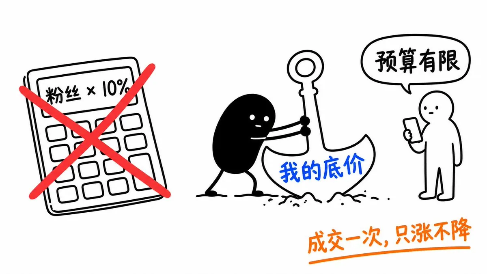
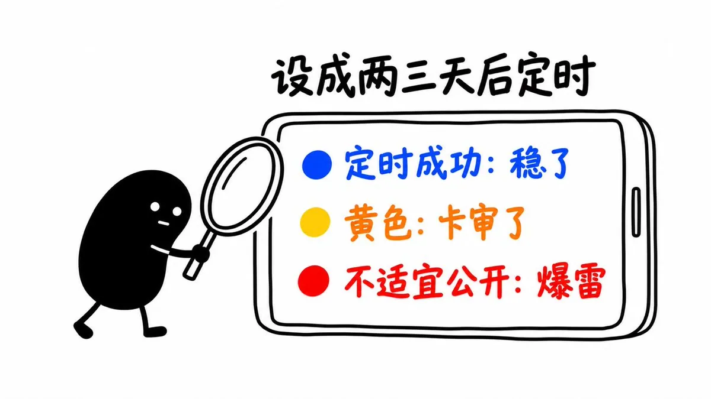
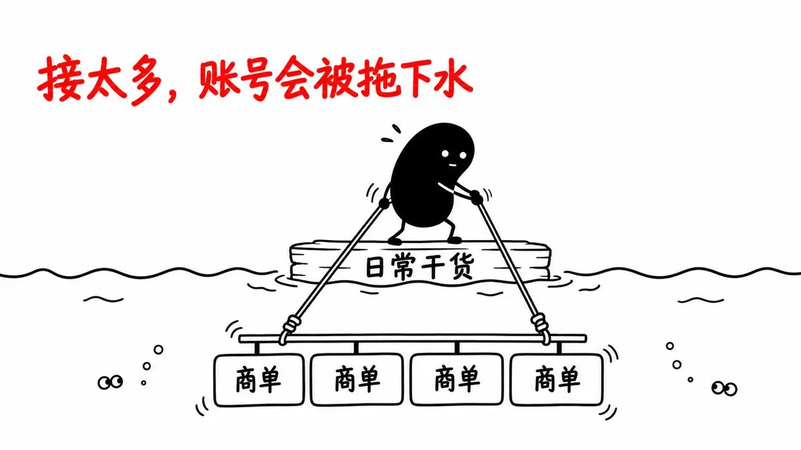
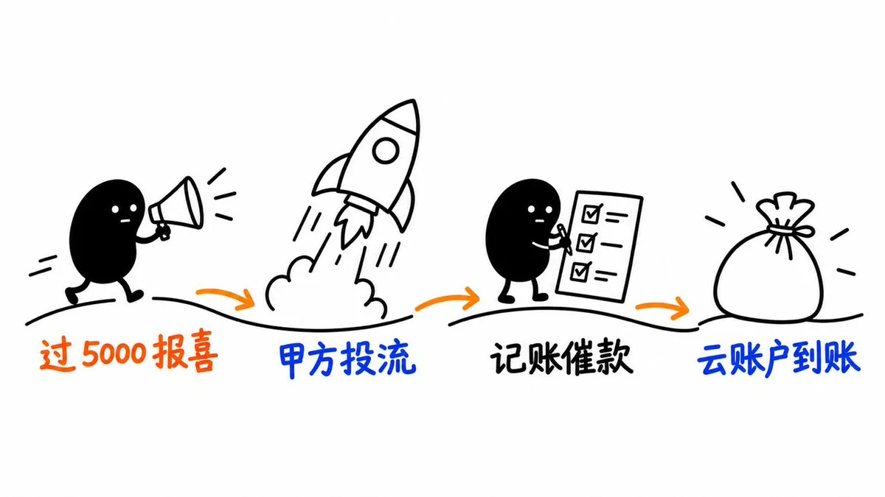

# Leaf Yeah!（@leaf_sanren）：抖音水下商单 0→1 实操手册——从首单接单、谈单报价、过审防限流到报喜回款

> 自媒体创作者水下商单全流程实战：破除「按粉丝 10% 报价」误区，用心理底价与动态博弈拿到确定收益；用定时发布当做探测器排查敏感口播与画面；DOU+ 测试隐形版权限流；平衡日常干货与商单比例维持账号人群标签；自然流量过 5000 主动向甲方报喜撬动二次投流与按时催账回款流程。

<!-- more -->

上个月，我在抖音连着发了 7-8 条水下商单，没有一条是我主动去找的。

水下商单，就是品牌不走抖音官方的接单平台（巨量星图），私下找博主做的广告。平台不经手、不抽成，所以平台也不护着你。

这篇从第一单讲到收钱，每一步都是我自己走过的。如果对你有帮助！请转发评论给我流量！！

小目录

1. 第一单：200 粉就有人找，你只管出爆款
2. 接单：拿到 brief，先问清 4 件事
3. 谈单：千万别按粉丝 X% 报价！！
4. 过审：别信发布助手，拿定时发布当探测器
5. 限流：投不了抖加，就是被隐形限流了
6. 养号：水下单天生被限制，怎么破？
7. 报喜和收钱：钱要自己追
8. 一些 QA

───

## 一、第一单：200 粉就有人找，你只管出爆款

水下单不用主动找，等着它上门就行。

我第一次被找上门的时候才 200 粉，一条视频小爆了，有人顺着主页加了我微信，给 50 块。

找你的大多是品牌方的市场、推广同学，或者帮品牌广撒网找博主的中介。他们手上有推广任务，每天都在刷爆款找人：

- 在抖音后台给你私信留言
- 顺着你主页留的痕迹（简介、其他平台账号）加你微信

不管你做口播、AI 视频还是 AIGC，只要持续有 5 万、10 万、50 万、100 万播放的爆款，他们就会来。

怎么出爆款，我之前写过两篇：

引用推文：Leaf Yeah! (@leaf_sanren)

https://t.co/4Ouh5spUKT

https://x.com/leaf_sanren/status/2086055837962023397

引用推文：Leaf Yeah! (@leaf_sanren)

https://t.co/vBbvmK3vXW

https://x.com/leaf_sanren/status/2089945993928442301

───

## 二、接单：拿到 brief，先问清 4 件事

对方加上你，开口通常是“有个合作感不感兴趣”，很多人不会说清楚是什么。

第一步：直接要 brief。 brief 就是他们的推广需求文档，写着推什么产品、要什么形式。大公司会把报酬也写进去，多数时候要你看完再单聊。

看完 brief，这 4 件事问清楚再开工：

- 产品和卖点：这个品你适不适合接。 我不太接办公类 AI 产品，我已经不在职场了，没那个场景，讲出来不真诚，数据也不会好。
- 报酬和结算方式： 下一节细讲。
- 发布时间和保留时长： 什么时候发、发完保留多久不删。brief 没写就主动问。
- 审核流程和露出要求： 有没有要求烧 logo、挂促销 tag，这类要求最容易让你被限流（第六节细讲）。大品牌一般审三轮：脚本、视频初稿、发布前的封面文案标签。确定合作就按发布日倒排一个 timeline。简单的 AIGC 合作，直接交成片 + 文案 + 标签，对方看一眼就发。

发完之后，一般要把作品链接发到合作群里，有的还要回填表格。

───

## 三、谈单：千万别按粉丝 X% 报价！！

### 先破一个说法：按粉丝量的百分比报价

网上流传最广的报价规矩是“按粉丝量的 10% 报”，1 万粉就报 1000。

这条规矩是坑。

粉丝量说明不了什么，甲方真正看的是你日常的数据。而日常数据值多少钱，行业里没有统一标准，全靠谈。

我 5000 粉的时候，心里的底价就是一单至少 1000，已经是粉丝量的 20%。 我研究过的案例里，还有人直接按粉丝量的 50%-80% 报。

所以决定价格的，是你心里给自己定的那个锚：你觉得自己值多少钱。

这个说法我之前专门发过一条：

引用推文：Leaf Yeah! (@leaf_sanren)

🤬 Damn! “接广按粉丝量的 10% 报价”---这大概是流传最广、也最坑人的一条规矩。 上一篇 dy 万粉复盘发出去，私戳里好多人问国内接广怎么报价，那就聊聊我的真实做法： 我接单从来不按粉丝 10%给！！！（太少了。。。） 甚至，我研究过的案例里，有人直接按粉丝量的 50%–80% 报。凭什么？凭底气，底气就 3 样： 一是数据。 大部分甲方只看数据、不看转化，所以一口价和底薪能要多高要多高——因为流量这东西，再老的老司机也说了不算，解释权永远在平台和算法手里，先把确定的钱拿稳。 二是制作。 你用 AI 做出一条 4A 广告公司级别质感的片子（...

https://x.com/leaf_sanren/status/2086274263766757500

### 再搞清楚：钱有几种给法

- 一口价： 最常见。能拿一口价就先拿，流量这东西谁都说了不算，先把确定的钱拿稳。
- 按播放量结算： 有的会跟你对赌播放量。接之前一定问清楚有没有对赌、怎么算。
- 按注册、拉新结算： 很少。国内水下单大多是做品牌宣传，不太看具体转化。

还有两个能多要钱的地方：

- 多平台组合价： 你小红书、视频号也有号，可以打包报，多一个平台大概能多要两成。
- 数据对赌加价： 比如每个平台赞藏到多少，再加几成。

### 报价太高、对方嫌贵、说预算有限，怎么办

这几种情况你都会遇到，应对是同一套：

- 对方不接，就不接。 他们是主动找来的，你还在出爆款，就会一直有人来。
- 连续三单都谈不拢， 说明锚定高了，降一点再试。
- 这个价只要成交过一单，就咬死它，以后只涨不降。 老客户可以给一点点优惠。
- 对方说“预算有限”“不是我能定的”： 告诉他，我的底线就是这个价，再低就不接了。

我很多次就是这么守住的，守的还是涨价后的底线。对方说要再看看，一两周后又回来成交。

最夸张的一次，一个 AIGC 厂商找我合作，他开的价我嫌少，直接拒了，报了我的底价，他一直没回。后来他回来给了一口价，正好是他最初开价的 3 倍。

引用推文：Leaf Yeah! (@leaf_sanren)

🤯笑死，我好像不小心把一个商单谈成了对方开价的 3 倍。 之前那条抖音爆款引来个 AIGC 厂商找合作， 他开口报的价我嫌少、直接拒了； 报了自己的底价，还要流量结算收益，结果他一直没回， 我寻思——得，黄了。 结果今天他回来一口价，一算，正好是他最初那个价的 3 倍😄 （其实原价稍微长点我就从了） 不得不说，有爆款案例，就是有底气：敢不接烂单、敢开口报价、敢转身走。

https://x.com/leaf_sanren/status/2090004826470170948

### 为什么守价有用：这是一场动态博弈

你只看得到一个中介，他手上同时在找很多博主。

- 他找完你，在市场上找到更便宜、数据也不差的，就不会回来了。那说明你的价确实高了。
- 他找了一圈没找到合适的，就会回来找你。
- 有时候是月底了，他还有量没完成：别的博主答应了没交付、来不及发，他急着补数。这时候他宁可自己少拿几百块提成，也要成交。

中介跟你砍价，砍的其实是他自己的提成，所以会咬住不放。

不可控的部分不用管，你只管一件事：这个价对得起你的劳动。 然后看市场反馈，该调就调，该守就守。

───

## 四、过审：别信发布助手，拿定时发布当探测器

接水下单，第一关是能不能正常发出去。

营销意图在各个平台都很容易被审核拦下。水下单是私下交易，平台吃不到分成，审得自然更严。

### 别信“发布前助手”

抖音发布页的检测助手，经常显示“未见异常”，一发出去就是“不适宜公开”。

我的办法是拿“定时发布”当探测器： 把视频设成两三天后定时发布，提交后看状态：

- 定时成功、日期显示蓝色：稳了
- 定时成功、日期显示黄色：卡审了，有雷
- 直接“不适宜公开”：爆雷

确认没问题，再取消定时，正式发。

### 视频被“不适宜公开”，怎么找是哪儿的问题

分段上传，一段一段试，缩到具体哪一段，再看是画面、字幕还是口播的问题。

口播特别容易被忽略。抖音会把你说的话转成文字来审。我有一条测评视频，画面干净，就因为口播里一句“大家可以看一下”，被判成引导营销、进了人工审核。把这两句掐掉，立刻就过了。

所以接商单的口播稿，像“大家可以看一下”“快去试试”“点击下方链接”这种引导话术，能删就删。

审核规则更细的部分，我之前写过两条：

引用推文：Leaf Yeah! (@leaf_sanren)

🤬关于国内自媒体合规发布，分享 2 招，都是血泪教训。 还有 2 句掏心窝子的话，放最后。 1. 商单可以用这个：https://t.co/ukv28G1rPr，我试过，一些风险提醒还可以的。 2. 日常有个骚操作： 抖音可以点定时发布，保两三天以后发。提交之后，要看是定时发布成功、一直审核，还是不适宜公开。 千万不要用发布前的“抖音发布助手”，那个不准。经常是发布助手显示“未见异常”，但发出去却是“不适宜公开”。 具体看你聊什么内容，这很复杂，官方没有明文规定。常见的问题包括但不限于： 1. 讲登录； 2. 截屏时暴露了网址； 3. 提到了“GitHu...

https://x.com/leaf_sanren/status/2076302921776369825

引用推文：Leaf Yeah! (@leaf_sanren)

接着上一条说！保证视频不被🍠 dy 审核卡住！！ 把我的过审 土办法 摊开讲讲。 先说个反常识的：抖音那个「发布前助手」，别信！！！ 它经常显示“未见异常”，你一发出去就是“不适宜公开”。 我的办法是拿「定时发布」当探测器： 把视频设成定时、时间挑两三天后，提交完看它状态 定时成功（发布日期显示蓝色） = 稳了！ 定时成功（发布日期显示黄色） = 卡审了，有雷。 直接“不适宜公开” = 爆雷。 确认没问题，再手动取消定时、正式发。 比发布前那个检测准太多了。 --- 要是真被判“不适宜公开”，怎么找是哪儿的锅？ 分段上传，一段段试，缩到具体哪一段...

https://x.com/leaf_sanren/status/2082273904345977261

───

## 五、限流：投不了抖加，就是被隐形限流了

过审之后还有一种更隐蔽的情况：

作品能正常发，后台显示账号和作品都正常，但播放就是上不去，可能卡在 1000 以下。

这时候先去试投一下抖加（DOU+，抖音的官方加热工具）。

投不了抖加，就说明有问题。 大概率是素材有版权风险，平台不会提醒你，直接悄悄限流。

做 AIGC 最容易踩：拿影视片段做复刻，或者画面里有名人、影视角色的脸。

我自己踩过一次。一条三国题材的视频，能发，就是投不了抖加。最后定位到画面里有一张吕布的脸：生成那张图时，我拿了老版电视剧的剧照当参考图锁脸，结果演员本人的脸被带进了成片。

把那一张脸遮住，整条视频立刻就能投了。

解决办法就是改：删掉那段画面，或者遮挡。

───

## 六、养号：水下单天生被限制，怎么破？

这一节我犹豫过要不要写，但它可能是全文最重要的。

接水下单，要做好自己投流的准备。

植入做得再自然、过审再顺利，水下单的流量多少都会被压。

我有一条商单，正常过审、正常发出去了，发布之后平台才回头判违规、限流。原因是甲方 brief 要求画面烧上促销 logo、文案挂上促销 tag，不加就不结算；我照做了，平台判的就是“营销浓度太高、没走官方推广渠道”。

更麻烦的是，这种违规记录跟着账号走，3 个月内消不掉，删视频也没用。

引用推文：Leaf Yeah! (@leaf_sanren)

🤬Shit！跟大家说个挺艹🥚的事。 我一条商单视频又被甲方投流了，数据在跑 但我一点都不想要。。。 因为这条早被平台判了违规、限了流。 魔幻的是，它明明正常过审、正常发出去了， 发布之后平台才回过头说你违规。 前脚放行，后脚限流。 违规点在哪？ 甲方 brief 里白纸黑字写着：画面得烧上他家促销 logo、文案得挂上促销 tag，不加，这条就不算结算、拿不到钱。 可我一照做，平台就判「营销浓度太高、没走官方推广渠道」，一巴掌拍下来。 甲方的要求和平台的规则，直接对着干， 我夹在中间两头不是人。 最操蛋的是，违规跟着账号走，3 个月内消不掉🙂...

https://x.com/leaf_sanren/status/2091748941885067406

所以接单时看到 brief 里要求硬性露出 logo、促销信息，要先想清楚这个代价。发得越多，越要靠投流才能把数据撑住。

这个问题只有一个解法：平衡商单和日常干货的比例。 用日常的好内容、不带广告的内容把账号托住，你才能一直接下去。

我上个月连发了七八条，对账号伤害非常大。观众不傻，一眼就看得出是广告；平台也会慢慢识别出来。

不只是我这么觉得。做小红书的狗哥，有个月接了 11 条商单，号基本不涨粉，于是花钱请了一位在服务公司做投放的资深 PR 做咨询。对方给的建议是：

一个月至少发 2 条日常内容。 每条都是商单，平台对你的人群画像会越来越窄，涨粉和数据都会停住。

引用推文：狗哥笔记 (@gbroai)

花 1000 找大 pr 做的咨询，免费分享给大家，做小红书接商单必看 先说我当时的处境：AI 工具赛道，小红书 8w 粉，8 月一个月做了 11 条商单，看着挺忙。但接的全是急单，没有一条是提前一个月预约的；号基本不涨粉；一家 MCN 在催我签全约，我拿不定主意。 这种问题网上搜不到答案，信息都在服务公司和机构的小圈子里。所以我把 8 个问题整理成一份文档，花钱请一位在服务公司做投放的大 PR 逐条回答。下面是她的原话加我的理解，能用的都在这。 一、要不要签 MCN 她第一句就说我对返点有误解：小红书头部机构签大服务公司年框，返点基本 25% 起...

https://x.com/gbroai/status/2112528740752490591

所以别学我一个月连发七八条。 商单和日常内容穿插着发。

───

## 七、报喜和收钱：钱要自己追

很多人发完商单就等着收钱了。中间其实还有一步很值钱：报喜。

### 先报喜：自然流量过 5000 马上去说

水下单很难跑，甲方心里也有数。所以只要自然流量过了 5000 播放，马上去跟甲方报喜。

报喜有两个用处：

- 维护关系： 他下次还会找你，你以后涨价也有底气。
- 撬动投流： 数据好，甲方可能愿意自己掏钱给你投。

我有一条商单，自然流量七八千，跟甲方一直处得不错。报喜之后，甲方直接给这条投流，连投一个月，跑了 300 多万播放，还给我涨了三五千粉。

数据不好就别吱声了。

### 再收钱：从发布到到账的完整流程

1. 发链接： 作品发出后，把链接发到合作群，按要求回填表格。
2. 报销垫付的会员费： 为了做内容自己充的甲方产品会员，一般实报实销，留好付款截图。
3. 等结算： 大厂一般比较快，发布后一两周会主动找你结算。小厂可能拖两个月，财务流程慢、老板休假没人审批，对接人也没办法。
4. 自己记账、到点就催： 每一单什么状态、什么时候该到账，自己记清楚。
5. 交信息： 结算时对方一般会要你的身份证和银行卡信息。
6. 绑小程序： 对方会让你绑定一个小程序，钱通过小程序里的云账户打给你。每家甲方用的结算主体可能不一样，换一家就重新绑一次。
7. 到账： 个税一般在这个流程里代扣代缴，不用自己另外报。

───

## 八、一些 QA

Q：返点要不要给？

有的中介会要返点，就是你拿到报酬后私下退一部分给他。这个看个人，我是坚决不给的。我可以在视频发出去后自己掏点钱投流，但不给返点。

Q：不签合同，被赖账怎么办？

水下单一般不签合同，全靠口头约定，确实有风险，所以才叫“水下”。我的做法是优先接大家叫得上名字的厂商和品牌，赖账的概率小很多。

Q：多少粉才能接？

几百粉就会有人找，但价格低。网上常说接商单月入过万，真要一单报到三五万，在现在涨粉这么难的环境下，可能得有 20 万、50 万粉。而且那只是报价，返点、损耗、你自己投进去的成本，没人会告诉你。

Q：会不会反复改稿？

看甲方。我做的基本都是一稿过。但我知道有些大厂改起来挺折磨人，接之前心里有个数。

───

接商单，说到底是做流量生意。

爆款负责让人找上门，锚价决定你赚多少，日常干货决定你能接多久。

怎么把甲方的卖点讲好、同时拿到好流量，这件事没有学完的一天，我也还在这条路上。

## 相关页面

- [[concepts/selfmedia-compound-model]]
- [[concepts/wechat-image-post-account]]
- [[sources/missle8z-information-arbitrage-8-business-models]]
