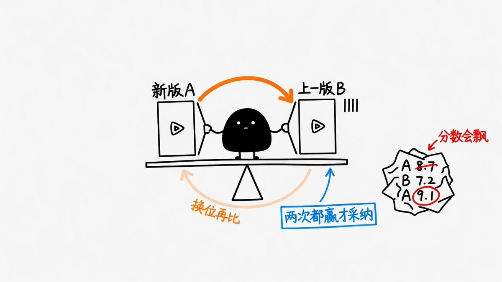
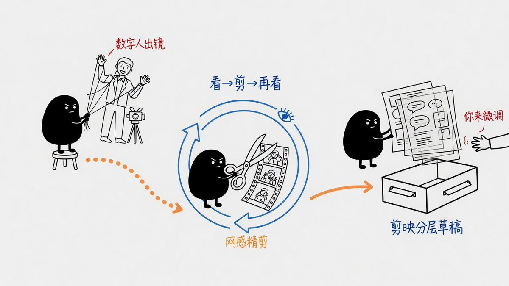

# Leaf Yeah!：SeeCut 开源管线——AI 自动网感精剪（数字人+看片挑刺+剪映草稿）

> 7 万人围观的 AI 剪辑片子全流程开源。四个关键设计：① Gemini 真看懂视频（而非纯抽帧）当评委；② 不打分只问「哪条更好」的双向盲测循环（最多 3 版收敛）；③ 宁截真图不画假界面；④ 说话人露不露脸看这句是「对你说」还是「给你看」。三步走：数字人出镜 → 网感精剪 → 剪映草稿微调。

<!-- more -->

前两天我发的那条 AI 剪辑 demo，比我预想的火多了。7.5w 人浏览，给我这小破号涨了 400 粉。

评论问得最多的就两句：怎么做的？能不能开源？

能！！

整套流程我做成了开源项目 SeeCut，一句话就能装。

> 引用推文：Leaf Yeah! (@leaf_sanren)
> 🎉🎉✌️啊啊啊爽了！兄弟们！以后我的视频，口播交给数字人拍，网感剪辑全交给 AI 自动跑通 😎 今天 Opus 5.5 帮我把最后一公里啃下来了：① 让数字人生成我的口播视频（视频 1）；② 派 Agent 套用训练的"网感"动效做 A/B-roll 编排；③ 自动出片，直接推成剪映工程文件（图 2），供我微调。这套东西我默默搞一个礼拜，就打算用在口播视频的网感剪辑上！！！！真的！我真的不想再哼哧哼哧拍完视频，又对着时间轴调素材弄半天。。。其实，市面上 AI 剪辑的产品和开源仓库很多，但说实话，得有一半多，我想复刻它宣传样片出来都费劲！...
> https://x.com/leaf_sanren/status/2102745561732419772

小目录

- 1｜为什么自己做：AI 剪辑都停在粗剪
- 2｜一句话安装，剩下的 AI 带你走
- 3｜为什么它能剪出网感：4 个关键设计
- 4｜三步流水线：数字人 → 网感精剪 → 剪映草稿
- 5｜还不够好的地方

⭐ 开源地址：[github.com/YeJe-cpu/SeeCut](https://github.com/YeJe-cpu/SeeCut)

───

## 1. 为什么自己做：AI 剪辑都停在粗剪

我想要的，是 AI 自动化的网感精剪。

注意，是精剪，不是粗剪。

剪气口、去口癖的工具，网上一大把。我要的是知识区那种口播：画面有料，每句话都有东西跟着动，讲到哪个产品，就出现哪个产品的真界面。

过去 3 周，我把能找到的 AI 剪辑开源项目几乎试了个遍。

结果很扎心：

- 效果到不了。大多停在粗剪，动效谈不上丰富完整。
- 样片复刻不出来。照着 README 一步步跑，我几乎做不出它们宣传片里的样子。
- 全靠嘴喷。大家都知道 Remotion、HyperFrames 能做动效，可真要用，得跟 AI 来回改几十轮。

有那个时间，我还不如自己打开剪映，一帧一帧手动剪完。

真的很痛苦。

没办法，只能自己做。我挨个拆别人的项目，想清楚自己到底要什么，把最好用的部分拼成一条新管线。

做完没抱什么期望，随手发了。结果评论区、私信全在问教程。

那就开源吧。

## 2. 一句话安装，剩下的 AI 带你走

把这句发给 Claude Code（或其他能跑 skill 的 agent）：

```
请从 https://github.com/YeJe-cpu/SeeCut 克隆仓库，把 skill/seecut 安装到 ~/.claude/skills/，然后运行 skill/seecut/scripts/preflight.sh，帮我把必需项全部装到通过，装好后告诉我怎么开始。
```

要提前准备的只有一样：一个能让 AI 看视频的 Antigravity CLI（为什么非它不可，下一节第一点细说）。其它环境，AI 会一项项检查、一项项带你装，仓库 README 里都写着。

装好后，准备一个素材文件夹：一段口播，外加几张口播里提到的东西的截图（可选）。新开对话：

```
/seecut 素材：<你的文件夹>
```

然后它自己跑：看懂素材 → 截证据 → 编排 → 渲染 → 自己看片挑刺、改版 → 交给你成片和分层工程包。

第一次建议先拿 20-30 秒的片段试方向，满意了再跑全片。

## 3. 为什么它能剪出网感：4 个关键设计

> ① GPT 和 Claude，其实看不懂视频

这事挺反直觉的。

GPT、Claude 这些模型，根本看不懂视频。它们只会暴力抽帧，把视频切成一张张截图去看。动效顺不顺、节奏对不对、人像是不是在乱跳，它们一概不知道。

这也是为什么，很多人想让它们拆解爆款视频、写提示词去复刻，总是失败。

连视频都理解不了，怎么可能复刻得出来？

很幸运的是，Gemini 的模型底层，是真的能理解视频的。

所以 SeeCut 把 Gemini 接了进来：看懂素材靠它，剪完挑刺也靠它。

这也是名字的由来：

> See，先看懂；Cut，再动剪刀；剪完再看，再剪，一圈一圈转。

还有一个小细节：AI 怎么看，取决于你怎么问。同一条片子换个提示词，它能从"标准"说成"土味"。所以当评委的提示词，我们先拿答案已知的片子校准过，才让它上岗。


> ② 自己剪、自己挑刺、自己改：一个不用你盯的循环 loop

剪完一版，它不交差，自己先转起来一个循环♻️：

查硬伤 → 跟上一版比 → 赢了才留下 → 找出离好片子还差在哪 → 改出下一版。

整个过程不用你盯着，你只看最后的成片（我就是）

怎么比？不打分，只问一句：哪条更好？

左右交换位置各比一次，两次都赢，才采纳新版。

为什么不打分？实测过，同一条片子让 AI 打两次分，能差出 20 分。拿这种 AI 评分当方向，只会越改越偏。而且 AI 总会自评越来越高分

什么时候停？最多 3 版，每版必须有肉眼看得出的大改动；比不过上一版，或者只剩小修小补，就停下来交付。

（demo 那条是早期版本，改了 5 版；现在收敛到最多 3 版，够用，也更快。）



> ③ 宁可截真图，也不画假界面

口播提到什么，它就去截真的网页、界面、案例当画面。

这是 Opus 5.5 给我的一个意外启发。

之前 AI 为了把画面"填满"，会画一堆假代码窗、假 App 界面，越满越丑。改成截真东西之后，没有额外的 B-roll，照样做得很有料。


> ④ 露不露脸，看这句是"对你说"还是"给你看"

我拆了口播类 AI 博主的 536 个镜头，总结成一张决策表：这句口播是什么功能 → 画面该怎么处理。

里面最好用的一条：

说话人露不露脸，取决于这句是"对你说"，还是"给你看"。

讲观点、建立信任时，人露脸；演示操作、摆证据时，人缩到角落或者干脆隐去，把画面让给信息。

决策表之外，还有设计令牌（颜色、字体、质感）、组件库、逐镜施工单，一层压一层。

组件大多直接用 HyperFrames 官方的，不用每个动效都跟 AI 从零磨，所以写起来很快。


## 4. 三步走：不拍视频，也能出一条网感口播

第 1 步 · 数字人：替你出镜

两条路：

- 基础版：一张照片（HeyGen AV4），约 $0.04/秒。精剪里人像多半缩成小窗，照片版的瑕疵基本看不出来。
- 进阶版：数字分身（HeyGen AV5），用一段真人视频训练，更真，约 $0.12/秒。

一个小技巧：配音别用数字人平台的内置音色，偏假。 

我用的是豆包语音合成，demo 里的声音就是这么来的。

有自己拍的口播，这一步直接跳过。数字人怎么调得像真人，门道很多，下一篇单独细讲。

第 2 步 · 网感精剪：替你剪

就是上一节那套：

看懂素材 → 找真证据 → 编排 → 渲染 → 自己看片挑刺 → 改出下一版。

一圈一圈转，直到新版赢不了上一版（最多 3 版），

才交到你手上。

第 3 步 · 剪映草稿：最后一口，留给你

除了成片，它还能推一份剪映草稿：纸底、人像、信息层、原声、音效各占一轨，哪里不满意，直接在剪映里拖。

这一步要自己装第三方的剪映草稿引擎（jianying-headless）。没装也不影响，照样拿到成片和分层素材。细节第三篇讲。



## 5. 丑话说在前：它还不够好的地方

- 慢：一条 25 秒的样片，要跑 1 小时左右。（中间要迭代 2-3 版，每版都完整渲染一遍，再让 AI 看片对比。）
- 音效：能按画面和文案自动配，但目前只到"能用"。
- 录屏 + 角落头像这类素材，当前版本测得还不够。
- 目前只在 macOS 上实测过。

它不完美，但已经能稳定出片。遇到问题直接开 issue；想一起改的，PR 非常欢迎。

协议是 PolyForm 非商业：个人学习、自己玩，随便用；要商用，请先来找我聊。用到的第三方组件和服务，按它们各自的协议来。

───

这套东西站在很多人的肩膀上：HyperFrames 的官方组件扛起了大部分动效；Talkcraft @VincentWei93 的剪辑管线思路；Hypit 的爆款拆解逻辑；xilo @xilo2991 的 Playbook 思路；Rachel @Zesee 的数字人流程启蒙；逸尘 @gengdaJ 的剪映草稿引擎。谢谢你们。

───

数字人出镜，AI 看片，自己挑刺，推进剪映。

7w 人围观的片子，口播我没拍，剪辑我没剪，最后只在剪映里调了一下音量，发出来。

⭐ github.com/YeJe-cpu/SeeCut 觉得有用，给个 star。

欢迎 issues 和 PR！我希望这是一个可以长期迭代的项目！

> 下一篇：细讲数字人怎么调得更像真人

## 相关页面

- [[patterns/story-studio-video-pipeline]]
- [[concepts/ai-content-pipeline]]
- [[sources/xaiwind-jianying-skill-guide]]
- [[sources/story-studio-video-account-pipeline]]
