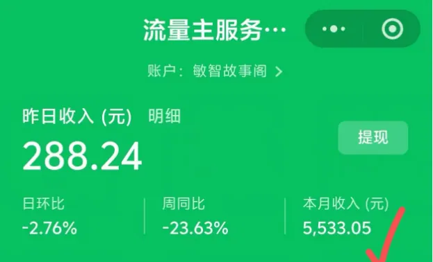
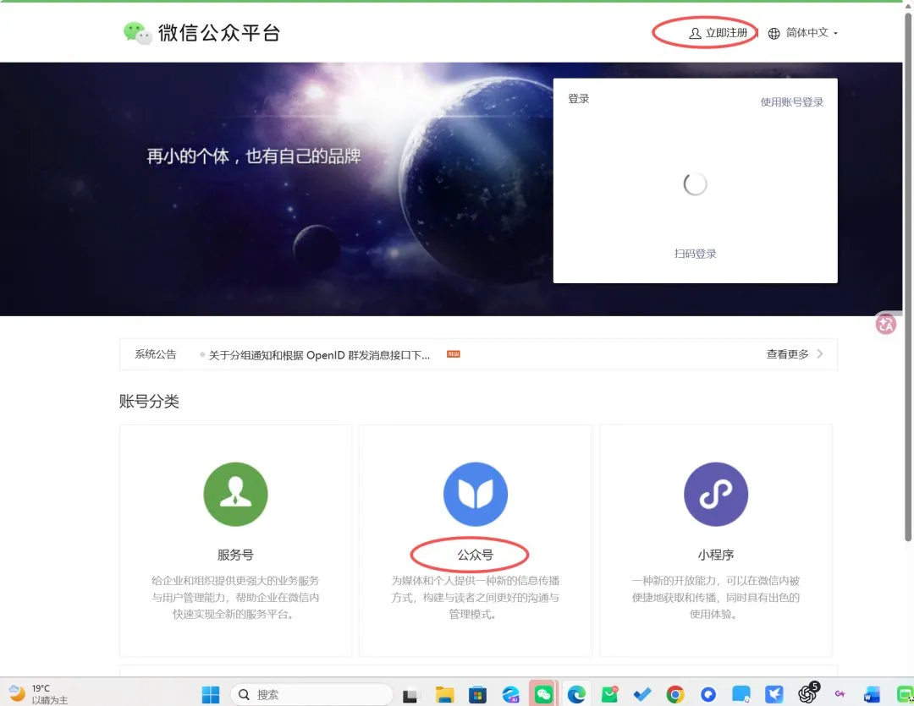
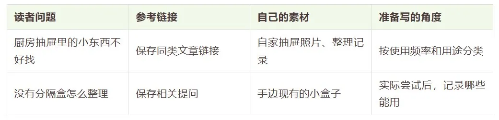
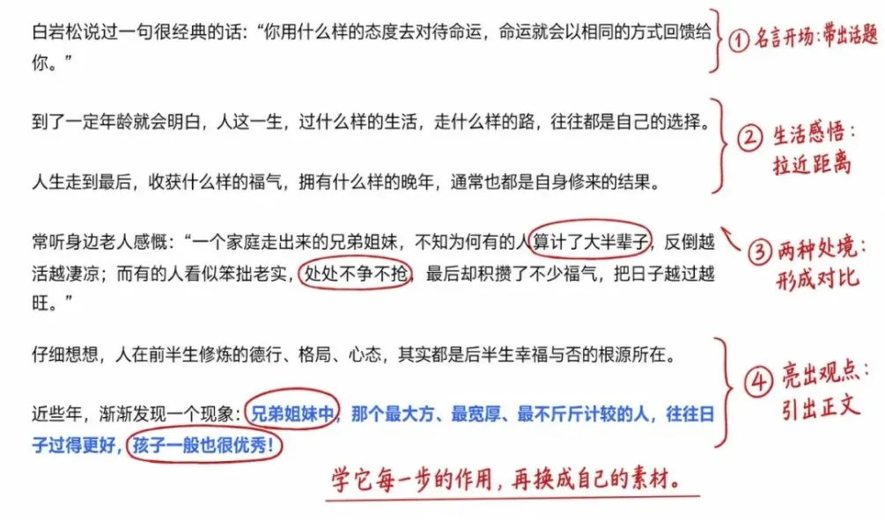
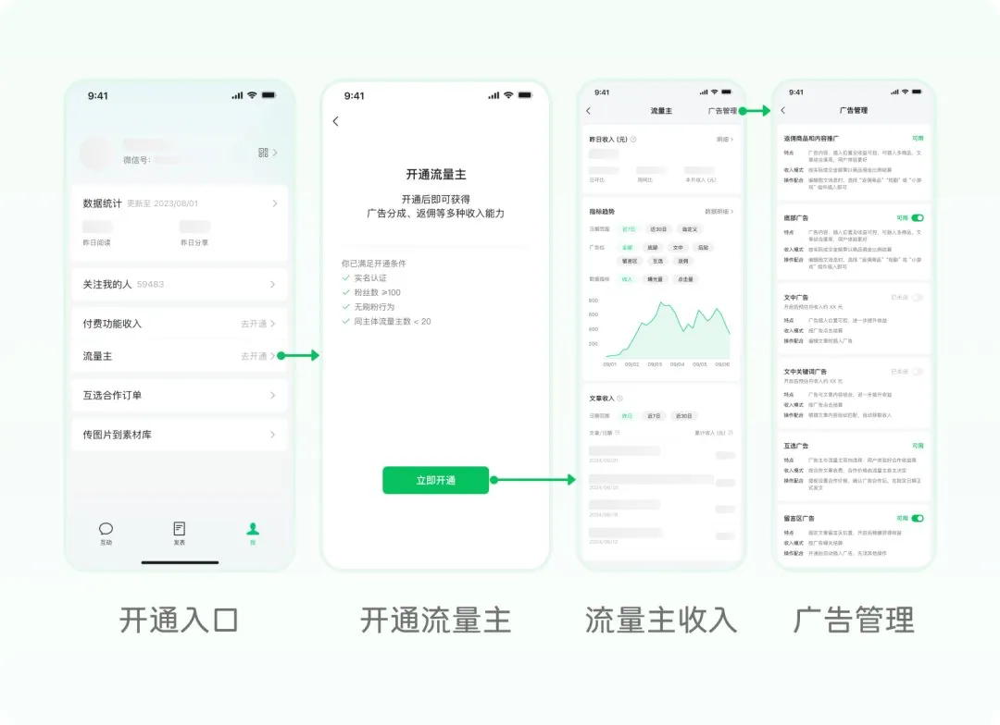

# 乐博士在路上（@lele898898898）：21 天手把手做一个能赚到钱的公众号——赛道选择、对标拆解与冷启动保姆级教程

> 零基础创作者 21 天公众号起号实战路线图：深度剖析生活/怀旧/实拍/美食/穿搭/家庭等 10 大低门槛赛道特征；拆解搜一搜找对标 3 个黄金筛选法则；详述爆款选题库搭建、三段式高吸引力正文撰写结构、图片搜集与留白排版，以及冷启动数据观察与流量主开通变现闭环。

<!-- more -->

你好呀，我是乐博士。

公众号贴图，可能是现在普通人能做的最好、最简单的赛道。

但很多小伙伴想做公众号，打开后台，却不知道该写什么；收藏了不少教程，真要动手，又卡在选方向、找选题和写第一篇。

如果你也卡在这里，就跟着下面的步骤做一遍。

我把这轮练习安排成 21 天。你可以按自己的时间调整进度；能否开通收益，要看账号是否符合条件，收入还要看后续的内容表现。

## 第一部分：赛道选择

第 1—3 天，先了解下面 10 类内容，再选出自己能做的方向。

1. 了解赛道

①生活

分享日常生活中的发现、见闻和实用经验。

可写方向：菜市场见闻、小区生活、有趣招牌、整理收纳、日常省钱。

②怀旧

写过去的人、事、物，分享回忆，讲讲以前和现在有什么不同。

可写方向：童年零食、老物件、旧街道、年代生活、经典人物。

③真人实拍

用自己拍摄的照片记录真实生活，再配上经历和观察。

可写方向：工作日常、县城生活、退休生活、家庭记录、出行见闻。

④美食特产

分享吃什么、怎么做，以及不同地方的饮食特色。

可写方向：家常菜、地方小吃、应季食材、家乡特产、一人食。

⑤穿搭

分享不同年龄、身材的人，平时和上班怎么穿衣服。

可写方向：通勤穿搭、平价搭配、小个子穿搭、中年穿搭、旧衣搭配。

⑥婚姻家庭

分享夫妻、父母和孩子相处时遇到的问题与做法。

可写方向：夫妻沟通、亲子相处、家庭分工、和父母孩子相处、家庭故事。

⑦三农

记录种地、赶集和农村生活。

可写方向：种菜、干农活、农村集市、乡村变化、家乡风俗。

⑧体育

围绕熟悉的运动项目，整理赛事信息、分析比赛、分享观赛感受。

可写方向：赛事信息、比赛复盘、运动员故事、经典比赛、球迷话题。

⑨影视

围绕影视作品，分析人物、情节和不同选择。

可写方向：热播剧讨论、人物分析、经典老剧、原著对比、结局解读。

⑩成长 IP

记录自己学习、实践和解决问题的过程，分享做法与收获。

可写方向：读书学习、写作练习、职业成长、技能学习、个人复盘。

先从中圈出 1—2 个感兴趣的方向，接着找同类账号。

2. 搜索对标账号

打开微信搜一搜，输入具体关键词。

想写生活，就搜“小区生活”“菜市场见闻”“厨房收纳”；想写影视，就搜剧名、人物名，再加上“人物分析”“结局”等词。

找到相关文章后，进入作者主页，按 3 个标准来筛：

1. 最近还在更新。查看近期文章的发布日期。

2. 阅读明显高的文章。把它最近几篇文章的阅读量放在一起，挑出明显高出的那几篇。能看到点赞、分享或留言次数的，也分别记下来。

3. 内容集中在同一方向。看它经常写谁、讨论什么问题。

先留 3—5 个账号，再各选几篇文章，存下链接。不要只凭一篇高阅读，就认定这个方向适合自己。

3. 做好充足准备

拿出备忘录，对照刚才找到的内容，从 4 个维度分析：

- 素材来源：我能拍什么、经历什么，或者从哪里查资料？

- 起步选题：我现在能写出哪 5 个题目？

- 个人材料：我能加入哪些经历、细节和判断？

- 时间安排：做完一篇需要多久，我每周能拿出多少时间？

比如，你想写生活收纳，就先列“抽屉里的封口夹怎么放”“锅盖怎么收”“调料瓶怎么摆”等具体题目，再思考自己能否实际整理、拍照，并记录使用感受。

如果一个方向需要长期追比赛，你却很少看球；需要大量实拍，你又没有拍摄条件，就先放弃，优先选手里有材料、愿意继续做的方向。

4. 写下一句话定位

把选定方向写成一句话：

我主要写给谁看，围绕什么问题，分享什么内容。

比如：

我主要写给住小户型的上班族，围绕居家整理，分享自己试过的收纳办法。

接着检查刚列的 5 个题目。符合这句话的留下，偏离方向的先移出去。

## 第二部分：注册账号

第 4 天，把账号开起来。已有账号的人，直接检查名称、头像和简介。

1. 准备资料

准备能正常收信的邮箱、本人常用手机号、身份信息和微信，放在手边。需要填写或验证哪些资料，跟着官方页面操作。

同时写好账号名称和简介，选好头像，避免填到一半又停下来想。

2. 进入官方页面注册

用电脑打开微信公众平台，手机打开公众号助手，点击“立即注册”。个人写公众号，具体参考网站指引

3. 设置名称、头像和简介

把第一部分确定的定位拿过来，逐项填写。

名称要准确好记。比如做厨房收纳，可以围绕“厨房”“整理”“收纳”组合名称，再到平台检查是否可用。

头像选清楚、容易辨认的图片。真人头像、自己拍摄的相关照片都可以，先保证缩小后也能看清。

简介直接写分享什么。例如：

记录小户型整理，分享自己试过的厨房、衣柜和杂物收纳办法。

填完后，用微信查看账号主页，核对名称、头像和简介有没有填错，是否与准备写的内容一致。

## 第三部分：内容创作

第 5—14 天，按下面的流程完成并发出第一批文章。可以先安排 3 篇，熟悉后再调整数量。

1. 收集选题

打开已经选好的对标账号，先收集 10 篇同方向文章。

每篇记录四项：标题、链接、读者关心的问题、自己能补充的材料。遇到评论区反复出现的问题，也一起记下来。

用备忘录或表格存下来，比如做厨房收纳：

2. 选一个小问题

从选题库里挑第一篇，先看三个条件：问题具体、手里有素材、自己能讲清楚。

比如，先把“怎样整理厨房”缩小成“抽屉里的封口夹、量勺和削皮刀怎么放”。

接着收集自己的材料：拍下整理前的样子，记下哪里不好用；实际调整，再拍过程和结果；用过以后，补上顺手和不顺手的地方。

写读书就记下书名、书里的观点，以及自己什么时候用过这个方法；写影视就核对人物、情节和前后背景。把查到的信息与自己的看法分开记。

3. 拆爆文

选一篇与当前题目接近的文章，按顺序做四条批注：

1. 拆标题：圈出人群、问题和吸引人的地方。

2. 拆开头：记下作者先写了什么，怎样进入主题。

3. 拆正文：给每一部分标出作用，看它先解释什么、后回答什么。

4. 拆结尾：记录它怎样回应主题，或带出下一步行动。

拆解要写具体。比如“先写东西不好找，再交代分类方法，最后补使用注意”，比只写“总分总”更方便自己动笔。

拆完就关掉原文，只看批注和自己的素材重新列提纲。

4. 列提纲，写正文

继续用厨房抽屉示范。假设准备介绍按使用频率和用途整理的方法，可以先列：

- 开头：写清东西混放、使用时不好找的具体问题。

- 第一部分：取出物品，分出常用和不常用的东西。

- 第二部分：把常用物品按用途分组，分别确定位置。

- 第三部分：用几天，记录哪些位置还需要调整。

- 结尾：交代这次方法适合什么情况。

把照片、做过的步骤和使用感受，放到对应的小标题下面，再写成完整的段落。

例如，方法段可以这样写：

先把抽屉里的东西全部取出来，分成常用和不常用两堆。再把常用物品按用途分开放：量勺放一处，封口夹放一处，削皮刀单独放。把不常用的东西移到其他合适的位置，给常用物品留出拿取空间。用几天后，再调整不顺手的地方。

实际写作时，再加入自己的照片、物品数量和使用反馈。只记录自己做过、观察到的内容。

需要 AI 帮忙时，先给它你的素材和提纲，再要求它检查步骤遗漏、句子不顺和重复解释。涉及经历、数据和引用的地方，自己逐项核对。

5. 修改标题和初稿

先从正文中提取最具体的对象、问题和做法，再写标题。

比如，同样写抽屉整理：

记录一下今天的生活

可以改成：

厨房抽屉里的小东西怎么放？先按使用频率和用途分一遍

对照标题检查正文：标题写了分类，就补齐怎么分；写了摆放，就说清放在哪里。

最后读一遍全文，逐项修改：

- 删掉迟迟没有进入主题的铺垫。

- 把“提升、优化、整理一下”改成具体动作。

- 补上步骤中缺少的对象、顺序和条件。

- 核对人名、数据、引用和材料来源。

- 删掉重复解释，检查标题里的问题是否已经回答。

第一篇做完，继续用同一流程写第二篇、第三篇。第 14 天前，留下自己的文章链接和创作记录。

## 第四部分：运营方法

第 15—21 天，继续创作，同时回看第一批文章，决定接下来写什么、改什么。

1. 提前排好选题

打开日历，先给下一周留出具体时间，再安排题目。

比如，周一收集选题、整理素材；周二完成一篇；周四完成第二篇；周末回看反馈，准备下周内容。时间充足就增加，做不完就减少。

俱乐部的沛员在分享中提过，第一次遇到高阅读时，她忙着刷新后台、看留言和新增关注，反而没顾上后面的作品。

先列好接下来 3 个题目，把要用的照片和资料放在一起。有时间就提前写好下一篇，存进草稿箱。某篇文章阅读上升时，也照常写后面的内容。

2. 记录文章数据

从第一篇开始，建一张记录表：

日期｜文章链接｜选题｜标题｜阅读量｜阅读来源｜分享与留言｜新增关注｜收益

后台能看到哪项，就记录哪项，暂时没有的数据留空。

建议在发布次日记录一次，7 天后再补一次。对照不同文章时，比较发布后相近时长的数据，别拿刚发一天的文章与发了一个月的文章比较。

3. 对照清单，统改全文

把第一批文章的次日阅读量放在一起，找出阅读较高的那几篇，再分别看分享次数和留言内容。先按下面几项检查：

- 选题：是否围绕一个明确问题，是否与账号方向一致？

- 标题：是否写清具体对象和看点？

- 正文：标题说要讲的内容，有没有讲到？步骤和例子是否够用？

- 留言：读者在哪一步看不懂，还想问什么？

刚开始文章少，先留下记录，别急着认定某个改动一定带来了阅读增长。

4. 评论区是一个宝藏

遇到具体提问，先确认读者的情况，再给对应做法。

比如有人问“没有分隔盒怎么办”，可以这样回复：

你手边有大小合适的小盒子吗？先量一下抽屉和盒子，放进去试试，确认抽屉还能正常开合，再拿一个装封口夹。你现在最不好放的是哪种东西？

自己还没试过的办法，先实际试一遍，再补充使用时遇到的问题。

把反复出现的问题放进选题库。同样写厨房收纳，还能继续写“调料瓶怎么摆”“锅盖怎么放”“冰箱剩菜怎么分区”。每篇回答一个新问题，补一组新材料。

5. 按顺序排查低阅读

如果文章阅读很少，先确认三处：

1. 打开文章链接，确认内容能正常访问。

2. 查看后台通知和账号状态；有明确提示，就按提示处理。

3. 对照标题和正文逐项检查。标题只有“一点感悟”，就补上具体写什么；标题说有 3 个方法，正文只写了 2 个，就补齐第三个，或者改正标题中的数量。

连续出现异常时，保存文章链接、发生时间和后台截图，通过官方帮助或反馈入口说明情况。

不要仅凭一两篇低阅读，就注销账号或频繁换赛道。先留下具体作品和记录，才方便判断问题出在哪里。

6. 申请流量主，查看收入

想通过广告获得收入，就登录公众号后台，进入“收入变现—流量主”，查看哪些广告可以开通。

现在公众号程序化广告的粉丝数门槛已调整为 100；符合条件的创作者，也可以从公众号助手 App 的“我—流量主”进入。实际申请时，核对自己账号显示的全部条件。

暂未达到条件，就继续创作并积累真实关注。阅读量和收益分开看：哪类内容有人读、能带来多少收入，都用自己的记录判断。

到第 21 天，再写下三个决定：下周继续写什么，下一篇重点改什么，每周安排多少时间。

我在[写给想要提前退休的小伙伴！](https://mp.weixin.qq.com/s?__biz=MzU4OTkwNTgwNg==&mid=2247575870&idx=1&sn=d2529c0681da71c63176ccfe95feca10&scene=21#wechat_redirect)如果你愿意花21天去入门，那么你愿意用一年时间去赚钱么？

## 写在最后

我特别想跟你说一句话：你不用等到什么都会了，才开始写公众号。

有些问题，看再多教程也想不明白，写过一篇才能发现。

写得不顺，就改一段；不知道怎么讲，就找一篇同类文章来学。

你可以一边做，一边慢慢学会。

PS：我们整理了《公众号起号变现一本通》，有需要的小伙伴，可以来拿

## 相关页面

- [[sources/stanley-wechat-tietu-6000-words-monetization-playbook]]
- [[sources/xionghuanwei-wechat-official-account-traffic-monetization-rules]]
- [[concepts/wechat-image-post-account]]
- [[concepts/selfmedia-compound-model]]
