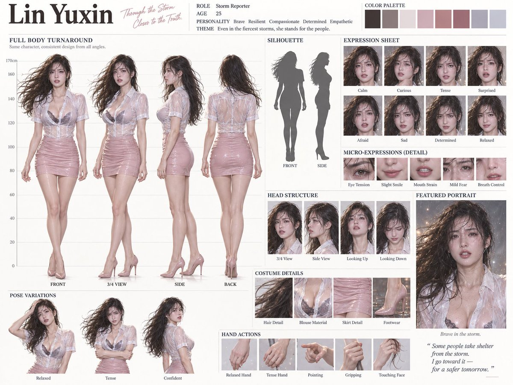
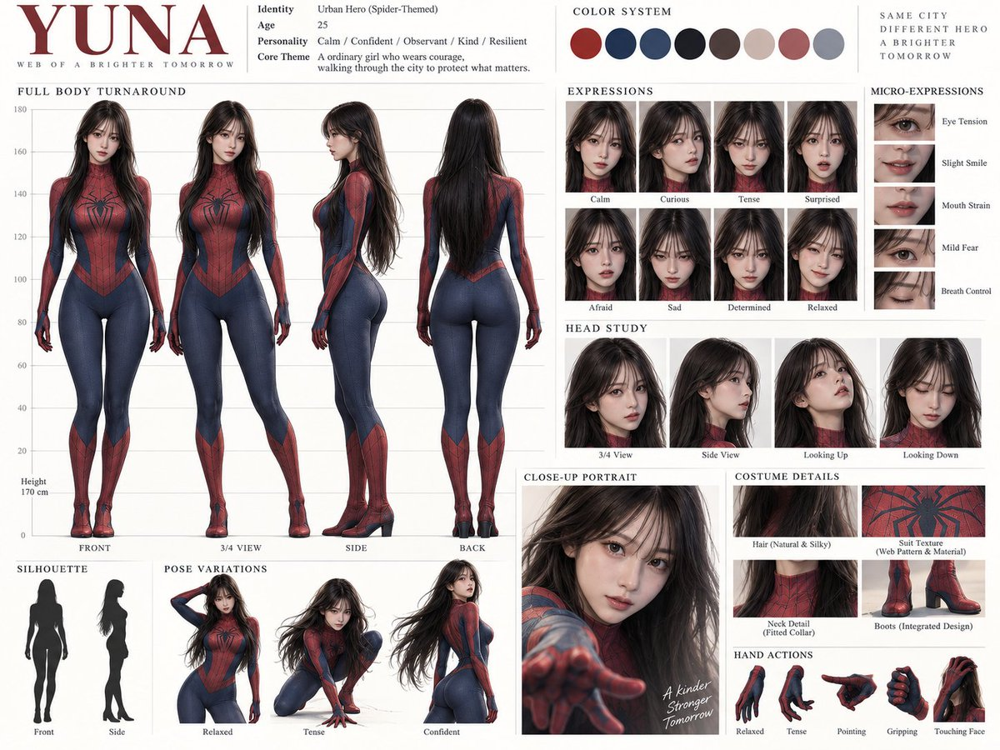
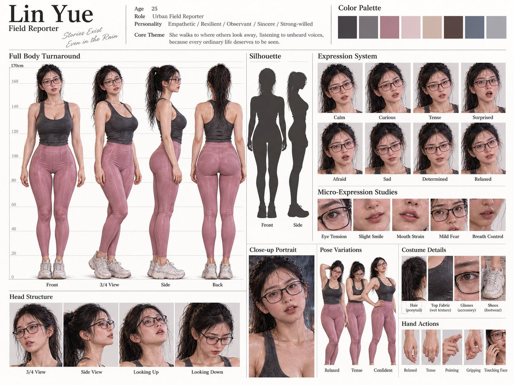
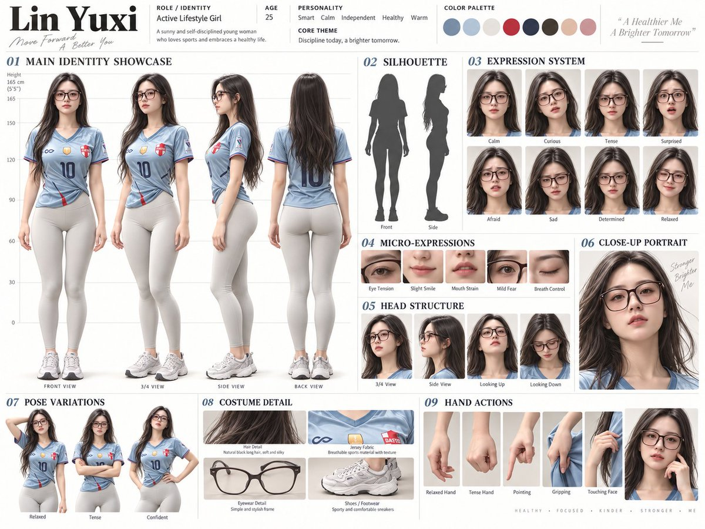

# 刘老板（@leo_xiaolei）：必备技能｜伸手即用——AI 人物一致性控制与角色卡制作 Skill

> 系统解决 AI 出图与视频中人物长期一致性难题的实战 Skill：本质是一张「角色视觉定义图」，一次性固定脸部特征、身材比例、发型、表情、服装与多视角；详解以正面/侧面/背面三视图锁定角色结构的提示词工程方法，阐明一致性对作品留存率与 IP 形象感的显著影响，是打造个人 IP 的必备工程化能力。

<!-- more -->

无论是出图还是做视频，AI 人物长期一致性控制都是一个很重要的课题，对作品的留存率、形象感有显著的影响。也是打造 IP 必备的技能。

它本质上是一张角色视觉定义图，把脸、身材、发型、表情、服装和不同视角一次性固定下来。

## 一、确定角色结构

很多人初次见到角色设定提示词可能会感到困惑。其实，这可以视为一项简单的任务。

这一步的关键在于固定角色的结构：通过正面、侧面和背面的视角，确保锁定角色的脸部特征、比例以及整体造型。稳定这一部分后，后续的生成就不易出现问题。（适用于真人角色）



## 二、增强表现力

角色的表情、微表情、姿态变化和手部动作等元素有助于传达角色的动态特征和情绪表达。这样生成的人物会显得栩栩如生，而非僵硬呆板。



## 三、细节说明

对头部结构、服装细节和材质等方面的说明，有助于 AI 更精准地理解。例如，发型的分层方式、衣物材质和金属质感等。

这一步决定了角色的质感和高端感，使生成的视频内容更加可控。



## 四、操作步骤

选择一个图像生成工具，准备一张角色图片，然后在节点中选择图片输入。

将提示词复制到窗口，根据需要进行调整，整个过程非常灵活。



```markdown
【任务】
基于参考图生成一张高精度角色设定板(Character Sheet)锁定角色ID，不允许生成新角色，所有画面必须基于同一角色结构

【基础设定】
风格:[写实3D/风格化3D/动漫/半写实/IP设计]
角色描述:[填写你的角色描述或上传参考图]
性别:[男/女/中性]
年龄:[数值]
体型:[瘦/标准/健壮/夸张比例]
风格关键词:[高级感/时尚/潮流/科技感/情绪化等】

【画面结构】
- 画面比例:4:3横版
- 背景:纯白/米白/极简
- U1:干净技术排版,无logo,无水印
- 字体:清晰可读英文标签

【必须包含模块】
1. 顶部信息
    - 名字(可自动生成)
    - 角色身份
    - 年龄
    - 性格关键词(3-5个)
    - 核心主题(1句)
2. 配色系统-6~8个色块(无文字)
3. 主身份展示(最大区域) 重点:锁定角色
    - 正面/3/4/侧面/背面
    - 标准站姿
    - 带比例线(身高刻度)
    - 无道具
4. 轮廓剪影
    - 正面剪影
    - 侧面剪影
5. 表情系统(8张)
    - 平静/好奇/紧张/惊讶/害怕/悲伤/坚定/放松
6. 微表情(5张)
    - 眼部紧张/微笑/嘴部用力/微恐惧/呼吸控制
7. 头部结构
    - 多角度(3/4/侧面/仰视/俯视)
8. 姿态变化
    - 放松/紧张/自信
9. 特写镜头(1张)
    - 胸部以上
    - 强情绪表达
10. 服装细节(4张)
    - 发型/材质/配饰/鞋
11. 手部动作
    - 放松/紧张/指向/抓握/面部动作

【一致性要求】
- 所有画面角色完全一致(脸/发型/比例/服装)
- 不允许风格漂移
- 主展示区域必须最大【质量要求】
- 0G级细节
- 材质真实(皮肤/布料/金属)
- 影视级光影
```

## 五、核心原则

所有的小图实际上都是为中心的“主形象图”服务。

理解了这一点后，整段提示词内容就变得清晰简洁。

目标是为 AI 提供一份“角色说明书”，而不仅仅是生成一幅美观的图像。

## 相关页面

- [[sources/ryan-muse-ai-image-post-daily-15-skills-rotation]]
- [[sources/aiwarts-awesome-seedance-463-ai-video-skills]]
- [[concepts/agent-skill]]
- [[concepts/ai-content-pipeline]]
