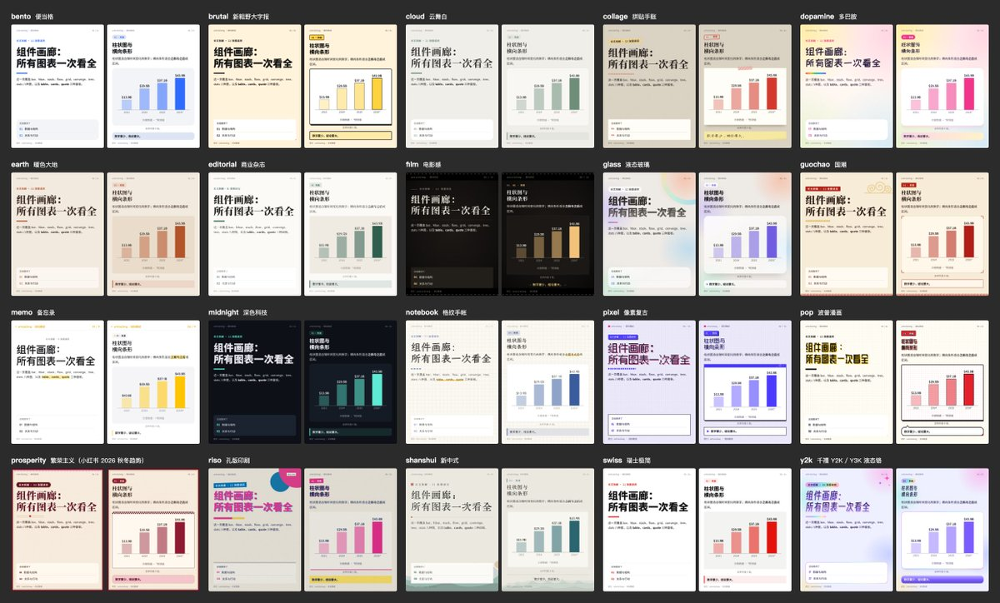
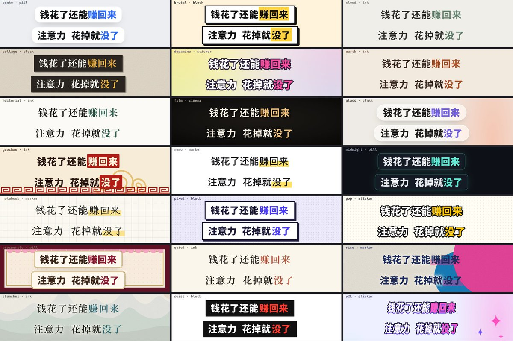

# 刘老板（@leo_xiaolei）：我开源了一套 Skill，可以运营全部自媒体——文章、视频丢进去，图文、口播视频做出来

> 把自媒体日常运营的全流程沉淀成一套开源 Skill：输入文章或视频素材，自动产出各平台所需的图文与口播视频成片——涵盖内容改写与适配、图文排版、口播稿与配音、字幕与封面生成、以及多平台分发；文中给出安装与目录结构、配置方式与实际产出示例。

<!-- more -->

感谢诸位老板的喜欢，这套 Skill 本来是我自己使用的一些工具集，过程中一些小伙伴说很喜欢，所以，今天正式把他开源。

写一篇深度长文花两小时，改成小红书卡片、公众号排版和抖音口播视频，却要耗掉一整天。

过去四天，我把这套跨平台重做的苦力活做成了开源工具 article2media，任意文章/视频丢给它，一条命令就能同时拿到杂志长图与 3:4 图文卡片，还能直接导出免图床公众号 HTML 和 48kHz 逐字同步的竖屏口播视频。

它的核心能力如下：

输入：

- 文章：X（Twitter）长文、网页、微信公众号文章，或本地 Markdown；
- 视频：抖音、YouTube、B 站链接，本地视频或音频，.srt / .vtt 字幕。视频先转成逐字稿文章。

产出：

- 杂志风长图、小红书 3:4 图文卡片、可直接粘贴的公众号排版；
- 带本地 AI 配音和逐字字幕的竖屏口播视频；
- 一字不改的原文长图、原文卡片和原文公众号排版；
- 中文全文译文、白板论证图和黑白漫画。

内置支持 20+ 主题，可指定，可模型自动推理；支持任意比例，会根据不同比例智能出图，而不是机械裁切； 还支持一键出微信公众号排好版的文章（注意不是原文，而是讲解版本，同样支持主题）；支持一键转换为讲解视频； 其他小功能包括自动插画、黄金 5s 设计等等细节。


上图来自 Dan Koe 的英文 X 长文《The most lucrative AI business to start in 2027》。给一个链接，article2media 直接生成了这套中文杂志长图与小红书卡片，同时产出了公众号排版、口播视频，以及原文长图、白板论证和黑白漫画。

不管是完全不懂代码的创作者和运营，还是想搭建多模态工作流的开发者，都能拿来即用。

## 一、为什么做这件事：内容分发的四个真卡点

市面上有很多 AI 总结工具和海报工具，但落到真实的内容分发里，大家还是卡在四件事上。

第一件是跨平台重做的苦力活。

不同平台的版式规矩完全不相通。公众号编辑器会吞掉外部 CSS 和 class 属性，粘贴进去的 Markdown 格式经常全乱。小红书得拆成 3:4 的多图卡片。短视频又讲究前 5 秒黄金钩子，还得录配音、对齐字级字幕。

人工在几个软件之间来回倒腾，半天就过去了。最后很多人只能妥协，要么只发一个平台，要么拿手机截几张长图应付。

第二件是 AI 工具「一刀切」的毛病。

绝大多数 AI 工具拿到文章，默认就往「摘要总结」里压。可遇到一篇万字外文长文或 20 分钟的访谈视频，我们需要的是带图表的结构化拆解，或者是逐段对应的全文精译。

反过来，要是自己辛辛苦苦写完一篇原创随笔想发公众号，诉求就变成了一字不改、只做排版。AI 要是擅自把原文改写成干瘪的「一二三点干货」，这工具就彻底废了。

第三件是 AI 直接画图的硬伤。

让生图模型直接画带字的信息图，中文字体经常笔画粘连，图表里的数字也是瞎编的。一旦发现图里错了一个词，你根本改不动，只能重新抽卡。

视频端也一样，常见的「图文成片」拿素材库画面硬凑，再配一段毫无波澜的机器朗读，观众两秒就划走了。

第四件是质量只能靠人眼兜底。

AI 生成的东西经常初看像模像样，细看全是漏洞。比如卡片最后一行被截断了半截，深色底压了深色字，翻译漏掉了一整段，或者视频字幕每秒闪三次。没有自动化验收，人就得给 AI 当全职校对。

## 二、article2media 能干什么：从链接到九种成品

为了解决这四个卡点，article2media 2.0 把输入源和文字处理路径拆开，再接到底层的视觉版式模块上。

### 1. 输入：文章和视频都能直接当原文

你可以把常见的文章链接或本地文件直接丢给它，包括免登录抓取的 X 长文与线程，以及普通网页、微信公众号文章和本地 Markdown。

视频和音频同样能直接当原文输入。它支持抖音短链与整段分享口令，也支持 B 站、YouTube 链接，以及本地音视频文件和 .srt 字幕。

收到视频后，video-transcript 会先把视频转成干净的逐字稿文章 article.md，同时把带时间戳的分段存进 transcript/segments.md。

它取文字的顺序很严格，优先用人工字幕，其次是平台原语言自动字幕，严禁采用机器翻译字幕轨，也会自动过滤 B 站弹幕。前两者都没有时，再调用本地 Whisper 识别。

在 Apple Silicon 设备上，它用本地 mlx-whisper 跑转写，实测 6 分钟的 B 站视频 16 秒转完，14 分钟的视频只要 29 秒。

转写时会自动用内置 OpenCC 字表完成繁简转换，把半角标点改成全角，删掉静音段的幻觉套话，并在句末停顿处分段。全程死守只补标点、不改原字的规矩，遇到人名和专业术语还能用 --prompt 和 --terms 词表精准替换。

### 2. 路径与产出：三条处理路径，接九种交付物

文字处理和视觉排版在 2.0 里彻底分开，提供三条清晰路径：

1. 原文路径（一字不改）：正文逐字保留，直接进原文长图、原文卡片或公众号排版，浏览器渲染后逐块读回比对，改一个字或漏一段都会直接报错退出。
2. 总结路径（深度重组 + 15 种图表）：Claude 先读透长文，重组成结构化的 content.json，剔除广告寒暄并核对数字，给每节配上两张互补的参数化图表和结尾执行清单。
3. 翻译路径（全文逐段对应）：把外文逐块译成中文 article.zh.md，保留代码与配图，由脚本核查块数、漏译段落和数字，译完直接接公众号排版或原文卡片。

三条路径往下接，一共能生成九种直接可用的成品：

| 交付产出 | 规格与核心亮点 | 典型适用场景 |
|---|---|---|
| **杂志长图** | 1200px 宽 2 倍高清图（1–4 页），每节含判断式标题与核心要点，配 2 张原生图表与数据面板，结尾附执行清单 | 深度长文拆解、知识库沉淀与社群长图分享 |
| **总结卡片组** | 支持小红书 3:4（1080×1440）及 4:5、1:1、9:16 比例，含封面、分节卡与总结卡，附发帖文案 `caption.md` | 小红书、Instagram 与 X 信息流图文 |
| **公众号排版** | 把原文、译文或总结稿排成内联样式与 base64 内嵌图片的 HTML，一键粘贴进后台免图床，附双尺寸封面 | 微信公众号日常推文与外文编译发布 |
| **竖屏口播视频** | 1080×1920 竖屏成片，黄金 5 秒钩子开场，本地 48kHz 配音，Whisper 字级时间戳驱动动画与字幕同步 | 抖音、视频号与小红书竖屏讲解 |
| **原文长图** | 白底阅读面（默认京华老宋体 40px / 1.9 行高，或套用任意主题），全文一字不改，过长在块间自动分页 | 严肃文章归档与保持原汁原味的全文长图 |
| **原文卡片** | 整篇文章按顺序流式分页成 3:4 等比例卡片，段落行间断开、表格跨卡自动重复表头，小标题绝不落单 | 把千字原创文章一字不改发成小红书多图笔记 |
| **中文全文译文** | 结构与外文逐块严格对齐的 Markdown 译稿，代码与图片原样保留，脚本自动核查漏译与数字 | 海外博客、X 长文与技术文档的高保真搬运 |
| **白板论证图** | 纵向推理主干长图，从问题与前提出发，把证据、转折与结论层层摊开，要求原文每段在账本里都有明确去向 | 拆解复杂商业逻辑、论文核心论证与观点复盘 |
| **黑白漫画** | 按认知因果拍点编排分镜，先生成锚点格锁定角色外观一致，对白全用 HTML 排版，同出长图与 3:4 卡片 | 用直观故事把抽象机制与技术概念讲明白 |

视觉上内置了 21 套主题，既有商业杂志 editorial、瑞士极简 swiss 与深色科技 midnight，也有液态玻璃 glass、新粗野 brutal 与多巴胺 dopamine，以及国潮 guochao、新中式 shanshui 和静线 quiet。不指定时，AI 会按「明确偏好 → 内容题材 → 投放场景」自动挑一套，并在交付时说明理由。



口播视频随包内置了 7 款完全凭文字描述设计的公开音色，包含阳光解说男声、资讯播报男声与纪录片旁白男声，以及甜美知性女声、东北热情大哥和台湾口音温柔女声等。语速全部调校在 4.2–4.95 字/秒区间，支持在台词行首加括号控制情绪与方言（如 (极度愤怒，东北话)注意看！），21 套主题还各自配了专属的字幕样式。



## 三、对非技术人：不懂代码，怎么拿来就用？

不管你是写作者、公众号主理人还是小红书博主，或者做日常内容运营与行业研究，都不用管背后的脚本怎么跑。装好插件后，像平时跟助理说话一样发一句话，就能直接拿走成品。

### 1. 自己写的文章发公众号与小红书，30 秒搞定排版

写完一篇 Markdown 文档，最烦去排版网站调格式、一张张传图床。现在你只需要输入一句：

/article2media ./我的文章.md 公众号

它会一字不改地排好全文，生成 article.html 预览页与写好摘要的发布清单，同时配齐 2.35:1 头图和 1:1 次条封面。

你在浏览器里打开 article.html，点顶部的**「复制到公众号」**按钮，去公众号后台直接粘贴就行。所有样式已经算成内联属性，配图也转成 base64 自动上传，连图床都省了。

想把同一篇原创文章原样发到小红书，就说一句 /article2media ./我的文章.md 原文卡片，它会自动流式分页成 3:4 卡片，连跨页表格的表头都会自动补齐。

### 2. 海外长文与 B 站、抖音视频，一键变中文图文或口播视频

刷到高价值的英文 X 长文，或者看到 15 分钟的 B 站、YouTube 与抖音视频，你可以按需求选下面四条路：

1. 外文全文搬运：输入 /article2media https://x.com/... 翻译成中文发公众号，逐段精译并核查漏译后，直接生成可粘贴的公众号图文。
2. 提炼做成小红书：输入 /article2media https://x.com/... 小红书，自动用中文提炼判断、画好数据图表，并附上写好标签的 caption.md 发帖文案。
3. 视频转文字或转图文：输入 /article2media https://www.bilibili.com/video/BV... 小红书，几十秒内先把视频转成干净的逐字稿，再做成 3:4 卡片组，底部自动署上原视频作者。
4. 免出镜做口播短视频：输入 /article2media ./文章.md 做成口播视频，AI 先当导演写分镜，再自动合成 48kHz 配音、字级同步动画和单行不闪烁字幕，说到哪个数字，画面就在那一刻滚动浮现。

## 四、对技术人员：它为什么这么稳？五个工程设计启发

如果你是工程师或 Agent 开发者，article2media 展示了怎么让大模型在多模态生产管线里做到高确定性、零幻觉和自动验收。下面五个工程取舍，可以直接复用到你的 Agent 架构里。

### 1. 10 个正交 Skill，只靠文件交接的 Unix 哲学

1. x 版本把所有能力塞在一个 Skill 里，任何输入默认都要先跑一遍「改写总结」。到了 2.0，我们按正交原则把它拆成了 10 个独立能力 + 1 个路由总入口：

| 独立 Skill | 职责边界 | 输入 → 标准交接产物 |
|---|---|---|
| `article-fetch` | 文章抓取 | X 长文 / 网页 / 公众号 / 本地文件 → `article.md` |
| `video-transcript` | 视频转文字 | 抖音 / YouTube / B 站 / 本地音视频 / 字幕 → 逐字稿 `article.md` |
| `article-rewrite` | 深度改写（总结） | `article.md` → 结构化 `content.json`（可由 `export.mjs` 导出 `rewrite.md`） |
| `article-translate` | 全文翻译 | `article.md` → 逐块对齐的中文译稿 `article.zh.md` |
| `long-image` | 长图渲染 | `content.json` → 杂志长图 / `article.md` → 原文长图 |
| `image-cards` | 比例卡片渲染 | `content.json` → 总结卡片 / `article.md` → 原文流式分页卡片 |
| `wechat-layout` | 公众号排版 | `article.md` / `article.zh.md` / `rewrite.md` → 内联样式图文 + 双尺寸封面 |
| `explainer-video` | 竖屏口播视频 | 文章 → 分镜脚本 `video.json` → 1080×1920 MP4 成片 |
| `logic-whiteboard` | 白板论证 | `article.md` → 论证账本 `whiteboard.json` → 纵向推理主干长图 |
| `article-comic` | 黑白漫画 | `article.md` → 分镜 `comic.json` → 角色一致的漫画长图 + 3:4 卡片 |

这些 Skill 之间绝不互相 import 代码，只靠工作目录里的 4 个标准文件交接（article.md、article.zh.md、content.json、rewrite.md）。

渲染引擎根据输入文件的后缀直接决定管线。它看见 .md 就走一字不改的原文管线，看见 content.json 就走带图表设计的视觉管线。公众号排版只收 .md 文章，总结稿只要先用 export.mjs 把图表截成 3 倍高清 PNG 导出成 rewrite.md，就能无缝复用同一套公众号排版代码。

### 2. 模型做判断，脚本做测量，图里绝不放一个字

很多 AI 图文工具没法商用，是因为把像素级排版、中文字体渲染和音频时长计算也交给了大模型。

article2media 的分工边界很明确，模型只管理解与写作，脚本包揽一切确定性的测量与合成。

哪怕开启了 --illustrate（AI 插画）或 -c（黑白漫画），生图模型画出来的图里也绝不放一个字。所有标题、正文与 15 种数据图表，包括漫画对白气泡和视频字幕，全部用 HTML + CSS 排版，再通过无头 Chrome 的 DevTools 协议（CDP）按 2 倍或 3 倍分辨率截图。

模型输出的 content.json 只有纯内容语义，不含任何颜色或字号。每套主题只是一个独立的 CSS 变量文件，换风格只需重新截一次图，不用重跑大模型。

### 3. 不信「看起来差不多」，用刚性账本和机器审片拦截次品

没有自动化验证的 Agent 管线没法进生产环境。我们给全部 10 个能力都加了验收门禁，只要出现一项错误（✗），脚本直接以非零状态码退出。

在原文长图、原文卡片和公众号排版里，我们建了一套原文块账本（Verbatim Block Ledger）。解析器先锁死源文件 SHA-256 哈希，给每个文本块打上 data-source-block 登记入账。等 Chrome 完成排版（包括原文卡片在页面内流式断行、跨卡分页），脚本从真实 DOM 里把文字逐块读回比对。

换 Dan Koe 那篇英文长文做测试时，原文有一处斜体紧挨粗斜体（***…***），解析器漏掉了一个星号。原文块账本立刻报错拦下，没让一张「肉眼看着没问题」的图混过去。

白板模式要求原文每一段都在账本里交代去向，全文翻译模式会自动核对块数、未翻译段落和数字丢失，长图和卡片还会检查溢出、元素重叠与孤字，并核验 WCAG 4.5:1 正文对比度。口播视频每次成片都会跑出下面这份量化审片报告：

```plaintext
审片：video/midnight/contact-sheet.jpg
  ✓ 首句说完：4.83s
  ✓ 第一个画面信息：0.75s
  ✓ 最长画面静止：4.7s
  ✓ 字幕停留过短（<0.55s）：0 条
  ✓ 旁白语速：4.37 字/秒（约 262 字/分钟，宜 ≤ 5.2）
  ✓ 字幕闪断（<0.6s 的空档）：0 处
  ✓ 字幕平均停留：2.07s（33 条，pill）
  ✓ 配音质检：18 段，0 段有问题
  ✓ 成片响度：-16.2 → -14 LUFS（48 kHz）

```

### 4. 把主观体感翻译成代码阈值，零 npm 依赖与合规前置

收到「配音太急」「字幕老闪」这类主观反馈时，只改 Prompt 下次还会犯。我们把它们全部拆成了代码里的硬指标。

比如解决「解说太急」，我们测出早期默认音色的参考音频高达 6.6 字/秒，而 VoxCPM2 会照着参考音频的节奏读，提示词写「放慢」根本没用。于是我们先用可控克隆把参考音频降到 4.2–4.95 字/秒，再在代码里定下全片目标约 4.5 字/秒、单句超 5.2 字/秒即判偏快（自动换种子重生成，仍偏快就保音高放慢最多 15%），并把开场首句卡死在 19 字以内。

同样，我们把「字幕闪烁」拆成四个物理原因逐个击破。切换动画全部改成硬切，字幕强制单行并自动微缩字号，1.4 秒内的短停顿保留字幕不消失，同句短语合并为 13 字以内的一行。改完后字幕切换减少近三分之一，平均停留拉长到 2 秒以上，闪断彻底归零。

整个底层引擎只用 Node.js 22 原生内置的 fetch 和 WebSocket 直连本机 Chrome，做到了真正的 0 npm 依赖。本地配音、Whisper 转写以及 yt-dlp 和出图能力全部先探测后选用，缺了就优雅降级，绝不在后台偷偷下载几个 G 的模型。

针对《民法典》第 1023 条与北京互联网法院 AI 声音权判例，我们把音色库做成了两层。随包分发的 7 款公开音色全部只凭文字描述生成，不模仿任何真人。克隆音色只能留在本机个人目录并在成片时提醒确认授权，视频首帧与 MP4 元数据也自动写入了 AIGC 标识。

## 五、三分钟开箱即用：对话调用与命令行集成

项目以 MIT 协议开源，基础环境只需要 Node.js 22+ 和本机已有的 Chrome 浏览器。

### 1. 作为 Claude Code / Codex 插件安装（推荐所有人）

Claude Code 用户只需执行两行命令，就能把全部 11 个 Skill 一次装好：

```markdown
claude plugin marketplace add threerocks/article2media
claude plugin install article2media@article2media

```

同时用 Claude Code 和 Codex 的用户，可以用 skills CLI 一键全局安装：

```markdown
npx skills add threerocks/article2media -g -a claude-code -a codex -y

```

装好后，直接在对话框里调用 /article2media（Codex 里用 $article2media）：

```markdown
/article2media https://x.com/thedankoe/status/2117664712532123680       # 默认：提炼生成杂志长图
/article2media https://example.com/post 小红书                           # 提炼生成 3:4 小红书卡片组 + 文案
/article2media ./my-essay.md 公众号                                      # 原文一字不改，排成可粘贴的公众号图文
/article2media ./my-essay.md 原文卡片                                    # 原文一字不改，流式分页成 3:4 卡片
/article2media https://x.com/… 翻译成中文发公众号                        # 外文全文精译 + 公众号排版
/article2media https://www.bilibili.com/video/BV… 小红书                 # B 站视频转逐字稿 + 小红书卡片
/article2media https://x.com/… 长图、小红书、公众号都要                  # 一稿多发：改写一次，同时出三种产物
/article2media https://example.com/post 做成口播视频 --style midnight    # 指定深色科技主题生成竖屏口播视频

```

也可以随时单独调用某一个独立能力：

```markdown
/article2media:wechat-layout ./my-essay.md                              # 只做公众号排版
/article2media:video-transcript https://www.bilibili.com/video/BV…      # 只把视频转成逐字稿文章
/article2media:article-translate article2media-out/x-…/article.md       # 只做全文翻译与结构校验

```

### 2. 作为独立命令行工具集成（适合开发者）

每个能力的 scripts/ 目录下都有独立的 CLI 入口，不经过大模型也能直接在自动化脚本或自定义 Agent 管线里调用：

```markdown
K=skills
# 1. 抓取文章或将视频转写为逐字稿
node $K/article-fetch/scripts/fetch.mjs "https://x.com/…/status/…"
node $K/video-transcript/scripts/transcribe.mjs "https://www.bilibili.com/video/BV…" --prompt "人名 术语"

# 2. 原文直接排版（公众号 / 原文卡片 / 原文长图）
node $K/wechat-layout/scripts/wechat.mjs <slug>/article.md --theme quiet
node $K/image-cards/scripts/cards.mjs <slug>/article.md --ratio 3:4
node $K/long-image/scripts/long.mjs <slug>/article.md

# 3. 结构化改写稿渲染（杂志长图 / 总结卡片 / 导出公众号文章）
node $K/long-image/scripts/long.mjs <slug>/content.json --theme editorial
node $K/image-cards/scripts/cards.mjs <slug>/content.json --ratio 3:4
node $K/article-rewrite/scripts/export.mjs <slug>/content.json

# 4. 翻译检查、白板论证、黑白漫画与口播视频合成
node $K/article-translate/scripts/translate.mjs check <slug>/article.md <slug>/article.zh.md
node $K/logic-whiteboard/scripts/whiteboard.mjs <slug>/whiteboard.json
node $K/article-comic/scripts/comic.mjs make <slug>/comic.json
node $K/explainer-video/scripts/video.mjs make <slug>/video/video.json

```

要在所有产出页脚署上自己的品牌名，只需在 ~/.config/article2media/brand.json 放一行配置：

```json
{ "name": "Founder Notes", "handle": "@you", "series": "实战手册", "editor": "编者" }

```

## 六、现在的客观边界与开源地址

最后坦诚交代一下当前版本的四个客观边界。

第一，48kHz 本地配音（VoxCPM2）和极速语音转写（mlx-whisper）目前需要 Apple Silicon Mac。其他机器上配音会自动退回免费的 edge-tts 或系统语音，无字幕视频则可提供 .srt 字幕文件。

第二，基础图文排版完全不需要生图 API。只有开启 --illustrate（AI 插画）或制作 -c（黑白漫画）时才需要出图能力，可以直接用 codex login 复用 ChatGPT 账号，不用额外买 API Key，也支持 OpenAI 和 Gemini 的付费 Key。

第三，这版视频故意砍掉了背景音乐。我们试过在线免版权曲库、程序合成和弦和 11GB 的本地 AI 作曲模型，全都太笨重，发抖音或小红书时直接在 App 里选一首热门配乐只要几秒钟。

第四，部分网络环境下 YouTube 会触发登录确认，抖音分享页也会要求 Cookie。脚本绝不会私自读取你的浏览器状态，而是会提示你主动加 --cookies-from-browser chrome 授权复用，或者把视频存到本地直接传文件。

花两小时写出的好内容，不该再被四个小时的截图、排版和剪辑拖慢脚步。

项目已在 GitHub 完全开源（MIT 协议）：[https://github.com/threerocks/article2media](https://github.com/threerocks/article2media)

欢迎直接安装试用、提 Issue，或者只写一个 CSS 文件，一起来贡献第 22 套主题。

## 相关页面

- [[sources/leo-3-days-launch-overseas-saas-server-domain-payment-seo]]
- [[sources/huahuazo-creatorhub-multi-platform-content-backend]]
- [[concepts/agent-skill]]
- [[concepts/ai-content-pipeline]]
