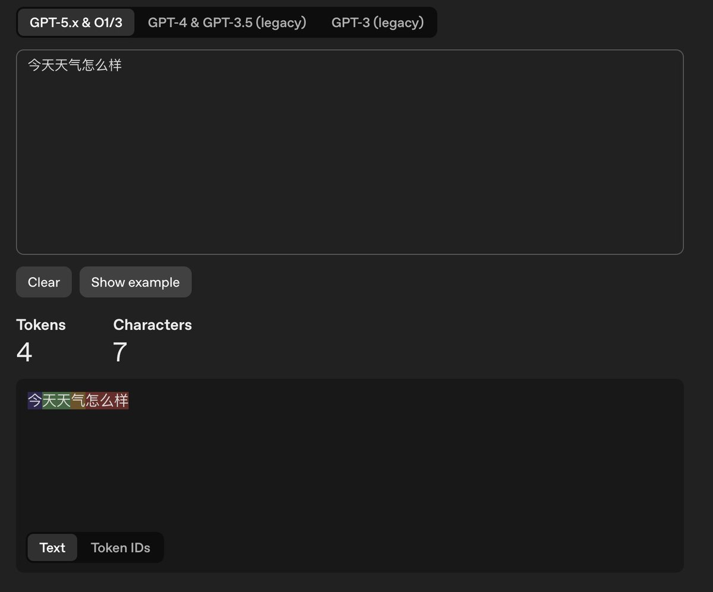
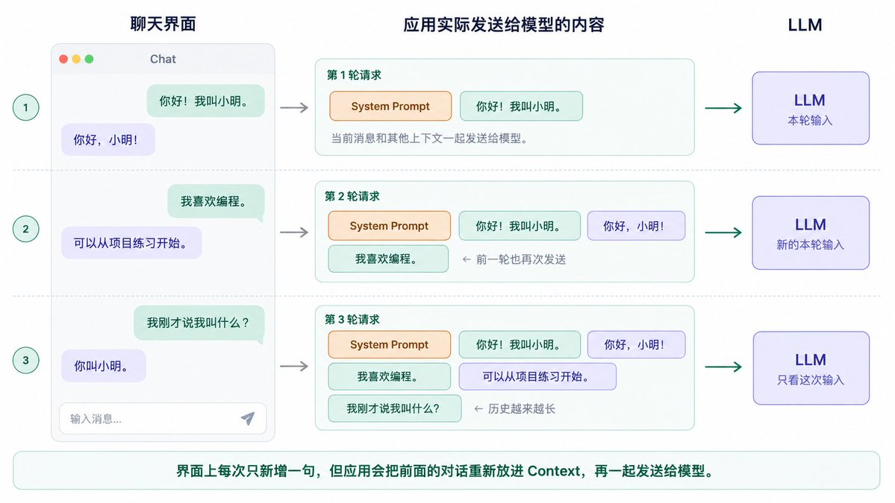
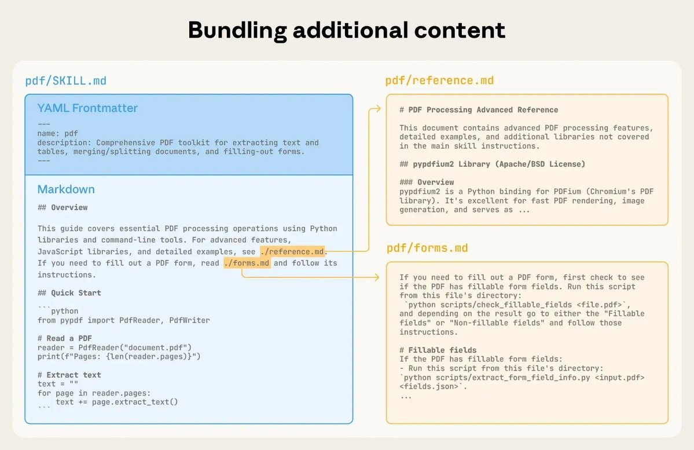
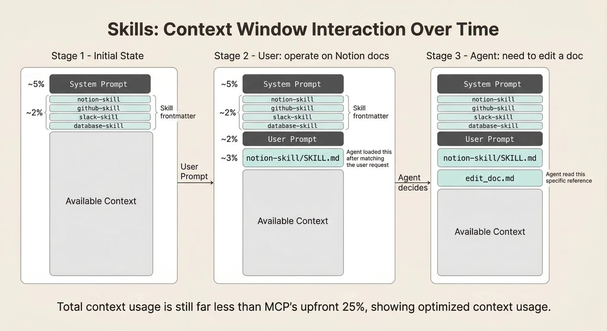

# 川处安（@leoshen0）：一篇速通入门——重新理解 AI Agent 的一切

> 面向新手的 AI Agent 认知重建长文：从大模型到工具调用、从 Prompt 到 Agent Loop，逐步厘清「Agent 到底是什么」这一被行业话术过度包装的概念，界定模型、工具、上下文、记忆与自主性五个维度的能力边界，并指出普通人上手 Agent 时真正需要掌握与可以跳过的部分。

<!-- more -->

平时在工作中以及刷推时，经常发现很多朋友用不好 AI，根源其实是对底层的基本原理缺乏了解。我一直想写这么一篇文章，用最自然的语言，从 LLM 基础一路推导到 Agent 的工程实现，循序渐进地把这些工具背后的运作机制彻底讲明白。

去年我写过一篇《[Agent 与 MCP 入门指南：理解与实践](https://shens.blog/posts/202507/agent-mcp-guide/)》，但随着 AI 的快速迭代以及我自己理解的加深，回头再看，很多关键细节当时其实没讲清楚。

最近在推上刷到不少讲 Agent 的教程和文章，收藏极高、转发也多，但点开看大多走向两个极端：

- 一眼 AI 生成的垃圾：长篇大论不知所云，翻来覆去全是正确的废话（点名各种红橙黄绿蓝靛紫皮书），纯属浪费时间、误人子弟；
- 要么过于硬核，要么流于表面：严肃教程堆砌术语把新人直接劝退；而零基础教程又只教你无脑抄工作流、装 Skill，让人知其然，却不知其所以然。

我一直反对花大量精力去死磕某个具体工具的使用。永远会有新概念被发明，永远会有新工具冒出来，追是追不完的，只会越追越焦虑。 一个月前学的工具，一个月后可能就有更好的出现了；之前抄来的工作流、装好的 Skill，新模型一出可能就彻底失效了，接着你又会刷到新的 xxx 橙皮书，如此往复被焦虑感笼罩。

但实际上，从大模型诞生到现在，底层的运转逻辑从来没有发生过本质变化。

理解 AI 怎么工作，并不是要你去深入写代码、看公式，而是为了让你建立起对 AI 的底层认知：了解它的能力边界在哪里、遇到的问题到底是什么导致的、面对铺天盖地的新工具和新名词能从容应对，不再被自媒体营造的 FOMO 情绪裹挟。

你大概率也有过这些疑问：

模型是怎么记住我前面说的话的？它是怎么上网、读文件、改代码的？为什么聊着聊着感觉 AI 变蠢了？我发出一条指令，AI 底层都干了什么？MCP、Skill、上下文、Token 这些词到底是什么？

一篇文章想把这些讲透极具挑战。内容较多，但相信我，耐心读下去，一定能为你省下大量读二手垃圾文章的时间。

文章同样发布到了博客，有交互式演示，体验更佳：

[一篇速通入门：重新理解关于 AI Agent 的一切](https://shens.blog/posts/202609/agent-fundamentals/)

## 一、大模型怎么生成一句话？

我们先把时钟拨回 2022、2023 年，那会儿还没什么 AI Agent、MCP、Skill。我们对 AI 的使用就是一个简单的对话框：你输入一段文字，它接着生成回复一段文字，非常纯粹。

不过，模型处理文字时用的单位和我们不太一样。它会先把文字拆成一小块一小块，这些小块叫 Token——这是大模型处理信息的唯一基本单位。我们平时说的消耗了多少 Token、支持多大的上下文窗口，指的都是它。

为了方便解释，本篇文章都是以纯文本输入为例，许多模型除了文本之外，还支持更多的输入类型，比如常见的图片，甚至是音视频，也就是我们常说的「多模态」，当我们说某个模型不支持多模态的时候，指的就是它只能处理文本信息。

一个英文单词可能是一个 Token，也可能被拆成几个；一个汉字也不一定恰好对应一个 Token。标点、空格同样可能占用 Token。具体怎么拆，取决于模型使用的分词器（Tokenizer）：



可以看到，“今天天气怎么样”这七个字，被拆成了 4 个 Token：「今」「天天」「气」「怎么样」。

可以在 [OpenAI Tokenizer](https://platform.openai.com/tokenizer) 试试看你输入的一句话会被拆成哪些 Token。

模型拿到这串 Token 后，会根据当前已经收到的所有内容，计算下一个可能出现的 Token 的概率分布，并按照策略选出一个。接着，这个新 Token 会被拼接到原有内容末尾，模型再基于这串更长的内容预测下一个……如此反复循环，直到生成结束。

你在屏幕上看到文字一个个蹦出来，就是这个过程在持续发生。

[video](https://video.twimg.com/amplify_video/2099536342506164224/vid/avc1/2000x796/etShbkXpZmlbnFcw.mp4?tag=29)

听起来很简单：预测下一个 Token。

但这背后预测的能力，来自海量数据的预训练。模型内部有成百上千亿的参数（可以理解为一组极其庞大、经过训练调优的数字权重）。通过这些训练，模型掌握了人类语言规律、世界知识以及逻辑推理模式，并在每一次预测中调用这些能力。

回答问题时，模型是根据规律重新组织语言，而不是去某个数据库里检索原文直接复制。

理解了这个底层逻辑，也许你就能理解这几个常见的疑问了：

1. 为什么同一个问题，每次问得到的回答可能不一样？ 生成时并不一定会死板地每次都选概率最高的那个词，而是会按概率分布进行随机采样。一旦开头选的词有细微差别，后续作为输入的内容就变了，整段回答就会走向完全不同的分支。

2. 为什么回答看起来头头是道，却可能在胡说八道？ 因为模型的目标是生成一段在概率上合理、流畅的文字，它本身并没有核实事实真伪的能力。如果缺乏对应知识或推理走偏，它依然会自信满满地编造答案。这就是我们常说「幻觉」。 这也解释了为什么问 AI“你是谁、是什么模型”毫无意义：在没有 System Prompt 明确告知的情况下，它只能依据训练语料里出现频率、权重最高的词来猜，所以经常会产生幻觉，误称自己是 GPT-4、Claude Sonnet 3.5 甚至其他竞品。

3. 为什么模型回答不了刚刚发生的新闻？ 模型的全部知识都固化在训练完成的那一刻。新发布的模型，其训练数据往往截止在几个月甚至一年前，对那之后发生的事情它物理上完全一无所知。

既然模型每次只是对着眼前的输入预测下一个词，它本身并没有记忆。那问题来了：我们在对话框里跟它来回聊了十几轮，它到底是怎么「记住」我们前面聊过什么的？

## 二、它为什么能记得前面聊过什么？

我刚开始了解大模型时，觉得最反直觉的就是这一点。

我们在一个对话框里连续聊，直觉上会觉得，对面一直是同一个「人」。我前面告诉过它一些事，它把这些事记住了，所以后面继续聊。

但常见的大模型调用，本身是无状态（模型本身并不知道你之前给它发送了什么）的。要实现连续对话，应用软件在幕后做了一件很粗暴的事：每次你发一条新消息，软件都会把从第一句话开始的所有历史对话记录，完完整整地重新打包，一股脑全发给模型。



你在界面上只发了一句新消息，模型这次获得的输入，却已经是一大段内容。

它之所以能接着聊，是因为前面的事情仍然在这次输入里。

模型这一次生成回答时，能够参考的这组信息，就是我们常常提到的上下文（Context）。

上下文不只有会话记录，它通常由几部分拼装而成：

- 系统提示词（System Prompt）：应用预先设置、用于规定角色和行为的指令（这部分你在界面上通常看不到）；
- 会话记录：前面几轮所有的问答与交互记录；
- 用户提示词（User Prompt）：你当前刚刚输入的这一条指令；
- 外部补充信息：后面会提到的文件内容、网页搜索结果或工具执行后的反馈。

大家平时天天听到的提示词（Prompt），其实没什么高大上的，说白了就是你（或系统）发给 AI 的那段文字，模型基于这段文字进行预测生成回复。

User Prompt 和 System Prompt 其实也没什么本质区别，底层都是给模型的文字输入，只是按照行为分为了两类，以便在训练时强化两者不同的职能，实现不一样的遵守效果。

所以，我们看到的多轮对话记录，都是存在应用层面，甚至是存在本地的，只是在你对话的时候一股脑全发给了模型而已，它这次对你的了解，全靠这次收到的内容。

## 三、最早的工具，调用的是人类

前面我们提到，模型只知道训练数据之内的知识，想要实时获取环境的信息，就只能依赖外部手段给它做输入。

所以我们最早用 AI 写代码，常见的过程是这样的：

给它说了我们的需求，然后把代码粘给它 -> 它回复一段修改后的代码 -> 把代码复制回编辑器 -> 运行，出错 -> 再把报错粘回去。

在这个过程中，模型始终在生成内容。读文件、编辑代码、运行代码、拿到报错，都是人在做。

既然这些动作有明确的执行方式，能不能让程序来接手？

可以。先告诉模型有哪些工具、分别能做什么、需要输入哪些信息，再约定一种交互协议。模型需要读文件时，只需要按照约定的协议把信息给我们外层的程序就行。

比如当模型认为需要看项目说明时，它可以生成这样一个调用请求：

```json
{
  "tool": "read_file",
  "arguments": {
    "path": "README.md"
  }
}
```

我们外层的程序识别出了模型的意图是要调用一个叫 read_file 的工具，就拿着模型给的参数去调用一次真实的文件读取，然后把 README.md 的内容返回给模型。 这就是常见的 Tool Calling / Function Calling，工具调用。模型生成调用请求，程序执行，执行结果再回到模型的输入里。

模型输出的内容原本只是显示给人看的文字，现在其中一部分可以被程序识别为操作请求，于是它开始影响外部世界。执行这些操作的能力来自应用提供的工具。

模型本身并不具备执行工具的能力！

后续的各种工具使用，比如 MCP、Skill、CLI 其实本质上都是这种方式实现的。

## 四、把单次操作变成闭环：Agent 诞生了

读完文件之后，模型可能发现，还需要看看它调用的另一个文件。

那就继续请求读取。

看明白之后，它请求修改代码。修改完成，再请求运行测试。测试失败，把报错交回来，它接着分析原因、继续修改。

原本由人来回复制粘贴、不断推动的过程，现在可以由外层的程序持续衔接。模型根据新拿到的结果，决定下一步做什么；外围程序负责执行，再把反馈送回来。

[video](https://video.twimg.com/amplify_video/2099535927802839040/vid/avc1/2240x960/9DwlT1VvACX18k-f.mp4?tag=29)

当一个系统以这种方式运行，由模型根据任务和环境反馈选择后续行动，就进入了我们通常讨论的 Agent 工作方式。

## 五、真正掌控全局的幕后宿主：Harness

到这里，我们已经好几次提到「外层的程序」了。

它保存会话记录，准备上下文，告诉模型有哪些工具，执行模型提出的操作，还负责决定什么时候继续、什么时候停。

现在这一套外层的程序有了一个名字「Harness」，当前对 Agent 普遍认可的定义：Agent = Model + Harness

这是现在一种常见的工程视角：模型提供理解、推理和生成能力，Harness 把模型接进一个能够实际工作的环境系统里。

所以我们可以认为：Claude Code、Codex 是 Harness，其底层应用的 Claude、ChatGPT 是模型。

Harness 和模型相对来说是比较独立的，一款 Harness 可以接入多个模型，一个模型也能被应用到多个 Harness 中。

从模型与外界交互的角度看，有两条主要路径：

- 被动获取信息：系统自动为模型注入各种上下文，构建完整的会话上下文，辅助模型完成任务。如系统提示词、历史记忆、当前环境状态变化的信息等等。 我们可以称之为上下文管理。
- 主动影响环境：给模型提供工具，由模型来决定要执行哪些工具，获取哪些信息、执行哪些操作，系统负责按照模型的要求执行工具并将结果返回给模型。也就是工具调用。

可以看到，Harness 干了非常多的事，绝对不是一句套壳可以概括的。类比人体，模型就是我们的大脑，Harness 就是我们的这具身体，大脑给予我们思考决策的能力，感官系统让我们感知环境的状态，手、脚等器官让我们脑子里的想法得以实现。大脑决定了我们智力的上限，但身体也十分重要，有人的手可以做精密的手术，有人的手满足日常生活都异常艰难。有人的视力敏锐，能很快捕捉到远处细微的变化，有人不戴眼镜甚至连眼前的文字都看不清。

这也解释了为什么接入同一个模型的两款 AI 应用，用起来可能差很多。

## 六、把 Harness 拆开看看

前面我们一直是把 Harness 当做一个黑盒的程序来描述的，现在让我们把这些工作拆开来看。

### 1. 上下文管理：准备好要给模型看的东西

你输入的那一句需求，只是模型收到的信息的一部分。

Harness 还可能准备好当前的工作目录、项目约定、可用工具，以及前面已经发生过的对话和工具调用记录等等，这些都会影响模型接下来怎么做。比如：

模型为什么知道有一个 read_file 工具？因为在调用模型时，程序把这个工具的名称、用途和参数要求提供给了它。

平时用 AI 干活，如果每次新开会话都要给它强调一下我们的规范、要遵循的风格等等，那样就太恶心了。

所以大家就把这些规矩写成一个文件（比如早期的 .cursorrules，现在的 CLAUDE.md、AGENTS.md）。每次你一发消息，你所使用的 Harness 就悄悄把这个文件读出来，塞到最前面一起发给模型，这样模型一上来就知道要遵守什么约定了。

有些东西你在聊天界面上看不到，但它们也参与了这次回答。

但我们不能把所有模型该知道的、不该知道的一股脑的喂给模型，在当前阶段，模型还是有一定的局限性：

- 上下文窗口有限：模型能消化的信息存在一个上限，超过这个上限，模型就直接罢工了。
- 推理成本高：上下文变长，每一次消耗的 Token 也会跟着增长，账单爆炸的同时模型推理响应的时间也会变长。
- 注意力机制限制： 前面我们讲过了，大模型是基于概率预测的，上下文中的每一个 Token 都会影响后续输出 Token 的预测。模型和人一样会注意力失焦，当你把一堆废话和重点混杂在一起讲时，模型就会抓不住重点。

所以，喂给模型上下文的质量，会显著地影响模型生成结果的质量。

Harness 工程中大部分工作都是在围 「如何做好上下文管理」，这就是我们常看到 「上下文工程」（Context Engineering）。

关于上下文工程，可以讲的内容太多太多了，这里我们可以结合两个常见的例子来展开和大家讲讲：记忆、上下文压缩

1. 1 记忆

我们前面明确了，大模型是无状态的，它本身记不住你任何信息，所谓的记忆都是我们通过上下文工程把这些信息塞给模型的。

我们可以把记忆分为两类：短期记忆、长期记忆

短期记忆：在一个会话内，你前面和模型聊过的内容。因为会话中的每一条消息都会被 Harness 塞到模型的上下文里，其作用域仅在同一个会话中，新开一个会话模型就啥也不知道了。 长期记忆：我们通过外挂工具的方式，把你的偏好、要求、踩过的坑等这些觉得需要记下来的信息记录到磁盘里，然后在后续的会话中再检索出来塞到模型的上下文里。通过这种方式，实现了跨会话的持久化长期记忆，无论你新开多少会话，模型都能「回想」起之前的记忆。

但记忆系统其实非常难做好：什么样的信息是值得记录的、什么时候需要让模型「想」起某一段记忆、如何保证记忆中的过时信息被更新等等

记忆系统做得好的 Harness （个人体验，Codex 做得还不错，Claude Code 一般）能让人觉得 AI 更懂自己，而记忆系统做得不好的，则很容易带来负面作用，比如：

- 把过时的错误信息当做事实，导致任务完全跑偏
- 记了不该记的东西，我之前用 Gemini 就深受其扰，某一次无意中给它说了我是一个程序员，后面它回复点啥都是“作为程序员 xxx”，比喻也老是拿写代码相关的内容做例子，导致我不得不关掉记忆系统。

1. 2 上下文压缩

模型的上下文窗口是有限的，但现实情况是我们在一个会话中，如果完成的任务较为复杂，很有可能会超出这个上限，新开一个会话上下文就又全丢了。

怎么办呢？其实我们自然就能想到，对会话的信息做一次摘要，把不重要的信息剔除掉，只保留关键信息就行，这就是上下文压缩。

上下文压缩有非常多的方式和细节可以探究，这里就不展开细聊了，后面我会单独开一个主题深入分享 Agent 的上下文管理。

我们就讲讲最普遍的，对用户来说体验感最明显的一种方式：使用模型做摘要总结。

其实这个逻辑非常简单，就是把当前会话的所有上下文发给大模型，然后给它一段提示词，让他来按要求总结。例如 Codex 的提示词如下，就简单的几句话：

```markdown
You are performing a CONTEXT CHECKPOINT COMPACTION. Create a handoff summary for another LLM that will resume the task.

Include:
- Current progress and key decisions made
- Important context, constraints, or user preferences
- What remains to be done (clear next steps)
- Any critical data, examples, or references needed to continue

Be concise, structured, and focused on helping the next LLM seamlessly continue the work.
```

总结完成过后，后续调用时，用这份摘要替代较早的冗长历史，同时保留必要的指令和近期消息，再继续任务。

显然，摘要必然是有损的，在做总结的时候肯定得做取舍，丢掉一部分 AI 觉得「没用」的内容。

这下你应该能理解为什么感觉 AI 聊着聊着就变笨了。

### 2. 工具调用：把请求变成真实操作

其实之前写的一篇文章已经做过深入的分析了，这里就只做一些核心的摘要，想要更深入理解可以参考：《[MCP vs Skill vs CLI: AI Agent 上下文管理的本质与实践](https://shens.blog/posts/202603/mcp-skill-cli/)》

前面我们说过，让模型可以调用工具的本质是我们在一开始就告诉了模型有哪些工具可以用、每个工具需要填写什么参数，也就是把整个工具的定义都给了模型。模型根据我们的要求输出调用参数，外层程序识别后执行并将结果返回给模型。

接下来真正麻烦的问题是：这些工具从哪儿来？应用没内置的能力，我们能不能自己接进去？

早期的 AI 应用，模型可用的工具都是内置在应用内部写死的，模型只能用这些应用厂商提供的工具来干活， 编辑器类的 AI 应用里，模型就只能读写文件；客服类 AI 应用，模型就只能读取历史工单信息，总结回复。

但我们日常的工作依赖的能力远不止于此，我们写代码的时候不全是盯着我们的编辑器看代码、写代码，有时候我们要找找历史的文档、查资料、查日志、看看线上实际的数据才能知道要怎么设计怎么写更好， 那会儿 Cursor 这样的 AI IDE 也就只能帮我们做到编辑代码这一步， 我们没办法把我们的日志系统、数据库接入到 Cursor 中，因为我们改不了 Cursor 的源码。

用户有自定义工具接入这些 AI 应用中的诉求，于是 MCP 诞生了， MCP 全称模型上下文协议（Model Context Protocol），需要注意它只是一种协议，而不是什么黑科技。

MCP 约定了一种调用工具的标准协议，任意服务端、任意客户端，只要他们都支持 MCP，那就能对接上， Cursor 支持了 MCP （客户端），那我们就可以给我们的日志系统写一个 MCP （服务端）， 来让在 Cursor 这个 Harness 中，模型能直接查询我们的线上日志，辅助我们判断，这样一来就可以把更多的任务交给 AI 来完成，而不是靠手动搬运了。

同时，因为 MCP 是一套标准协议，我们做好了 MCP 过后可以接入到任意支持了 MCP 工具里去，比如 Claude Code、Codex 等等。

但 MCP 不是万金油，MCP 和之前的工具调用除了标准化之外，没什么本质区别，绝大多数客户端实现的时候，同样是一次性把所有的工具定义都塞给大模型，然后大模型就知道怎么用了。

这引入了一个问题，你每装一个 MCP，这个 MCP 工具定义所占用的上下文就常驻在你和 AI 的每一次对话里了，无论你当前需不需要它，它都会占用上下文。并且很多 MCP 提供方的开发者，对于 MCP 没有深刻的认知，在工具定义里无脑塞了一大堆信息。

这导致了一个非常严重的问题，你新开了一个对话，啥也没说，光是安装的 MCP 可能就占掉你 20% 的上下文窗口了（一点没夸张）。

和 MCP 类似，我们的一堆指令也是一样，早期在使用 Cursor 的时候，很多人为了让 AI 写代码更规范，在 Cursor Rule（与现在的 AGENTS.md 类似） 里塞了一大堆信息：完整的 Java 开发规范、工程结构描述、单元测试编写指南等等。

我们可以发现，关键的问题在：我们装了一堆工具，写了一堆提示词，但并不是每一个会话/任务，我们都需要所有的这些信息。

那能不能只有当前会话需要的时候再加载特定的工具/提示词呢？

当然可以，我们可以给这些工具、提示词都加一个简短的描述，模型通过描述来识别与当前任务相关性，觉得相关再把完整的信息加载进来。

我们把这样的方案称为渐进式加载，再后来这样的方案有了一个标准： Skill。（同样的，Skill 也只是一个标准而已，并不是什么黑科技）

Skill 解决的问题和 MCP 一样，都是让 AI 能够获取和使用外部能力。但它在信息加载策略上做了根本性的改变：不一次性给 AI 所有信息，而是只提供索引，让 AI 按需逐层加载。

一个简单的 PDF 处理 Skill 结构如下：



每个 Skill，在会话开始的时候，模型看到的就两个信息：名称、描述，模型根据描述判断自己需要这个 Skill 后再加载这个 Skill 的完整 SKILL.md

举个具体的例子。假设我们要让 AI 能操作 Notion，需要查询、搜索、新建、编辑、移动、删除文档等一系列能力。

用 MCP 的方式：

这一堆能力的完整调用指南会在你接入的那一刻全部进入上下文。后续哪怕你在做一个完全不涉及文档的任务，这些内容也一直在那里占着位置。

用 Skill 的方式：

1. 一开始 AI 只会读到 SKILL.md 文件头里的一句话：“用于与 Notion 交互，当需要查询、搜索、编辑等文档操作时使用该 Skill。”；
2. 当 AI 判断当前任务确实需要操作文档时，才会加载 SKILL.md 的完整内容
3. 而 SKILL.md 里我们还可以再做一层拆分：把每个功能的使用指南拆成独立文档放在 references 目录下，比如获取文档.md、搜索文档.md、编辑文档.md。SKILL.md 本身只保留描述和对这些文档的索引。

同时，我们通常会在 Skill 里集成 CLI 工具或者代码脚本来实现工具调用，Skill 内的文档则是这些工具的使用指南。

这样 AI 就是一层一层地主动获取自己需要的信息，而不是被动地接收一堆可能用不上的东西。



Skill 能做的也不只是工具调用。很多时候我们用它来做「专家知识」的渐进式加载：不同领域的知识库、一套标准的工作流 SOP、甚至是写作风格指南。这些纯文本的技能同样受益于按需加载的机制。

### 3. Agent Loop：把一次次调用衔接上

上下文准备好了，可以调用模型；工具请求执行完了，也拿到了结果。

接下来什么时候再次调用模型？什么时候把回复交给用户？这需要一段程序持续控制。

常见的过程是：一轮模型生成结束后，程序检查它是否提出了工具调用请求。有请求，就安排执行，收集结果，准备下一轮输入，再调用模型；没有后续工具请求时，就可以把回复交给用户。

这段反复衔接的控制流程，就是 Agent Loop。

前面那个改代码的任务，可能经历“读文件、修改、测试、再修改”。这些具体动作由模型根据反馈选择，循环负责让下一步能够继续发生。

除此之外，循环还需要处理中断、追加消息、停止。你点击中断、某个操作需要确认、运行达到限制、需要你回答问题、你新追加了一条消息，都会影响循环的行为。

### 4. 状态管理：存下进度条，下次接着跑

模型的每一次调用可以是独立的，但 Harness 需要知道，整个任务进行到了哪里。

你提过什么要求，模型请求过哪些工具，工具返回了什么，以及程序目前处于运行、等待还是结束状态，都可以由外围系统记录。要在程序关闭之后继续工作，就还需要把必要记录保存到文件或数据库里。

这时候，要把两件事分开：

状态管理负责保存下来；上下文管理负责决定这一次拿哪些给模型看。

软件里可以保存完整的历史记录，而当前模型调用只使用其中一部分，或者使用整理后的摘要。因此，你还能在界面上翻到某句话，并不保证模型这一次也收到了那句话的原文。

恢复一个会话时，程序可以读取之前保存的记录，重新准备上下文，让模型在这些信息的基础上继续。持续保存进度的是应用，模型根据再次收到的信息生成后续内容。

还有一个边界：保存会话记录，不等于保存了整个外部世界。

之前改过的文件、启动的程序、发出去的请求，都有各自的状态。恢复对话不会自动还原这些东西。

至此，Harness 的核心能力就介绍清楚了：它组织输入、执行操作、衔接调用、保存过程。模型和外部环境之间的往返，就是这样被维持起来的。

我们主要讲的是 Harness 的核心模块，但 Harness 做的工作远不止于此，错误处理、权限控制、预算管理、生命周期控制（Hook）等等还有一大堆细节是值得深入学习的。

接下来，再讲讲一些大家日常使用 Agent 的时候会遇到的稍微进阶一些的内容

## 七、进阶知识

### 1. 不同思考强度有什么区别？

现在几乎每个 AI 工具都可以调整思考强度：低、中、高，甚至还有更高的档位。

但我们前面不是说，模型一直在预测下一个 Token 吗？怎么又冒出来一个「思考」？

其实，这两件事并不冲突。

常见的推理模型在给出正式回答前，可以先生成一段用于分析问题的中间内容：拆解条件、尝试不同的解法、检查前面的推导有没有问题，然后再继续生成答案。这些用于推理的 Token，通常叫 Reasoning Tokens。

可以把它理解为打草稿。

我们做一道复杂的题，如果要求看完题目就直接写出答案，很容易出错。但如果允许先把条件列出来，算几步，发现不对再换个方向，做对的机会就大一些。

模型也可以利用自己生成的中间内容，继续往下推导。原本需要一下子跨过去的问题，被拆成了多个较小的步骤。这种有效利用中间推导的能力，也需要在训练中被强化，不是随便让模型多写几段话就能获得同样的效果。

那思考强度控制的是什么？

可以粗略理解为：我们愿意让模型为这次任务投入多少推理预算。

强度更高，模型通常会花更多 Token 去分析、检查和尝试；强度更低，则更倾向于尽快给出结果。不过，这通常是一种行为上的调节，不是高档必须思考满多少秒，也不一定对应一个固定的 Token 数量。模型还可能根据问题难度自行调整。

代价就是更多计算通常意味着更长的等待和更高的消耗。

那是不是永远开最高就行？

先不说 Token 消耗的问题（没钱是我的问题，不是 AI 的），主要是更高的思考强度并不意味着结果就一定更优，在一些普通任务，或者确定性任务的执行上，思考强度太高可能会导致模型过度设计、简单问题复杂化，甚至左右脑互搏出现鬼打墙的现象。看各种评测榜单大家也可以观察到，有些评测集上，同一个模型，思考强度低的结果不比思考强度高的低多少，甚至可能结果更优。

所以根据不同模型的特性（可以参考下网上大佬的评测结果）以及自己任务的复杂度来规划思考强度就好。

### 2. 缓存：发过的内容，还要再计算一遍吗？

前面我们说过，每次对话，应用都会把需要的历史记录重新交给模型。

我猜你肯定会有疑问：“每次还得把前面那一大坨内容重新处理一遍，那得多贵？”

至少我刚入门了解到这个特性的时候有过这样的疑问。

尤其是 Agent，一个任务可能连续调用几十次工具，每次拿到结果又要再调用模型，上下文持续不断地变长。

确实会有这个问题。不过，把历史内容再次作为输入，不代表每次都要把里面的计算完整重做一遍。 模型服务可以复用之前已经算过的一部分结果，减少重复计算。

我们先回到第一章：模型每生成一个 Token，都要参考前面的内容。但前面那些已经处理过的 Token，有一部分中间计算结果可以保存下来，后续生成时直接复用。这就是大家经常看到的 KV Cache。

这个思路也可以用在不同请求之间。

假设第一次请求的输入是：

```plaintext
[系统提示词][项目说明][你的问题]
```

下一次请求变成了：

```plaintext
[系统提示词][项目说明][你的问题][模型的回答][你的追问]
```

前面有很长一段完全没有变化。模型服务如果保留了对应的计算缓存，就有机会复用这一段，只对新增部分继续做计算。这就是 API 文档和价格表里常见的 Cache Read/Write。命中的输入通常会按更低的价格计费，处理输入的时间也会缩短。

命中缓存通常会比未命中的价格低一个量级，DeepSeek 最为夸张，缓存的价格仅为未命中价格的 1/50 ！！！

这里缓存的是中间计算结果，不是把上一次的答案存下来，碰到类似的问题就原样返回。模型仍然会结合这次的输入重新生成回答。

不过，缓存有一个很重要的条件：通常要求输入的内容前缀完全一致。

因为模型处理一段内容时，得到的中间结果还依赖它前面的内容。你改了开头，后面的计算依据也就变了。

所以，Harness 组织上下文时，也会考虑把相对固定的系统提示词、工具定义等内容放在前面，把不断变化的消息追加在后面。这样才能尽可能复用已有的缓存。

反过来，修改工具定义、重写前面的提示词，或者把历史记录压缩成摘要，都可能让后续请求无法继续命中原来的部分缓存。

读到这里，你应该能理解大家讨论 Harness 的时候为什么这么看重缓存命中率了。Harness 做得不好导致缓存爆炸，那你的账单就该爆炸了。

缓存本身也有过期的时间，不同模型和 Harness 可能都不一样，过期过后就需要重新计算了。

如果你正在一个长上下文的对话中，吃个饭回来就发了个「继续」，额度就掉了不少，那就是因为缓存失效了。

切换模型通常也无法直接沿用原模型的计算缓存。至于调整思考强度，有些模型服务会因此改变内部拼装的输入，导致缓存是小，有些则支持保留前面的缓存，不能一概而论。

这也意味着，上下文压缩不只是把内容缩短这么简单：它减少了后续要处理的信息，虽然这会导致暂时损失一部分缓存复用。最终是否省钱，要看两边加起来的总成本。

了解了缓存的特性，平时使用过程可以养成良好的使用习惯，保护你的钱包。（富哥可以随意，哈哈哈哈哈）

### 3. 沙箱：隔离的运行环境

前面讲工具调用时，我们已经看到，模型生成的请求会被程序变成真实操作。

那自然会有一个问题：如果它操作错了怎么办？

你只是让它整理一下项目目录，结果它把不该删的文件删了；你让它运行一个脚本，脚本却去读取了电脑上其他地方的敏感信息。

在提示词里反复强调禁止 xxx 当然有用，但大模型的特性就注定了它不能百分百遵守。模型可能判断失误，也可能被网页、文件里夹带的恶意指令带偏。

更直接的办法是：给执行工具的程序开一个独立的运行环境。

比如，只允许读写指定的工作目录；某些敏感文件不允许读取；网络只能连接经过允许的服务。模型提出的操作一旦超出范围，就由执行环境拦下来。

这就是这里所说的 沙箱，Sandbox。这些限制由操作系统等底层机制执行，不需要模型去理解并遵循。

沙箱也不一定是一台另外创建的虚拟电脑。有的方案使用容器或虚拟机隔离环境，有的直接利用操作系统的能力，限制本地程序能访问哪些文件、连接哪些网络。

有了沙箱，你就可以放开让 AI 干，不用什么都找你审批确认了。

允许范围内的工作可以连续执行，超出范围时再请求额外授权。这样既能减少打断，也不必为了省事，把整台电脑毫无保留地交出去。沙箱和每次操作前的确认，是可以配合使用的两层机制。

但其实我个人本地开发基本上不会用沙箱，都是直接把权限全交出去，高危操作通过在调用的工具层面做拦截，减少人的介入，效率更高。是否使用沙箱，取决于你对 AI 的信任度以及掌握度，按照自己诉求选用即可。

但使用了沙箱并不意味着就万无一失了。

允许修改的文件，仍然可能被改坏；如果给它接入了真实账号，并允许相应操作，发出去的邮件、提交出去的数据，也仍然会影响外部世界。因此，重要操作是否需要确认、账号拥有什么权限，还是要单独控制。

沙箱要解决的是把影响范围限制住。至于这个范围划得是否合理，仍然是 Harness 和我们使用者需要认真处理的问题。

## 最后

AI 时代技术日新月异，希望我们都能不被铺天盖地的 FOMO 情绪裹挟，别让浮躁的声音偷走你的专注与耐心。把宝贵的时间与精力，多花在自己真实的生活，以及那些真正让你热爱的创造上。

感谢你耐心读到这里，希望这篇「万字长文」没浪费你的时间，能给你带来一些帮助。如果发现哪里讲得不够准确，或者有更好的理解，欢迎随时留言指正探讨～

## 相关页面

- [[sources/criscxuan-deepseek-super-agent-architecture-teardown]]
- [[sources/criscxuan-deepseek-super-agent-architecture-teardown]]
- [[concepts/generic-agent]]
- [[concepts/agentic-architectures]]
