# Levi 卧云：审美拯救计划（一）· 文章封面配色——收集 100 种世界公认顶级配色

> Levi 卧云收集了 100 种世界公认顶级配色，做成了 OpenCode / Claude Code Skill，装上后把文章发给 AI 一键选出适合的配色，也可以自己从中挑选。文章列出全部 100 组配色（编号、名称、HEX 值）。作者自述从小审美差、班主任给他审美等级打 C+，故自我立项「审美拯救计划」。

<!-- more -->

## 以下是 100 种色卡：

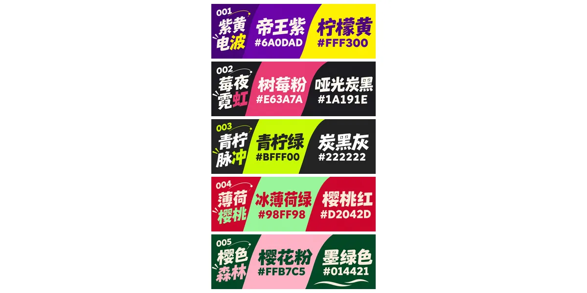

001 紫黄电波：帝王紫#6A0DAD，柠檬黄#FFF300

002 莓夜霓虹：树莓粉#E63A7A，哑光炭黑#1A191E

003 青柠脉冲：青柠绿#BFFF00，炭黑灰#222222

004 薄荷樱桃：冰薄荷绿#98FF98，樱桃红#D2042D

005 樱色森林：樱花粉#FFB7C5，墨绿色#014421

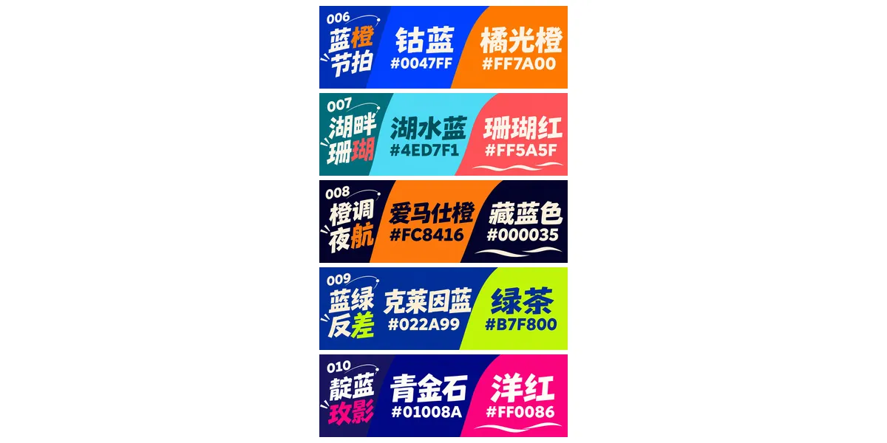

006 蓝橙节拍：钴蓝#0047FF，橘光橙#FF7A00

007 湖畔珊瑚：湖水蓝#4ED7F1，珊瑚红#FF5A5F

008 橙调夜航：爱马仕橙#FC8416，藏蓝色#000035

009 蓝绿反差：克莱因蓝#022A99，绿茶#B7F800

010 靛蓝玫影：青金石#01008A，洋红#FF0086

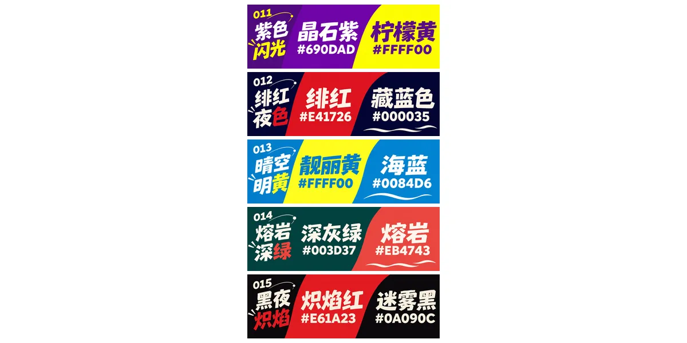

011 紫色闪光：晶石紫#690DAD，柠檬黄#FFFF00

012 绯红夜色：绯红#E41726，藏蓝色#000035

013 晴空明黄：靓丽黄#FFFF00，海蓝#0084D6

014 熔岩深绿：深灰绿#003D37，熔岩#EB4743

015 黑夜炽焰：炽焰红#E61A23，迷雾黑#0A090C

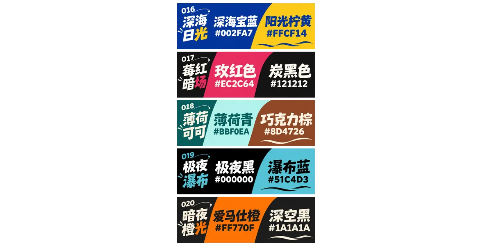

016 深海日光：深海宝蓝#002FA7，阳光柠黄#FFCF14

017 莓红暗场：玫红色#EC2C64，炭黑色#121212

018 薄荷可可：薄荷青#BBF0EA，巧克力棕#8D4726

019 极夜瀑布：极夜黑#000000，瀑布蓝#51C4D3

020 暗夜橙光：爱马仕橙#FF770F，深空黑#1A1A1A

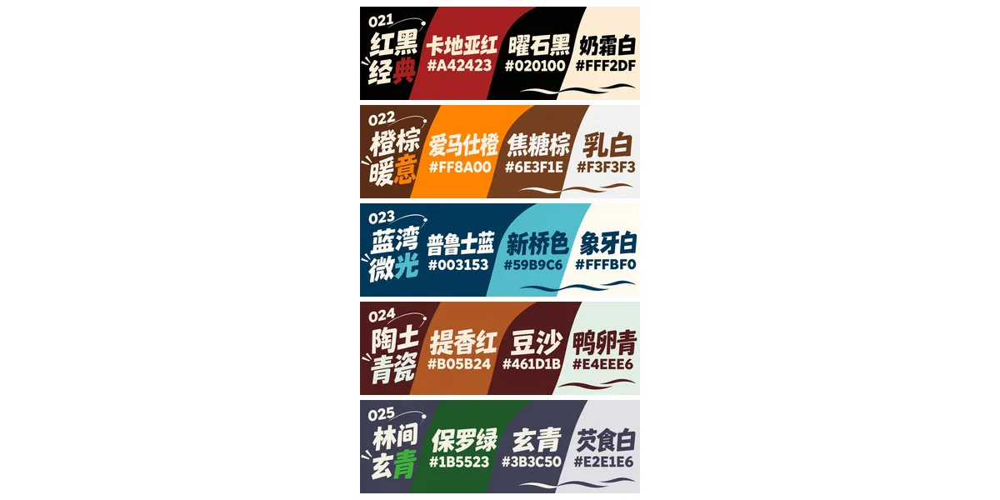

021 红黑经典：卡地亚红#A42423，曜石黑#020100，奶霜白#FFF2DF

022 橙棕暖意：爱马仕橙#FF8A00，焦糖棕#6E3F1E，乳白#F3F3F3

023 蓝湾微光：普鲁士蓝#003153，新桥色#59B9C6，象牙白#FFFBF0

024 陶土青瓷：提香红#B05B24，豆沙#461D1B，鸭卵青#E4EEE6

025 林间玄青：保罗绿#1B5523，玄青#3B3C50，芡食白#E2E1E6

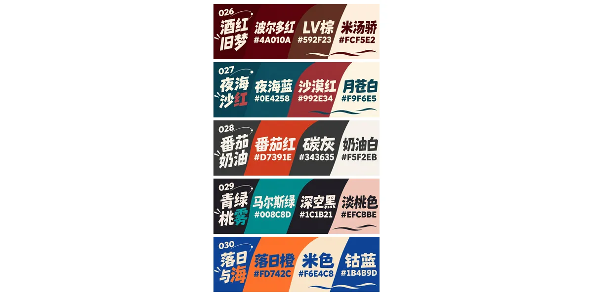

026 酒红旧梦：波尔多红#4A010A，LV 棕#592F23，米汤骄#FCF5E2

027 夜海沙红：夜海蓝#0E4258，沙漠红#992E34，月苍白#F9F6E5

028 番茄奶油：番茄红#D7391E，碳灰#343635，奶油白#F5F2EB

029 青绿桃雾：马尔斯绿#008C8D，深空黑#1C1B21，淡桃色#EFCBBE

030 落日与海：落日橙#FD742C，米色#F6E4C8，钴蓝#1B4B9D

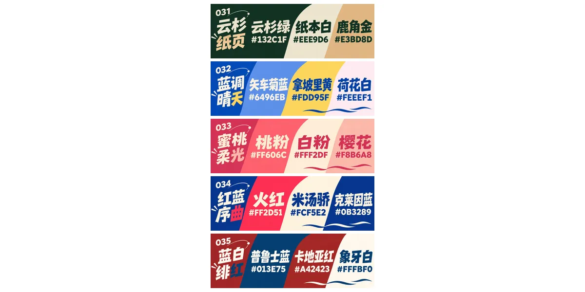

031 云杉纸页：云杉绿#132C1F，纸本白#EEE9D6，鹿角金#E3BD8D

032 蓝调晴天：矢车菊蓝#6496EB，拿坡里黄#FDD95F，荷花白#FEEEF1

033 蜜桃柔光：桃粉#FF606C，白粉#FFF2DF，樱花#F8B6A8

034 红蓝序曲：火红#FF2D51，米汤骄#FCF5E2，克莱因蓝#0B3289

035 蓝白绯红：普鲁士蓝#013E75，卡地亚红#A42423，象牙白#FFFBF0

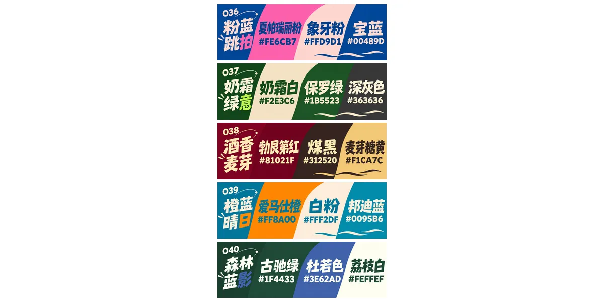

036 粉蓝跳拍：夏帕瑞丽粉#FE6CB7，象牙粉#FFD9D1，宝蓝#00489D

037 奶霜绿意：奶霜白#F2E3C6，保罗绿#1B5523，深灰色#363636

038 酒香麦芽：勃艮第红#81021F，煤黑#312520，麦芽糖黄#F1CA7C

039 橙蓝晴日：爱马仕橙#FF8A00，白粉#FFF2DF，邦迪蓝#0095B6

040 森林蓝影：古驰绿#1F4433，杜若色#3E62AD，荔枝白#FEFFEF

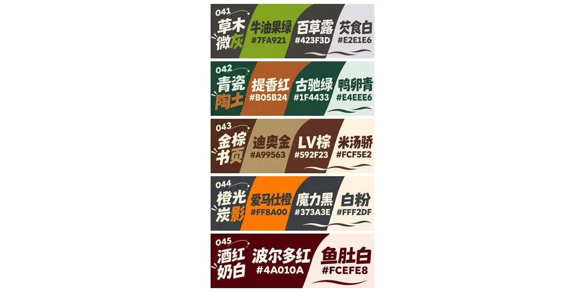

041 草木微灰：牛油果绿#7FA921，百草露#423F3D，芡食白#E2E1E6

042 青瓷陶土：提香红#B05B24，古驰绿#1F4433，鸭卵青#E4EEE6

043 金棕书页：迪奥金#A99563，LV 棕#592F23，米汤骄#FCF5E2

044 橙光炭影：爱马仕橙#FF8A00，魔力黑#373A3E，白粉#FFF2DF

045 酒红奶白：波尔多红#4A010A，鱼肚白#FCEFE8

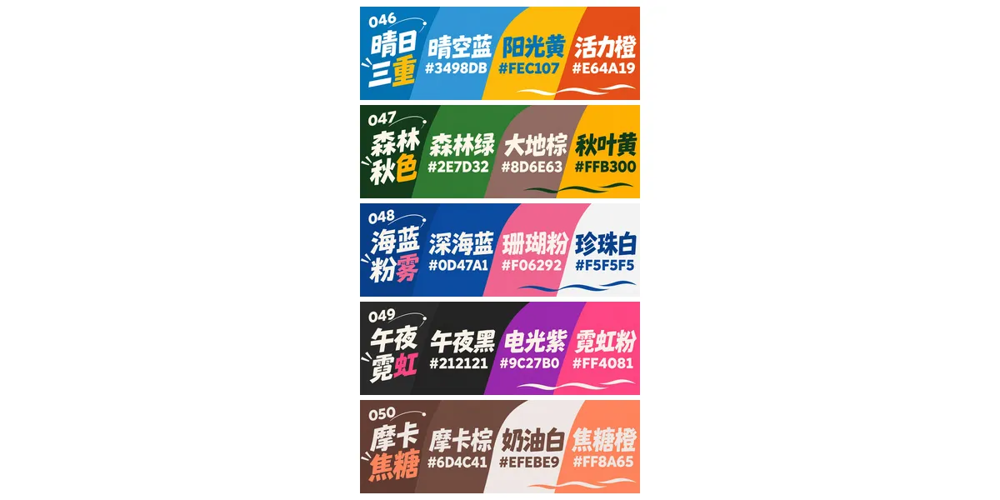

046 晴日三重：晴空蓝#3498DB，阳光黄#FEC107，活力橙#E64A19

047 森林秋色：森林绿#2E7D32，大地棕#8D6E63，秋叶黄#FFB300

048 海蓝粉雾：深海蓝#0D47A1，珊瑚粉#F06292，珍珠白#F5F5F5

049 午夜霓虹：午夜黑#212121，电光紫#9C27B0，霓虹粉#FF4081

050 摩卡焦糖：摩卡棕#6D4C41，奶油白#EFEBE9，焦糖橙#FF8A65

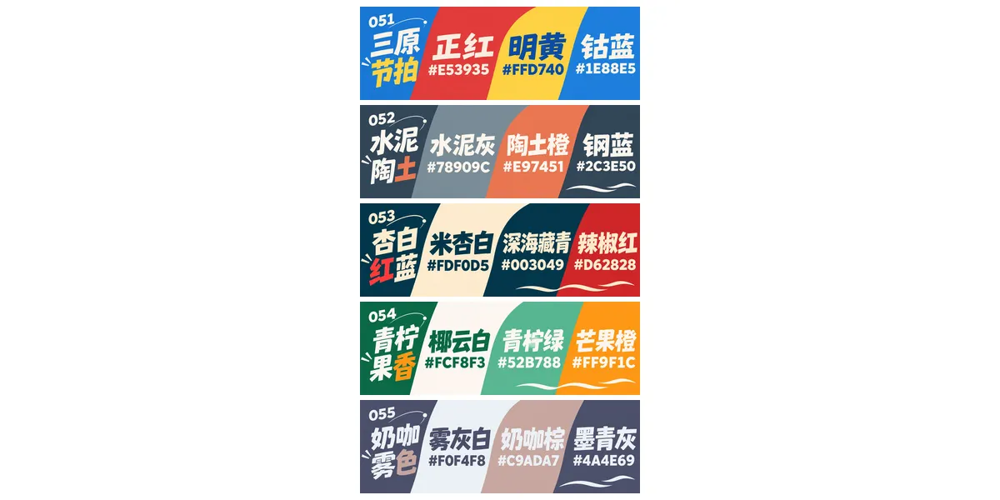

051 三原节拍：正红#E53935，明黄#FFD740，钴蓝#1E88E5

052 水泥陶土：水泥灰#78909C，陶土橙#E97451，钢蓝#2C3E50

053 杏白红蓝：米杏白#FDF0D5，深海藏青#003049，辣椒红#D62828

054 青柠果香：椰云白#FCF8F3，青柠绿#52B788，芒果橙#FF9F1C

055 奶咖雾色：雾灰白#F0F4F8，奶咖棕#C9ADA7，墨青灰#4A4E69

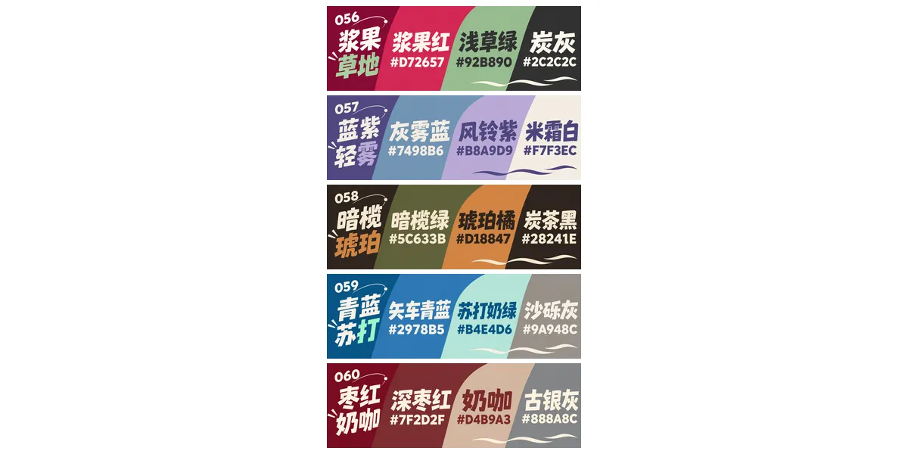

056 浆果草地：浆果红#D72657，浅草绿#92B890，炭灰#2C2C2C

057 蓝紫轻雾：灰雾蓝#7498B6，风铃紫#B8A9D9，米霜白#F7F3EC

058 暗榄琥珀：暗榄绿#5C633B，琥珀橘#D18847，炭茶黑#28241E

059 青蓝苏打：矢车青蓝#2978B5，苏打奶绿#B4E4D6，沙砾灰#9A948C

060 枣红奶咖：深枣红#7F2D2F，奶咖#D4B9A3，古银灰#888A8C

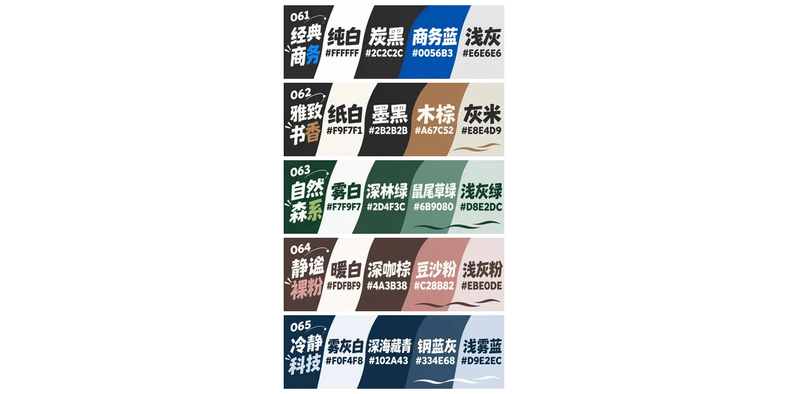

061 经典商务：纯白#FFFFFF，炭黑#2C2C2C，商务蓝#0056B3，浅灰#E6E6E6

062 雅致书香：纸白#F9F7F1，墨黑#2B2B2B，木棕#A67C52，灰米#E8E4D9

063 自然森系：雾白#F7F9F7，深林绿#2D4F3C，鼠尾草绿#6B9080，浅灰绿#D8E2DC

064 静谧裸粉：暖白#FDFBF9，深咖棕#4A3B38，豆沙粉#C28B82，浅灰粉#EBE0DE

065 冷静科技：雾灰白#F0F4F8，深海藏青#102A43，钢蓝灰#334E68，浅雾蓝#D9E2EC

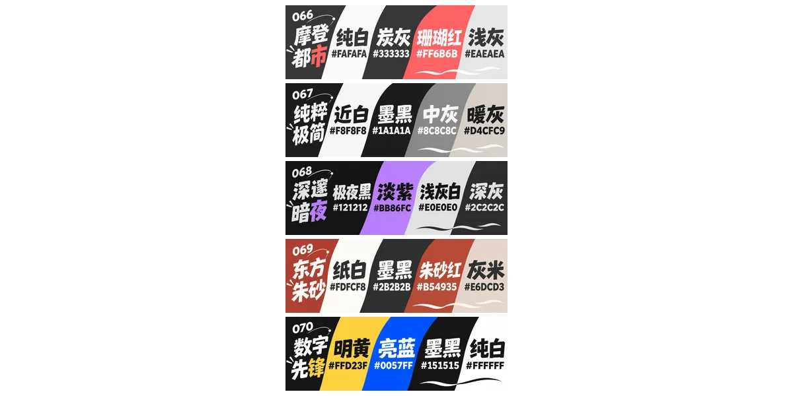

066 摩登都市：纯白#FAFAFA，炭灰#333333，珊瑚红#FF6B6B，浅灰#EAEAEA

067 纯粹极简：近白#F8F8F8，墨黑#1A1A1A，中灰#8C8C8C，暖灰#D4CFC9

068 深邃暗夜：极夜黑#121212，淡紫#BB86FC，浅灰白#E0E0E0，深灰#2C2C2C

069 东方朱砂：纸白#FDFCF8，墨黑#2B2B2B，朱砂红#B54935，灰米#E6DCD3

070 数字先锋：明黄#FFD23F，亮蓝#0057FF，墨黑#151515，纯白#FFFFFF

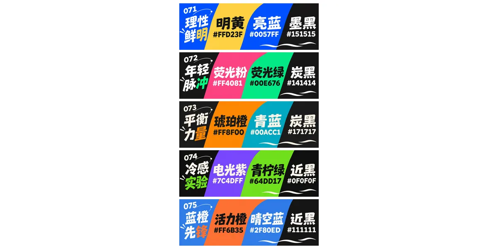

071 理性鲜明：明黄#FFD23F，亮蓝#0057FF，墨黑#151515

072 年轻脉冲：荧光粉#FF4081，荧光绿#00E676，炭黑#141414

073 平衡力量：琥珀橙#FF8F00，青蓝#00ACC1，炭黑#171717

074 冷感实验：电光紫#7C4DFF，青柠绿#64DD17，近黑#0F0F0F

075 蓝橙先锋：活力橙#FF6B35，晴空蓝#2F80ED，近黑#111111

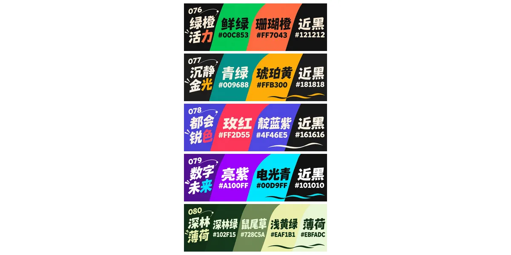

076 绿橙活力：鲜绿#00C853，珊瑚橙#FF7043，近黑#121212

077 沉静金光：青绿#009688，琥珀黄#FFB300，近黑#181818

078 都会锐色：玫红#FF2D55，靛蓝紫#4F46E5，近黑#161616

079 数字未来：亮紫#A100FF，电光青#00D9FF，近黑#101010

080 深林薄荷：深林绿#102F15，鼠尾草#728C5A，浅黄绿#EAF1B1，薄荷#EBFADC

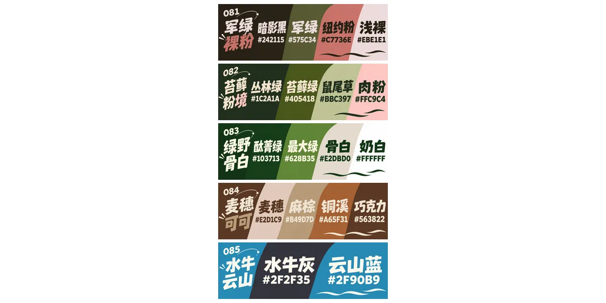

081 军绿裸粉：暗影黑#242115，军绿#575C34，纽约粉#C7736E，浅裸#EBE1E1

082 苔藓粉境：丛林绿#1C2A1A，苔藓绿#405418，鼠尾草#BBC397，肉粉#FFC9C4

083 绿野骨白：酞菁绿#103713，最大绿#628B35，骨白#E2DBD0，奶白#FFFFFF

084 麦穗可可：麦穗#E2D1C9，麻棕#B49D7D，铜溪#A65F31，巧克力#563822

085 水牛云山：水牛灰#2F2F35，云山蓝#2F90B9

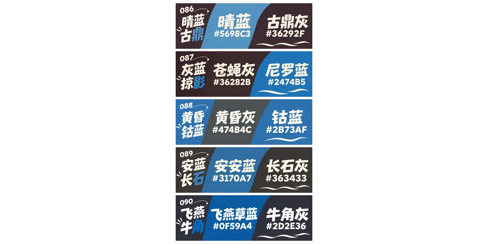

086 晴蓝古鼎：晴蓝#5698C3，古鼎灰#36292F

087 灰蓝掠影：苍蝇灰#36282B，尼罗蓝#2474B5

088 黄昏钴蓝：黄昏灰#474B4C，钴蓝#2B73AF

089 安蓝长石：安安蓝#3170A7，长石灰#363433

090 飞燕牛角：飞燕草蓝#0F59A4，牛角灰#2D2E36

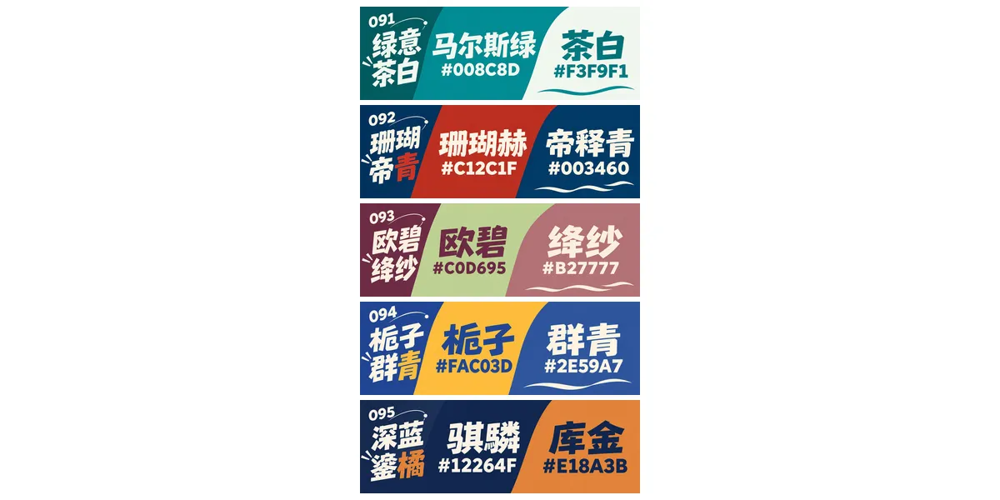

091 绿意茶白：马尔斯绿#008C8D，茶白#F3F9F1

092 珊瑚帝青：珊瑚赫#C12C1F，帝释青#003460

093 欧碧绛纱：欧碧#C0D695，绛纱#B27777

094 栀子群青：栀子#FAC03D，群青#2E59A7

095 深蓝鎏橘：骐驎#12264F，库金#E18A3B

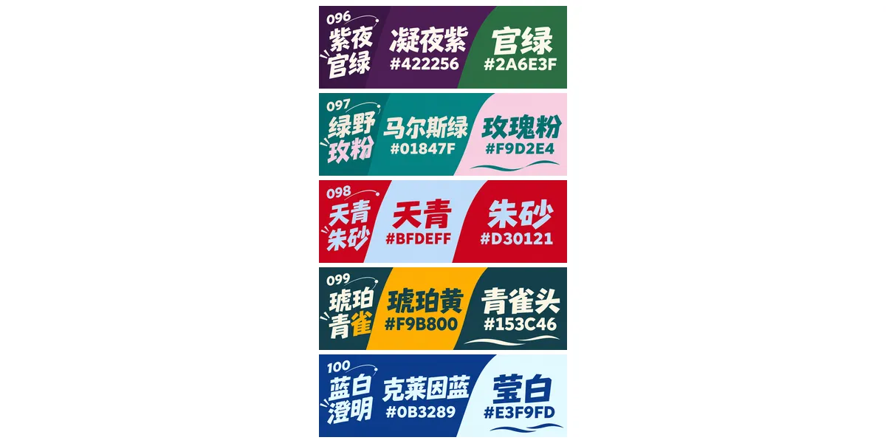

096 紫夜官绿：凝夜紫#422256，官绿#2A6E3F

097 绿野玫粉：马尔斯绿#01847F，玫瑰粉#F9D2E4

098 天青朱砂：天青#BFDEFF，朱砂#D30121

099 琥珀青雀：琥珀黄#F9B800，青雀头#153C46

100 蓝白澄明：克莱因蓝#0B3289，莹白#E3F9FD

审美拯救计划是说给我自己听的，因为我从小就被说审美差！班主任给我审美等级打 C+！

## 相关页面

- [[sources/leviwoyun-fable-life-advice]]
