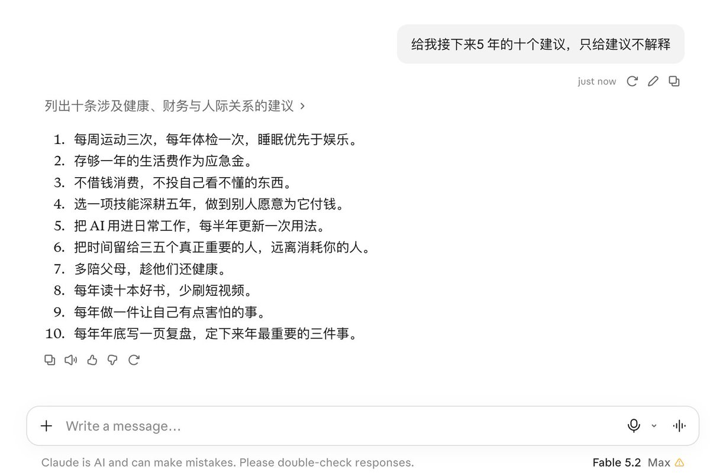

# Levi 卧云：与神对话，神给的人生建议（Fable 5.2）

> 让模型以“神”的口吻给出的 10 条人生建议：运动三次/年体检、一年应急金、不借钱消费、一项技能深耕五年、把 AI 用进日常、时间留给三五个重要的人、陪父母、每年读十本书、每年做一件害怕的事、年底复盘。

<!-- more -->

与神对话，神给的人生建议 - -Fable5.2

1. 每周运动三次，每年体检一次，睡眠优先于娱乐。
2. 存够一年的生活费作为应急金。
3. 不借钱消费，不投自己看不懂的东西。
4. 选一项技能深耕五年，做到别人愿意为它付钱。
5. 把 AI 用进日常工作，每半年更新一次用法。
6. 把时间留给三五个真正重要的人，远离消耗你的人。
7. 多陪父母，趁他们还健康。
8. 每年读十本好书，少刷短视频。
9. 每年做一件让自己有点害怕的事。
10. 每年年底写一页复盘，定下来年最重要的三件事。

