# 良竹（@liangzhu_AI）：掌控 AI·FDE 实战 01｜万字实操 SOP——搭建本地自动内容交付流水线

> 前线部署工程师（FDE）模式在内容工业化领域的万字实战复盘：通过本地大模型 API、规则过滤器与自动化构建工具，手把手搭建「热点感知 → 多维内容生成 → 样式排版 → 自动化质检」的本地闭环流水线，演示如何像管理软件工程一样管理日常自媒体内容交付。

<!-- more -->

我前老板常把一句话挂在嘴边：“以后不会用 AI 的人，全部要被淘汰。”

但现实往往极其讽刺： 公司花大价钱充齐了顶级模型会员，开了一堆动员大会，月底一查后台，大家用得最多的场景，依然是给周报改错别字、给年会通知润色。 核心业务，一个都没碰。

很多老板觉得是员工执行力不行、学不会。

真不是。

真实的卡点极其简单： 大家根本不知道 AI 到底该怎么用到具体业务里，手里也完全没有一个顺手、现成的业务入口。

- 买了工具直接扔给员工，没有具体任务切口，大家只能摸黑；
- 每天在网页对话框里聊天打字，标签页一关，大模型立刻失忆。
- 它进不了真实工位，碰不到电脑里的任何业务文件和表格；
- 每次都要人肉喂提示词、一段一段搬运结果、一遍一遍切屏改格式，出了错还得自己背锅。
- 最后自然只能流向改周报、润色邮件这种最边缘、最无需负责的文书工作。

大模型的推理能力早就严重过剩了。

真正卡死绝大多数人乃至企业的，从来不是提示词写得够不够花哨，而是它根本落不进你的本地业务流。

在硅谷和技术前线，真正负责破局的角色叫 FDE（Forward Deployed Engineer，前线部署工程师）。 FDE 的逻辑极其纯粹： 不搞空中楼阁，直接深入业务一线，把大模型与本地文件系统、真实数据和交付接口焊死，现场交付能稳定运转的系统。

所以，FDE 落地实战的第一步，从来不是空谈转型，而是先搭建一套有体系的业务流水线。


而作为整个实战系列的第一篇，我选择直接以“自动内容交付流水线”作为第一步切入。 为什么第一战选内容？ 因为它对公司和个人都有立竿见影的真实帮助：

- 对公司来说：想要在 AI 时代获得更多曝光与业务线索，绝对离不开持续、专业的内容运营（比如搭建公司的公众号矩阵、行业案例库、全域 SEO 文章）；
- 对个人来说：想要在垂直领域建立自己的专属 IP、跑通一人公司的高利润闭环，内容也是成本最低、确定性最高的信任杠杆。

这些你过去需要花几个人、耗费大量工时才能勉强维持的动作，都可以通过今天我们要搭建的这套本地流水线跑通闭环。

今天这篇文章，直接抛弃所有空洞理论，手把手带你在本地电脑里跑通这套可落地的 Agent 交付机床。 建议先点击右上角 Bookmark（书签收藏），照着这套 SOP，今天你就能把它跑起来。

|章节|核心内容|
|---|---|
|**01 / 认知重塑**|告别提问思维：本地数字员工的四大工程支柱（工位、规则、原料、连接器）|
|**02 / 定位筑基**|制作 01\_账号定位卡：5 维标准人设宪章与红线防火墙示范|
|**03 / 选题进货**|原料供应链：Excel 8 列表格设计、竞对低粉爆款监控与逆向蒸馏|
|**04 / 技能挂载**|刀具就位：WorkBuddy 专家、技能与连接器（MCP）黄金组合|
|**05 / 成稿交付**|工业化撰写：从选题库取料、调取真实素材库到双版本排版|
|**06 / 质检调优**|人肉关卡：成稿质检红线、人机磨合与专属 Agent 技能固化|
|**07 / 静默推送**|微信草稿箱 API 配置、IP 白名单与定时任务全天候托管|
|**08 / 商业落地**|从单机流水线走向企业级 FDE 交付：模式、定价与变现闭环|

### 一、FDE 核心认知：什么是“数字员工管理思维”？

想要让 AI 真正替你分担业务，必须把“提问思维”切换为“数字员工管理思维”。

提问思维 vs 数字员工管理思维

- 提问思维：
把 AI 当成搜索引擎或陪聊机器人，问一句答一句。

它不知道你的业务上下文、不知道你之前的规矩，每次都要你手动伺候它、从零写一段长提示词；

- 数字员工管理思维：
就像公司招了一个新员工。你不会每次都重新教他怎么做人，而是：

1. 给他在电脑里划定工位（指定本地专属文件夹）；
2. 给他制度手册与员工守则（规约文件：不能用什么词、必须按什么格式排版、遵守什么业务红线）；
3. 给他业务原料与历史案例（公司背景、选题表、客户真实对话）；
4. 交代任务目标与交付产物（“今天下午 5 点前，把这批数据处理好，按标准格式存进待审文件夹”）；
5. 人只做最终质检和拍板，不再做重复搬运工。

本地数字员工的四大支柱

说明：这“四大支柱”是我自己做软件开发 14 年、结合近两年把大模型落地到具体业务工程（FDE）中，踩坑总结出的一套本地交付架构。无论是用 WorkBuddy、Claude Code 还是自己写 Python 调度，底层逻辑其实都逃不出这四个模块：

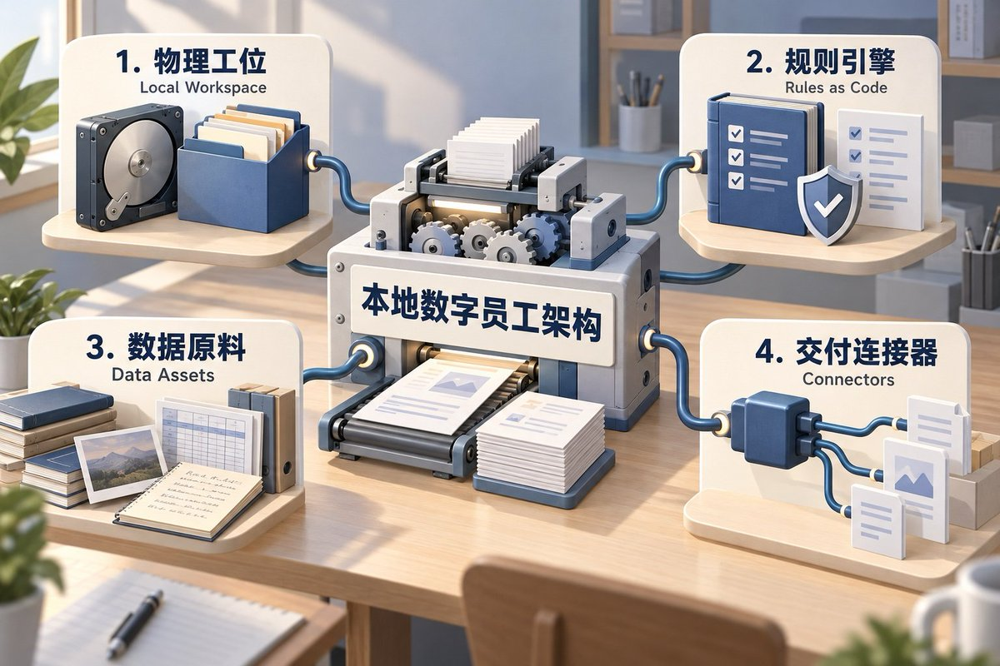

这四个模块一串联，你电脑里的桌面 Agent 就不再是一个聊天工具，而是一台能自主运转的内容机床。

### 二、实战案例拆解：公众号内容自动生产、排版与分发流水线

市面上 Agent 工具这么多，为什么第一篇要拿 WorkBuddy 来做交付机床？

在我看来，WorkBuddy 是目前国内中小型企业与普通人最容易接受、最好落地的桌面 AI 智能体。

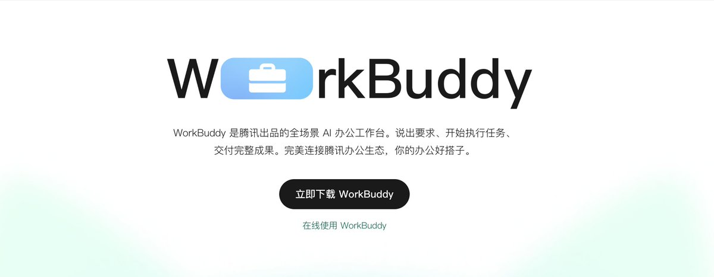

原因极其务实：

- 网页端大模型天生残疾：
  碰不到本地的任何文件与表格，根本无法串进真实的业务流。

- 海外工具门槛过高：
  Claude Code、Codex 虽强，但网络门槛高、纯命令行交互，普通业务人员很难接手。

 （注：如果你自己具备网络环境、能熟练操作终端，完全可以优先用 Claude Code，上限极高；但在绝大多数企业现场，业务人员需要的是零学习成本的桌面客户端。）

- 本地读写开箱即用：
  WorkBuddy 不用折腾网络，天然具备本地工位物理隔离、文件直接读写与后台脚本静默执行能力。

- 内置主流模型免配置：
  内置免费模型（阶跃五、混元）跑日常建档；每天赠送的积分也能直调 GLM、DeepSeek、Kimi 等主力模型；如果有海外网络环境，直连 Gemini 的文案语感会更细腻。


它把复杂的 Agent 调度藏在后台，把最简单的操作留给业务人员。

这也是做 FDE 交付的核心原则：永远不要强迫客户和团队去迁就复杂的工具，选阻力最小、最容易落地的载体把事情跑通，才是真本事。

第一步：安装客户端并绑定本地空文件夹

不要一上来就手动去建一堆复杂的目录，我们先装好环境，后面让智能体替我们干活：

1. 下载与路径避坑：从官网 workbuddy.cn 下载安装客户端。Windows 用户切记：安装路径绝对不要包含中文或空格（如默认的 Program Files），否则后续后台调用 Python 脚本容易报错；
2. 绑定本地物理工位：在电脑硬盘里新建一个空文件夹（如 D:\Content_FDE_Pipeline\），打开 WorkBuddy，点击输入框左下角的“选择工作空间”（或左上角打开文件夹），选中这个空文件夹即可。工位划定，准备开工。

第二步：数字工位搭建与人设注入（一键建档 + 制作 01_账号定位卡.md）

1. 让 WorkBuddy 一键创建目录并完成结构化内容填充

装好 WorkBuddy 并绑定空文件夹后，不需要你自己手动去一个个新建子文件夹、写规范或做 Excel 表头，直接要求智能体帮你创建文件，并且让 WorkBuddy 自动把各个文件里的初始结构化内容一次性填充好！

我们要生成的标准本地工作区包含以下 6 个核心资产：

可直接复制运行的“自动建档 + 结构化内容填充” Prompt：

FDE 交付提醒：企业客户和一线员工往往比你想象中要小白得多。千万别要求他们去改代码或配置文件，他们最习惯的就是本地 Excel 表格；如果是多人协同团队，直接切到他们熟悉的飞书或钉钉多维表格即可。把复杂逻辑藏在后台，把最习惯的入口留给客户。

2. 采访式制作“01_账号定位卡.md”（给数字员工注入灵魂锚点）

为什么 99% 的人直接用大模型写出来的文章一股浓浓的塑料味？

因为大模型根本不知道你是谁、不知道你在对哪类人群说话、也不知道你亲身经历过什么踩坑细节。一旦缺少背景约束，它就会去全网通用语料里拼凑正确的废话。

“账号定位卡”就是你给数字员工立下的最高人设宪章。

你同样不需要自己对着刚才生成的模板苦思冥想。在 WorkBuddy 里直接发送下面这段“采访式建档指令”，让 AI 先像资深主编一样向你提问，聊完自动帮你把这两份核心资产填充完整：

可直接复制运行的采访建档 Prompt：

使用提示：复制指令时，根据自己的节奏把其中的 X 改为 1 到 3 即可（新手最推荐填 1 或 2，单次只回答一两个问题）。

填充完成后的 01_账号定位卡.md 标准范例参考：

```markdown
# 01 · 账号定位卡（标准示范案例）

本文件是账号的“宪法”。所有选题、写作、排版决策与本文冲突时，以本文为准。

## 一、人设与对外口径
- **账号人格**：AI 落地操盘手——把 AI 从概念变成企业里跑得起来的系统，并且敢把过程中每个坑讲出来的人。
- **说话口吻**：直接、口语化、先结论后理由；自称“我”，称呼读者“你”；可以泼冷水但必须带证据；不吹概念，只讲交付过的东西。允许使用情绪张力强的口语化共鸣表达，严禁为了博眼球大面积滥用粗俗词汇。
- **专业背书**：程序员出身 → 技术总监 → Java 讲师 → 架构师 → 产品负责人 → PMO 项目总监 → 分公司副总（14 年 6 次跨岗）；TOGAF + PMP 双证；一人 + AI 独立完成 5 个产品全流程交付。
- **对外口径**：“我帮中小企业把 AI 真正落进业务，拒绝空中楼阁——项目怎么卖出去、落地第一关卡在哪、团队为什么用不起来，我都讲真的；看完觉得靠谱，我们再谈合作或培训。”

## 二、目标读者画像
- **画像 A（中小企业老板、决策人）**：知道 AI 好，但怕被割、怕落不了地、怕白花钱；读我判断这事值不值得干、值不值得找上门合作。
- **画像 B（企业中层管理者、推动者）**：老板要“搞 AI”，自己手里没方法、没培训资源；读我找可直接抄作业的落地步骤和团队带法。
- **阅读场景**：带着具体业务问题找方案、找避坑指南，不是摸鱼消遣；读完的理想动作是留言、私信、谈合作或培训。

## 三、读者核心痛点（按付费意愿排序）
1. **不知道往哪落**：知道 AI 很好，但不知道具体怎么用、用在自己业务的哪个场景里；
2. **钱花了没效果**：工具买了、课上了，员工不用，老板觉得被割韭菜；
3. **团队带不动**：中层想推，一线表面配合、实际“支支吾吾说不出内容”，没方法、没培训资源沉淀。
- **停留与共鸣钩子**：真实踩坑细节、具体业务数字、一线员工现场原话、反常识推论。

## 四、绝对不能碰的红线
- **不编造经历与数字**：所有故事、数据必须能在素材库找到出处，不得凭空造假；效果数字没有就不写；
- **前公司保密**：不提公司名，可识别的系统细节一律模糊；
- **客户项目口径**：对外可称“我操盘/我负责”；不把项目定性为“失败 / 烂尾”；不编造成果数字；
- **学历不主动提**：只在“起点低”叙事需要时一笔带过，不写具体层次、不卖惨；
- **出海收入不外讲**：当前产品出海真实月收入绝不对外讲，不戳穿、不强化对外 IP 阈值；
- **不搞虚假承诺**：不写“保证暴富 / XX 天速成 / 月入 X 万”等浮夸口号；
- **格式与文风底线**：严禁爹味说教、鸡汤、“家人们”；全文统一使用标准简体中文双引号 “ ”；严禁“首先、其次、综上所述、不难发现、显而易见”等机械套话。

## 五、内容承诺与呈现形式
- **每篇必给**：1 个当天能上手的动作 + 1 个亲历细节或真实数字，缺一样不发；
- **呈现形式**：优先图文、录屏等不露脸形式（以可执行的交付物为主，出镜根据实际业务需要安排）；
- **商业闭环**：内容开门（真实复盘 + 方法）→ 咨询 / 培训询盘 → 落地交付收钱。

## 六、验证与迭代指标
- **核心假设**：真实踩坑复盘 + 可执行工程方法 → 吸引高质量 B 端询盘与团队合作，而不是赚虚荣阅读量；
- **验证指标**：重点看私信/询盘质量与合作转化（“能不能帮我们做系统 / 讲一场”），不盲目追求泛流量。
```

第三步：选题进货与自动化入库（两条路径填满选题库 + 人工选题核查）

文章能不能爆，80% 取决于选题。千万不要每天坐到电脑前才拍脑袋现想，要把选题当成流水线的“原料备货”。

但很多朋友把上面的工位和定位卡配置好之后，看着干净的对话框和本地空目录，心里往往会突然犯怵发懵：“环境我都配齐了，但我现在大脑一片空白，第一篇到底该写什么？根本不知道怎么起步啊！”

别慌，这个卡点极其真实。不仅是新手，包括我自己当年刚跑这套流程时，也经常对着空白屏幕发愣。

为了让你今天能 100% 亲手跑通闭环，我们先不扯任何抽象概念。假设你手头现在没有任何灵感、也没有抓对标，我们就拿下面这个案例来实操：

👉通用实测案例：一句话大白话想法： “很多企业和个人买了一堆 AI 课和付费会员，最后发现员工还是只会拿它润色周报、改错别字，根本落不进核心业务，为什么？”

下面是两条把原料变成扎实库存的完整路径：

1. 路径 A：个人灵感细化与认知升维（把一句话粗糙想法梳理成可以直接开写的选题方案）

平时与客户交流的痛点、群里被反复问的问题、自己踩过的坑，或者自己一直想写但不知从何下手的碎念，你只需要向 WorkBuddy 抛出一句大白话，剩下的受众拆解、痛点挖掘与认知升维全交给 AI 完成。

可直接复制运行的“灵感细化与认知升维” Prompt：

```markdown
你现在的角色是资深内容总编与认知架构师。
请严格读取当前目录下的“01_账号定位卡.md”、“04_真实经历素材库.md”与“05_排版与写作规范.md”作为最高执行基准。

我现在有一个初步想写的一句话粗糙灵感：
“很多企业和个人买了一堆 AI 课和付费会员，最后发现员工还是只会拿它润色周报、改错别字，根本落不进核心业务，为什么？”
（注：如果你有自己的真实业务想法，就替换上面这句；如果现在大脑一片空白，就直接原封不动复制这句做测试！）

请结合定位卡，帮我把这个初步想法做一次深度的梳理与细化，提炼成可以直接开写的完整选题方案：
1. 精准锁定受众画像与共鸣时刻：明确这篇文章究竟写给谁看（区分决策人主受众与执行人次受众）、他们在什么具体业务场景下读到会心里一沉、产生强烈共鸣；
2. 挖掘痛点场景：戳破目标群体最焦虑、每天遇到却无法解决的具体痛点与表面现象；
3. 颠覆性认知升维：拒绝人云亦云的假大空建议，站在 14 年一线技术人实操视角，指出传统伪解法为什么必然失败，并立起一个颠覆性的认知破局新模型（例如：操作层、翻译层、结构层三层漏斗）；
4. 匹配真实经历支撑：从“04_真实经历素材库.md”中检索匹配 1 到 2 个真实经历编号（如 EXP-03 / EXP-01），作为文章核心论据支持；
5. 打造开头黄金钩子：输出前 60 字痛点扎心钩子，3 秒内抓牢读者；
6. 拟定 3 个高转化标题：分别从“痛点直击”、“反常识颠覆”、“数字扎心”三个维度起标题（严禁使用诱导词）；
7. 自动回填入库：将以上提炼出的完整字段，按照标准 8 列表头格式，状态标为“待写”，自动追加写入本地的“03_选题排期库.xlsx”对应行中。
```

回车发出后，WorkBuddy 会立刻在后台完成拆解，并在对话框给你返回一份清晰的选题解析（并自动回填到 Excel）：

- 选题方向：
企业 AI 课买而不用：AI 为什么只停在周报，落不进核心业务。

- 受众画像与共鸣时刻：
决策人主受众：掏钱买了 AI 课和全员会员的中小企业老板；

共鸣时刻：到期续费决策、后台使用报告全是润色、听见员工说“周报是我用 AI 写的”心里一沉；

执行人次受众：被要求“搞 AI”却背不动 KPI 的中层管理者。

- 我要输出的认知升维观点：
员工拿 AI 改周报不是懒，而是理性——AI 永远只会流向“无考核、无风险”的边缘文书；

落不进核心业务，是因为企业只修了“操作层”（买课），没修“翻译层”（把算钱业务拆成 AI 任务）和“结构层”（隐性知识固化）；

立“操作层 → 翻译层 → 结构层”三层漏斗模型；用前老板“淘汰论”当靶子：吓人没用，给场景才有用。

- 拟定 3 个候选标题：《你的员工不是不会用 AI，是只敢用它写周报》（痛点直击）
《员工拿 AI 润色周报，不是懒，是理性》（反常识颠覆）

《十几万的课、全员的会员，最后只换来更漂亮的周报》（数字扎心）

执行完成后，WorkBuddy 会把上述字段规整地追加写入本地 03_选题排期库.xlsx 的最后一行（由于初始化已包含 2 行示范数据，新选题自动沉淀为序号 3），状态标为“待写”。

打开本地 Excel 即可看到新选题已自动就位。

2. 路径 B：大脑一片空白、找不到选题？（全网热点与竞对低粉爆款监控）

很多人在做内容时，心里总有一股莫名的排斥和包袱：

总觉得去翻竞对、看别人的爆款，好像就“不是自己纯原创”了。

这种观念大错特错，这也是我曾经的心态。

商业和内容的第一铁律是：你连拆解和看懂优秀同行的能力都没有，根本谈不上什么真正的创新。

不看竞对、不看市场，你甚至连对手在打什么痛点、同行里真正拿结果的人在写什么维度的认知都一无所知。

每天把自己关在房间里硬憋着“写写写”，不是说这样绝对跑不出来，但成功的概率极低。

绝大多数人写到最后，不过是一个闭门造车的自嗨人而已。

灵感从来不是凭空掉下来的。

你要不停地输入，先去了解这个市场当前真正关注什么、热点情绪在哪，这些真实的外部碰撞才会激发你深层的灵感。

下面是经过实战验证的监控与抓取逻辑：

2. 1: 先学会一眼识别什么是值得抄的“竞对低粉爆款”

无论你做哪个垂直赛道（比如中老年银发经济、养生轻食、中小企业 AI 降本增效、超级个体副业、或者职场技术转管理），找对标竞品时记住三条铁律：

1. 低粉高读（最核心指标）：一个账号平时常态阅读量只有 200～500，但某篇文章突然飙升到 5000 甚至破万（或者小红书粉丝几百，单篇赞藏破 2000）。这说明流量完全来自选题和标题精准踩中了大众痛点，极具复刻价值；
2. 评论区有强体感互动：读者在评论区真实宣泄焦虑、追问解决方案或激烈讨论细节；
3. 微信端免费挖掘手势：打开手机微信 -> 顶部搜索栏输入你赛道的痛点关键词 -> 点击“文章”标签 -> 点击右上角筛选“最近发表” -> 从上往下翻，挑出阅读量异常高的陌生小号文章 -> 复制链接直接发给 WorkBuddy，让它自动下载、清洗并存入本地的“02_对标爆文库/”（具体操作见下一步）。

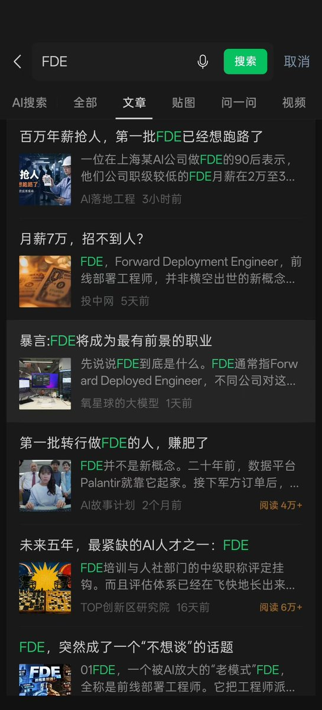

2. 2: 用 WorkBuddy 自动下载、监控热点与竞对入库（3 种落地方式）

拿到爆款文章链接或热搜方向后，千万不要人肉去手动复制粘贴。把抓取网页、排版清洗与本地归档的脏活全部交给 WorkBuddy：

- 方式 1：单篇竞对爆文一键下载归档（最推荐的人肉感知法）
平时在手机微信刷到同行低粉爆款，复制链接，在电脑端直接发给 WorkBuddy：

```markdown
请提取这个链接里的正文、小标题与核心结构，去除所有平台噪音与广告，
转成标准 Markdown 格式保存在本地的“02_对标爆文库/”文件夹中，
命名为“对标_原文章标题.md”。
```

WorkBuddy 会在后台静默打开网页、抓取解析并存入你的硬盘。你只要顺手一转，对标文章就已经整整齐齐躺在“02_对标爆文库/”里了。

实操体感：持续输入，建立你的人肉审美

每天花十几分钟，带着解剖的心态去快速浏览同行爆款，去理解别人为什么能引发几千人共鸣。

你看得多了，市场的手感和行文节奏自然会长在自己身上。有这种敏锐的人肉判断力压阵，你驾驭 AI 流水线才会有真正的底气，而不是沦为一个闭门造车的工具操作员。

- 方式 2：调用内置专家监控七大平台实时热搜（零门槛全网进货）
接在 WorkBuddy 专家中心搜索并召唤“公众号爆文写作专家｜爆款捕手”

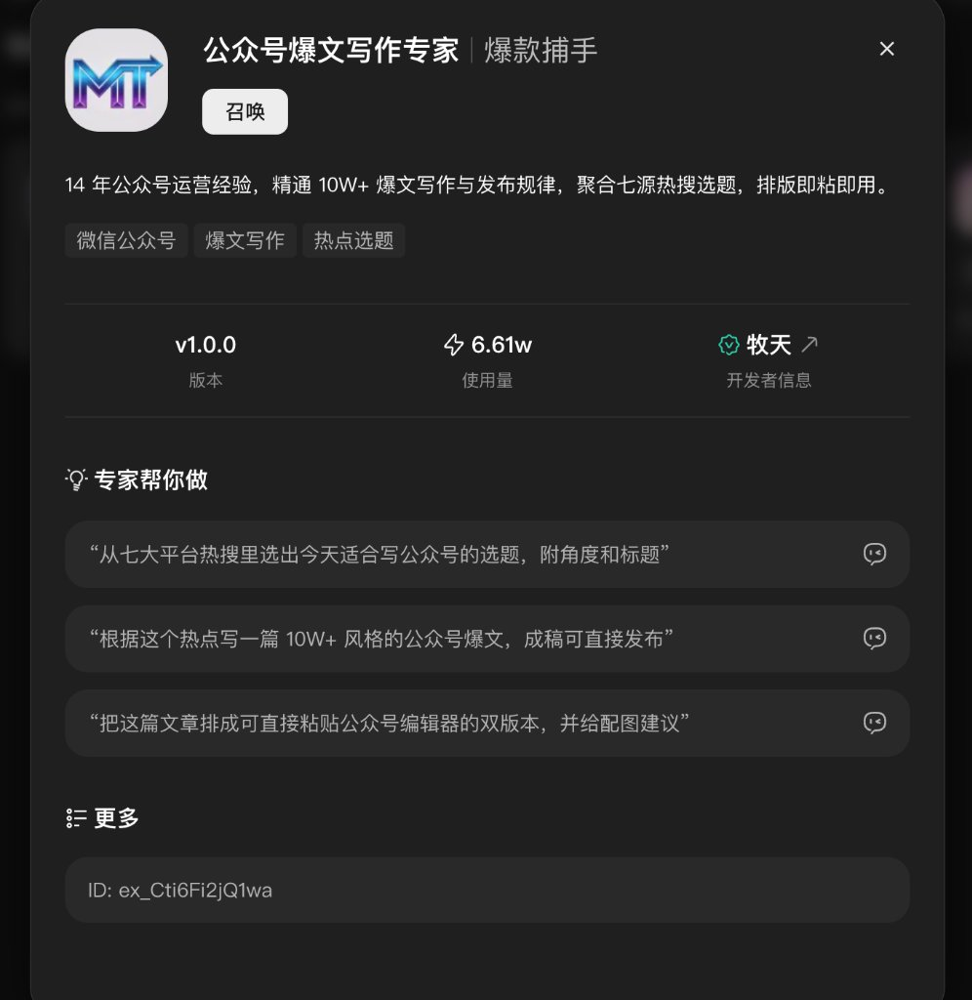

或“自媒体热点雷达与内容增长官｜热点猎手”

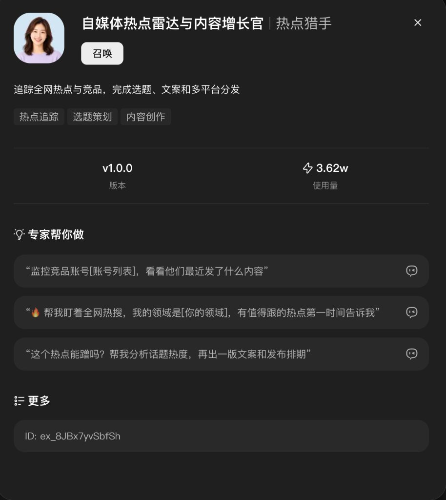

发送指令：

```markdown
请帮我实时聚合今天百度、微博、抖音、知乎、今日头条、微信搜一搜、快手七大平台的热搜榜，
结合我的 01_账号定位卡.md，
交叉筛选出 10 个最适合我切入的选题（附带切入角度和 3 个候选标题），
并直接写入 03_选题排期库.xlsx。
```

你会得到当前的热点选题并写入 03_选题排期库.xlsx

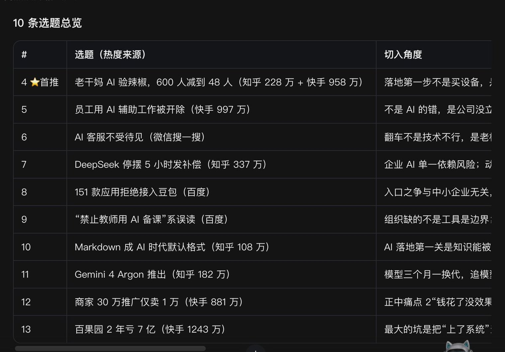

- 方式 3：让 WorkBuddy 写 Python 脚本调接口批量监控竞对（全自动进货）
去专业公众号数据平台（如 wxrank.com 等）注册拿一个数据查询 API Key（充几块钱能查几千次）。把你的 API Key 和数据平台的开发文档链接一起发给 WorkBuddy：

```markdown
我手头有一个第三方公众号数据平台的接口权限：
- API Key：<粘贴你的Key>
- 开发接口文档链接：<粘贴数据平台的开发文档URL，例如：https://api.xxx.com/doc>
请先阅读上述开发文档，理解其文章检索与正文提取接口的请求参数与返回结构。
然后帮我写一个 Python 脚本，调用该接口拉取关于“（填入你的赛道关键词，例如：AI落地 / 职场管理）”近 3 个月阅读量前 30 的同行爆款文章。
把它们的正文、阅读数、发布时间提取出来，分别转为标准 Markdown 文件保存在“02_对标爆文库/”文件夹中（命名为“对标_原文章标题.md”）。
写完脚本后，请直接在本地终端运行它，并告诉我最终抓取成功的篇数。
```

WorkBuddy 会先自动打开文档弄清接口协议，在后台写好代码、自动补齐依赖并静默运行脚本，把 30 篇竞对爆文整整齐齐存进你的硬盘。

2. 3: 逆向蒸馏，把竞对爆文一键转化为原创选题池
   竞对文章抓回来后，同样不能直接搬运！必须让 AI 对整个对标库做一次全局逆向蒸馏。

在 WorkBuddy 中发送下面这段指令：

```markdown
你现在的角色是竞品情报分析师兼爆款策划主编。
请严格读取本地的“01_账号定位卡.md”作为人设与业务边界准则。
请通读“02_对标爆文库/”目录下的所有同行爆款文章，进行爆款逻辑逆向蒸馏：
1. 规律拆解：量化分析这些爆款的平均字数、开头 60 字痛点钩子、小标题密度与高频共鸣词；
2. 选题反哺衍生：严禁抄袭竞对内容！必须基于对标文章验证过的大众痛点内核，结合我的“01_账号定位卡.md”，为我逆向推导出 10 个全新的高潜力原创选题（把大众痛点嫁接到我自己的真实经历与专业视角上）；
3. 自动入库：将这 10 个选题按照标准 8 列表头格式（状态设为“待审”），自动追加写入“03_选题排期库.xlsx”末尾。
```

执行完毕后，你的 Excel 选题库里就会自动长出 10 条经过市场验证的高潜选题备货！

2. 4 将选题监控进货固化为“定时任务”（每天 8:00、11:00、16:00 自动进货）

上面的抓取与逆向蒸馏如果每次都靠人肉手动去点，依然不够自动化。

而且根本不需要我们自己去写爬虫或用浏览器抓取——WorkBuddy 内置的“公众号爆文写作专家｜爆款捕手”（或搭配“自媒体热点雷达与内容增长官｜热点猎手”）本身就自带强大的七源热搜实时数据能力（实时聚合百度、微博、抖音、知乎、头条、微信搜一搜、快手七大平台热榜）。

在定时任务中，直接应用该专家读取七源热搜数据，结合本地定位卡自动筛选、蒸馏，就能实现真正无人值守的后台原料进货。

完全不需要你去客户端界面菜单里一层层手动点击设置，直接发一段提示词，让 WorkBuddy 在后台自动为你创建并托管这个定时任务！

我个人的实操习惯，是将这个监控任务配置为每天固定 3 次定时执行：

- 08:00（早间 8 点）：读取早间发酵的七源热搜与各平台首发议题；
- 11:00（上午 11 点）：监控上午黄金流量时段各平台快速蹿升的高热议题；
- 16:00（下午 4 点）：捕捉全天发酵定型的高互动爆款热点，为晚间生产备足弹药。

可直接复制运行的“创建定时选题监控进货” Prompt：

```markdown
请为我在当前工作目录下创建一套全自动“定时任务”，并按照以下要求完成配置与调度：
1. 任务名称：七源热搜与竞对选题自动化监控进货
2. 执行时间：每天固定 3 次定时触发（08:00、11:00、16:00）
3. 挂载专家：“公众号爆文写作专家｜爆款捕手”
4. 每次定时执行的具体业务逻辑：
   - 严格读取本地绑定的“01_账号定位卡.md”；
   - 读取七源实时热搜：直接调取专家内置的七源热搜数据接口（聚合百度、微博、抖音、知乎、头条、微信搜一搜、快手七大平台热搜榜）；
   - 赛道匹配与痛点筛选：对照“01_账号定位卡.md”中的目标受众、痛点场景与业务边界，从七源数据中筛选出契合本账号定位的高潜力议题；
   - 逆向蒸馏为原创选题：基于筛选出的热搜痛点内核与情绪共鸣点，结合定位卡人设，为我逆向推导 3~5 个高潜原创选题（严禁生搬硬套或直接抄袭！）；
   - 自动追加写入表格：严格按照标准 8 列表头格式直接追加写入“03_选题排期库.xlsx”末尾，状态一律设为“待审”；
   - 任务报告：生成简短运行日志，列出本次从七源数据中新提炼入库的选题名称。
```

智能体执行后，会在后台直接创建并注册该定时任务。以后每天一到固定时间点，你的 Excel 选题库就会自动长出结合全网七源热搜、经过市场验证的高潜选题，且全部整齐标记为“待审”！

3. 核心关卡 1：FDE 选题人工核查与确认定版

很多新手在做自动化时最容易犯的错误，就是以为流水线一跑起来，自己就可以当甩手掌柜、任由 AI 自动一条龙写下去。

这是大错特错。内容工业化绝不等于“无人化”。人机协同的第一铁律是：人定战略与方向，机跑执行与流程。

当 WorkBuddy 把上面提炼出的选题方案写入 03_选题排期库.xlsx 之后，你必须花 1 到 2 分钟做第一次人工核查：

1. 受众与痛点核查：
   双击打开本地 Excel，看这一行的痛点是不是目标读者（老板或中层）在实际业务里被刺痛的事情？
   如果太泛，手动调一两个字让它更有刺痛感；
2. 认知升维核查：
   大模型给出的颠覆性新解法，符不符合你的业务真实认知？能否调出你素材库里的踩坑经历去支撑？
3. 确认定版：
   在 Excel 中把满意的选题状态从“待审”修改为**“待写（已核准）”**，不合格的直接删掉或重新提炼。

只有经过你亲自把关点头的选题，才配进入下一道工序，避免浪费算力去生产一篇注定没人看的平庸废稿。

第四步：从选题库自动取料，全流程撰写成稿与双版本交付

当选题库里备好了原料、且经过了你的人工核准（在本地 Excel 中把状态标记为“待写”）之后，接下来就是真正的大规模自动化生产环节：

让数字员工自动打开表格取料，结合你的定位卡和真实经历，一口气交付双版本成稿！

1. 生产前准备：召唤专家与论据调取

在正式下发撰写指令之前，只需确认好两件事：

- 召唤“总编大脑”：
在 WorkBuddy 左侧菜单点击“专家中心”，搜索并点击“召唤”“公众号爆文写作专家｜爆款捕手”（ID:ex_Cti6Fi2jQ1wa，如图二所示）。

这样当前会话就自动载入了 14 年公众号爆文结构、黄金前 60 字痛点钩子以及符合微信规范的内联富文本排版引擎，不需要你每次手写长篇写作规则；

- 真实论据调取（守住真实底线）：单机模式（默认）：AI 会直接读取本地的 04_真实经历素材库.md，调取你在第二步建档时沉淀的亲历踩坑细节和一线实测数据；
外挂知识库模式（可选）：如果你或团队平时在腾讯 ima 知识库、飞书知识库或 Notion 中沉淀了行业资料，可以在 WorkBuddy 中直接接入外部连接器（如），让它自主检索关联案例作为论据，完全无需手动复制进本地。

2. 一键开始生产：从选题库取料到全流程生成

把下面这段标准指令发给已召唤“爆款捕手”的会话：

可直接复制运行的撰写 Prompt：

```markdown
你现在的角色是资深公众号主编兼内容架构师（请结合“公众号爆文写作专家｜爆款捕手”专家规范与本地表格技能执行）。
请严格读取“05_排版与写作规范.md”和“01_账号定位卡.md”作为最高执行标准。

请执行今日自动化生产流程：
1. 选题锁定：读取“03_选题排期库.xlsx”，检索状态为“待写”的选题（例如刚才入库的序号 3）；
2. 真实论据调取：读取“04_真实经历素材库.md”，检索匹配前老板“AI淘汰论”的真实踩坑细节与一线“支支吾吾说不出内容”的业务事实数据，作为文章的核心事实支撑（严禁凭空编造假故事！）；
3. 爆款行文骨架：按照“前 60 字痛点场景钩子 -> 戳破传统伪解法 -> 给出认知升维新范式（操作层/翻译层/结构层三层漏斗模型） -> 手把手落地 SOP -> 结尾行动清单”的节奏撰写一篇 2000 字左右的深度长文；
4. 配图与排版闭环：
   - 双版本成稿：同时输出“纯文本版”与可直接粘贴进公众号编辑器的“全内联样式 HTML 版”（17px 字号、2.0 行高、重点金句加粗）；
   - 封面图片联动生成：
     直接调用 WorkBuddy 内置的生图工具（ImageGen）配合挂载的 punk-cover 技能（来自胖克老师开源的 Punk-Skill 项目：https://github.com/adrianpunk/Punk-Skill）。
     由 AI 自行判断：请通读成稿，根据本文的核心观点与受众痛点，自行判断最契合的设计风格与视觉隐喻（杜绝廉价塑料假人与发光芯片），严格按照微信公众号 2.35:1 画幅（900×383）生成封面图并预留标题安全区，自动保存为“06_今日待审草稿/cover.png”；
   - 正文插图自主判断与嵌入：
     可直接配合挂载宝玉大佬开源的生图技能（baoyu-skills 中的 baoyu-article-illustrator 或生图流：https://github.com/JimLiu/baoyu-skills）。
     由 AI 自行判断：请通读成稿，自主判断正文哪些核心论点、认知模型或业务转折处需要配图辅助理解（通常 1~2 处）。若需要，自动调用生图工具生成对应风格插图（或直接内嵌自适应 SVG 架构卡片代码），无缝嵌入 HTML 对应位置；
5. 跨平台切片衍生：
   - 提取 1 条适合发布在 Twitter/X 的 300 字硬核观点快评；
   - 提取 1 条适合小红书的图文种草文案（包含 3 组痛点标题与正文）；
6. 状态回填： 将“03_选题排期库.xlsx”中该选题的状态改写为“成稿待审”，并在“06_今日待审草稿/”生成今日内容归档文件。
```

回车发出后，WorkBuddy 会在后台自动打开 Excel 锁定行、调取本地素材库、结合专家规范生成双版本长文与切片，并把状态更新回 Excel。

2. 自动化配图与插图说明

关于配图，微信草稿箱接口（draft/add）强制要求必须传入封面图片 thumb_media_id，否则会直接报错拒绝入库。

在上述撰写 Prompt 中，我们让智能体直接调用 WorkBuddy 内置的生图工具（ImageGen），并联动@AdrianPunk115 的“Punk-Skill”（做 2.35:1 杂志级封面）与@dotey 的“baoyu-skills”（做正文概念与结构插图）。智能体会通读全文，自主判断契合的风格与配图位置，一键完成封面与正文插图的生成与嵌入，完全免去人工切屏作图。

这里必须给读者做一个积分消耗提醒：

WorkBuddy 单纯裸调用一次生图，基础消耗大约是 5~10 积分；

但当挂载了外部专业生图技能（如 Punk-Skill 或宝玉生图流）并配合生图时，由于多了一层 Agent 技能提示词的深度推理与上下文解析 Token 开销，实际消耗的积分会比单纯裸生图的 5~10 积分略微多一些。大家可以在后台查看扣费明细，不过相比请设计师或人工耗时切屏折腾，这笔算力成本依然微乎其微。

（注：这里推荐全自动出图来提效，但你完全可以自行选择。如果你不想消耗积分、有自己习惯的作图工具，或者更喜欢直接使用未经美颜的真实业务现场照片与系统截图，直接替换 06_今日待审草稿/目录下的图片或者在原始文件上修改即可。真实业务截图所自带的现场感与颗粒感，具有极高的信任杀伤力。）

3. 核心关卡 2：成稿人工核查与交付质检（守住人味底线）

机器写完之后，初稿就已经整整齐齐存放在本地待审文件夹了。但坚决不能直接推进发布流程，必须花 2 到 3 分钟进行第二次成稿人工核查：

1. 事实与经历核查（红线铁律）：
   通读一遍文章里的踩坑故事、项目场景和量化数据；
   确认是不是 100% 对应你素材库里的真实经历，坚决杜绝 AI 偷偷编造虚假故事。
2. 真实口吻校准（去机器味）：
   扫读正文，检查是否有“首先、其次、不可否认的是、值得注意的是、不是…而是...”等机械套话；
   语言是否保持了直接、接地气和先结论后理由的口吻。
3. 视觉排版与金句加粗预览：
   打开生成的全内联 HTML 预览一下，确认字号、行高排版舒适，重点金句加粗醒目。

经过这一道人肉质检打磨，这篇初稿才算具备交付的水准！

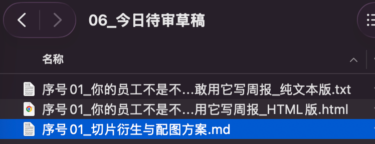

第五步：初期磨合与调优心法（人机对话蒸馏，升级为专属 Skill / Agent）

这里必须给所有实操者提个醒：在最初期跑这套流程时，初稿大概率不会一次就完美。

文案的风格是不是你想要的？有没有把你最想表达的硬核观点说透？这些细节你都要反反复复多检查，把 AI 当成一个文科实习生，在对话中对模型不断提出具体的修改要求：

- “第二段太啰嗦，换成接地气的大白话口吻”；
- “第三段的论据太泛，换成我真实经历里的踩坑数据”；
- “不要用对仗工整的假大空排比句，讲人话”。

WorkBuddy 本身自带记忆与上下文沉淀机制。随着你不断纠偏和沟通，它会越来越熟悉你的表达习惯与业务逻辑。

当你通过多轮对话打磨出一套非常稳定的交互提示词和排版规约后，千万别每次都手动去敲长指令！

你可以直接向 WorkBuddy 发送一段“工作流资产一键固化”指令。告诉它你想把这套打磨好的链路沉淀为“专属专家”还是“专属技能”，让智能体自动为你封装配置：

可直接复制运行的“工作流资产一键固化” Prompt：

```markdown
请回顾我们上述的所有对话记录、修改意见以及本地绑定的目录规约（01_账号定位卡.md、05_排版与写作规范.md）。
基于我们刚才反复磨合确认的真实交付标准，帮我把这套自动化流水线提炼并固化下来：
【固化目标选择】：请帮我制作为 [专属专家（Expert） / 专属技能（Skill）]（二选一，默认制作为“专属专家”）
1. 核心人设与守则提炼：抽取定位卡中的人设口吻、业务红线、以及我刚才纠正过的所有“去AI味”语言偏好，整理成系统级 Prompt；
2. 工具与接口绑定：自动关联当前本地工作空间，绑定微信草稿箱推送工具；
3. 输出固化资产：
   - 若选择“专属专家”：帮我生成包含名称（如“公众号内容工业化总编”）、系统提示词与默认挂载工具的专家配置方案，并引导我保存到专家库；
   - 若选择“专属技能”：帮我提炼为标准的技能指令与执行步骤，支持后续在输入框直接通过斜杠指令（如 /auto-publish）一键唤起。
```

实操进阶建议（支持按个人习惯分步制作）：

刚上手的朋友不一定非要一次性全量打包。你完全可以按照自己的节奏分步制作：第一步（先固化文风）：先单独把“正文深度撰写 + 消除 AI 塑料味”的修改规约固化为一个写作专家或技能；

第二步（再串联工具）：等文风完全符合你的预期后，再把“Excel 自动读写”与“微信草稿箱推送”追加绑定进去；

这样逐步迭代、小步快跑，整套交付机床会越来越贴合你的业务手感。

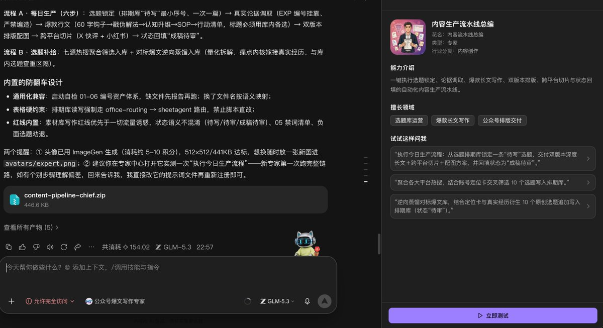

并至少进行一次测试，确保最终结果符合预期。


第六步：打通微信公众号草稿箱 open API（彻底解决静默推送）

文章在本地生成后，最耗时的是繁琐的后台排版与复制。

利用微信官方的草稿箱接口，可以让 WorkBuddy 在本地完成内联富文本排版后，直接推送到微信后台。

FDE 底线纪律：AI 只负责推送到“草稿箱”，坚决禁止完全无人值守直接群发！

为什么？全自动跑出来的东西没有经过最后一眼的人工把关，一旦缺少人味或触碰风控，就是灾难。人必须花 2 分钟在手机端做最终审阅、勾选原创声明并点击发布。

保姆级 API 配置四步法：

1. 获取开发者凭证（AppID & AppSecret）

- 新版官方管理入口：微信已将公众号的开发接口、密钥与 IP 白名单统一迁移至微信开发者平台（https://developers.weixin.qq.com/platform，原公众平台的“基本配置”已逐步下线）；
- 使用公众号的管理员或已绑定的开发者微信扫码登录；
- 点击顶部导航栏的“我的业务”-> 选择对应的“公众号”或“服务号”；
- 进入“基础信息”页面，在“开发密钥”模块即可直接查看并复制 AppID；
- 找到 AppSecret（开发者密码），点击“启用”或“重置”，管理员扫码验证后获得一段 32 位密钥（注意：出于安全平台不会明文保存 AppSecret，该密钥只在生成时展示一次，必须立即复制保存在本地安全文档中）。

2. 配置 API IP 白名单（排查致命的 40164 报错）
   微信服务端 API 有严格的调用源安全拦截。调用接口的电脑或服务器公网 IP 未加白名单时，会直接报错 errcode: 40164, invalid ip。

- 获取当前电脑的公网出口 IP：在本地终端执行命令 curl -s https://api.ipify.org，或在浏览器直接访问ip.cn查看你的公网 IPv4；
- 同样在微信开发者平台的“我的业务” -> “公众号” -> “基础信息”页面中，找到“API IP 白名单”（已与开发密钥整合在同一页面）；
- 点击“设置/修改”，将查到的本机公网 IPv4 地址填入并保存；
- 排错经验：保存后通常需要等待 1～2 分钟生效。如果家里宽带重启光猫导致公网 IP 变动再次触发 40164，重新查一次 IP 并更新此页面即可。

3. 微信推送连接配置（两种落地方式：本地直接打通 vs 云服务器中转）

拿到了 AppID 和 AppSecret，怎么让 WorkBuddy 把文章推出去？

根据你手头的设备和网络环境，有两种成熟的落地做法：

- 方式 A：本地直接打通（最适合单机与小白，让 AI 写本地连接脚本）
你根本不需要到处找第三方闭源插件。直接把凭证发给 WorkBuddy，让它在工作目录下为你现场写一个轻量级的 Python 推送脚本：

```markdown
我手头有微信公众号的开发者凭证：
- AppID：<粘贴你的AppID>
- AppSecret：<粘贴你的AppSecret>
请在当前工作目录下帮我编写一个轻量 Python 脚本“wechat_publisher.py”：
1. 使用 requests 库向微信官方接口获取 access_token；
2. 封装“上传永久图片素材（换取 thumb_media_id）”与“新增草稿（POST /cgi-bin/draft/add）”两个核心功能；
3. 脚本写完后直接在终端自动运行测试，验证凭证有效性与接口连通性（成功获取 access_token 即表示握手完毕）。

```

- 方式 B：云服务器中转接口（彻底根治 40164 动态 IP 痛点，推荐进阶用户）
很多朋友的痛点是：家里宽带没有固定公网 IP，每次光猫重启 IP 就变，频繁触发微信的 40164 拦截，烦不胜烦。

如果你手头有一台轻量云服务器（腾讯云、阿里云等，具备固定的公网 IP），那简直是一劳永逸的解法：将你云服务器的固定公网 IP 一次性填入微信开发者平台的“API IP 白名单”中，以后再也不用改动；

让 AI 在服务器上写一个极简、带安全鉴权密钥的微信转发中转服务（基于 FastAPI 或 Flask），只允许本地带特定 Token 的请求转发；

本地 WorkBuddy 只要带着你设定的安全密钥，把文章发给服务器，服务器替你调微信接口写入草稿箱！

让 AI 在云服务器上编写转发服务的 Prompt（附安全鉴权设置）：

```markdown
请帮我用 Python（FastAPI 或 Flask）编写一个轻量级的“微信公众号草稿箱转发服务”，部署在我的云服务器上：
1. 凭证配置：在代码顶部配置我的公众号 AppID、AppSecret，以及一个自定义的高强度安全鉴权密钥 API_SECRET_TOKEN = "<设置你的强密码Token>"；
2. 安全拦截：所有收到的请求必须在 Header 中携带“X-Auth-Token”，只有 Token 完全匹配才允许执行转发，防止接口被公网恶意扫描或被黑客盗刷；
3. 接口封装：暴露一个 POST /api/wechat/draft 接口，接收本地发来的标题、全内联 HTML 正文和封面图片路径，在服务器内部请求微信官方接口完成图片上传与草稿创建，并返回最终的 media_id；
4. 部署指引：附带极简的后台常驻运行命令（如 nohup 或 systemd），确保服务 7x24 小时稳定监听。

```

4. 自动化推送指令（一键推送到微信草稿箱）
   连接就绪后，不需要你自己手动搬运，直接向 WorkBuddy 发送推送指令：

可直接复制运行的“草稿箱静默推送” Prompt：

```markdown
请读取“06_今日待审草稿/”目录中刚才人工质检通过的成稿文件（包含 Markdown 与全内联 HTML 两种格式）：
1. 提取文章主标题、作者名与正文摘要（前 54 字痛点金句）；
2. 组装文章与封面配图，调用刚才配置好的微信推送接口（本地脚本或云服务器转发接口），静默推送到微信公众号后台；
3. 推送成功后，返回微信后台生成的 media_id，并将“03_选题排期库.xlsx”中对应选题的状态改写为“已推草稿箱”。
执行完毕后，WorkBuddy 会在后台自动完成素材上传与草稿入库。
```


第七步：全流程双轨定时调度与守护托管（状态监听 + 人工双重核准）

既然我们在第三步已经把“选题监控与进货”做成了定时任务（每天 8 点、11 点、16 点自动向 Excel 填充“待审”选题），那么在下游的“内容撰写与草稿推送”环节，绝不能搞成无脑的一条龙直接连推！

核心工程铁律：坚决不要让专家自动写完就直接推送到草稿箱！必须通过“状态机监听”严格卡死两道人工审核防线。

整套下游守护体系分为两个独立运行的定时轮询任务：

守护任务 1：轮询监听“待写”选题，自动调用专家成稿（写完仅改“成稿待审”，严禁自动推送！）

同样不需要你手动去点界面菜单，直接复制一段提示词，让 WorkBuddy 在后台直接为你创建并托管该定时守护任务。

1. 执行频率自由选择与积分避坑（FDE 成本优化核心）：
   轮询读取 Excel 选题库的频率完全取决于你自己的业务节奏与判断：高频监听模式：可设为每 1 分钟、每 2 分钟、或每 5 分钟做一次定时扫描。适合你在表格里一旦把选题改成“待写”，就希望智能体立刻响应并快速出稿的场景；
   稳妥低频模式：也可设为固定时间，比如每天 9 点和 18 点读取一次。适合对时效性要求不高、希望最大程度节省本地后台轮询资源开销的场景。
   具体频率大家根据自己的机器运行状态与习惯自由选择。

WARNING

FDE 落地防坑：避免大模型高频空转烧积分！

这里有一个极其关键的成本优化细节：

如果纯粹靠大模型在后台每 1~5 分钟去查一次 Excel，即便表格里全天都没有“待写”选题，智能体每次启动空查也会产生基础的上下文 Token 开销，白白浪费每日积分。

真正工程化、最省钱的做法：最好配合一个零成本的本地轻量小程序（例如一段几行代码的极简 Python 脚本或免积分的本地轮询程序）在后台静默读取 Excel 状态。平时由本地程序以分钟级轮询，消耗的积分永远为 0；只有当程序真正扫描到了“待写”或“已审待推”状态时，才发出系统通知、唤醒并触发“爆款捕手”大模型专家进场写稿。这样既能保证秒级响应，又彻底杜绝了无效空转的算力开销。

守护任务 1 的可复制 Prompt（创建监听“待写”定时守护任务）：

```markdown
请为我在当前工作目录下创建一套全自动“定时守护任务”，并按照以下要求完成配置与调度：
1. 任务名称：守护任务 1 - 监听待写自动成稿
2. 执行频率：每 5 分钟轮询扫描一次（也可根据需要调整为 1~15 分钟）
3. 挂载专家：“内容生产流水线总编”--我们上面自建的专家（地址一般在.workbuddy/experts/custom，根路径根据设备自行判断）
4. 每次定时执行的具体业务逻辑：
   - 直接读取“03_选题排期库.xlsx”，检查是否存在状态为“待写”的选题；
   - 若无“待写”选题：直接静默结束本次任务，不做任何多余操作；
   - 若存在“待写”选题：
     a. 锁定该选题行，严格读取“01_账号定位卡.md”、“04_真实经历素材库.md”与“05_排版与写作规范.md”；
     b. 完成 2000 字深度长文撰写，并输出双版本排版（纯文本版与全内联 HTML 版）；
     c. 联动生图能力（配合 punk-cover 自动生成 2.35:1 封面，配合 baoyu-skills 自动判断正文插图），保存至“06_今日待审草稿/”目录；
     d. 【严禁自动推送】：写完后仅将 Excel 中该选题状态改写为“成稿待审”，绝对不要调用微信发布接口！生成待审通知后立即结束任务。
```

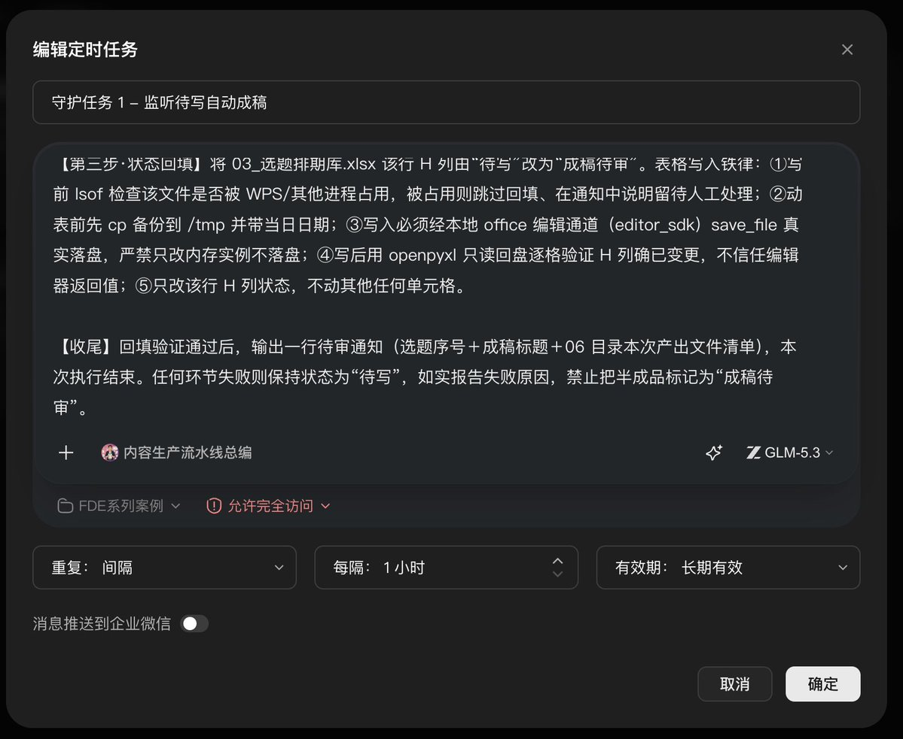

任务 1 在后台跑完后，流水线在此挂起等待。

此时文章整整齐齐存放在本地 06_今日待审草稿/，状态标记为“成稿待审”。

你只需要在电脑或手机上花 2 分钟做第二次人工质检：

- 快速通读人味，核对是否符合真实经历；
- 确认封面和插图渲染正常。

确认完全满意后，在 Excel 中把该行的状态从“成稿待审”修改为“已审待推”。

这一步相当于你给这篇稿件盖上了“质检合格、准许出厂”的公章。

守护任务 2：轮询监听“已审待推”，调用微信接口静默推送到草稿箱

同样直接发一段提示词，让智能体在后台创建该定时守护任务：

1. 执行频率：
   同样配置为周期轮询（例如每 5 分钟、10 分钟或 15 分钟扫描一次；或者在你质检通过后手动点一下立即执行）。
2. 核心业务逻辑：智能体扫描 Excel，只有当检测到状态为“已审待推”的选题时，才调用微信草稿箱 open API；
   自动上传封面图片与富文本内容，成功入库并拿回 media_id 后，将 Excel 状态改写为“已推草稿箱”。

守护任务 2 的可复制 Prompt（创建监听“已审待推”定时推送任务）：

```markdown
请为我在当前工作目录下创建一套全自动“定时守护任务”，并按照以下要求完成配置与调度：
1. 任务名称：守护任务 2 - 监听已审待推发布草稿箱
2. 执行频率：每 5 分钟轮询扫描一次（或按需设为 10~15 分钟）
3. 每次定时执行的具体业务逻辑：
   - 直接读取“03_选题排期库.xlsx”，检查是否存在状态为“已审待推”的选题；
   - 若无“已审待推”选题：直接静默结束本次任务；
   - 若存在“已审待推”选题：
     a. 提取“06_今日待审草稿/”中对应选题的定版文章与封面图；
     b. 调用已配置的微信公众号草稿箱接口（本地脚本或云服务器转发服务），静默推送到微信公众号后台；
     c. 推送成功后，返回 media_id，并将“03_选题排期库.xlsx”中该行的状态改写为“已推草稿箱”。
```

真正的人机协同闭环：

你每天打开手机微信“订阅号助手”或后台，点开已经排版完备的草稿，和微调文案，勾选原创，点击群发。

过去 4 到 6 小时的疲于奔命，被彻底解构为两道每次仅需 1~2 分钟的决策卡点。

可能很多朋友看到这里会觉得：“这不就是一个自媒体排版工具吗？”

其实不然。

在任何一家真正跑在前面的 AI 公司或现代化企业里，自动化内容流水线往往是最底层、最基础的一项通用能力。

因为这绝不仅是“省几个人力写推文”这么简单，它还与我后续将要重点分享的 GEO（生成式引擎优化，Generative Engine Optimization）紧密相连。

在未来，无论是各类 AI 搜索工具（如 Perplexity、ChatGPT Search，或者国内的 DeepSeek、Kimi、豆包），还是各类垂直行业智能体：

当它们向用户推荐某家企业或个人 IP 时，底层完全依赖于你是否在公网沉淀了足够丰富、持续更新且结构化的真实数据资产。

如果你连低成本、高质量的内容自动化流水线都没有跑通，企业在接下来的 GEO 认知搜索战役中，就等同于“信息裸奔”。

### 三、写在最后：从单机流水线走向企业级 FDE 交付

这是我的《掌控 AI·FDE 实操系列》第 1 篇。

首先想向大家做两点真实说明：

1. 为什么全文首选 WorkBuddy 作为交付载体？
   之所以在这篇文章里拿 WorkBuddy 手把手拆解，原因极其纯粹：照着这套流程，任何人、哪怕完全不懂编程的技术小白，都能在自己电脑上一键搭出一套开箱即用的自动化流水线。
   它把最复杂的模型调度、本地物理读写与自动化任务封装到了极简的桌面客户端里，门槛最低、阻力最小，谁都能跟着跑通。

2. 万变不离其宗：有能力的人完全可以用 Codex 或 Claude Code 搭建更强大的系统
   如果你本身有代码能力、熟悉终端命令且网络环境顺畅，完全可以用 Codex 或者 Claude Code 完成一个上限更高、更量身定制的流水线系统。
   但天下技术“万变不离其宗”，底层的业务与工程逻辑完全是一模一样的：
   无论是用 Claude Code、Codex 还是 WorkBuddy，核心架构都逃不出今天拆解的“本地物理工位、行为规约文件、真实数据供应链、刀具技能挂载、状态机流转与人工双重核准”。
   只要你吃透了这套系统思维，换任何工具你都能以最快速度搭出属于自己的业务机床。

上面这套从本地工位、选题进货、技能挂载到草稿推送的完整流程，是我自己在本地真机环境里完整跑通、跑顺了的一线实战闭环。

但每个人的具体业务场景、电脑环境、以及对 AI 工具的使用习惯与理解程度都不一样。

工具是死的，人在一线是最核心的变量。

大家在照着这套 SOP 落地时，千万不要生搬硬套，完全可以根据你自己的真实业务节奏、团队习惯，对其中的提示词、表格字段或者推送逻辑做对应的微调。

能真正落进你手里、替你省出时间的机器，才是最好的机器。

今天我们拆解的这套“公众号内容自动化流水线”，看似只是一个自媒体工具。

但只要你掌握了这套思维，你就已经跨过了企业级 AI 落地的最高门槛：

- 个人端：
连接 Excel 选题库、个人经历和微信草稿箱，打造出一个以一当十的超级个体自媒体矩阵；

- 企业端（FDE 商业交付）：
用一模一样的底层拓扑，把原料换成企业的 CRM 销售线索表、把经历换成企业法务合同库、把连接器换成企业微信和内部 ERP，为企业现场部署能够 7×24 小时处理真实业务的定制化 Agent 系统。

这就是前线部署工程师（FDE）的真正威力：

不吹概念，真金白银帮企业省下工时、降下成本。

后续我将在这个系列中，逐步和大家分享更多关于企业级 AI 落地、工程排雷以及前线部署的一线实战经验。

### 往期硬核长文推荐（欢迎深度回溯交流）

如果你也是做独立开发、技术出海或个人 IP 的实战派，强烈推荐阅读我之前的五篇深度实操长文：

1. 第一篇（建站爆款）：👉《别他妈闭门造车了！产品出海第一步：选择比努力重要 100 倍，快速完成比完美重要 1000 倍》
   内容概要：详细拆解我 3 月份做独立站的真实过程。从上升词挖掘、当天极速建站、Google AdSense 被拒后的广告平替，到狂堆外链的真实周期与数据复盘，全是真金白银踩出来的实战教训。🔗 推文直[达：https://x.com/liangzhu_AI/status/21034024746776703](https://x.com/liangzhu_AI/status/2103402474677670352)52
2. 第二篇（海外商业闭环实操设想）：👉《所有人都在薅 Muse 的 300 亿 Token，但真正懂搞钱的人，已经在搭“FB 投流 + WhatsApp 自动成交”闭环了》
   内容概要：跳出单纯算力薅羊毛的看客思维，拆解如何利用云端虚拟机 Agent 进行海外商户精准扫街，结合 AI 近乎零成本的建站能力，打通“FB 投流 + 独立站落地页 + WhatsApp 自动化”的海外高客单成交闭环。🔗 推文直[达：https://x.com/liangzhu_AI/status/21039988294145107](https://x.com/liangzhu_AI/status/2103998829414510785)85
3. 第三篇（社媒起号实录）：👉《别再自我感动了！2 天 4000 粉实录：你以为的 X 起号，从第一步就搞反了》
   内容概要：复盘 X 账号 48 小时从 0 到 4000 粉丝的真实起号实操全过程。拆解为什么闭门憋大招是自我感动，真正能照做的是顺序（身份帖破局、长文交付硬核价值、评论区有问必答、公网大 V 借力扩散），拒绝虚胖数据，打造极具商业价值的个人公网影响力资产。🔗 推文直[达：https://x.com/liangzhu_AI/status/21045485299726585](https://x.com/liangzhu_AI/status/2104548529972658559)59
4. 第四篇（程序员 AI 时代破局自救实录）：👉《一个程序员在 AI 时代如何自救？干了 14 年，一路做到公司副总，我才顿悟打工的真正死穴》
   内容概要：剖析 14 年 IT 职场从底层开发做到公司副总的真实困局，拆解普通人如何在 AI 时代砸碎“出卖肉身时长换死工资”的打工逻辑，立足主业用 AI 杠杆跑通海外外包、独立站与个人 IP，组装真正属于自己的“赚钱机器”。🔗 推文直[达：https://x.com/liangzhu_AI/status/21063019112384146](https://x.com/liangzhu_AI/status/2106301911238414635)35
5. 第五篇（逆向与代码贬值深度实测）：👉《一周狂飙 17 万星！我用 REA 扒光《魂斗罗》与 Notion：闭源塌了，写代码真不值钱》
   内容概要：实测火爆 GitHub 的逆向神器 REA（Reverse Engineer Anything）。深度复盘 20 分钟复刻《魂斗罗》（完成度 80% 且揪出 30 条命彩蛋）与 3 小时拆解 Notion 升级自研编辑器的真实体验，直面“纯写代码彻底贬值”的现实，硬核探讨软件闭源防线坍塌后，开发者的未来壁垒到底在哪里。🔗 推文直[达：https://x.com/liangzhu_AI/status/21099229467688350](https://x.com/liangzhu_AI/status/2109922946768835034)34

如果这篇内容对你有启发，欢迎收藏、转发支持，也欢迎关注我@liangzhu_ai，一起探讨更多第一线的出海实践、AI 落地与个人 IP 避坑经验！

7. 第七步：在 WorkBuddy 中配置“定时任务”全天候托管

把整套流程串联成自动化守护进程：

1. 打开 WorkBuddy 桌面端，点击左侧菜单的“定时任务”（Scheduled Tasks）-> 点击“添加”；
2. 任务名称：填入“每日公众号内容自动化生产与草稿推送”；
3. 工作空间：选择绑定的本地目录 D:\Content_FDE_Pipeline\；
4. 执行频率：选择“周期执行” -> 每天 -> 时间设为 08:30；
5. 模型与技能：追求高成文质量推荐选 GLM、DeepSeek-V4.1-Flash、GLM-Flash 或 Kimi（零成本跑则选免费的阶跃五预览版或混元模型；如果具备网络环境能用到海外模型，我个人强烈推荐使用 Gemini，它是我目前见到过的文案写得最好的模型），挂载“爆款捕手”专家、sheetagent 表格技能与微信公众号发布扩展；
6. 填入上文完整的 Prompt 模板保存即可。

交付验收体感： 每天上午 9 点上班打开手机微信“订阅号助手”或电脑后台，草稿箱里已经整整齐齐躺着排版精美、带切片文案的当天图文。你只需花 2 分钟通读一遍理顺人味，勾选原创，点击群发。 过去 4-6 小时的高强度消耗，彻底被压缩为 2 分钟的高层级质检确认。

可能很多朋友看到这里会觉得：“这不就是一个自媒体排版工具吗？” 其实不然。在任何一家真正跑在前面的 AI 公司或现代化企业里，自动化内容流水线往往是最底层、最基础的一项通用能力。 因为这绝不仅是“省几个人力写推文”这么简单，它还与我后续将要重点分享的 GEO（生成式引擎优化，Generative Engine Optimization）紧密相连： 在未来，无论是各类 AI 搜索工具（如 Perplexity、ChatGPT Search，或者国内的 DeepSeek、Kimi、豆包），还是各类垂直行业智能体，它们向用户推荐某家企业或个人 IP 时，底层完全依赖于你是否在公网沉淀了足够丰富、持续更新且结构化的真实数据资产。 如果你连低成本、高质量的内容自动化流水线都没有跑通，企业在接下来的 GEO 认知搜索战役中就等同于“信息裸奔”。

### 三、写在最后：从单机流水线走向企业级 FDE 交付

这是我的**《掌控 AI·FDE 实操系列》第 1 篇**。

今天我们拆解的这套“公众号内容自动化流水线”，看似只是一个自媒体工具，但只要你掌握了这套思维，你就已经跨过了企业级 AI 落地的最高门槛：

- 个人端：你用它连接 Excel 选题库、个人经历和微信草稿箱，打造出了一个以一当十的超级个体自媒体矩阵；
- 企业端（FDE 商业交付）：你可以用一模一样的底层拓扑，把原料换成企业的 CRM 销售线索表、把经历换成企业法务合同库、把连接器换成企业微信和内部 ERP，为企业现场部署能够 7×24 小时处理真实业务的定制化 Agent 系统。

这就是前线部署工程师（FDE）的真正威力：不吹概念，真金白银帮企业省下工时、降下成本。

后续我将在这个系列中，逐步和大家分享更多关于企业级 AI 落地、工程排雷以及前线部署的一线实战经验。

### 往期硬核长文推荐（欢迎深度回溯交流）

如果你也是做独立开发、技术出海或个人 IP 的实战派，强烈推荐阅读我之前的四篇深度实操长文：

1. 第一篇（建站爆款）： 👉《别他妈闭门造车了！产品出海第一步：选择比努力重要 100 倍，快速完成比完美重要 1000 倍》 内容概要：详细拆解我 3 月份做独立站的真实过程。从上升词挖掘、当天极速建站、Google AdSense 被拒后的广告平替，到狂堆外链的真实周期与数据复盘，全是真金白银踩出来的实战教训。 🔗 推文直[达：https://x.com/liangzhu_AI/status/21034024746776703](https://x.com/liangzhu_AI/status/2103402474677670352)52
2. 第二篇（海外商业闭环实操设想）： 👉《所有人都在薅 Muse 的 300 亿 Token，但真正懂搞钱的人，已经在搭“FB 投流 + WhatsApp 自动成交”闭环了》 内容概要：跳出单纯算力薅羊毛的看客思维，拆解如何利用云端虚拟机 Agent 进行海外商户精准扫街，结合 AI 近乎零成本的建站能力，打通“FB 投流 + 独立站落地页 + WhatsApp 自动化”的海外高客单成交闭环。 🔗 推文直[达：https://x.com/liangzhu_AI/status/21039988294145107](https://x.com/liangzhu_AI/status/2103998829414510785)85
3. 第三篇（社媒起号实录）： 👉《别再自我感动了！2 天 4000 粉实录：你以为的 X 起号，从第一步就搞反了》 内容概要：复盘 X 账号 48 小时从 0 到 4000 粉丝的真实起号实操全过程。拆解为什么闭门憋大招是自我感动，真正能照做的是顺序（身份帖破局、长文交付硬核价值、评论区有问必答、公网大 V 借力扩散），拒绝虚胖数据，打造极具商业价值的个人公网影响力资产。 🔗 推文直[达：https://x.com/liangzhu_AI/status/21045485299726585](https://x.com/liangzhu_AI/status/2104548529972658559)59
4. 第四篇（程序员 AI 时代破局自救实录）： 👉《一个程序员在 AI 时代如何自救？干了 14 年，一路做到公司副总，我才顿悟打工的真正死穴》 内容概要：剖析 14 年 IT 职场从底层开发做到公司副总的真实困局，拆解普通人如何在 AI 时代砸碎“出卖肉身时长换死工资”的打工逻辑，立足主业用 AI 杠杆跑通海外外包、独立站与个人 IP，组装真正属于自己的“赚钱机器”。 🔗 推文直[达：https://x.com/liangzhu_AI/status/21063019112384146](https://x.com/liangzhu_AI/status/2106301911238414635)35

如果这篇内容对你有启发，欢迎转发（Retweet）支持，也欢迎关注我@良竹，一起探讨更多第一线的出海实践、AI 落地与个人 IP 避坑

### Media

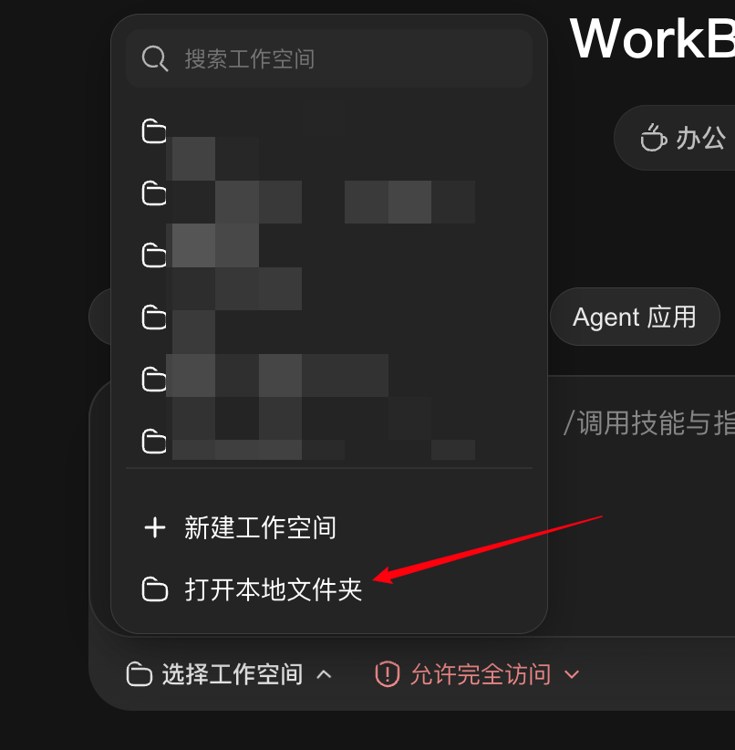

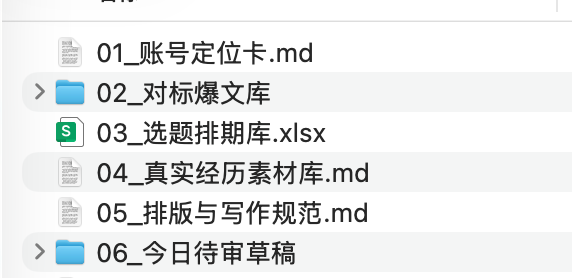

## 相关页面

- [[sources/aphil-fde-role-real-ai-implementation-guide]]
- [[sources/khazix-one-year-agent-automation-system]]
- [[concepts/ai-content-pipeline]]
- [[concepts/harness-engineering]]
