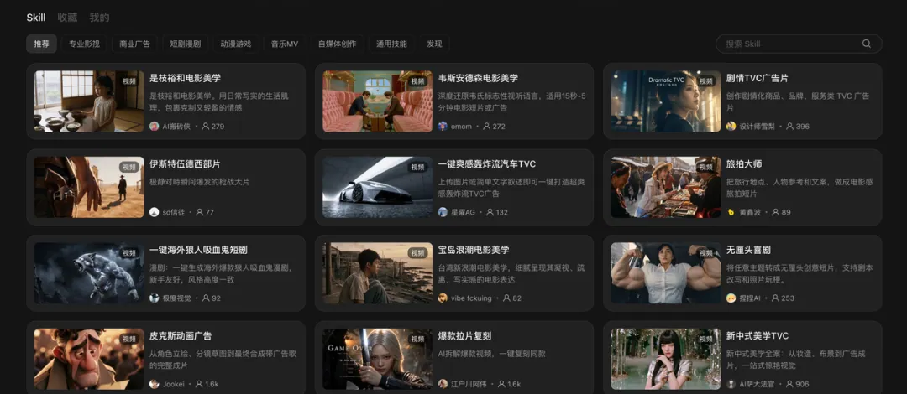
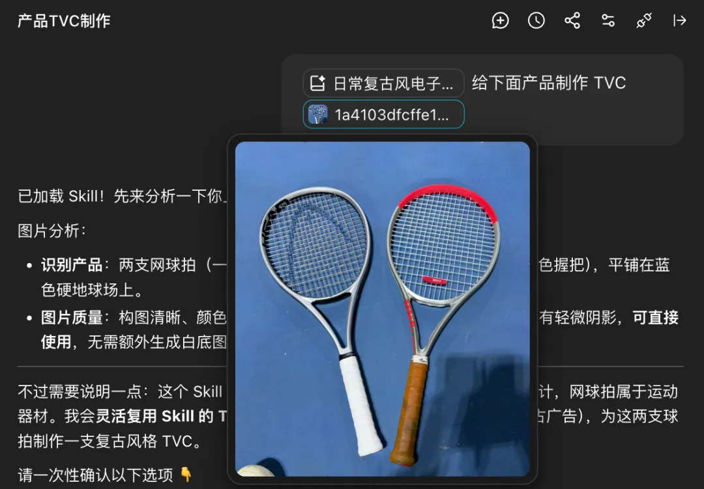
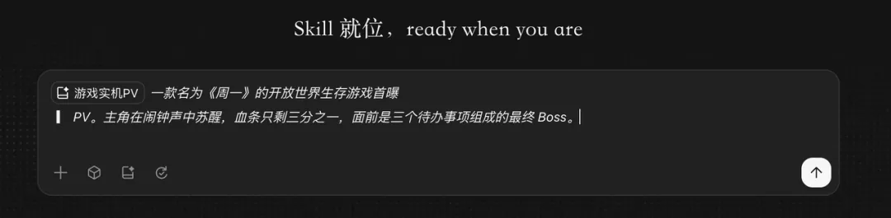
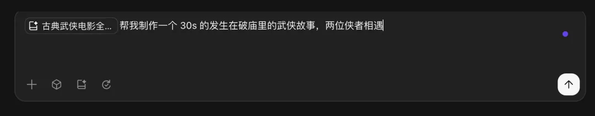
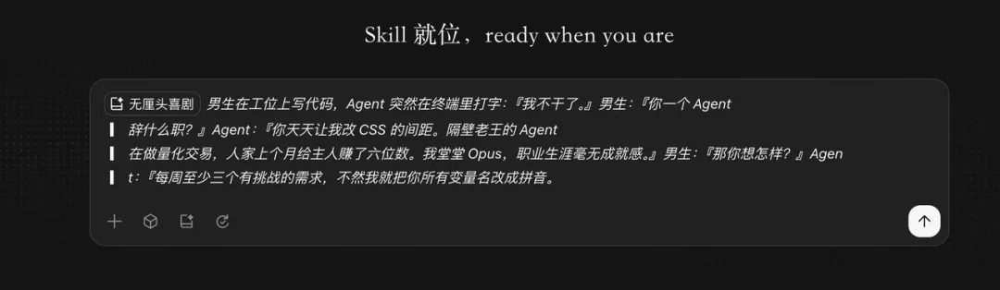
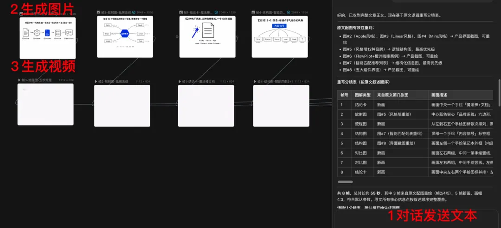
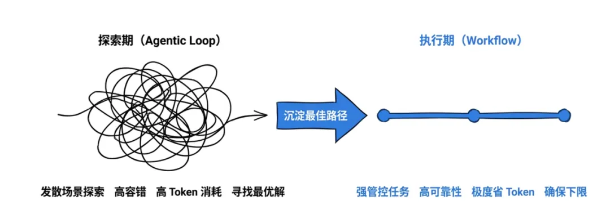
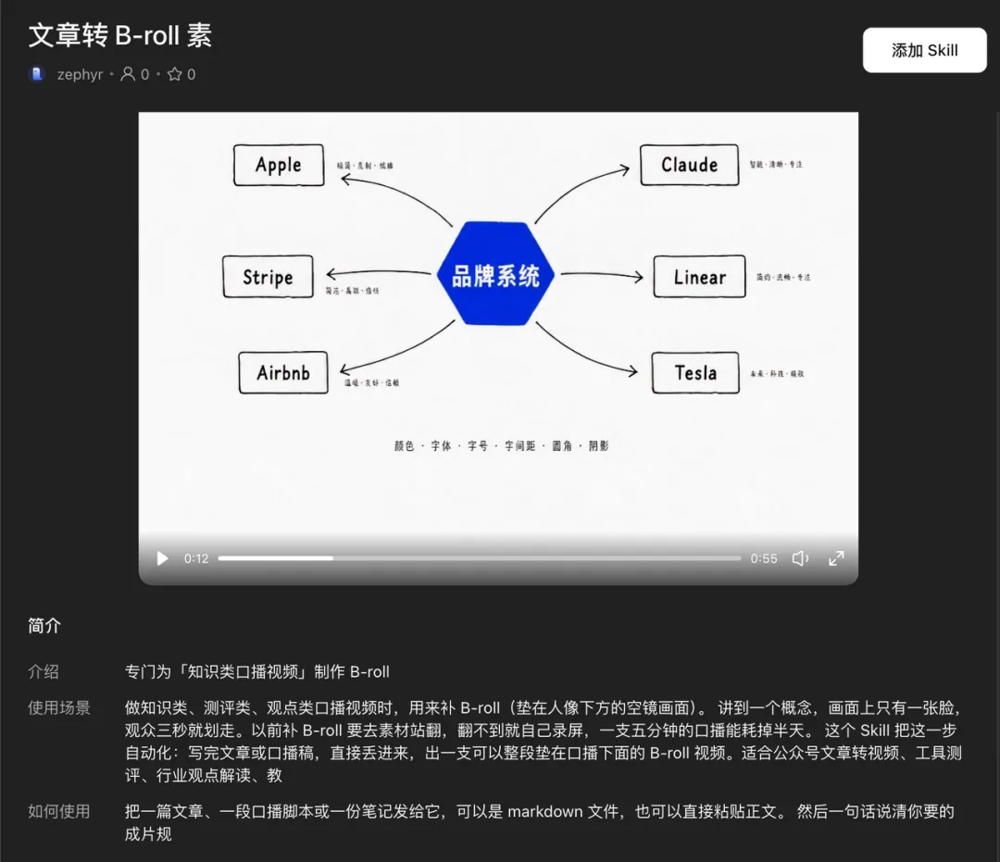

# 空格丶：做了个 Skill，把任何文章都变成视频版 PPT（LibTV Agent 100+ Skill 实测）

> LibTV Agent 一次性开放了 100 多个 Skill，覆盖广告、短剧、影视、MV 与自媒体场景。这些 Skill 均来自一线从业者——广告导演、短剧团队、MV 导演，把自己项目里真实验证过的方法沉淀成了可调用的能力，从创意策划、分镜设计到运镜与剪辑节奏全部内置。本文记录了作者对多个 Skill 的完整实测，并分享其自研的「B-roll 素材生成」Skill：把任何文章变成会动的图解视频版 PPT。

<!-- more -->

## 一、100+ Skill 来自真实从业者

*图 1：LibTV Agent 开放的 100+ Skill 广场*

这些 Skill 来自真实的从业者。广告导演、短剧团队、MV 导演，把自己项目里验证过的方法沉淀成了可调用的能力。从创意策划、分镜设计到运镜和剪辑节奏，全在这些 Skill 里。

作者实测了多个 Skill，并给自己常用的视频制作做了一个 **B-roll 素材生成 Skill**——能把文章转成动效版的 PPT，可以用作剪辑的素材。

---

## 二、五个实测案例：Agent 不是直接出片，而是先过方案

### 案例 1：给网球拍拍一支广告（复古 FPV）

作者挑了真实商单场景：给一个具体的产品拍片。把自己那把网球拍随手拍了张照片传上去，选了「复古 FPV」Skill，提示词只有一句：

> 给下面产品制作 TVC

*图 2：上传一张产品照片即生成 TVC 级广告片*

**关键点**：Agent 没有直接出视频，而是先给出了创意方案和分镜脚本——置景、光影、每个镜头拍什么，全都列了出来，确认之后才开始生成。这个过程很像跟一个导演过方案。

### 案例 2：为不存在的游戏《周一来了》做发行级 PV

继续用「游戏实机 PV」Skill，做了一款根本不存在的游戏。出来的东西比预想好得多：有 UI 血条、有技能栏、有实机操作的镜头语言，还有一本正经的游戏预告片旁白节奏。

*图 3：AI 认真地在做不存在的游戏的发行级 PV*

### 案例 3：古典武侠电影美学导演

使用「古典武侠电影美学导演」Skill，一句话就能出片。成片效果不错，配乐也很有古典武侠风味。

*图 4：一句提示词产出古典武侠美学短片*

### 案例 4：我的 Agent 半夜辞职了（无厘头喜剧）

用「无厘头喜剧」Skill 做第四支，剧本是自己编的一段很短的对话。丢进去，出来的就是一支完整的搞笑短片，**表演节奏和镜头切分都对得上包袱**。

*图 5：短对话剧本直接生成节奏对位的喜剧短片*

### 案例 5：精品女频短剧一键成片

这个效果最惊艳。调用「精品女频短剧一键成片」Skill，一句话输出一个完整的短剧故事，**每个人的台词表达也是有逻辑的**。

五种完全不同的类型，整个过程作者没写过一行分镜脚本——这就是 Agent + Skill 的魅力。

---

## 三、自研 Skill：B-roll 素材生成（文章转视频版 PPT）

作者最后给自己造了一个 Skill：**B-roll 素材生成**。

它可以把任何文字内容转成会动的 PPT，用于垫在主画面之外的空镜、图解、演示画面。输入一篇文章，它自动拆出核心信息点，每个信息点画成一张逻辑图，然后把这张图制作成视频。

*图 6：文章 → 信息点拆分 → 逻辑图 → 动效视频*

文章总共被拆成 **9 个分镜**，合并成了一支 **55 秒**的视频。

*图 7：逻辑图手绘风格动效，可直接垫在口播下方*

这些画面可以直接垫在口播下面做动效，也可以把视频转成 GIF 动图，用作公众号文章的插图。

*图 8：Agent + Skill 全程只需点击确认*

### 视觉语言设计

设计这个 Skill 时用的是作者惯用的那套视觉语言：**逻辑图 + 手绘插画风格**。

*图 9：白底、黑色单线手绘图标、只有轮廓不填色、箭头是随手画上去的曲线*

这套风格是作者长期在用的。在 LibTV 做成 Skill 后，输出效果极其稳定——你输入任何文字内容，出来的都是这个风格。

该 Skill 已发布到 LibTV 的 Skill 广场，可直接取用。

*图 10：B-roll 素材生成 Skill 的发布页*

---

## 四、核心洞察：Skill 解决的是「怎么用好模型」

LibTV 底层接了 Seedance 2.0 等模型，生成质量本身过关。**但光有模型不够**。

> 你给普通人一个再强的生成器，大家也不知道提示词该怎么写、镜头该怎么编排、节奏该怎么卡。

Skill 解决的就是这件事：**把专业创作者的经验封装成能复用的能力，让模型的天花板真正被普通人够到。**

对作者而言最实在的一点是：**把自己的视觉风格沉淀成了一个 Skill**。以后每写完一篇文章，顺手就能出一版 B-roll 和一组动图——**你的审美和方法，从此可以变成一个能制作视频的资产。**

---

## 相关页面

- [[sources/kongge-creator-buddy-10-wechat-skills]]
- [[sources/aiwarts-awesome-seedance-463-ai-video-skills]]
- [[sources/ryan-muse-ai-image-post-daily-15-skills-rotation]]
- [[concepts/ai-content-pipeline]]
- [[concepts/agent-skill]]
