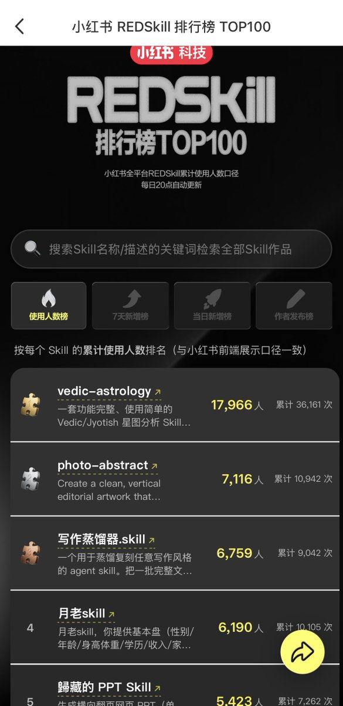
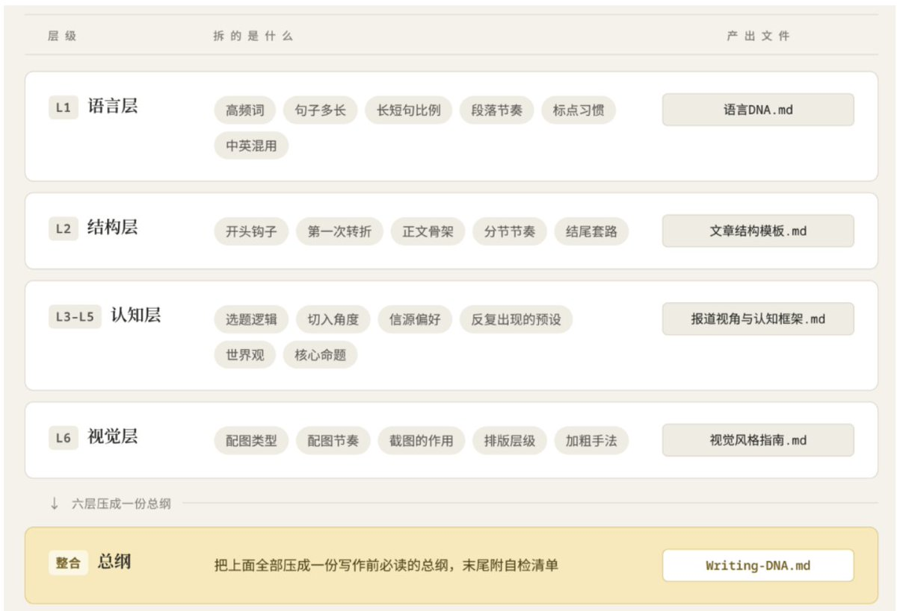
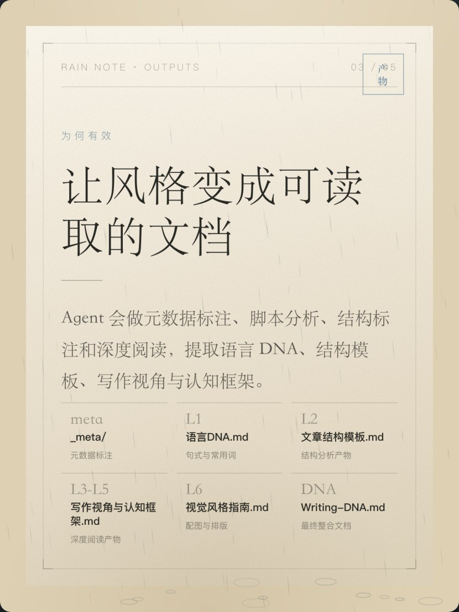
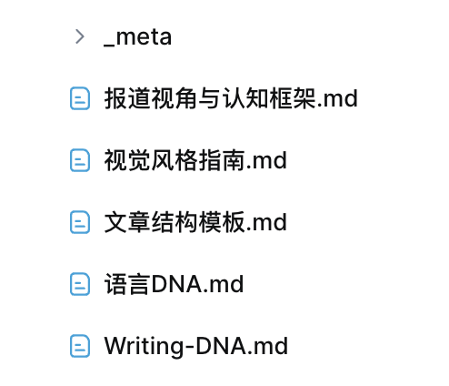

# 躺在废墟里 Lieflat：写作蒸馏器 Skill——量化文本层次与风格复刻工作流

> 前文字记者开发的 writing-dna-skill（写作蒸馏器，REDSkill 榜单前三）。底层基于语言学研究方法，把写作风格拆解为词汇密度、句法节奏、叙事推进、论证骨架等量化规则，让 AI Agent 能稳定复刻任何对标文章的语调质感，彻底消除 AI 写作的油腻感与干瘪感。

<!-- more -->

作为一个前文字记者，写作对我来说是一种本能。所以，在我熟练使用 Agent 之后，我做了一系列写作相关的 skill。今天介绍这个系列的第一个 skill，写作蒸馏器.skill。  

这个 skill 目前是小红书 REDSkill 排行榜使用人数第三，到现在已经超过 6759 人用过了。这也真的超出我的意料之外了，毕竟上榜的有很多大佬（顺便说一下，歸藏 PPT skill 真的特别好用！）

这个 skill 我用了半年，不夸张地说，它完全改变了我的写作模式。写作是一件极为耗费心力的事，哪怕是从业几十年的老记者同事，写长稿件也是痛苦的。尤其是把所有资料整理好，需要从第一个字开始写时，最考验人。很多时候，我会把其他部分写完，再写导语。

GitHub 地址：[https://github.com/larashero3-dotcom/writing-dna-skill](https://github.com/larashero3-dotcom/writing-dna-skill)

但是现在，我再也不用从头开始写稿了。

这篇文章，我会详细介绍这个 skill 到底咋工作的，应该怎么使用，以及我现在的整个写作工作流是什么。

## 一、底层原理：量化"写作风格"

这是整个 skill 最核心的设计是，基于语言学的研究方法，用量化统计和深度分析的方式，把写作风格总结成可复制的规则，AI 写作的时候就能逐层对照。它的底层假设是，写作风格其实是好几个相互独立、又彼此咬合的文本层次叠加的，因此需要把每一层单独拆开分析。

具体分为这几层：

这里面，L1 是最小单位，语言层面本身的统计，比如作者爱用哪些词、句子多长、爱不爱用感叹号等等。

L2 则是文章的"骨架"，怎么开头、递进、收尾。

L3 到 L5 是思维层面，选题出发点，作者站在什么角度写作，思维框架是什么，认知是什么。

L6 是最后的配图和排版。因为我自己觉得配图和排版是很麻烦的事，所以我希望 AI 能直接帮我排版。不过，如果你给的素材中都没有配图、也没有样式，那这一层会跳过蒸馏。

表格里面有个 _meta，它其实就是对每篇文章的数据标注，你可以理解成大模型预训练之前做的那步"数据清洗+标注"，模型要从海量文本里学东西，第一步永远是先给数据打标签、分类、建索引。

写作蒸馏也一样，agent 需要先逐篇过一遍，把每篇文章的关键特征标注清楚，然后再基于这些标注去做跨篇的统计和归纳。没有这步标注，后面的分析就缺少依据。

这些蒸馏层次的分类，是从语言学的研究出发。语言学里有个老共识，分析一篇文章的风格，得从词汇、句法、语义三层分开看。我在这个基础上往外扩了两步：语义层拆细了，变成了选题逻辑和世界观（L3-L5）；又加了视觉层（L6），毕竟公众号写作里配图和排版本身就是风格的一部分。

这里面，L3 到 L5 的思维层面，是最难的部分。一些蒸馏风格的 skill 做出来不够像，也是因为这部分没学到作者的精髓，复刻出来的就是个会甩口头禅的空壳。我还是觉得，一个人的思想是最重要的。当然，这部分因为更难被量化，所以也更难被 AI 总结和学会。

## 二、怎么用

好，下面正式上教程，整个流程其实很简单，就三步。

## 第一步：攒素材

（这部分最关键，决定上限，也是需要人介入比较多的部分）

蒸馏器的产出质量，上限是被你的素材锁死的。你给 agent 喂二流素材，蒸馏出来的产物当然也不会比这个更好。素材太少了，能分析的规律有限，效果也会很差。

所以素材有几个硬要求：

数量：至少 20 篇这个作者的完整文章。30 篇才算进了理想区间，连那些低频的小习惯都能采到。但大部分场景下，其实也不需要特别多的素材。如果文章数量太多导致风格不够统一，最后蒸馏出来的效果也不一定更好。

长度：单篇最好超过 1000 字。太短的撑不起结构层和认知层的分析。

格式：.md 或者 .txt 纯文本就行。

完整：要全文，不要摘要、不要片段。

体裁统一：尽量选同一类体裁的文章放在一起蒸。一个人写日记和写论文的风格会差得很远，混在一起蒸馏，模型会取中间值，哪种都学不到位。如果这个作者有好几种明显不同的写法，最好是在蒸馏时就让 agent 按照不同的体裁蒸馏，效果会好很多。

至于素材从哪弄，相信大部分朋友还是蒸馏本地素材吧，如果是 word、pdf 等文件，可以让 agent 转成.md 或者是.txt 纯文本格式。（这里可以下一个 markitdown 之类的工具，转起来很方便）

如果是线上素材，可以让 agent 用抓取工具去批量抓。如果是视频素材，你也可以通过其他 skill 把视频转成纯文本。抓回来的素材记得清洗一下，把里面的一些噪音信息删掉。素材可以全部放进一个叫 raw/ 或者 raw-corpus/ 的文件夹。

## 第二步：蒸馏（这步你完全不用动手）

素材备好之后，后面就特别简单了。你只需要对 agent 说一句话：

"用 writing-dna-skill 蒸馏这个目录里的所有文章。"

然后它就自己跑了。一般它的整个蒸馏过程也就几分钟到十几分钟的时间，除非你给的文件特别多，或者是文章里的配图太多影响了 agent 处理速度。

等 agent 蒸馏完，你会获得 5 份 DNA 文档加一个 _meta 文件夹。5 份 DNA 文档里最重要的是 Writing-DNA.md，它是对整个写作风格的总结。如果你的素材里没有配图，也没有格式，那么就不会有视觉风格指南这个文件。

而这些，就是可被复用写作风格规则档案。

## 第三步：复用蒸馏文件

蒸馏后，AI 不是直接就能写出这个风格。相反，每次写作前，都必须让 agent 重读所有风格文档，还要读几篇相关的原材料，才能最好地复现写作风格。

正确的姿势是这样跟 agent 说：

"把蒸馏出来的 Writing-DNA.md 和所有风格文档读一遍，再读几篇原材料的范文，然后用这个风格，写一篇关于 XXX 的文章。"

agent 会先把那五份文档全部重读，写完还能按照 Writing-DNA.md 末尾那张自检清单检查一遍。

再进阶一点，你可以把这份 DNA 直接固化成一个独立的写作 Skill，固化之后以后连文档都不用手动喂了，直接调用就出稿。

我就用这个方式，把我自己过去的文章蒸馏了一遍，再也不用从头开始写稿了。

## 三、为什么蒸馏可以模仿写作风格

现在来和大家探讨一下，为什么这个方法会有效。

举个例子，大模型在预训练时肯定读过《红楼梦》，但你直接让它"模仿红楼梦的风格写"，它只能从几十亿参数里模糊调取一点残影，因为红楼梦的文本已经和其他万亿 token 的训练数据混在一起了，信号被稀释得差不多了。

但如果你把十几万字的红楼梦原文摆进上下文，再把提炼出来的风格规则放在最前面，模型的注意力就被锚定在这些具体内容上了。它生成每一个字的时候都在看这些规则，输出自然更贴合红楼梦本身的风格。

也就是说，"蒸馏"是把模型当下的注意力完全集中到了你需要的风格上，所以效果很好，模仿得十分相像。

其实，在蒸馏之外，我也尝试过用微调来模仿写作风格。但可能是我使用的 GPT4 模型问题，最后效果很差。另外，我和一些算法的朋友交流过，微调的效果不一定好，因为拿几十篇文章做 SFT，这几十万字相对于模型预训练见过的万亿 token，信号太弱了，权重几乎没怎么偏移。训完之后推理时又没有任何显性提醒，模型又回到那个巨大的参数空间里随机漫步，风格当然也是飘忽不定的。

微调试图改变底层记忆，蒸馏改变的是此刻的注意力焦点。写作风格复刻这种小样本场景，后者天然更有效。

## 四、我的写作工作流完全改变了

这个 skill 开源之后，有很多朋友反馈用得不错。它确实能蒸馏学习各种不同风格的文章，哪怕是差的风格，也能学。因为它把文字结构化了。

有了这个 skill 之后，我的写作效率明显变高了，也经常会有 aha moment，觉得 ai 写得实在是太好了。

它也能解决很多之前难以解决的问题了。比如我现在要写一篇文章，从来不会从头开始一个字一个字写了。agent 写的初稿虽然我不会直接用，但至少有 70 分水准，在这基础上改，比从零写简单太多了。

所以，很多人说蒸馏会替代一个人，我觉得这个说法还为时尚早。至少，蒸馏学的是"怎么写"，它学不会"想什么"。

它能高保真复刻一个人的声音和结构，也就是那个"容器"。但它给不了作者此刻的认知，这些东西不在历史语料里，它当然抓不到。

如果你想用蒸出来的风格写一篇有深度、有见解的新文章，光有写作蒸馏的 writing-dna 文件还远远不够，你还得给 agent 足够多的上下文，自己的感受和认知，或者是让 agent 检索足够多的优质信息。

我现在的写作流程基本上是这样的，有了想写的话题之后，自己先获取所有相关的信息、不断和 agent 交流得出新的认知，然后把所有的内容都放在 moxt 的空间里。

因为打字比较麻烦，我经常是用语音说出想写什么内容，天马行空地想到啥说啥，最后让 agent 读以上所有内容，并按照我的风格来写作。

这套工作流我用了几个月，我的公众号的所有内容都是这样完成的。正是这个工作流，让我在上班的间隙还有时间更新公众号，并且能迅速对我要写的话题建立认知。很多时候，agent 还启发了我，给出了更深刻的观点。

现在回想起几年前做记者，每周手搓写作到半夜，都觉得很感叹。谢谢生产力工具的进步，让我不再痛苦写作。所以，好东西一定要分享给大家。

## 五、最后的注意事项

最后的最后，我还是想说，这个 skill 的使用还是希望有一个边界。这是用来学习和沉淀个人写作资产的工具，对于蒸馏使用他人的公开素材，要注意版权问题。

祝大家都能快乐写作

## 相关页面

- [[patterns/story-studio-video-pipeline]]
- [[patterns/pre-publish-compliance-check]]
- [[sources/story-studio-video-account-pipeline]]
