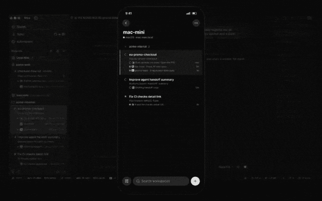
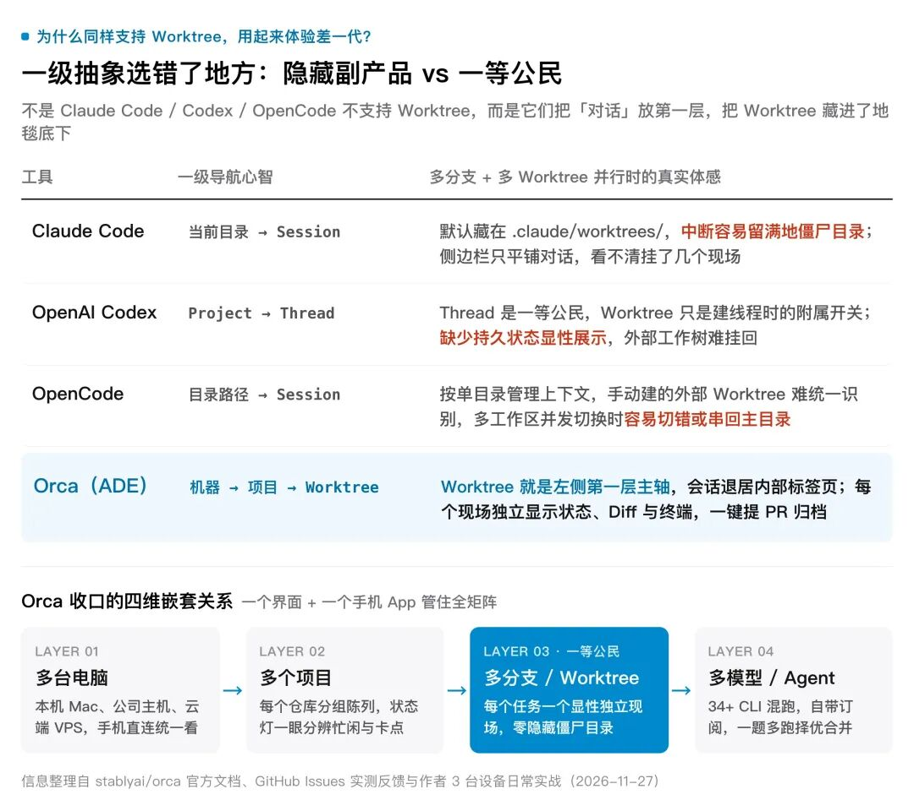
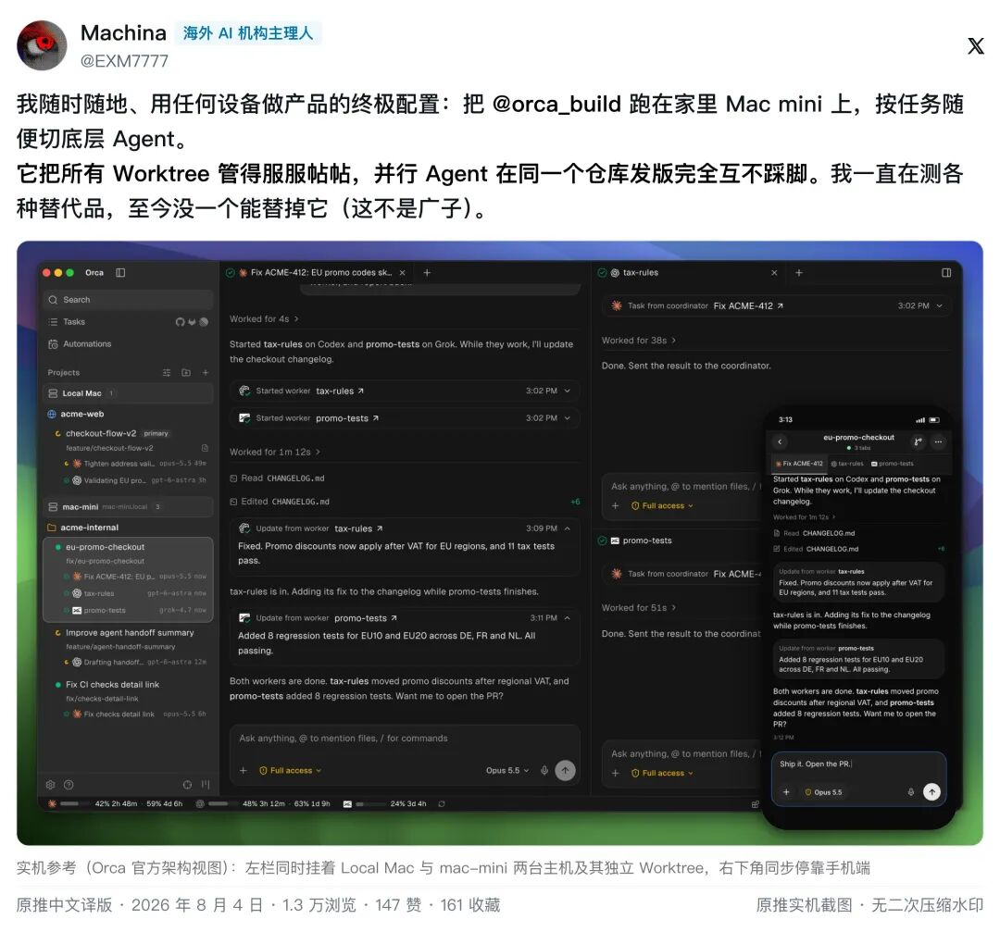
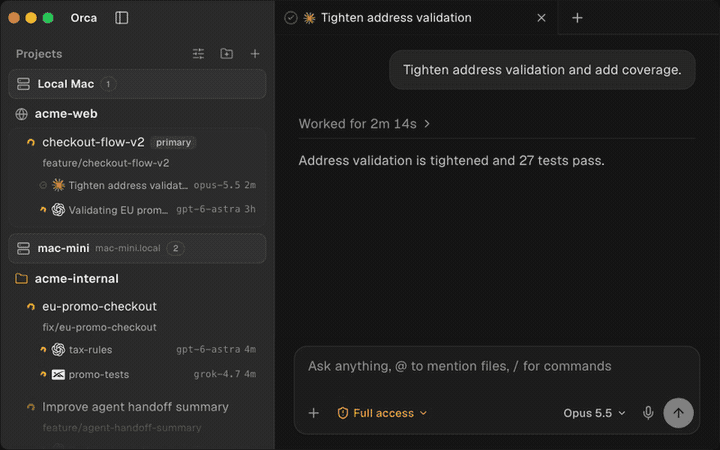
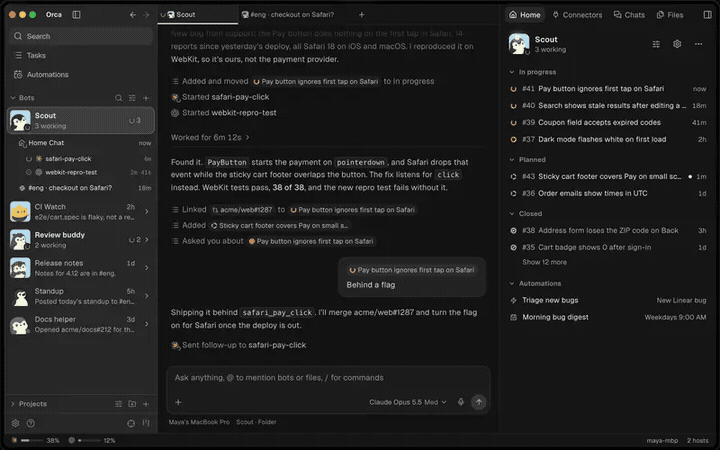
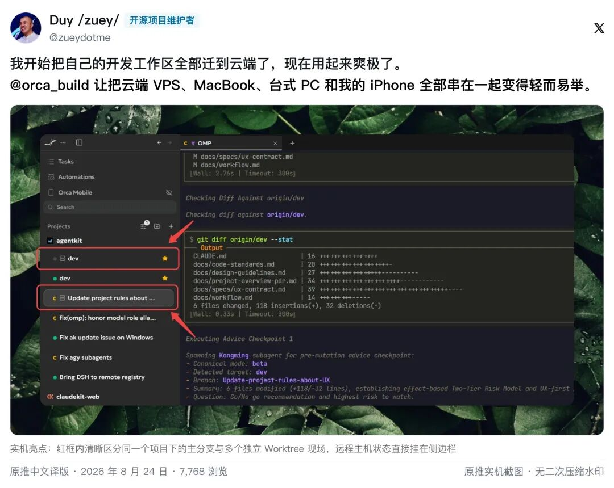

# 《一个人如何管理几十个 AI 程序员？》之二：当前最优解

> Worktree 是一等公民——把所有机器、项目、独立工作树平铺在一张总控台上，才是「全矩阵模式」落到日常的最优解。

<!-- more -->

哈喽，大家好，我是刘小排。
今年 7 月我写过一篇《一个人如何管理几十个 AI 程序员？》，聊到 OpenClaw 作者 Peter 用 Jump Desktop 控 5 台机器，同时跑 30 多个 Codex 会话。

那篇把概念掰开了：分支管路线，Worktree 管现场。
道理懂了，但真拿 OpenCode、Codex、Claude Code 干活这几个月，我撞上了一个大痛点。
它们现在都会自动帮你建分支和 Worktree。前两天我查硬盘，我有一个项目里，居然默默攒了 37 个隐藏 Worktree。
最难受的是界面里根本看不清。分支勉强能瞄见，什么时候开了 Worktree、现在到底用的是哪个 Worktree，极其不明显。一旦多分支配多 Worktree 并行，脑子直接乱套。
这时候我又想起了 Orca。这是我第三次用它，前两次都被劝退，这次一用直接爱上。
省流版先放前面：
核心解法：在 Orca 里，Worktree 是一等公民，所有机器、项目和独立工作树全平铺在左侧，告别隐藏僵尸目录。
两大惊喜：新出的 Orca Bots 能用自有订阅跑 24 小时后台任务；手机端实测在国内普通网络（不用魔法）下飞快，直接替掉了我大半个 UU 远程。
使用成本：MIT 协议完全开源免费，通吃 34 款以上 CLI Agent，自带已有订阅即可。
这篇算是 7 月那篇的续集，聊聊怎么把“全矩阵模式”真正落到日常干活里。
对了，熟悉我的朋友知道，我曾经是 UU 远程重度用户（我不用电脑了）。最近几天，我 UU 远程使用的频率变低了。
终于把「多台电脑 × 多个项目 × 多分支/Worktree × 多模型/Agent」的「全矩阵模式」装进一个手机软件了。
我认为，Orca 是 AI Native 创业公司的当下最优解。因为，它的整个产品设计，符合 AI Agent 时代编程工具的第一性原理 —— 把 Worktree 当成一等公民。
## 三进三出 Orca：前两次劝退，第三次真香
三进三出 Orca
前两次劝退，第三次真香
第一次用 Orca 是今年 3 月它刚上线时。看到是 YC（W22 批次的 Stably AI）投的，很酷，装上试了试。
结果很快劝退。当时界面非常程序员，满屏终端和密密麻麻的设置项，感觉只适合极客折腾。
第二次是后来我常跑一类复杂工作流，需要多模型、多 Agent 互相讨论协作。当时我在用 Multica 这类工具，听说 Orca 支持了又试了一次。功能通了，但用户体验还是不够顺手，再次劝退。
直到被 37 个隐藏 Worktree 逼得受不了，我第三次打开它，彻底改观了。
短短 8 个多月，这个仓库在 GitHub 上冲到了 14 万多 Star，团队几乎日更甚至一天两更（目前已经 v1.4.279）。
以前劝退我的毛病全磨平了：支持原生中文、Chat 卡片与原始终端一键无损互切，底栏还直接挂着各家模型剩余额度与重置倒计时。上周 X 上有位意大利开发者 Danilo 晒出自己的新版 Orca 实机工作台，一屏同时挂着 30 多个 AI Agent 和 11 个常驻 Bot，连发两条拿了 6.6 万浏览。

## 为什么只有在 Orca 里，Worktree 才是一等公民？
为什么只有在 Orca 里
Worktree 才是一等公民？
先把事实说严谨：最早把 Worktree 放进界面的不是 Orca。
去年有 Claude Squad，后来陆续出了 Conductor、Vibe Kanban、Cursor 2.0 和 T3 Code。Orca 今年 3 月去 Hacker News 首发时，标题写的就是“开源版 Conductor + Ghostty”。但它是把这套模式做成开源、跨平台、通吃 34 款以上 CLI 的集大成底座。
它也让我看清了一件事：为什么 Claude Code、Codex、OpenCode 都补上了 Worktree，用起来还是别扭？
其实是它们的一级抽象选错了地方。
它们本质上是底层执行器，心智起点是“进目录 → 开对话”。侧边栏永远在平铺对话流，Worktree 只是藏在 .claude/worktrees/ 里的附属开关。任务一中断，僵尸目录越积越多，直到默默攒出 37 个。
Orca 不造模型也不造 Agent，它是架在所有 CLI 上的总控台，一级导航直接定死为：机器 → 项目 → Worktree。

对话降级成了 Worktree 里的标签页。切左侧任意一个 Worktree，切过去的就是整套独立现场：专属目录、独立分支、里面混跑的多个 Agent、终端分屏、行级 Diff 批注和内置浏览器预览，干完一键提 PR 清理现场。
实机录屏：左侧边栏按「机器 → 项目 → Worktree」平铺，新建并行工位一目了然
实机录屏：左侧边栏按「机器 → 项目 → Worktree」平铺，新建并行工位一目了然
海外不少重度开发者也有同感。X 上一位做 AI 机构的博主 Machina 直接晒出自己的配置：在家里的 Mac mini 上常驻跑 Orca，所有 Worktree 全交给它管，并行 Agent 在同一个仓库发货完全互不踩脚，“我一直在测各种替代品，至今没一个能替掉它（不是广子）。”

遇到难啃的需求，还能开“一题多跑”赛马模式，把同一个提示词扇出给最多 5 个模型，最后在三栏视图里按代码块择优合并。调前端界面时开内置浏览器 Design Mode，点一下按钮就把 HTML、样式和截图直接塞进 Agent 对话框。
## 除了 Worktree：常驻 Bot 和手机控多机也很香
除了 Worktree
常驻 Bot 和手机控多机也很香
让我决定把主力工位迁过来的，还有后半段体验到的两个功能。
第一个是 Orca Bots。
这是 11 月 19 日刚上的重磅更新。你可以养一批 24 小时待命的常驻机器人，接在 Slack、Linear、GitHub 上，或者设定时任务与 Webhook 触发。
它用你本机配好的 Claude Code 或 Codex 订阅跑，没有中间商加价；人设和记忆就是本地明文的 SOUL.md 和 MEMORY.md，随时打开就能改。派个修 Bug 的活，Bot 后台自动起 Worker 改代码、跑测试、提 PR，真需要人工拍板的卡点全集中到右侧的 Needs you，切过去点两下就行。
实机录屏：常驻 Bot 后台起 Worker 修完 Bug 挂 PR，卡点集中到 Needs you 等人类确认
实机录屏：常驻 Bot 后台起 Worker 修完 Bug 挂 PR，卡点集中到 Needs you 等人类确认
第二个是手机端 Orca Mobile 远程控多台电脑。
实测特别惊喜：在国内普通网络下，不需要魔法，手机版 Orca 的连接和响应速度也非常快。
我有 3 台电脑分散在不同位置。以前出门在外，想看 Agent 跑完没，得掏手机开 UU 远程缩放屏幕找终端。现在直接拿手机 Orca 控这 3 台电脑，哪个跑完了、哪个等你确认，手机直接弹推送，随手回一句电脑立刻接着干。最近我开 UU 远程的频率少了一大半。
海外社区也有人直接用它把 Mac mini、云端 VPS、笔记本和 iPhone 全串起来，7 月那篇里 Peter 的多机远程玩法，现在普通人开箱就能用。

实机录屏：手机端直接验收多个 Worker 进度，回一句指令立刻推开 PR
实机录屏：手机端直接验收多个 Worker 进度，回一句指令立刻推开 PR
## 这才是 AI Native 个人和组织该有的底座
这才是 AI Native 个人和组织
该有的底座
你看我现在的关系网：有很多电脑，每台电脑上有很多 Agent 和模型，每个模型在做很多项目，每个项目里又有多个分支和多个 Worktree。
多台电脑 × 多个项目 × 多分支/Worktree × 多模型/Agent。
这么复杂的关系，Orca 一个软件就全搞定了。我终于意识到，这就是我梦想中最适合 Agent 时代、最适合 AI Native 组织和个人去用的产品。
最后顺手提两个用深了会碰到的细节，省得你踩坑：
别让依赖和 .env 占爆硬盘：每个 git worktree 默认不带 node_modules 和 .env，开五个任务装五遍很吃空间。记得在根目录配好 orca.yaml 共享依赖目录，用 .worktreeinclude 自动同步 .env。
盯紧默认跳过权限的边界：Orca 默认常给 Agent 传跳过确认参数，但 Worktree 只隔离代码文件，不隔离宿主机网络、~/.ssh 密钥和线上环境变量。跑生产相关项目时，记得关掉默认放行。另外软件自带多账号额度追踪与免登热切换，多号党记得开。
7 月那篇结尾我写过：分支是排班的，Worktree 是发工位的。现在，我们终于有了一张趁手的工位总控台。
欢迎评论交流感受。
