# 龙海（@longhaiqwe123）：玩 X 瑞士军刀——开源浏览器插件 Oh My X，解决 24 个网页端操作痛点（附代码）

> 重度 X 创作者开源的生产力浏览器扩展：针对网页端发帖排版难、图片抓取繁琐、Thread 快速折叠与阅读障碍等 24 个日常操作痛点，打造极简瑞士军刀式增强插件；开源全部核心代码与打包逻辑，提升 X 日常浏览、内容输出与长文消费效率。

<!-- more -->

## 缘起

昨天，马斯克发布了“飞行汽车”，科幻照进现实。但也许马斯克的团队成员都干 AI、火箭和飞行汽车去了，X 的体验无人看管。最近高强度使用 X 的网页版，发现了太多操作痛点问题，随手举上几例：

- 长文或帖子下方塞满 Emoji 的引流或者搞黄账号，发一堆废话；
- 点开一篇几千字的长文想回复，鼠标滚轮要往下划动好几屏才能到达输入框；
- 想引用以前写的一篇长文或者帖子，需要再打开一个新的窗口去找到文章链接再插进来；
- 在自己的关注列表里，无法直观判断谁没有回关自己，想确认互关状态必须点进对方主页翻查；

于是我基于星川（@starflowai）的插件 [X Focus](https://x.com/star_flow_ai/status/2097583620936585339)，结合我自己的痛点和 X 友的启发，为 X 网页端创造了一个堪称瑞士军刀的插件，我为他取名 Oh My X。

引用推文：星川 ✨ StarFlow (@star_flow_ai)

https://t.co/QqNN2VCzOI

https://x.com/star_flow_ai/status/2097583620936585339

如果你在 X 上严肃创作，真心建议你认真读完本文并装上插件，试试那些也命中你的痛点的功能，我相信你会感受到痛点被解决的痛快感。即使有些功能你不喜欢，我也大概率为你增加了开关。

当然，每个人依旧还是会有极其个性化的需求，就像星川说的，欢迎基于开源代码魔改，或者提 PR，或加入 X 用户群提出宝贵意见，大家一起将此项目真正打造成一个真正优秀的产品。

温馨提示：本文含大量网页端截图，更适合在电脑上观看。由于 X Article 图片数量限制，我不得不删除了很多界面配置项的截图（原文 75 张配图），每一个痛点只放了最终效果图。如果需要源文件，欢迎 X 私信我或者直接安装插件探索。

## 插件功能详细介绍

下面，我将把插件的 5 大模块详细介绍给你。

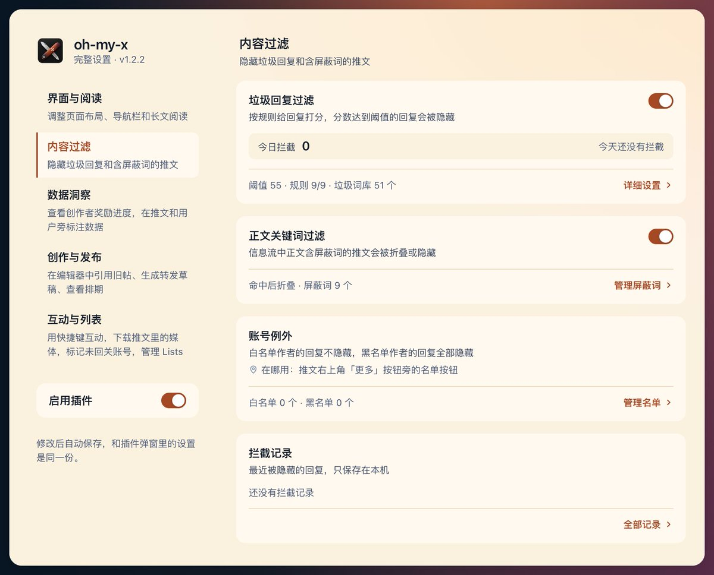

### 01 界面与阅读

1）时间线宽度调节

支持将主时间线宽度在 600px 至 800px 范围内滑动调整。也就是下图箭头的长度能够调整。大屏上，我调到 700 还是挺舒适的。

2）干扰模块显隐控制

允许独立控制页面右侧边栏和发帖按钮的显隐状态，对应插件里的「隐藏右侧边栏」和「隐藏发帖按钮」两个开关，打开即隐藏。开启隐藏后，页面右侧的搜索、推荐和热搜趋势栏将被移除，左侧发帖按钮也可隐藏，以减少视觉干扰。

发帖是我的高频操作，右侧边栏的搜索我也偶尔用到，并且我外接了较大显示器，所以这两个我都没隐藏过。如果你用小屏，可以考虑隐藏这两部分增加可视化范围内的有用信息。X 发帖有快捷键 N（用习惯了效率更高），搜索可以用左侧「探索」替代。下面是隐藏后的效果，确实清爽。

3）导航栏配置与文本标签控制

提供对左侧导航栏各按钮的显隐配置，覆盖探索、通知、聊天、Grok、Premium、历史、文章、个人资料、更多、X Money 共 10 个入口。被 X 收进「更多」菜单的入口，隐藏后在菜单里也会一起隐藏。如下图所示，设置完成后，图中❶和❷完全对应。

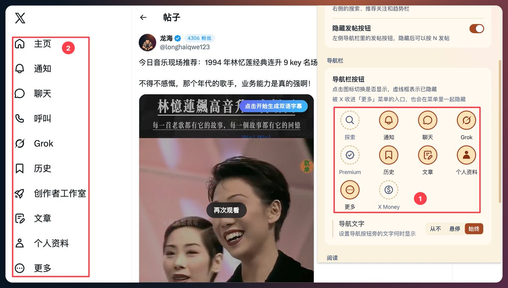

同时支持设置导航文本的展现方式，包括从不显示、鼠标悬停时显示以及始终显示。

4）长文悬浮目录

在长推文、长文章阅读视图以及写作编辑器中，扩展自动提取文章大标题（H1）与副标题（H2），兼容 Markdown 语法、阿拉伯数字、中文大纲序号及全段加粗等标题形态，在页面侧边生成悬浮目录，支持点击平滑滚动跳转至对应章节。

### 02 噪音过滤

1）垃圾回复过滤

当单条评论的累计危险分达到或超过设定阈值（默认 55 分，支持在 20 至 150 区间调节）时，该条评论会被自动隐藏。

检测规则包含营销昵称、Emoji 占比、评论过短、随机用户名、垃圾词库、纯 Emoji 评论、装饰昵称、重复字符以及矩阵引流共 9 项，每项规则均可单独启闭。

其中垃圾词库同样支持维护和管理。

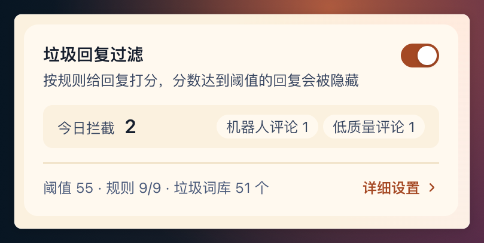

在推文评论区提供一键提取关键词功能，可快速将评论内容或昵称中的词段追加到本地词库。

2）推文正文过滤

除评论区过滤外，扩展支持对信息流主推文正文进行关键词匹配过滤。

目前最不喜欢的一个词是「暴论」，所以我将它设置成了我的屏蔽词。

对于命中过滤词的推文，系统提供完全隐藏或折叠为占位条两种处置动作。

折叠状态下支持点击展开查看完整推文，并可再次手动收起。

3）账号例外管理

支持基于作者 handle 的白名单与黑名单机制。

白名单作者的评论永不被拦截，黑名单作者的评论将被直接隐藏。

可以在回复区直接将用户拉入白名单或黑名单中。

4）拦截记录

本地数据库保存最近拦截记录，并可以点进入查看拦截详情。

### 03 数据分析

1）创作者奖励追踪

我对这个指标还是挺关注的，毕竟和能否拿到马斯克老师的低保有关。之前想看一下每次都需要点好几次，干脆做到插件中。愿所有看到本文的你，都已满足条件，或者马上满足条件。

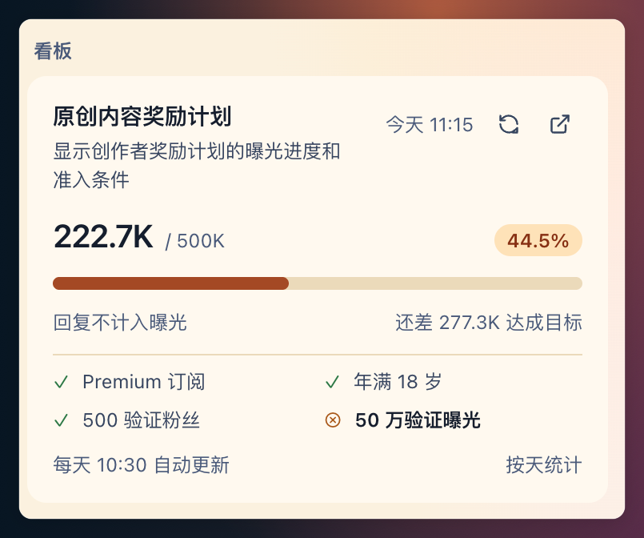

2）博主活动度统计

在博主主页中，可以尝试获取博主的活跃度（包括 7 天内的帖子数和回复数），通过这个数据可以看出博主是偏向单向输出内容，还是高频在评论区参与交流互动。

让我们来看看乔木老师（@vista8）和蜗牛哥（@isnail）的结果。看来乔木老师更偏精品输出创造，互动交流相对偏少。蜗牛哥是勤奋的代表，发帖数量多，互动交流也很多。

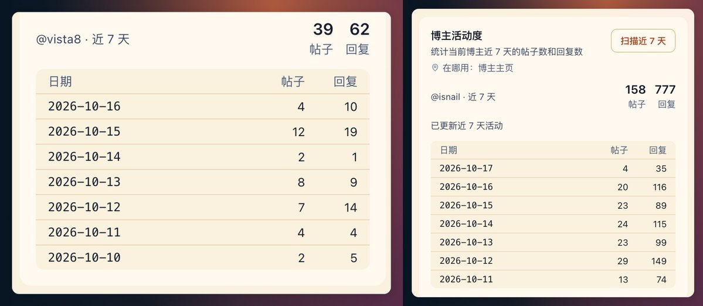

注意，接口对调用频次有限制，如果短时间调用太多次，会有超额提醒。

3）爆款雷达

爆款雷达依据推文的浏览量除以发布时间计算实时流速。

系统预设计算阈值并自动标定为潜力推文或爆款推文，支持以边框高亮、背景高亮或两者叠加的形式在信息流中标识符合条件的推文，辅助识别具备较高扩散速度的内容。

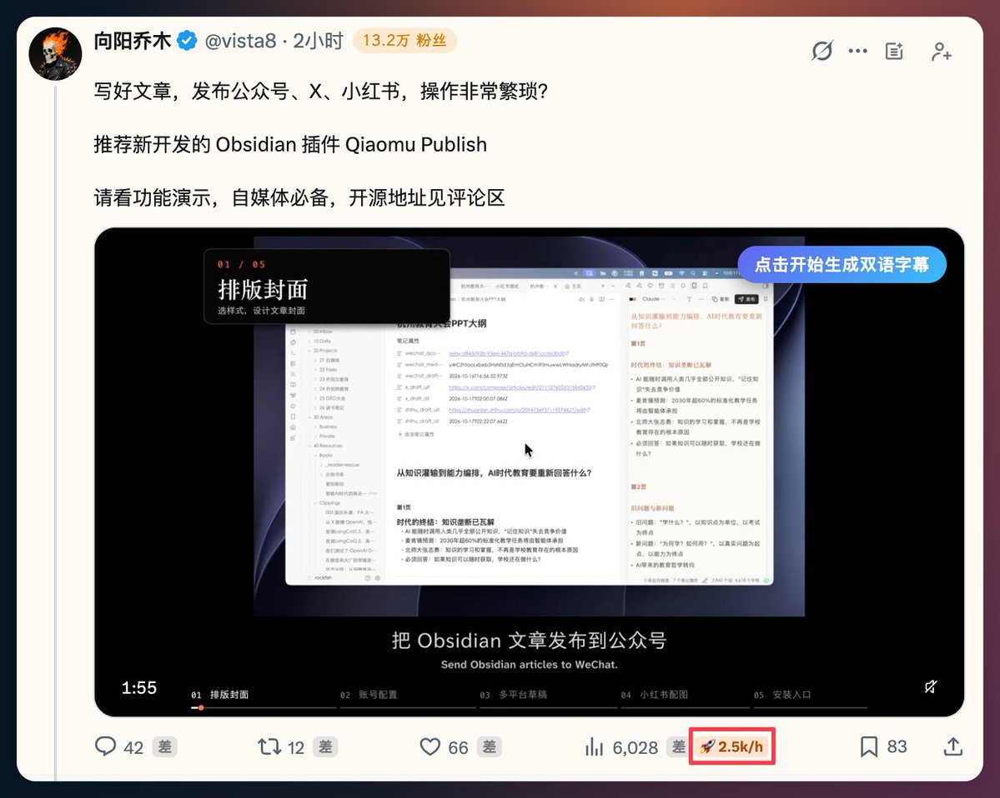

4）数据比例徽章

在浏览博主个人主页时，自动计算并展示推文的曝光比（浏览量与作者粉丝数的比值）和互动比（点赞、转推、回复与书签总量与作者粉丝数的比值）。

以此可以量化推文在其受众群体的传播深度。

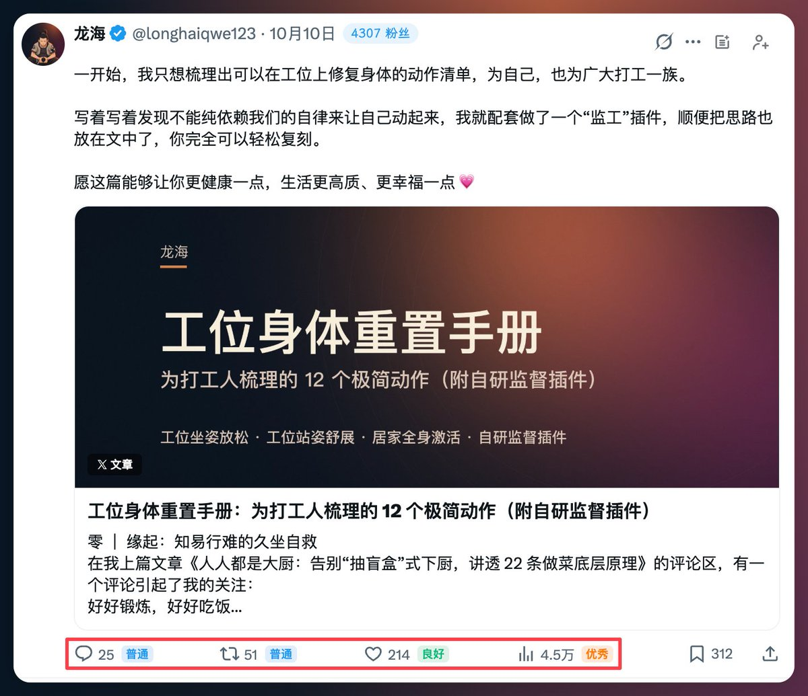

5）用户粉丝数标注

在信息流推文头部作者栏及各类用户列表卡片中，扩展直接标注博主的实际粉丝数，鼠标悬停可查看精确的粉丝与关注数值。

这里可能需要对「全部」和「仅列表」略作解释。

「仅列表」：仅在关注列表、粉丝列表、推荐关注及搜索列表等处出现粉丝数量。

「全部」：会同时处理用户卡片和所有推文头部；无论是主页时间线，还是推文下方的每一条回复者，昵称右侧都会显示其粉丝数徽章。

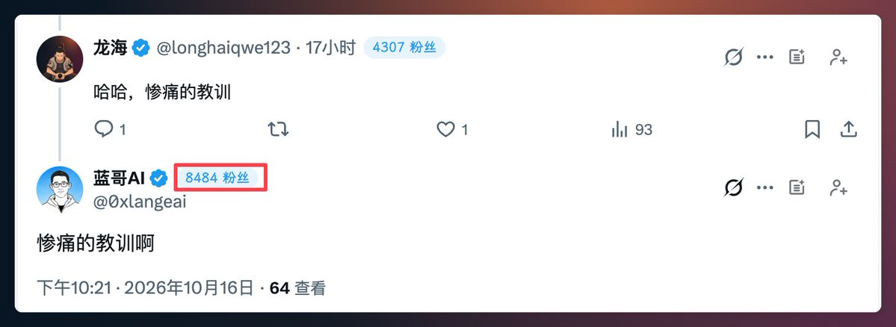

6）展示推文收藏量

现在 X 好像只在进入文章的瞬间展示一下推文的收藏量，然后就马上把这个数值收起来了。

我还是很在意文章收藏量的，毕竟还想看看自己能否在小航哥（@jedeeai）[X 榜单的长文「热门贡献榜」](https://xbangdan.com/articles/)上继续前进呢。

于是我在插件中做了获取推文的收藏数量、并将具体数值直接显示在推文底部的书签操作按钮旁的能力。

### 04 创作辅助

1）发帖时引用我的帖子

使用过程中还有一个痛点，是我要重点强调一下的。那就是每次当我发内容时，想引用我之前的帖子或者长文，都需要去「个人资料」中去找到这个链接，或者通过搜索我的帖子去获取，至少都需要再打开另一个 tab 页。

于是，我新增了在发帖编辑器中（不管是发帖、引用或者回复）提供快捷插入自己帖子或长文 URL 的功能，并且支持定时同步、快速搜索。

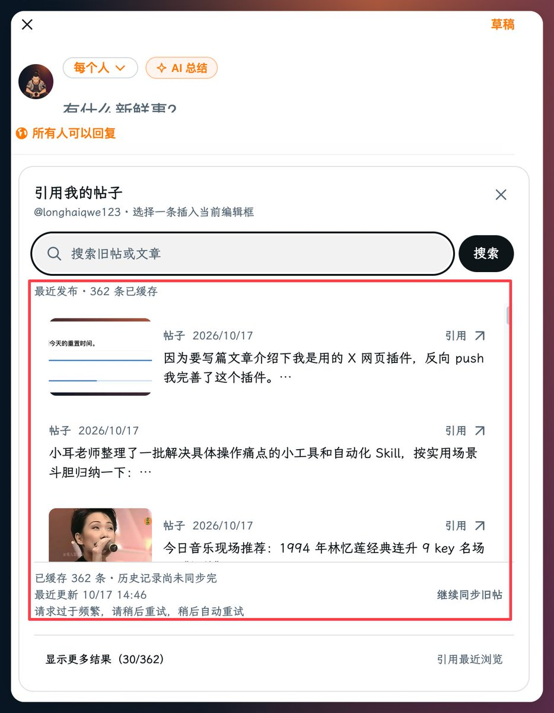

2）AI 总结转发

在用户进行引用转发操作时，可自动获取被引用推文的完整文本，调用模型提炼推文主旨。

一次生成两条转发草稿，选中一条即填充至编辑器中供二次编辑。

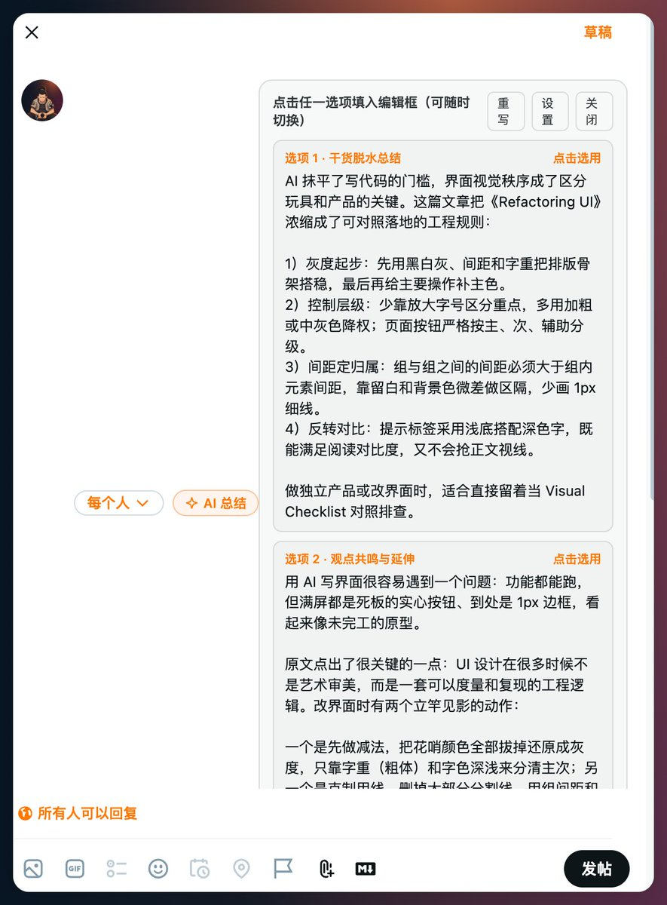

支持接入兼容 OpenAI 接口规范的大语言模型服务。

转发的语言风格可以自己设置：在插件「创作 → AI 总结转发」的「转发风格」里，「风格描述」写一段你想要的风格，「参考样本」贴 2 到 5 条自己写过的转发（每条之间用单独一行 --- 隔开）。两项都不填时，使用默认的平实风格。

3）排期全景分布

支持定时设置弹窗与草稿箱中生成排期全景看板。看板将各个定时推文的时间点换算为相对时间倒计时，并自动计算相邻推文之间的时间间隔。针对小于 2 小时、2 至 8 小时、8 至 24 小时以及大于 24 小时等不同间距分别赋予对应的主题色，并对发帖间隔过密的情况进行提示。

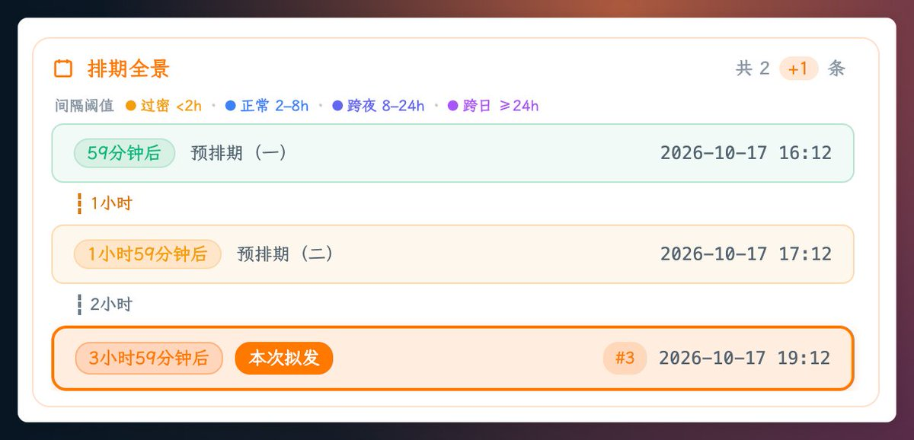

4）本地 markdown 导入文章（非本插件）

这个功能我暂时没有放到我的插件中，因为我使用的是冷酷小猫（@icycat）的[X 长文 Markdown 导入器](https://xmdpaste.icy-cat.com/zh/)，效果实在很好，就没有动力再加个轮子。当然，这个插件需要付费，你完全可以在我的插件上自己新增这个功能。

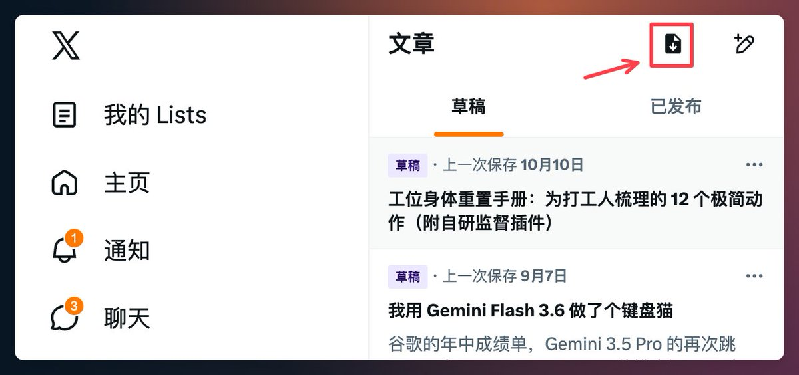

### 05 互动增强

1）快捷互动与按键绑定

在回复区支持使用数字键直接触发互动动作：

- 1 聚焦回复输入框
- 2 触发引用转发
- 3 切换点赞状态
- 4 切换收藏状态

在推文详情页面底部提供悬浮交互工具条，支持显示或者隐藏。

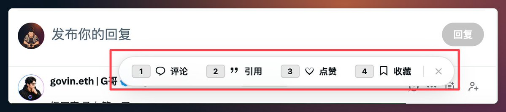

2）直达回复区

这是在长文回复时发现的痛点问题，每次要去看下长文还有哪些评论没有回复，都需要拖动半天。所以在较长的推文或长文章页面右下角，新增了一个直达回复区的悬浮胶囊按钮。

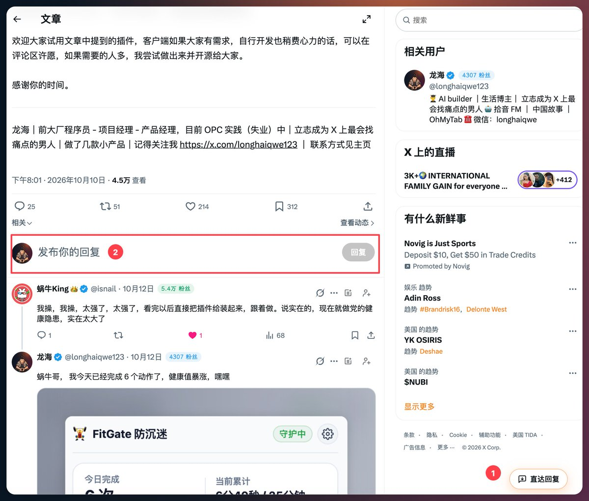

点击后，页面会自动平滑滚动穿过长文正文，直接到达评论区与回复输入框；当页面滚动到评论区时，按钮文字会自动切换为“回到正文”，再次点击即可回到顶部。

若胶囊按钮遮挡了正文内容，可以按住自由拖拽到屏幕任意位置，松开后会自动保存位置。

3）回复自动点赞

开启此项后，当用户在页面上回复他人推文或评论时，扩展在检测到回复提交动作后，会自动对目标推文触发点赞。

系统内置 300 至 700 毫秒的拟人化延迟，并具备点赞状态校验与账号比对逻辑，不会重复点击已赞推文，也不会对当前登录用户自身的内容点赞。

4）媒体资源本地下载

在推文分享菜单中补充媒体资源下载入口，支持将图片、GIF 或视频保存至本地。下载选项的样式和 X 菜单里的其他选项一致；如果是你自己发的视频，X 菜单里已经自带「下载视频」，插件就不再重复添加。

5）未互关标记

在「正在关注」列表页面中，扩展会自动检测并标注（红色加亮）未关注你的用户。

如图中的大佬们，就是我关注了，但是没有回关我的人。如果你在读这篇文章，刚好和这些大佬有链接，帮我引荐一下呀。

6）Lists 快捷管理

引用推文：龙海 (@longhaiqwe123)

@thesavasx 梳理的一套回复与互动的实战系统，教我们通过每天 2 小时的高效回复与互动，在 90 天内将曝光与互动量提升 3 倍，同时彻底避开算法封禁降权的深坑。为了消除语言障碍，我用 AI 整理翻译，并结合自己的真实中文实操补充了避坑细节与修正。 https://t.co/39CaBnhNID

https://x.com/longhaiqwe123/status/2096810516056563908

同时，如果打开了「资料卡加入列表」的功能，就能在用户头像悬浮卡片中直接将用户加入列表，无需点击进入用户主页再完成添加操作。

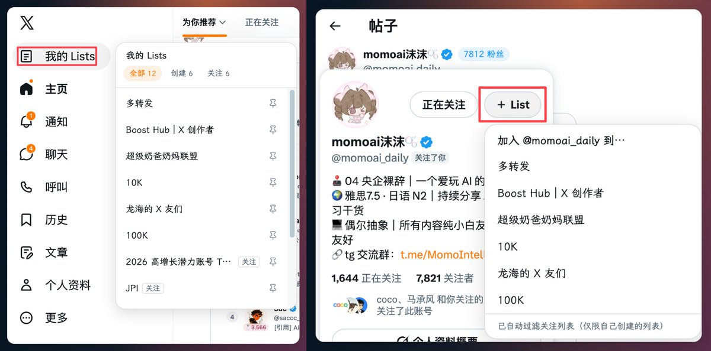

## 写在最后

工欲善其事，必先利其器。希望这篇文章可以让你的 X 创作之旅如虎添翼。

我在 X 上建了一个用户群，如果你懒得再造轮子，可以反馈使用建议，没啥大冲突的话，我都会实现并合入：[https://x.com/i/chat/group_join/g2111364237507670445/ElRmy78U7D。](https://x.com/i/chat/group_join/g2111364237507670445/ElRmy78U7D)

### 获取与安装方式

1）代码仓库：[https://github.com/longhaiqwe/oh-my-x](https://github.com/longhaiqwe/oh-my-x)

2）方式一：通过发行包安装（推荐，无需开发环境）

- 前往 GitHub Releases 页面（https://github.com/longhaiqwe/oh-my-x/releases）下载最新版本的预构建压缩包（如oh-my-x-chrome-mv3.zip）；
- 解压下载的压缩包，得到 chrome-mv3 文件夹；
- 打开 Chrome 或 Edge 浏览器的扩展管理页面（地址栏输入 chrome://extensions），开启右上角的「开发者模式」；
- 点击左上角的「加载已解压的扩展程序」，选择刚才解压出来的 chrome-mv3 文件夹即可完成安装。

3）方式二：从源码构建安装（适合开发者或需要二次修改代码）

- 安装 Node.js 24（自带 npm）；
- 在终端里依次运行构建命令：

git clone https://github.com/longhaiqwe/oh-my-x.git

cd oh-my-x

npm install

npm run build

- 同样在浏览器扩展管理页点击「加载已解压的扩展程序」，选择构建生成的 oh-my-x/build/chrome-mv3 文件夹。

4）方式三：Chrome 应用商店

- 商店版本计划提审，审核通过后将补充一键安装链接。

你在使用 X 的过程中还遇到了什么痛点吗？欢迎评论区讨论交流。

感谢你的时间。

龙海｜前大厂程序员 - 项目经理 - 产品经理，目前 OPC 实践（失业）中｜立志成为 X 上最会找痛点的男人｜做了几款小产品｜记得关注我 [https://x.com/longhaiqwe123](https://x.com/longhaiqwe123) ｜ 联系方式见主页

## 相关页面

- [[sources/kaitox-markdown-to-x-article]]
- [[sources/yuntianming-md2draft-markdown-to-x-draft-extension]]
- [[concepts/open-source-seo-tooling]]
- [[concepts/engineering-skills]]
